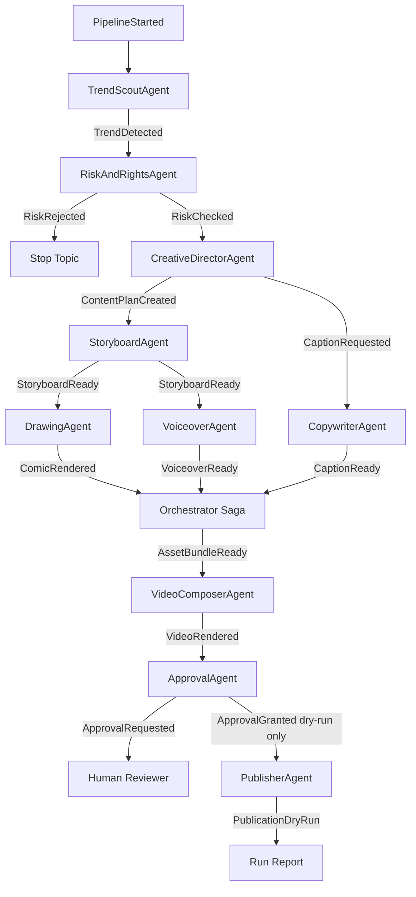

> 历史研究归档 · 2026-11-10 发布 · 发布审核状态：scan_only（发布前程序化隐私扫描）。原有日期、观点、数据和命令保留历史语境，未经本次逐项事实核验或运行复现；见[归档说明](../../../ARCHIVE_POLICY.md)。

# P08 Viral Video Agent Lab

> 一句话概括：这是一个学习用“究极复杂 Agent 系统”原型，把事件驱动、多 Agent、A2A 消息、OpenAI Agents SDK 可选后端、HITL 发布闸门、EDD Eval 集放进同一个短视频生产流水线里。

## TL;DR 速查卡

- **它是什么**：自动监控热榜 → 风险审查 → 创意策划 → 漫画分镜 → 绘画提示词 → 配文 → 配音脚本 → 视频 manifest → 人工审批 → dry-run 发布。
- **它复杂在哪**：不是一个巨型 Prompt，而是 10 个 Agent 通过事件总线和 A2A envelope 协作，每一步都有 JSONL 事件日志。
- **默认安全边界**：不抓真实抖音、不绕验证码、不搬运原视频、不真实发布；所有发布默认 dry-run。
- **SDK 选择**：默认 `mock` 零依赖可跑；`--provider openai` 可把创意/配文 Agent 切到 OpenAI Agents SDK。
- **学习价值**：适合观察“大系统不是一个 Agent 变聪明，而是一堆小 Agent 被协议、事件和闸门管起来”。

## 深度学习文档

如果你想系统学习这个项目为什么这么设计，而不是逐行看代码，优先阅读：P08 事件驱动多 Agent 自媒体系统架构复盘（原稿交叉引用，本归档未解析）。

这篇报告重点解释事件驱动、A2A envelope、Saga 编排、Adapter 隔离、HITL 发布闸门和 EDD Eval 为什么要这样组合。

## 定位透镜：为什么它是“复杂 Agent 系统”

**纵轴：从脚本到平台。** 30 行 Agent 是“单脑袋 + 工具”；这个原型是“事件流 + 多角色 + 状态机 + 审批闸门”。复杂度从 ReAct 循环升级到 Saga 编排。

**横轴：与 LangGraph/CrewAI/纯 SDK 的区别。** LangGraph 强在显式图；CrewAI 强在角色协作；OpenAI Agents SDK 强在 Agent、tool、handoff 和 tracing。本原型故意把“业务级事件总线”放在 SDK 外层：SDK 负责局部智能，事件系统负责全局可控。

**交叉判断。** 如果你要学生产级 Agent，关键不是“让一个 Agent 做所有事”，而是学会：事件契约、A2A 消息、幂等、审计、HITL、失败补偿、Eval Gate。

## 架构图



## A2A 消息契约

每个 Agent 间事件都带一层 A2A-style envelope：

| 字段 | 用途 |
|---|---|
| `trace_id` | 串起同一条任务链路 |
| `conversation_id` | 串起同一次 pipeline run |
| `sender` / `receiver` | 谁对谁说话 |
| `performative` | `inform/request/propose/approve/reject/delegate` |
| `payload` | Agent 可见的结构化内容 |

这比“函数直接调函数”更啰嗦，但可审计、可回放、可替换成远程 Agent。

## 快速运行

推荐先用 mock 模式，不需要任何 API Key：

```powershell
cd prototypes\P08_viral_video_agent_lab
python -m venv .venv
.\.venv\Scripts\Activate.ps1
python -m pip install -e ".[dev]"
python -m viral_lab.main --provider mock --max-trends 4
python -m pytest
```

预期结果：

- 输出一个 `run_id`
- 生成 `output/<run_id>/event_log.jsonl`
- 生成 `output/<run_id>/run_report.json`
- 至少出现 `PublicationDryRun`
- 风险样例会出现 `RiskRejected`

## 切到 OpenAI Agents SDK

```powershell
cd prototypes\P08_viral_video_agent_lab
python -m pip install -e ".[live,dev]"
$env:OPENAI_API_KEY = "你的 key"
python -m viral_lab.main --provider openai --max-trends 2
```

注意：当前只有创意策划和配文环节会调用 SDK。事件总线、Saga、A2A、发布闸门仍由本地代码控制，这是故意设计：**模型只负责局部推理，系统负责全局治理**。

## 真实自媒体生产模式

如果你要把它用于真实创作，先看 `PRODUCTION_GUIDE.md`。推荐第一阶段命令：

```powershell
python -m pip install -e ".[media,live,dev]"
Copy-Item config\trends.sample.json config\trends.local.json
$env:OPENAI_API_KEY = "你的 key"
python -m viral_lab.main --provider openai --trend-source file --trend-file config\trends.local.json --media-provider openai --video-renderer moviepy --max-trends 1
```

无 API Key 时，也可以生成模板 MP4 验证流程：

```powershell
python -m pip install -e ".[media,dev]"
python -m viral_lab.main --provider mock --trend-source file --trend-file config\trends.sample.json --media-provider template --video-renderer moviepy --max-trends 1
```

产物会在 `output/run_xxx/` 下，包括 `panel_*.png`、`voiceover_*.mp3/.wav`、`video_*.mp4`、`run_report.json` 和 `event_log.jsonl`。

## EDD Eval 集

Eval 文件：`evals/viral_pipeline_eval.yaml`

覆盖 5 个关键行为：

1. dry-run 全链路完成
2. 敏感/隐私热榜被拒绝
3. A2A 消息字段完整
4. 发布前必须人工审批
5. 事件日志可复盘

后续如果你改 Prompt 或 Agent 行为，先跑这些 case，再谈“变好了”。

## 避坑指南

| 坑 | 原因 | 解法 |
|---|---|---|
| 一个超级 Agent 做完所有事 | 无法审计、难复盘、失败点模糊 | 拆成事件 + 小 Agent + Saga 状态 |
| 自动抓平台热榜 | 容易违反平台规则/验证码/授权边界 | 只接官方 API、授权数据源或人工导入 |
| 自动真实发布 | 误发、侵权、舆情风险巨大 | 默认 dry-run，真实发布必须官方 API + HITL |
| 只看最终视频 | 中间过程不可评估 | 保留 `event_log.jsonl` 和每个 artifact |
| 把 SDK 当架构 | SDK 是能力层，不是治理层 | SDK 外层加事件总线、权限、Eval、观测 |

## 成本与 ROI 速算

- mock 模式：零 API 成本，适合学习架构。
- OpenAI 模式：当前只调用 2 类文本 Agent；每个选题约 2-4 次 LLM 调用。
- 真正上生产后成本大头会转移到：图像生成、TTS、视频合成、人工审核、平台分发失败重试。
- ROI 判断：如果只是个人玩具，做到 dry-run 即可；如果要商业化，优先投入合规数据源和发布审批后台，而不是先堆更多 Agent。

## 安全边界

这个原型刻意不实现以下能力：

- 不绕过验证码或平台反爬
- 不搬运真实短视频内容
- 不用真实个人隐私/肖像做梗
- 不默认真实发布
- 不保存或打印任何真实密钥

真实平台接入应使用官方 API、授权账号、明确的内容审核流程和人工审批。

## 后续扩展路线

1. 用 LangGraph 替换本地 Saga，观察显式图编排差异。
2. 给每个 Agent 加独立 mailbox，模拟远程 A2A 服务。
3. 接入真实图像/TTS/视频生成，但保持 dry-run 发布。
4. 增加补偿事件：图片生成失败 → 降级为模板漫画；TTS 失败 → 字幕视频。
5. 接入 `skills/skill-evaluator`，把 YAML Eval 做成自动 Gate。

## 来源

- OpenAI Agents SDK Quickstart — 2026-05-19 获取：`Agent`、`Runner`、function tools、handoffs、tracing、HITL 等能力入口。
- 本仓库已有知识：[R50](../../reports/04-%E5%B7%A5%E7%A8%8B%E5%AE%9E%E8%B7%B5/R50_A2A%E5%8D%8F%E8%AE%AE%E5%85%A5%E9%97%A8%E5%AD%A6%E4%B9%A0%E6%8C%87%E5%8D%97.md) A2A、[R51](../../reports/04-%E5%B7%A5%E7%A8%8B%E5%AE%9E%E8%B7%B5/R51_%E5%A4%9AAgent%E7%BC%96%E6%8E%92%E4%B8%89%E7%A7%8D%E5%AE%9E%E7%8E%B0%E6%96%B9%E5%BC%8F.md) 多 Agent 编排、[R68](../../reports/04-%E5%B7%A5%E7%A8%8B%E5%AE%9E%E8%B7%B5/R68_Agent%E4%BA%A7%E5%93%81%E6%A8%A1%E5%BC%8F%E4%B8%8EHITL%E8%AE%BE%E8%AE%A1.md) HITL、[R70](../../reports/04-%E5%B7%A5%E7%A8%8B%E5%AE%9E%E8%B7%B5/R70_AI-Native%E5%9B%A2%E9%98%9F%E4%B8%8E%E5%B7%A5%E7%A8%8B%E7%AE%A1%E7%90%86.md) EDD、[R80](../../reports/02-%E7%9F%A5%E8%AF%86%E7%AE%A1%E7%90%86%E4%B8%8E%E4%B8%8A%E4%B8%8B%E6%96%87/R80_%E5%A4%9A%E6%A8%A1%E6%80%81%E6%95%B0%E6%8D%AE%E8%BD%AC%E6%96%87%E6%9C%AC%E6%8A%80%E6%9C%AF%E5%85%A8%E6%99%AF%E8%B0%83%E7%A0%94.md) Agentic Skills Framework。
