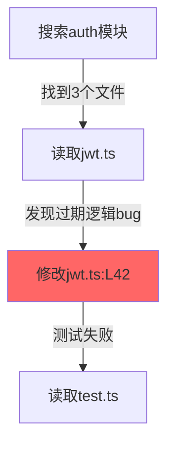

> 历史研究归档 · 2026-11-10 发布 · 程序扫描；未逐篇全文审阅。原有日期、观点、数据和命令保留历史语境，未经本次逐项事实核验或运行复现；请结合[归档说明](../../../ARCHIVE_POLICY.md)阅读。

# TencentDB Agent Memory 速查

> **一句话**：腾讯开源的 Agent 长期记忆库，核心卖点是「Mermaid 符号化压缩 + L0→L3 渐进式披露」，在 SWE-bench 上 Token 省 33%、通过率涨 10%。
> 信息获取日期：2026-05-15 | 仓库版本：v0.3.4 | Stars：1.6k | 语言：TypeScript

---

## 定位透镜

**纵轴 · 从哪来的**：2026-05 由腾讯数据库团队开源，一个月内从 0 到 1.6k Stars。诞生背景是「编码 Agent 做长链任务时上下文爆炸」——跑 50 道 SWE-bench 连续任务，工具日志吃掉绝大多数 Token，Agent 反而看不清任务全貌。生命周期定位：**上升期早期**（版本 0.3.x，迭代极快，3 天一个版本）。

**横轴 · 跟谁竞争**：

| 维度 | TencentDB Agent Memory | Mem0 | agentmemory | Letta(MemGPT) |
|------|----------------------|------|-------------|---------------|
| 设计哲学 | **符号化压缩** + 渐进披露 | 图谱化事实管理 | 认知四层巩固 | 虚拟分页 |
| 短期记忆 | Mermaid Canvas + offload | 无 | Working Memory buffer | 上下文分页 |
| 长期记忆 | L0→L3 金字塔 | 实体-关系图 | Episodic/Semantic/Procedural | 归档检索 |
| 检索 | BM25 + vector + RRF | 图遍历 + 向量 | 向量 + metadata | 向量 |
| 可审计性 | **白盒 drill-down 链** | 部分 | 有 | 差 |
| 本地优先 | SQLite + sqlite-vec | 云服务 | ChromaDB | Postgres |
| 集成方式 | OpenClaw 插件 / Hermes 适配器 | SDK | SDK | 独立服务 |

**交叉判断**：TencentDB 的真正创新不在"分层"本身（R117 已有四层巩固），而在**用 Mermaid 做符号化压缩 + node_id 回溯链**——这是目前唯一一个把结构化图表当"缓存层"的方案，在长链任务场景下效果显著。

---

## 三个值得借鉴的思路

### 思路一：Mermaid Canvas 符号化压缩（最有价值）

**问题**：长任务中工具调用产出大量日志（搜索结果、代码、报错），占满上下文后 Agent 反而"近视"。

**方案**：不做摘要（摘要是有损的），而是把任务状态编码为 Mermaid 流程图：



- 每个节点有 `node_id`，原始日志 offload 到 `refs/{node_id}.md`
- 上下文里只保留 Mermaid 图（几十 token）+ 当前步骤详情
- Agent 需要追溯时，按 `node_id` grep 回原始文本

**为什么比摘要好**：
1. **无损**：原文在 refs/ 里完好无损，随时可恢复
2. **结构化**：Mermaid 天然表达因果关系和时序，比文本摘要信息密度更高
3. **LLM 友好**：主流模型解析 Mermaid 语法的准确率很高
4. **人类可读**：debug 时直接看图就知道 Agent 走到了哪一步

**实测效果**（来源：README benchmark 表）：

| 场景 | 原始 Token | 压缩后 Token | 节省率 | 通过率变化 |
|------|-----------|-------------|--------|-----------|
| WideSearch 连续任务 | 221M | 86M | **-61%** | +52% |
| SWE-bench 50 连续题 | 3474M | 2375M | **-33%** | +10% |
| AA-LCR | 112M | 77M | **-31%** | +8% |

### 思路二：L0→L3 语义金字塔 + Drill-Down 链

**四层结构**：

```
L3 Persona  — 用户画像/长期偏好（persona.md）
L2 Scenario — 场景块（某次调试经验、某个项目上下文）
L1 Atom     — 原子事实（"用户偏好 dark theme"）
L0 Conversation — 原始对话
```

**与 R117 四层巩固的差异**：

| | R117 (认知心理学路线) | TencentDB (工程实用路线) |
|---|---|---|
| 分层依据 | Tulving 记忆分类理论 | 信息粒度 + 使用场景 |
| 层间关系 | 巩固（时间驱动） | **提炼**（LLM 驱动） |
| 核心创新 | 层间流动 + 衰减函数 | **全链路可回溯** |
| 调试性 | 隐式（在向量库里） | **白盒**（Markdown 文件） |

**值得借鉴**：每一层都保留回溯链。L3 Persona → 由哪些 L2 Scenario 生成 → 对应哪些 L1 Atom → 出自哪段 L0 对话。压缩不丢证据链。

### 思路三：异构存储策略——底层数据库，顶层 Markdown

| 层 | 存储介质 | 原因 |
|----|---------|------|
| 底层（L0/L1 + refs） | SQLite + sqlite-vec | 需要 BM25 全文检索 + 向量语义检索 |
| 顶层（L2/L3 + Canvas） | Markdown 文件 | 需要人类直接阅读和编辑、白盒调试 |

**实用意义**：不是所有记忆都适合放进向量库。高频变动的"画像"和"场景摘要"用人类可读的 Markdown 更好维护，底层原始数据用数据库做结构化检索更高效。

---

## 工程亮点速查

| 亮点 | 说明 |
|------|------|
| 零配置启动 | SQLite + sqlite-vec 本地就绪，不依赖外部 API |
| OpenClaw 插件 | 安装即用，自动 capture → extract → recall |
| Hermes 适配器 | Docker 一键部署，支持自定义 LLM endpoint |
| BM25 + vector + RRF | 混合检索（与 R117 描述的 RRF 一致，k=60） |
| context-token-tracker | 实时跟踪上下文 Token 用量 |
| opik-tracer | 可观测性集成 |
| 短期 offload local-llm | v0.3.4 新增本地 LLM 做 offload 摘要 |

---

## 局限与风险

1. **极早期**：v0.3.x，3 个核心贡献者，API 可能频繁 breaking change
2. **强绑定 OpenClaw/Hermes**：虽然有 HostAdapter 抽象，但独立使用门槛高
3. **Mermaid 上限**：当任务超过 ~200 步时，Mermaid 图本身也会膨胀——他们还没公开解法
4. **LLM 依赖**：L0→L1→L2→L3 每层提炼都要调 LLM，长对话的提炼成本不低
5. **PersonaMem 76% 准确率**：虽然比 baseline 48% 进步大，但还有 24% 的画像信息丢失

---

## 对我们工作区的启发

| 启发 | 对应改进 | 优先级 |
|------|---------|--------|
| Mermaid Canvas 做短期记忆压缩 | 在 pattern-topics 的 Recursive Agent Loop 中引入符号化 step tracking | 中 |
| 全链路 drill-down（压缩保留证据链） | 我们的 KNOWLEDGE_INDEX 已有 §五 依赖关系，可借鉴其 node_id 回溯设计 | 低 |
| 异构存储（底层 DB + 顶层 Markdown） | 我们已经在实践（Obsidian Markdown + KNOWLEDGE_INDEX），一致 | — |
| 白盒调试（所有中间产物人可读） | 我们的 sessions/ 日志和 reports/ 已满足，一致 | — |

---

## 来源清单

- [Tencent/TencentDB-Agent-Memory](https://github.com/Tencent/TencentDB-Agent-Memory) — 2026-05-15 — 官方仓库 README + 目录结构
- 模型训练知识 — 仅作背景参考

⚖️ 来源一致性：单一来源（官方仓库），benchmark 数据为自测，待第三方验证
📅 时效性声明：以上信息获取于 2026-05-15
