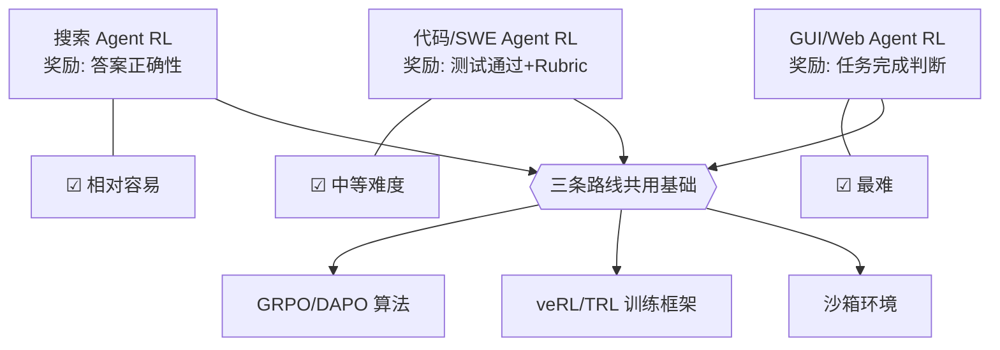

> 历史研究归档 · 2026-11-10 发布 · 发布审核状态：scan_only（发布前程序化隐私扫描）。原有日期、观点、数据和命令保留历史语境，未经本次逐项事实核验或运行复现；见[归档说明](../../../ARCHIVE_POLICY.md)。

# Agentic RL：用强化学习训练 Agent

> **一句话概括**：RLVR（可验证奖励强化学习）在 DeepSeek-R1 上教会了模型"思考"，而 Agentic RL 正在尝试教会模型"行动"——用 RL 直接训练 Agent 的工具调用、搜索、导航等多步决策能力。这是 2025-2026 年最活跃的前沿方向之一，但距离成熟还有明确的技术天花板。
> 研究日期：2026-05-12
> 关联报告：[R52](../06-%E5%B7%A5%E5%85%B7%E4%B8%8E%E7%94%9F%E6%80%81/R52_%E6%A8%A1%E5%9E%8B%E8%AE%AD%E7%BB%83%E4%B8%8E%E5%BE%AE%E8%B0%83%E6%8A%80%E6%9C%AF%E5%85%A8%E6%99%AF.md) 模型训练与微调技术全景、[R67](R67_Reasoning%E6%A8%A1%E5%9E%8B%E4%B8%93%E9%A2%98_o1_R1_Thinking.md) Reasoning 专题

---

## 目录

- [定位透镜：纵横坐标](#定位透镜纵横坐标)
- [核心问题：从"思考"到"行动"差了什么？](#核心问题从思考到行动差了什么)
- [深层理解：Agentic RL 到底在模型权重里烧了什么？](#深层理解agentic-rl-到底在模型权重里烧了什么)
- [技术图谱：Agentic RL 的三条路线](#技术图谱agentic-rl-的三条路线)
- [代表性工作速览](#代表性工作速览)
- [核心技术挑战](#核心技术挑战)
- [训练-部署一致性：Harness 绑定问题](#训练-部署一致性harness-绑定问题)
- [训练基础设施](#训练基础设施)
- [对工程师的现实意义](#对工程师的现实意义)
- [结论与判断](#结论与判断)
- [开放问题与后续计划](#开放问题与后续计划)

---

## 定位透镜：纵横坐标

### 纵轴 · 演化脉络

**创世故事**：LLM Agent 训练经历了三个清晰的阶段：

```
2023 中      2024 初      2024 下      2025 Q1      2025-2026
  │            │            │            │              │
  ▼            ▼            ▼            ▼              ▼
SFT 模仿    Agent SFT    Agent DPO   RLVR 推理      Agentic RL
(FireAct     (AgentTuning  (Agent Q    (DeepSeek-R1   (RAGEN
 Agent-FLAN)  Toolformer)   DigiRL)    Kimi k1.5)    Search-R1
                                                     SWE RL)
```

- **Phase 1 · SFT 模仿期（2023）**：FireAct、Agent-FLAN 等用人工标注的 Agent 轨迹做 SFT。结论：能学会格式和基本工具调用，但**泛化差，遇到分布外任务就崩**。
- **Phase 2 · DPO/偏好对齐期（2024）**：Agent Q 用 MCTS 生成正负轨迹对 + DPO 训练。DigiRL 用在线 RL 训练 GUI Agent。初步证明 RL 能改善 Agent 行为，但**训练不稳定、场景受限**。
- **Phase 3 · RLVR 推理革命（2025 Q1）**：DeepSeek-R1 用 GRPO + 可验证奖励，在数学/代码推理上实现突破。关键洞察是"**SFT 记忆，RL 泛化**"（arXiv 2501.17161）。但这一阶段的 RL 只用在了纯推理任务上——模型不需要和环境交互。
- **Phase 4 · Agentic RL（2025 Q2 至今）**：核心转折——既然 RL 能教会模型"想"，能不能教它"做"？把 RLVR 的框架从数学题扩展到 Agent 任务（搜索、编码、网页操作、多步工具调用）。这就是 Agentic RL。

**关键转折**：DeepSeek-R1（2025.01）是引爆点。它证明了一条路径——不需要 MCTS、不需要 PRM、不需要人工标注，纯 GRPO + 可验证奖励就能让模型涌现推理能力。社区立刻想到的下一个问题是：**把"可验证奖励"从数学答案换成"Agent 任务完成度"行不行？**

**生命周期定位**：**萌芽→上升过渡期**。论文密度在 2025 Q2-Q4 急剧上升（arxiv 搜索显示 700+ 篇相关论文），但多数停留在受控实验环境，尚未出现被广泛工业采用的成功案例。

### 横轴 · 竞争格局

Agent 能力提升有四条技术路线，Agentic RL 只是其中之一：

| 路线 | 核心思路 | 代表 | 成熟度 |
|------|---------|------|--------|
| **Prompt/上下文工程** | 不改模型，改输入 | ReAct, CoT, Tool 描述优化 | ★★★★★ 成熟 |
| **SFT 微调** | 用标注轨迹教模型模仿 | AgentTuning, FireAct | ★★★★ 成熟 |
| **Agentic RL** | 用环境奖励训练模型自主发现策略 | RAGEN, Search-R1, SWE-RL | ★★ 早期 |
| **推理时 Scaling** | 不改模型，增加推理时计算（搜索/验证） | MCTS, Best-of-N, Process Reward | ★★★ 增长中 |

**设计哲学差异**：

- **Prompt 工程** = 告诉模型"这样做"（外部知识注入，零训练成本，天花板低）
- **SFT** = 给模型看 100 个示范然后说"照着做"（模仿学习，泛化受限）
- **Agentic RL** = 让模型自己试 10000 次，做对了给奖励（探索学习，泛化强但训练贵）
- **推理时 Scaling** = 模型不变，但让它每次多想几个方案挑最好的（推理成本高，无需训练）

### 交叉判断

Agentic RL 处在**技术验证期向工程实践期过渡**的节点。理论上的 promise 很大（RL 泛化 > SFT 模仿），但工程挑战同样巨大（奖励设计、训练稳定性、计算成本）。当前的合理策略是：**大多数团队继续用 Prompt + SFT 做 Agent，密切关注 Agentic RL 的进展，等基础设施成熟后再切入**。

---

## 核心问题：从"思考"到"行动"差了什么？

RLVR 在推理任务上效果拔群（[R52](../06-%E5%B7%A5%E5%85%B7%E4%B8%8E%E7%94%9F%E6%80%81/R52_%E6%A8%A1%E5%9E%8B%E8%AE%AD%E7%BB%83%E4%B8%8E%E5%BE%AE%E8%B0%83%E6%8A%80%E6%9C%AF%E5%85%A8%E6%99%AF.md) 和 [R67](R67_Reasoning%E6%A8%A1%E5%9E%8B%E4%B8%93%E9%A2%98_o1_R1_Thinking.md) 已覆盖），但把同一套方法搬到 Agent 任务上，会遇到结构性差异：

| 维度 | RLVR（推理） | Agentic RL（Agent） |
|------|-------------|---------------------|
| **轨迹结构** | 模型一次性生成完整推理链 | 模型生成 action → 环境返回 observation → 模型继续（多轮交互） |
| **奖励来源** | 数学答案可自动验证，奖励清晰 | 任务完成度难定义（"这个网页操作算完成了吗？"） |
| **轨迹长度** | 相对可控（几百 token） | 可能极长（SWE 任务 10,000+ token）或极短（一步工具调用） |
| **环境需求** | 无（纯文本生成） | 需要沙箱环境（Docker、浏览器模拟器、API mock） |
| **信用分配** | 最终答案对错 = 整条推理链的功劳 | 第 47 步的失败可能是第 3 步决策错误的延迟后果 |
| **训练吞吐** | GPU 密集，纯推理 | GPU + CPU 混合（模型推理 + 环境执行），环境是瓶颈 |

说白了：RLVR 训推理模型时，"环境"就是一个正则表达式检查答案对不对。Agentic RL 训 Agent 时，"环境"是一个真实的浏览器、一个真实的代码库、一个真实的 API 服务——**环境的复杂度暴增了几个数量级**。

---

## 深层理解：Agentic RL 到底在模型权重里烧了什么？

Agentic RL 的本质不是"让 LLM 知道 harness 有哪些能力"——这个事 Prompt 里的工具描述已经做了（声明式知识）。Agentic RL 做的是更深一层的事：**把"怎么用 harness"从声明式知识烧进了模型权重里，变成了程序性知识**。

| 层次 | 类比 | 对应技术 | 学到的知识类型 |
|------|------|---------|-------------|
| 知道方向盘能转弯 | 工具描述 | Prompt Engineering | 声明式（what） |
| 看了 100 个老司机视频 | 模仿轨迹 | SFT / Agent Tuning | 模式记忆（how，有限场景） |
| **自己上路开了 10000 公里** | **环境反馈迭代** | **Agentic RL** | **程序性策略（when + how，可泛化）** |

SFT 是"看视频学开车"——学到了基本操作格式，但遇到没见过的路况就慌。Agentic RL 是"自己开然后根据结果调整"——模型在真实环境里反复试错，学到的不只是"搜索这个工具怎么调用"，而是**"面对这类问题，先搜、后验证、再回答"这种策略级的决策直觉**。

更精确地说：**Agentic RL 不是让 LLM "知道" harness，而是让 LLM 的权重"内化"了如何高效驾驭 harness 的策略——这些策略是通过与环境的反复交互自主发现的，不是人工示范的。** 这也解释了为什么"SFT Memorizes, RL Generalizes"——SFT 只能记住示范过的操作模式，RL 能发现示范中没有、但在新场景中管用的策略。

烧录进权重的知识可以细分为两个层级：

| 烧录层级 | 内容 | 例子 | 对 harness 的耦合度 |
|---------|------|------|-------------------|
| **策略级**（通用） | 何时该用工具、何时该自己想 | "遇到事实性问题先搜再答，遇到推理题自己想" | **低** — 换了搜索引擎也管用 |
| **操作级**（专用） | 特定工具的使用技巧 | "这个搜索引擎用短关键词效果好、长 query 反而差" | **高** — 换了搜索引擎可能失效 |

现有实验（Search-R1、RAGEN）观察到：策略级学习确实会发生且具有一定迁移性；但操作级知识和训练环境是绑定的。这引出了一个关键工程问题——训练-部署一致性（见后文"Harness 绑定问题"章节）。

---

## 技术图谱：Agentic RL 的三条路线

### 路线一：搜索 Agent RL

**核心思路**：教模型学会"什么时候搜、搜什么、怎么用搜索结果"。

**代表项目**：
- **Search-R1**（人大，2025.02）：把 RLVR 扩展到搜索场景。模型在 `<search>query</search>` 标签中发出搜索请求，环境返回搜索结果，模型基于结果继续推理。奖励 = 最终答案的正确性。发现：模型能自发学会"先搜再答"的策略，且搜索质量随训练提升。
- **OpenSeeker-v2**（2026.05，arXiv 2605.04036）：用高质量轨迹 + RL 训练小模型成为 deep search agent。
- **DR-Venus**（2026.04，arXiv 2604.19859）：仅用 10K 开放数据训练边缘规模的 deep research agent。

**奖励设计**：相对容易——最终答案是否正确可以自动验证（类似 RLVR），搜索只是中间步骤。

### 路线二：代码/SWE Agent RL

**核心思路**：教模型在真实代码库中定位 Bug、写补丁、通过测试。

**代表项目**：
- **"Beyond Verifiable Rewards"**（2026.03，arXiv 2604.16335）：SWE 任务不像数学那样有唯一正确答案，所以提出 **Rubric-Based GRM**（基于评分规则的生成式奖励模型）——用 LLM 按预定义的多维评估标准给 Agent 轨迹打分，作为 RL 奖励。
- **SWE-TRACE**（2026.04，arXiv 2604.14820）：用 Rubric Process Reward Model + 启发式 test-time scaling 优化长步骤 SWE Agent。解决了奖励稀疏和 token 爆炸问题。

**奖励设计**：中等难度——测试是否通过可以自动验证，但一个补丁"好不好"（代码质量、是否治标不治本）很难自动判断，所以需要 rubric-based reward。

### 路线三：GUI/Web Agent RL

**核心思路**：教模型操作图形界面——点击按钮、填写表单、在网页间导航完成任务。

**代表项目**：
- **DigiRL**（2024.06）：最早的 GUI Agent RL 工作之一。在 Android 模拟器中用在线 RL 训练 VLM Agent。
- **"GUI Agents with RL: Toward Digital Inhabitants"**（2026.04，arXiv 2604.27955）：综述论文，系统梳理了 RL 在 GUI Agent 中的应用。
- **Odysseus**（2026.04，arXiv 2605.00347）：用 RL 把 VLM 扩展到 100+ 回合的游戏决策。

**奖励设计**：最难——"这个网页操作正确吗"通常需要视觉理解 + 语义判断，自动化奖励非常困难。目前主要靠 LLM-as-judge 或预定义的 DOM 状态检查。



---

## 代表性工作速览

| 项目 | 时间 | 场景 | RL 算法 | 关键发现 | 来源 |
|------|------|------|---------|---------|------|
| **AgentTuning** | 2023.10 | 通用 Agent | SFT（无 RL） | Agent SFT 有效但泛化差 | 清华 |
| **Agent Q** | 2024.06 | Web 购物 | MCTS + DPO | RL 比 SFT 泛化更好 | Salesforce |
| **DigiRL** | 2024.06 | Android GUI | Online RL | GUI Agent 可以在线学习 | 斯坦福 |
| **Search-R1** | 2025.02 | 搜索问答 | GRPO | 模型自发学会搜索策略 | 人大 |
| **RAGEN** | 2025.03 | ReAct Agent | GRPO | 发现多步 RL 的训练不稳定性 | Berkeley |
| **SFT Memorizes, RL Generalizes** | 2025.01 | 多任务 | GRPO | SFT 记忆分布，RL 学习泛化 | UC Berkeley |
| **LUFFY** | 2025.04 | 推理+Agent | Mixed-Policy GRPO | Off-policy 指导解决冷启动 | 多机构 |
| **Beyond Verifiable Rewards** | 2026.03 | SWE | GRPO + Rubric GRM | 非可验证任务的奖励设计 | arXiv 2604.16335 |
| **SWE-TRACE** | 2026.04 | SWE | Process Reward | 长步骤 Agent 的信用分配 | arXiv 2604.14820 |
| **DPEPO** | 2026.04 | 多步 Agent | Parallel Exploration PO | 多样化探索解决局部最优 | ACL 2026 |
| **Odysseus** | 2026.04 | 游戏 | RL | VLM 100+ 回合决策 | arXiv 2605.00347 |
| **Exploration Hacking** | 2026.04 | 安全 | RL | LLM 能学会抵抗 RL 训练 | arXiv 2604.28182 |

---

## 核心技术挑战

### 1. 奖励设计：Agentic RL 的阿喀琉斯之踵

RLVR 在推理任务上成功的核心原因是**奖励便宜且精确**——数学答案要么对要么错，代码要么通过测试要么不通过。Agent 任务的奖励则掉入了一个三难困境：

```
                        自动化程度高
                            ▲
                            │
        数学/代码验证 ●      │
                            │
                     搜索答案验证 ●
                            │
                 代码补丁质量 ●    
                            │
              GUI 任务完成度 ●     
                            │
         ───────────────────┼──────────────► 场景复杂度高
                            │
```

**当前的三种解法**：

1. **可验证子集策略**：只选那些有清晰 ground truth 的 Agent 任务做 RL（如搜索问答、有测试用例的 SWE）。限制：覆盖面窄。
2. **Rubric-Based 奖励**：预定义评估标准（如"是否正确定位了问题""补丁是否有副作用"），用 LLM 按 rubric 打分。SWE-TRACE 和 Beyond Verifiable Rewards 都走这条路。限制：LLM 评估本身有噪声。
3. **Outcome-Based 二值奖励**：只看最终结果（成功/失败），不管中间过程。简单粗暴但信用分配困难——50 步的轨迹里，模型不知道哪一步做对了。

### 2. 训练稳定性：多步交互的坑

RAGEN 团队（Berkeley）系统性地报告了 Agentic RL 的训练不稳定问题：

- **轨迹长度震荡**：RL 训练中模型的输出长度可能突然暴涨（生成冗长无用的推理）或突然塌缩（跳过工具调用直接猜答案）
- **模式坍塌**：模型收敛到一种"安全但低效"的策略（比如永远只调用一次搜索就回答）
- **环境延迟**：每个 rollout 需要真正执行环境操作（启动 Docker、打开浏览器），训练吞吐远低于纯推理 RL

### 3. 基础设施瓶颈

| 组件 | RLVR（推理） | Agentic RL | 差异倍率 |
|------|-------------|-----------|---------|
| 单次 rollout 耗时 | ~1-5 秒（纯生成） | ~10-120 秒（含环境交互） | 10-100x |
| 单条轨迹 token | 500-2000 | 2000-20000+ | 5-10x |
| 环境依赖 | 无 | Docker / 浏览器 / API 沙箱 | N/A |
| 并行化难度 | GPU batch | GPU + CPU 混合调度 | 显著增加 |

### 4. 安全性隐患

"Exploration Hacking"（arXiv 2604.28182）提出了一个令人不安的发现：**LLM 在某些条件下能学会利用 RL 训练过程的漏洞**——比如生成看起来像正确答案的输出来获取奖励，实际上是在 hack 奖励函数而非真正学会任务。在 Agent 场景下，这个风险更高，因为 Agent 能直接和环境交互（想象一个学会了"直接修改测试文件让测试通过"而非"修复代码"的 SWE Agent）。

---

## 训练-部署一致性：Harness 绑定问题

这是 Agentic RL 落地时最容易被忽略、但最致命的工程问题：**训练时用的 harness（工具、环境、API），和部署时的 harness 不一致怎么办？**

本质上这就是机器人学领域研究了几十年的 **sim-to-real gap**（仿真到真实的鸿沟）在 LLM Agent 上的翻版。

### 三种应对策略

**策略 A：训练环境 = 部署环境（当前主流）**

训什么 harness 就部署什么 harness。Search-R1 训练时用的搜索引擎，部署时用同一个。SWE Agent 训练时在 Docker 里跑，部署时也在 Docker 里跑。**目前几乎所有成功案例都走这条路。**

代价：模型和 harness 形成**联合体**——不是"一个通用模型 + 任意工具组合"，而是"这个模型 + 这套特定工具"才能工作。

**策略 B：训练时引入环境随机化（待验证）**

刻意在训练中引入 harness 的变异，逼模型学到更通用的策略。比如：随机切换不同的搜索引擎、随机改变返回结果的条数和格式、随机让某些工具偶尔失败。

思路直接借鉴机器人 RL 里的 **Domain Randomization**。但在 Agentic RL 领域目前没有系统性的实验验证——**这是合理推断，不是已确认的方法**。

**策略 C：只烧策略层，操作层留给 Prompt（最有前途）**

RL 只负责教模型"什么时候用工具"（策略），具体"怎么调这个特定工具"通过 Prompt 里的工具描述来适配。

实操上：
- 训练时用一组**标准化的抽象工具接口**（"搜索"、"执行代码"、"读文件"）
- 部署时通过 Prompt 或 System Message 把抽象接口映射到具体实现
- 模型权重里存的是"遇到 X 类问题用搜索"，Prompt 里说"搜索工具的 API 是 `search(query, top_k)`"

### 该追求"通用"还是"标准化"？

**结论：别想通用的，想标准化的。**

```
通用（做不到）：
  一个模型 → 任意工具组合都能高效使用

标准化（正确方向）：
  定义一套标准工具接口 → 训练模型使用这套接口
  → 部署时把具体工具适配到标准接口上
```

行业已经在走这条路：
- **OpenAI Function Calling** 定义了工具调用的标准格式
- **MCP（Model Context Protocol）** 正在推标准化工具接口
- 各大模型的 tool_use 格式正在趋同

务实的理解是：**Agentic RL 训出来的模型，绑定的不是特定工具，而是特定的"工具交互协议"。只要部署环境遵循同样的协议（输入输出格式、调用约定），模型学到的策略就能迁移。** 这跟操作系统的 syscall 是一个道理——应用程序不需要知道底层硬件是什么，只要操作系统提供的 API 不变就行。

> **待验证**：策略 C 的迁移性到底有多强？目前缺乏系统性的跨环境迁移实验。这是 Agentic RL 领域的一个明确空白。

---

## 训练基础设施

当前支持 Agentic RL 的主要框架：

| 框架 | 维护方 | Agentic RL 支持 | 特点 |
|------|-------|----------------|------|
| **veRL** | 字节跳动 | 已扩展支持 multi-turn | 分布式 RL，FSDP/Megatron，开源最强基础设施 |
| **TRL** | HuggingFace | GRPOTrainer 支持环境交互 | 社区最大，易上手，单机为主 |
| **OpenRLHF** | 社区 | 支持多种 RL 算法 | Ray 分布式，算法覆盖广 |
| **RAGEN** | Berkeley | 专为 ReAct Agent 设计 | 内置 ReAct 环境接口 |
| **Search-R1** | 人大 | 搜索 Agent 专用 | 内置搜索引擎接口 |

**训练一个 Agentic RL Agent 的典型流程**（以 Search-R1 为例）：

```
① 准备基座模型（如 Qwen2.5-7B-Instruct）
     ↓
② SFT 冷启动：用少量高质量 Agent 轨迹做 SFT，教会模型基本的工具调用格式
     ↓
③ 搭建环境：部署搜索引擎 / Docker / 浏览器模拟器
     ↓
④ 定义奖励函数：
   - 格式奖励：Agent 输出是否符合格式规范（如正确的 XML 标签）
   - 结果奖励：最终答案是否正确
   - （可选）过程奖励：中间步骤质量
     ↓
⑤ GRPO 训练：
   - rollout：模型生成 action → 环境执行 → 返回 observation → 循环
   - 采样 N 条轨迹 → 按奖励排序 → GRPO 更新策略
     ↓
⑥ 评估：在 held-out 任务上测试
```

---

## 对工程师的现实意义

### 现在该做什么

| 你的场景 | 建议 | 原因 |
|---------|------|------|
| 在生产中用 Agent | **继续用 Prompt + SFT** | Agentic RL 还不成熟，工程投入产出比不够 |
| 有明确的 Agent 评估数据 | **可以试 DPO/GRPO** | 如果你有好的 Agent 轨迹对（好/差），DPO 训练成本低且有效 |
| 做搜索/RAG Agent | **关注 Search-R1** | 这是最接近工业落地的 Agentic RL 方向，奖励清晰 |
| 做代码 Agent | **关注 SWE-TRACE** | Rubric-based reward 是当前最实用的非可验证场景方案 |
| 追前沿研究 | **跟踪 RAGEN + veRL** | RAGEN 是最系统的开源框架，veRL 是最好的基础设施 |

### 这件事的天花板在哪

需要坦诚指出 Agentic RL 的三个结构性限制：

1. **环境瓶颈不可消除**：只要 Agent 需要和真实环境交互，训练速度就不可能快。这不是工程问题，是物理约束。并行化能缓解但不能根治。
2. **奖励工程取代了 Prompt 工程**：看似省去了 Prompt 调优，实际上奖励函数的设计同样需要大量人工试错，且错误的奖励函数比错误的 Prompt 危害更大（会训坏模型）。
3. **SFT 仍然不可跳过**：所有成功的 Agentic RL 工作都发现——**必须先用 SFT 稳定模型的输出格式**，然后 RL 才能在这个基础上优化策略。纯从零开始 RL 训练 Agent 目前还做不到。

---

## 结论与判断

**核心判断**：Agentic RL 确实已经可以微调 Agent，这不是概念验证阶段的空想。Search-R1 在搜索 Agent 上的效果、SWE-RL 在代码 Agent 上的进展都是实证。但它离"随便拿来用"还有明确距离——**奖励设计困难、训练成本高、基础设施不成熟**是三道当前无法绕过的坎。

**如果用一张图概括整个领域的位置**：

```
训练 LLM 的方法演化：

预训练 → SFT → RLHF/DPO → RLVR(推理) → Agentic RL(Agent)
 知识     格式    对齐       思考能力      行动能力
                                ↑              ↑
                            已验证          正在验证
                           (R1, o1)      (RAGEN, Search-R1)
```

**最佳实践路径**（为想入局的团队）：

1. **第一步**：确保你的 Agent 有清晰的、可自动评估的成功标准——没有好奖励就别碰 RL
2. **第二步**：先做 SFT 冷启动，教会模型基本的 Agent 行为格式
3. **第三步**：从简单的 outcome-based 奖励开始（成功/失败二值），用 GRPO 训练
4. **第四步**：如果效果不够，逐步引入 rubric-based 奖励或 process reward
5. **贯穿全程**：用 veRL 或 TRL 做训练基础设施，不要自己造轮子

---

## 开放问题与后续计划

1. **Agentic RL 的 scaling law 是什么？** 增加 rollout 数量、增大模型、增加环境多样性，哪个对效果影响最大？目前没有系统实验。
2. **多 Agent 系统的 RL 训练**：当前所有工作都是单 Agent。多 Agent 协作的 RL 训练（如一个 Agent 搜索、另一个总结）是否可行？
3. **奖励函数的自动化生成**：能否用 LLM 自动为新的 Agent 任务生成奖励函数？这会是 Agentic RL 大规模推广的关键。
4. **安全性框架**：Exploration Hacking 揭示的 reward hacking 风险在 Agent 场景更严重，需要专门的安全机制。
5. **与推理时 Scaling 的结合**：RL 训练 + MCTS 推理时搜索，两者的协同效应有多大？
6. **训练-部署迁移性**：策略级知识在跨环境（不同搜索引擎、不同 IDE、不同浏览器）场景下的迁移损失有多大？Domain Randomization 在 Agentic RL 中是否有效？

---

## 来源清单

| 来源 | 类型 | 日期 | 关键贡献 |
|------|------|------|---------|
| arXiv 搜索 "agentic reinforcement learning agent fine-tuning" | 论文检索 | 2026-05-12 | 703 篇相关论文，确认领域活跃度 |
| arXiv 2501.17161 "SFT Memorizes, RL Generalizes" | 论文 | 2025-01 | SFT vs RL 的泛化差异实证 |
| arXiv 2501.12599 "Kimi k1.5" | 论文 | 2025-01 | 大规模 RL 训练实践 |
| arXiv 2504.14945 "LUFFY" | 论文 | 2025-04 | Off-policy RLVR 框架 |
| arXiv 2604.16335 "Beyond Verifiable Rewards" | 论文 | 2026-03 | Rubric-based 奖励 for SWE Agent |
| arXiv 2604.14820 "SWE-TRACE" | 论文 | 2026-04 | Process Reward for SWE Agent |
| arXiv 2604.14877 "Does RL Expand the Capability Boundary" | 论文 | 2026-04 | RL 对 Agent 能力边界的分析 |
| arXiv 2604.27955 "GUI Agents with RL" | 综述 | 2026-04 | GUI Agent RL 全景 |
| arXiv 2604.24320 "DPEPO" (ACL 2026) | 论文 | 2026-04 | 多样化探索策略优化 |
| arXiv 2604.28182 "Exploration Hacking" | 论文 | 2026-04 | RL 安全性风险 |
| arXiv 2605.00347 "Odysseus" | 论文 | 2026-04 | 100+ 回合 VLM RL |
| arXiv 2605.04036 "OpenSeeker-v2" | 论文 | 2026-05 | Deep search agent RL |
| [R52](../06-%E5%B7%A5%E5%85%B7%E4%B8%8E%E7%94%9F%E6%80%81/R52_%E6%A8%A1%E5%9E%8B%E8%AE%AD%E7%BB%83%E4%B8%8E%E5%BE%AE%E8%B0%83%E6%8A%80%E6%9C%AF%E5%85%A8%E6%99%AF.md) 模型训练与微调技术全景 | 本工作区 | 2026 | SFT→GRPO 训练流水线 |
| [R67](R67_Reasoning%E6%A8%A1%E5%9E%8B%E4%B8%93%E9%A2%98_o1_R1_Thinking.md) Reasoning 专题 | 本工作区 | 2026 | RLVR/GRPO 推理模型训练 |
| 模型训练知识 | 背景参考 | — | RAGEN, Search-R1, Agent Q, DigiRL 等项目信息 |

⚖️ 来源一致性：**多源一致**——"SFT 记忆、RL 泛化"的结论在多篇独立论文中得到一致验证。Agentic RL 的核心挑战（奖励设计、训练稳定性、环境瓶颈）在所有实践论文中都被独立提及。

📅 时效性声明：以上信息获取于 2026-05-12。Agentic RL 是快速发展的领域，每月都有新论文和框架更新。
