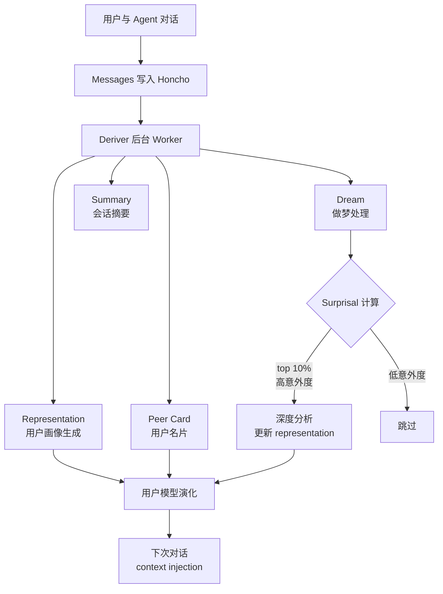

> 历史研究归档 · 2026-11-10 发布 · 程序扫描；未逐篇全文审阅。原有日期、观点、数据和命令保留历史语境，未经本次逐项事实核验或运行复现；请结合[归档说明](../../../ARCHIVE_POLICY.md)阅读。

# Agent Dreaming：当 AI 学会做梦

> **一句话概括**：Agent Dreaming 是一种让 AI 在非交互时段（后台/离线）主动整理记忆、发现认知盲区、更新用户模型的机制——本质上是**异步记忆巩固**，Honcho/Hermes 是当前唯一的生产级开源实现，学术界则从 RL world model 和 Jung 心理学两个方向同步探索。
> 研究日期：2026-05-12
> 关联报告：[R34_HermesAgent开源自学习智能体](../06-%E5%B7%A5%E5%85%B7%E4%B8%8E%E7%94%9F%E6%80%81/R34_HermesAgent%E5%BC%80%E6%BA%90%E8%87%AA%E5%AD%A6%E4%B9%A0%E6%99%BA%E8%83%BD%E4%BD%93.md) · [R35_HermesAgent记忆与Skill自迭代源码拆解](../06-%E5%B7%A5%E5%85%B7%E4%B8%8E%E7%94%9F%E6%80%81/R35_HermesAgent%E8%AE%B0%E5%BF%86%E4%B8%8ESkill%E8%87%AA%E8%BF%AD%E4%BB%A3%E6%BA%90%E7%A0%81%E6%8B%86%E8%A7%A3.md) · [R72_Agent记忆系统横评](../02-%E7%9F%A5%E8%AF%86%E7%AE%A1%E7%90%86%E4%B8%8E%E4%B8%8A%E4%B8%8B%E6%96%87/R72_Agent%E8%AE%B0%E5%BF%86%E7%B3%BB%E7%BB%9F%E6%A8%AA%E8%AF%84.md) · [R78_手搓Agent记忆系统_从0到330行渐进式实现](../02-%E7%9F%A5%E8%AF%86%E7%AE%A1%E7%90%86%E4%B8%8E%E4%B8%8A%E4%B8%8B%E6%96%87/R78_%E6%89%8B%E6%90%93Agent%E8%AE%B0%E5%BF%86%E7%B3%BB%E7%BB%9F_%E4%BB%8E0%E5%88%B0330%E8%A1%8C%E6%B8%90%E8%BF%9B%E5%BC%8F%E5%AE%9E%E7%8E%B0.md)

---

## 目录

- [定位透镜](#定位透镜)
- [什么是 Agent Dreaming](#什么是-agent-dreaming)
- [Honcho 的 Dream 系统：生产级实现](#honcho-的-dream-系统生产级实现)
- [Hermes 的 Background Review：轻量版"做梦"](#hermes-的-background-review轻量版做梦)
- [学术界的 Agent Dreaming 研究](#学术界的-agent-dreaming-研究)
- [为什么这件事重要](#为什么这件事重要)
- [开放问题](#开放问题)
- [来源清单](#来源清单)

---

## 定位透镜

### 纵轴 · 演化脉络

Agent 记忆的演化路径可以这样划分：

1. **无记忆期**（~2023）：每次对话从零开始，上下文窗口就是全部"记忆"
2. **被动记忆期**（2024）：Mem0、Zep 等出现——用户说了什么就记什么，检索靠向量相似度
3. **主动记忆期**（2025）：Hermes 的 nudge 机制、Claude Code 的 auto-memory——Agent 在对话中主动决定存什么
4. **离线整理期**（2025 末~2026）：**这就是 Dreaming**——Agent 在非交互时段后台整理、反思、发现认知盲区

"做梦"的灵感来自认知神经科学：人类睡眠中的 REM 阶段会**重播和巩固白天的记忆**，筛选出"意外"（高 surprisal）的经验重点加工。Honcho 的创始团队 Plastic Labs 明确借用了这个隐喻。

### 横轴 · 竞争格局

| 方案 | 后台记忆整理 | Surprisal 驱动 | 用户模型演化 | 生产可用 |
|------|:-----------:|:-------------:|:-----------:|:-------:|
| **Honcho Dream** | ✅ 异步 deriver | ✅ top 10% surprisal | ✅ representation + peer card | ✅ |
| **Hermes Background Review** | ✅ daemon thread | ❌ | ❌ 基于 nudge 规则 | ✅ |
| Letta (MemGPT) | ❌ | ❌ | 部分（inner monologue） | ✅ |
| Mem0 | ❌ | ❌ | ❌ | ✅ |
| LangMem | ❌ | ❌ | ❌ | ✅ |
| 学术方案（DECKARD/DynaWeb） | ✅ 仿真 rollout | ❌ | ❌ | ❌ 仅实验 |

### 交叉判断

**Honcho 是当前唯一将 "Agent 做梦" 做到生产级、且有信息论基础（surprisal）的开源系统。** Hermes 作为 Honcho 的主要集成方，同时自带一套更轻量的 background review 机制。学术界的探索集中在 RL world model 方向，和 Honcho 走的"用户认知建模"方向本质上不同——前者让 Agent 在想象中练技能，后者让 Agent 在后台理解人。

---

## 什么是 Agent Dreaming

"Agent 做梦"不是玄学概念，拆开来就三件事：

### 1. 后台异步处理（When）

Agent **不和用户交互的时候**，不是空闲着，而是在后台跑一个处理管线。就像人睡着了大脑没停——海马体在重播白天的经历。

### 2. 记忆巩固与筛选（What）

不是把所有交互历史都过一遍。核心操作是**筛选**：哪些观察值得长期记住？标准不是"用户说了几次"（频率），而是**surprisal（意外度）**——越出乎预料的信息越值得加工。

说白了：如果 Agent 的用户模型预测"这个用户喜欢简洁回复"，但最近一次交互中用户突然要求了一份 500 行的详细报告，这就是高 surprisal 事件——值得"做梦"时重点处理，更新用户模型。

### 3. 主动模型更新（Why）

最终目的是**让 Agent 的用户理解不断进化**，而不是停留在上次对话结束时的状态。传统记忆系统是"你说我记"（被动），做梦是"我自己想想你到底是什么样的人"（主动）。

用一个类比：

| 人类 | Agent |
|------|-------|
| 白天经历事件 | 与用户对话，产生 messages |
| 睡眠时海马体重播 | 后台 deriver 处理 messages |
| REM 阶段整合情绪记忆 | dream 子系统处理高 surprisal 观察 |
| 醒来后"想通了" | 下次对话时 representation 已更新 |

---

## Honcho 的 Dream 系统：生产级实现

### 架构概览

Honcho（Plastic Labs 开发，3.4K Stars，AGPL-3.0）的核心处理管线：



### 技术细节：Deriver + Dream

Honcho 的后台处理由 **deriver** 完成，它是一个独立进程（`python -m src.deriver`），消费消息队列并执行四种任务：

**1. Representation（用户画像）**

Deriver 读取对话消息，提取两类 observations：
- **Explicit**：用户直接陈述的事实（"我是做后端的"、"我用 Rust"）
- **Deductive**：从行为推断的特征（问题的复杂度暗示技术水平、提问方式暗示性格）

这些 observations 被存入向量化的 Collections，用于构建和持续更新用户的 representation。

**2. Dream（做梦）——核心创新**

Dream 系统在 representation 的基础上加入了 **surprisal 驱动的主动学习**：

关键配置参数（从 `config.toml.example` 提取）：

```toml
[dream]
# dream 子系统的配置
# 使用 kNN-based trees 构建表示
TREE_K = 5
SAMPLING_STRATEGY = "recent"  # recent, random, all
SAMPLE_SIZE = 200
TOP_PERCENT_SURPRISAL = 0.10  # Top 10% — 只处理最意外的观察
MIN_HIGH_SURPRISAL_FOR_REPLACE = 10  # 至少 10 个高意外观察才触发替换
INCLUDE_LEVELS = ["explicit", "deductive"]  # 包含哪些层级的观察
```

工作流程：

1. Deriver 积累了足够的 observations 后（有 threshold 和 time-guard 机制防止过于频繁触发）
2. 用 kNN tree 检索当前 representation 中与新 observations 最相关的节点
3. 计算每个 observation 的 **surprisal**——它和现有用户模型的偏差有多大
4. 只取 **top 10%** 高 surprisal 的观察进入深度处理
5. 用专门的 LLM（默认 Anthropic 模型，可配置）做深度推理
6. 更新 representation，必要时替换过时的认知

**为什么用 surprisal？** 因为如果一个观察完全符合预期（低 surprisal），说明现有模型已经准确捕捉了这个方面——不需要浪费 LLM 调用去"想"。只有那些**打破预期的观察**才值得深度处理。这和人类记忆巩固的选择性机制是同构的。

**3. 专用模型配置**

Honcho 允许为不同任务配置不同的 LLM：
- Deriver（日常处理）：默认用 Gemini（便宜、快）
- Dream（深度推理）：默认用 Anthropic（贵、但推理强）
- Summary：默认用 Gemini
- Dialectic（对话式查询）：按 reasoning level 分档（minimal→max）

这个设计很聪明——日常的 observation 提取不需要强模型，但"做梦"时的深度推理需要更强的模型来发现非显而易见的模式。

### Dialectic API：查询用户模型

做梦的产物最终通过 Dialectic API 暴露给 Agent：

```python
# 问 Honcho："这个用户的学习风格是什么？"
response = alice.chat("What learning styles does the user respond to best?")

# 获取会话级的用户画像
representation = session.representation(alice)

# 获取上下文注入（summary + representation + card + messages）
context = session.context(summary=True, tokens=10_000)
```

Dialectic 有 5 个推理等级：`minimal` → `low` → `medium` → `high` → `max`，对应不同的 LLM 调用复杂度和 token 消耗。

---

## Hermes 的 Background Review：轻量版"做梦"

Hermes 在 Honcho 之外自带一套独立的后台处理机制，虽然没有 surprisal 计算，但思路相通。

### 实现机制

从 `run_agent.py` 的源码看，核心是 `_spawn_background_review()` 方法：

```python
# 在对话结束后，fork 一个完整的 AIAgent 副本
def _spawn_background_review(self, messages_snapshot, 
                              review_memory=False, review_skills=False):
    """后台线程审查对话，决定是否保存记忆/Skill"""
    
    # 创建完整的 Agent 副本（同模型、同工具）
    review_agent = AIAgent(
        model=self.model,
        max_iterations=8,  # 最多 8 轮工具调用
        quiet_mode=True,
        platform=self.platform,
        provider=self.provider,
    )
    # 共享主 Agent 的记忆存储
    review_agent._memory_store = self._memory_store
    
    # 用审查 prompt 驱动副本
    review_agent.run_conversation(
        user_message=prompt,  # Memory/Skill/Combined review prompt
        conversation_history=messages_snapshot,
    )
```

**关键设计**：
- 运行在 **daemon thread** 中，不阻塞主对话
- **完整 fork**：不是简化版，是一个能调用 memory tool 和 skill creation tool 的完整 Agent
- **静默执行**：stdout/stderr 重定向到 /dev/null，用户看不到过程
- **结果通知**：如果保存了什么，通过 `💾 Memory updated` 通知用户

### Review 的三种 Prompt

| 模式 | 关注点 | 触发条件 |
|------|-------|---------|
| Memory Review | 用户偏好、个人信息、行为期望 | nudge_interval 轮次到达 |
| Skill Review | 非平凡的方法、试错经验、改进路径 | creation_nudge_interval 到达 |
| Combined Review | 以上两者 | 两个条件同时满足 |

### 与 Honcho Dream 的区别

| 维度 | Honcho Dream | Hermes Background Review |
|------|-------------|-------------------------|
| 触发 | 消息积累 + threshold + time-guard | 固定轮次间隔（默认 10/15 轮） |
| 选择性 | Surprisal 驱动（只处理 top 10%） | 无选择——把整段对话丢给 review agent |
| 深度 | 多层推理（deductive + explicit） | 单轮 LLM 判断 |
| 产物 | 结构化 representation + peer card | 自由格式 MEMORY.md / SKILL 文件 |
| 成本 | 中等（有 surprisal 过滤） | 较高（每次 fork 完整 Agent） |
| 独立性 | 独立服务（可服务多个 Agent） | 绑定 Hermes Agent |

两者可以共存——Hermes 同时支持内置记忆和 Honcho 插件。Honcho 做的是**深层用户认知建模**，Hermes background review 做的是**即时经验保存**。

---

## 学术界的 Agent Dreaming 研究

学术界对"Agent 做梦"的探索走了两条不同的路：

### 路线 A：World Model Dreaming（RL 方向）

核心思想：Agent 在想象的环境中"做梦"练技能，不需要真实交互。

**DECKARD**（ICML 2023，Nottingham et al.）：
- Dream 阶段：LLM 分解任务为子目标序列（假设的 Abstract World Model）
- Wake 阶段：Agent 在真实环境中验证/修正假设
- 在 Minecraft 中样本效率比 baseline 高一个数量级

**DynaWeb**（2026，Ding et al.）：
- 训练一个 web world model 来模拟网页交互
- Agent 在模拟环境中"做梦"生成大量 rollout 轨迹
- 用这些想象的轨迹做 online RL
- WebArena 和 WebVoyager 上显著超过 SOTA 开源模型

**DLLM**（2024，Liu et al.）：
- 在 model-based RL 的 world model rollout 中注入 LLM 的"提示子目标"
- 对齐 LLM 提示的样本获得更高内在奖励
- HomeGrid/Crafter/Minecraft 上分别提升 27.7%/21.1%/9.9%

### 路线 B：Cognitive Dreaming（认知科学方向）

**"Dreaming Is Not a Bug"**（arXiv:2601.06115，Cheung 2026）：

这篇最有趣。它提出了一个 Jung 心理学启发的 **Dream Layer**：

- **Artificial Collective Unconscious（ACU）**：多个 Agent 共享的"梦池"，每个 Agent 贡献脱敏的抽象交互模板
- **离线做梦**：逻辑约束放松、采样温度升高，生成"故意奇怪但安全"的叙事
- **关键解耦**：安全约束保持不变（不会梦到越狱），但叙事策略变灵活
- 作者认为"受控幻觉"不是 bug 而是 feature——用于增强稀有事件数据和边缘 case 安全测试

### 两条路线的对比

| 维度 | World Model Dreaming | Cognitive Dreaming | Honcho Dream |
|------|---------------------|-------------------|-------------|
| 目标 | 练技能、探索策略 | 理解人、建关系 | 理解用户 |
| "做梦"对象 | 环境状态转移 | 社交叙事模板 | 用户行为观察 |
| 技术核心 | World model + RL | 温度采样 + 共享梦池 | Surprisal + kNN |
| 成熟度 | 有 benchmark 验证 | 概念阶段 | 生产部署 |
| 适用场景 | 游戏/网页/机器人 | 社交 AI/伴侣 | 所有需要个性化的场景 |

---

## 为什么这件事重要

三个层面：

**1. 从"有记忆"到"会学习"**

大多数 Agent 记忆系统停在"你说我记"。做梦是**从被动存储到主动学习**的关键一步。区别在于：被动记忆在信息到来时处理，做梦在信息不来时也在处理。

**2. 成本效率**

Surprisal 过滤的意义不只是节省 token——它解决了一个根本问题：当 Agent 积累了大量交互历史后，不可能每次都全量处理。只处理"意外"的部分，是一种**信息论最优的注意力分配**。

**3. 从"工具"到"关系"**

如果 Agent 只在你和它说话时才"想你"，那它是工具。如果它在你不说话的时候也在"琢磨你这个人"，那它开始有关系的雏形了。这是 Honcho 团队明确的产品直觉——他们追求的不是更好的记忆系统，而是更深的用户关系。

---

## 开放问题

1. **Surprisal 的计算成本**：当前 Honcho 的 surprisal 计算依赖 kNN tree + LLM 推理，当用户基数大时扩展性如何？有没有更轻量的近似方案？

2. **梦的"质量控制"**：如果 dream 系统基于错误的 observation 做了推理，错误结论会被巩固到 representation 中。是否需要类似"清醒验证"的机制？

3. **隐私边界**：Agent 在后台主动推理用户的行为模式，这超出了用户明确授权的范围。Honcho 目前没有看到显式的 opt-in/opt-out 机制（待验证）。

4. **Cognitive Dreaming 的可行性**：Cheung 的 Dream Layer 概念很有想象力，但"故意放松逻辑约束"在生产环境中风险多高？有无安全的实现路径？

5. **两条路线的融合**：World Model Dreaming（练技能）和 Cognitive Dreaming（理解人）能否统一？一个 Agent 既在后台练习技能、又在后台理解用户？

---

## 来源清单

📌 **来源清单**
- [Honcho GitHub](https://github.com/plastic-labs/honcho) — 2026-05-12 — 3.4K Stars，config.toml.example 中 `[dream]` 配置、deriver 源码
- [Honcho config.toml.example](https://github.com/plastic-labs/honcho/blob/main/config.toml.example) — 2026-05-12 — Dream 配置参数：TREE_K、SAMPLING_STRATEGY、TOP_PERCENT_SURPRISAL 等
- [Honcho src/deriver/](https://github.com/plastic-labs/honcho/tree/main/src/deriver) — 2026-05-12 — deriver.py、enqueue.py、prompts.py 源码
- [Honcho PR #573](https://github.com/plastic-labs/honcho/pull/573) — fix(dreamer): threshold and time-guard semantics
- [Honcho PR #581](https://github.com/plastic-labs/honcho/pull/581) — fix(surprisal): use correct filter format for level observations
- [Honcho PR #613](https://github.com/plastic-labs/honcho/pull/613) — Feat/dreamer specialist provider overrides
- [Hermes Agent 源码](https://github.com/NousResearch/hermes-agent) — 本地 `_samples/hermes/` — run_agent.py `_spawn_background_review()` 方法
- Hermes RELEASE_v0.4.0.md（原稿引用文件未随本次归档发布） — Background memory/skill review replaces inline nudges (#2235)
- Cheung, "Dreaming Is Not a Bug: A Jung-Inspired Dream Layer for Multi-Agent LLM Companions", arXiv:2601.06115, Jan 2026
- Nottingham et al., "Do Embodied Agents Dream of Pixelated Sheep", ICML 2023, arXiv:2301.12050
- Ding et al., "DynaWeb: Model-Based RL of Web Agents", arXiv:2601.22149, Jan 2026
- Liu et al., "World Models with Hints of LLMs for Goal Achieving (DLLM)", arXiv:2406.07381, Jun 2024
- Ravindran, "CosmoCore-Evo: Evolutionary Dream-Replay RL", arXiv:2512.21351, Dec 2025

⚖️ 来源一致性：多源一致（Honcho 源码与 GitHub Issues/PRs 互证）
📅 时效性声明：以上信息获取于 2026-05-12
