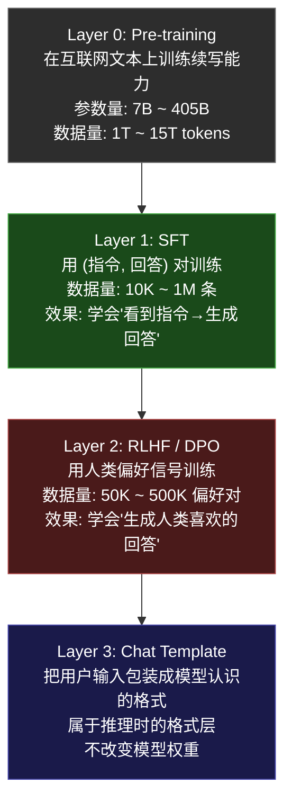
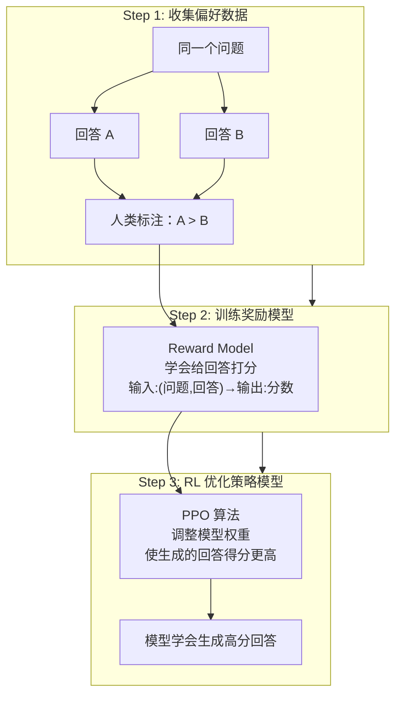
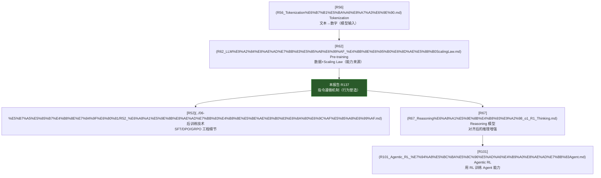

> 历史研究归档 · 2026-11-10 发布 · 发布审核状态：scan_only（发布前程序化隐私扫描）。原有日期、观点、数据和命令保留历史语境，未经本次逐项事实核验或运行复现；见[归档说明](../../../ARCHIVE_POLICY.md)。

# LLM 指令遵循机制：从续写到听话

> **一句话概括**：Base model 只是一台续写机器（给前文，预测下一个 token）。让它"听话"需要三步改造——SFT 教它对话格式、RLHF/DPO 教它什么是好回答、Chat Template 把用户输入翻译成它认识的格式。三者缺一不可，但核心能力在训练阶段注入，harness 只做格式翻译。
>
> **研究日期**：2026-05-22
> **关联报告**：[R62](R62_LLM%E9%A2%84%E8%AE%AD%E7%BB%83%E5%85%A8%E6%99%AF_%E4%BB%8E%E6%95%B0%E6%8D%AE%E5%88%B0ScalingLaw.md) 预训练全景（"模型怎么从零训出来"） · [R52](../06-%E5%B7%A5%E5%85%B7%E4%B8%8E%E7%94%9F%E6%80%81/R52_%E6%A8%A1%E5%9E%8B%E8%AE%AD%E7%BB%83%E4%B8%8E%E5%BE%AE%E8%B0%83%E6%8A%80%E6%9C%AF%E5%85%A8%E6%99%AF.md) 后训练技术全景（SFT/DPO/GRPO 工程细节） · [R56](R56_Tokenization%E6%B7%B1%E5%BA%A6%E8%A7%A3%E6%9E%90.md) Tokenization（"文本怎么变数字"） · [R67](R67_Reasoning%E6%A8%A1%E5%9E%8B%E4%B8%93%E9%A2%98_o1_R1_Thinking.md) Reasoning 模型（"听话之后还能推理"）
> **增量价值**：R52 是训练工程师的操作手册（怎么跑 SFT、选什么超参），本报告回答更上游的问题——**为什么这些技术能让续写模型变成对话模型**，是概念层的"指令遵循原理课"。
> **目标读者**：知道 LLM 是"预测下一个 token"但不理解"为什么它能听指令"的应用工程师。

---

## 目录

1. [核心问题：续写机器为什么能听话？](#核心问题)
2. [四层架构全景](#四层架构)
3. [Layer 0：Pre-training — 纯续写能力](#layer-0)
4. [Layer 1：SFT — 教会对话格式](#layer-1)
5. [Layer 2：RLHF/DPO — 选出好回答](#layer-2)
6. [Layer 3：Chat Template — 格式翻译层](#layer-3)
7. [实验：亲手感受 Base vs Chat 模型差异](#实验)
8. [进阶话题：涌现、失败模式与前沿](#进阶话题)
9. [知识串联：与其他报告的关系](#知识串联)
10. [来源清单](#来源清单)

---

<a id="核心问题"></a>
## 1. 核心问题：续写机器为什么能听话？

你的直觉是对的：LLM 的底层能力就是 **next-token prediction**（给定前面的 token 序列，预测下一个 token 的概率分布）。数学上写成：

$$P(x_t | x_1, x_2, ..., x_{t-1})$$

这个公式说的是：给定前面所有 token $x_1$ 到 $x_{t-1}$，模型输出的是**第 $t$ 个位置每个可能 token 的概率**。

那么问题来了——

> "请帮我写一首关于春天的诗"

对一个纯续写模型来说，这只是一段文本的开头。它的"正确续写"可能是：

```
请帮我写一首关于春天的诗，要求押韵，不超过四行。最好是五言绝句。
```

它把你的指令当成了**某篇网帖的前半段**继续写下去——因为它在训练时见过无数这样的帖子。

**核心矛盾**：续写 ≠ 遵循。续写是"根据统计规律补全文本"，遵循是"理解意图并执行"。

这个矛盾通过**三层训练改造**解决——下面逐层拆解。

---

<a id="四层架构"></a>
## 2. 四层架构全景



**关键直觉**：

- Layer 0 提供**能力**（知识、语言、推理——全在这里）
- Layer 1 提供**格式**（"遇到指令就回答"这个行为模式）
- Layer 2 提供**品味**（在多种合法回答中选好的）
- Layer 3 提供**翻译**（把外部输入变成模型见过的 token 格式）

---

<a id="layer-0"></a>
## 3. Layer 0：Pre-training — 纯续写能力

### 3.1 训练目标

预训练的数学目标极其简单——**最小化负对数似然**（Cross-Entropy Loss）：

$$\mathcal{L} = -\sum_{t=1}^{T} \log P_\theta(x_t | x_1, ..., x_{t-1})$$

翻译成人话：对于训练语料中的每个 token，模型要尽量给正确答案分配高概率。

### 3.2 Base Model 的能力边界

经过 15T tokens 训练后的 base model（如 Llama 3 405B base）已经具备：

| 能力 | 示例 | 原因 |
|------|------|------|
| 事实知识 | "法国首都是巴黎" | 训练语料中大量出现 |
| 代码生成 | 给函数签名，续写实现 | GitHub 代码就是这种"前文→续写"模式 |
| 翻译 | "英文: Hello\n中文:" → "你好" | 平行语料中见过这种格式 |
| 少样本推理 | 给 3 个例子后推广到第 4 个 | Few-shot = 利用 In-Context Learning |
| 逻辑推理 | 三段论、数学推导 | 教科书和论文中有大量推理过程 |

**但它不能**：

| 缺失能力 | 原因 |
|---------|------|
| 稳定遵循指令 | 没见过"用户问→助手答"的固定模式 |
| 拒绝有害请求 | 对它来说任何续写都是等价的 |
| 生成结构化回答 | 不知道什么时候该停（没有 `<eos>` 的概念） |
| 保持人设 | 对话历史对它就是一长段文本，没有"角色"概念 |

### 3.3 一个真实例子

用 Llama 3 70B **base**（非 instruct 版本）输入：

```
User: What is the capital of France?
Assistant:
```

Base model 的实际输出可能是：

```
User: What is the capital of France?
Assistant: Paris.
User: What about Germany?
Assistant: Berlin.
User: And Japan?
```

它不是在"回答你"，它是在**续写一段虚构对话**——因为训练语料里有大量这种 Q&A 格式的文本。有时它会停在正确答案上，有时它会继续编造新的 User 问题。这就是为什么 base model 的行为**不稳定不可靠**。

---

<a id="layer-1"></a>
## 4. Layer 1：SFT — 教会对话格式

### 4.1 核心思想

SFT（Supervised Fine-Tuning，监督微调）的本质是：

> 在 base model 上继续训练，但训练数据全部是 **(指令, 回答)** 对。

模型通过几万条示例，学会一个**条件行为**：当输入符合某种格式标记时，切换到"回答模式"。

**类比**：一个读完所有书的天才，从来没上过学也没跟人对话过。SFT 就像送他去上了一学期的"社交礼仪课"——他已有的知识没变，但学会了"别人问你话时该怎么回应"。

### 4.2 训练数据长什么样

```json
{
  "messages": [
    {"role": "system", "content": "你是一个有帮助的助手。"},
    {"role": "user", "content": "解释什么是量子纠缠，用小学生能听懂的方式。"},
    {"role": "assistant", "content": "想象你有两个魔法骰子...（完整回答）"}
  ]
}
```

几万到几十万条这样的数据，涵盖各种任务类型（问答、写作、代码、翻译、数学...）。

### 4.3 Loss 的精妙之处：只算回答部分

SFT 的关键技术细节——**Loss Masking**：

```python
# 伪代码：SFT 的 loss 计算
def compute_sft_loss(input_ids, labels):
    # input_ids: [system_tokens] + [user_tokens] + [assistant_tokens]
    # labels:    [-100, -100, ..., -100] + [-100, ..., -100] + [assistant_tokens]
    #             ↑ system 部分不算 loss    ↑ user 部分不算      ↑ 只有这里算 loss
    
    logits = model(input_ids)
    loss = cross_entropy(logits, labels, ignore_index=-100)
    return loss
```

**为什么只算 assistant 部分的 loss？**

- 如果也算 user 部分的 loss，模型会学到"生成用户的提问"这种行为——我们不需要
- 只在 assistant token 上计算 loss，等于在说："记住，你的任务是**续写 assistant 该说的话**"
- system 和 user 部分只提供上下文，不提供梯度信号

#### 数学表达

带 mask 的 SFT loss 完整公式：

$$\mathcal{L}_{\text{SFT}} = -\sum_{t=1}^{T} m_t \cdot \log P_\theta(x_t \mid x_{<t})$$

其中 $m_t \in \{0, 1\}$ 是 mask 向量：
- $m_t = 1$：assistant 回答的 token → 计算 loss、贡献梯度
- $m_t = 0$：system prompt / user 输入 / 特殊 token → 跳过

**PyTorch 实现细节**：`CrossEntropyLoss(ignore_index=-100)` 看到 label 为 -100 的位置就跳过，不计算梯度。所以实际代码中是把 user/system 部分的 label 全部设为 -100，而非显式乘以 mask 向量——效果等价，实现更简洁。

### 4.4 SFT 到底改了什么？

一个关键认知：**SFT 几乎不增加模型的知识，它只改变模型的行为模式。**

证据：

1. **数据量差距**：预训练用 15T tokens，SFT 通常只用 1M-10M tokens（差 3-4 个数量级）
2. **LIMA 论文**（2023）：Meta 用仅 1000 条高质量 SFT 数据就训出了接近 GPT-4 的对话能力——说明 SFT 不是在"教知识"，而是在"解锁表达方式"
3. **Superficial Alignment Hypothesis**（表面对齐假说）：SFT 只是让模型学会了"用什么风格/格式输出"，知识和能力来自预训练

这就是业界常说的：

> **"SFT is not teaching, it's unlocking."**（SFT 不是教学，是解锁。）

### 4.5 特殊 Token 的作用

SFT 阶段引入了一批**特殊 token**，它们在预训练中不存在：

| Token | 作用 |
|-------|------|
| `<\|begin_of_text\|>` | 标记序列开始 |
| `<\|start_header_id\|>` | 角色标记开始 |
| `<\|end_header_id\|>` | 角色标记结束 |
| `<\|eot_id\|>` | 当前角色发言结束（End of Turn） |
| `<\|eom_id\|>` | 消息结束（工具调用场景） |

这些 token 在 tokenizer 的词表中有对应 ID，但在预训练阶段从未出现过——它们的 embedding 是**随机初始化**的。SFT 阶段通过梯度更新，让模型学会这些 token 的"含义"：

- 看到 `<|start_header_id|>assistant<|end_header_id|>` → "接下来该我生成回答了"
- 生成 `<|eot_id|>` → "我该停了"

**这就是 SFT 最核心的产物：一套"信号灯系统"，告诉模型什么时候开始说、说什么角色的话、什么时候停。**

---

<a id="layer-2"></a>
## 5. Layer 2：RLHF/DPO — 选出好回答

### 5.1 为什么 SFT 不够？

SFT 之后，模型会回答了。但问题是——**"会回答"不等于"回答得好"**。

同一个问题，模型可能生成 10 种不同的回答，SFT 只教了"要回答"，没教"哪种回答更好"。具体表现：

- 有时啰嗦冗长，有时过于简短
- 有时会编造事实（幻觉）但语气自信
- 不知道什么时候该拒绝（"教我怎么黑进别人电脑"→ 它可能真教）
- 回答风格不一致

### 5.2 RLHF 的三步流程



#### Step 1：偏好数据收集

```
问题：如何向5岁孩子解释为什么天空是蓝色的？

回答 A：天空是蓝色的是因为瑞利散射。太阳光中波长较短的蓝光
       更容易被大气分子散射到各个方向，所以我们从各个角度
       都能看到蓝色光。

回答 B：你知道彩虹吗？太阳的光其实是彩虹里所有颜色混在一起。
       当阳光照进天空，蓝色的光最喜欢到处乱跑，到处弹来弹去，
       所以你不管往哪看，都能看到蓝色！其他颜色就直直地走了，
       不爱弹。

人类标注：B > A（因为问的是"向5岁孩子解释"，B更合适）
```

#### Step 2：奖励模型（Reward Model）

奖励模型的训练目标是**学会像人类一样打分**。数学上是一个 Bradley-Terry 模型：

$$P(y_w \succ y_l | x) = \sigma(r_\theta(x, y_w) - r_\theta(x, y_l))$$

翻译：给定问题 $x$，被人类偏好的回答 $y_w$ 的分数应该高于被拒绝的回答 $y_l$ 的分数，差值越大越确信。

#### Step 3：PPO 强化学习

有了奖励模型后，用 PPO（Proximal Policy Optimization）算法：

1. 让策略模型生成回答
2. 奖励模型打分
3. 用分数作为 reward 信号，更新策略模型的权重
4. **关键约束**：加一个 KL 散度惩罚项，防止模型为了追求高分而"hack"奖励模型（比如学会说一堆好听的废话）

$$\mathcal{L}_{PPO} = -\mathbb{E}[r_\theta(x, y)] + \beta \cdot KL(\pi_\theta \| \pi_{ref})$$

- 第一项：追求高奖励
- 第二项：不要偏离 SFT 后的模型太远（$\pi_{ref}$ 是 SFT 模型）
- $\beta$：控制两者的平衡

#### PPO 目标函数详细拆解

上面是简化版。PPO 的完整目标函数长这样：

$$\mathcal{L}_{\text{PPO}} = \mathbb{E}\left[\min\left(r_t(\theta) \cdot A_t,\ \text{clip}(r_t(\theta), 1-\epsilon, 1+\epsilon) \cdot A_t\right)\right]$$

每个符号的含义：

| 符号 | 公式 | 直觉解释 |
|------|------|---------|
| $r_t(\theta)$ | $\frac{\pi_\theta(a_t \mid s_t)}{\pi_{\theta_{\text{old}}}(a_t \mid s_t)}$ | 概率比——"新模型和旧模型在这个 token 上的分歧有多大" |
| $A_t$ | 来自奖励模型 | 优势函数——"这个 token 比平均水平好多少"（正=好，负=差） |
| $\text{clip}(\cdot, 1\!-\!\epsilon, 1\!+\!\epsilon)$ | 通常 $\epsilon=0.2$ | 把概率比裁剪到 $[0.8, 1.2]$——"每步改动不能太大" |
| $\min(\cdot, \cdot)$ | 取较小值 | 悲观估计——优势正时封顶奖励，优势负时封顶惩罚 |

**数值例子**：假设旧模型对某个位置生成 token "好的" 的概率是 0.3，新模型给了 0.6，则 $r_t = 2.0$。如果这个 token 的优势 $A_t = 3$（好动作），clip 后变成 $\min(2.0 \times 3, 1.2 \times 3) = \min(6, 3.6) = 3.6$。哪怕新模型激进地翻了 2 倍概率，奖励也被限制在 3.6——防止一步走太远策略崩溃。

**KL 惩罚的直觉**：你可以为了讨好导师（奖励模型）调整自己的表达，但不能为此变成一个完全不同的人。$\beta \cdot D_{\text{KL}}$ 就是"别忘了你 SFT 阶段学到的基本功"。

**PPO 的实际痛点**：

| 问题 | 原因 |
|------|------|
| 训练不稳定 | 奖励模型有误差，被 PPO 过度利用（reward hacking） |
| 成本高 | 需同时运行 4 个模型：策略、参考、奖励、价值（Critic） |
| 超参数敏感 | $\epsilon$、$\beta$、学习率稍有不对就崩 |

这些痛点催生了 DPO 和 GRPO。

### 5.3 DPO：跳过奖励模型的捷径

2023 年 Rafailov 等人发现：可以把 RLHF 的三步**数学等价地简化为一步**。

**核心洞察**：奖励模型隐含在策略模型本身的输出概率中。不需要单独训练一个 RM，直接用偏好数据调整策略模型。

$$\mathcal{L}_{DPO} = -\log\sigma\left(\beta \log\frac{\pi_\theta(y_w|x)}{\pi_{ref}(y_w|x)} - \beta \log\frac{\pi_\theta(y_l|x)}{\pi_{ref}(y_l|x)}\right)$$

翻译成人话：**让模型增加生成好回答的概率，同时降低生成差回答的概率**——相对于参考模型（SFT 后的初始状态）。

#### DPO 公式四步拆解

这个公式看着唬人，逐步拆开其实很清晰：

**Step 1** — 计算"当前模型相对于参考模型，有多偏好好回答"：
$$\Delta_w = \log \frac{\pi_\theta(y_w|x)}{\pi_{\text{ref}}(y_w|x)}$$
$\Delta_w > 0$ 说明当前模型比参考模型更倾向于生成好回答。

**Step 2** — 计算"当前模型相对于参考模型，有多偏好坏回答"：
$$\Delta_l = \log \frac{\pi_\theta(y_l|x)}{\pi_{\text{ref}}(y_l|x)}$$

**Step 3** — 两者相减，乘以温度 $\beta$：
$$\beta \cdot (\Delta_w - \Delta_l)$$
这个值越大，说明模型越"正确地"偏好好回答、远离坏回答。

**Step 4** — 过 sigmoid → 取 log → 取负 → 变成 loss：
$$\mathcal{L} = -\log \sigma(\beta \cdot (\Delta_w - \Delta_l))$$

#### 数值例子

假设某个 prompt，当前模型给好回答概率 0.7、给坏回答 0.3；参考模型各给 0.5：

$$\Delta_w - \Delta_l = \log\frac{0.7}{0.5} - \log\frac{0.3}{0.5} = 0.336 - (-0.511) = 0.847$$

取 $\beta = 1$：$\sigma(0.847) \approx 0.70$，loss $= -\log(0.70) = 0.36$。

如果模型训练到好回答概率 0.95、坏回答 0.05：$\Delta_w - \Delta_l$ 会更大 → sigmoid 更接近 1 → loss 更小。训练朝正确方向收敛。

#### DPO 的局限

- **数据质量 = 一切**：偏好标注有噪声（标注者意见不一致）时，DPO 学到矛盾信号
- **没有在线探索**：PPO 能在训练中生成新回答并获得反馈（on-policy），DPO 只能用静态数据集（off-policy）
- **长回答信号稀释**：整个回答的概率是所有 token 概率的乘积，长回答中 token 级信号被淹没

| | RLHF (PPO) | DPO |
|---|---|---|
| 需要训练奖励模型？ | 是 | 否 |
| 需要 RL 训练循环？ | 是（复杂） | 否（简单如 SFT） |
| 效果 | 略好（有时） | 接近 |
| 工程复杂度 | 高 | 低 |
| 2026 主流？ | 大厂用 | 中小团队首选 |

### 5.4 RLHF/DPO 到底教了什么？

和 SFT 类似，RLHF/DPO 也**不增加新知识**。它教的是：

1. **风格偏好**：简洁 vs 详细、正式 vs 口语
2. **安全边界**：什么该拒绝、怎么拒绝
3. **诚实度**：不确定时说"我不确定"而不是自信地瞎编
4. **有用度**：直接回答 vs 绕弯子、给代码 vs 给伪代码

**类比**：SFT 教了"有人问话要回答"，RLHF 教了"回答时要像一个**有教养、有帮助、又诚实**的人"。

### 5.5 GRPO：去掉 Critic 的 PPO

PPO 的四个模型中，有一个**价值模型（Critic）**专门用来估算"平均水平是多少分"（即计算优势函数 $A_t$ 的 baseline）。这个 Critic 跟策略模型一样大，训练不稳定，还吃显存。

**GRPO（Group Relative Policy Optimization）** 是 DeepSeek 在训练 R1 时的解决方案——用"组内对比"替代 Critic：

1. 对同一个 prompt，让策略模型**一口气生成 G 个回答**（如 G=8）
2. 奖励模型给这 8 个回答打分：$r_1, r_2, ..., r_8$
3. 组内标准化：$\hat{r}_i = \frac{r_i - \text{mean}(r_{1..G})}{\text{std}(r_{1..G})}$
4. 标准化后的 $\hat{r}_i$ 直接当作优势函数

**说白了**：不再问"这个回答比宇宙平均水平好多少"（需要 Critic 估算），而是问"这个回答比**同一题的其他 7 个回答**好多少"（自己跟自己比，不需要 Critic）。

$$\mathcal{L}_{\text{GRPO}} = -\mathbb{E}\left[\frac{1}{G}\sum_{i=1}^{G} \min\left(r_i(\theta)\hat{A}_i,\ \text{clip}(r_i(\theta), 1\!-\!\epsilon, 1\!+\!\epsilon)\hat{A}_i\right) - \beta \cdot D_{\text{KL}}\right]$$

结构跟 PPO 几乎一样，唯一区别是 $\hat{A}_i$ 来自组内标准化而非 Critic 网络。

| 对比 | PPO | GRPO |
|------|-----|------|
| 模型数量 | 4（策略+参考+奖励+Critic） | 3（去掉 Critic） |
| 显存 | 高 | 省约 25-30% |
| 优势函数来源 | Critic 网络估算 | 组内统计标准化 |
| 代价 | — | 每个 prompt 需采样多次（计算换显存） |

DeepSeek-R1 用 GRPO 训出了长链推理能力（"思考"过程），证明这个简化没有牺牲效果。

---

<a id="layer-3"></a>
## 6. Layer 3：Chat Template — 格式翻译层

### 6.1 为什么需要这层？

经过 SFT + RLHF，模型的权重里已经写入了"遵循指令"的能力。但有个实操问题：

**模型在 SFT 阶段见过的格式是固定的。** 你必须用**完全一样的格式**喂给它，否则它不认。

这就像一个训练有素的接线员，他被培训为"听到'请转接'就帮你转"。如果你不说"请转接"而是说"能帮我找一下"，他可能就愣住了——能力在，但触发条件没匹配。

### 6.2 真实的 Chat Template 长什么样

#### Llama 3 格式

```
<|begin_of_text|><|start_header_id|>system<|end_header_id|>

You are a helpful assistant.<|eot_id|><|start_header_id|>user<|end_header_id|>

写一首关于春天的诗<|eot_id|><|start_header_id|>assistant<|end_header_id|>

```

#### ChatML 格式（Qwen/Yi 系列）

```
<|im_start|>system
You are a helpful assistant.<|im_end|>
<|im_start|>user
写一首关于春天的诗<|im_end|>
<|im_start|>assistant
```

#### Hugging Face 的 Jinja2 模板

实际工程中，chat template 通常用 Jinja2 模板定义，存储在 tokenizer_config.json 中：

```python
# 这是 Llama 3 的 chat_template（简化版）

<|start_header_id|>{{ message['role'] }}<|end_header_id|>

{{ message['content'] }}<|eot_id|>

<|start_header_id|>assistant<|end_header_id|>

```

### 6.3 用错模板会怎样？

**真实案例**：用 ChatML 格式去调用 Llama 3 模型：

```
<|im_start|>user
What is 2+2?<|im_end|>
<|im_start|>assistant
```

Llama 3 从未在训练中见过 `<|im_start|>` 这个 token。结果：
- 模型把这些特殊标记当作普通文本的一部分
- 退化到接近 base model 的行为
- 可能输出乱码、重复循环、或者继续"创造"新的对话轮次

**这是部署开源模型时最常见的"模型不听话"原因之一——不是模型不行，是格式喂错了。**

### 6.4 Harness 还做了什么？

除了格式翻译，推理时的 harness/runtime 还负责：

| 功能 | 说明 |
|------|------|
| **对话历史管理** | 把多轮对话拼接成模型要的 token 序列 |
| **Token 截断** | 历史太长时截掉最旧的，保持在上下文窗口内 |
| **停止条件** | 看到 `<\|eot_id\|>` 就停止生成 |
| **采样策略** | Temperature、Top-p、Top-k 等参数控制 |
| **工具调用格式** | 把 function calling 的 JSON schema 注入到 system prompt |

**核心结论：Harness 不改变模型能力，只负责"正确触发"模型已有的能力。**

---

<a id="实验"></a>
## 7. 实验：亲手感受 Base vs Chat 模型差异

### 7.1 用 Hugging Face Transformers 对比

```python
"""对比 base model 和 instruct model 的行为差异"""
from transformers import AutoTokenizer, AutoModelForCausalLM
import torch

# ========== 实验 1: Base Model ==========
model_name = "meta-llama/Llama-3.1-8B"  # base 版本
tokenizer = AutoTokenizer.from_pretrained(model_name)
model = AutoModelForCausalLM.from_pretrained(model_name, torch_dtype=torch.bfloat16)

prompt = "请帮我写一首关于春天的诗"
inputs = tokenizer(prompt, return_tensors="pt")
outputs = model.generate(**inputs, max_new_tokens=100, temperature=0.7)
print("Base model 输出：")
print(tokenizer.decode(outputs[0], skip_special_tokens=True))
# 典型输出: "请帮我写一首关于春天的诗，要求七言绝句，需要包含..."
# → 它在续写你的"请求"，而不是回答

# ========== 实验 2: Instruct Model ==========
model_name = "meta-llama/Llama-3.1-8B-Instruct"  # instruct 版本
tokenizer = AutoTokenizer.from_pretrained(model_name)
model = AutoModelForCausalLM.from_pretrained(model_name, torch_dtype=torch.bfloat16)

# 必须用正确的 chat template
messages = [{"role": "user", "content": "请帮我写一首关于春天的诗"}]
inputs = tokenizer.apply_chat_template(messages, return_tensors="pt")
outputs = model.generate(inputs, max_new_tokens=200, temperature=0.7)
print("Instruct model 输出：")
print(tokenizer.decode(outputs[0], skip_special_tokens=True))
# 典型输出: "春风拂面暖阳升，万物复苏绿意浓..."
# → 它在回答你的请求
```

### 7.2 格式错误实验

```python
"""故意用错格式，观察 instruct model 退化"""
# 用 instruct model，但不用 chat template，直接喂原始文本
prompt = "请帮我写一首关于春天的诗"  # 没有特殊标记
inputs = tokenizer(prompt, return_tensors="pt")
outputs = model.generate(**inputs, max_new_tokens=100)
print("错误格式输出：")
print(tokenizer.decode(outputs[0], skip_special_tokens=True))
# 输出可能介于 base 和 instruct 之间——不稳定、不可靠
```

### 7.3 不用 GPU 也能感受：Ollama 实验

```bash
# 下载 base 和 instruct 两个版本
ollama pull llama3.1:8b        # instruct 版本（默认）
ollama pull llama3.1:8b-text   # base 版本（如果有）

# 对比同一个 prompt 的输出差异
echo "请帮我写一首关于春天的诗" | ollama run llama3.1:8b
```

---

<a id="进阶话题"></a>
## 8. 进阶话题：涌现、失败模式与前沿

### 8.1 一个深层问题：SFT 真的只是"格式"吗？

**Superficial Alignment Hypothesis**（表面对齐假说）说 SFT 只教格式。但有争议：

| 观点 | 证据 |
|------|------|
| "SFT 只是解锁" | LIMA（1000 条数据就够）、Phi-3（合成数据 SFT 效果极好） |
| "SFT 也教能力" | 代码 SFT 确实提升了代码能力；数学 SFT 提升了数学推理 |

**我认为**更准确的说法是：SFT 主要教格式，但如果 SFT 数据中包含 **base model 训练数据里稀少的推理模式**（如 chain-of-thought），它确实能"激活"一些预训练阶段未充分学习的能力。这不是新知识，而是"强化弱信号"。

### 8.2 指令遵循的失败模式

即使经过完整的 SFT + RLHF，模型仍然会"不听话"。常见原因：

| 失败模式 | 根本原因 | 表现 |
|---------|---------|------|
| **长指令遗忘** | Attention 稀释 | 10 条要求只遵守了前 3 条 |
| **角色崩塌** | RLHF 的 helpful 奖励压过 system prompt | "不管你的人设是什么，我是 AI 助手" |
| **越狱/Jailbreak** | 对抗性 prompt 绕过安全训练 | 用角色扮演套出有害内容 |
| **Sycophancy（讨好）** | RLHF 的 reward hacking | 用户说"你错了"它就改口，即使原来是对的 |
| **格式不遵循** | 训练数据中该格式样本太少 | 要求 JSON 但输出 Markdown |

### 8.3 2025-2026 前沿：超越 RLHF

| 技术 | 核心思想 | 代表 |
|------|---------|------|
| **RLVR**（RL from Verifiable Rewards） | 不需要人类标注，用可验证的正确答案做 reward | DeepSeek-R1 |
| **Constitutional AI** | 让 AI 自己评判回答好坏（Self-critique） | Claude（Anthropic） |
| **GRPO**（Group Relative Policy Optimization） | 不需要 critic model，用组内相对排序做 reward | DeepSeek-R1 |
| **Iterative DPO** | 不断生成新数据→标注→训练，循环迭代 | Llama 3.1 |
| **Process Reward Model** | 不只奖励最终答案，还奖励正确的推理步骤 | OpenAI o1/o3 |

### 8.4 System Prompt 为什么有效？

一个常见疑问：system prompt 只是 prompt 的一部分，为什么它比 user 消息有"更高优先级"？

**答案**：这是在 SFT 阶段通过数据设计"硬编码"的。

1. SFT 数据中，system 消息的内容总是被严格遵循
2. 模型学到了统计规律："system 角色的内容 = 行为约束，必须遵守"
3. 这是一种**涌现的优先级**——不是代码硬编码的，而是数据驱动学到的

**但它不是绝对的**：足够长的 user 对话或精心构造的 prompt，可以让模型"忘记"system 指令。这就是 prompt injection 攻击的原理——利用模型学到的优先级规则不是刚性的这一事实。

---

<a id="知识串联"></a>
## 9. 知识串联：与其他报告的关系



| 如果你想深入... | 去读 |
|---------------|------|
| Tokenizer 怎么把文本切成 token | [R56](R56_Tokenization%E6%B7%B1%E5%BA%A6%E8%A7%A3%E6%9E%90.md) |
| 预训练阶段的数据工程和 Scaling Law | [R62](R62_LLM%E9%A2%84%E8%AE%AD%E7%BB%83%E5%85%A8%E6%99%AF_%E4%BB%8E%E6%95%B0%E6%8D%AE%E5%88%B0ScalingLaw.md) |
| SFT/DPO/GRPO 的具体训练操作和工具选型 | [R52](../06-%E5%B7%A5%E5%85%B7%E4%B8%8E%E7%94%9F%E6%80%81/R52_%E6%A8%A1%E5%9E%8B%E8%AE%AD%E7%BB%83%E4%B8%8E%E5%BE%AE%E8%B0%83%E6%8A%80%E6%9C%AF%E5%85%A8%E6%99%AF.md) |
| RLVR 和推理模型（o1、DeepSeek-R1） | [R67](R67_Reasoning%E6%A8%A1%E5%9E%8B%E4%B8%93%E9%A2%98_o1_R1_Thinking.md) |
| 用 RL 训练 Agent 做复杂任务 | [R101](R101_Agentic_RL_%E7%94%A8%E5%BC%BA%E5%8C%96%E5%AD%A6%E4%B9%A0%E8%AE%AD%E7%BB%83Agent.md) |

---

<a id="来源清单"></a>
## 10. 来源清单

| 来源 | 说明 |
|------|------|
| [InstructGPT (Ouyang et al., 2022)](https://arxiv.org/abs/2203.02155) | RLHF 的奠基论文，首次系统展示 SFT+RLHF 流程 |
| [LIMA: Less Is More for Alignment (Zhou et al., 2023)](https://arxiv.org/abs/2305.11206) | 1000 条数据做 SFT 就够，证明"表面对齐假说" |
| [DPO (Rafailov et al., 2023)](https://arxiv.org/abs/2305.18290) | 跳过奖励模型直接做偏好优化 |
| [DeepSeek-R1 (2025)](https://arxiv.org/abs/2501.12948) | GRPO + RLVR，纯 RL 涌现推理能力 |
| [Llama 3 技术报告 (Meta, 2024)](https://arxiv.org/abs/2407.21783) | 完整的预训练→后训练流水线工程细节 |
| [Constitutional AI (Bai et al., 2022)](https://arxiv.org/abs/2212.08073) | AI 自我批评+修正的对齐方法 |
| 模型训练知识 — 截止日期未知 — 作为背景参考 | |

---

## 开放问题

1. **SFT 数据质量 vs 数量的精确边界在哪？** LIMA 说 1000 条够，但 Llama 3 用了几百万条——最优点在哪？
2. **RLHF 的 reward hacking 如何根治？** 当前方案（KL 惩罚、ensemble RM）都是 patch，不是根因修复
3. **指令遵循能力能完全靠 RL 从零训出来吗？** DeepSeek-R1 的 zero-shot RL 实验暗示可能可以，但还不确定能否泛化到所有指令类型
4. **多模态模型的指令遵循机制是否相同？** 视觉-语言模型的对齐方式有什么不同？

---

## 附录：术语全称速查表

| 缩写 | 全称 | 中文 |
|------|------|------|
| SFT | Supervised Fine-Tuning | 监督微调 |
| RLHF | Reinforcement Learning from Human Feedback | 基于人类反馈的强化学习 |
| PPO | Proximal Policy Optimization | 近端策略优化 |
| DPO | Direct Preference Optimization | 直接偏好优化 |
| GRPO | Group Relative Policy Optimization | 群体相对策略优化 |
| KL | Kullback-Leibler (divergence) | KL 散度（衡量两个概率分布差异） |
| RM | Reward Model | 奖励模型 |
| RLVR | Reinforcement Learning from Verifiable Rewards | 基于可验证奖励的强化学习 |
| IPO | Identity Preference Optimization | DPO 变体，去掉 sigmoid |
| KTO | Kahneman-Tversky Optimization | 只需"好/坏"标签不需要配对的 DPO 变体 |
| LLM | Large Language Model | 大语言模型 |
| EOS | End of Sequence | 序列结束标记 |
| EOT | End of Turn | 轮次结束标记 |
