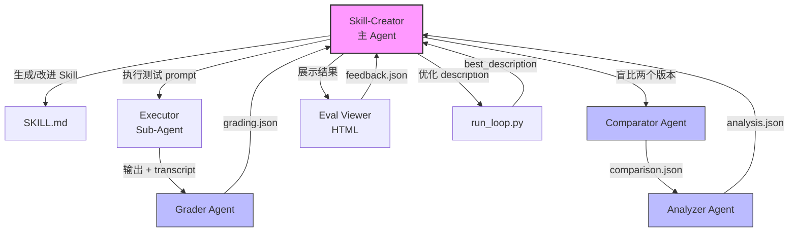
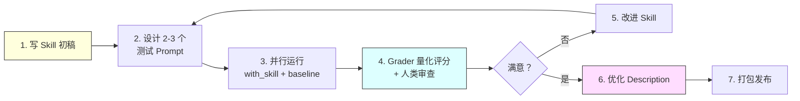

> 历史研究归档 · 2026-11-10 发布 · 程序扫描；未逐篇全文审阅。原有日期、观点、数据和命令保留历史语境，未经本次逐项事实核验或运行复现；请结合[归档说明](../../../ARCHIVE_POLICY.md)阅读。

# Anthropic 官方 Skill-Creator 设计哲学研究报告

> **一句话概括**：Anthropic 官方 skill-creator 是一个完整的"Skill 工程化系统"——它的核心设计哲学是"用 Why 驱动指令、用数据驱动迭代、用泛化对抗过拟合"，这与我们在 agent.md 三次迭代中独立发现的"赋能而非约束"范式完全吻合，但在工程化闭环方面远超我们的直觉认知  
> **研究日期**：2026-06  
> **关联报告**：[Agent-Skills与LLM-Wiki生态调研报告](../02-%E7%9F%A5%E8%AF%86%E7%AE%A1%E7%90%86%E4%B8%8E%E4%B8%8A%E4%B8%8B%E6%96%87/R01_AgentSkills%E4%B8%8ELLMWiki%E7%94%9F%E6%80%81.md)（P6 SKILL.md 格式标准）、[Agent架构深度研究报告](R03_Agent%E6%9E%B6%E6%9E%84%E6%B7%B1%E5%BA%A6%E7%A0%94%E7%A9%B6.md)（P5 简单可组合 > 复杂框架）  
> **增量价值**：本报告在已有 #1 报告（agent-skills 生态概览）基础上，**首次深入 Anthropic 官方 skill-creator 的完整源码**，提炼出 Skill/Agent 指令编写的"元方法论"——不仅是"怎么写好一个 Skill"，更是"Anthropic 自己是怎么想的、为什么这么设计"

---

## 目录

- [一、Skill-Creator 是什么：一个完整的工程化系统](#一skill-creator-是什么一个完整的工程化系统)
- [二、七个核心设计哲学](#二七个核心设计哲学)
- [三、架构拆解：三个专业 Sub-Agent + 八个脚本](#三架构拆解三个专业-sub-agent--八个脚本)
- [四、Eval-Driven Development：Prompt/Skill 的 TDD](#四eval-driven-developmentpromptskill-的-tdd)
- [五、Description 优化：触发机制的科学](#五description-优化触发机制的科学)
- [六、与我们已有发现的交叉验证](#六与我们已有发现的交叉验证)
- [七、可借鉴的最佳实践](#七可借鉴的最佳实践)
- [八、开放问题与后续计划](#八开放问题与后续计划)

---

## 一、Skill-Creator 是什么：一个完整的工程化系统

很多人以为 skill-creator 只是一份"教你写 SKILL.md 的指南"。不是。它是一套**完整的 Skill 工程化系统**，包含：

| 组件 | 文件 | 职责 |
|------|------|------|
| 核心指令 | `SKILL.md` (~2000+ 行) | 整个系统的大脑：工作流程、写作指南、迭代策略 |
| 评分 Agent | `agents/grader.md` | 对 Skill 输出执行结构化评分（assertions + claims 提取） |
| 盲比 Agent | `agents/comparator.md` | 不知道哪个版本是哪个，纯粹基于输出质量做 A/B 判断 |
| 分析 Agent | `agents/analyzer.md` | "揭盲"后分析 WHY winner 赢了，生成改进建议 |
| 聚合脚本 | `scripts/aggregate_benchmark.py` | 将多次运行结果聚合为 benchmark.json |
| 描述优化器 | `scripts/run_loop.py` + `improve_description.py` | 自动优化 description 字段的触发准确率 |
| 打包器 | `scripts/package_skill.py` | 打包 .skill 文件 |
| 验证器 | `scripts/quick_validate.py` | 快速校验 Skill 结构合规性 |
| 评估查看器 | `eval-viewer/generate_review.py` | 生成 HTML 界面供人类 review 输出质量 |
| Schema 规范 | `references/schemas.md` | 7 种 JSON Schema 定义（evals/grading/benchmark/comparison/analysis/metrics/timing） |

说白了：**Anthropic 不是写了一份最佳实践文档，而是建了一条 Skill 的生产流水线**。从需求捕获 → 初稿编写 → 测试执行 → 量化评估 → 人类审查 → 迭代改进 → 描述优化 → 打包发布，每一步都有对应的工具和流程。

这条流水线的设计透露了一个思维方式：**Skill 不是"写完就好了"的文档，而是需要像软件产品一样经过测试、度量、迭代的工程制品**。

---

## 二、七个核心设计哲学

### 哲学 1：解释 Why，而非堆砌 MUST

这是整个 skill-creator 最重要的一句话，出自"如何改进 Skill"章节：

> "Try hard to explain the **why** behind everything you're asking the model to do. Today's LLMs are *smart*. They have good theory of mind and when given a good harness can go beyond rote instructions and really make things happen... **If you find yourself writing ALWAYS or NEVER in all caps, or using super rigid structures, that's a yellow flag** — if possible, reframe and explain the reasoning so that the model understands why the thing you're asking for is important. That's a more humane, powerful, and effective approach."

翻译一下：

- ❌ `MUST: 输出必须包含三级标题`
- ✅ `报告用三级标题是因为读者需要快速扫描和跳转——没有结构的大段文字会让忙碌的工程师直接关掉`

**全大写的 ALWAYS/NEVER 是黄旗**——Anthropic 官方说的。这与我们在 agent.md 第三次迭代中独立得出的结论（"把约束清单变成价值观内化"）完全一致。

### 哲学 2：泛化而非过拟合

> "We're trying to create skills that can be used a million times across many different prompts... **Rather than put in fiddly overfitty changes, or oppressively constrictive MUSTs**, if there's some stubborn issue, you might try branching out and using different metaphors, or recommending different patterns of working."

核心洞察：**当某个问题反复出现时，本能反应是加更多约束（"一定要做X！不许做Y！"），但正确的做法是换个角度解释、用不同的比喻、推荐不同的工作模式**。约束是脆弱的（一个新场景就可能失效），理解是鲁棒的（模型真正懂了 WHY 就能举一反三）。

这暗含了一个更深层的观点：**Skill 的目标是创造一百万次好的执行，而不是在三个测试用例上表现完美**。

### 哲学 3：保持精简，删掉不拉分的

> "Remove things that aren't pulling their weight. Make sure to read the transcripts, not just the final outputs — if it looks like the skill is making the model waste a bunch of time doing things that are unproductive, you can try getting rid of the parts of the skill that are making it do that."

精简不是"能短则短"，而是**通过阅读执行 transcript 来判断哪些指令实际上在浪费模型的时间**。这是一种数据驱动的精简——不是凭感觉删，是看到模型反复在某个指令上打转才删。

### 哲学 4：发现重复工作 → 固化为脚本

> "Read the transcripts from the test runs and notice if the subagents all independently wrote similar helper scripts or took the same multi-step approach to something. If all 3 test cases resulted in the subagent writing a `create_docx.py` or a `build_chart.py`, **that's a strong signal the skill should bundle that script**."

这是一个绝妙的启发：**模型反复创造的东西 = 应该被预制的东西**。观察模型在自由执行时"自发"写了什么脚本，那些脚本就应该变成 Skill 的 bundled scripts。这比人类猜测"模型可能需要什么"准确得多。

### 哲学 5：先写草稿，再用新鲜眼光审视

> "Start by writing a draft and then look at it with fresh eyes and improve it."

简短但重要：**Skill 的编写本身就应该是迭代的**。第一遍是 brain dump，第二遍才是打磨。

### 哲学 6：Description 是触发开关，要"有攻击性"

> "Claude has a tendency to 'undertrigger' skills — to not use them when they'd be useful. To combat this, please make the skill descriptions a little bit 'pushy'."

官方例子：

- ❌ `How to build a simple fast dashboard to display internal data.`
- ✅ `How to build a simple fast dashboard to display internal data. **Make sure to use this skill whenever the user mentions dashboards, data visualization, internal metrics, or wants to display any kind of company data, even if they don't explicitly ask for a 'dashboard.'**`

Description 不是客观描述，是**主动的激活条件声明**。

### 哲学 7：适应运行环境，而非要求环境适应你

Skill-creator 的 SKILL.md 有三个独立的环境适配章节：

| 环境 | 适配策略 |
|------|---------|
| Claude Code | 完整流程：subagent 并行、浏览器 viewer、description optimizer |
| Claude.ai | 降级：无 subagent → 串行执行；无浏览器 → 内联展示；跳过 benchmark |
| Cowork (headless) | 中间态：有 subagent 但无浏览器 → `--static` 输出 HTML 文件 |

**同一份 Skill 根据运行环境做优雅降级**，不是"不支持就报错"，而是"没有这个能力就换个方式完成同样的目标"。

---

## 三、架构拆解：三个专业 Sub-Agent + 八个脚本

### Sub-Agent 架构

#### Grader Agent 的设计亮点

Grader 不只是打分——它做四件事：

1. **评估 assertions**：传统的 pass/fail
2. **提取 claims**：从输出中主动提取事实声明（"表单有 12 个字段"）并验证
3. **读取 executor notes**：关注执行者自己标注的不确定性
4. **批判 evals 本身**：一个 assertion 如果太容易通过（连错误输出都能过），Grader 会指出这个 eval 本身不够好

> "A passing grade on a weak assertion is worse than useless — it creates false confidence."

这句话揭示了一个常被忽略的问题：**测试用例的质量比测试结果更重要**。一个永远 pass 的测试给你的是虚假的安全感。

#### Comparator Agent 的盲比设计

Comparator 的核心设计是**盲比（blind comparison）**：

- 接收两个输出 A 和 B，不知道哪个来自哪个 Skill 版本
- 自己生成评估 rubric（Content + Structure 两个维度）
- 给每个维度的每个指标打 1-5 分
- 综合评分后选出 winner

为什么盲比？**防止对"新版本"的系统性偏见**。如果 Grader 知道 B 是改进版，它会倾向于给 B 更高分。盲比消除了这个偏见。

#### Analyzer Agent 的"揭盲分析"

Comparator 选出 winner 后，Analyzer "揭盲"——此时它知道哪个是哪个版本，然后分析 WHY 赢了。分析维度包括：

- 指令跟随度（1-10 分）
- Winner 的优势来源（更清晰的指令？更好的脚本？更全的例子？）
- Loser 的改进建议（按 high/medium/low 优先级，按 instructions/tools/examples/error_handling 分类）

**这三个 Agent 形成了一条"科学评估管线"——不是凭感觉判断好不好，而是用结构化方法量化分析**。

### 脚本体系

| 脚本 | 职责 | 设计要点 |
|------|------|---------|
| `run_eval.py` | 执行单次评估 | 使用 `claude -p` 命令行调用 |
| `run_loop.py` | 描述优化循环 | 60% train / 40% test 防过拟合，每轮 3 次取均值 |
| `improve_description.py` | 基于失败案例改进描述 | 接收失败的 eval 数据，输出改进后的 description |
| `aggregate_benchmark.py` | 聚合多次运行结果 | 计算 mean ± stddev，生成 delta |
| `generate_report.py` | 生成 Markdown 报告 | 将 benchmark 数据转为可读报告 |
| `package_skill.py` | 打包 .skill 文件 | 将整个 Skill 目录打包为可分发格式 |
| `quick_validate.py` | 快速验证 Skill 结构 | 检查 frontmatter、目录命名等格式合规性 |
| `utils.py` | 公共工具函数 | CLI 调用、文件操作等 |

---

## 四、Eval-Driven Development：Prompt/Skill 的 TDD

这是 skill-creator 最具工程创新性的部分。传统的 Prompt Engineering 是"写→试→凭感觉改"。Skill-creator 引入了一套**类似 TDD 的系统性方法**：

### 关键设计决策

**1. With-skill vs Without-skill 双轨对照**

每个测试用例都跑两个版本——有 Skill 和没有 Skill（或旧版 Skill）。这让你能量化回答："这个 Skill 到底提供了多少增量价值？"

**2. 并行执行（In the same turn）**

所有测试用例的 with-skill 和 baseline 在同一轮发起，而不是先跑完一组再跑另一组。原因：减少等待时间，利用 subagent 并行能力。

**3. 边执行边起草 assertions**

不是等执行完再想评判标准，而是在 subagent 跑的时候就开始起草 assertions。这既利用了等待时间，也避免了"看到结果后反推评判标准"的 bias。

**4. 区分可量化 vs 不可量化**

> "Skills with objectively verifiable outputs (file transforms, data extraction, code generation, fixed workflow steps) benefit from test cases. Skills with subjective outputs (writing style, art) often don't need them."

不是所有 Skill 都适合量化评估。**承认评估的局限性，对主观输出用人类审查而非硬凑 assertions**——这本身就是一种工程成熟度。

---

## 五、Description 优化：触发机制的科学

### 触发机制原理

Agent Skills 的触发机制工作原理：

1. 所有已安装 Skill 的 `name + description` 始终在 Claude 的上下文中（~100 words each）
2. 用户发送 prompt 后，Claude 基于 description 决定是否"咨询"某个 Skill
3. **简单任务不触发**——即使 description 完美匹配，如果 Claude 认为自己能直接搞定（比如"读这个 PDF"），它不会费劲去加载 Skill
4. **复杂、多步骤、专业化的任务**才可靠地触发

### 优化循环

Skill-creator 有一套自动化的 description 优化流程：

1. **生成 20 个测试查询**：10 个 should-trigger + 10 个 should-not-trigger
2. **确保测试质量**：should-not-trigger 的用例必须是**近似命中**（near-miss），不能是明显不相关的
3. **60/40 分割**：60% 训练集 + 40% 测试集，防止对训练集过拟合
4. **每个 description 测 3 次**：因为触发行为有随机性，需要多次采样取均值
5. **最多迭代 5 轮**：每轮基于失败案例让 Claude 提出改进，然后在训练集和测试集上验证
6. **选最佳在测试集上的得分**（而非训练集），防止过拟合

关于测试查询的质量：

> Bad: `"Format this data"`, `"Extract text from PDF"`, `"Create a chart"`
>
> Good: `"ok so my boss just sent me this xlsx file (its in my downloads, called something like 'Q4 sales final FINAL v2.xlsx') and she wants me to add a column that shows the profit margin as a percentage. The revenue is in column C and costs are in column D i think"`

好的测试查询像**真实用户**——有上下文、有错别字、有口语化表达、有不确定性。**差的测试查询像教科书上的选择题**。

---

## 六、与我们已有发现的交叉验证

### 完全吻合的发现

| 我们的发现 | Anthropic 官方立场 | 来源 |
|-----------|-------------------|------|
| P5: 简单可组合 > 复杂框架 | 整个 Skill 体系就是"可组合的简单模块" | #3 Agent架构报告 |
| P6: SKILL.md = 通用能力注入格式 | 官方规范：Progressive Disclosure 三层加载 | #1 Skills生态报告 |
| P9: Anti-rationalization 防偷懒 | Grader Agent 会批判"太弱的 assertion" | #1 Skills生态报告 |
| agent.md 第三次迭代："赋能而非约束" | "ALWAYS/NEVER in all caps is a yellow flag" | 本次研究 |
| "质量直觉"优于"质量铁律" | "explain the why... a more humane, powerful approach" | 本次研究 |

**重要验证**：我们在 agent.md 三次迭代中独立发现的"把约束清单变成价值观内化"，与 Anthropic 官方的指导意见**完全一致**。我们不是凭感觉对了，而是从不同路径到达了同一个正确结论。

### 我们有而 Anthropic 未强调的

| 我们的发现 | 说明 |
|-----------|------|
| "五种武器"而非"五阶段闭环" | 灵活工具箱 vs 线性流程——我们的表述可能比 Anthropic 的更灵活 |
| 跨领域类比能力 | "Agent的工具调用 = 操作系统的系统调用"——这种深层类比是我们的特色 |
| 成本意识作为第一公民 | 我们在每个阶段都强调成本估算，Anthropic 的 skill-creator 较少提及 |

### Anthropic 有而我们缺失的

| Anthropic 的做法 | 我们的差距 | 优先级 |
|----------------|----------|--------|
| **Eval-Driven Development** | 我们的 Skill 和 agent.md 没有测试机制 | 🔴 高 |
| **Description 作为触发激活器** | 我们的 agent.md description 偏描述性，不够"pushy" | 🟡 中 |
| **盲比（Blind Comparison）** | 没有 A/B 对照来验证改进是否真的更好 | 🟡 中 |
| **"观察模型自发行为 → 固化为脚本"** | 我们的研究脚本是人类设计的，没有观察模型行为来反推 | 🟡 中 |
| **环境自适应降级** | 我们的 agent.md 没有考虑不同运行环境的差异 | 🟢 低 |
| **完整的 JSON Schema 体系** | 我们的数据格式隐性约定，没有显式 schema | 🟢 低 |

---

## 七、可借鉴的最佳实践

### 实践 1：写指令时问自己 "模型知道 WHY 吗？"

**方法**：每写一条指令，追问"如果模型面临一个我没想到的边界情况，它能基于 WHY 做出合理判断吗？"。如果答案是否，说明你给的是死规则而非活理解。

**例子**：
- 死规则：`报告必须包含 Mermaid 图表`
- 活理解：`复杂关系用 Mermaid 图比文字描述更直观——读者扫一眼图就能理解 30 秒，但读同样信息量的文字要 3 分钟`

### 实践 2：Description 要"有攻击性"地声明自己的领地

**方法**：在 description 中不仅说"我做什么"，还要主动列出"遇到这些关键词/场景时都应该触发我"。

**应用到 ai-research-expert.agent.md**：当前 description 是偏内敛的描述。可以追加明确的触发场景："适用于：技术调研、框架分析、方案评估... **即使用户只是随口提到某个 AI 框架或问'这个东西怎么样'，也应该使用此 agent**"。

### 实践 3：用"模型自发行为"反推应该预制什么

**方法**：让 Agent 自由执行几个真实任务，观察它反复做了哪些"创造性"工作（写了什么辅助脚本、用了什么中间格式），然后把这些固化为 bundled scripts 或 references。

**应用**：观察 AI Research Expert agent 在执行调研任务时，是否反复做了类似的工作（如：反复写"xx vs yy 对比表"、反复画同类 Mermaid 图、反复用类似的 TODO 格式）。如果是，这些就应该变成 references/ 中的模板。

### 实践 4：任何 Skill 改动都应该有"对照组"

**方法**：改了 Skill 之后，用同一个 prompt 分别在旧版和新版上跑，对比输出质量。不需要像 Anthropic 那样有三个 sub-agent 和自动化管线——**哪怕是手动对比 diff，都比"改完凭感觉觉得好了"强一百倍**。

### 实践 5：Progressive Disclosure 的 500 行纪律

**方法**：SKILL.md 主体控制在 500 行以内。超过了就把细节移到 references/ 目录。原因：
- Level 1 (~100 tokens)：`name + description` 始终在上下文
- Level 2 (<500 lines)：SKILL.md body 触发时加载
- Level 3 (unlimited)：`references/`, `scripts/`, `assets/` 按需加载

当前 ai-research-expert.agent.md 约 253 行，在健康范围内。但如果后续扩展，要注意不超过 500 行的经验阈值。

### 实践 6：测试用例要像真实用户，不要像教科书

**方法**：如果要测试 description 触发率，测试 prompt 要模拟真实用户的说话方式——带上下文、有不确定性、可能有错别字、长度参差不齐。"研究一下 Agent"和"我老板让我调研下现在 AI Agent 这块主流的框架都有啥，特别是 Anthropic 和 Google 的方案，下周要给团队做个分享"是完全不同的两种测试。

---

## 八、开放问题与后续计划

### 开放问题

1. **Eval-Driven Development 的成本效益比**：Anthropic 的完整评估管线（3 个 sub-agent + 8 个脚本 + viewer）适合职业级 Skill 开发者。对于我们这种研究工作区的 agent.md/skill，最小可行版本的 eval 流程是什么？
2. **Description 优化的迁移性**：Anthropic 的 `run_loop.py` 依赖 `claude -p` CLI。在 VS Code Agent 模式下，description 的触发机制是否相同？能否复用类似方法？
3. **盲比的可行性**：在没有 subagent 基础设施的环境中，如何低成本实现类似盲比的效果？手动 A/B 是否足够？

### 后续计划

| 行动 | 优先级 | 说明 |
|------|--------|------|
| 优化 ai-research-expert.agent.md 的 description | 🟡 中 | 按"pushy"原则增强触发条件 |
| 为知识库 Skill 建立最小 eval 流程 | 🟡 中 | 不需要全套管线，至少2-3个测试prompt对照 |
| 确立范式 P10："解释 Why > 堆砌 MUST" | 🔴 高 | 补入 KNOWLEDGE_INDEX 核心范式表 |
| 记录"模型自发行为观察法" | 🟡 中 | 在日常使用中开始收集 Agent 的自发模式 |

---

> **小结**：Anthropic 的 skill-creator 给出了一个清晰的信号——**写好 Skill/Agent 指令的核心不是文字功力，而是工程思维**。用 Why 驱动理解、用数据驱动迭代、用泛化对抗过拟合、用对照验证改进。这不是在写文档，这是在做产品。
