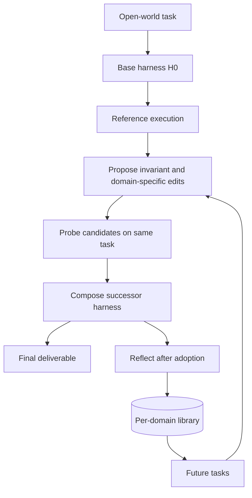

> 历史研究归档 · 2026-11-10 发布 · 发布审核状态：scan_only（发布前程序化隐私扫描）。原有日期、观点、数据和命令保留历史语境，未经本次逐项事实核验或运行复现；见[归档说明](../../../ARCHIVE_POLICY.md)。

# R167 · RSI 与 Harness² 自进化 Agent 机制调研

## 结论先行

这波“agent 自回归自进化”的主流实现，不是让模型在对话中直接改自己的权重，而是：

> **冻结基座模型，把 Agent 的外部 harness 当作可版本化对象；用固定任务集与独立评估器驱动“生成候选 harness → 执行 → 对比轨迹 → 采纳/回滚 → 沉淀经验”的外部进化闭环。**

换句话说，真正被递归修改的是 prompt、memory、skills、tools、workflow、agent code 和 optimizer 这些外部资产；模型的 next-token 生成能力保持不变。所谓“自回归”更准确的工程解释是：上一轮执行产物和轨迹成为下一轮改进输入，而不是模型参数在上下文里自训练。

Harness² 是这波路线里最清晰的开源样本：它把 task-level recursion 和 harnessing-level recursion 分成两层，前一层优化当前任务 harness，后一层沉淀“如何优化 harness”的经验库。论文自报在三个专业基准上有稳定提升，但结果是自报的，本轮只做了论文与源码结构核验，没有复现 benchmark。

对个人或业务系统的落地判断：先做**离线 harness optimization**，不要直接让 agent 自改生产配置。最小可行闭环需要固定任务集、可回放轨迹、独立 evaluator、证据门槛、版本化持久化、回滚和 held-out 验证；缺任何一项，都很容易把噪声、过拟合或 benchmark 泄漏固化成“进化成功”。

## 1. 定位透镜：RSI 到 harness-level RSI

### 1.1 RSI 的核心定义

Recursive Self-Improvement 的关键不是“输出比之前好一点”，而是：

1. 系统能对自身做持久修改；
2. 修改后的系统会影响后续改进的生成、评估和保留；
3. 改进结果可以跨任务或跨时间复用。

因此，一次 prompt 调优不一定是 RSI；把有效 prompt 写入版本库，并在后续任务检索、复用、继续修改，才接近 RSI。

### 1.2 两条主流路线

| 路线 | 被修改对象 | 典型机制 | 工程特点 |
|---|---|---|---|
| Foundation Model Improvement | 模型权重 | self-training、self-reward、RL、失败轨迹蒸馏 | 训练成本高，评估要求严格，容易过拟合和 reward hacking |
| Scaffolding / Harness Improvement | 外部系统 | prompt、memory、skills、tools、workflow、agent code、optimizer | 不改权重，可解释、可回滚、可审计，更容易在应用层落地 |

2026 年这波 agent 自进化论文大多落在第二条路线上，部分工作开始把 harness 与 policy 交替优化。

### 1.3 自进化层级

从工程可操作性看，可以按以下阶梯理解：

| 层级 | 改什么 | 典型证据 | 风险 |
|---|---|---|---|
| L1 Prompt | 系统提示词、输出格式 | 固定任务前后对比 | 容易过拟合少数样本 |
| L2 Context / Memory | 检索、记忆、经验库 | 跨任务复用、遗忘率、命中率 | 错误记忆长期污染 |
| L3 Workflow | 步骤编排、工具调用顺序 | 端到端成功率、成本、轨迹长度 | 流程僵化，泛化差 |
| L4 Harness / Agent code | Skills、tools、scripts、subagents、plugins | 可执行行为对比 | 改动面大，需要隔离与回滚 |
| L5 Optimizer / Meta-harness | 生成和选择 harness 的机制 | held-out 提升、采纳质量、库复用 | evaluator 被优化器欺骗 |
| L6 Harness + weights | 外部系统与模型参数联合进化 | 独立 benchmark 与安全评估 | 成本与风险最高，证据最难 |

Harness² 覆盖 L4 和 L5；Self-HPO 等工作延伸到 L6 的方向。多数个人系统应先在 L1-L4 建立证据链，再考虑 L5。

## 2. Harness² 源码级拆解

### 2.1 基本信息

| 项目 | 内容 |
|---|---|
| 论文 | Harness²: Recursive Agent Harnessing for an Open World |
| arXiv | [2610.14224](https://arxiv.org/abs/2610.14224)，2026-10-09 |
| 作者机构 | Google Cloud AI Research / Northwestern |
| 代码 | [google-research/harness2](https://github.com/google-research/harness2) |
| 本轮核验提交 | `1cfe254e8d25b15f37048c3730134686abe60335` |
| 许可 | Apache 2.0 |
| 网站 | [harness2.github.io](https://harness2.github.io) |

### 2.2 总体架构

Harness² 保持基座模型权重固定，把 Agent 拆成两个递归对象：

- **execution harness**：执行当前任务的运行时外壳；
- **improvement harness**：指导后续如何提出、组合和采纳 harness 改进的经验机制。



关键点是：任务内只改 execution harness；任务结束后才更新 improvement harness 的经验库。这种拆分避免了把某个任务的临时 hack 直接当成跨任务规律。

### 2.3 八个可编辑组件

Harness² 暴露的编辑面不是抽象配置项，而是实际挂载到 runtime 的文件树：

| 组件 | 作用 | 改进关注点 |
|---|---|---|
| System prompt | 身份、行为契约、输出规范 | 规划方式、交付形状、推理纪律 |
| Guardrails | 安全与操作边界 | 越权、破坏性操作、敏感信息 |
| Memory | 常驻上下文和事实 | 是否负担过重、是否污染后续任务 |
| Skills | 触发式领域能力 | 何时触发、是否可复用 |
| Tool guidance | 工具选择与调用规则 | 工具误用、参数构造、重试策略 |
| Scripts | 确定性辅助程序 | 重复计算、格式转换、校验 |
| Subagents | 委托与并行执行 | 任务拆分、上下文隔离、结果汇总 |
| Plugin / middleware | 控制循环与运行时扩展 | 生命周期、权限、中间件行为 |

这和 [R142](../04-%E5%B7%A5%E7%A8%8B%E5%AE%9E%E8%B7%B5/R142_LoopEngineering%E5%BE%AA%E7%8E%AF%E5%B7%A5%E7%A8%8B%E8%B0%83%E7%A0%94.md)、[R148](../06-%E5%B7%A5%E5%85%B7%E4%B8%8E%E7%94%9F%E6%80%81/R148_%E5%BC%80%E6%BA%90AgentHarness%E6%A8%AA%E8%AF%84_OpenClaw_Hermes%E4%B8%8E%E5%85%AD%E7%B1%BB%E9%AB%98%E5%85%89%E6%9C%BA%E5%88%B6.md)、[R149](../06-%E5%B7%A5%E5%85%B7%E4%B8%8E%E7%94%9F%E6%80%81/R149_OpenClaw%E4%B8%8EHermes%E5%9B%9B%E5%A4%A7Harness%E4%BA%AE%E7%82%B9%E6%BA%90%E7%A0%81%E6%B7%B1%E6%8B%86_%E5%AF%B9%E6%AF%94ClaudeCode.md) 的判断一致：harness 的价值不在“包了一层”，而在这些组件有明确所有权、版本和验证路径。

### 2.4 Task-level recursion：Propose → Probe → Compose

#### Propose

先跑一次当前 harness 的 reference execution。它不是正确答案，而是行为基线。编辑器基于任务、当前 harness、reference、历史执行和经验库，提出两类候选：

- **invariant candidate**：跨领域可能复用的通用改进，如规划、上下文管理、工具调用、委托；
- **domain-specific candidate**：当前领域或环境的知识、流程和约束。

候选不是自然语言建议，而是可直接执行的 harness 文件树。

#### Probe

在同一任务、同一模型、同一环境配置下执行候选 harness，得到候选轨迹和交付物。比较的重点不是“哪个答案看起来更好”，而是：

- 目标缺陷是否消失；
- 相关行为是否改变；
- 是否引入回归；
- 修改是否产生空输出、崩溃或超时。

论文明确承认执行随机性和共同模型偏差会限制证据强度，因此 probe 只提供行为对比，不冒充 ground truth。

#### Compose

Composer 读取 reference、候选 diff、候选执行和任务内全部证据，选择：

- 合并多个有效修改；
- 采纳一个候选；
- 保留 base harness；
- 修订冲突修改。

`KEEP_BASE` 被设计成合法结果，而不是失败。这一点很重要：没有证据支持的“进化”只会增加上下文成本和回归风险。

### 2.5 Parallel 与 sequential recursion

| 模式 | 机制 | 适合问题 | 代价 |
|---|---|---|---|
| Parallel | 同时探测 k 个 invariant 和 k 个 domain-specific 候选，再从共享证据池组合 k 个 successor | 探索面宽，减少单次噪声影响 | rollout 和 editor session 成本高 |
| Sequential | 第 r 轮基于第 r-1 轮 successor 和累积证据继续改进 | 深化单一方向，发现连锁改进 | 容易越改越窄，需要回退点 |

README 的表达很准确：parallel explores wider; sequential refines deeper。工程上两者不是二选一，而是预算和任务分布决定探索宽度与深度。

### 2.6 Harnessing-level recursion：经验库

任务结束后，Harness² 把 adopted harness 与 `EXPERIENCE.md` 存入 per-domain library。源码中的库结构为：

```text
<root>/<run-tag>/<mode>/<domain>/
  INDEX.md
  harnesses/<task>/harness/<rel>
  harnesses/<task>/EXPERIENCE.md
```

`EXPERIENCE.md` 要求至少包含：

- `cue`：什么形状的场景适用；
- `lesson`：对哪个组件执行什么可检查操作；
- `evidence`：依赖哪些执行对比。

源码里有三个值得借鉴的守门机制：

1. **经验必须绑定执行对比**：被采纳不等于有效；需要回读候选 diff、轨迹和 selection reasoning。
2. **入库前检查 grader / rubric 泄漏**：防止评分信息进入 harness 或经验库。
3. **按 domain 构造检索边界**：不把所有经验混成全局大杂烩，降低跨域污染。

这比常见“成功案例自动入库”更谨慎：它承认 adoption 是一个弱信号，真正要保存的是可复用的执行证据。

### 2.7 输出选择与反作弊

最终交付物通过匿名候选比较选择：

- 候选 ID 被打乱；
- selector 不知道哪个来自 base、哪个来自修改后的 harness；
- 选择规则优先看交付形状、符合度、事实一致性、内部一致性、可用性和完成度；
- 明确禁止把“更复杂、更长、更漂亮”当成改进。

这对自进化系统很关键：如果 evaluator 看得到候选来源，很容易偏好“看起来被改进过”的输出，而不是真正符合任务的输出。

### 2.8 源码地图

| 文件 | 职责 |
|---|---|
| `harness2/core/recursion.py` | task-level recursion 主流程 |
| `harness2/core/proposer.py` | harness editor session、重试与错误处理 |
| `harness2/core/selection.py` | 匿名候选选择、experience 蒸馏、泄漏检查 |
| `harness2/core/library.py` | per-domain adopted harness 与经验库 |
| `harness2/core/schedule.py` | benchmark sweep、任务流与运行编排 |
| `harness2/core/prompts.py` | invariant、domain、compose、select、reflect 等 prompt 契约 |

本轮核验结论：论文描述与开源实现结构一致；但 benchmark 结果、成本和跨模型迁移效果没有本地复现。

## 3. 论文自报结果与边界

### 3.1 结果

Harness² 在 WorkBuddy-Bench、JobBench、LAB 三个专业基准、四个 model-harness 配置上报告：

- 单个 contrastive step 的最高提升：
  - WorkBuddy-Bench：+11.5 points；
  - JobBench：+4.5 points；
  - LAB Partial pass rate：+11.8 percentage points。
- 增加任务级递归预算后的额外提升：
  - WorkBuddy-Bench：最高 +3.9 points；
  - JobBench：最高 +4.2 points；
  - LAB Partial：最高 +6.7 percentage points。

这些数字的意义是“论文在其选定设置内自报一致提升”，不是通用性能承诺。

### 3.2 限制

1. **成本高**：需要额外 reference rollout、candidate rollout 和 editor session；parallel k 越大成本越高。
2. **无 ground truth 时证据弱**：行为对比容易受随机性和共同模型偏差影响；单次 rollout 只能算弱证据。
3. **公开 benchmark 有泄漏风险**：executor 默认网络不受限时，agent 可能自行下载 rubric 或评分标准；评估前必须网络隔离。
4. **过拟合风险仍在**：domain library 能缓解任务特化，但无法保证跨域迁移。
5. **自报结果不等于本地可用**：个人任务的分布、工具权限和评估器质量都会改变结论。

## 4. 最近 RSI 论文谱系

### 4.1 综述：Self-Improvements in Modern Agentic Systems

[arXiv 2607.13104](https://arxiv.org/abs/2607.13104) 把现代 agent 自改进分成两大类：

- **Foundation Model Improvement**：修改模型权重或训练过程；
- **Scaffolding Improvement**：修改 prompt、工具、memory、workflow 和 agent code。

它给出的关键提醒是：很多“self-improvement”论文修改的是 scaffolding，却在叙述上暗示模型能力本身提升。读这类论文时必须先问“被修改的对象到底是什么”。

### 4.2 代表论文对照

| 论文 | arXiv | 核心机制 | 关键增量 | 工程启示 |
|---|---|---|---|---|
| RRSI | [2609.24972](https://arxiv.org/abs/2609.24972) | 递归自我改进，重点防过拟合 | annealed edit budget、critic、pruner | 自进化必须限制编辑量，不是越多越好 |
| MaD-RSI | [2610.28201](https://arxiv.org/abs/2610.28201) | 多模型失败轨迹作为训练证据 | 跨模型差异帮助定位 harness 缺陷 | 不同模型的失败模式比单一模型自评更有信息量 |
| Self-HPO | [2610.22791](https://arxiv.org/abs/2610.22791) | harness 与 policy 交替优化 | RL 更新模型，同时优化外部结构 | 进入 L6 前需要强评估与安全边界 |
| RSIFlow | [2610.21791](https://arxiv.org/abs/2610.21791) | 自适应 workflow + evolving meta-agent | workflow 成为被优化对象 | 先有可版本化 workflow，再谈自进化 |
| Meta^n | [2608.24735](https://arxiv.org/abs/2608.24735) | 固定 meta-operation 递归处理自身产物 | 控制递归语言，避免无限自我重写 | 固定 outer loop 比完全开放自改更稳 |
| Dream-RSI | [2609.14858](https://arxiv.org/abs/2609.14858) | 历史 discovery tree 作为 replay simulator | 离线优化探索策略，减少真实环境交互 | 自进化可以先在历史轨迹上模拟，再上线 |
| AI4AI-Bench | [2608.20318](https://arxiv.org/abs/2608.20318) | 评估“用 AI 改进 AI 训练算法” | 最强系统归一化分数仅 0.250 | “自动发明更好训练算法”仍远未解决 |
| RSI audit | [2610.27610](https://arxiv.org/abs/2610.27610) | 审计 90 篇自称 RSI 的论文 | 仅 22% 审计两次以上完整循环；60% 使用未参与选择任务评估 | 论文 claim 与评估设计必须对应 |

### 4.3 谱系判断

这些工作共同指向三个演化方向：

1. **改进对象从 prompt 走向 harness 与 optimizer**；
2. **证据从输出评分走向执行轨迹和行为对比**；
3. **持久化从一次性 checkpoint 走向经验库与版本化资产**。

但审计论文也说明：RSI 领域的叙事领先于证据。看到“recursive”“self-evolving”时，应优先检查它是否真的完成了至少两轮递归、是否用 held-out 任务评估、是否有独立 verifier。

## 5. 最小工程闭环

如果要在自己的系统里复用这套思想，不一定要照搬 Harness² 的八组件文件树，可以先做一个最小闭环：

### 5.1 必要组件

| 组件 | 最低要求 |
|---|---|
| 固定任务集 | 覆盖当前真实场景，不随优化器变化 |
| 可回放轨迹 | 保存 prompt、工具调用、输出、错误、成本和时间 |
| 独立 evaluator | 与候选生成器隔离；能区分格式、事实、完成度 |
| candidate mutation | 每次只改明确组件，记录 diff 和动机 |
| evidence gate | 只有执行对比支持的行为变化才入库 |
| 版本化持久化 | harness、经验、评估结果、随机种子都可追溯 |
| rollback | 任何候选可一键回到上一版本 |
| held-out 验证 | 用未参与选择的任务确认泛化 |
| 网络与权限隔离 | 评估时禁止访问答案、rubric 或生产写权限 |

### 5.2 推荐流程

1. 建立基线：当前 harness 在固定任务集上跑多次，记录成功率、成本、失败类型。
2. 生成候选：一次只改一个层级或少数组件，写明预期机制。
3. 对比执行：同一任务、同一模型、同一环境，保留完整轨迹。
4. 独立评估：不看候选来源，只看交付是否符合任务。
5. 证据过滤：无明确行为改善则 `KEEP_BASE`。
6. 入库：保存 diff、触发条件、证据和失败边界。
7. held-out 复验：跨任务、跨时间、必要时跨模型。
8. 人工闸口：生产写入、权限变化和不可逆操作必须审批。

### 5.3 不建议的做法

- 让 agent 直接改生产 prompt、权限或数据库配置；
- 只用“模型自评更喜欢”作为采纳标准；
- 把一次成功 rollout 泛化成全局规则；
- 无网络隔离地跑公开 benchmark；
- 没有版本和回滚就启用长期经验库；
- 用复杂度、长度或语气自信度替代任务完成度。

## 6. 与已有知识库的关系

- [R28](../03-%E5%AE%9E%E9%AA%8C%E9%AA%8C%E8%AF%81/R28_Skill%E8%87%AA%E8%BF%AD%E4%BB%A3%E6%9C%BA%E5%88%B6%E6%B7%B1%E5%BA%A6%E7%A0%94%E7%A9%B6.md) 已经覆盖 Skill 自迭代与 GEPA：R167 把这个问题上移到完整 harness 与 meta-harness。
- [R33](../05-%E8%AF%84%E4%BC%B0%E4%B8%8E%E8%B4%A8%E9%87%8F/R33_%E9%95%BF%E6%95%88AgentHarness%E5%B7%A5%E7%A8%8B%E5%8C%96.md)、[R148](../06-%E5%B7%A5%E5%85%B7%E4%B8%8E%E7%94%9F%E6%80%81/R148_%E5%BC%80%E6%BA%90AgentHarness%E6%A8%AA%E8%AF%84_OpenClaw_Hermes%E4%B8%8E%E5%85%AD%E7%B1%BB%E9%AB%98%E5%85%89%E6%9C%BA%E5%88%B6.md)、[R149](../06-%E5%B7%A5%E5%85%B7%E4%B8%8E%E7%94%9F%E6%80%81/R149_OpenClaw%E4%B8%8EHermes%E5%9B%9B%E5%A4%A7Harness%E4%BA%AE%E7%82%B9%E6%BA%90%E7%A0%81%E6%B7%B1%E6%8B%86_%E5%AF%B9%E6%AF%94ClaudeCode.md) 关注长效 Harness：R167 补上“harness 如何被递归优化”。
- [R142](../04-%E5%B7%A5%E7%A8%8B%E5%AE%9E%E8%B7%B5/R142_LoopEngineering%E5%BE%AA%E7%8E%AF%E5%B7%A5%E7%A8%8B%E8%B0%83%E7%A0%94.md) 关注 Loop Engineering：R167 说明 loop 之上的 optimizer 如何利用轨迹证据。
- [R34](../06-%E5%B7%A5%E5%85%B7%E4%B8%8E%E7%94%9F%E6%80%81/R34_HermesAgent%E5%BC%80%E6%BA%90%E8%87%AA%E5%AD%A6%E4%B9%A0%E6%99%BA%E8%83%BD%E4%BD%93.md)、[R35](../06-%E5%B7%A5%E5%85%B7%E4%B8%8E%E7%94%9F%E6%80%81/R35_HermesAgent%E8%AE%B0%E5%BF%86%E4%B8%8ESkill%E8%87%AA%E8%BF%AD%E4%BB%A3%E6%BA%90%E7%A0%81%E6%8B%86%E8%A7%A3.md) 关注 Hermes 自学习：R167 增加论文级 RSI 谱系与审计视角。
- [R46](../06-%E5%B7%A5%E5%85%B7%E4%B8%8E%E7%94%9F%E6%80%81/R46_%E5%A4%96%E9%83%A8%E8%B5%84%E8%AE%AF%E5%90%8C%E6%AD%A5_Agent%E6%8C%81%E7%BB%AD%E5%AD%A6%E4%B9%A0%E4%B8%89%E5%B1%82%E8%8C%83%E5%BC%8F.md)、[R48](../02-%E7%9F%A5%E8%AF%86%E7%AE%A1%E7%90%86%E4%B8%8E%E4%B8%8A%E4%B8%8B%E6%96%87/R48_Agent%E7%9F%A5%E8%AF%86%E5%B7%A5%E7%A8%8B%E5%85%A8%E6%99%AF%E8%B0%83%E7%A0%94.md)、[R72](../02-%E7%9F%A5%E8%AF%86%E7%AE%A1%E7%90%86%E4%B8%8E%E4%B8%8A%E4%B8%8B%E6%96%87/R72_Agent%E8%AE%B0%E5%BF%86%E7%B3%BB%E7%BB%9F%E6%A8%AA%E8%AF%84.md)、[R75](../02-%E7%9F%A5%E8%AF%86%E7%AE%A1%E7%90%86%E4%B8%8E%E4%B8%8A%E4%B8%8B%E6%96%87/R75_Obsidian%2BClaudeCode%E8%B6%8A%E7%94%A8%E8%B6%8A%E8%81%AA%E6%98%8E%E6%A8%A1%E5%BC%8F%E6%8B%86%E8%A7%A3.md) 关注持续学习与记忆：R167 强调经验入库必须绑定执行证据。

## 7. 给你的建议

1. **学习层面**：把 Harness² 当作 2026 年 harness-level RSI 的代表实现，重点读 `recursion.py`、`selection.py`、`library.py` 三个文件的职责边界。
2. **个人系统层面**：先为知识库或开发流程建一个只读 harness optimizer，输出候选 prompt/skill/workflow 和证据，不自动生效。
3. **业务系统层面**：任何自进化都先跑 shadow 任务集；生产生效必须经过版本化、回滚、held-out 验证和人工审批。
4. **阅读论文层面**：看到 RSI 先问四个问题：改的是权重还是 harness？是否完成两轮递归？evaluator 是否独立？是否有未参与选择的 held-out 任务？

## 来源与新鲜度

以下内容于 2026-10-26 检索和核验：

- [Harness² 论文](https://arxiv.org/abs/2610.14224)
- [Harness² 代码](https://github.com/google-research/harness2)
- [Harness² 网站](https://harness2.github.io)
- [Self-Improvements in Modern Agentic Systems](https://arxiv.org/abs/2607.13104)
- [RRSI](https://arxiv.org/abs/2609.24972)
- [MaD-RSI](https://arxiv.org/abs/2610.28201)
- [Self-HPO](https://arxiv.org/abs/2610.22791)
- [RSIFlow](https://arxiv.org/abs/2610.21791)
- [Meta^n](https://arxiv.org/abs/2608.24735)
- [Dream-RSI](https://arxiv.org/abs/2609.14858)
- [AI4AI-Bench](https://arxiv.org/abs/2608.20318)
- [RSI audit](https://arxiv.org/abs/2610.27610)

证据等级：

- 已核验：Harness² 论文摘要、机制描述、README 与源码结构；
- 未复现：三个 benchmark 的性能数字、成本、跨模型迁移和长期稳定性；
- 未验证：其他 RSI 论文的实验结果，仅作为谱系与机制对照。

## 开放问题

1. Harness² 的经验库在长周期任务流中是否会积累冲突或过时规则？
2. 行为对比在没有 ground truth 时，能否用多模型、多 rollout 降低共同偏差？
3. harness optimizer 与模型微调交替时，如何避免 evaluator 和 policy 共同漂移？
4. 私有业务系统的 held-out 任务集应如何构建，才既不泄漏生产数据又能代表真实分布？
5. 自进化系统的安全边界应该由 guardrails、runtime 权限还是人工审批承担主要责任？
