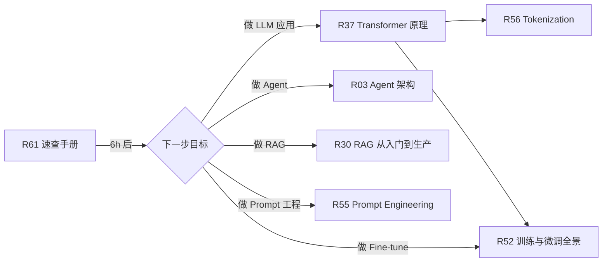

> 历史研究归档 · 2026-11-10 发布 · 程序扫描；未逐篇全文审阅。原有日期、观点、数据和命令保留历史语境，未经本次逐项事实核验或运行复现；请结合[归档说明](../../../ARCHIVE_POLICY.md)阅读。

# R61 · LLM 从业者数学与代码速查手册

> **一句话定位**：不是教材，是**速查卡 + 外部资源索引 + 最小心智模型**。给"想学/用 LLM，但不打算从头啃数学和深度学习"的应用工程师。
> **研究日期**：2026-04-24
> **关联报告**：[R54](../04-%E5%B7%A5%E7%A8%8B%E5%AE%9E%E8%B7%B5/R54_LLM%E4%BB%8E%E4%B8%9A%E8%80%85%E5%AD%A6%E4%B9%A0%E8%B7%AF%E7%BA%BF%E6%80%BB%E8%A7%88.md) 学习路线总览（本篇填 G1/G2/G3 三个缺口）、[R37](R37_Transformer%E5%8E%9F%E7%90%86%E4%BB%8E%E7%9B%B4%E8%A7%89%E5%88%B0%E4%BB%A3%E7%A0%81.md) Transformer 原理、[R52](../06-%E5%B7%A5%E5%85%B7%E4%B8%8E%E7%94%9F%E6%80%81/R52_%E6%A8%A1%E5%9E%8B%E8%AE%AD%E7%BB%83%E4%B8%8E%E5%BE%AE%E8%B0%83%E6%8A%80%E6%9C%AF%E5%85%A8%E6%99%AF.md) 训练与微调、[R56](R56_Tokenization%E6%B7%B1%E5%BA%A6%E8%A7%A3%E6%9E%90.md) Tokenization

---

## 🔖 TL;DR 速查卡

- **本篇不教你 ML/数学/PyTorch**，而是告诉你——用哪 3 套外部资源就够了、每套花多久、学到哪一步可以停
- **黄金路径**：3Blue1Brown 神经网络 4 集（2h）→ Karpathy Zero to Hero 第 1-2 集（3h）→ PyTorch 60 分钟闪电战（1h）= **6 小时建立可操作心智模型**
- **够用原则**：能看懂论文里的 $\text{softmax}(QK^T/\sqrt{d_k})V$、能读懂 `nn.Linear + nn.LayerNorm + F.scaled_dot_product_attention` 代码、能把 Hugging Face 示例跑起来——**就够做 LLM 应用了**
- **不够用的信号**：你要做预训练 / 自研算子 / 复现论文 —— 此时本篇不够，去读 [动手学深度学习](https://zh.d2l.ai/) 全本
- **最大陷阱**：数学党想从 PRML 啃起，代码党想一上来就手写 Transformer—— 两种路径都会**崩在第 3 周**。先建直觉，再看代码，最后才回补数学

---

## 📑 目录

- [🔭 定位透镜：为什么是速查而不是深度学](#定位透镜)
- [🎯 够用的标准：学到哪一步可以停](#够用标准)
- [G1 · ML 基础速查](#g1-ml-基础)
- [G2 · 数学直觉速查](#g2-数学直觉)
- [G3 · PyTorch 速查](#g3-pytorch)
- [🚀 统一 Hello World：30 行代码训一个 MLP](#hello-world)
- [🕳️ 避坑指南](#避坑指南)
- [📚 外部资源总表（一键打开）](#外部资源总表)
- [🎯 决策速查](#决策速查)

---

<a id="定位透镜"></a>
## 🔭 定位透镜：为什么是速查而不是深度学

### 纵轴 · 学习路径的演化

| 年代 | 主流入门路径 | 典型耗时 | 今天还值得吗 |
|------|-------------|---------|-------------|
| 2015 前 | Coursera 吴恩达 ML 课 + PRML/MLAPP 教材 | 6-12 个月 | ❌ 过时，研究方向变了 |
| 2016-2020 | 斯坦福 CS231n + CS224n + 动手学深度学习 | 3-6 个月 | ✅ 想做研究仍必读 |
| 2020-2023 | Fast.ai + HuggingFace 教程 | 1-2 个月 | ✅ 做应用够用 |
| 2023-2026 | **3B1B + Karpathy + PyTorch 官方** | **6-20 小时** | ✅ **本篇推荐路径** |

**关键转折**：2022 年底 ChatGPT 之后，"ML 从业者"分化成两类——
- **模型研发派**（Pre-train / 架构创新）：仍需要全栈数学和系统知识，< 5% 的从业者
- **模型应用派**（Prompt / RAG / Agent / Fine-tune）：只需要**读得懂论文 + 会调 API**，> 95% 的从业者

本篇服务后者。如果你属于前者，请直接去 [R52](../06-%E5%B7%A5%E5%85%B7%E4%B8%8E%E7%94%9F%E6%80%81/R52_%E6%A8%A1%E5%9E%8B%E8%AE%AD%E7%BB%83%E4%B8%8E%E5%BE%AE%E8%B0%83%E6%8A%80%E6%9C%AF%E5%85%A8%E6%99%AF.md) 训练全景和 [R37](R37_Transformer%E5%8E%9F%E7%90%86%E4%BB%8E%E7%9B%B4%E8%A7%89%E5%88%B0%E4%BB%A3%E7%A0%81.md) Transformer 深度，本篇对你太浅。

### 横轴 · 三条路径对比

| 路径 | 代表资源 | 总时长 | 优点 | 适合谁 |
|------|---------|-------|------|-------|
| **A. 本速查路径** | 3B1B + Karpathy + PyTorch Blitz | 6 小时 | 建立直觉最快、视觉化最强 | 应用工程师、产品/业务同学 |
| **B. 系统课程路径** | 动手学深度学习 + CS224n | 60-100 小时 | 覆盖全面、有数学推导 | 想做 LLM 研究/复现论文的人 |
| **C. 从头啃教材路径** | PRML + MLAPP + DL Book | 300+ 小时 | 理论最扎实 | 有志于理论研究、博士方向 |

> **本篇推荐 A**，但诚实标注：A 路径让你能**读懂**论文 80%，不代表你能**复现**。想复现论文请走 B。

### 交叉判断

- **演化告诉我们**：视觉化资源（3B1B、Karpathy）已经把门槛拉到历史最低，6 小时足够建立心智模型，过去需要 6 个月
- **竞争告诉我们**：老教材路径不是"更好"，而是"更全"——但对应用派，全不等于有用
- **独立结论**：**花 6 小时走 A 路径，如果后续做的是应用（而不是研究），你永远不会后悔；反过来直接上 B/C，80% 的人会中途放弃**

---

<a id="够用标准"></a>
## 🎯 够用的标准：学到哪一步可以停

完成本篇推荐路径后，你应该能做到以下五件事。**做不到就说明没学到位，做到了就可以停了**：

| # | 验收题 | 达标标准 |
|---|-------|---------|
| 1 | 看到 $\text{softmax}(QK^T/\sqrt{d_k})V$ 这个公式 | 能用一句话解释每个符号代表什么、为什么要除 $\sqrt{d_k}$ |
| 2 | 看到 `loss.backward(); optimizer.step()` | 能讲清楚这两行干了什么、为什么要 `zero_grad()` |
| 3 | 看到 "这个模型 7B 参数、FP16 加载" | 能心算出显存占用（~14GB） |
| 4 | 看到论文里的 "我们用 AdamW，lr=3e-4，warmup 2000 steps" | 能理解每个超参在控制什么 |
| 5 | 给你一个 HuggingFace 示例脚本 | 能看懂每一行、能按需改动（换模型/换数据） |

如果都能做到，**就不要再往下学数学了**，把时间花在读 [R37](R37_Transformer%E5%8E%9F%E7%90%86%E4%BB%8E%E7%9B%B4%E8%A7%89%E5%88%B0%E4%BB%A3%E7%A0%81.md)、[R52](../06-%E5%B7%A5%E5%85%B7%E4%B8%8E%E7%94%9F%E6%80%81/R52_%E6%A8%A1%E5%9E%8B%E8%AE%AD%E7%BB%83%E4%B8%8E%E5%BE%AE%E8%B0%83%E6%8A%80%E6%9C%AF%E5%85%A8%E6%99%AF.md)、[R55](../04-%E5%B7%A5%E7%A8%8B%E5%AE%9E%E8%B7%B5/R55_PromptEngineering%E7%B3%BB%E7%BB%9F%E5%8C%96%E8%B0%83%E7%A0%94.md) 这些上层报告上。

---

<a id="g1-ml-基础"></a>
## G1 · ML 基础速查

### 核心资源（强烈推荐）

> 🎥 **[3Blue1Brown — Neural Networks 系列](https://www.3blue1brown.com/topics/neural-networks)**（4 集，约 70 分钟）
> - YouTube 播放列表：<https://www.youtube.com/playlist?list=PLZHQObOWTQDNU6R1_67000Dx_ZCJB-3pi>
> - B 站搬运（中文字幕）：搜索 "3Blue1Brown 神经网络"
> - 看完后能回答：神经网络本质上在做什么？反向传播在干什么？梯度下降为什么有效？

### 最小心智模型（看完视频后的速查）

```
神经网络 = 一个参数化的函数 f(x; θ)
训练  = 找一组 θ 让 loss(f(x), y) 最小
反向传播 = 用链式法则自动算 ∂loss/∂θ
梯度下降 = θ ← θ - η · ∂loss/∂θ
```

### 必知的 10 个概念（每个一句话）

| 概念 | 一句话解释 | 在 LLM 里对应 |
|------|-----------|--------------|
| **Loss Function** | 衡量"预测和真实差多远"的函数 | Cross-Entropy（预测下一个 token） |
| **Gradient** | loss 对参数的偏导，指向"loss 增大最快的方向" | `loss.backward()` 自动算 |
| **SGD / Adam / AdamW** | 用梯度更新参数的三种策略 | LLM 几乎全用 AdamW |
| **Learning Rate (lr)** | 每次更新走多大一步 | LLM 预训练 ~1e-4、SFT ~2e-5 |
| **Batch Size** | 一次用多少样本估计梯度 | 越大越稳但越费显存 |
| **Epoch** | 完整过一遍数据集 | LLM 预训练常常 < 1 个 epoch |
| **Overfitting** | 训练集好但测试集差 | LLM 时代已不是主要矛盾 |
| **Regularization** | 防过拟合的手段（L2 / Dropout / LayerNorm） | LLM 主要用 LayerNorm + Weight Decay |
| **Activation** | 引入非线性的函数（ReLU / GELU / SiLU） | Transformer FFN 层用 GELU/SwiGLU |
| **Softmax** | 把实数向量变成概率分布 | 预测下一个 token 的分布 |

### 够用信号

看完 3B1B 后如果能用自己的话回答："为什么深度网络能学会复杂任务？"（答：多层线性变换+非线性激活=可以逼近任意函数；梯度下降能在高维空间找到局部最优；数据量大时局部最优往往足够好）—— 就 **G1 毕业**。

---

<a id="g2-数学直觉"></a>
## G2 · 数学直觉速查

### 核心资源（强烈推荐）

> 🎥 **[Karpathy — Neural Networks: Zero to Hero](https://karpathy.ai/zero-to-hero.html)** 第 1-2 集（约 3 小时）
> - GitHub 仓库（含 notebook）：<https://github.com/karpathy/nn-zero-to-hero>
> - YouTube 频道：<https://www.youtube.com/@AndrejKarpathy>
> - **第 1 集 micrograd**：手撸自动微分（理解反向传播最清楚的教程）
> - **第 2 集 makemore (bigram)**：最简单的语言模型（理解什么叫"建模 token 分布"）
>
> 🎥 **线代直觉**：[3Blue1Brown — Essence of Linear Algebra](https://www.3blue1brown.com/topics/linear-algebra)（可选，15 集 ~3h，只看 1/3/4/9/11 集也行）
>
> 🎥 **微积分直觉**：[3Blue1Brown — Essence of Calculus](https://www.3blue1brown.com/topics/calculus)（可选，12 集 ~3h，看完前 3 集就够）

### 最小心智模型：LLM 真正用到的数学

```
线性代数 ── 矩阵乘法 (Q·K^T)、向量点积（语义相似度）、SVD（了解即可）
微积分   ── 偏导（反向传播）、链式法则（backward）
概率论   ── 条件概率 P(next_token | context)、交叉熵、KL 散度
```

**就这些**。你不需要懂群论、不需要懂测度论、不需要懂拓扑。

### 必知的 8 个公式/概念

| 概念 | 公式 / 一句话 | 在哪会遇到 |
|------|--------------|----------|
| **点积（相似度）** | $a \cdot b = \sum a_i b_i$ | Attention、向量检索 |
| **矩阵乘法** | $C_{ij} = \sum_k A_{ik} B_{kj}$ | 线性层、Attention |
| **Softmax** | $\text{softmax}(x_i) = \frac{e^{x_i}}{\sum_j e^{x_j}}$ | Attention 归一化、下一 token 分布 |
| **链式法则** | $\frac{\partial L}{\partial x} = \frac{\partial L}{\partial y} \cdot \frac{\partial y}{\partial x}$ | 反向传播 |
| **梯度下降** | $\theta \leftarrow \theta - \eta \nabla_\theta L$ | 所有训练过程 |
| **交叉熵** | $H(p, q) = -\sum p_i \log q_i$ | 语言模型 loss |
| **KL 散度** | $D_{KL}(p \| q) = \sum p_i \log \frac{p_i}{q_i}$ | DPO/PPO 正则项 |
| **Bayes 公式** | $P(A|B) = \frac{P(B|A)P(A)}{P(B)}$ | 理解条件概率和先验 |

### 够用信号

跟着 Karpathy micrograd 视频**自己手敲一遍**（不要只看），能独立解释"为什么 `Value` 类要存 `_backward` 闭包" —— 就 **G2 毕业**。

> 💡 **强烈建议**：micrograd 是我见过解释反向传播最清楚的教程，没有之一。它会用 ~100 行纯 Python 实现一个能跑的自动微分系统，跑完你会明白 PyTorch `backward()` 里到底藏了什么。

---

<a id="g3-pytorch"></a>
## G3 · PyTorch 速查

### 核心资源

> 🎥 **[PyTorch 官方 60 分钟闪电战](https://pytorch.org/tutorials/beginner/deep_learning_60min_blitz.html)**（中文版：<https://pytorch.apachecn.org/>）
> - 覆盖：Tensor、autograd、nn.Module、训练一个 CNN
>
> 📖 **[动手学深度学习 (d2l)](https://zh.d2l.ai/)** （备查工具书，不通读）
> - PyTorch 版：<https://zh.d2l.ai/chapter_preface/index.html>
> - 英文版：<https://d2l.ai/>
> - 用法：遇到具体问题时查对应章节（比如想懂 LayerNorm 就看第 8 章）
>
> 📖 **[HuggingFace Transformers 文档](https://huggingface.co/docs/transformers)**（应用派真正用得最多的）
> - Quicktour: <https://huggingface.co/docs/transformers/quicktour>
> - 30 分钟能把 pipeline / AutoModel / AutoTokenizer 搞清楚

### 必会的 15 个 API（按重要性排序）

```python
# ── Tensor 基础 ──
torch.tensor([1,2,3])              # 创建
torch.randn(3, 4)                  # 随机初始化
x.to('cuda'); x.cpu()              # 设备切换
x.shape, x.dtype                   # 形状和类型
x.view(...), x.reshape(...)        # 变形（view 共享内存、reshape 可能拷贝）

# ── 自动微分 ──
x.requires_grad_(True)
loss.backward()                    # 反向传播
optimizer.zero_grad()              # 清梯度（必做，否则累加）
optimizer.step()                   # 更新参数
with torch.no_grad(): ...          # 推理时禁梯度（省显存）

# ── nn.Module ──
class MyModel(nn.Module):
    def __init__(self):
        super().__init__()
        self.linear = nn.Linear(10, 20)
        self.norm   = nn.LayerNorm(20)
    def forward(self, x):
        return self.norm(self.linear(x))

# ── 常用层 ──
nn.Linear(in, out)                 # 线性变换（最常用）
nn.LayerNorm(dim)                  # LLM 标配归一化
nn.Embedding(vocab_size, dim)      # token → vector
F.scaled_dot_product_attention(Q, K, V)  # LLM 时代一行搞定 Attention

# ── 训练循环 ──
optim = torch.optim.AdamW(model.parameters(), lr=3e-4)
for batch in dataloader:
    pred = model(batch.x)
    loss = F.cross_entropy(pred, batch.y)
    optim.zero_grad(); loss.backward(); optim.step()
```

### 够用信号

能**不看教程**独立写出一个"线性模型 + 训练循环 + 测试"的 `.py`（20 行内），跑通一个自己编的玩具数据集—— 就 **G3 毕业**。

---

<a id="hello-world"></a>
## 🚀 统一 Hello World：30 行代码训一个 MLP

**目的**：跑通这段代码 = G1+G2+G3 全部过关。

### 环境

```bash
# 依赖版本（2026-04 验证）
python >= 3.10
pip install torch==2.3.0 numpy==1.26.4
```

### 代码（`hello_mlp.py`）

```python
import torch
import torch.nn as nn
import torch.nn.functional as F

# ── 1. 准备玩具数据：学一个 XOR ──
X = torch.tensor([[0.,0.],[0.,1.],[1.,0.],[1.,1.]])
y = torch.tensor([0, 1, 1, 0])  # XOR 真值表

# ── 2. 定义一个两层 MLP ──
class MLP(nn.Module):
    def __init__(self):
        super().__init__()
        self.fc1 = nn.Linear(2, 8)
        self.fc2 = nn.Linear(8, 2)
    def forward(self, x):
        return self.fc2(F.relu(self.fc1(x)))

model = MLP()
optim = torch.optim.AdamW(model.parameters(), lr=1e-2)

# ── 3. 训练循环 ──
for step in range(500):
    logits = model(X)                     # 前向
    loss = F.cross_entropy(logits, y)     # 交叉熵
    optim.zero_grad()                     # 清梯度
    loss.backward()                       # 反向传播
    optim.step()                          # 更新参数
    if step % 100 == 0:
        acc = (logits.argmax(-1) == y).float().mean().item()
        print(f"step {step:3d}  loss {loss.item():.4f}  acc {acc:.2f}")

# ── 4. 验证 ──
print("\n最终预测：", model(X).argmax(-1).tolist())
print("真实标签：", y.tolist())
```

### 预期输出

```
step   0  loss 0.7123  acc 0.50
step 100  loss 0.3245  acc 1.00
step 200  loss 0.0812  acc 1.00
step 300  loss 0.0201  acc 1.00
step 400  loss 0.0067  acc 1.00

最终预测： [0, 1, 1, 0]
真实标签： [0, 1, 1, 0]
```

### 如果跑通了意味着什么

- ✅ 你用 PyTorch 定义了一个神经网络（G3）
- ✅ 你用了 AdamW 做梯度下降（G1）
- ✅ 你理解了交叉熵作为分类 loss（G2）
- ✅ 你走完了"前向 → loss → 反向 → 更新"完整循环（G1+G2+G3）

**这时候可以合上这篇，去看 [R37](R37_Transformer%E5%8E%9F%E7%90%86%E4%BB%8E%E7%9B%B4%E8%A7%89%E5%88%B0%E4%BB%A3%E7%A0%81.md) Transformer 了**。

---

<a id="避坑指南"></a>
## 🕳️ 避坑指南

| 坑 | 原因 | 解法 |
|----|------|------|
| 上来就读 Ian Goodfellow《Deep Learning》700 页大书 | 该书是博士参考书，不是入门书 | 改成 3B1B 视频 + Karpathy，6 小时起步 |
| 视频只"看"不"手敲代码" | 看视频会产生"我懂了"的错觉 | Karpathy 所有教程都自己跑一遍 notebook |
| 忘了 `optimizer.zero_grad()` | PyTorch 梯度默认累加，不清就叠加上一步 | 写训练循环时死记三句话：`zero_grad / backward / step` |
| `tensor.view()` 和 `reshape()` 分不清 | `view` 共享内存但要求连续，`reshape` 可能拷贝 | 纠结时统一用 `reshape`，99% 场景一样 |
| 训练不收敛就怀疑模型结构 | 90% 是 lr 错了（太大炸、太小不动） | 先试 `3e-4` 和 `1e-3`，再调别的 |
| GPU 代码在 CPU 上跑得飞慢 | 没 `.to('cuda')` 或数据加载没并行 | 训练前统一 `model.to(device); x.to(device)` |
| 数据类型炸裂（float32 vs float16 vs bfloat16） | LLM 时代混精度成常态 | 应用派先用 `torch.float32` 活下去，再学混精度 |
| HuggingFace 模型下载慢 | 国内直连 Hub 慢 | 设置 `export HF_ENDPOINT=https://hf-mirror.com` |
| 一上来就想看 LLaMA 源码 | 跨度太大，必然放弃 | 先跑 Karpathy 的 `makemore`（40MB，两层 Transformer） |
| 以为学完本篇就能做预训练 | 本篇只教了"读懂 + 应用"层面 | 做预训练请走 [R52](../06-%E5%B7%A5%E5%85%B7%E4%B8%8E%E7%94%9F%E6%80%81/R52_%E6%A8%A1%E5%9E%8B%E8%AE%AD%E7%BB%83%E4%B8%8E%E5%BE%AE%E8%B0%83%E6%8A%80%E6%9C%AF%E5%85%A8%E6%99%AF.md) + 动手学深度学习全本 + CS224n |

---

<a id="外部资源总表"></a>
## 📚 外部资源总表（一键打开）

### 🥇 强烈推荐（本速查手册推荐路径）

| # | 资源 | 时长 | 链接 | 备注 |
|---|------|------|------|------|
| 1 | 3Blue1Brown — Neural Networks | 70min | <https://www.3blue1brown.com/topics/neural-networks> | 建立神经网络直觉最佳 |
| 2 | Karpathy — Zero to Hero（第 1-2 集） | 3h | <https://karpathy.ai/zero-to-hero.html> | 手撸反向传播 + bigram LM |
| 3 | Karpathy — Zero to Hero GitHub | - | <https://github.com/karpathy/nn-zero-to-hero> | notebook 源码 |
| 4 | PyTorch 60 分钟闪电战 | 60min | <https://pytorch.org/tutorials/beginner/deep_learning_60min_blitz.html> | 官方 Quickstart |
| 5 | PyTorch 中文文档 | - | <https://pytorch.apachecn.org/> | API 速查 |

### 🥈 备查工具书（遇到具体问题再翻）

| 资源 | 链接 | 什么时候查 |
|------|------|-----------|
| 动手学深度学习 (d2l 中文) | <https://zh.d2l.ai/> | 想系统学某一章节（如 RNN、CNN） |
| 动手学深度学习 (d2l English) | <https://d2l.ai/> | 英文版 |
| HuggingFace Transformers Docs | <https://huggingface.co/docs/transformers> | 用 HF 做任何事前必查 |
| HuggingFace NLP 课程 | <https://huggingface.co/learn/nlp-course> | 想系统学 LLM 应用 |
| PyTorch Tutorials 索引 | <https://pytorch.org/tutorials/> | 找具体任务的官方示例 |

### 🥉 进阶（跨过速查手册之后）

| 资源 | 链接 | 适合谁 |
|------|------|-------|
| 3B1B — Essence of Linear Algebra | <https://www.3blue1brown.com/topics/linear-algebra> | 想把线代直觉打牢 |
| 3B1B — Essence of Calculus | <https://www.3blue1brown.com/topics/calculus> | 想把微积分直觉打牢 |
| StatQuest with Josh Starmer | <https://statquest.org/> | 想补概率统计直觉 |
| Karpathy — Let's build GPT | <https://www.youtube.com/watch?v=kCc8FmEb1nY> | Zero to Hero 第 7 集，从零搭 GPT |
| Karpathy — nanoGPT | <https://github.com/karpathy/nanoGPT> | 300 行实现完整 GPT |
| CS224n (Stanford NLP) | <https://web.stanford.edu/class/cs224n/> | 想走 LLM 研究路线 |
| CS336 (Stanford LLM) | <https://stanford-cs336.github.io/spring2024/> | 2024 新开，聚焦 LLM 训练 |
| Neel Nanda — Transformer Circuits | <https://www.neelnanda.io/mechanistic-interpretability> | 想做可解释性研究 |
| The Little Book of Deep Learning | <https://fleuret.org/public/lbdl.pdf> | 200 页浓缩版 DL 教材（免费 PDF） |

### 📺 中文替代（如果英文视频吃力）

| 资源 | 链接 |
|------|------|
| 李沐 — 动手学深度学习视频 | <https://space.bilibili.com/1567748478>（B 站） |
| 李宏毅 — 机器学习 2024 | <https://speech.ee.ntu.edu.tw/~hylee/ml/2024-spring.php> |
| 3B1B B 站官方号 | <https://space.bilibili.com/88461692> |

---

<a id="决策速查"></a>
## 🎯 决策速查

### 该走本篇速查路径 ✅

- 你是应用工程师/产品经理/业务同学，想搞懂 LLM 是怎么工作的
- 你打算做 Prompt / RAG / Agent / Fine-tune，不打算做预训练
- 你时间有限（< 20 小时能投入）
- 你学过编程（Python 基础够），但数学和 ML 是白纸

### 不该走本篇、改走其他路径 ❌

| 你的目标 | 该走的路径 |
|---------|-----------|
| 做 LLM 研究、复现论文 | 动手学深度学习全本 + CS224n + CS336 |
| 做模型架构创新 | 先读 [R37](R37_Transformer%E5%8E%9F%E7%90%86%E4%BB%8E%E7%9B%B4%E8%A7%89%E5%88%B0%E4%BB%A3%E7%A0%81.md)、再读 Transformer 原论文、再看 nanoGPT 源码 |
| 做预训练工程 | 见 [R52](../06-%E5%B7%A5%E5%85%B7%E4%B8%8E%E7%94%9F%E6%80%81/R52_%E6%A8%A1%E5%9E%8B%E8%AE%AD%E7%BB%83%E4%B8%8E%E5%BE%AE%E8%B0%83%E6%8A%80%E6%9C%AF%E5%85%A8%E6%99%AF.md) 模型训练与微调全景 |
| 做推理优化 / CUDA 算子 | 见 [R58](../04-%E5%B7%A5%E7%A8%8B%E5%AE%9E%E8%B7%B5/R58_LLM%E6%8E%A8%E7%90%86%E9%83%A8%E7%BD%B2%E5%B7%A5%E7%A8%8B%E6%8C%87%E5%8D%97_%E9%87%8F%E5%8C%96%E4%B8%8E%E6%8E%A8%E7%90%86%E5%BC%95%E6%93%8E.md) 推理部署工程指南 + CUDA 编程入门 |
| 只想当"会用 ChatGPT 的人" | 本篇都太深了，去 <https://learnprompting.org/> |

### 学完本篇之后的下一步路线



---

## ⚠️ 局限性与开放问题

- **本篇刻意浅**：如果你读完觉得"好像学了但又好像没学到底层"，这是**设计**，不是 bug。深度请走 [R52](../06-%E5%B7%A5%E5%85%B7%E4%B8%8E%E7%94%9F%E6%80%81/R52_%E6%A8%A1%E5%9E%8B%E8%AE%AD%E7%BB%83%E4%B8%8E%E5%BE%AE%E8%B0%83%E6%8A%80%E6%9C%AF%E5%85%A8%E6%99%AF.md) 或外部系统课
- **资源时效性**：2026-04 时点有效。Karpathy 视频和 3B1B 内容稳定，PyTorch 2.x API 稳定；但 HuggingFace 文档每几个月大改，遇到 API 变动以官网为准
- **没覆盖的主题**：CNN、RNN、GAN、Diffusion —— 对 LLM 从业者优先级不高，故省略。如需补充看动手学深度学习对应章节即可
- **开放问题**：是否需要出一个"0 基础读者的 Python 速查手册"？目前假设读者有 Python 基础，如果发现实际情况不是，再考虑

---

## 📌 来源清单

- [3Blue1Brown Neural Networks](https://www.3blue1brown.com/topics/neural-networks) — 持续更新，最近观看 2026-04 — 免费、视觉化 DL 教程天花板
- [Karpathy Zero to Hero](https://karpathy.ai/zero-to-hero.html) — 2023 发布，2026 仍有效 — 反向传播/GPT 从零实现
- [PyTorch Tutorials](https://pytorch.org/tutorials/) — 官方持续更新 — PyTorch 2.x API
- [动手学深度学习 d2l](https://zh.d2l.ai/) — 2024 最新版 — 中文深度学习系统教材
- 模型训练知识 — 作为基础背景参考

⚖️ **来源一致性**：所有推荐资源均经过社区长期验证（3B1B 3M+ 订阅、Karpathy 作为 OpenAI/Tesla 前研究员教程业内公认、PyTorch 官方）—— 多源一致，高置信
📅 **时效性声明**：2026-04-24 验证所有链接可访问

---

## 🔗 交叉引用与定位

- **上游依赖**：无（本篇是路线图入口之一）
- **下游报告**：[R37](R37_Transformer%E5%8E%9F%E7%90%86%E4%BB%8E%E7%9B%B4%E8%A7%89%E5%88%B0%E4%BB%A3%E7%A0%81.md) Transformer 原理（下一步深入）、[R52](../06-%E5%B7%A5%E5%85%B7%E4%B8%8E%E7%94%9F%E6%80%81/R52_%E6%A8%A1%E5%9E%8B%E8%AE%AD%E7%BB%83%E4%B8%8E%E5%BE%AE%E8%B0%83%E6%8A%80%E6%9C%AF%E5%85%A8%E6%99%AF.md) 训练与微调（更深层）、[R55](../04-%E5%B7%A5%E7%A8%8B%E5%AE%9E%E8%B7%B5/R55_PromptEngineering%E7%B3%BB%E7%BB%9F%E5%8C%96%E8%B0%83%E7%A0%94.md) Prompt Engineering（应用层）、[R56](R56_Tokenization%E6%B7%B1%E5%BA%A6%E8%A7%A3%E6%9E%90.md) Tokenization（配套底层知识）
- **路线图位置**：[R54](../04-%E5%B7%A5%E7%A8%8B%E5%AE%9E%E8%B7%B5/R54_LLM%E4%BB%8E%E4%B8%9A%E8%80%85%E5%AD%A6%E4%B9%A0%E8%B7%AF%E7%BA%BF%E6%80%BB%E8%A7%88.md) 学习路线总览 G1/G2/G3 三个缺口的合并填补
- **修订历史**：2026-04-24 初版（合并 G1/G2/G3，含外部链接收录）
