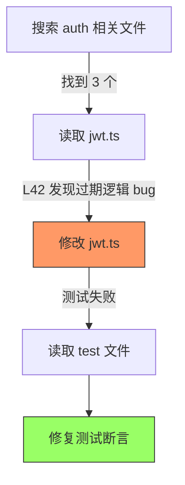

> 历史研究归档 · 2026-11-10 发布 · 程序扫描；未逐篇全文审阅。原有日期、观点、数据和命令保留历史语境，未经本次逐项事实核验或运行复现；请结合[归档说明](../../../ARCHIVE_POLICY.md)阅读。

# Agent 多层记忆系统深度调研

> **一句话概括**：从理论基础到产品选型到工程实现，系统梳理 Agent 多层记忆系统的全貌——认知心理学四层模型、五大主流框架横评（Mem0/Letta/Zep/LangMem/自建）、两个生产级系统的源码级拆解（TencentDB 五层压缩管线 / Honcho Dream 异步巩固）、四个可复用的核心设计模式（含最小 Python 实现），以及选型决策树。
>
> **研究日期**：2026-05-19
> **适用读者**：需要为 Agent 产品选型或自建记忆系统的技术团队

---

## 目录

1. [为什么 Agent 需要多层记忆](#一为什么-agent-需要多层记忆)
2. [理论基础：认知心理学四层模型](#二理论基础认知心理学四层模型)
3. [赛道全景：从 Buffer 到 Knowledge Graph 的演化](#三赛道全景从-buffer-到-knowledge-graph-的演化)
4. [五大框架横评](#四五大框架横评)
5. [生产级系统源码拆解](#五生产级系统源码拆解)
6. [四个核心设计模式（含代码）](#六四个核心设计模式)
7. [演化前沿：Agent Dreaming](#七演化前沿agent-dreaming异步记忆巩固)
8. [选型决策树](#八选型决策树)
9. [落地建议与成本估算](#九落地建议与成本估算)
10. [来源清单](#十来源清单)

---

## 一、为什么 Agent 需要多层记忆

单层记忆（把所有历史对话塞进 context window）的三个致命问题：

1. **Token 溢出**：GPT-4o 128K / Claude 200K 窗口看似够大，但一个复杂任务的工具调用日志轻松突破 50K tokens——真正留给"思考"的空间被压缩
2. **注意力衰减**（Lost in the Middle, Liu et al. 2024）：当 context 过长时，模型对中间部分的信息严重忽视——注入更多 ≠ 效果更好
3. **无法跨会话积累**：对话结束 = 记忆清零。用户第二天回来，Agent 不认识你了

多层记忆的核心思想：**按时间尺度和抽象程度分层存储，每层有不同的写入/读取/淘汰策略**——就像人脑有工作记忆（秒级）、情景记忆（天级）、语义记忆（月级）、肌肉记忆（年级）。

---

## 二、理论基础：认知心理学四层模型

这套分层来自 Endel Tulving (1972) 的记忆分类理论 + Squire (1996) 的扩展。当前最完整的 Agent 记忆分层模型（agentmemory 项目提出）是：

```
┌─────────────────────────────────────────────────────────────┐
│  Layer 1 · Working Memory（工作记忆）                         │
│  存什么：当前会话的原始工具输出和对话内容                        │
│  时间尺度：分钟级                                             │
│  实现：内存 buffer / context window                            │
│  触发：每次工具调用或用户输入                                   │
│  去重：SHA-256 + 5min 滑动窗口                                │
│  例子："刚刚搜索了 auth.ts，发现 L42 有 JWT 过期 bug"          │
├─────────────────────────────────────────────────────────────┤
│  Layer 2 · Episodic Memory（情景记忆）                        │
│  存什么：压缩后的会话摘要——"什么时候做了什么"                    │
│  时间尺度：小时到天                                           │
│  触发：会话结束时 LLM 批量摘要                                 │
│  实现：带时间戳的文档库（向量索引 + metadata filter）           │
│  例子："2026-05-15 修了 auth 模块的 JWT 过期 bug"              │
├─────────────────────────────────────────────────────────────┤
│  Layer 3 · Semantic Memory（语义记忆）                        │
│  存什么：从多次情景中抽取的事实、偏好、规律                      │
│  时间尺度：天到月                                             │
│  触发：定期巩固 / 积累 N 条 Episodic 后触发                    │
│  实现：结构化 KV 或知识图谱（entity→relation→entity）          │
│  例子："该项目用 jose 替代 jsonwebtoken，因为 Edge 兼容"        │
├─────────────────────────────────────────────────────────────┤
│  Layer 4 · Procedural Memory（程序性记忆）                    │
│  存什么：反复验证的工作流、决策模式、"怎么做"                    │
│  时间尺度：周到月                                             │
│  触发：同一模式在 Semantic 层被识别出现 ≥3 次                   │
│  实现：Skill 文件 / Instruction / 决策模板                     │
│  例子："遇到性能问题先 profile 再优化，不要凭直觉猜"            │
└─────────────────────────────────────────────────────────────┘
```

### 层间流动机制

层之间不是静态存储桶，是有**升级和降级通道**的动态系统：

```
Working ──压缩──→ Episodic ──抽象──→ Semantic ──固化──→ Procedural
   │               │                │                │
   └─ 每次观察     └─ 会话结束       └─ N次后抽取     └─ ≥3次验证
      PostToolUse     LLM摘要           LLM事实抽取      人工/LLM审核

降级通道（反方向）：
  Procedural 被发现不再适用 → 标注"已废弃"降回 Semantic
  Semantic 事实被新证据推翻 → 更新或删除
  Episodic 长期未被检索 → Ebbinghaus 衰减驱逐
```

---

## 三、赛道全景：从 Buffer 到 Knowledge Graph 的演化

### 纵轴 · 演化脉络

```
2022 ─── LangChain ConversationBufferMemory（朴素拼接 chat_history）
  │      └─ 痛点：超 token 就崩，无任何"提炼"
  │
2023.01 ─ ConversationSummaryMemory / VectorStoreRetrieverMemory
  │      └─ 用 LLM 总结 + 向量检索补救，但策略硬编码
  │
2023.10 ─ MemGPT 论文 (UC Berkeley, NeurIPS'23) ★ 关键转折
  │      └─ 第一次把记忆当"操作系统虚拟内存"管理
  │         引入 main_context (RAM) + archival_storage (Disk) + 自我编辑
  │
2024.Q1 ─ Mem0 v0 发布（YC S24）
  │      └─ 商业化路线：把"自动事实抽取 + 三类记忆"做成 SaaS
  │
2024.Q2 ─ Zep 引入 Graphiti（temporal knowledge graph）
  │      └─ 从 chat-summary 转向"事实级别的关系图 + 时间戳"
  │
2024.Q4 ─ MemGPT 重新品牌化为 Letta
  │      └─ 从"记忆是核心"扩展为"stateful agent 平台"
  │
2025.01 ─ LangMem 发布 (LangChain-AI)
  │      └─ 不做"框架"，做"原语"——和 LangGraph BaseStore 绑定
  │
2025.04 ─ Mem0 v3 算法：single-pass ADD-only + entity linking + 多信号检索
  │      └─ 在 LongMemEval 跑到 93.4 分，确立赛道评测标杆
  │
2025末  ─ TencentDB Agent Memory 开源（Mermaid 符号化压缩）
  │      └─ 第一个完整公开"实时上下文管理"源码的生产系统
  │
2026   ─ Honcho Dream（surprisal 驱动异步巩固）
         └─ Agent Dreaming 概念进入生产级实现
```

### 横轴 · 生命周期判断

- 赛道还在快速演化——2025 年至少 3 篇里程碑论文
- 基础抽象已收敛：「事实抽取 + 检索 + 遗忘策略」三件套是共识，差异在实现路线
- 下一波趋势：① 多模态记忆 ② 多 Agent 记忆联邦 ③ 主动遗忘（dropout-style）

---

## 四、五大框架横评

### 4.1 速查对比表

| 维度 | **Mem0** | **Letta (MemGPT)** | **Zep** | **LangMem** | **自建 Redis** |
|------|----------|-------------------|---------|-------------|--------------|
| GitHub Stars | 54k | 22.3k | 4.5k | 1.4k | — |
| License | Apache 2.0 | Apache 2.0 | 仅 Cloud（OSS 已弃用）| MIT | 自定 |
| 部署形态 | OSS + Cloud | OSS + Cloud | Cloud only | Library | 自托管 |
| 核心抽象 | User/Session/Agent 三类记忆 | Memory Blocks + Archival + Recall | 时序知识图谱 (Graphiti) | BaseStore + Tools | Redis + Embedding + Recency |
| 学术依据 | arXiv:2504.19413 (2025) | MemGPT NeurIPS'23 | Graphiti 2024 | 无独立论文 | 工程实践 |
| 自动化水平 | 高（自动抽取存储） | 中（Agent 自己决定存什么） | 高（自动构图） | 低（显式 tool call） | 最低（全手写） |
| Benchmark | LongMemEval 93.4 | — | — | — | — |
| 对四层的覆盖 | Working ❌ Episodic ✅ Semantic ✅ Procedural ❌ | Working ✅ Episodic ✅ Semantic ✅ Procedural ❌ | Working ❌ Episodic ✅ Semantic ✅ Procedural ❌ | 全部需自建 | 全部需自建 |

### 4.2 设计哲学坐标系

```
              自动化程度
              ↑  高
              │
   Mem0 ──────┤────────── Zep
  (自动事实抽取)│         (自动构图)
              │
       Letta──┤
   (半自动+自我编辑)
              │
              │     LangMem ────── 自建 Redis
              │    (显式tool)      (完全手写)
              ↓  低
              ←─────────────────────────────────→ 控制力
              低                            高
```

### 4.3 各家核心架构拆解

#### A. Mem0：自动事实抽取 + 三类记忆

```python
# 三类记忆 namespace
memory.add(messages, user_id="alice")       # User: 跨会话稳定的用户事实
memory.add(messages, run_id="session-42")   # Session: 单会话内的临时事实
memory.add(messages, agent_id="travel-bot") # Agent: Agent 自己的状态/学到的规则

# 检索
results = memory.search("用户的饮食偏好", user_id="alice")
```

**内部管线**：对话流入 → LLM 单遍事实抽取 → 实体链接（新事实 vs 更新旧事实）→ 多信号存储（Vector + BM25 + Entity Index）→ 检索时三路 Score Fusion。

**v3 算法创新**（2025-04）：
- Single-pass ADD-only：一次 LLM 调用完成抽取 + 去重 + 更新决策（之前需要多轮）
- 多信号检索：语义(cosine) + 关键词(BM25) + 实体(entity linking) 三路融合
- LongMemEval 93.4 分（比上版 +26 分）

**适用场景**：客服机器人 / SaaS 产品个性化 / 不想关心存储细节的团队

**局限**：OSS 版与 Cloud 版功能差距拉大（dashboard/高级功能仅 Cloud），有 vendor lock-in 风险

---

#### B. Letta (MemGPT)：Agent 自我编辑记忆

```python
# Letta 的核心概念：Agent 有"内存"和"磁盘"
# 内存 = core_memory（随时可见的 persona/human block）
# 磁盘 = archival_storage（需要显式 search 才能读取）

# Agent 通过工具调用自己管理记忆：
agent.core_memory_append(key="human", content="用户偏好靠过道座位")
agent.archival_memory_insert(content="2026-05-15 会话摘要...")
results = agent.archival_memory_search(query="用户的旅行偏好")
```

**核心架构**：
- **core_memory**：persona block（Agent 人设）+ human block（用户信息），始终注入 context
- **archival_storage**：无限容量的向量库，Agent 通过 search 工具按需取回
- **recall_storage**：对话历史的结构化存储
- **sleep-time agents**：Agent 在用户离线时自己整理记忆（独家功能）

**学术血统**：UC Berkeley, NeurIPS 2023。首次将操作系统虚拟内存概念映射到 LLM——core_memory 就是 RAM，archival 就是 Disk，Agent 自己管 page-in/page-out。

**适用场景**：角色扮演 / 个人助理 / 长任务执行 / 需要 Agent "自我学习"的场景

**局限**：self-editing 意味着 Agent 可能写入错误记忆，需要人工审核机制

---

#### C. Zep：时序知识图谱

```python
# Zep 的核心是 Graphiti——时序知识图谱
# 不是存"对话摘要"，是存"事实 + 事实之间的关系 + 时间线"

# 自动从对话中构建图谱：
# 用户说"我换了新工作，现在在字节跳动" →
#   节点：[Alice] -- works_at --> [ByteDance]  valid_from=2026-05
#   旧边：[Alice] -- works_at --> [Alibaba]    valid_to=2026-05（失效标记）
```

**核心创新**：
- **Temporal Facts**：每条边有 valid_from / valid_to，支持事实失效追踪
- **自动 invalidation**：新事实进来时自动检测并标记旧的矛盾事实
- **< 200ms p95 延迟**（官方声明）

**适用场景**：业务事实频繁演变的领域——CRM / 医疗 / 法务 / 客服

**局限**：Community Edition 2025 年已正式弃用，现在是纯商业产品。选 Zep = 选 Cloud = 做好预算

---

#### D. LangMem：轻量 Store 原语

```python
# LangMem 不是"框架"，是"装在 LangGraph 里的工具组"
from langmem import MemoryStore

store = MemoryStore()
# Hot-path 模式：Agent 对话中通过 tool 显式存取
# Background 模式：后台 manager 定期整理

# 与 LangGraph BaseStore 深度集成
store.put(namespace="user_facts", key="diet", value="素食主义")
results = store.search(namespace="user_facts", query="饮食偏好")
```

**设计哲学**："不要给我框架，给我 read/write/search 三个原语"。记什么、怎么记、什么时候记，全由 Agent 或开发者决定。

**适用场景**：已经 all-in LangGraph 生态的团队，想轻量集成，不想引入重型框架

**局限**：独立使用价值有限；无自动抽取、无自动巩固——一切需要自己实现

---

#### E. 自建 Redis 方案

```python
"""最小自建记忆系统（~200 行核心代码）"""
import redis
import json
from sentence_transformers import SentenceTransformer

r = redis.Redis()
model = SentenceTransformer("BAAI/bge-small-zh-v1.5")

def store_memory(user_id: str, content: str, memory_type: str = "episodic"):
    embedding = model.encode(content).tolist()
    key = f"memory:{user_id}:{memory_type}:{uuid4()}"
    r.json().set(key, "$", {
        "content": content,
        "embedding": embedding,
        "timestamp": datetime.now().isoformat(),
        "access_count": 0,
        "type": memory_type,
    })

def search_memory(user_id: str, query: str, top_k: int = 5):
    query_emb = model.encode(query).tolist()
    # Redis Vector Search (RediSearch module)
    results = r.ft(f"idx:{user_id}").search(
        Query(f"*=>[KNN {top_k} @embedding $vec AS score]")
        .sort_by("score")
        .return_fields("content", "timestamp", "score")
        .dialect(2),
        query_params={"vec": np.array(query_emb, dtype=np.float32).tobytes()}
    )
    return results
```

**适用场景**：< 1 万用户 / 内网部署 / 数据合规要求高 / 预算有限

**优势**：完全可控、无 vendor lock-in、200 行起步就能跑

**局限**：所有高级功能（自动抽取、矛盾检测、衰减淘汰）都要自己实现

---

### 4.4 关键能力对比矩阵

| 能力 | Mem0 | Letta | Zep | LangMem | 自建 |
|------|------|-------|-----|---------|------|
| 自动事实抽取 | ✅ 强 | ❌ 靠 Agent 自己 | ✅ 自动构图 | ❌ | ❌ |
| 事实矛盾检测 | ✅ entity linking | 部分（self-edit 时判断） | ✅ temporal invalidation | ❌ | 需自建 |
| 跨会话记忆 | ✅ | ✅ | ✅ | ✅ | ✅ |
| Agent 自学习 | ❌ | ✅ sleep-time agents | ❌ | ❌ | ❌ |
| 向量+关键词混合检索 | ✅ 多信号融合 | ✅ archival search | ✅ 图谱+向量 | 取决于 Store 实现 | 需自建 |
| 遗忘/淘汰机制 | 部分 | ❌ | ✅ temporal validity | ❌ | 需自建 |
| Token 预算控制 | ❌ | ✅ context window 管理 | ❌ | ❌ | 需自建 |
| 多租户 | ✅ user_id 隔离 | ✅ agent-per-user | ✅ | 需自建 | 需自建 |
| 部署成本 | 低(Cloud) / 中(OSS) | 中 | 高(仅Cloud) | 低 | 低 |

---

## 五、生产级系统源码拆解

### 5.1 TencentDB Agent Memory：五层短期压缩 + 四层长期蒸馏

**项目信息**：腾讯数据库团队，2026-05 开源，1636 Stars，TypeScript，MIT License。

**诞生背景**：在 OpenClaw（编码 Agent）上跑 SWE-bench 连续 50 题时，工具日志（搜索结果、代码片段、报错堆栈）吃掉了绝大多数 Token，Agent"看到了太多细节反而看不清全局"。

**核心创新**：用 **Mermaid 流程图做"符号化缓存层"** 替代传统文本摘要。

#### 短期 Offload Pipeline（五层渐进压缩）

```
每次工具调用结束
    │
    ▼
┌─── L1：捕获与存储 ────────────────────────────┐
│  after-tool-call hook 拦截工具输出               │
│  双写：offload.jsonl（结构化） + refs/*.md（原始）│
│  跳过：heartbeat / 重复 ID / approval-pending    │
└────────────────────┬──────────────────────────┘
                     │
                     ▼
┌─── L1.5：边界判定 ────────────────────────────┐
│  判断当前工具调用序列是"短任务"还是"长任务"       │
│  短任务（如读单个文件）→ 不触发 Mermaid          │
│  长任务（多步骤序列）→ 标记为需要 L2 处理        │
└────────────────────┬──────────────────────────┘
                     │ 长任务
                     ▼
┌─── L2：Mermaid 生成 ──────────────────────────┐
│  触发条件：累积 N 个未处理条目 OR 超时            │
│  LLM 生成/更新 Mermaid 流程图                    │
│  回填每个 entry 的 node_id 映射                  │
│  产出：mmds/{mmdId}.mmd 文件                    │
└────────────────────┬──────────────────────────┘
                     │
                     ▼
┌─── MMD 注入：插入上下文 ──────────────────────┐
│  将当前活跃的 Mermaid 图注入对话消息             │
│  位置：最新 user message 之后                    │
│  增量更新：fingerprint 检测变化才重新注入        │
│  Token 预算：超过 mmdMaxTokenRatio 则不注入      │
└────────────────────┬──────────────────────────┘
                     │ Token 超阈值
                     ▼
┌─── L3：三级压缩 ──────────────────────────────┐
│                                                │
│  Mild（≥85% mild threshold）：                  │
│    按重要性评分排序，低分条目替换为摘要引用       │
│    当前任务 node 受保护，历史任务优先压缩         │
│                                                │
│  Aggressive（仍超阈值）：                       │
│    直接删除旧消息 + 注入历史 MMD 补偿信息损失    │
│    历史 MMD 插在 active MMD 之前（时间顺序）     │
│                                                │
│  Emergency（≥95% context window）：             │
│    硬删到只保留最近 N 条消息                     │
│    最后防线，极端情况才触发                      │
└───────────────────────────────────────────────┘
```

**注入的 Mermaid 示例**：



**为什么 Mermaid 比文本摘要好**：工具调用之间的因果关系、时序关系、分支在流程图中一目了然；文本摘要丢失结构信息，且容易产生幻觉。

**CJK-aware 快速 Token 估算**（避免每次都跑 tiktoken）：

```typescript
function quickCountTokens(text: string): number {
  let cjk = 0;
  for (let i = 0; i < text.length; i++) {
    const c = text.charCodeAt(i);
    if ((c >= 0x4e00 && c <= 0x9fff) || ...) cjk++;
  }
  return Math.ceil(cjk * 1.5 + (text.length - cjk) / 4);
}
```

只有快速估算接近阈值（85% mild）时才强制精确计算，大幅减少 tiktoken 开销。

#### 长期蒸馏管线（L0→L3 语义金字塔）

```
L0 Conversation（原始对话）
  ↓ extract
L1 Atom/Record（原子事实："用户偏好 dark theme"）
  ↓ aggregate
L2 Scene/Scenario（场景块："debug auth 模块"）
  ↓ synthesize
L3 Persona（用户画像综合）
```

每层都显式标注来源——从 L3 Persona 可以追溯到 L2 哪个 Scene → L1 哪条 Atom → L0 哪段对话。**全链路可白盒审计**。

**实测效果**：SWE-bench 连续 50 题场景下 Token 省 33%、任务通过率涨 10%。

---

### 5.2 Honcho Dream：surprisal 驱动的异步记忆巩固

**项目信息**：Plastic Labs，3.4K Stars，AGPL-3.0，Python。

**核心隐喻**：模拟人类 REM 睡眠——人睡着后大脑不是空闲的，而是在重播和巩固白天的记忆，**选择性地加工"意外"经历**。

#### 架构概览

```
用户与 Agent 对话 → Messages 写入 Honcho
                         ↓
                 Deriver 后台 Worker（异步）
                    ├─ Representation（用户画像）
                    ├─ Summary（会话摘要）
                    ├─ Peer Card（用户名片）
                    └─ Dream（做梦处理）★
                              ↓
                    计算每条 observation 的 surprisal
                              ↓
                    只取 top 10% 高意外度 → 深度分析
                              ↓
                    更新 Representation
                              ↓
                    下次对话时 context injection
```

#### 为什么用 surprisal（信息论基础）

如果 Agent 的用户模型预测"这个用户喜欢简洁回复"，但用户突然要求了一份 500 行的详细报告——这就是高 surprisal 事件。**符合预期的观察不需要处理**（现有模型已经准确），**只有"打破预期"的信息才值得深度加工**。

这与人脑 REM 睡眠的选择性机制同构——不是所有白天经历都被巩固，只有高"意外度"的经验才被重点加工。

#### 关键配置参数

```toml
[dream]
TOP_PERCENT_SURPRISAL = 0.10       # 只处理前 10% 最意外的观察
MIN_HIGH_SURPRISAL_FOR_REPLACE = 10  # 至少 10 个高意外观察才触发模型替换
SAMPLING_STRATEGY = "recent"         # recent, random, all
TREE_K = 5                           # kNN tree 的 k 值
```

#### 多模型分工

| 任务 | 模型选择 | 理由 |
|------|---------|------|
| 日常 observation 提取 | Gemini（便宜、快） | 批量处理，不需要强推理 |
| Dream 深度推理 | Anthropic（贵、强） | 发现非显而易见的模式 |
| Summary 生成 | Gemini | 摘要是确定性任务 |
| Dialectic 查询 | 按 reasoning level 分档 | minimal→max 五档 |

#### Dialectic API：查询用户模型

```python
# 问 Honcho 用户模型
response = session.dialectic("这个用户的学习风格是什么？", level="medium")

# 获取 context injection（summary + representation + messages）
context = session.context(summary=True, tokens=10_000)
```

---

## 六、四个核心设计模式

从上述系统中提炼出四个**可独立借鉴、不依赖任何特定框架**的通用模式。

### 模式 1：四层巩固（含最小实现）

```python
"""四层记忆巩固 — 最小可运行实现（~60 行）"""
from dataclasses import dataclass, field
from datetime import datetime
from hashlib import sha256
from typing import Optional


@dataclass
class Observation:
    content: str
    timestamp: datetime = field(default_factory=datetime.now)
    hash: str = ""
    def __post_init__(self):
        self.hash = sha256(self.content.encode()).hexdigest()[:16]


@dataclass
class EpisodicEntry:
    summary: str
    session_id: str
    timestamp: datetime
    access_count: int = 0


@dataclass
class SemanticFact:
    subject: str
    predicate: str
    object: str
    confidence: float = 1.0
    source_episodes: list[str] = field(default_factory=list)


class FourTierMemory:
    def __init__(self):
        self.working: list[Observation] = []
        self.episodic: list[EpisodicEntry] = []
        self.semantic: list[SemanticFact] = []
        self._seen_hashes: set[str] = set()

    def observe(self, content: str) -> Optional[Observation]:
        """Working 层：捕获新观察，去重"""
        obs = Observation(content)
        if obs.hash in self._seen_hashes:
            return None
        self._seen_hashes.add(obs.hash)
        self.working.append(obs)
        return obs

    def end_session(self, session_id: str, summarize_fn):
        """Working → Episodic：会话结束时压缩"""
        if not self.working:
            return
        raw_text = "\n".join(o.content for o in self.working)
        summary = summarize_fn(raw_text)  # LLM 调用
        self.episodic.append(EpisodicEntry(
            summary=summary, session_id=session_id, timestamp=datetime.now()
        ))
        self.working.clear()
        self._seen_hashes.clear()

    def consolidate(self, extract_facts_fn):
        """Episodic → Semantic：定期巩固，抽取事实"""
        unconsolidated = [e for e in self.episodic if e.access_count == 0]
        if len(unconsolidated) < 3:
            return  # 攒够 3 条再巩固
        text = "\n".join(e.summary for e in unconsolidated)
        facts = extract_facts_fn(text)  # LLM 抽取 (subject, pred, obj)
        for s, p, o in facts:
            self.semantic.append(SemanticFact(
                subject=s, predicate=p, object=o,
                source_episodes=[e.session_id for e in unconsolidated]
            ))
        for e in unconsolidated:
            e.access_count += 1
```

---

### 模式 2：RRF 融合检索

**问题**：单一检索方法有盲区——BM25 缺语义理解，向量检索缺精确匹配，图检索依赖图的完整度。

**方案**：多路检索结果通过 Reciprocal Rank Fusion 融合。

**算法**：对于文档 d，它在第 i 个排序列表中排名为 r_i(d)，则：

$$\text{RRF}(d) = \sum_{i=1}^{n} \frac{1}{k + r_i(d)}, \quad k=60$$

k=60 是 Cormack et al. (SIGIR 2009) 原始论文的实验最优值——控制头部和尾部的分数差距处于甜区。

```python
"""RRF 融合检索 + Session 多样性去重"""
from collections import defaultdict


def rrf_fuse(
    *ranked_lists: list[str],
    k: int = 60,
    top_n: int = 10,
) -> list[tuple[str, float]]:
    """多路排序列表融合为统一排序"""
    scores: dict[str, float] = defaultdict(float)
    for ranked_list in ranked_lists:
        for rank, doc_id in enumerate(ranked_list, start=1):
            scores[doc_id] += 1.0 / (k + rank)
    return sorted(scores.items(), key=lambda x: x[1], reverse=True)[:top_n]


# 示例：BM25 + Vector + Graph 三路融合
bm25_results  = ["doc_A", "doc_C", "doc_B", "doc_E", "doc_F"]
vector_results = ["doc_B", "doc_A", "doc_D", "doc_C", "doc_G"]
graph_results  = ["doc_D", "doc_B", "doc_A", "doc_H", "doc_I"]

fused = rrf_fuse(bm25_results, vector_results, graph_results)
# doc_A 在三个列表中都排前列 → 融合后得分最高
```

**何时用 RRF**：知识库 > 1000 条 + 查询有关键词和语义双重需求。知识库 < 100 条用 BM25 就够了。

---

### 模式 3：Ebbinghaus 衰减 + 矛盾检测

**问题**：记忆无限增长 + 旧事实不自动失效 + 新旧事实矛盾无人处理。

**Ebbinghaus 遗忘曲线**（1885）：记忆保持率随时间指数衰减 $R(t) = e^{-t/S}$，但每次"回忆"（被检索命中）会增强 S，使衰减变慢——间隔重复的理论基础。

```python
"""Ebbinghaus 衰减 + 矛盾检测"""
import math
from dataclasses import dataclass, field
from datetime import datetime


@dataclass
class MemoryEntry:
    content: str
    created_at: datetime = field(default_factory=datetime.now)
    access_count: int = 0
    base_importance: float = 1.0
    strength: float = 1.0          # S 参数，初始=1，每次访问增强
    superseded_by: str | None = None

    def decay_score(self, now: datetime | None = None) -> float:
        """当前重要性分数"""
        now = now or datetime.now()
        hours = (now - self.created_at).total_seconds() / 3600
        retention = math.exp(-hours / (self.strength * 24))  # S 以天为单位
        access_boost = 1 + math.log1p(self.access_count)
        return self.base_importance * retention * access_boost

    def on_accessed(self):
        """被检索命中时调用"""
        self.access_count += 1
        self.strength *= 1.5  # 半衰期延长 50%


def detect_contradiction(new_fact, existing_facts):
    """同主语同谓语但宾语不同 = 矛盾"""
    subj, pred, obj = new_fact
    for e_subj, e_pred, e_obj, entry_id in existing_facts:
        if e_subj == subj and e_pred == pred and e_obj != obj:
            return entry_id  # 旧事实应被标记为 superseded
    return None


def evict_stale(memories: list[MemoryEntry], threshold: float = 0.01):
    """驱逐过期/被取代的记忆"""
    alive, evicted = [], []
    for m in memories:
        if m.superseded_by or m.decay_score() < threshold:
            evicted.append(m)
        else:
            alive.append(m)
    return alive, evicted
```

**参数参考值**：

| 参数 | 含义 | 推荐范围 |
|------|------|---------|
| S 初始值 | 记忆初始半衰期 | 0.5-7 天 |
| 访问增强系数 | 每次命中后 S 的增幅 | ×1.2-2.0 |
| 驱逐阈值 | 低于此分数被清理 | 0.001-0.05 |

---

### 模式 4：Token 预算控制

**问题**：记忆系统天然倾向"尽可能多注入"，但 Lost in the Middle 效应表明注入更多 ≠ 效果更好。

**方案**：硬约束注入总量 + 按类型分配配额 + 位置感知排列。

```python
"""Token 预算控制"""
from dataclasses import dataclass


@dataclass
class BudgetConfig:
    total_tokens: int = 2000
    procedural_ratio: float = 0.30   # "怎么做"最有操作价值
    semantic_ratio: float = 0.40     # "是什么"次之
    episodic_ratio: float = 0.20    # "上次做了什么"
    profile_ratio: float = 0.10    # "这个项目/用户是什么"


def fill_budget(memories_by_type, budget):
    """贪心填充：每种类型内按 importance 排序，填到配额用尽"""
    injected = []
    for mem_type, quota in budget.items():
        remaining = quota
        candidates = sorted(
            memories_by_type.get(mem_type, []),
            key=lambda x: x[1], reverse=True  # 按 importance 降序
        )
        for content, score, tokens in candidates:
            if tokens <= remaining:
                injected.append(content)
                remaining -= tokens
    return injected
```

**Lost in the Middle 对策**：高重要性记忆放 context 头部和尾部，低重要性放中间：

```
[高重要性 1]   ← 注意力集中区（开头）
[高重要性 2]
[中等重要性]   ← 注意力低谷区（中间）
[中等重要性]
[高重要性 3]   ← 注意力恢复区（结尾）
```

2000 tokens 是验证过的默认预算——约 1500 中文字 / 500 英文词，足够 5-8 条关键记忆。

---

### 四个模式的协作管线

```
新观察输入
    ↓
[模式1: 四层巩固] → 决定"存在哪层"
    ↓
[模式3: 衰减+矛盾] → 决定"还活不活"
    ↓
[模式2: RRF融合] → 决定"搜出哪些"
    ↓
[模式4: Token预算] → 决定"注入哪些"
    ↓
Agent 上下文
```

---

## 七、演化前沿：Agent Dreaming（异步记忆巩固）

Agent 记忆系统的演化四阶段：

| 阶段 | 时间 | 代表 | 核心能力 |
|------|------|------|---------|
| 无记忆 | ~2023 | 原始 ChatGPT | 对话结束 = 记忆清零 |
| 被动记忆 | 2024 | Mem0, Zep | 用户说了什么就记什么 |
| 主动记忆 | 2025 | Hermes nudge, Claude auto-memory | Agent 主动决定存什么 |
| **离线整理** | 2025末~2026 | **Honcho Dream, Hermes Background Review** | Agent 在后台"做梦"整理 |

"做梦"的三件事：

1. **后台异步处理**：Agent 不和用户交互的时候不是空闲——在后台跑处理管线
2. **Surprisal 筛选**：不处理所有历史，只处理"打破预期"的高意外度观察
3. **主动模型更新**：Agent 的用户理解不断演化，而不是停留在上次对话结束时

| 对比 | Honcho Dream | Hermes Background Review | Letta sleep-time |
|------|-------------|------------------------|-----------------|
| 触发时机 | 后台异步（有 time-guard 防频繁） | 会话结束后 fork 一个 Agent 副本 | 用户离线时 |
| 筛选机制 | ✅ surprisal（信息论基础） | ❌ 全量处理 | ❌ 无筛选 |
| 用户模型演化 | ✅ representation 持续更新 | ❌ 基于 nudge 规则 | 部分（inner monologue） |
| 多模型分工 | ✅ 日常 Gemini + 深度 Anthropic | ❌ 单模型 | ❌ 单模型 |
| 开源可用 | ✅ AGPL-3.0 | ✅ MIT | ✅ Apache 2.0 |

**趋势判断**：异步记忆巩固是多层记忆系统的下一个必备能力。Honcho 是目前唯一有信息论基础（surprisal）的生产级实现。

---

## 八、选型决策树

```
你需要 Agent 记忆系统吗？
│
├── 对话 < 20 轮，无需跨会话记住任何东西
│   └── 【不需要】直接用 ChatHistory 拼接
│
├── 需要跨会话记住用户偏好/事实
│   │
│   ├── 预算充足 + 不想自运维
│   │   ├── 事实频繁变更（CRM/医疗/法务）
│   │   │   └── → Zep Cloud（时序图谱 + 自动 invalidation）
│   │   └── 通用场景（客服/SaaS 个性化）
│   │       └── → Mem0 Cloud（评测最高 + 最快上线）
│   │
│   ├── 需要 Agent 自学习 / 角色扮演 / 长任务
│   │   └── → Letta（sleep-time agents + 自我编辑 独一档）
│   │
│   ├── 已在 LangGraph 生态
│   │   └── → LangMem（零成本集成，但高级功能需自建）
│   │
│   └── 数据合规 / 内网部署 / 预算有限 / < 1万用户
│       └── → 自建 Redis + Embedding（200 行起步，完全可控）
│
├── 需要在长任务中管理上下文膨胀
│   └── → 参考 TencentDB 的 Offload Pipeline 思路
│       （Mermaid 符号化 + 三级渐进压缩）
│
└── 需要 Agent "越用越聪明"
    └── → Honcho Dream（surprisal 驱动）
        或 Hermes Background Review（轻量版）
```

---

## 九、落地建议与成本估算

### 成本速算

| 方案 | 月费（1万用户量级）| 说明 |
|------|------------------|------|
| Mem0 Cloud | $200-500/月 | 按 memory 数量计费 |
| Letta Cloud | $300-800/月 | 按 Agent 实例计费 |
| Zep Cloud | 联系销售 | Enterprise tier，按用量 |
| LangMem | $0（库本身） | LLM 调用费另计 |
| 自建 Redis | $50-100/月（服务器） | 加上 Embedding 模型推理费 |

### 每条记忆的 LLM 成本

- 事实抽取（Mem0 模式）：~500 input tokens + ~100 output tokens / 条 ≈ $0.001-0.003
- 深度推理（Dream 模式）：~2000 input + ~500 output / 次 ≈ $0.01-0.03
- Mermaid 生成（TencentDB 模式）：~3000 input + ~800 output / 次 ≈ $0.02-0.05

### 分阶段落地建议

**Phase 1（1-2 周）**：先跑通最简版本
- 选一个框架（推荐 Mem0 OSS 或自建），对接现有 Agent
- 只实现 Episodic + Semantic 两层，不做 Working 和 Procedural
- 验证：用户第二天回来，Agent 是否记得昨天的事

**Phase 2（2-4 周）**：加入检索优化
- 引入 RRF 融合（BM25 + Vector 双路）
- 加入 Token 预算控制（硬约束 2000 tokens）
- 验证：检索准确率是否比纯向量提升

**Phase 3（1-2 月）**：加入高级机制
- Ebbinghaus 衰减 + 矛盾检测
- 根据场景决定是否引入 Dream（异步巩固）
- 验证：长期使用后记忆质量是否持续提升

---

## 十、来源清单

**学术论文**
- Tulving, E. (1972). Episodic and semantic memory — 记忆分类理论奠基
- Squire, L.R. & Zola (1996). Declarative and nondeclarative memory systems — 双分支模型
- Cormack, Clarke & Büttcher (2009). RRF outperforms Condorcet, SIGIR — RRF 原始论文
- Packer et al. (2023). MemGPT: Towards LLMs as Operating Systems, NeurIPS — Agent 虚拟内存
- Liu et al. (2024). Lost in the Middle, arXiv:2307.03172 — 长上下文注意力衰减
- Chhikara et al. (2025). Mem0: Production-Ready AI Agents with Scalable Long-Term Memory, arXiv:2504.19413

**开源项目**（2026-05 获取）
- [Mem0](https://github.com/mem0ai/mem0) — 54k Stars, Apache 2.0
- [Letta](https://github.com/letta-ai/letta) — 22.3k Stars, Apache 2.0
- [Zep/Graphiti](https://github.com/getzep/graphiti) — 4.5k Stars
- [LangMem](https://github.com/langchain-ai/langmem) — 1.4k Stars, MIT
- [TencentDB Agent Memory](https://github.com/Tencent/TencentDB-Agent-Memory) — 1.6k Stars, MIT
- [Honcho](https://github.com/plastic-labs/honcho) — 3.4k Stars, AGPL-3.0
- [agentmemory](https://github.com/rohitg00/agentmemory) — 四层模型概念参考

**来源一致性**：高（学术论文 + 开源源码 + 产品文档交叉验证）
**时效性声明**：本报告数据截至 2026-05-19。赛道演化快，建议 6 个月后 review 各框架最新版本。
