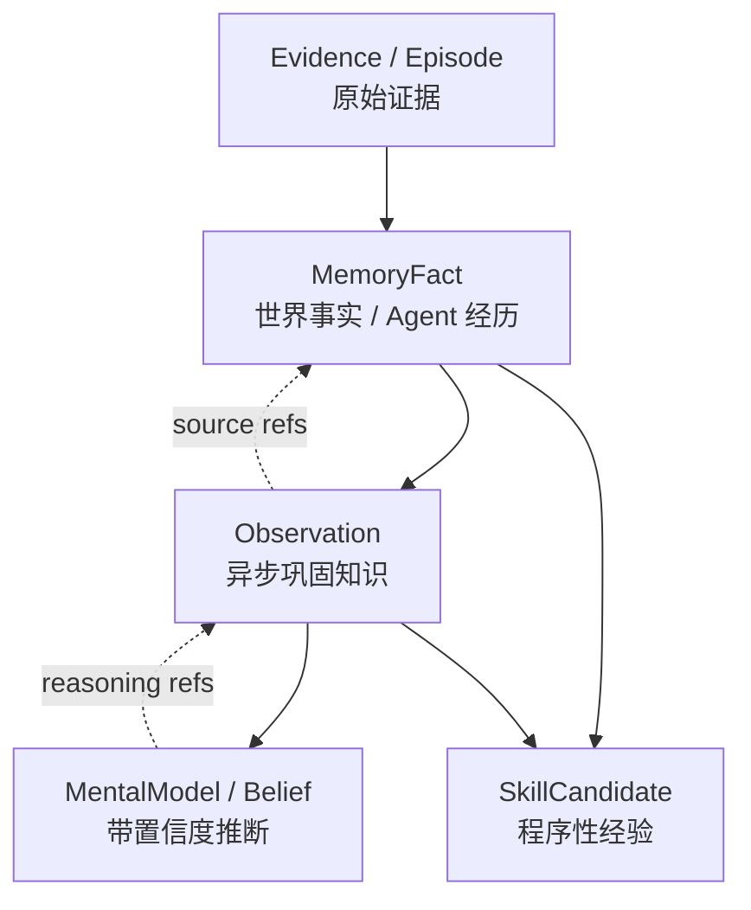

> 历史研究归档 · 2026-11-10 发布 · 发布审核状态：scan_only（发布前程序化隐私扫描）。原有日期、观点、数据和命令保留历史语境，未经本次逐项事实核验或运行复现；见[归档说明](../../../ARCHIVE_POLICY.md)。

# Agent Memory 与 Dream 分项冠军融合设计

> **一句话结论**：Hermes 强在 Agent 生命周期集成，不是 Memory 总冠军；当前更合理的组合是 Hindsight 分层与可靠归纳、Honcho 两阶段 Dream、Letta commit-gated 版本化、Graphiti 时序证据、Mem0 自动 ADD-only，再由自建 Candidate Gate 统一治理。

> **已有基础与增量**：R35/R72/R78/R102/R149 已覆盖 Hermes、五家记忆横评、手搓实现和 Agent Dreaming。本报告按 2026-07-15 固定 commit 的源码重新校准六家实现，并给 Crazy Resident A2A 平台收敛成可运行方案。源码复核重点纠正：Honcho Surprisal 默认关闭且只是 hint、Mem0 OSS 无独立多路/时间召回、Hindsight 四路非完全并行且 Reflect 只读、Graphiti 默认搜索非 active-only。

## 1. 定位透镜

### 纵轴：Memory 的演进

1. Context History：把历史对话直接塞回模型。
2. Extract + Retrieve：抽取事实，按查询召回。
3. Temporal / Structured Memory：区分事实、经历、实体、时间和来源。
4. Consolidation / Explicit Refresh：后台把事实巩固为 Observation；只读 Reflect 与 Mental Model 持久化分离。
5. Governed Evolution：Dream 只提交候选，经证据、评测和版本门后晋升。

### 横轴：当前分工

| 项目 | 核心定位 | 最值得吸收 | 主要边界 |
|---|---|---|---|
| Hindsight | 完整 Agent Memory Engine | 可恢复 Retain、融合 Recall、只读 Reflect、可重试 Consolidation、显式 Mental Model History | 体量与依赖较重；四路非完全并行；源码未见 MMR 实际调用 |
| Honcho | Peer/User Modeling + Dream | 在线 Deriver、持久 Queue、Deduction/Induction、`source_ids` provenance DAG | AGPL；Postgres；Surprisal 默认关闭且只是 query hint |
| Letta | Memory-first Stateful Agent | commit-gated MemFS、隔离 worktree Reflection、Doctor/Palace | 是完整平台；Sleep-time 当前为 step/compaction 事件触发 |
| Mem0 v3 OSS | 通用 Memory Layer | 自动推断 ADD-only、语义候选内 BM25/实体加分 | 无 OSS 时间检索；非独立三路候选；高分含托管专有优化 |
| Graphiti | Temporal Context Graph | valid/invalid window、Episode Provenance、旧事实保留 | 图数据库和 LLM 成本较高；默认搜索非 active-only |
| Hermes | 通用 Agent Harness | 前台交付/后台 Review、Memory/User/Skill 分流、写审批 | 固定触发粗糙；后台写入与模型继承风险 |

### 交叉判断

“选一家最强”是错误问题。Memory 的写入、巩固、召回、时序、版本、治理和 Harness 集成是不同问题。Crazy 应把共同机制重写成内部协议，再保留 Hindsight Adapter 做同任务 A/B。

## 2. 当前最值得作为主参考的是 Hindsight

Hindsight 的结构最接近完整 Memory Harness：

- `Retain` 提取事实、实体、关系和时间。
- `Recall` 组合 Semantic、BM25、Graph、Temporal，使用 RRF 和可选 Cross-Encoder 融合；当前调度为分阶段，不是四路完全并行。
- `Reflect` 是有界只读工具 Agent，返回回答与实际 Evidence，契约明确 `persists nothing`。
- `Consolidation` 把 world/experience 归纳为 Observation；Mental Model 通过显式 create/refresh 持久化并保存旧版本。
- 区分 `world`、`experience`、`observation` 与 `mental_model`。
- 支持自动 Consolidation、Observation/Mental Model History、异步操作队列、Bank 串行化和 LLM Trace。

它的优势不是某一个 Prompt，而是把“原始事实”和“后续推断”分层，并把 Recall 做成多路检索，而不是单一向量 Top-K。

但不能因此直接采用整个实现作为 Crazy Core：这会隐藏我们要学习的控制权和状态边界，也会把 PostgreSQL、Embedding、Reranker 等配置变成前置负担。

## 3. Dream 最值得借鉴 Honcho，而非照搬 Hermes

Honcho 当前 Dreamer 是独立队列任务：

- `DreamScheduler` 或显式任务触发。
- 可选 Surprisal 从近期表示中生成 query hint；当前默认关闭，不负责决定 Dream 是否运行。
- Deduction Specialist 产生演绎结论。
- Induction Specialist 产生归纳结论。
- `source_ids` provenance DAG 保存前提与派生链。
- Deriver 与同步请求路径分离。

Hermes 的 Background Review 更适合教学和轻量 Harness：前台完成回复，后台 Fork 一个只带 Memory/Skill Tool 的 Agent。但固定轮次触发、完整对话审查和默认可直接写入使它不适合作为最终治理模型。

Crazy 应采用：

```text
Hermes 的前后台隔离
+ Honcho 的在线 Deriver、持久 Dream 与两阶段推理
+ Hindsight 的 Consolidation/Observation
+ Crazy 的 Candidate/Eval/Promotion Gate
```

## 4. Letta 的新增价值：Memory 是可版本化 Context

截至 2026-07-15，Letta Code 已把 sleep-time compute 称为 Dreaming，并提供：

- step-count / compaction-event 触发的后台 Reflection，不是墙钟周期任务。
- Memory Blocks 与共享 Blocks。
- Git-backed MemFS，记录 Memory 修改历史。
- `/doctor` 审查质量，`/palace` 检查 Memory。

这修正了旧报告中“Letta 没有后台整理”的说法。Crazy 不需要复制 Letta 平台，但应吸收它的三个工程结论：Memory 可读、可 Diff、可 Rollback；Dream 产物不是黑盒数据库变化；多个 Agent 共享的是授权 Memory Block，不是完整上下文。

## 5. Crazy 的统一 Memory 层次



硬边界：

- Evidence 不可变，是最终事实依据。
- Fact 可以被替代或失效，但不物理覆盖历史。
- Observation 必须能回溯到 Fact。
- MentalModel 必须显式标注为推断。
- 程序性知识进入 SkillCandidate，不和用户事实混存。

## 6. Crazy Dream 管线

```text
Select
  -> Consolidate
  -> Induce / Synthesize
  -> Validate
  -> Shadow
  -> Promote / Reject / Quarantine
```

触发信号组合：任务完成、Full Compact、新事实批量、用户纠正、事实冲突、空闲 Deadline 和手动触发。Surprisal 只是后续优先级插件；第一版先实现 durable DreamJob、Deduction/Induction、Evidence Gate 和失败恢复，再用 novelty、contradiction、user correction、task impact、source authority 做可解释消融。

所有 DreamRun 使用 ResidentRuntime 的 Durable Queue、Lease、Heartbeat、Retry At、幂等 Operation ID 和预算。后台模型只能提交 Candidate，不能直接写 Active Store。

## 7. Recall 管线

```text
ACL/Scope/Status/Expiry/Conflict Filter
  -> FTS5
  -> Entity/Tag
  -> Temporal
  -> Optional Embedding
  -> RRF
  -> Optional Rerank
  -> Evidence Coverage
  -> Token Budget
  -> ContextCompiler
```

第一版以 SQLite FTS5、实体/标签和时间三路为必选；Embedding 和 Cross-Encoder 是可插拔优化。这样本地零额外服务也能真实运行，配置后又能做消融实验。

## 8. 集成决策

推荐接口：

```text
MemoryProvider
  retain(candidate_batch)
  recall(query, policy)
  dream(trigger)
  inspect(memory_id)
  diff(version_a, version_b)
```

实现顺序：

1. `NativeMemoryProvider`：手搓 SQLite、治理、DreamRun 和可视化。
2. `HindsightMemoryAdapter`：MIT、支持嵌入式/HTTP，作为真实比较组，不接管 AgentLoop。
3. Honcho 只吸收机制；第一版不依赖其 AGPL 服务。

## 9. Benchmark 为什么不能决定“谁最强”

Hindsight、Honcho、Mem0 都报告了很高的 LongMemEval 结果，但模型、检索预算、数据处理、答案模型和闭源优化不同。Mem0 官方 README 还明确说明其高分来自包含 proprietary optimizations 的托管平台。

最新 MemDelta 控制实验显示：只替换 Embedding 就能显著改变结果，模型变化还会让方案排名翻转。因此外部榜单只能形成候选，Crazy 必须固定：

- 同一个 DeepSeek 模型。
- 同一数据集与 Recall Token Budget。
- 同一回答 Prompt。
- 同一 Judge 与人工抽检。
- 同时记录正确率、成本、延迟、ACL 泄漏和错误巩固。

## 10. 失败模式与治理

- 错误 Observation 被 Dream 放大：保留 Evidence 链，先 Shadow 后晋升。
- 推断冒充事实：Fact 与 Belief 分表/分类型，Context 中显式标注。
- 背景任务重复：Operation ID + 幂等写入。
- 多 Agent 污染共享 Memory：Scope、ACL 和 Subject 必须在检索前过滤。
- Dream 成本失控：持久积压、批量、独立模型预算、调用上限和并发槽；Surprisal 仅作为可选优化。
- 新策略负提升：固定回归集、版本晋升、Canary/Shadow、Rollback。
- Prompt Injection 被长期化：Candidate 安全扫描、来源权威性和隔离区。

## 11. 推荐结论

Crazy Memory 不采用“整包接入某一家”，而采用：

> Hindsight 分层与归纳，Honcho 运行两阶段 Dream，Letta 管 committed Context 版本，Graphiti 管时间与来源，Mem0 简化自动写入，Hermes接入前后台生命周期；Crazy 自己掌握 Candidate、Gate、Eval 和 Rollback。

项目内完整设计：`E:\LLM\AI\Crazy\research\07_memory_dream_champion_synthesis.md`。

## 12. Sources and freshness

- [Hindsight GitHub](https://github.com/vectorize-io/hindsight) - retrieved 2026-07-15 - Retain/Recall/Reflect、Consolidation、MIT。
- [Hindsight paper](https://arxiv.org/abs/2512.12818) - retrieved 2026-07-15 - 分层 Memory 与 Benchmark。
- [Honcho GitHub](https://github.com/plastic-labs/honcho) - retrieved 2026-07-15 - Dream/Deriver、AGPL 与部署。
- [Honcho fixed source](https://github.com/plastic-labs/honcho/tree/5ad22840d829878f9ac4d13e9538e5fef216c97e) - retrieved 2026-07-15 - Deriver、DreamScheduler、Specialists 与 provenance。
- [Letta Code](https://github.com/letta-ai/letta-code) - retrieved 2026-07-15 - Dreaming、MemFS、Doctor/Palace。
- [Mem0 fixed source](https://github.com/mem0ai/mem0/tree/633b0353422ff7634f8ec72daa4d1aed9e224983) - retrieved 2026-07-15 - 自动 ADD-only、语义候选重排与 OSS/托管边界。
- [Graphiti GitHub](https://github.com/getzep/graphiti) - retrieved 2026-07-15 - Temporal Validity 与 Episode Provenance。
- [Hermes Configuration](https://github.com/NousResearch/hermes-agent/blob/main/website/docs/user-guide/configuration.md) - retrieved 2026-07-15 - Memory/Skill Write Approval。
- [MemDelta](https://arxiv.org/abs/2606.29914) - retrieved 2026-07-15 - Memory Benchmark 控制变量与排名翻转。

Consistency: 机制结论多源一致；绝对排名存在冲突。  
Unverified: DeepSeek V4 Flash 在结构化 Retain、Consolidate、Reflect 上的正确率与成本需本地实测。
