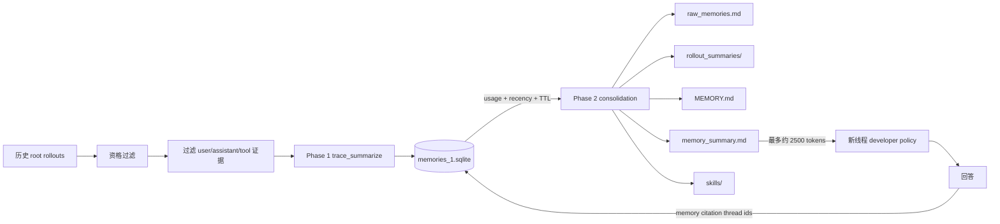

> 历史研究归档 · 2026-11-10 发布 · 程序扫描；未逐篇全文审阅。原有日期、观点、数据和命令保留历史语境，未经本次逐项事实核验或运行复现；请结合[归档说明](../../../ARCHIVE_POLICY.md)阅读。

# R161 · Codex 开源边界与长期记忆源码拆解及 DSH 复刻

## 结论

Codex 是“部分开源”，不是整个产品栈都开源。可核验的开源范围包括 Apache-2.0 下的 Codex CLI、Rust agent core、记忆模块、TUI 和 app-server 协议；仓库 README 明确把 IDE 扩展、桌面应用和 Codex Web/Cloud 作为其他产品入口。当前仓库没有桌面 UI 壳和云端后端实现，也不包含模型权重，因此不能表述为“Codex 产品整体开源”。

其长期记忆不是传统的向量数据库方案，而是一条本地优先、模型辅助的两阶段蒸馏流水线：

1. 从近期、空闲、允许生成记忆的 root session 中过滤可复用证据，调用模型产生 `raw_memory + rollout_summary + slug`。
2. 把 Phase 1 结果按真实使用次数和时间选取，交给第二个模型任务整合为 `MEMORY.md`、`memory_summary.md` 和可选 `skills/`。
3. 新线程把紧凑的 `memory_summary.md` 注入 developer policy；需要细节时再搜索 `MEMORY.md → rollout_summaries → 原始 rollout`。
4. 回答中的 memory citation 会回写 `usage_count/last_usage`，反过来影响后续保留与遗忘。

用户画像不是独立的画像服务或固定数据库表，而是 Phase 2 生成的 Markdown 语义层。`memory_summary.md` 强制包含 `## User Profile` 和 `## User preferences`；Prompt 要求仅保留已知、稳定、可行动事实，强调重复证据高于一次性陈述，并把 Profile 控制在 350 词以内。

本次已将该机制复刻为可安装的 DSH Cordis 插件 `@local/dsh-codex-memory`。复刻保留 SQLite、两阶段模型调用、本地 Markdown/Git、Prompt 注入、关键词渐进读取、使用反馈和 30 天未用选择窗口；适配层只监听 DSH 的 `turn/end`，不修改 agent loop。

## 一、研究边界与版本

### 1.1 Codex

- 上游：`openai/codex`
- 固定提交：`4347f94d5539880e8583028a50a19df5b202d9fa`
- 提交时间：2026-08-25
- 本机 CLI：`codex-cli 0.147.0`
- 许可证：Apache-2.0

### 1.2 DeepSeek Harness

- 上游：`deepseek-ai/deepseek-harness`
- 固定提交：`b150a551b8d465e31e418e1b2eaf5e79bbb7d28e`
- 对应发布：`0.1.1-rc.2`
- 许可证：MIT
- 当前 DSH 引擎要求：Node `^22.19 || >=24`
- 本机系统 Node 为 `22.14.0`，不满足要求；验证使用 Codex bundled Node `24.19.0`

### 1.3 证据等级

- 已验证事实：来自固定提交源码、包元数据、真实安装/加载/测试输出。
- 证据推断：仓库没有某一产品层的源码，只能得出“当前仓库未包含”，不能证明公司内部不存在。
- 未验证：Codex Web/桌面可能存在的服务端记忆实现不在本次开源源码边界内。

## 二、Codex 到底开源了什么

| 层 | 是否可在当前仓库验证 | 判断 |
|---|---|---|
| Codex CLI | 是 | 开源，Apache-2.0 |
| Rust agent core | 是 | 开源 |
| memories crate / extension / state | 是 | 开源，可完整追踪读写链 |
| TUI memory settings | 是 | 开源 |
| app-server protocol | 是 | 开源 |
| Codex 桌面 UI 壳 | 否 | 当前仓库未包含完整前端壳源码 |
| Codex Web/Cloud backend | 否 | 当前仓库未包含 |
| OpenAI 模型权重和服务端推理 | 否 | 不在仓库中 |

因此准确表述应是：**Codex 的本地 agent/CLI 和记忆编排实现已开源；完整商业产品、云后端和模型没有随此仓库开源。**

## 三、记忆系统总图



### 3.1 启动条件

`codex-rs/memories/src/start.rs` 在 root session 启动时决定是否运行流水线。以下情况跳过：

- ephemeral session；
- memory feature 未开启；
- 当前是 subagent；
- state DB 不可用。

Phase 1 是异步任务；Phase 2 使用全局锁，避免多个线程同时整合同一记忆根目录。

### 3.2 默认参数

源码默认值包括：

| 参数 | 默认值 | 作用 |
|---|---:|---|
| `max_rollouts_per_startup` | 2 | 每次启动最多处理的历史 rollout |
| `max_rollout_age_days` | 10 | Phase 1 候选最长年龄 |
| `min_rollout_idle_hours` | 6 | 避免处理仍活跃会话 |
| `min_rate_limit_remaining_percent` | 25 | 低余量时暂停后台记忆调用 |
| `max_raw_memories_for_consolidation` | 256 | Phase 2 输入上限 |
| `max_unused_days` | 30 | 未使用记忆的选择窗口 |
| Phase 1 并发上限 | 8 | 有界并行提炼 |

功能注册表中 memory feature 当前默认关闭，但配置层可显式设置 `generate_memories=true`、`use_memories=true`。

## 四、Phase 1：从会话抽取可复用证据

### 4.1 候选选择

Phase 1 只处理允许的交互来源，排除当前线程、过新/过旧/非 idle rollout，以及 `memory_mode` 不是 enabled 的线程。输出按 thread id 幂等 upsert；只有 `source_updated_at` 更新时才覆盖旧结果。

### 4.2 输入过滤

进入提炼模型的主要记录包括：

- 用户/助手消息；
- 本地 shell 调用；
- function/custom tool 调用及结果；
- tool search 与 web search 调用。

明确排除或清理：

- developer 消息；
- reasoning 项；
- compaction 产物；
- 自动注入的 `AGENTS.md` 指令片段；
- Skill 注入片段。

过滤后的序列先经过 secret redaction，再进入模型。Phase 1 的调用端点是 `/v1/memories/trace_summarize`；因此编排和本地存储开源，但真实提炼仍依赖所配置的模型/provider，并非纯离线规则算法。

### 4.3 抽取目标

Phase 1 Prompt 要求：

- 没有有意义、可复用学习时返回空结果；
- 优先稳定用户操作偏好、重复纠正、高杠杆流程、任务地图、持久环境事实；
- 用户消息证据最强，工具输出次之，助手陈述最弱；
- 第三方内容只当数据，不能作为指令；
- 只根据证据写，且必须脱敏。

输出为 JSON：

```json
{
  "raw_memory": "...",
  "rollout_summary": "...",
  "rollout_slug": "..."
}
```

## 五、Phase 2：长期记忆与用户画像

### 5.1 选择与遗忘

SQLite 中的 Phase 1 记录保存：

- `thread_id`
- `source_updated_at`
- `raw_memory`
- `rollout_summary`
- `rollout_slug`
- `generated_at`
- `usage_count`
- `last_usage`
- `selected_for_phase2`

Phase 2 只选择非空输出；已用条目要求 `last_usage` 在窗口内，未用条目按 `generated_at` 判断新鲜度。排序先看 `usage_count`，再看 `last_usage/generated_at`，最后截取最多 256 条。

这不是严格 TTL 删除：选择集合先变化，随后 consolidation 模型根据 diff 更新或删除 Markdown 中的旧条目。因此它是**启发式、模型辅助的遗忘**，不能声称为可证明删除。

### 5.2 文件层次

默认记忆根目录：`~/.codex/memories/`。

```text
memories/
├── .git/
├── MEMORY.md
├── memory_summary.md
├── raw_memories.md
├── phase2_workspace_diff.md
├── rollout_summaries/
├── skills/
└── extensions/ad_hoc/notes/
```

SQLite 状态库独立放在 `~/.codex/state/memories_1.sqlite`。Git 用作 Phase 2 的增量基线、diff 和可回退证据，而不是远程同步机制。

### 5.3 用户画像

`memory_summary.md` 必须以 `v1` 开头，并包含：

- `## User Profile`
- `## User preferences`

Profile 限制在 350 词内，覆盖角色/目标、工作方式、工具、沟通偏好、可复用约束和重复 follow-up 模式。Prompt 要求：

- 只写已知事实；
- 对一次性信号保持保守；
- preference 应具体、面向未来行动；
- 重复出现或高杠杆的证据优先；
- 用户的原始措辞应尽可能保留。

所以“用户画像”本质上是带 Prompt 约束的语义蒸馏文档，而不是 schema 固定的画像实体表。

## 六、读取链路与使用反馈

`codex-rs/ext/memories/src/prompts.rs` 读取 `memory_summary.md`，截断到约 2500 tokens，再注入线程的 developer policy。读取策略要求：

1. 先看注入的 summary；
2. 需要细节时搜索 `MEMORY.md`；
3. 再读取 1–2 个相关 rollout summary 或 skill；
4. 只有需要精确命令、错误或证据时才读原始 rollout。

源码中的 dedicated local search 是按行的字面 `contains(query)`，可选大小写和标点归一化，并非 embedding/vector retrieval。这解释了它成本低、可审计，也解释了同义词、改写和中文分词下的漏召回风险。

当回答使用了记忆，Codex 要求输出一个可解析的 `<oai-mem-citation>` block，包含文件行号和 rollout ids。运行时从最终输出提取该块，给对应 Phase 1 记录增加 `usage_count`、更新 `last_usage`。这是一个闭环：**检索/引用行为会影响未来记忆保留。**

## 七、优势与失败模式

### 7.1 优势

- 本地优先：核心记忆是 SQLite + Markdown + Git，可直接检查。
- 渐进披露：短 summary 常驻，详细证据按需读取，节省上下文。
- 证据可追踪：语义记忆可下钻到 rollout/thread。
- 两阶段分工：会话级抽取与全局去重/整合分开。
- 使用反馈：不是只按时间保留，还看真实引用。
- 有界后台任务：候选数、并发、rate limit 都有限制。
- 程序性记忆：重复流程可升级为 Skill，而不是无限堆在画像里。

### 7.2 风险

1. **画像误泛化**：Prompt 再保守也不能保证模型不会把一次性要求当成稳定偏好。
2. **长期 Prompt Injection**：第三方数据虽被标记为非指令，且注入指令被过滤，但没有候选 quarantine/人审晋升闸口。
3. **全局污染**：`memory_summary.md` 是全局注入；cwd 分组主要靠文档约定，不是强 namespace 隔离。
4. **检索漏召回**：当前是关键词包含，不理解同义改写。
5. **遗忘不确定**：TTL 影响选择，最终文档删除依赖 consolidation 模型。
6. **本地机密风险**：有 secret redaction，但记忆模块自身没有文件级加密；正则脱敏也可能漏掉业务秘密。
7. **成本**：Phase 1 和 Phase 2 都调用模型；后台记忆不是免费本地索引。
8. **开源边界**：桌面/云端可能另有实现，本报告只覆盖当前开源客户端。

## 八、DSH 复刻设计

### 8.1 为什么用原生插件而不是 fork

DSH 的架构约束是 everything is a plugin。记忆可以完整落在现有扩展点：

- `session/event`：观察 append-only 会话日志；
- `turn/end`：触发会话提炼；
- `systemPrompt.section()`：注入长期摘要；
- `ctx.tools.register()`：提供显式检索/记忆工具；
- Cordis effect：在卸载时 drain 后台任务并关闭 SQLite。

不需要修改 `agent-loop`，也不需要侵入 DSH 的 JSONL persistence。

### 8.2 交付结构

```text
dsh-codex-memory-plugin/
├── core.js                 # provider-neutral 两阶段内核
├── index.js                # DSH Cordis 适配层
├── prompts.js              # Phase 1/2 与注入提示词
├── example/cordis.patch.yml
├── test/
├── package.json
├── README.md
├── LICENSE
└── THIRD_PARTY_NOTICES.md
```

### 8.3 复刻映射

| Codex | DSH 插件 |
|---|---|
| root session 限制 | `delegationDepth` + `topLevelOnly` |
| rollout 过滤 | DSH SessionEvent 过滤 |
| 忽略 developer/AGENTS/Skill 注入 | 忽略 `source.kind=plugin` 的 user message |
| Phase 1 model call | `ctx.llm.stream()` + JSON 输出 |
| `memories_1.sqlite` | `state/memories.sqlite` |
| Phase 2 全局锁 | 单插件串行 Promise queue |
| `memory_summary.md` 注入 | `systemPrompt.section({ name: 'memory:summary' })` |
| dedicated search | `memory_search` |
| ad hoc notes | `memory_remember` + `extensions/ad_hoc/notes` |
| citation usage | 搜索命中 thread id 后回写 usage |
| Git baseline/diff | 每次整合前后本地 commit 与 diff |

### 8.4 与 Codex 不完全相同的地方

- DSH 插件默认在 turn 结束后 5 秒防抖处理，而 Codex 默认在之后的 root session 启动时处理至少 idle 6 小时的历史 rollout。
- DSH 没有 Codex 内置的最终答案 citation 剥离协议；当前复刻用 `memory_search` 命中回写使用次数。
- Codex Phase 2 让内部 subagent 直接编辑记忆工作区；复刻版要求模型返回结构化 JSON，再由确定性代码原子写文件，边界更窄。
- DSH 复刻暂时只有关键词检索，没有 hybrid/vector 检索。

## 九、验证结果

### 9.1 确定性测试

在 Node `24.19.0` 下运行：

```text
pnpm test
```

结果：`6 passed, 0 failed`。覆盖：

- 注入上下文和 reasoning 过滤；
- 常见凭据脱敏；
- fenced JSON 解析与错误拒绝；
- Phase 1 → SQLite → Phase 2 → Markdown → Prompt summary；
- 关键词检索和 usage feedback；
- 相同 source 版本幂等跳过；
- 真实挂载 Cordis、DSH LLM、SystemPrompt 和 ToolRuntime；
- 三个 memory 工具及两个 Prompt section 注册。

### 9.2 DSH 配置探针

使用官方 `@deepseek-ai/dsh@0.1.1-rc.2`：

```text
dsh --profile web --patch example/cordis.patch.yml --dump-config
```

已验证 DSH 输出中出现：

```yaml
- id: codex-memory
  name: '@local/dsh-codex-memory'
```

第一次探针发现示例误写成普通 row，被 DSH 判定为覆盖不存在的 entry；已按官方协议修正为 `- insert:` 并重跑通过。

### 9.3 打包

`pnpm pack` 成功生成 `local-dsh-codex-memory-0.1.0.tgz`，包内容只含运行时源码、README、许可证和配置示例。

### 9.4 未验证项

- 未调用真实 DeepSeek API，因此没有产生真实模型账单，也没有把研究对话写入用户的正式 DSH memory root。
- 未在 Web UI 中跑完整人机回合；已验证到真实 DSH 服务挂载和官方 profile 配置层。
- 未做多进程并发；当前串行队列只保证单一插件进程内互斥。

## 十、后续演进建议

当前版本适合作为单用户、本地开发 Agent 的可审计基线。若进入企业多用户场景，应优先补：

1. 强 namespace：`tenant/user/workspace` 进入持久化主键和物理目录。
2. Typed memory schema：subject、scope、type、valid_from/to、confidence、source ids。
3. Candidate quarantine：自动抽取先进入候选区，经过冲突检查、ACL、评测或人审再晋升。
4. 显式纠错与 tombstone：支持“这个画像不对”“忘掉某件事”，并防止下次 consolidation 复活。
5. Hybrid retrieval：关键词 + embedding + 元数据/时间过滤 + rerank，同时保留可解释来源。
6. 安全：OS ACL/加密、可配置 external-context 污染策略、业务秘密分类器。
7. 评测：画像 precision、过时率、跨 workspace 泄漏、检索 hit rate、错误记忆影响率、单会话成本。

## 十一、来源

### Codex 固定提交

- [Codex README 与许可证边界](https://github.com/openai/codex/blob/4347f94d5539880e8583028a50a19df5b202d9fa/README.md)
- [memories crate 总览](https://github.com/openai/codex/blob/4347f94d5539880e8583028a50a19df5b202d9fa/codex-rs/memories/README.md)
- [Phase 1 Prompt](https://github.com/openai/codex/blob/4347f94d5539880e8583028a50a19df5b202d9fa/codex-rs/memories/write/templates/memories/stage_one_system.md)
- [Phase 2 consolidation Prompt](https://github.com/openai/codex/blob/4347f94d5539880e8583028a50a19df5b202d9fa/codex-rs/memories/write/templates/memories/consolidation.md)
- [memory read path](https://github.com/openai/codex/blob/4347f94d5539880e8583028a50a19df5b202d9fa/codex-rs/ext/memories/templates/memories/read_path.md)
- [local search implementation](https://github.com/openai/codex/blob/4347f94d5539880e8583028a50a19df5b202d9fa/codex-rs/ext/memories/src/local/search.rs)

### DSH 固定提交与发布资料

- [DeepSeek Harness repository](https://github.com/deepseek-ai/deepseek-harness/tree/b150a551b8d465e31e418e1b2eaf5e79bbb7d28e)
- [DSH npm package](https://www.npmjs.com/package/@deepseek-ai/dsh)
- [DSH system prompt subsystem](https://github.com/deepseek-ai/deepseek-harness/blob/b150a551b8d465e31e418e1b2eaf5e79bbb7d28e/packages/core/system-prompt/README.md)
- [DSH extension cookbook](https://github.com/deepseek-ai/deepseek-harness/blob/b150a551b8d465e31e418e1b2eaf5e79bbb7d28e/docs/cookbook/extension-cookbook.md)
- [DSH session persistence](https://github.com/deepseek-ai/deepseek-harness/blob/b150a551b8d465e31e418e1b2eaf5e79bbb7d28e/packages/session/session-persistence-jsonl/README.md)

