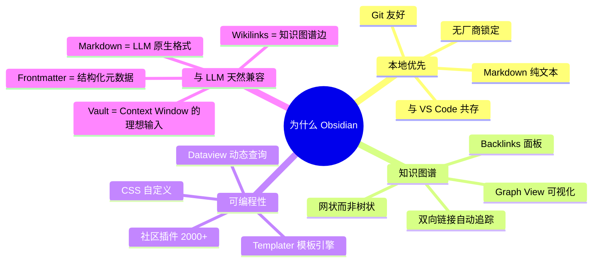
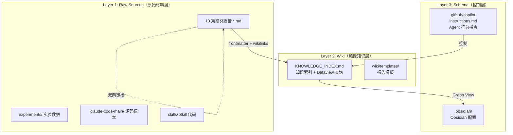
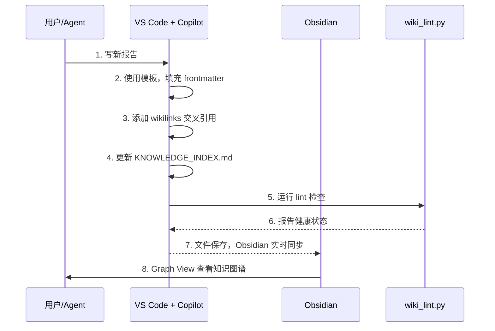

> 历史研究归档 · 2026-11-10 发布 · 发布审核状态：scan_only（发布前程序化隐私扫描）。原有日期、观点、数据和命令保留历史语境，未经本次逐项事实核验或运行复现；见[归档说明](../../../ARCHIVE_POLICY.md)。

# Obsidian + Wiki 知识库方案研究与实施报告

> **一句话概括**：将现有 Agent 研究工作区改造为 Obsidian Vault，利用 Graph View、Backlinks、Dataview 实现知识可视化与结构化查询，同时保持 LLM Wiki 三层架构和 Copilot 工作流不变。
>
> **研究日期**：2026-04-11
>
> **增量价值**：在 Agent-Skills与LLM-Wiki生态调研报告（原稿交叉引用，本归档未解析） 和 [大规模知识库检索方案调研](R09_%E5%A4%A7%E8%A7%84%E6%A8%A1%E7%9F%A5%E8%AF%86%E5%BA%93%E6%A3%80%E7%B4%A2%E6%96%B9%E6%A1%88.md) 基础上，**从"理论调研"推进到"实际落地"** —— 为本工作区完成 Obsidian 化改造，建立可运行的 Wiki 维护工作流。
>
> **关联报告**：Agent-Skills与LLM-Wiki生态调研报告（原稿交叉引用，本归档未解析）、[大规模知识库检索方案调研](R09_%E5%A4%A7%E8%A7%84%E6%A8%A1%E7%9F%A5%E8%AF%86%E5%BA%93%E6%A3%80%E7%B4%A2%E6%96%B9%E6%A1%88.md)、[Anthropic官方Skill-Creator设计哲学研究报告](../01-%E7%90%86%E8%AE%BA%E4%B8%8E%E6%9E%B6%E6%9E%84/R14_AnthropicSkillCreator%E8%AE%BE%E8%AE%A1%E5%93%B2%E5%AD%A6.md)

---

## 目录

1. [我们已经知道什么](#1-我们已经知道什么)
2. [为什么选 Obsidian](#2-为什么选-obsidian)
3. [方案设计：Obsidian × LLM Wiki 三层架构](#3-方案设计obsidian--llm-wiki-三层架构)
4. [与已有方案的对比](#4-与已有方案的对比)
5. [实施方案：四步改造](#5-实施方案四步改造)
6. [自动化工具链](#6-自动化工具链)
7. [Obsidian 插件选型](#7-obsidian-插件选型)
8. [工作流规范](#8-工作流规范)
9. [成本与收益分析](#9-成本与收益分析)
10. [结论与开放问题](#10-结论与开放问题)

---

## 1. 我们已经知道什么

本工作区已经积累了两篇直接相关的报告：

| 已有报告 | 核心结论 | 本次增量 |
|---------|---------|---------|
| [大规模知识库检索方案调研](R09_%E5%A4%A7%E8%A7%84%E6%A8%A1%E7%9F%A5%E8%AF%86%E5%BA%93%E6%A3%80%E7%B4%A2%E6%96%B9%E6%A1%88.md) | Wiki 法 + Prompt Caching 是当前最优；"让知识适配 LLM" | 那篇是方案横评，**这篇是落地实施** |
| Agent-Skills与LLM-Wiki生态调研报告（原稿交叉引用，本归档未解析） | LLM Wiki 三层架构（Raw → Wiki → Schema）；llm-knowledge-bases 用 Obsidian | 那篇是生态调研，**这篇把 Obsidian 真正用起来** |

**关键发现**：我们的工作区**已经在用三层架构**的变体——

| 层 | 标准定义 | 我们的现状 |
|----|---------|-----------|
| Raw Sources | 原始材料 | 13 篇 `*.md` 研究报告 |
| Wiki | LLM 编译的结构化知识 | `KNOWLEDGE_INDEX.md`（手动维护的索引） |
| Schema | 控制 LLM 行为的指令 | `.github/copilot-instructions.md` |

但缺少三个关键能力：**可视化（Graph View）、双向链接（Backlinks）、结构化查询（Dataview）**。这正是 Obsidian 能补上的。

---

## 2. 为什么选 Obsidian

### 2.1 Obsidian 的核心优势



### 2.2 关键决策：为什么不是其他方案？

| 方案 | 优势 | 淘汰理由 |
|------|------|---------|
| Notion | UI 漂亮，协作强 | 非本地、不是纯 Markdown、API 有限 |
| Logseq | 大纲式、本地优先 | 块引用语法与标准 Markdown 不兼容 |
| Wiki.js / Docusaurus | Web 化、搜索强 | 需要部署服务，过重 |
| 纯 VS Code + Markdown | 已在用，零成本 | 缺少 Graph View、Backlinks、Dataview |
| **Obsidian** | 本地 Markdown + 图谱 + 插件 | ✅ **与现有工作流 100% 兼容，增量式采用** |

说白了：Obsidian 是唯一一个**不要求你改变任何现有文件格式，只需要加一个 `.obsidian/` 文件夹就能获得全部增值能力**的方案。

### 2.3 Obsidian + VS Code 共存模型

```
┌──────────────────────────────────────────────────┐
│           f:\AI2025\Agent研究\  (同一个目录)       │
│                                                   │
│  ┌──────────────┐     ┌──────────────────────┐   │
│  │   Obsidian    │     │     VS Code + Copilot │   │
│  │              │     │                      │   │
│  │ • 浏览/阅读   │     │ • 编写/研究           │   │
│  │ • Graph View  │     │ • Agent 工作流        │   │
│  │ • Backlinks   │     │ • 实验代码            │   │
│  │ • Dataview    │     │ • Git 管理           │   │
│  │ • 日常探索    │     │ • 报告生成            │   │
│  └──────────────┘     └──────────────────────┘   │
│          ↕  读写同一批 .md 文件  ↕                  │
│                                                   │
│  ┌──────────────────────────────────────────────┐│
│  │  .obsidian/        ← Obsidian 专属配置       ││
│  │  .github/          ← Copilot 专属配置        ││
│  │  *.md              ← 双方共享的知识文件       ││
│  └──────────────────────────────────────────────┘│
└──────────────────────────────────────────────────┘
```

---

## 3. 方案设计：Obsidian × LLM Wiki 三层架构

### 3.1 改造后的架构



### 3.2 Obsidian 化三要素

#### 要素一：YAML Frontmatter

给每篇报告添加结构化元数据，让 Dataview 和 Graph View 能理解：

```yaml
---
title: Agent架构深度研究报告
aliases: [Agent架构, 架构报告]
tags: [architecture, agent, claude-code, workflow]
date: 2026-04-10
category: 理论与架构
report_id: 3
tokens: 9513
status: completed
related:
  - "[钩子详解与Agent层级对比](../01-%E7%90%86%E8%AE%BA%E4%B8%8E%E6%9E%B6%E6%9E%84/R12_%E9%92%A9%E5%AD%90%E8%AF%A6%E8%A7%A3%E4%B8%8EAgent%E5%B1%82%E7%BA%A7%E5%AF%B9%E6%AF%94.md)"
  - "[Agent开发Python知识清单](../01-%E7%90%86%E8%AE%BA%E4%B8%8E%E6%9E%B6%E6%9E%84/R02_Agent%E5%BC%80%E5%8F%91Python%E7%9F%A5%E8%AF%86%E6%B8%85%E5%8D%95.md)"
  - "[Agent部署上线方案全景调研报告](../04-%E5%B7%A5%E7%A8%8B%E5%AE%9E%E8%B7%B5/R04_Agent%E9%83%A8%E7%BD%B2%E4%B8%8A%E7%BA%BF%E6%96%B9%E6%A1%88%E5%85%A8%E6%99%AF.md)"
---
```

#### 要素二：Wikilinks

将报告间的引用从 Markdown 链接改为 Obsidian wikilinks：

```markdown
# 之前
参见 大规模知识库检索方案调研（原稿引用文件未随本次归档发布）

# 之后
参见 [大规模知识库检索方案调研](R09_%E5%A4%A7%E8%A7%84%E6%A8%A1%E7%9F%A5%E8%AF%86%E5%BA%93%E6%A3%80%E7%B4%A2%E6%96%B9%E6%A1%88.md)
```

好处：
- Obsidian 自动追踪双向链接
- 重命名文件时自动更新所有引用
- Graph View 自动生成知识图谱

#### 要素三：Dataview 查询

在 KNOWLEDGE_INDEX.md 或专门的仪表板中嵌入动态查询：

````markdown
## 报告总览（自动生成）

```dataview
TABLE category as "分类", date as "日期", tokens as "Tokens", status as "状态"
FROM ""
WHERE report_id
SORT category, date DESC
```

## 待深入课题

```dataview
LIST
FROM #gap
WHERE status != "completed"
```
````

---

## 4. 与已有方案的对比

### 4.1 与 llm-knowledge-bases 的对比

| 维度 | llm-knowledge-bases | 我们的方案 |
|------|-------------------|-----------|
| 依赖 | Claude Code CLI + 插件 | VS Code + Copilot + Obsidian |
| 初始化 | `/kb-init` 从零搭建 | 原地改造，增量式 |
| Raw Sources | `raw/` 目录,放原始材料 | 报告本身就是 Raw + 加工后的产出 |
| Wiki 编译 | LLM 自动编译到 `wiki/` | KNOWLEDGE_INDEX.md + frontmatter |
| 研究能力 | 多 Agent 并行研究 | Copilot Agent 单线程 |
| 适配性 | 需要 Claude Code | **任何编辑器 + 任何 LLM** |

**核心差异**：llm-knowledge-bases 是一个"全新项目模板"，而我们需要的是"现有工作区的增量改造"。它的 ingest → compile → query 循环很好，但我们不需要推倒重来。

### 4.2 与 llm-wiki-compiler 的对比

| 维度 | llm-wiki-compiler | 我们的方案 |
|------|-------------------|-----------|
| 工具类型 | Claude Code 斜杠命令 | VS Code Skill + Python 脚本 |
| 核心操作 | ingest / query / lint | compile / lint / evolve |
| Wiki 产出 | 主题化 Wiki 页面 | KNOWLEDGE_INDEX + Obsidian Graph |
| 成本 | 号称降 60% | Prompt Caching + 本地 Dataview = 更低 |

### 4.3 我们的独特优势

1. **双编辑器模式**：VS Code 写 + Obsidian 读，各取所长
2. **Copilot 原生**：不依赖特定 LLM CLI，任何 Copilot 兼容的 Agent 都能用
3. **增量式**：不破坏现有 13 篇报告和工作流
4. **自动化 lint**：Python 脚本检查 frontmatter 完整性、链接健康、索引同步

---

## 5. 实施方案：四步改造

### Step 1: Obsidian Vault 初始化

创建 `.obsidian/` 配置目录：

```
.obsidian/
├── app.json              ← 基础设置（启用 wikilinks）
├── appearance.json       ← 主题配置
├── core-plugins.json     ← 核心插件开关
├── community-plugins.json ← 社区插件列表
├── graph.json            ← Graph View 配置
└── templates.json        ← 模板插件配置
```

### Step 2: 为所有报告添加 Frontmatter

给 13 篇报告批量添加 YAML frontmatter，包含：
- `title` / `aliases` — 标题和别名
- `tags` — 分类标签
- `date` — 研究日期
- `category` — 所属类别（理论/知识管理/实验）
- `report_id` — 唯一编号
- `tokens` — Token 数量
- `related` — 关联报告（wikilinks）

### Step 3: 创建自动化工具

Python 脚本 `wiki_lint.py`：
- 检查所有 `.md` 文件的 frontmatter 完整性
- 扫描 wikilinks 是否都能解析到实际文件
- 检测孤立页面（没有被任何报告引用的报告）
- 检查 KNOWLEDGE_INDEX.md 与实际报告是否同步
- 输出健康报告

### Step 4: 更新 Schema 层

更新 `.github/copilot-instructions.md`：
- 新增 Obsidian 格式约定（frontmatter 必填字段、wikilink 格式）
- 新增报告模板路径
- 新增 lint 工作流

---

## 6. 自动化工具链

### 6.1 wiki_lint.py — 知识库健康检查

```python
# 核心检查项
checks = [
    "frontmatter_completeness",   # 必填字段是否齐全
    "wikilink_resolution",        # wikilinks 是否指向存在的文件
    "orphan_detection",           # 孤立页面检测
    "index_sync",                 # KNOWLEDGE_INDEX 与报告同步检查
    "tag_consistency",            # 标签命名一致性
    "date_format",                # 日期格式检查
]
```

### 6.2 生命周期自动化



---

## 7. Obsidian 插件选型

| 插件 | 用途 | 优先级 |
|------|------|--------|
| **Dataview** | 动态查询 frontmatter，生成表格/列表 | 🔴 必装 |
| **Graph View**（内置） | 知识图谱可视化 | 🔴 内置 |
| **Backlinks**（内置） | 双向链接面板 | 🔴 内置 |
| **Templates**（内置）| 新报告模板 | 🔴 内置 |
| **Obsidian Git** | 自动提交 + 版本控制 | 🟡 推荐 |
| **Tag Wrangler** | 批量管理标签 | 🟡 推荐 |
| **Calendar** | 按日期浏览报告 | 🟢 可选 |
| **Excalidraw** | 手绘架构图 | 🟢 可选 |

---

## 8. 工作流规范

### 8.1 新报告工作流

```
1. 使用模板创建报告（自动填充 frontmatter 骨架）
2. 研究 → 撰写（VS Code + Copilot Agent）
3. 添加 wikilinks（引用已有报告时用 报告名（原稿交叉引用，本归档未解析） 格式）
4. 更新 KNOWLEDGE_INDEX.md
5. 运行 wiki_lint.py 检查
6. 在 Obsidian 中通过 Graph View 确认知识图谱连接正确
```

### 8.2 Frontmatter 规范

```yaml
---
title: <报告标题>
aliases: [<别名1>, <别名2>]
tags: [<主题标签>]
date: YYYY-MM-DD
category: <理论与架构 | 知识管理与上下文 | 实验验证 | 工程实践>
report_id: <数字编号>
tokens: <约数>
status: <completed | in-progress | draft>
related:
  - "相关报告1（原稿交叉引用，本归档未解析）"
  - "相关报告2（原稿交叉引用，本归档未解析）"
---
```

### 8.3 Wikilink 约定

- 引用报告：`报告名（原稿交叉引用，本归档未解析）`（不含 `.md` 后缀）
- 引用带显示文本：`显示文本（原稿交叉引用，本归档未解析）`
- 引用章节：`报告名#章节名（原稿交叉引用，本归档未解析）`
- 在 copilot-instructions.md 中用标准 Markdown 链接（因为不走 Obsidian 渲染）

---

## 9. 成本与收益分析

### 收益

| 收益项 | 量化估计 |
|--------|---------|
| Graph View 知识可视化 | 从"脑中想象"到"一眼看到"所有知识关联 |
| Backlinks 自动追踪 | 每篇报告自动显示谁引用了它，节省手动查找时间 |
| Dataview 动态查询 | 实时统计报告数量、Token 分布、课题状态 |
| 模板标准化 | 新报告创建时间从"从零写"到"填空" |
| lint 自动化 | 自动发现断链、孤立页面、索引不同步 |
| 双编辑器模式 | 写作效率（VS Code）+ 浏览体验（Obsidian）|

### 成本

| 成本项 | 估计 |
|--------|------|
| 初始改造工时 | 一次性，由 Agent 自动完成 |
| 学习成本 | Obsidian 上手简单，已是 Markdown 用户 |
| 维护成本 | frontmatter 维护是增量的，lint 脚本自动检查 |
| 磁盘开销 | `.obsidian/` 约 10KB |

**结论：成本极低，收益显著，值得落地。**

---

## 10. 结论与开放问题

### 核心结论

1. ✅ **Obsidian 是现有工作区的理想增量升级** —— 不改文件格式，只加配置和元数据
2. ✅ **LLM Wiki 三层架构与 Obsidian 天然兼容** —— frontmatter 是结构化元数据，wikilinks 是知识图谱的边，Graph View 是可视化
3. ✅ **双编辑器模式（VS Code + Obsidian）是最佳实践** —— 各取所长，一个写一个读
4. ✅ **lint 自动化弥补了 LLM 维护的"不可靠性"** —— 机器检查 frontmatter 和链接完整性

### 开放问题

| # | 问题 | 优先级 |
|---|------|--------|
| 1 | Dataview 查询能否完全替代手动维护的 KNOWLEDGE_INDEX §二？ | 🟡 待验证 |
| 2 | 多人协作场景下 `.obsidian/` 配置冲突如何处理？ | ⬜ 当前单人，暂不需要 |
| 3 | 是否需要引入 Obsidian Publish 做知识库公开分享？ | ⬜ 未来考虑 |
| 4 | 报告数量增长到 50+ 时 Graph View 是否仍然清晰？ | 🟡 待观察 |

---

## 附录：参考项目

| 项目 | 地址 | Stars | 与本方案关系 |
|------|------|-------|------------|
| llm-knowledge-bases | github.com/rvk7895/llm-knowledge-bases | 15 | 灵感来源，Obsidian + Claude Code 集成 |
| llm-wiki-compiler | github.com/nicobailon/llm-wiki-compiler | 61 | 参考 ingest/query/lint 工作流 |
| agent-skills | github.com/addyosmani/agent-skills | 12K | context-engineering skill 的上下文层级模型 |
| Obsidian Dataview | github.com/blacksmithgu/obsidian-dataview | 5K+ | 核心插件，动态查询引擎 |
