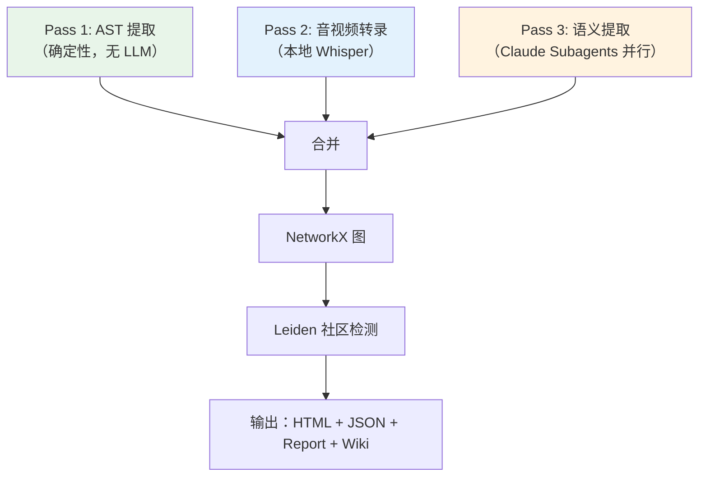
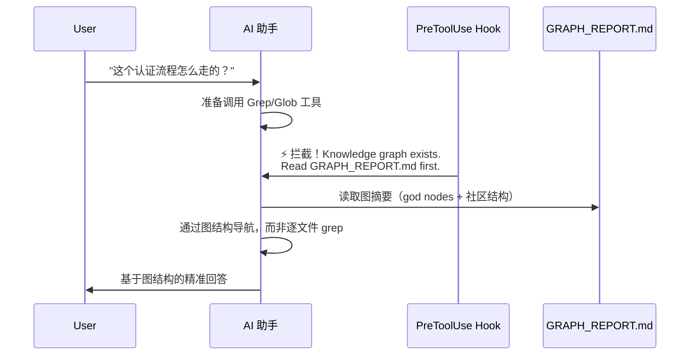
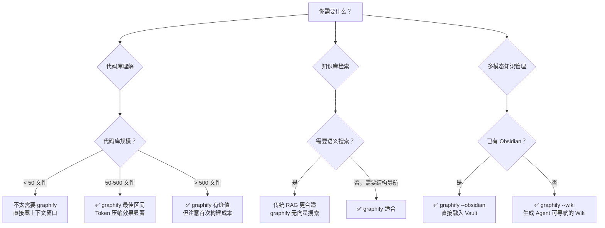

> 历史研究归档 · 2026-11-10 发布 · 程序扫描；未逐篇全文审阅。原有日期、观点、数据和命令保留历史语境，未经本次逐项事实核验或运行复现；请结合[归档说明](../../../ARCHIVE_POLICY.md)阅读。

# Graphify 知识图谱工具深度调研报告

> **一句话概括**：graphify 是一个将任意文件夹（代码/文档/论文/图片/视频）转化为可查询知识图谱的 AI Coding Skill，15 天内从零长到 28.9K⭐，核心价值是"让 AI 助手通过图结构导航代码库，而非逐文件 grep"——大型代码库查询 Token 压缩 71.5 倍。
> 研究日期：2026-04-18
> 增量声明：本报告在 [大规模知识库检索方案调研](R09_%E5%A4%A7%E8%A7%84%E6%A8%A1%E7%9F%A5%E8%AF%86%E5%BA%93%E6%A3%80%E7%B4%A2%E6%96%B9%E6%A1%88.md)（GraphRAG 方案）、[大型多仓代码库上下文方案研究](R08_%E5%A4%A7%E5%9E%8B%E5%A4%9A%E4%BB%93%E4%BB%A3%E7%A0%81%E5%BA%93%E4%B8%8A%E4%B8%8B%E6%96%87%E6%96%B9%E6%A1%88.md)（Code Graph 方案）和 [RAG从入门到生产落地完全指南](../04-%E5%B7%A5%E7%A8%8B%E5%AE%9E%E8%B7%B5/R30_RAG%E4%BB%8E%E5%85%A5%E9%97%A8%E5%88%B0%E7%94%9F%E4%BA%A7%E8%90%BD%E5%9C%B0.md)（Agentic RAG 前沿）基础上，新增了 graphify 这一具体实现的深度拆解、架构分析和适用场景评估。

---

## 目录

- [一、定位透镜：graphify 是什么](#一定位透镜graphify-是什么)
- [二、工作原理：三遍管线](#二工作原理三遍管线)
- [三、架构拆解](#三架构拆解)
- [四、核心产出物](#四核心产出物)
- [五、平台适配与集成机制](#五平台适配与集成机制)
- [六、上手指南](#六上手指南)
- [七、与已有知识的交叉引用](#七与已有知识的交叉引用)
- [八、竞品对比](#八竞品对比)
- [九、优势与局限](#九优势与局限)
- [十、适用场景决策树](#十适用场景决策树)
- [十一、结论与建议](#十一结论与建议)

---

## 一、定位透镜：graphify 是什么

### 创世故事

graphify 的灵感来源于 Andrej Karpathy 的工作习惯：维护一个 `/raw` 文件夹，把论文、推文、截图、笔记等各种资料丢进去。问题是——资料积累后，找东西全靠记忆和 grep。graphify 就是针对这个问题的回答：**把一堆文件变成一个有结构的知识图谱，让你（和你的 AI 助手）能通过图结构导航，而不是逐文件搜索。**

### 基本数据

| 维度 | 数据 |
|------|------|
| 仓库 | [safishamsi/graphify](https://github.com/safishamsi/graphify) |
| Stars | 28.9K ⭐ |
| Forks | 3.2K |
| 版本 | v0.4.20（52 个 Release） |
| 首次发布 | 2026-04-03 |
| 最新发布 | 2026-04-17 |
| 语言 | Python 100% |
| 许可 | MIT |
| 贡献者 | 7 人（主导开发者：safishamsi） |
| 下载量 | ~100K+（PyPI: graphifyy） |
| 依赖 | NetworkX + graspologic（Leiden）+ tree-sitter + vis.js |

> 📌 来源：GitHub 仓库页面实时获取，2026-04-18
> ⚠️ 注意：PyPI 包名是 `graphifyy`（双 y），`pip install graphify` 装的是不相关的包

### 生命周期定位

**爆发上升期**。15 天内从 0 到 28.9K⭐，52 个 Release，开发速度极快（几乎日均 3+ 个版本）。社区活跃度高（40 open issues, 85 PR, 活跃讨论区）。但仍是单人主导项目，API 和功能在快速迭代中，稳定性待观察。

### 一句话定位

> graphify = 代码库/知识库的 GraphRAG 实现 + AI Coding Skill 一体化方案

说白了：它不是一个通用的图数据库或 RAG 框架，而是一个**专门为 AI 编程助手设计的"代码库知识图谱生成器"**。它的目标用户不是开发者直接读图，而是让 AI 助手（Claude Code / Codex / Cursor / VS Code Copilot 等）读图后更好地理解代码库。

---

## 二、工作原理：三遍管线

graphify 的核心是一个三遍提取管线（Three-Pass Pipeline）：



### Pass 1：AST 确定性提取（代码文件）

- 使用 **tree-sitter** 解析 25 种编程语言的 AST
- 提取：类、函数、导入关系、调用图（跨文件）、docstring、rationale 注释（`# WHY:`、`# HACK:`、`# NOTE:`）
- **完全本地，不调用 LLM**——代码内容不离开本机
- 跨文件调用解析：对所有支持语言做全局 label map 后处理

### Pass 2：音视频转录（本地 Whisper）

- 使用 **faster-whisper** 本地转录视频/音频文件
- 域感知 Whisper 提示词：从语料库的 god nodes 生成领域提示，提高技术内容转录精度
- 转录结果缓存在 `graphify-out/transcripts/`，重跑跳过已转录文件
- **音频不离开本机**

### Pass 3：语义提取（LLM 并行）

- **Claude 子代理（Subagents）并行**处理文档、论文、图片和转录文本
- 提取：概念、关系、设计决策理由（rationale）
- 语义相似性边：跨文件的概念关联（无结构连接的两个函数解决相同问题）
- **超边（Hyperedges）**：3+ 个节点的群组关系

### 关系置信度标签

| 标签 | 含义 | 来源 |
|------|------|------|
| `EXTRACTED` | 源码中显式存在（import 语句、直接调用） | AST/文档字面量 |
| `INFERRED` | 合理推断（共现、调用图二次推导），附 confidence score 0.0-1.0 | LLM 推理 |
| `AMBIGUOUS` | 不确定，标记供人工审查 | LLM 标注 |

> 这个三标签系统是 graphify 的设计亮点之一——**你始终知道哪些关系是确定的、哪些是猜的、哪些需要人看看**。与我们在 [AI输出质量稳定性与反讨好研究报告](../05-%E8%AF%84%E4%BC%B0%E4%B8%8E%E8%B4%A8%E9%87%8F/R16_AI%E8%BE%93%E5%87%BA%E8%B4%A8%E9%87%8F%E7%A8%B3%E5%AE%9A%E6%80%A7%E4%B8%8E%E5%8F%8D%E8%AE%A8%E5%A5%BD.md) 中讨论的"诚实的不确定性"理念完全一致。

---

## 三、架构拆解

### 管线架构

```
detect() → extract() → build_graph() → cluster() → analyze() → report() → export()
```

每个阶段是独立模块中的单一函数，通过 Python dict 和 NetworkX 图通信——**无共享状态，副作用只写入 `graphify-out/`**。

### 模块职责表

| 模块 | 核心函数 | 职责 |
|------|---------|------|
| detect.py | `collect_files(root)` | 目录扫描 → 过滤后文件列表（遵守 `.graphifyignore`） |
| extract.py | `extract(path)` | 文件 → `{nodes, edges}` dict（AST + 语义） |
| build.py | `build_graph(extractions)` | 提取结果列表 → nx.Graph |
| cluster.py | `cluster(G)` | 图 → 每个节点标注社区属性（Leiden 算法） |
| analyze.py | `analyze(G)` | 图 → 分析 dict（god nodes, 意外连接, 建议问题） |
| report.py | `render_report(G, analysis)` | 图 + 分析 → GRAPH_REPORT.md |
| export.py | `export(G, out_dir, ...)` | 图 → Obsidian vault / JSON / HTML / SVG / GraphML / Neo4j |
| serve.py | `start_server(graph_path)` | 图 → MCP stdio 服务器 |
| cache.py | `check_semantic_cache / save` | SHA256 缓存——只重处理改变的文件 |
| validate.py | `validate_extraction(data)` | 提取结果模式校验 |
| watch.py | `watch(root, flag_path)` | 文件变更监听 → 自动重建 |
| security.py | 校验辅助函数 | URL/路径/标签安全校验 |

### 关键设计决策

| 决策 | 选择 | 理由 |
|------|------|------|
| 聚类算法 | Leiden（graspologic） | 基于图拓扑，不需要 Embedding/向量数据库 |
| 代码解析 | tree-sitter AST | 确定性、不需要 LLM、25 语言统一接口 |
| 图存储 | NetworkX（内存） | 轻量、纯 Python、无需部署图数据库 |
| 可视化 | vis.js（HTML） | 浏览器直接打开，交互式，零依赖 |
| 缓存策略 | SHA256 文件哈希 | 增量更新——只重处理变化文件 |
| 平台集成 | PreToolUse Hook + AGENTS.md | 在 AI 助手搜索文件前注入图上下文 |

---

## 四、核心产出物

运行 `/graphify .` 后生成：

```
graphify-out/
├── graph.html        # 交互式图可视化（浏览器打开，搜索/过滤/点击节点）
├── GRAPH_REPORT.md   # God nodes + 意外连接 + 建议问题（一页摘要）
├── graph.json        # 持久化图（JSON，后续查询无需重读原文件）
├── cache/            # SHA256 缓存（增量更新）
├── transcripts/      # 音视频转录缓存
└── wiki/             # [可选] Wikipedia 风格文章（--wiki 标志）
    └── index.md      # Wiki 入口（Agent 可导航）
```

### 核心概念

- **God Nodes**：度数最高的概念节点——整个图谱的"枢纽"，所有东西都通过它们连接
- **Surprising Connections**：按复合分数排序的意外关联（代码→论文的边比代码→代码的排名更高），附带"为什么意外"的解释
- **Suggested Questions**：图谱独特能回答的 4-5 个问题
- **Rationale Nodes**：从 docstring、注释（`# WHY:`、`# HACK:`）和文档中提取的"为什么这样设计"——不只是代码做什么，还有**为什么这样写**

### Token 压缩效果

| 语料规模 | 文件数 | Token 压缩比 |
|---------|--------|-------------|
| Karpathy repos + 5 papers + 4 images | 52 | **71.5x** |
| graphify 源码 + Transformer 论文 | 4 | 5.4x |
| httpx（小项目） | 6 | ~1x |

> 压缩比随语料规模增长。6 个文件本身就放得进上下文窗口，图的价值在结构清晰度而非压缩。52+ 文件时压缩效果显著。

---

## 五、平台适配与集成机制

graphify 的一大特点是**极广的 AI 编程助手平台覆盖**：

| 平台 | 集成方式 | Always-On 机制 |
|------|---------|---------------|
| Claude Code | `graphify claude install` | CLAUDE.md + PreToolUse Hook |
| Codex | `graphify codex install` | AGENTS.md + PreToolUse Hook |
| Cursor | `graphify cursor install` | `.cursor/rules/graphify.mdc` (alwaysApply) |
| VS Code Copilot Chat | `graphify vscode install` | `.github/copilot-instructions.md` |
| Gemini CLI | `graphify gemini install` | GEMINI.md + BeforeTool Hook |
| GitHub Copilot CLI | `graphify copilot install` | `~/.copilot/skills/graphify/SKILL.md` |
| Kiro IDE/CLI | `graphify kiro install` | `.kiro/skills/` + steering (always) |
| Aider / OpenClaw / Hermes / Trae | 各自 install 命令 | AGENTS.md（通用） |

### Always-On 机制的核心思路



说白了：**在 AI 助手每次要搜索文件之前，Hook 告诉它"先看地图再走路"。** 这和我们的 P3 范式（分层上下文：常驻 Map + 焦点 + 按需）高度一致。

---

## 六、上手指南

### 安装

```bash
# 基础安装
pip install graphifyy

# 带视频支持
pip install 'graphifyy[video]'

# 带 MCP 服务器
pip install 'graphifyy[mcp]'

# 全功能
pip install 'graphifyy[all]'
```

> ⚠️ 注意：PyPI 包名是 **graphifyy**（双 y）。Windows 上 PATH 可能需要添加 `%APPDATA%\Python\PythonXY\Scripts`。

### 基本使用

```bash
# 在 AI 助手中运行（Claude Code / Codex / Cursor 等）
/graphify .                           # 扫描当前目录
/graphify ./raw                       # 扫描特定文件夹
/graphify ./raw --mode deep           # 更激进的推断边提取
/graphify ./raw --update              # 增量更新（只重处理变化文件）
/graphify ./raw --wiki                # 同时生成 Wiki
/graphify ./raw --obsidian            # 同时生成 Obsidian vault

# 查询已建好的图
/graphify query "认证流程怎么走的？"
/graphify path "DigestAuth" "Response"   # 两节点间最短路径
/graphify explain "SwinTransformer"      # 节点解释

# 添加外部内容
/graphify add https://arxiv.org/abs/1706.03762    # 添加论文
/graphify add https://youtube.com/...              # 添加视频
```

### 终端直接使用（无需 AI 助手）

```bash
graphify query "what connects attention to the optimizer?" --graph graphify-out/graph.json
graphify path "DigestAuth" "Response"
graphify explain "SwinTransformer"
graphify watch ./src                    # 文件变更自动重建
graphify update ./src                   # 手动增量更新
```

### MCP 服务器

```bash
python -m graphify.serve graphify-out/graph.json
```

配置 `.mcp.json`：
```json
{
  "mcpServers": {
    "graphify": {
      "type": "stdio",
      "command": "python",
      "args": ["-m", "graphify.serve", "graphify-out/graph.json"]
    }
  }
}
```

提供工具：`query_graph`、`get_node`、`get_neighbors`、`shortest_path`、`god_nodes`

### VS Code Copilot Chat 集成

```bash
graphify vscode install
```

这会：
1. 安装 Python Skill 文件
2. 写入 `.github/copilot-instructions.md`，VS Code 每次会话自动加载图上下文

### 团队工作流

```bash
# 1. 一个人构建初始图
/graphify .

# 2. 提交 graphify-out/（graph.html + GRAPH_REPORT.md + graph.json）
git add graphify-out/
git commit -m "Add knowledge graph"

# 3. 安装 git hook，代码提交后自动重建（无需 LLM）
graphify hook install

# 4. .graphifyignore 排除不需要的路径
echo "node_modules/\nvendor/\ndist/" > .graphifyignore
```

---

## 七、与已有知识的交叉引用

graphify 与我们知识库中多个范式和研究有直接关联：

| 已有知识 | graphify 的映射 | 验证/修正 |
|---------|----------------|----------|
| **P1** "让知识适配 LLM" | graphify 将原始文件转化为图结构，LLM 读摘要+查子图 | ✅ P1 的具体工程实现 |
| **P3** 分层上下文 | GRAPH_REPORT.md = 常驻 Map，query = 焦点，graph.json = 按需 | ✅ 完全映射 |
| **P4** "选更准 > 塞更多" | 图导航取代全文件 grep，71.5x 压缩 | ✅ 强验证 |
| **P6** SKILL.md 格式 | graphify 本身就是一个 Skill（通过 SKILL.md 安装到各平台） | ✅ P6 的活范例 |
| **[大规模知识库检索方案调研](R09_%E5%A4%A7%E8%A7%84%E6%A8%A1%E7%9F%A5%E8%AF%86%E5%BA%93%E6%A3%80%E7%B4%A2%E6%96%B9%E6%A1%88.md)** G2 GraphRAG | graphify = GraphRAG 的开箱即用实现 | ✅ 实操级验证 |
| **[大型多仓代码库上下文方案研究](R08_%E5%A4%A7%E5%9E%8B%E5%A4%9A%E4%BB%93%E4%BB%A3%E7%A0%81%E5%BA%93%E4%B8%8A%E4%B8%8B%E6%96%87%E6%96%B9%E6%A1%88.md)** Code Graph | graphify 的 AST Pass = Code Graph 方案的完整实现 | ✅ tree-sitter 跨 25 语言 |
| **[RAG从入门到生产落地完全指南](../04-%E5%B7%A5%E7%A8%8B%E5%AE%9E%E8%B7%B5/R30_RAG%E4%BB%8E%E5%85%A5%E9%97%A8%E5%88%B0%E7%94%9F%E4%BA%A7%E8%90%BD%E5%9C%B0.md)** Agentic RAG | graphify 是 Agentic 模式：Agent 主动查图 | ✅ 非 Naive RAG |
| **Agent-Skills与LLM-Wiki生态调研报告（原稿交叉引用，本归档未解析）** Skill 生态 | graphify 完美适配 agent-skills 生态 | ✅ 多平台 Skill 安装 |
| **Sourcegraph 放弃 Embedding 改用 BM25** | graphify 同样不用 Embedding——用图拓扑聚类 | ✅ 相同设计哲学 |

### 与我们工作区的潜在结合点

1. **对本研究知识库运行 graphify**：33 篇报告 + 实验 + sessions 构成 ~500K tokens 的语料，graphify 可以自动发现跨报告的概念关联——可能比人工维护 KNOWLEDGE_INDEX §五 更完整
2. **用于多仓代码库**：多仓代码库知识建设实战研究报告（原稿交叉引用，本归档未解析） 中提到的冷启动和跨仓断裂问题，graphify 的跨文件/跨语言图谱可能是一种解决方案
3. **与 Obsidian 互补**：graphify 支持 `--obsidian` 导出，可与我们已有的 Obsidian Vault（[Obsidian-Wiki知识库方案研究与实施报告](R20_ObsidianWiki%E7%9F%A5%E8%AF%86%E5%BA%93%E6%96%B9%E6%A1%88.md)）融合

---

## 八、竞品对比

| 维度 | graphify | Microsoft GraphRAG | Repomix | 传统 RAG（向量检索） |
|------|---------|-------------------|---------|------------------|
| **核心方法** | AST + LLM 提取 → 图拓扑聚类 | LLM 提取 + Embedding → 图社区 | 文件打包为文本 | Embedding + 向量搜索 |
| **需要 Embedding？** | ❌ 不需要 | ✅ 需要 | ❌ 不需要 | ✅ 需要 |
| **需要向量数据库？** | ❌ 不需要 | ✅ 需要 | ❌ 不需要 | ✅ 需要 |
| **代码理解** | ✅ tree-sitter AST（25 语言） | ⚠️ 通用文本处理 | ❌ 仅打包 | ❌ 语义匹配 |
| **多模态** | ✅ 代码+文档+图片+视频+音频 | ⚠️ 主要文本 | ❌ 仅代码/文本 | ⚠️ 取决于 Embedding 模型 |
| **AI 助手集成** | ✅ 16+ 平台原生支持 | ❌ 需自建 | ⚠️ 需手动 | ❌ 需自建 |
| **增量更新** | ✅ SHA256 缓存 | ⚠️ 部分支持 | ❌ 全量 | ✅ 支持 |
| **透明度** | ✅ EXTRACTED/INFERRED/AMBIGUOUS | ⚠️ 隐式 | N/A | ❌ 黑盒相似度 |
| **成本** | 首次构建需 LLM Token（代码免费），后续查询零成本 | 每次都需要 LLM + Embedding | 免费 | 每次查询需 Embedding |
| **Stars** | 28.9K（15 天） | 25.2K（~2 年） | ~50K | N/A |

### graphify vs 我们的 Code Wiki 方案

在 Code-Wiki代码仓库业务知识组织实验报告（原稿交叉引用，本归档未解析） 中，我们实验了"人工编写 Wiki"方案。对比：

| 维度 | Code Wiki | graphify |
|------|-----------|---------|
| 知识来源 | 人工编写（高质量但费时） | 自动提取（快但可能遗漏深层业务逻辑） |
| 覆盖范围 | 业务知识（What/Why） | 结构知识（How/连接） |
| 维护成本 | 需人工更新 | git hook 自动重建 |
| Token 效率 | ~12K tokens 手工精炼 | 视语料规模，可能更大 |
| 深度 | 深（术语表/ADR/Playbook） | 宽（自动发现所有连接） |
| **最佳组合** | **Wiki（深层业务语义）+ graphify（全局结构发现）** | |

---

## 九、优势与局限

### 优势

1. **开箱即用**：`pip install graphifyy && /graphify .` 两步搞定
2. **不需要向量数据库**：纯图拓扑聚类，部署极简
3. **代码+文档一体化图谱**：打通代码结构和文档语义，形成跨模态知识图
4. **透明度**：EXTRACTED/INFERRED/AMBIGUOUS 三标签，"你知道图谱知道多少"
5. **16+ 平台原生适配**：几乎覆盖了所有主流 AI 编程助手
6. **增量更新**：SHA256 缓存 + git hook，代码变更后自动重建（代码不需要 LLM）
7. **MCP 服务器**：可作为工具直接暴露给 Agent

### 局限

1. **语义提取依赖 LLM API**：文档/论文/图片的提取需要调用 Claude（或平台对应的模型），首次构建有 Token 成本
2. **极早期项目**：15 天 52 个版本意味着 API 仍在快速变化，生产级稳定性待验证
3. **单人主导开发**：核心贡献者 safishamsi 占绝大部分代码，bus factor = 1
4. **图不适合所有查询**：简单的"某个函数在哪定义"用 grep 更快，图的价值在跨概念导航
5. **大型项目的图可能噪声多**：INFERRED 边的 confidence 依赖 LLM 判断质量
6. **无语义搜索**：纯图拓扑——如果两个概念之间没有显式的结构/关系路径，图谱中可能找不到
7. **Python 3.10+ 要求**：graspologic（Leiden）在 Python 3.13+ 有兼容问题
8. **PyPI 包名混淆**：`graphifyy`（双 y）不直觉，社区已有 Issue 讨论（#280）

### 成本估算

| 场景 | 代码文件 | 文档/论文 | 预估 Token 成本 |
|------|---------|----------|---------------|
| 小项目（~50 文件，纯代码） | AST 本地（$0） | 无 | **$0** |
| 中型项目（~200 文件，含文档） | AST 本地（$0） | ~100K tokens 提取 | **~$0.3-1**（Claude Haiku） |
| 大型项目（~1000 文件，多模态） | AST 本地（$0） | ~500K tokens 提取 | **~$1.5-5**（Claude Haiku） |
| 后续增量更新（代码变更） | AST 本地（$0） | 不触发 | **$0** |

> 首次构建是一次性成本，后续代码变更通过 AST 免费重建。文档变更才触发 LLM 重提取。

---

## 十、适用场景决策树



### 最佳适用场景

- **新接手大型代码库**：快速建立全局理解（god nodes = 核心概念入口）
- **跨领域语料管理**（代码 + 论文 + 会议视频 + 设计文档）
- **AI 编程助手增强**：让 Claude Code/Copilot 从"grep 搜索"升级为"图谱导航"
- **团队知识共享**：提交 `graphify-out/`，新成员拉取后 AI 助手立即获得上下文

### 不太适合的场景

- 小项目（< 50 文件）——直接塞上下文窗口更高效
- 纯语义搜索需求——用传统 RAG + 向量数据库
- 需要生产级稳定性的企业系统——项目太年轻
- 需要深层业务语义理解——图谱发现结构，深层"为什么"还是靠人写（Code Wiki）

---

## 十一、结论与建议

### 核心判断

graphify 是当前 **GraphRAG + 代码理解**领域最实用的开源实现之一。它的核心创新不是某个算法突破，而是**把 GraphRAG 管线做成了一个开箱即用的 AI Coding Skill，并覆盖了几乎所有主流平台**。

从设计哲学看，graphify 印证了我们知识库的多个核心范式：
- P1（让知识适配 LLM）✅
- P3（分层上下文）✅
- P4（选更准 > 塞更多）✅
- P6（SKILL.md 通用格式）✅

### 对我们知识库的意义

1. **G2（GraphRAG 实操）可标记为"有可用工具"**：graphify 提供了 G2 课题的一个即可上手的实操路径
2. **与 Code Wiki 互补**：graphify 负责"自动发现结构性关联"，Code Wiki 负责"深层业务语义"——两者组合可能是最优解
3. **对本研究知识库本身的潜在价值**：用 graphify 扫描 33 篇报告，可能自动发现人工索引遗漏的跨报告关联

### 建议下一步

| 优先级 | 行动 | 预期产出 |
|--------|------|---------|
| P0 | 在本研究工作区运行 `graphify .`，验证对 33 篇报告的图谱效果 | 实验数据（Token 压缩比、god nodes 是否合理、意外连接质量） |
| P1 | 对工作中的代码项目运行 graphify，评估对日常编码的实际帮助 | 实用性评估 |
| P2 | 跟踪项目稳定性，等 API 收敛后考虑集成到 VS Code Copilot 日常工作流 | 工作流优化 |

---

## 📌 来源清单

- [safishamsi/graphify](https://github.com/safishamsi/graphify) — 2026-04-18 — 主仓库（28.9K⭐, v0.4.20）
- [ARCHITECTURE.md](https://github.com/safishamsi/graphify/blob/v4/ARCHITECTURE.md) — 2026-04-18 — 架构文档
- [CHANGELOG.md](https://github.com/safishamsi/graphify/blob/v4/CHANGELOG.md) — 2026-04-18 — 52 个版本完整记录
- [GitHub Discussions](https://github.com/safishamsi/graphify/discussions) — 2026-04-18 — 社区讨论
- [GitHub Issues](https://github.com/safishamsi/graphify/issues) — 2026-04-18 — 40 open issues

⚖️ 来源一致性：一致（所有信息来自官方仓库实时获取）
📅 时效性声明：以上信息获取于 2026-04-18
