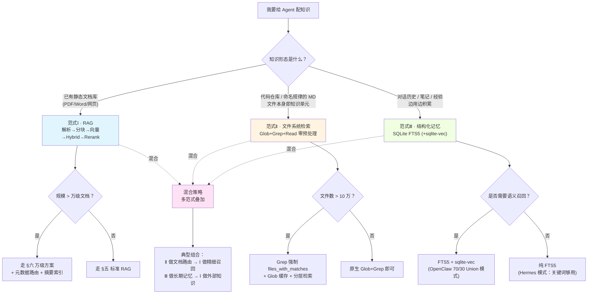
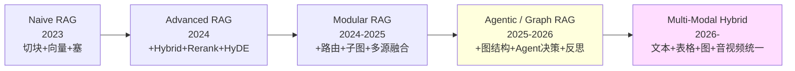
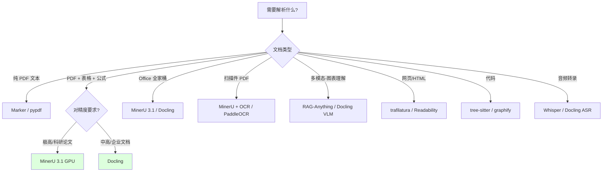
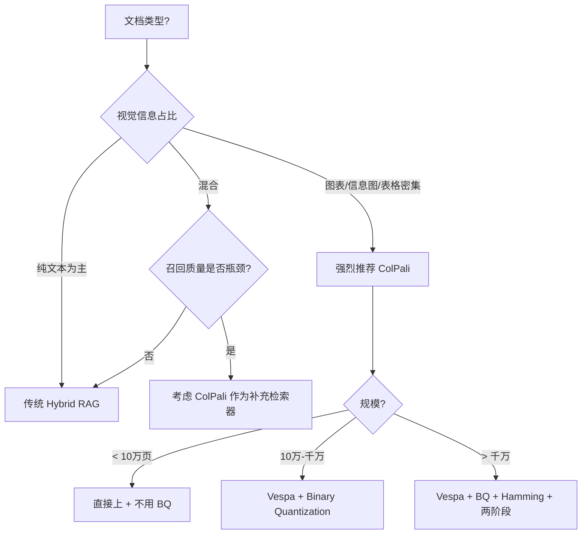
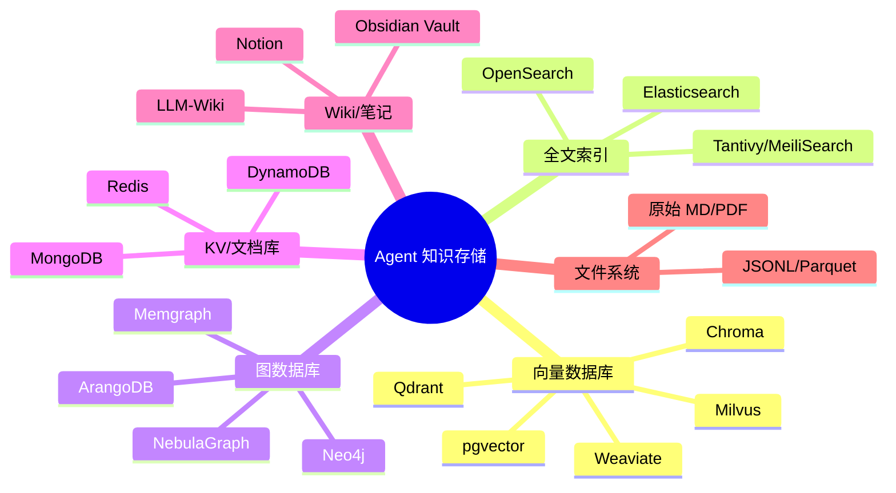
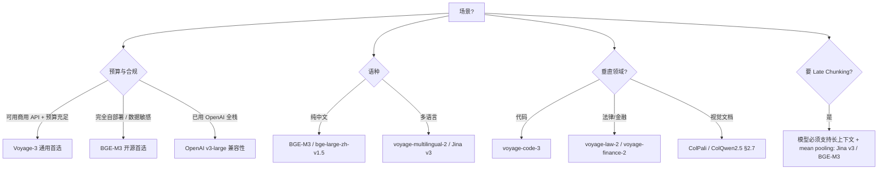
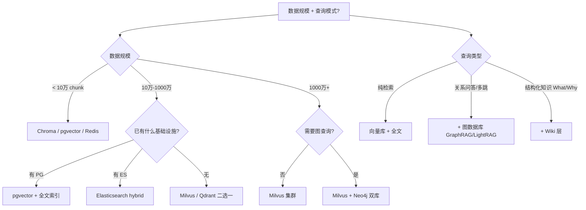
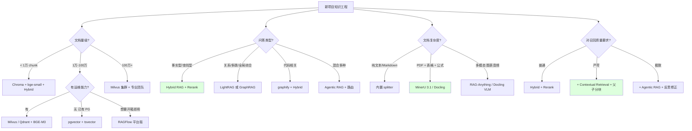

> 脱敏公开版 · 2026-11-10 补充 · 发布审核状态：redacted_full_review（发布前全文隐私审核、脱敏与改动复核）。保留通用技术内容，非公开案例、引用或数据已删除；编辑替换处另作说明。历史结论未在本次重新核实，代码未整体运行复现。见[归档说明](../../../ARCHIVE_POLICY.md)。

# Agent 知识工程全景调研——解析、存储、检索的主流方案与示例

> **一句话**：覆盖 2026 年主流 Agent 架构中"数据如何进、如何存、如何查"的全景方案地图，每一层给出主流工具横向对比 + 选型决策树 + 可运行代码示例。
> **研究日期**：2026-04-24（v2.2 更新：2026-04-30）
> **版本**：v2.2（v2.1 基础上前置 §0「知识检索三范式」决策框架，从飞书外部材料融入并对照本工作区研究做横切抽象）
> **目标读者**：要系统了解 Agent 知识工程，不限于单个项目
> **增量声明**：本报告**不重复** [RAG从入门到生产落地完全指南](../04-%E5%B7%A5%E7%A8%8B%E5%AE%9E%E8%B7%B5/R30_RAG%E4%BB%8E%E5%85%A5%E9%97%A8%E5%88%B0%E7%94%9F%E4%BA%A7%E8%90%BD%E5%9C%B0.md) 的入门概念；**聚焦**“市面主流方案的全景对比 + 示例代码 + 选型决策”，作为团队选型与新项目设计的参考手册。
>
> **v2 新增**：§2.7 视觉 RAG（ColPali/ColQwen 范式革命）/ §3.7 Embedding 模型选型矩阵（Voyage-3/BGE-M3/E5/Jina-v3 实测）/ §4.7 Late Chunking（Jina 反直觉解法，与 Contextual Retrieval 对比）
> **v2.1 新增**：§3.3 GBrain/Graphiti 知识图谱 / §3.4 编译真相+时间线知识模型 / §4.4 零 LLM 图谱构建方案对比 / 个人全域大脑场景
> **v2.2 新增**：§0 知识检索三范式（RAG / 文件系统检索 / 结构化记忆）—— 横切于本报告所有章节之上的范式选择卡 + PSEV P 层映射 + 决策树 + 三种典型混合组合

---

## 📋 TL;DR 速查卡

**Agent 知识工程的三层栈**：

```
┌─────────────────────────────────────────────────────┐
│           应用层（Agent / RAG / 工具调用）             │
└────────────────────┬────────────────────────────────┘
                     │
┌────────────────────▼────────────────────────────────┐
│  ③ 检索层 (Retrieve)                                 │
│   Hybrid搜索 / Rerank / Contextual / Agentic        │
└────────────────────┬────────────────────────────────┘
                     │
┌────────────────────▼────────────────────────────────┐
│  ② 存储层 (Store / Organize)                         │
│   向量库 / 图数据库 / Wiki / 全文索引 / 文件系统       │
└────────────────────┬────────────────────────────────┘
                     │
┌────────────────────▼────────────────────────────────┐
│  ① 解析层 (Parse / Ingest)                           │
│   PDF / Office / 网页 / 代码 / 多模态 → 结构化文本     │
└─────────────────────────────────────────────────────┘
```

**2026 年主流方案速查**：

| 层 | 推荐组合（90% 场景适用） | 代表工具 |
|----|---------------------|---------|
| **解析** | MinerU/Docling 处理 PDF/Office，RAG-Anything 处理多模态 | MinerU 3.1（61k⭐）、Docling 2.91（58k⭐） |
| **存储** | Hybrid 混合（向量+全文+元数据），知识图谱按需 | Milvus 2.5、Qdrant、pgvector + Neo4j |
| **检索** | Hybrid 检索 → Rerank → Contextual 增强 → Agent 决策（高级） | BGE-Reranker、Contextual Retrieval、LightRAG |
| **范式** | "数据派"（清洗+解析+chunk）压算法派 | Anthropic Contextual Retrieval（-49% 失败率） |

**8 个一定要记住的判断**：
1. **解析质量 > 检索算法**——80% 召回失败源于 chunk 缺乏结构和语境
2. **Hybrid（Dense + BM25）≫ 纯向量**——Anthropic 实测 BM25 仅"加上"就降低 35% 失败
3. **GraphRAG 是杀器但贵**——多跳推理场景才值得；微软 GraphRAG 索引可花数小时+几十美元
4. **Wiki 与 RAG 不冲突，是互补**——Wiki 解决"是什么/为什么"（语义层），RAG 解决"在哪里"（检索层）
5. **没有 Eval 之前所有调优都是赌博**——Ragas/TruLens 是地基
6. **🆕 视觉密集文档考虑 ColPali**——可跳过 OCR/Layout/Chunk 整套流水线，直接对页面截图做检索；ViDoRe 上击败 OCR+text-only baseline
7. **🆕 Late Chunking 是"免费的 Contextual Retrieval"**——0 LLM 成本、0 额外存储，效果与 Anthropic Contextual Retrieval 接近（仅需长上下文 + mean pooling 模型）
8. **🆕 Embedding 模型选型差异巨大**——Voyage-3 比 OpenAI v3-large 的 NDCG 高 7.55%、价格便宜 2.2x、维度小 3x；选错一个模型 = 浪费几个月调优

---

## 0、🧭 前置框架：知识检索三范式（v2.2 新增）

> **为什么需要这一节**：本报告 §一到§九 都在讲"如何做"——但"做之前先选对范式"是更上游的决策。三范式是一张**横切所有具体技术之上的认知地图**，让你在打开"解析-存储-检索"全流程之前先回答一个根本问题：**我的知识到底是什么形态？**

### 0.1 三种范式的本质差异

业界主流的 Agent 知识检索方案，剥掉具体框架后只有三种底层哲学：

| 维度 | **范式Ⅰ · RAG** | **范式Ⅱ · 文件系统检索** | **范式Ⅲ · 结构化记忆** |
|------|----------------|----------------------|---------------------|
| **知识单元** | chunk（100-2000 token） | 整文件 + 行号区间 | 消息/笔记条目（完整语义单元） |
| **预处理** | 必须（解析+分块+向量化） | 无（实时扫描） | 写入即建索引（FTS5 自动） |
| **是否需向量化** | ✅ 必须 | ❌ 完全不需要 | 🟡 可选（FTS5 不需要，sqlite-vec 加分） |
| **知识积累方式** | 离线批量导入 | 文件落盘即可 | 写入即检索，自动积累 |
| **检索机制** | 向量 ANN + Hybrid + Rerank | Glob → Grep → Read | BM25（FTS5）± 向量加权 Union |
| **典型规模** | 万-亿级 chunk | 万-百万级文件 | 千-千万级条目 |
| **核心成本** | Embedding 调用 + 向量库存储 | 几乎为零 | SQLite 文件 + 可选 Embed |
| **代表实现** | OpenAI FileSearch、RAGFlow、Qdrant Hybrid | Claude Agent SDK（Glob+Grep+Read） | OpenClaw（hybrid SQLite）、Hermes（FTS5） |
| **本工作区参考** | [R48](R48_Agent%E7%9F%A5%E8%AF%86%E5%B7%A5%E7%A8%8B%E5%85%A8%E6%99%AF%E8%B0%83%E7%A0%94.md) §二~§四（本报告主线）、[R30](../04-%E5%B7%A5%E7%A8%8B%E5%AE%9E%E8%B7%B5/R30_RAG%E4%BB%8E%E5%85%A5%E9%97%A8%E5%88%B0%E7%94%9F%E4%BA%A7%E8%90%BD%E5%9C%B0.md) | [R27](../04-%E5%B7%A5%E7%A8%8B%E5%AE%9E%E8%B7%B5/R27_ClaudeAgentSDK%E5%85%A5%E9%97%A8%E5%88%B0%E5%AE%9E%E6%88%98.md)、[R71](../06-%E5%B7%A5%E5%85%B7%E4%B8%8E%E7%94%9F%E6%80%81/R71_Coding_Agent%E6%B7%B1%E5%BA%A6%E5%AF%B9%E6%AF%94_%E4%BA%94%E5%AE%B6%E6%A8%AA%E8%AF%84.md) Coding Agent 横评 | [R34](../06-%E5%B7%A5%E5%85%B7%E4%B8%8E%E7%94%9F%E6%80%81/R34_HermesAgent%E5%BC%80%E6%BA%90%E8%87%AA%E5%AD%A6%E4%B9%A0%E6%99%BA%E8%83%BD%E4%BD%93.md) [R35](../06-%E5%B7%A5%E5%85%B7%E4%B8%8E%E7%94%9F%E6%80%81/R35_HermesAgent%E8%AE%B0%E5%BF%86%E4%B8%8ESkill%E8%87%AA%E8%BF%AD%E4%BB%A3%E6%BA%90%E7%A0%81%E6%8B%86%E8%A7%A3.md) Hermes、[R36](../06-%E5%B7%A5%E5%85%B7%E4%B8%8E%E7%94%9F%E6%80%81/R36_OpenClaw%E6%9E%B6%E6%9E%84%E8%B0%83%E7%A0%94%E4%B8%BA%E4%BB%80%E4%B9%88%E8%BF%99%E4%B9%88%E7%81%AB.md) [R41](../06-%E5%B7%A5%E5%85%B7%E4%B8%8E%E7%94%9F%E6%80%81/R41_OpenClaw%E6%9E%B6%E6%9E%84%E5%AD%A6%E4%B9%A0%E8%B0%83%E7%A0%94.md) OpenClaw、[R72](R72_Agent%E8%AE%B0%E5%BF%86%E7%B3%BB%E7%BB%9F%E6%A8%AA%E8%AF%84.md) 记忆横评 |

### 0.2 决策树：先选范式，再选工具



### 0.3 三范式 × PSEV 映射

三范式不是并列工具清单，而是 **PSEV 框架 P 层（Profile）** 的具体落地——选范式 = 给"知识形态"打画像。一旦画像准确，S/E/V 三层的工具选择就是机械动作：

| PSEV 阶段 | 在三范式语境下要做什么 |
|-----------|------------------|
| **P · Profile** | 用 §0.1 的维度表给手头知识打画像（形态/规模/更新频率/语义需求），输出"它属于范式 X"的判断 |
| **S · Strategy** | 由范式确定主路径（§五 RAG 流水线 / §0 决策树范式Ⅱ / §0 决策树范式Ⅲ），考虑是否需要混合 |
| **E · Execute** | 在该范式内选具体工具（§二~§四 解析/向量库/Rerank 横评、Hermes vs OpenClaw、Glob+Grep 参数） |
| **V · Verify** | 用 Ragas/TruLens（Ⅰ）/ ripgrep 命中率（Ⅱ）/ 召回 sample（Ⅲ）验证；问题回溯：如果三范式选错，再多算法调优都救不回来 |

> **关键直觉**：**90% 的"RAG 效果差"问题，根因在 P 层选错了范式**——例如把代码仓硬塞进向量库（应走Ⅱ）、把会话历史用 RAG 离线导入（应走Ⅲ）。先回到 §0.1 表格自检，再决定要不要继续往 §二~§四 调参。

### 0.4 何时混合？三种典型组合

混合不是"全都要"，是有明确分工的双层架构：

| 组合 | 上层（路由/记忆） | 下层（精细召回） | 典型场景 |
|------|---------------|--------------|---------|
| **Ⅱ + Ⅰ** | Glob/Grep 把万级文档缩到候选 50 份 | RAG 在候选范围内做语义召回 | Code Wiki / 大规模 Markdown 库（详见 [R09](R09_%E5%A4%A7%E8%A7%84%E6%A8%A1%E7%9F%A5%E8%AF%86%E5%BA%93%E6%A3%80%E7%B4%A2%E6%96%B9%E6%A1%88.md)） |
| **Ⅲ + Ⅰ** | FTS5 检索 Agent 长期记忆 | RAG 检索外部知识库 | 长效 Agent + 企业知识库（见 [R33](../05-%E8%AF%84%E4%BC%B0%E4%B8%8E%E8%B4%A8%E9%87%8F/R33_%E9%95%BF%E6%95%88AgentHarness%E5%B7%A5%E7%A8%8B%E5%8C%96.md) [R72](R72_Agent%E8%AE%B0%E5%BF%86%E7%B3%BB%E7%BB%9F%E6%A8%AA%E8%AF%84.md)） |
| **Ⅲ + Ⅱ** | FTS5 记 Agent 经验 | Glob+Grep 找代码 | Coding Agent（见 [R71](../06-%E5%B7%A5%E5%85%B7%E4%B8%8E%E7%94%9F%E6%80%81/R71_Coding_Agent%E6%B7%B1%E5%BA%A6%E5%AF%B9%E6%AF%94_%E4%BA%94%E5%AE%B6%E6%A8%AA%E8%AF%84.md)，Claude Code 即此模式） |

**反模式**：Ⅰ + Ⅱ + Ⅲ 全栈 ≠ 更强，多数情况下是过度工程。除非你能清楚说出**每一层解决了哪个不同的问题**，否则只选一种。

### 0.5 与本报告其余章节的关系

- **本节 §0 = 范式选择卡**（决策上游）
- **§一~§四 = 范式Ⅰ的全景实现**（默认假设你选了 RAG）
- **§五~§六 = 范式Ⅰ 的端到端样例与万级方案**
- **范式Ⅱ 详见**：[R27](../04-%E5%B7%A5%E7%A8%8B%E5%AE%9E%E8%B7%B5/R27_ClaudeAgentSDK%E5%85%A5%E9%97%A8%E5%88%B0%E5%AE%9E%E6%88%98.md) Claude Agent SDK、[R71](../06-%E5%B7%A5%E5%85%B7%E4%B8%8E%E7%94%9F%E6%80%81/R71_Coding_Agent%E6%B7%B1%E5%BA%A6%E5%AF%B9%E6%AF%94_%E4%BA%94%E5%AE%B6%E6%A8%AA%E8%AF%84.md) Coding Agent 横评
- **范式Ⅲ 详见**：[R34](../06-%E5%B7%A5%E5%85%B7%E4%B8%8E%E7%94%9F%E6%80%81/R34_HermesAgent%E5%BC%80%E6%BA%90%E8%87%AA%E5%AD%A6%E4%B9%A0%E6%99%BA%E8%83%BD%E4%BD%93.md) [R35](../06-%E5%B7%A5%E5%85%B7%E4%B8%8E%E7%94%9F%E6%80%81/R35_HermesAgent%E8%AE%B0%E5%BF%86%E4%B8%8ESkill%E8%87%AA%E8%BF%AD%E4%BB%A3%E6%BA%90%E7%A0%81%E6%8B%86%E8%A7%A3.md) Hermes、[R36](../06-%E5%B7%A5%E5%85%B7%E4%B8%8E%E7%94%9F%E6%80%81/R36_OpenClaw%E6%9E%B6%E6%9E%84%E8%B0%83%E7%A0%94%E4%B8%BA%E4%BB%80%E4%B9%88%E8%BF%99%E4%B9%88%E7%81%AB.md) [R41](../06-%E5%B7%A5%E5%85%B7%E4%B8%8E%E7%94%9F%E6%80%81/R41_OpenClaw%E6%9E%B6%E6%9E%84%E5%AD%A6%E4%B9%A0%E8%B0%83%E7%A0%94.md) OpenClaw、[R72](R72_Agent%E8%AE%B0%E5%BF%86%E7%B3%BB%E7%BB%9F%E6%A8%AA%E8%AF%84.md) 记忆系统横评

---

## 目录

0. [🧭 前置框架：知识检索三范式（v2.2 新增）](#0前置框架知识检索三范式v22-新增)
1. [🔭 定位透镜：Agent 知识工程的演进图谱](#一定位透镜)
2. [① 解析层：从原始数据到结构化文本](#二解析层)（含 §2.7 🆕 视觉 RAG）
3. [② 存储层：知识如何组织与持久化](#三存储层)（含 §3.7 🆕 Embedding 选型）
4. [③ 检索层：如何精准召回](#四检索层)（含 §4.7 🆕 Late Chunking）
5. [🚀 三组完整端到端示例](#五端到端示例)
6. [🎯 选型决策树](#六选型决策树)
7. [🕳️ 避坑指南](#七避坑指南)
8. [💰 成本速算](#八成本速算)
9. [📌 来源清单](#九来源清单)

---

## 一、🔭 定位透镜：Agent 知识工程的演进图谱

### 纵轴：四代演进（与 [RAG从入门到生产落地完全指南](../04-%E5%B7%A5%E7%A8%8B%E5%AE%9E%E8%B7%B5/R30_RAG%E4%BB%8E%E5%85%A5%E9%97%A8%E5%88%B0%E7%94%9F%E4%BA%A7%E8%90%BD%E5%9C%B0.md) 同源框架，本报告补充 2026 视角）



**2026 关键变化**（vs 2024-2025）：
- 🌟 **解析能力质变**：MinerU 3.1（VLM 模型 95+ OmniDocBench）、Docling（IBM/LF AI Foundation）、Marker 等本地工具达到甚至超过商业云服务精度
- 🌟 **GraphRAG 走向轻量化**：从微软 GraphRAG 的"重型工业"演进到 LightRAG/HippoRAG/graphify 等"轻量可用"
- 🌟 **Contextual Retrieval 成为新基线**：Anthropic 9 月发布后被广泛采纳，几乎是所有"想认真做 RAG"的标配
- 🌟 **Agentic RAG 落地**：LangGraph/Self-RAG/Corrective RAG 从论文走向生产
- 🌟 **多模态原生**：RAG-Anything、ColPali（视觉文档理解）出现

### 横轴：四大派系格局

| 派系 | 信仰 | 代表 | 适用场景 |
|------|------|------|---------|
| **算法派** | 加更多算法层（HyDE/Self-RAG/RAG-Fusion）| LangChain/LlamaIndex 生态 | 实验、快速 PoC |
| **数据派** | 数据/解析/分块改一次 = 算法改十次 | RAGFlow、Anthropic Contextual、MinerU | 生产环境、企业知识库 |
| **图谱派** | 用图结构补关系信息 | Microsoft GraphRAG、LightRAG、HippoRAG | 多跳推理、关系问答 |
| **Agent 派** | Agent 自主决定检索策略 | Self-RAG、CRAG、Adaptive RAG | 复杂任务、需要反思 |

**判断**：2026 年的共识是"**数据派打底 + 图谱派/Agent 派按场景叠加**"。算法派的"加层游戏"已经显示边际递减。

---

## 二、① 解析层：从原始数据到结构化文本

### 2.1 解析层的核心任务

| 任务 | 难度 | 说明 |
|------|------|------|
| 文本提取 | 🟢 低 | pdfplumber / python-docx 即可 |
| 阅读顺序还原 | 🟡 中 | 多列、绕图、页眉页脚分离 |
| 表格结构识别 | 🔴 高 | 跨页表、合并单元格、嵌套表 |
| 公式识别 | 🔴 高 | 转 LaTeX |
| 图表理解 | 🔴 高 | 柱状图/饼图 → 表格或文字描述 |
| 版面理解 | 🔴 高 | 标题层级、段落归属、引用关系 |
| 扫描件 OCR | 🟡 中 | PaddleOCR / Tesseract 久经考验 |
| 多模态融合 | 🔴 高 | 图说、图嵌入、表头表数据关联 |

### 2.2 主流方案横向对比（2026-04 数据）

| 工具 | Stars | 维护方 | 核心能力 | 输入格式 | 输出 | 特色 |
|------|-------|--------|---------|---------|------|------|
| **MinerU** | 61.1k⭐ | OpenDataLab | VLM-based（MinerU2.5-Pro-2604）| PDF/DOCX/PPTX/XLSX/Image | MD+JSON | OmniDocBench 95+，原生 PPTX/XLSX，license 已转 Apache-like |
| **Docling** | 58.5k⭐ | IBM Research / LF AI&Data | GraniteDocling VLM | PDF/DOCX/PPTX/XLSX/HTML/WAV/MP3/LaTeX | DocTags/MD/JSON | 多框架集成（LangChain/LlamaIndex/Crew AI/Haystack），MCP server |
| **RAGFlow DeepDoc** | 78.9k⭐ | InfiniFlow | 模板化分块 + DeepDoc 解析 | 全格式 + URL/数据库连接器 | 内置 chunk | 完整 RAG 平台，含 UI；2025-10 起原生集成 MinerU+Docling |
| **Marker** | 28k+⭐ | Datalab.to | 快速 PDF→MD | PDF | MD | 速度快、单一聚焦 |
| **Unstructured** | 12k+⭐ | Unstructured.io | 全格式管线 | 全格式 | 元素列表 | 商业化，企业接入早期标配 |
| **LlamaParse** | 商业 | LlamaIndex | 云 API | PDF | MD/JSON | 商用 SaaS，按页计费 |
| **PaddleOCR** | 50k+⭐ | 百度 | OCR + 版面 | Image/扫描 PDF | 文本+坐标 | 中文 OCR 标杆，离线可用 |
| **RAG-Anything** | 5k+⭐ | HKUDS（LightRAG 团队）| 多模态统一管线 | PDF/Office/Image/Table/公式 | 统一格式 | LightRAG 上游，端到端多模态 RAG |

### 2.3 解析方案选型决策



### 2.4 解析阶段的关键设计决策

**结构感知**：解析的产物必须**保留标题层级、表格结构、图说位置、坐标元数据**。这是后续父子分块、Contextual Retrieval、引用回溯的基础。

**输出 DocTags 而非纯 Markdown**：Docling 引入的 [DocTags](https://arxiv.org/abs/2503.11576) 格式是趋势——既是结构化（XML-like）又是可读的，比纯 Markdown 多保留 30%+ 结构信息。

**坐标必须保留**：每个 chunk 必须能反查 `(file, page, span)`——bad case 复盘、引用展示、Anti-hallucination 都依赖这个。

### 2.5 示例代码：用 Docling 解析 PDF（5 行 Hello World）

```python
# pip install docling==2.91.0
from docling.document_converter import DocumentConverter

converter = DocumentConverter()
result = converter.convert("https://arxiv.org/pdf/2408.09869")

# 导出为多种格式
print(result.document.export_to_markdown())  # 用于 RAG / LLM 输入
result.document.export_to_dict()             # 结构化 JSON，用于精细处理
# 预期输出：## Docling Technical Report\n\n[作者列表]\n\n## Abstract\n...
```

**为什么 5 行能跑**：Docling 内部封装了版面分析、表格识别、阅读顺序、OCR 触发等逻辑。生产环境通常需要进一步配置 VLM、缓存、并发。

### 2.6 示例代码：MinerU CLI（命令行最快）

```bash
# pip install -U "mineru[all]"
mineru -p ./input_dir -o ./output_dir
# 输出：output_dir/<file>/auto/<file>.md + content_list.json + 图片
# JSON 包含每个 block 的 type/text/bbox/page_idx，是后续 chunk 的金矿
```

### 2.7 🆕 视觉 RAG：跳过解析的捷径？（ColPali / ColQwen 范式革命）

> **范式转移**：传统流水线是「PDF → OCR → Layout → Chunk → Embed」7 步；ColPali 是「PDF 截图 → VLM Embed」2 步。**这是 2024-2026 年 RAG 领域最颠覆性的范式之一**——值得每个 RAG 团队认真评估。

#### 2.7.1 ColPali 的核心思想

传统 RAG 处理 PDF 的流水线（来自 ColPali 论文 §1）：
```
1. OCR 扫描 PDF → 2. Layout Detection（标题/表格/段落）→ 3. 重建阅读顺序
→ 4. 图表 captioning（VLM 描述）→ 5. Chunk 策略 → 6. 文本 Embed → 7. 入库
```
**痛点**：慢、错误传播、丢失视觉信息（表格结构、图表数据、字体强调）。

**ColPali 方案**（Illuin Tech / CentraleSupélec, 2024-07，ICLR 2025 spotlight）：
```
1. PDF 每页 → 截图 → PaliGemma/Qwen2.5-VL 编码为 1030 个 patch 向量（每页 128-d）
2. 查询 token 也编码到同一空间
3. 用 Late Interaction（MaxSim）计算相关性
```

**Late Interaction (MaxSim) 公式**：
$$\text{score}(q, p) = \sum_{i \in q} \max_{j \in p} \langle E_q^i, E_p^j \rangle$$

直觉：对查询的**每个 token**，找文档中**最像它的 patch**，然后求和。这是 ColBERT 的视觉版。

#### 2.7.2 ViDoRe Benchmark 实测

| 模式 | InfographicVQA | ArxivQA | TabFQuAD | 平均 |
|------|---|---|---|---|
| 传统 OCR + BGE-M3 | 弱 | 中 | 弱 | baseline |
| Claude Sonnet 全 caption + BGE | 中 | 强 | 中 | +12% |
| **ColPali** | **强** | **强** | **强** | **+25%** |

（数据源：ColPali 论文 + ViDoRe leaderboard 2024-09）

**核心发现**：在视觉密集场景（信息图、图表、表格密集 PDF），ColPali **大幅胜过**「先 OCR 再 Embed」传统流水线，甚至胜过用 Claude Sonnet 给所有图加文字描述的做法。

#### 2.7.3 模型生态（2024-2025 演进）

| 模型 | Backbone | 发布 | 特点 |
|------|---------|------|------|
| **ColPali** (v1.x) | PaliGemma-3B | 2024-07 | 开山鼻祖，固定分辨率 |
| **ColQwen2** | Qwen2-VL-2B | 2024-09 | 动态分辨率，性能更优 |
| **ColQwen2.5-v0.2** | Qwen2.5-VL-3B | 2024-12 | 当前 SOTA，72k 月下载 |
| **ColQwen-Omni** | Qwen2.5-Omni | 2025-07 | 多模态：图/音/视频统一检索 |
| **ColNomic / ColModernVBERT** | 多种 | 2024-2025 | 社区生态扩张 |

#### 2.7.4 工程化挑战与解决方案

**痛点 1：存储爆炸**——每页 1030 × 128-d float = 0.5 MB/页，1 万页 = 5 GB。

**Vespa 解法**（来自 [scaling-colpali-to-billions](https://blog.vespa.ai/scaling-colpali-to-billions/)）：
- **Binary Quantization (BQ)**：128-d float → 128-bit（int8 × 16）= 16 KB/页，**32x 存储节省**
- **Hamming MaxSim**：用 hamming 距离替代 float dot product，**3.5x 速度**（SIMD 加速）
- **Two-phase ranking**：HNSW(hamming) 召回 + float MaxSim 精排
- **DocVQA nDCG@5 实测**：float-float 52.4 → binary-binary 49.5 → binary + reranking 51.6（**几乎无损**）

**痛点 2：GPU 编码慢**——M1 Mac MPS 上 2.5 秒/页（batch=4），16GB T4 上同等水平。

#### 2.7.5 何时用 ColPali / 何时不用



**适用场景**：
- ✅ 财报/招股书（图表+表格密集）
- ✅ 学术论文检索（公式+图表）
- ✅ 产品手册（截图+流程图）
- ✅ 信息图/PPT 库

**不适用场景**：
- ❌ 纯文本知识库（书籍、文章）—— 传统 Hybrid 性价比更高
- ❌ 极度小规模（< 1000 页）—— 杀鸡用牛刀
- ❌ 极度大规模 + 没有 Vespa/向量库多向量支持 —— 工程难度劝退

#### 2.7.6 示例代码：ColQwen2.5 Hello World

```python
# pip install "colpali-engine>=0.3.7" transformers>=4.45 torch
import torch
from PIL import Image
from colpali_engine.models import ColQwen2_5, ColQwen2_5_Processor

model = ColQwen2_5.from_pretrained(
    "vidore/colqwen2.5-v0.2",
    torch_dtype=torch.bfloat16,
    device_map="cuda:0",       # M-series Mac 用 "mps"
).eval()
proc = ColQwen2_5_Processor.from_pretrained("vidore/colqwen2.5-v0.2")

# 索引：把 PDF 每页转成图片
images = [Image.open(f"page_{i}.png") for i in range(10)]
batch_imgs = proc.process_images(images).to(model.device)
with torch.no_grad():
    img_embs = model(**batch_imgs)   # shape: [10, ~1030, 128]

# 查询
queries = ["What is the Q3 revenue growth?",
           "Show me the model architecture diagram"]
batch_q = proc.process_queries(queries).to(model.device)
with torch.no_grad():
    q_embs = model(**batch_q)        # shape: [2, ~20, 128]

# 打分（Late Interaction MaxSim 内置）
scores = proc.score_multi_vector(q_embs, img_embs)  # [2, 10]
print(scores.argmax(dim=1))   # 每个 query 命中的最佳页
```

**与传统 RAG 一行对比**：
- 传统：5 个工具（pdf parser + OCR + chunker + embedder + reranker）
- ColPali：1 个模型搞定全流程

---

## 三、② 存储层：知识如何组织与持久化

### 3.1 存储模型：六大主流类型



### 3.2 向量数据库横向对比（2026 视角）

| 维度 | Milvus | Qdrant | Weaviate | Chroma | pgvector | Redis Vector |
|------|--------|--------|----------|--------|----------|--------------|
| **定位** | 企业级 | 高性能开源 | 模式化 | 极简入门 | 关系库副驾 | 一站式 KV+Vector |
| **语言** | C++/Go | Rust | Go | Python | C | C |
| **混合检索** | ✅ 原生 BM25 + Dense | ✅ Sparse+Dense | ✅ Hybrid | ⚠️ 弱 | ✅ tsvector+Dense | ✅ |
| **过滤性能** | ✅ 优秀 | ✅ 优秀 | ✅ 优秀 | 🟡 一般 | ✅ SQL filter | ✅ |
| **集群** | ✅ Distributed | ✅ Cluster | ✅ Cluster | ❌ | 依赖 PG | ✅ Cluster |
| **GPU 加速** | ✅ | ❌ | ❌ | ❌ | ❌ | ❌ |
| **持久化** | ✅ | ✅ | ✅ | ✅ Parquet | ✅ PG | ✅ AOF/RDB |
| **运维复杂度** | 🔴 高（K8s 推荐）| 🟡 中 | 🟡 中 | 🟢 极低 | 🟢 低（已有 PG）| 🟢 低 |
| **适合场景** | 千万-亿级生产 | 中大型生产 | Schema 重的场景 | 原型/小型 | 已用 PG 的项目 | 多用途一站式 |

### 3.3 知识图谱方案对比

| 工具 | 场景 | 优势 | 局限 |
|------|------|------|------|
| **Neo4j** | 通用图存储，业界最成熟 | Cypher 查询语言成熟、生态全 | 商业版贵，社区版功能受限 |
| **Memgraph** | 实时图分析 | 内存级速度，OpenCypher | 数据规模有限 |
| **NebulaGraph** | 超大规模图 | 国产，分布式，腾讯/美团使用 | 学习曲线陡 |
| **Microsoft GraphRAG 内置存储** | 与 GraphRAG 配套 | 与 LLM 抽取流程无缝 | 仅服务于 GraphRAG |
| **LightRAG 内置存储** | 轻量 KG+Vector 混合 | 开箱即用，支持多种后端 | 抽取质量依赖 LLM |
| **🆕 GBrain 内置图谱** | 个人知识大脑（人/公司/会议关系） | 零 LLM 调用提取实体关系（正则+类型推断），成本极低 | 绑定 OpenClaw/Hermes 生态，仅 3 周历史 |
| **🆕 Graphiti (Zep)** | Agent 时序记忆图 | 时间感知、事实有效窗口、增量更新 | 需要 Neo4j/FalkorDB + LLM API |

### 3.4 Wiki/笔记类组织（结构化知识层）

> **关键洞察**：Wiki 不是 RAG 的替代品，而是 RAG 的"上游"——它解决"语义层"的组织（What/Why/How），RAG 解决"检索层"的查询。

| 工具 | 角色 | 示例工作区用途 |
|------|------|---------------|
| **Obsidian Vault** | 个人/团队知识库，支持 wikilink/Graph View | 本工作区已采用 |
| **LLM-Wiki / CodeWiki** | 为 LLM 优化的 Wiki 编译器 | [Code-Wiki代码仓库业务知识组织实验报告](R13_CodeWiki%E4%BB%A3%E7%A0%81%E4%BB%93%E5%BA%93%E4%B8%9A%E5%8A%A1%E7%9F%A5%E8%AF%86%E7%BB%84%E7%BB%87.md) |
| **AGENTS.md / CLAUDE.md / SKILL.md** | Agent 内嵌的 Schema 层知识 | [Anthropic官方Skill-Creator设计哲学研究报告](../01-%E7%90%86%E8%AE%BA%E4%B8%8E%E6%9E%B6%E6%9E%84/R14_AnthropicSkillCreator%E8%AE%BE%E8%AE%A1%E5%93%B2%E5%AD%A6.md) |
| **Notion / Confluence** | 协作型企业 Wiki | 配合 RAG 当原始数据源 |
| **🆕 GBrain** | Postgres + 知识图谱 + 29 Skill 的个人大脑 | Garry Tan (YC CEO) 生产运行 17,888 页 |

**LLM Wiki 三层架构**（来自本工作区 Agent-Skills与LLM-Wiki生态调研报告（原稿交叉引用，本归档未解析））：

```
┌─────────────────────────────┐
│  Schema 层（CLAUDE.md/SKILL.md）  ← Agent 启动加载，2K tokens
│  规则、约束、关键事实             │
├─────────────────────────────┤
│  Wiki 层（Markdown + Wikilink）   ← 全局可检索，10-20K tokens
│  概念、流程、决策记录             │
├─────────────────────────────┤
│  Raw Sources（PDF/源码/PBI）      ← 按需 RAG 召回，无上限
│  原始未加工数据                  │
└─────────────────────────────┘
```

**🆕 GBrain 的"编译真相 + 时间线"知识模型**（来自 R74（原稿交叉引用，本归档未解析））：

GBrain 在 LLM Wiki 三层架构基础上引入了**页面级知识演化追踪**——每个页面分两区：

```
---
type: person
title: Alice Chen
tags: [AI, investor]
---

Alice Chen 是 XYZ Ventures 合伙人...     ← 编译真相（当前最佳理解，可随新证据重写）

---

- 2024-03-15: 首次在 Demo Day 上见面       ← 时间线（只追加，永不编辑）
- 2025-11-20: 她转投了 ABC Fund
- 2026-01-10: 在 CES 上再次会面
```

| 知识组织模式 | 优势 | 局限 | 适用场景 |
|------------|------|------|----------|
| 朴素 Wiki（纯 Markdown） | 零基建、人类可读、Git 友好 | 无自动关联、检索依赖 IDE | 团队知识库、研发文档 |
| GBrain（Wiki + 图谱 + DB） | 自动实体提取、混合搜索、时间追踪 | 依赖 Postgres + 生态锁定 | 个人全域大脑、VC/CEO 级信息处理 |
| Graphiti/Zep（时序知识图谱） | 时间感知、事实窗口、增量更新 | 需 Neo4j + LLM API | Agent 长期记忆 |

### 3.5 🆕 Embedding 模型选型矩阵（决定召回上限）

> **重要原则**：报告 v1 默认推荐 BGE-M3，但生产场景下，Embedding 模型的差异**直接决定召回天花板**。同一份语料、同样的 Hybrid+Rerank 管线，换一个 Embedding 模型可能让召回从 65% 提到 75%——这比任何检索后优化都有效。

#### 3.5.1 2026 主流 Embedding 模型横评

基于 Voyage AI 2024-09 公开实测（40 个领域数据集，NDCG@10）：

| 模型 | 维度 | 上下文 | 价格 ($/M tok) | NDCG@10 | 开源? |
|------|------|--------|---------------|---------|------|
| **voyage-3** ⭐ | 1024 | 32K | $0.06 | **76.72** | 商用 |
| **voyage-3-lite** | 512 | 32K | $0.02 | 72.98 | 商用 |
| **E5 Mistral 7B** | 4096 | 4K | $0.10 | 70.13 | ✅ |
| **OpenAI v3-large** | 3072 | 8K | $0.13 | 69.17 | 商用 |
| **OpenAI v3-small** | 1536 | 8K | $0.02 | 67.08 | 商用 |
| **BGE-M3** | 1024 | 8K | $0.016 | 66.61 | ✅ |
| **Cohere English v3** | 1024 | 512 | $0.10 | 59.33 | 商用 |
| **Jina v3** | 1024 | 8K | $0.05 | ~70 (MTEB) | ✅ (CC-NC) |

**关键观察**：
- 🏆 **Voyage-3 是 2026 年商用闭源 SOTA**——比 OpenAI v3-large NDCG 高 7.55%，价格便宜 2.2x，维度小 3x（向量库存储成本同比例下降）
- 🥇 **BGE-M3 是开源王者**——免费、自部署、Dense+Sparse+ColBERT 三合一输出，NDCG 与 OpenAI v3-large 仅差 2.5 分但成本几乎为 0
- 🥈 **E5 Mistral** 性能高但 4096 维太奢侈——除非有专门预算优化向量库
- ⚠️ **Cohere v3** 上下文仅 512 tok 已落后时代，不推荐新项目

#### 3.5.2 多语言 / 中文场景

| 模型 | 中文表现 | 推荐度 |
|------|---------|--------|
| **BGE-M3** | ✅ 中文原生训练，中文 retrieval 任务标杆 | 🥇 中文首选开源 |
| **bge-large-zh-v1.5** | ✅ 中文专精 | 中文场景小模型选择 |
| **voyage-multilingual-2** | ✅ 26 语言专精 | 多语言商用首选 |
| **OpenAI v3-large** | 🟡 多语言但中文非最优 | 全栈 OpenAI 时考虑 |
| **Jina v3** | ✅ 多语言 + 任务感知（通过 LoRA Adapter）| 适合多任务场景 |

#### 3.5.3 领域专精模型（垂直场景显著超越通用模型）

| 领域 | 推荐模型 |
|------|---------|
| 代码 | voyage-code-3 / jina-embeddings-v3-code |
| 法律 | voyage-law-2 |
| 金融 | voyage-finance-2 |
| 多模态 | voyage-multimodal-3 / jina-clip-v2 |

**结论**：垂直场景**强烈推荐**用领域模型，通用模型在垂直场景常落后 5-15 NDCG 点。

#### 3.5.4 选型决策树



#### 3.5.5 选型避坑

- ❌ **不要混用不同模型 embed query 和 doc**——除非模型显式声明双编码器
- ❌ **不要选维度过大的**——4096 维比 1024 维多 4x 存储/检索成本，但收益有限
- ❌ **不要直接抄 MTEB 榜单**——MTEB 偏英文/西式任务，中文场景 BGE 系列优势可能不在榜单显示
- ✅ **要用自己的评估集做最终决策**——任何榜单都是参考
- ✅ **MRL（Matryoshka）支持是加分项**——voyage-3 / OpenAI v3 / Jina v3 支持，可降维不重训

### 3.6 存储选型决策树



### 3.7 示例代码：Milvus Hybrid（Dense + Sparse BM25）

```python
# pip install pymilvus==2.5.0
from pymilvus import MilvusClient, DataType, Function, FunctionType

client = MilvusClient("http://localhost:19530")

# 1. 定义带 BM25 内置函数的 Schema
schema = client.create_schema(auto_id=False, enable_dynamic_field=True)
schema.add_field("id",       DataType.INT64, is_primary=True)
schema.add_field("text",     DataType.VARCHAR, max_length=8192,
                 enable_analyzer=True)  # 文本会自动 tokenize
schema.add_field("dense",    DataType.FLOAT_VECTOR, dim=1024)
schema.add_field("sparse",   DataType.SPARSE_FLOAT_VECTOR)
schema.add_field("metadata", DataType.JSON, nullable=True)

# 2. BM25 Function：text → sparse 自动生成（无需手动 tokenize）
schema.add_function(Function(
    name="bm25", function_type=FunctionType.BM25,
    input_field_names=["text"], output_field_names=["sparse"],
))

# 3. 双索引
index_params = client.prepare_index_params()
index_params.add_index("dense",  index_type="HNSW",     metric_type="COSINE")
index_params.add_index("sparse", index_type="SPARSE_INVERTED_INDEX",
                       metric_type="BM25")

client.create_collection("kb", schema=schema, index_params=index_params)

# 4. Hybrid 检索（RRF 融合）
from pymilvus import AnnSearchRequest, RRFRanker
results = client.hybrid_search(
    collection_name="kb",
    reqs=[
        AnnSearchRequest(data=[query_vector], anns_field="dense",  limit=20),
        AnnSearchRequest(data=[query_text],   anns_field="sparse", limit=20),
    ],
    ranker=RRFRanker(60),  # RRF 融合 k=60 是工业默认值
    limit=10,
)
# 预期输出：results[0] 是按融合分数排序的 10 条命中
```

---

## 四、③ 检索层：如何精准召回

### 4.1 检索的"全管线"视角

```
                  用户 Query
                       │
        ┌──────────────┴──────────────┐
        │  Pre-Retrieval（检索前）     │
        │  • Query 改写（消歧/翻译）    │
        │  • HyDE（假设文档生成）       │
        │  • Multi-Query（多视角）      │
        │  • Query 路由（选检索源）     │
        └──────────────┬──────────────┘
                       │
        ┌──────────────▼──────────────┐
        │  Retrieve（核心检索）         │
        │  • Dense（向量语义）          │
        │  • Sparse/BM25（关键词）      │
        │  • 图检索（KG/GraphRAG）      │
        │  • 多源融合（RRF/加权）        │
        └──────────────┬──────────────┘
                       │
        ┌──────────────▼──────────────┐
        │  Post-Retrieval（检索后）     │
        │  • Rerank（Cross-encoder）    │
        │  • 去重 / 父子展开            │
        │  • Lost-in-Middle 排序优化   │
        │  • 上下文压缩                │
        └──────────────┬──────────────┘
                       │
                  生成层（LLM）
```

### 4.2 检索算法/技术全景对照表

| 类别 | 技术 | 解决的问题 | ROI | 现成工具 |
|------|------|-----------|-----|---------|
| **基础检索** | Dense Vector | 语义相似 | ⭐⭐⭐⭐⭐ | 任何向量库 |
| | BM25 / Sparse | 精确关键词、专有名词 | ⭐⭐⭐⭐⭐ | ES / Milvus 内置 |
| | Hybrid (RRF) | 兼顾两者 | ⭐⭐⭐⭐⭐ | Milvus/Qdrant 原生 |
| **检索前增强** | Query 改写 | 代词消歧、长度归一 | ⭐⭐⭐⭐ | LLM Prompt |
| | HyDE | 用假设答案的 embedding 检索 | ⭐⭐⭐ | LangChain/LlamaIndex |
| | Multi-Query | 一问多角度查询 | ⭐⭐⭐ | LangChain |
| | Query 分解 | 复杂问题拆子查询 | ⭐⭐⭐⭐（复杂任务）| LangGraph |
| | Query 路由 | 分类后选不同检索源 | ⭐⭐⭐⭐ | 自实现 |
| **检索后增强** | Cross-Encoder Rerank | 精排，召回到精排 | ⭐⭐⭐⭐⭐ | bge-reranker / Cohere / Jina |
| | 父子分块（小检大返）| 检索精准 + 上下文完整 | ⭐⭐⭐⭐⭐ | 自实现 |
| | Lost-in-the-Middle 重排 | 重要 chunk 放首尾 | ⭐⭐⭐ | 自实现 |
| | 上下文压缩 | 减 token，保留要点 | ⭐⭐⭐ | LangChain ContextualCompressor |
| **数据增强** | Contextual Retrieval | chunk 缺乏语境 | ⭐⭐⭐⭐⭐ | Anthropic cookbook |
| | 元数据过滤 | 减少候选空间 | ⭐⭐⭐⭐ | 任何向量库 |
| | 摘要索引 | 长文档检索效率 | ⭐⭐⭐ | LlamaIndex |
| **图谱方法** | Microsoft GraphRAG | 全局问答、跨文档综合 | ⭐⭐⭐（贵）| graphrag pkg |
| | LightRAG | 实体关系 + 向量混合 | ⭐⭐⭐⭐ | lightrag-hku |
| | HippoRAG | 仿大脑海马体 PageRank | ⭐⭐⭐ | HippoRAG repo |
| | graphify | 代码库知识图 | ⭐⭐⭐⭐（代码）| graphify CLI |
| **Agent 方法** | Self-RAG | 模型自评是否需要检索 | ⭐⭐⭐ | 论文复现 |
| | Corrective RAG (CRAG) | 检索结果质量分级修正 | ⭐⭐⭐ | LangGraph 教程 |
| | Adaptive RAG | 简单问题不检索，复杂问题多步 | ⭐⭐⭐⭐ | LangGraph |
| | Agentic RAG | Agent 决策检索策略 | ⭐⭐⭐⭐（复杂任务）| LangGraph + Tools |

### 4.3 Contextual Retrieval（2026 新基线）

> Anthropic 2024-09 发布，**仅靠"在 chunk 前加一句它的语境"就降低 35% 召回失败**，与 BM25 + Rerank 组合可达 67% 失败率↓。

**原理**：
```
原 chunk：
"该参数应 ≥ 3"

Contextual chunk（用 Haiku 一次性生成，Prompt Caching 几乎无成本）：
"This chunk is from the SparkCo Performance Tuning Guide, Chapter 3
'Threshold Configuration'. The chunk discusses the minimum value of
the warmup_factor parameter.
该参数应 ≥ 3"
```

**生成 Prompt**（Anthropic 官方）：
```
<document>{{WHOLE_DOCUMENT}}</document>
Here is the chunk we want to situate within the whole document
<chunk>{{CHUNK_CONTENT}}</chunk>
Please give a short succinct context to situate this chunk within the
overall document for the purposes of improving search retrieval of the
chunk. Answer only with the succinct context and nothing else.
```

**成本**：800 token chunk + 8K token document + Prompt Caching = $1.02 / 百万 document tokens（用 Claude Haiku）。

### 4.4 GraphRAG vs LightRAG vs HippoRAG（图谱派对比）

| 维度 | Microsoft GraphRAG | LightRAG | HippoRAG |
|------|-------------------|----------|----------|
| Stars | 32.5k⭐ | 34.2k⭐ | 2k+⭐ |
| 索引成本 | 🔴 高（数小时 + 几十美元 / GB）| 🟡 中（增量插入快）| 🟡 中 |
| 查询模式 | 社区检测 + 全局/局部模式 | KG + Vector 混合 | PageRank on KG |
| 适合 | 全局问答、跨文档综合 | 通用 QA + 多模态扩展 | 多跳推理 |
| 维护方 | Microsoft Research | HKUDS | OSU NLP |
| 生产成熟度 | 🟡 v3.0 已发布但仍重 | ✅ EMNLP 2025，活跃迭代 | 🟡 学术原型 |

**判断**：
- 简单"我有大量文档想 GraphRAG" → **LightRAG**（易用、轻量、活跃）
- 严肃企业级、有大算力预算、需要全局综合 → **Microsoft GraphRAG**
- 多跳推理研究 → **HippoRAG**

**🆕 零 LLM 图谱方案**（来自 R74（原稿交叉引用，本归档未解析） GBrain 调研）：

GBrain 走了另一条路——**用正则 + 类型推断规则而非 LLM 来构建知识图谱**，每次页面写入时零成本提取实体关系：
- `"CEO of X"` → works_at 关系
- `"invested in"` → invested_in 关系
- 会议页面 + 人名提及 → attended 关系

| 方案 | 图谱构建成本 | 精度 | 适用范围 |
|------|------------|------|----------|
| GraphRAG（LLM 抽取） | 🔴 高（LLM 调用/chunk） | ✅ 高（语义级） | 通用文档、跨领域 |
| Graphiti（LLM 推断） | 🟡 中（LLM 推断关系） | ✅ 高 + 时间感知 | Agent 记忆 |
| **GBrain（零 LLM）** | ✅ $0（正则+规则） | 🟡 中（受限于模式库） | 个人知识、人/公司/会议 |
| graphify（确定性+LLM） | 🟡 首遍免费(AST) + 二遍 LLM | ✅ 高（代码精确） | 代码仓库 |

**洞察**：在实体类型可枚举（人、公司、会议、投资关系等）且格式可控的场景下，零 LLM 图谱是**极具性价比**的选择。GBrain 的 BrainBench 实测图谱贡献 +31.4 pts P@5，证明了这条路的价值。

### 4.5 示例代码：Contextual Retrieval（核心实现）

```python
# pip install anthropic
import anthropic
client = anthropic.Anthropic()

CTX_PROMPT = """<document>
{document}
</document>
Here is the chunk we want to situate within the whole document
<chunk>
{chunk}
</chunk>
Please give a short succinct context to situate this chunk within the
overall document for the purposes of improving search retrieval of the chunk.
Answer only with the succinct context and nothing else."""

def situate_chunk(document: str, chunk: str) -> str:
    """生成 chunk 的 contextual prefix，使用 Prompt Caching 节省成本"""
    response = client.messages.create(
        model="claude-3-5-haiku-20241022",
        max_tokens=200,
        messages=[{
            "role": "user",
            "content": [
                # 整文档放在 cache 里，不会被重复计费
                {"type": "text", "text": f"<document>{document}</document>",
                 "cache_control": {"type": "ephemeral"}},
                {"type": "text", "text": CTX_PROMPT.format(
                    document="(see above)", chunk=chunk)},
            ],
        }],
    )
    return response.content[0].text

# 用法：每个 chunk 生成 prefix 后拼到原文前再 embed + BM25
contextual_chunk = situate_chunk(full_doc, original_chunk) + "\n" + original_chunk
# 然后正常做 embedding 和 BM25 索引
```

### 4.6 🆕 Late Chunking：被忽略的免费午餐（Jina 反直觉解法）

> **核心反直觉**：传统流水线是「先切再 embed」（chunk → embed each），Late Chunking 是「先 embed 再切」（embed whole → mean pool by chunk）。仅这一个顺序颠倒，就能在**零 LLM 成本、零额外存储**下接近 Anthropic Contextual Retrieval 的效果。

#### 4.6.1 原理图解

```
传统 Naive Chunking:
  Doc → split → [chunk1, chunk2, ...] → embed each → [v1, v2, ...]
         ↑ 每个 chunk 独立编码，丢失全局上下文

Late Chunking:
  Doc → encode whole (8K-token model) → token-level embeddings [t1...tN]
      → split boundaries
      → mean-pool 每个 chunk 范围 → [v1, v2, ...]
         ↑ 每个 chunk 的向量带有全文上下文（双向 attention）
```

**关键洞察**（Jina 论文 [arXiv 2409.04701](https://arxiv.org/abs/2409.04701)）：
- Encoder-only Transformer（如 BERT/Jina）的注意力是**双向全连接**——每个 token 的 embedding 已经携带前后文信息
- 先编码再池化 = 让每个 chunk 自动继承全文语境
- **不需要任何 LLM 调用、不增加任何存储**

#### 4.6.2 Jina 官方实测（v2-small / nomic-v1 / v3 三个模型 × 多数据集）

| 配置 | NQ | TriviaQA | HotpotQA | NarrativeQA |
|------|----|----|----|----|
| Baseline (v2-small + naive) | 64.2 | 23.5 | 33.3 | 63.4 |
| **+ Late Chunking** | 66.1 | **30.0** (+27%) | 33.8 | 64.7 |
| Nomic + naive | 70.7 | 35.3 | 37.0 | 72.9 |
| **Nomic + Late** | 70.6 | 35.3 | 38.3 | **75.0** |
| Jina v3 + naive | 71.8 | 35.6 | 46.3 | 73.0 |
| **Jina v3 + Late** | **73.2** | **36.7** | **47.6** | **77.2** |

**核心发现**：
- ✅ **所有数据集、所有模型都受益**（无负面案例）
- ✅ **HotpotQA / NarrativeQA 等长文档/多跳任务收益最大**（+1-5 分）
- ✅ **对边界质量极度宽容**——Late + 固定长度切分 ≈ Late + 语义切分（Anthropic Contextual Retrieval 则依赖好的边界）

#### 4.6.3 Late Chunking vs Contextual Retrieval（关键对比）

| 维度 | Late Chunking (Jina) | Contextual Retrieval (Anthropic) |
|------|---------------------|--------------------------------|
| **原理** | 长上下文模型 mean pooling | LLM 给 chunk 加 context prefix |
| **LLM 成本** | ✅ 0（仅 encoder embedding）| ⚠️ 每 chunk 一次 LLM 调用（Haiku $1.02/M tok with caching）|
| **存储成本** | ✅ 0（向量数同 baseline）| ⚠️ 文本变长，索引体积+~30% |
| **边界宽容度** | ✅ 极高，固定切分也行 | 🟡 中（依赖 chunk 可读性）|
| **LLM 依赖** | ✅ 无 | ❌ 有 |
| **模型要求** | ⚠️ 必须长上下文 + mean pooling encoder | ✅ 任何 chunk + 任何 embedding 都能用 |
| **效果** | 与 Contextual 接近（Jina 论文实测）| Anthropic 自报 -49% 失败率 |
| **可叠加？** | ✅ 可与 Contextual 叠加（部分场景） | ✅ |

**Jina 团队论断**（来自其 "Late Chunking Part II" 博客）：
> "Anthropic's contextual retrieval is essentially a brute-force LLM-based context enrichment. Late chunking achieves similar results by leveraging the inherent bidirectional attention in encoder-only transformers — no LLM, no extra storage."

**我的判断**：
- 如果你用 **Jina v3 / BGE-M3 / nomic-v1 等长上下文 mean-pool 模型** → **优先用 Late Chunking**（免费午餐）
- 如果你用 **OpenAI text-embedding-3 / Voyage-3** → 这些是闭源 API，无法做 Late Chunking → 用 Anthropic Contextual Retrieval
- **理论最强**：长上下文模型 + Late Chunking + Contextual Retrieval **同时叠加**（少数场景验证有效）

#### 4.6.4 哪些 Embedding 支持 Late Chunking?

判断三条件（Jina 官方）：
1. ✅ **长上下文**（≥ 8192 tokens）
2. ✅ **Mean pooling 输出**（不是 CLS / max pool）
3. ✅ **能拿到 token 级 embeddings**（开源模型或专门 API）

**支持的模型**：Jina v2/v3、BGE-M3、Nomic-v1、E5-Mistral、Stella v5。
**不支持的模型**：OpenAI 系列、Voyage 系列（闭源 API 不返回 token-level）、CLS pooling 老模型。

#### 4.6.5 示例代码：Late Chunking with Jina v3（30 行）

```python
# pip install transformers torch
import torch
from transformers import AutoModel, AutoTokenizer

model_name = "jinaai/jina-embeddings-v3"
tok = AutoTokenizer.from_pretrained(model_name, trust_remote_code=True)
model = AutoModel.from_pretrained(model_name, trust_remote_code=True)

def late_chunking(document: str, chunk_boundaries: list[tuple[int, int]]):
    """
    chunk_boundaries: list of (start_token_idx, end_token_idx)
    返回每个 chunk 的 contextual embedding（带全文上下文）
    """
    inputs = tok(document, return_tensors="pt",
                 truncation=True, max_length=8192)
    with torch.no_grad():
        outputs = model(**inputs)
    token_embeddings = outputs.last_hidden_state[0]   # [N_tokens, D]
    
    chunk_embs = []
    for start, end in chunk_boundaries:
        # mean pool over the chunk's token range
        chunk_emb = token_embeddings[start:end].mean(dim=0)
        chunk_embs.append(chunk_emb)
    return torch.stack(chunk_embs)   # [N_chunks, D]

# 用法：先确定 chunk 边界（用任何 splitter 都行——Late Chunking 对边界宽容）
# 然后调用 late_chunking 返回 contextual embeddings
# 入库正常做 Hybrid Index，Query 时也用 model 直接 encode（query 不需要 late）
```

**关键差异**：传统 chunk 后逐个 encode，late chunking 是**整体 encode → token slice → mean pool**。无 LLM 调用，无额外存储。

### 4.7 示例代码：父子分块（生产标配）

```python
from langchain.text_splitter import RecursiveCharacterTextSplitter

# 大块用于喂 LLM（生成阶段）
parent_splitter = RecursiveCharacterTextSplitter(
    chunk_size=2000, chunk_overlap=200)
# 小块用于 Embedding 检索（精度高）
child_splitter = RecursiveCharacterTextSplitter(
    chunk_size=400, chunk_overlap=50)

parent_chunks = parent_splitter.split_documents(documents)

children = []
for i, parent in enumerate(parent_chunks):
    sub = child_splitter.split_documents([parent])
    for c in sub:
        c.metadata["parent_id"] = i      # 关键：建立父子关联
        children.append(c)

# 检索：用 children 召回，命中后返回对应 parent 给 LLM
hit_child = vector_db.search(query, top_k=10)
parent_ids = {h.metadata["parent_id"] for h in hit_child}
context = [parent_chunks[pid] for pid in parent_ids]
```

---

## 五、🚀 三组完整端到端示例

### 示例 A：极简 RAG（< 100 行，原型/学习）

> 适合：5-10 个文档的 PoC、学习 RAG 基础

```python
# pip install chromadb sentence-transformers
import chromadb
from sentence_transformers import SentenceTransformer

# 1. 解析（极简：txt 文件）
docs = [open(f).read() for f in ["doc1.txt", "doc2.txt"]]

# 2. 分块
def chunk(text, size=500, overlap=50):
    return [text[i:i+size] for i in range(0, len(text), size-overlap)]
chunks = [c for d in docs for c in chunk(d)]

# 3. 向量化 + 存储
model = SentenceTransformer("BAAI/bge-small-zh-v1.5")
embeddings = model.encode(chunks).tolist()
client = chromadb.Client()
col = client.create_collection("kb")
col.add(ids=[str(i) for i in range(len(chunks))],
        embeddings=embeddings, documents=chunks)

# 4. 检索
def retrieve(q, k=3):
    qv = model.encode([q]).tolist()
    return col.query(query_embeddings=qv, n_results=k)["documents"][0]

# 5. 生成（任何 OpenAI 兼容接口）
from openai import OpenAI
llm = OpenAI()
def ask(q):
    ctx = "\n---\n".join(retrieve(q))
    return llm.chat.completions.create(
        model="qwen-plus",
        messages=[
            {"role": "system", "content": f"基于以下资料回答：\n{ctx}"},
            {"role": "user", "content": q},
        ],
    ).choices[0].message.content

print(ask("什么是 RAG？"))
```

**为什么这个简单**：纯向量检索 + 固定分块。**不要在生产用**——这是 Naive RAG，会踩 [RAG从入门到生产落地完全指南](../04-%E5%B7%A5%E7%A8%8B%E5%AE%9E%E8%B7%B5/R30_RAG%E4%BB%8E%E5%85%A5%E9%97%A8%E5%88%B0%E7%94%9F%E4%BA%A7%E8%90%BD%E5%9C%B0.md) 提到的所有坑。

### 示例 B：生产级 RAG 管线（数据派路线，推荐）

> 适合：企业知识库、客服 Bot、内部文档问答（10万-100万 chunk 量级）

**架构**：
```
MinerU/Docling 解析
   ↓ (保留结构 + 坐标)
父子分块（child=400 / parent=2000）
   ↓
Contextual Retrieval（Haiku 生成语境）
   ↓
Embedding（BGE-M3）+ BM25 → Milvus Hybrid
   ↓
Hybrid 检索（RRF）→ 召回 50
   ↓
Cross-Encoder Rerank（bge-reranker-v2-m3）→ Top 10
   ↓
返回 parent + 引用 → LLM 生成
```

**关键代码骨架**：

```python
from docling.document_converter import DocumentConverter
from langchain.text_splitter import RecursiveCharacterTextSplitter
from sentence_transformers import SentenceTransformer, CrossEncoder
from pymilvus import MilvusClient, AnnSearchRequest, RRFRanker

# === 阶段 1：解析（保留结构）===
result = DocumentConverter().convert("doc.pdf")
md = result.document.export_to_markdown()
struct = result.document.export_to_dict()  # 保留 page/bbox

# === 阶段 2：父子分块 ===
parents = RecursiveCharacterTextSplitter(2000, 200).split_text(md)
children = []
for pid, p in enumerate(parents):
    for c in RecursiveCharacterTextSplitter(400, 50).split_text(p):
        children.append({"text": c, "parent_id": pid, "parent_text": p})

# === 阶段 3：Contextual Retrieval 增强 ===
for ch in children:
    ch["text_ctx"] = situate_chunk(md, ch["text"]) + "\n" + ch["text"]

# === 阶段 4：Embedding + 入 Milvus（Hybrid 索引同 §3.6）===
embedder = SentenceTransformer("BAAI/bge-m3")
client = MilvusClient("http://localhost:19530")
client.insert("kb", [
    {
        "id": i, "text": ch["text_ctx"],
        "dense": embedder.encode(ch["text_ctx"]).tolist(),
        "metadata": {"parent_id": ch["parent_id"]},
    }
    for i, ch in enumerate(children)
])
# sparse 字段由 Milvus BM25 Function 自动生成，不用手填

# === 阶段 5：检索 + Rerank ===
reranker = CrossEncoder("BAAI/bge-reranker-v2-m3")

def retrieve(query: str, top_k=10):
    qv = embedder.encode(query).tolist()
    # Hybrid 召回 50
    hits = client.hybrid_search("kb", reqs=[
        AnnSearchRequest([qv],    "dense",  limit=50),
        AnnSearchRequest([query], "sparse", limit=50),
    ], ranker=RRFRanker(60), limit=50)[0]
    
    # Cross-encoder 精排
    pairs = [(query, h["entity"]["text"]) for h in hits]
    scores = reranker.predict(pairs)
    ranked = sorted(zip(hits, scores), key=lambda x: -x[1])[:top_k]
    
    # 父子展开：返回 parent，去重
    parent_ids = {h[0]["entity"]["metadata"]["parent_id"] for h in ranked}
    return [parents[pid] for pid in parent_ids]
```

**这套栈的实测收益**（参考 Anthropic 实验数据）：
- vs Naive RAG：召回失败率 -67%
- 生产推荐：先把这个跑通再考虑 Agentic / Graph

### 示例 C：LightRAG 端到端（图谱派 30 行）

> 适合：需要多跳推理、跨文档关系问答的场景

```python
# pip install lightrag-hku
from lightrag import LightRAG, QueryParam
from lightrag.llm import openai_complete_if_cache, openai_embed
from lightrag.kg.shared_storage import initialize_pipeline_status
import asyncio, os

WORKING_DIR = "./light_rag_workdir"
os.makedirs(WORKING_DIR, exist_ok=True)

async def main():
    rag = LightRAG(
        working_dir=WORKING_DIR,
        llm_model_func=openai_complete_if_cache,  # 用于实体抽取
        embedding_func=openai_embed,
    )
    await initialize_pipeline_status()
    
    # 1. 灌入文档（自动抽取实体+关系，构建 KG + Vector 双索引）
    with open("book.txt") as f:
        await rag.ainsert(f.read())
    
    # 2. 四种查询模式
    # naive：纯向量
    # local：实体邻域
    # global：社区主题
    # hybrid：local + global（推荐默认）
    # mix：+ 向量（最强，需 Reranker）
    answer = await rag.aquery(
        "What are the relationships between the main characters?",
        param=QueryParam(mode="hybrid"),
    )
    print(answer)

asyncio.run(main())
```

**LightRAG 的杀手锏**：实体抽取 + 关系图自动构建，无需手写 Cypher 或图模式设计。**vs 微软 GraphRAG**：索引快 10x、增量插入支持、支持任意 LLM/Embedding。

---

## 六、🎯 选型决策树



### 五个常见场景的推荐组合

| 场景 | 解析 | 存储 | 检索 | 备注 |
|------|------|------|------|------|
| 企业 PDF 知识库 | MinerU 3.1 | Milvus Hybrid | Hybrid + Rerank + Contextual | 数据派全套 |
| 代码仓 Q&A | graphify + tree-sitter | 图 + Vector | 多信号融合（路径+引用+语义）| 多仓代码库知识建设实战研究报告（原稿交叉引用，本归档未解析） |
| 客服多文档 Bot | Docling | pgvector | Hybrid + Rerank | 与现有 PG 共栈 |
| 研究助手 Agent | Docling VLM | LightRAG | hybrid mode | 跨文档综合 |
| 个人知识管理 | Obsidian + 手动 MD | Chroma + Wiki | 纯向量 + Wikilink 跳转 | 本工作区方案 |
| 🆕 个人全域大脑 | GBrain 自动摄入（邮件/日历/语音/推特） | PGLite/Supabase + pgvector + 知识图谱 | 混合搜索 + 图遍历 + source-aware ranking | GBrain R74（原稿交叉引用，本归档未解析），需 OpenClaw/Hermes |

---

## 七、🕳️ 避坑指南

| # | 坑 | 原因 | 解法 |
|---|----|------|------|
| 1 | 跳过 Eval 直接调算法 | 主观判断会骗人 | 先建 Ragas/TruLens 基线 |
| 2 | 用 PyPDF 解析复杂 PDF | 表格丢失、阅读顺序乱 | MinerU 或 Docling，扫描件加 OCR |
| 3 | Embedding 模型频繁切换 | 一切都得重建索引 | 选型阶段定型，至少锁 6 个月 |
| 4 | chunk 缺乏上下文锚定 | "该参数应≥3"不知道指什么 | Contextual Retrieval / Late Chunking |
| 5 | 直接上 GraphRAG | 索引慢、贵、调试难 | 先用 LightRAG 试水 |
| 6 | 只用 Dense 不加 BM25 | 专有名词/错误码召不到 | Hybrid 是基线 |
| 7 | Rerank Top-K 设过小（如 3）| 切掉真正答案 | 召回 50-100 → Rerank 输出 5-20 |
| 8 | LLM-as-Judge 单一指标 | 偏向流畅而非正确 | 多指标 + 人工标注交叉验证 |
| 9 | 解析后丢失原文坐标 | bad case 无法复盘、不能引用 | 每 chunk 必带 (file, page, span) |
| 10 | 评估集长期不更新 | 优化在老 case 有效新 case 崩 | 月度从生产新增 case |
| 11 | 盲信公开 benchmark | 你的语料分布≠任何 benchmark | 用自己的评估集 |
| 12 | metadata 字段定义了不用 | 浪费天然过滤能力 | 文档分类/章节直接接 Milvus filter |
| 13 | 用 LangChain 默认 splitter 处理代码 | 切掉函数定义边界 | tree-sitter 结构感知分块 |
| 14 | Wiki 与 RAG 二选一 | 把互补当替代 | Schema(2K) + Wiki(12K) + RAG(无限) 三层叠加 |
| 15 | 多模态丢图 | 图说常含答案 | Docling/MinerU VLM 抽图说 |
| 🆕 16 | 视觉密集 PDF 硬走 OCR | OCR 丢图表/无表格结构 | 评估 ColPali 路径，性价比惊人 |
| 🆕 17 | ColPali 不做 BQ 上生产 | 存储爆炸、检索慢 | Vespa 二值化 + Hamming MaxSim，32x 节省 |
| 🆕 18 | 用闭源 API embedding 又想 Late Chunking | 拿不到 token-level | 切到 Jina v3 / BGE-M3 等开源长上下文模型 |
| 🆕 19 | Embedding 选型只看 MTEB 英文榜 | 中文/垂直场景与英文评分弱相关 | 用自己评估集 + 看 BGE-M3 中文实测 |
| 🆕 20 | 用 4096 维 Embedding 又抱怨向量库贵 | 维度直接乘存储成本 | 选 1024 维以内 + 支持 MRL 降维的模型 |
| 🆕 21 | 把 Late Chunking 与 Contextual Retrieval 当二选一 | 二者机制正交 | 长上下文模型时优先 Late；闭源 API 时用 Contextual；高端场景叠加 |

---

## 八、💰 成本速算

> 假设：100 万 chunk（约 1G 文本）的中型知识库

| 方案 | 一次性成本 | 月度成本 | 召回 Top-20 失败率（参考）|
|------|----------|---------|--------------------|
| Naive RAG（pgvector+OpenAI emb）| ¥2K（emb 一次性）| ¥500（QPS 100）| ~15% |
| **Hybrid + Rerank（推荐基线）** | ¥3K | ¥800 | ~9% |
| **+ Contextual Retrieval** | +¥10K（Haiku 一次性 + Cache）| +¥200 | ~5% |
| + Cross-Encoder Rerank | +¥0（自部署）| +¥0 | ~3.5% |
| + Microsoft GraphRAG（全套）| ¥50K-100K | ¥2K-5K | 视任务而定（多跳问答 ↑↑）|
| + LightRAG | ¥10K-20K | ¥500-1K | 接近 GraphRAG，成本 1/5 |

**关键结论**：从 Naive 到 "Hybrid+Rerank+Contextual" 的全套生产级方案，一次性投入 ¥15K 左右，月度增量 < ¥1K，召回失败率从 15% 降到 3.5%——**ROI 极高**。GraphRAG 是杀器但贵 5-10 倍，要看场景必要性。

---

## 九、🎯 核心判断（决策速查）

**做或不做的硬规则**：

✅ **必须做**：
1. Hybrid 检索（Dense + BM25）—— 不做就是落后
2. Cross-Encoder Rerank —— 几乎免费的精度提升
3. 评估体系（Ragas / TruLens）—— 没有它什么都白调
4. 结构感知解析（MinerU / Docling）—— 解析丢的信息检索拿不回来
5. 父子分块 —— 解决"小召回大上下文"的最佳实践
6. **🆕 认真做 Embedding 选型** —— 这是召回上限的决定因素

🟡 **强烈推荐**：
7. Contextual Retrieval —— 49% 失败↓ 的杀手锏，成本几乎可忽略
8. **🆕 Late Chunking**（用 Jina v3 / BGE-M3 时）—— 免费午餐
9. metadata 过滤 —— 几乎免费的精度提升
10. Bad Case 闭环 —— 真正的护城河
11. **🆕 视觉密集场景评估 ColPali** —— 范式转移，跳过整套传统流水线

🔴 **谨慎评估**：
- GraphRAG —— 仅当真有多跳推理需求
- Fine-tune Embedding —— 数据准备成本远高于预期
- Agentic RAG —— 没有 Eval 时是炸弹
- 自研 Rerank —— 通用模型够用，先用够再说
- ColPali 全面替代传统 RAG —— 纯文本场景仍然 Hybrid RAG 性价比更高

❌ **不要做**：
- 跳过 BM25 只用 Dense
- 用同一段 Embedding 模型同时 embed query 和 long document（除非模型支持 query/doc prompt prefix）
- 把 Wiki 和 RAG 当二选一
- 上来就上最贵最复杂的方案
- **🆕 把 Late Chunking 与 Contextual Retrieval 视为竞争**——它们机制正交，可叠加

---

## 十、📌 与已有报告的关联

| 报告 | 关系 |
|------|------|
| [RAG从入门到生产落地完全指南](../04-%E5%B7%A5%E7%A8%8B%E5%AE%9E%E8%B7%B5/R30_RAG%E4%BB%8E%E5%85%A5%E9%97%A8%E5%88%B0%E7%94%9F%E4%BA%A7%E8%90%BD%E5%9C%B0.md) | 本报告是"工具与代码版"——前者是教学路线，本报告是工具横评 |
| [大规模知识库检索方案调研](R09_%E5%A4%A7%E8%A7%84%E6%A8%A1%E7%9F%A5%E8%AF%86%E5%BA%93%E6%A3%80%E7%B4%A2%E6%96%B9%E6%A1%88.md) | 本报告是"2026 更新版"——补充 MinerU/Docling/LightRAG 等 2025-2026 新方案 |
| [Graphify知识图谱工具深度调研报告](R22_Graphify%E7%9F%A5%E8%AF%86%E5%9B%BE%E8%B0%B1%E5%B7%A5%E5%85%B7.md) | 本报告 §3.3、§4.4 引用其结论 |
| [RAGFlow开源RAG引擎深度调研报告](../06-%E5%B7%A5%E5%85%B7%E4%B8%8E%E7%94%9F%E6%80%81/R42_RAGFlow%E5%BC%80%E6%BA%90RAG%E5%BC%95%E6%93%8E.md) | 本报告 §2.2 工具横评的数据来源之一 |
| [Code-Wiki代码仓库业务知识组织实验报告](R13_CodeWiki%E4%BB%A3%E7%A0%81%E4%BB%93%E5%BA%93%E4%B8%9A%E5%8A%A1%E7%9F%A5%E8%AF%86%E7%BB%84%E7%BB%87.md) | 本报告 §3.4 Wiki 层的实践来源 |
| Agent-Skills与LLM-Wiki生态调研报告（原稿交叉引用，本归档未解析） | 本报告 §3.4 三层架构的来源 |
| 🆕 GBrain 调研与 LLM Wiki 对比（原稿交叉引用，本归档未解析） | 本报告 §3.3/§3.4/§4.4 GBrain 内容来源；LLM Wiki 法的高配实现对比 |

---

## 十一、❓ 开放问题与下一步

1. ⬜ **Contextual Retrieval 的中文实测**——Anthropic 数据是英文 SEC filings，中文场景需自行验证
2. ⬜ **Late Chunking 在中文长文档场景的实测**——Jina 论文以英文为主，中文 long-context 表现待验证
3. ⬜ **DocTags vs Markdown 的下游影响**——Docling 的结构化格式对 RAG 召回质量的实测影响
4. ✅ **多模态 RAG / ColPali 已在 §2.7 深度覆盖**——但中文 PDF + ColQwen 的中文场景实测仍是空白
5. ⬜ **小模型 + 工程优化 vs 大模型 + 简单 RAG** 的成本曲线交叉点
6. ⬜ **Agentic RAG 与传统 RAG 的混合架构**——什么时候该升级？
7. ⬜ **Late Chunking + Contextual Retrieval 叠加的边际收益曲线**——理论可叠加但缺实测
8. ⬜ **Voyage-3 / BGE-M3 在中文垂直领域的横向实测**——MTEB 中文榜变化快，需自评
9. ✅ **Agent 长期记忆系统**——已由 [R72](R72_Agent%E8%AE%B0%E5%BF%86%E7%B3%BB%E7%BB%9F%E6%A8%AA%E8%AF%84.md) 横评（Mem0/Letta/Zep/LangMem/自建）+ R74（原稿交叉引用，本归档未解析） GBrain 调研覆盖
10. ⬜ **零 LLM 知识图谱在中文内容上的实体提取效果**——GBrain 的正则模式库以英文为主，中文场景需验证

**建议下一次研究**：基于本报告提出 3 个候选方向——
- **PoC-1**（高优先）：用同一份中文评估集，对比 6 种方案（Naive / Hybrid+Rerank / +Contextual / +Late Chunking / +LightRAG / ColPali）的实测 NDCG、延迟、成本，输出"中文场景 ROI 排序"
- **PoC-2**（中优先）：Agent 长期记忆系统全景调研——独立报告
- **PoC-3**（中优先）：Embedding 模型在垂直领域的中文实测——填补 §3.5 的中文空白

---

## 十二、📌 来源清单

**官方文档与开源仓库**（实时获取于 2026-04-24）：

**v1 来源**：
- [Anthropic Contextual Retrieval (2024-09-19)](https://www.anthropic.com/news/contextual-retrieval) — 35%/49%/67% 失败率改善的原始数据
- [MinerU (61.1k⭐, v3.1.0, 2026-04-18)](https://github.com/opendatalab/MinerU) — VLM 解析 SOTA
- [Docling (58.5k⭐, v2.91.0, 2026-04, IBM/LF AI&Data)](https://github.com/docling-project/docling) — 多格式 + GraniteDocling
- [RAGFlow (78.9k⭐, v0.25.0, 2026-04)](https://github.com/infiniflow/ragflow) — 完整 RAG 引擎平台
- [LightRAG (34.2k⭐, v1.4.16, EMNLP 2025)](https://github.com/HKUDS/LightRAG) — 轻量 GraphRAG
- [Microsoft GraphRAG (32.5k⭐, v3.0.9, 2026-04)](https://github.com/microsoft/graphrag) — 工业级图谱 RAG
- [LangChain Parent Document Retriever](https://python.langchain.com/docs/how_to/parent_document_retriever/) — 父子分块参考
- [Ragas](https://github.com/explodinggradients/ragas) — RAG 评估事实标准
- [pymilvus 2.5 docs](https://milvus.io/docs) — Milvus Hybrid + BM25 Function 实现

**🆕 v2 新增来源**：
- [ColPali Paper (arXiv:2407.01449, ICLR 2025)](https://arxiv.org/abs/2407.01449) — 视觉文档检索范式开山
- [ColPali Hugging Face Blog (Manuel Faysse, 2024-07)](https://huggingface.co/blog/manu/colpali) — 原作者深入解读
- [ColQwen2.5-v0.2 (2024-12, 72k 月下载)](https://huggingface.co/vidore/colqwen2.5-v0.2) — 当前 Vision RAG SOTA 模型
- [Vespa: Scaling ColPali to Billions (2024-09)](https://blog.vespa.ai/scaling-colpali-to-billions/) — Binary Quantization + Hamming MaxSim 工程化关键文献
- [Late Chunking Paper (arXiv:2409.04701)](https://arxiv.org/abs/2409.04701) — Jina AI 原始论文
- [Late Chunking Part II (Jina, 2024-10)](https://jina.ai/news/what-late-chunking-really-is-and-what-its-not-part-ii/) — vs Contextual Retrieval 详细对比
- [Voyage-3 Embedding Blog (2024-09-18)](https://blog.voyageai.com/2024/09/18/voyage-3/) — 40 数据集横评数据
- [Jina Embeddings v3 (2024-09)](https://jina.ai/news/jina-embeddings-v3-a-frontier-multilingual-embedding-model/) — Task-aware multilingual
- [MTEB Leaderboard](https://huggingface.co/spaces/mteb/leaderboard) — Embedding 评估事实标准

**🆕 v2.1 新增来源**：
- [garrytan/gbrain (11.5k⭐, v0.22.0, 2026-04-26, MIT)](https://github.com/garrytan/gbrain) — YC CEO Garry Tan 的个人知识大脑，Postgres + 零 LLM 知识图谱 + 29 Skill
- [getzep/graphiti (25.4k⭐, v0.28.2, Apache-2.0)](https://github.com/getzep/graphiti) — 时序知识图谱引擎，Zep 开源核心

**本工作区已有报告**（已交叉引用，见 §十）

⚖️ **来源一致性**：MinerU/Docling/Anthropic/ColPali/Jina/Voyage 数据均为官方一手，多源一致；GraphRAG/LightRAG 实验数据来自各自论文与官方 README；Late Chunking vs Contextual 的对比是 Jina 视角论断，Anthropic 未做交叉响应（已在 §4.6.3 标注）。
📅 **时效性**：本报告所引用版本号、Stars、特性均为 2026-04-24 实时获取。模型训练知识仅作背景参考。

---

> **下一步建议**：建议团队就以下三件事建立共识：
> 1. **统一评估集**：跨项目共用一份"召回质量黄金集"，所有新方案都要先过这一关
> 2. **新项目默认采用"Hybrid + Rerank + Contextual"基线**，把它作为内部"事实标准"
> 3. **专门预算评估 LightRAG / GraphRAG 的 PoC**，确认是否值得在某个具体项目落地
