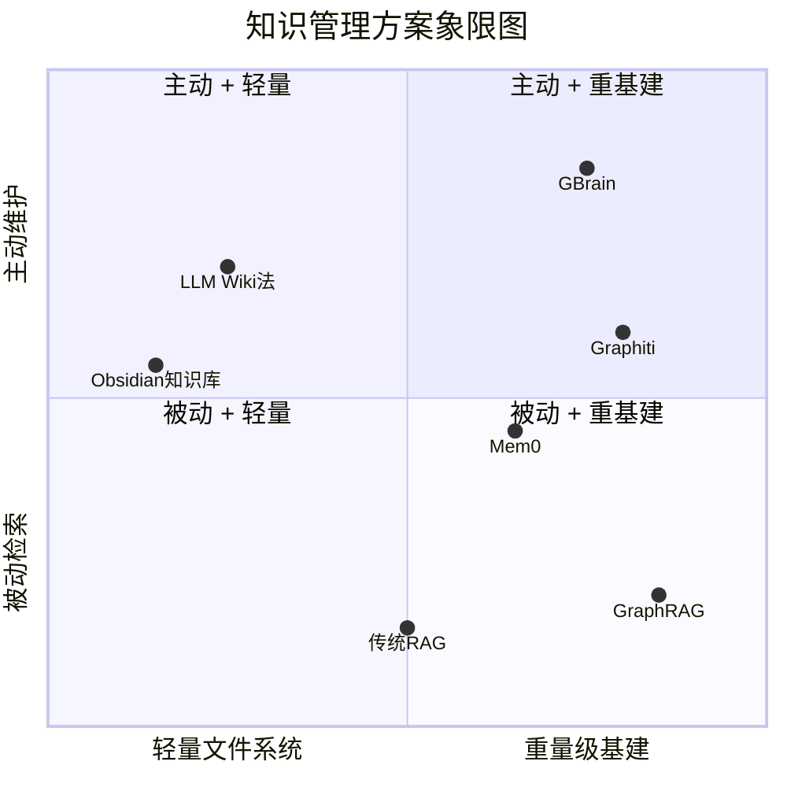

> 脱敏公开版 · 2026-11-10 补充 · 发布审核状态：redacted_full_review（发布前全文隐私审核、脱敏与改动复核）。保留通用技术内容，非公开案例、引用或数据已删除；编辑替换处另作说明。历史结论未在本次重新核实，代码未整体运行复现。见[归档说明](../../../ARCHIVE_POLICY.md)。

# GBrain 调研与 LLM Wiki 对比

> 一句话概括：GBrain 是 Garry Tan 构建的"Agent 个人大脑"——Postgres + 知识图谱 + 29 个 Skill + 自动信号捕获，本质上是 LLM Wiki 三层架构的**极端强化版**；两者设计哲学一致（编译知识 > 临时检索），但 GBrain 在自动化、持久化、图谱关联三个维度远超朴素 Wiki 法，代价是重基建和生态锁定。
> 研究日期：2026-04-26
> 关联报告：[R01](R01_AgentSkills%E4%B8%8ELLMWiki%E7%94%9F%E6%80%81.md) Agent-Skills 与 LLM Wiki 生态、[R13](R13_CodeWiki%E4%BB%A3%E7%A0%81%E4%BB%93%E5%BA%93%E4%B8%9A%E5%8A%A1%E7%9F%A5%E8%AF%86%E7%BB%84%E7%BB%87.md) CodeWiki 代码仓库业务知识组织、[R48](R48_Agent%E7%9F%A5%E8%AF%86%E5%B7%A5%E7%A8%8B%E5%85%A8%E6%99%AF%E8%B0%83%E7%A0%94.md) Agent 知识工程全景调研、[R72](R72_Agent%E8%AE%B0%E5%BF%86%E7%B3%BB%E7%BB%9F%E6%A8%AA%E8%AF%84.md) Agent 记忆系统横评

---

## 目录

1. [定位透镜：纵横坐标](#1-定位透镜纵横坐标)
2. [GBrain 核心架构拆解](#2-gbrain-核心架构拆解)
3. [LLM Wiki 法回顾（我们已有）](#3-llm-wiki-法回顾我们已有)
4. [GBrain vs LLM Wiki 结构性对比](#4-gbrain-vs-llm-wiki-结构性对比)
5. [GBrain 的核心创新点](#5-gbrain-的核心创新点)
6. [GBrain 的局限与风险](#6-gbrain-的局限与风险)
7. [对我们的启示与可借鉴点](#7-对我们的启示与可借鉴点)
8. [结论与选型建议](#8-结论与选型建议)
9. [信息来源](#9-信息来源)
10. [开放问题与后续计划](#10-开放问题与后续计划)

---

## 1. 定位透镜：纵横坐标

### 纵轴 · 演化脉络

**创世故事**：GBrain 由 Garry Tan（Y Combinator 现任 CEO）于 2026 年 4 月初创建（v0.1.0 约 3 周前），源于他为自己的 OpenClaw Agent 搭建 Markdown 知识库的实际需求。一周内积累 10,000+ 文件、3,000+ 人物、13 年日历数据——说白了，是一个 VC 大佬把自己的人脉、会议、投资决策全部灌进了 Agent 大脑。

**引爆事件**：
- Garry Tan 的个人影响力（YC CEO）+ OpenClaw/GStack 生态（70K+ Stars）提供了天然流量
- "12 天建了一个 17,888 页的个人大脑"的故事极具传播性
- v0.22.0（7 小时前刚更新），3 周达到 11.5K Stars，迭代速度极快

**生命周期定位**：**萌芽→上升期交界**（v0.22.0，3 周历史）。产品迭代飞快（几乎每天一个版本），但仅 3 周历史，API 和架构仍在快速变化，未经大规模社区验证。

### 横轴 · 竞争格局

"给 Agent 持久记忆/知识"这个赛道上的主要玩家：

| 方案 | 设计哲学 | 典型代表 | Stars |
|------|---------|---------|-------|
| **朴素 Wiki 法** | 文件即知识，Schema 控行为 | LLM Wiki 三层架构、我们的 Obsidian 知识库 | — |
| **结构化 Brain** | 编译知识 + 知识图谱 + 持久DB | **GBrain** | 11.5K |
| **时序知识图谱** | 时间感知的实体-关系图 | Graphiti/Zep | 25.4K |
| **记忆即服务** | 托管式记忆 API | Mem0, Zep Cloud | 25K+ |
| **GraphRAG** | 批量构建社区摘要图 | Microsoft GraphRAG | 32.5K |
| **自学习 Agent** | Agent 自动生成 Skill + 记忆 | Hermes Agent | 见 [R34](../06-%E5%B7%A5%E5%85%B7%E4%B8%8E%E7%94%9F%E6%80%81/R34_HermesAgent%E5%BC%80%E6%BA%90%E8%87%AA%E5%AD%A6%E4%B9%A0%E6%99%BA%E8%83%BD%E4%BD%93.md) |

**设计哲学差异**：



### 交叉判断

GBrain 处于**早期快速上升期**，Garry Tan 的影响力带来了极高关注，但核心代码主要由 2 人贡献（garrytan + claude），3 周历史意味着架构可能随时大改。它在"主动维护"维度做到了当前最强（信号检测、自动富化、夜间维护），但代价是深度绑定 OpenClaw/Hermes 生态和 Postgres。

**独立判断**：GBrain 对我们的价值不在于直接采用（生态不匹配），而在于**它验证并极化了 LLM Wiki 方法论的多个假设**——这些假设我们可以选择性吸收。

---

## 2. GBrain 核心架构拆解

### 2.1 基本信息

| 属性 | 数据 |
|------|------|
| 仓库 | [garrytan/gbrain](https://github.com/garrytan/gbrain) |
| Stars | 11.5K |
| 语言 | TypeScript 98.3% |
| 许可 | MIT |
| 版本 | v0.22.0（2026-04-26） |
| 引擎 | PGLite（嵌入式 Postgres）/ Supabase |
| 依赖 | Bun, pgvector, OpenAI API |
| 生态 | OpenClaw / Hermes Agent / GStack |
| 作者 | Garry Tan（YC CEO）+ Claude（AI 贡献者排第二） |

### 2.2 三层架构

```
┌──────────────────┐    ┌───────────────┐    ┌──────────────────┐
│   Brain Repo     │    │    GBrain     │    │    AI Agent      │
│   (git)          │    │  (retrieval)  │    │  (read/write)    │
│                  │    │               │    │                  │
│  markdown files  │───>│  Postgres +   │<──>│  29 skills       │
│  = source of     │    │  pgvector     │    │  define HOW to   │
│    truth         │    │               │    │  use the brain   │
│                  │<───│  hybrid       │    │                  │
│  human can       │    │  search       │    │  RESOLVER.md     │
│  always read     │    │  (vector +    │    │  routes intent   │
│  & edit          │    │   keyword +   │    │  to skill        │
│                  │    │   RRF)        │    │                  │
└──────────────────┘    └───────────────┘    └──────────────────┘
```

**核心设计决策**：
- **Markdown 文件是 Source of Truth**（和 LLM Wiki 一致）
- **Postgres 是检索层，不是存储层**（`gbrain sync` 从 git 同步到 DB）
- **人类始终可读可写**（编辑任何 Markdown，sync 自动更新 DB）

### 2.3 知识模型：编译真相 + 时间线

每个页面遵循统一模式：

```markdown
---
type: concept
title: Do Things That Don't Scale
tags: [startups, growth, pg-essay]
---

Paul Graham's argument that ...（编译真相：当前最佳理解）

---

- 2013-07-01: Published on paulgraham.com（时间线：只增不改）
- 2024-11-15: Referenced in batch W25 kickoff talk
```

**分隔线上方** = 编译真相（Compiled Truth），随新证据重写。
**分隔线下方** = 时间线（Timeline），只追加不编辑。

这是 GBrain 最核心的知识组织范式。

### 2.4 搜索管线（~20 层策略叠加）

```
Query
  → Intent classifier（entity / temporal / event / general）
  → Multi-query expansion（Haiku 改写 3 种表述）
  → Vector search (HNSW cosine) + Keyword search (tsvector)
  → RRF fusion: score = sum(1/(60 + rank))
  → Source-aware ranking（策展目录 > 日常流水）
  → Cosine re-scoring + Compiled truth boost
  → Backlink boost（连接度高的实体排名提升）
  → 4-layer dedup + compiled truth guarantee
  → Results
```

**BrainBench 评测**（240 页 Opus 生成的富文本语料）：
- P@5: 49.1%，R@5: 97.9%
- 比纯向量 RAG 高 +31.4 pts P@5
- 知识图谱贡献显著（图谱关闭后 P@5 下降 31.4 点）

### 2.5 知识图谱：零 LLM 调用的自动连线

```
写入一个提到 Alice 和 Acme AI 的会议页面
  → auto-link 从内容中提取实体引用（零 LLM 调用）
  → 推断类型：meeting + person ref ⇒ attended
                "CEO of X" pattern   ⇒ works_at
                "invested in"        ⇒ invested_in
  → 清理过期链接：编辑移除后链接自动删除
  → 反向链接提升搜索排名
```

支持图遍历查询：
```bash
gbrain graph-query people/alice --type attended --depth 2
# 返回 Alice 参加过的会议，以及那些会议中的其他人
```

### 2.6 29 个 Skill 分类

| 类别 | Skill 数 | 代表 | 说明 |
|------|---------|------|------|
| Always-on | 2 | signal-detector, brain-ops | 每条消息都触发，自动捕获信号 |
| Content Ingestion | 4 | idea-ingest, media-ingest | 链接/音频/视频/PDF → 知识页面 |
| Brain Operations | 7 | enrich, query, maintain | 富化、检索、维护 |
| Operational | 10 | cron-scheduler, minion-orchestrator | 任务管理、报告、后台作业 |
| Identity & Setup | 4 | soul-audit, migrate | 身份、迁移、设置 |
| Conventions | 5 | brain-first, model-routing | 跨切面质量规则 |

**核心设计哲学**：**Thin Harness, Fat Skills**（薄运行时，胖技能）——智能在 Skill 文件里，不在代码里。

### 2.7 Minions：确定性作业 vs LLM Sub-agent

GBrain 的一个重要创新是区分了**确定性任务**和**判断性任务**：

| | Minions（确定性） | Sub-agents（判断性） |
|---|---|---|
| 适用场景 | 拉文章、解析 JSON、同步 | 评估优先级、撰写回复 |
| Token 成本 | $0 | ~$0.03/次 |
| 耗时 | 753ms | >10,000ms |
| 成功率 | 100% | ~60%（网关超时） |
| 内存 | ~2 MB | ~80 MB |

---

## 3. LLM Wiki 法回顾（我们已有）

基于 [R01](R01_AgentSkills%E4%B8%8ELLMWiki%E7%94%9F%E6%80%81.md)、[R13](R13_CodeWiki%E4%BB%A3%E7%A0%81%E4%BB%93%E5%BA%93%E4%B8%9A%E5%8A%A1%E7%9F%A5%E8%AF%86%E7%BB%84%E7%BB%87.md)、[R48](R48_Agent%E7%9F%A5%E8%AF%86%E5%B7%A5%E7%A8%8B%E5%85%A8%E6%99%AF%E8%B0%83%E7%A0%94.md) 的已有结论：

### 3.1 三层架构

```
┌─────────────────────────────────┐
│  Schema 层（CLAUDE.md / SKILL.md）  ← Agent 启动加载，~2K tokens
│  规则、约束、关键事实               │
├─────────────────────────────────┤
│  Wiki 层（Markdown + Wikilink）     ← 全局可检索，10-20K tokens
│  概念、流程、决策记录               │
├─────────────────────────────────┤
│  Raw Sources（PDF / 源码 / PBI）    ← 按需 RAG 召回，无上限
│  原始未加工数据                     │
└─────────────────────────────────┘
```

### 3.2 核心范式

| 维度 | RAG 范式 | LLM Wiki 范式 |
|------|----------|---------------|
| LLM 角色 | 被动检索者 | **主动维护者** |
| 知识状态 | 临时检索，用完即弃 | 持久化 Wiki，持续演进 |
| 人类角色 | 构建 pipeline | 喂原始材料 + 调整 Schema |
| 知识质量 | 取决于 embedding 质量 | 取决于 Schema 设计 |
| 迭代方式 | 调参、换模型 | 协同演进 Schema |

### 3.3 方法定位

- 核心结论：**Wiki 解决「知识问题」（What/Why），Skill 解决「流程问题」（How），两者互补**
- 最优架构 = Schema（常驻指令）+ Wiki（编译知识）+ Skills（按需流程）

---

## 4. GBrain vs LLM Wiki 结构性对比

### 4.1 架构层面

| 维度 | LLM Wiki 法（已有） | GBrain |
|------|-------------------|--------|
| **存储** | 纯文件系统（Markdown + Git） | Postgres/PGLite + pgvector + Git |
| **检索** | 依赖 IDE/Agent 内置搜索 | 自建混合搜索（向量 + 关键词 + RRF + 图遍历） |
| **知识图谱** | Wikilink（手动/半自动） | 自动实体提取 + 类型推断（零 LLM 调用） |
| **知识模型** | 自由 Markdown | 编译真相 + 时间线（强约束格式） |
| **Schema** | CLAUDE.md / copilot-instructions.md | RESOLVER.md + 29 个 SKILL.md |
| **维护** | 人工 + LLM 辅助 | **自动夜间维护**（dream cycle） |
| **运行时** | 无（文件即运行时） | Bun + PGLite 进程 / Supabase |
| **MCP** | 无 | 内置 30+ MCP tools |
| **语言** | 无约束 | TypeScript |
| **基建要求** | 几乎零 | Postgres + OpenAI API + Bun |

### 4.2 能力层面

| 能力 | LLM Wiki 法 | GBrain | 差距 |
|------|------------|--------|------|
| 知识写入 | 人工编写 / LLM 辅助编译 | 信号检测 → 自动捕获 → 自动富化 | ⚠️ 大 |
| 知识检索 | 文件搜索 / 语义搜索 | 混合搜索 + 图遍历 + 意图分类 | ⚠️ 大 |
| 实体关联 | Wikilink（手动） | 自动类型推断（零 LLM 成本） | ⚠️ 大 |
| 时间追踪 | 无 / 手动日期标注 | 编译真相 + 时间线双区 | 中 |
| 多源摄入 | 手动导入 | 邮件/日历/语音/推特/会议自动摄入 | ⚠️ 大 |
| 人类可读 | ✅ 天然可读（纯 Markdown） | ✅ Markdown 是 Source of Truth | 持平 |
| 可迁移性 | ✅ 零锁定 | ⚠️ 依赖 PGLite/Supabase | Wiki 法优 |
| 启动成本 | ✅ 接近零 | 30 分钟安装 + API keys | Wiki 法优 |
| 生态依赖 | ✅ 无 | ⚠️ OpenClaw/Hermes/Bun | Wiki 法优 |
| 团队协作 | ✅ Git + Obsidian | ⚠️ 主要个人用 | Wiki 法优 |
| 评估体系 | 无标准 | BrainBench（P@k, R@k, nDCG@k） | GBrain 优 |

### 4.3 哲学层面

两者共享的设计信念：

> **编译知识 > 临时检索**
> **Markdown 是知识的正确载体**
> **LLM 应该是知识维护者，不是检索者**
> **Schema/Skill 控制 LLM 行为**

核心分歧：

| | LLM Wiki 法 | GBrain |
|---|---|---|
| **复杂度预算** | 极简——能用文件解决的不上数据库 | 不惜基建——为检索质量上 Postgres + 图谱 |
| **自动化程度** | 人机协作，人主导节奏 | Agent 自主运行，人监督 |
| **知识密度** | 精炼（人编译的知识密度高） | 海量（自动捕获一切信号） |
| **适用场景** | 研究工作区、代码仓库、团队知识库 | 个人全域大脑（VC/CEO 级信息处理） |

---

## 5. GBrain 的核心创新点

### 5.1 编译真相 + 时间线模式 ⭐

这是 GBrain 最值得借鉴的范式。每个知识页面分为两区：
- **上区（编译真相）**：当前最佳理解，随新证据重写
- **下区（时间线）**：事件追踪，只追加不编辑

这解决了一个我们在 Wiki 法中未解决的问题：**知识随时间演化时，如何同时保留"现在的理解"和"历史的证据"？**

### 5.2 零 LLM 成本的知识图谱 ⭐

通过正则匹配 + 类型推断规则，自动从内容中提取实体关系，**完全不调用 LLM**：
- `"CEO of X"` → works_at 关系
- `"invested in"` → invested_in 关系
- 会议页面 + 人名提及 → attended 关系

这比 GraphRAG（需要 LLM 抽取）和 Graphiti（需要 LLM 推断）都更经济。

### 5.3 信号检测器（Always-on）

每条消息都并行触发一个轻量模型（Haiku 级），自动捕获：
- 原创想法
- 实体提及（人/公司/概念）
- 值得记录的信息

说白了：**你聊天的副产品就是知识积累**。

### 5.4 分层富化（Tier 1/2/3）

基于提及频率自动升级富化力度：
- Tier 3（1 次提及）：创建存根页面
- Tier 2（3 次跨源提及）：网络 + 社交富化
- Tier 1（会议或 8+ 次提及）：全管线富化

这是一个优雅的**注意力分配机制**——大脑不可能对所有人/事投入同样精力。

### 5.5 Minions：确定性 vs 判断性任务分离

这个洞察对所有 Agent 系统都有价值：
> **确定性任务（同输入→同输出）→ 脚本/作业队列，零 Token**
> **判断性任务（需要评估和决策）→ LLM Sub-agent**

90% 以上的后台任务是确定性的，用 LLM 跑是浪费。

### 5.6 Source-aware 排名（v0.22.0 最新）

搜索结果中，**策展目录（concepts/, people/）的页面排名高于流水目录（daily/, chat/）**。这解决了知识库膨胀后"噪音淹没信号"的经典问题。

---

## 6. GBrain 的局限与风险

### 6.1 极早期，架构不稳定

- 仅 3 周历史（v0.1.0 → v0.22.0），几乎每天一个版本
- 核心贡献者仅 2 人（Garry Tan + Claude）
- API 和数据模型可能随时 breaking change
- 无正式 release tag，无 SemVer 保证

### 6.2 深度生态锁定

- 设计目标是 OpenClaw/Hermes Agent，**不是通用工具**
- 依赖 Bun（非 Node.js 主流）、PGLite/Supabase
- MCP 服务端实现专为 Claude Code/Cursor 设计
- **与 VS Code Copilot 生态无直接集成路径**

### 6.3 个人大脑 vs 团队知识库

GBrain 是为**一个人**设计的——一个 VC CEO 的个人信息处理系统：
- SOUL.md（Agent 身份）、USER.md（用户画像）都是单人设计
- 无多用户权限、无协作冲突处理
- 45,000 页的"个人大脑"场景与"团队研发知识库"有本质差异

### 6.4 运维成本不低

- 需要 OpenAI API key（向量嵌入 + 查询扩展）
- Supabase Pro $25/月（超过本地后）
- 19 个 cron job 需要持续运行的进程
- 嵌入更新、图谱提取、夜间维护都消耗资源

### 6.5 "Claude 写 Claude 用"的同质性风险

代码的第二大贡献者是 Claude。Skill 文件也主要由 Claude 读取和执行。这存在**LLM 自我强化**的风险——方案可能对 Claude 过度优化而对其他模型表现不佳。

---

## 7. 对我们的启示与可借鉴点

### 7.1 可直接采纳的模式

| 模式 | 来源 | 如何应用到我们的 Wiki 法 | 投入 |
|------|------|------------------------|------|
| **编译真相 + 时间线** | GBrain 知识模型 | 报告格式增加"时间线"区（追踪结论演变） | 低 |
| **Source-aware 排名** | GBrain v0.22.0 | Obsidian Vault 目录分级（reports/ > sessions/ > _inbox/） | 低 |
| **分层富化** | Tiered enrichment | 知识索引中标注"提及频次"，高频条目深度展开 | 中 |

### 7.2 值得参考但不直接采用的模式

| 模式 | 原因 | 替代方案 |
|------|------|---------|
| 零 LLM 知识图谱 | 需要 Postgres + 自建代码 | 增强 Wikilink 自动化（lint 脚本检测未链接实体） |
| 信号检测器 | 需要 always-on 进程 | 会话结束时集中审视 |
| BrainBench 评估 | 需要自建评估框架 | 参考其指标设计评估流程 |
| MCP 暴露知识库 | 需要独立服务 | 继续用 Copilot 原生搜索 + 手动加载 |

### 7.3 需要警惕的反模式

- **过度自动化**：GBrain 的 19 个 cron job 适合 VC CEO，不适合研发团队——维护成本会反噬
- **知识膨胀**：45,000 页中有多少是噪音？source-aware ranking 正是为了对抗这个问题
- **工具锁定**：从 Obsidian 迁移到 GBrain 容易（它有 migrate 工具），但反向迁移不确定

---

## 8. 结论与选型建议

### 8.1 一句话结论

GBrain 是 LLM Wiki 方法论的**高配实现**——它证明了"编译知识 + 知识图谱 + 主动维护"这条路能走多远。但对于团队研发知识库 + VS Code Copilot 场景，**继续用朴素 Wiki 法并选择性吸收 GBrain 的设计模式，比直接切换到 GBrain 更明智**。

### 8.2 决策树

```
你的场景是什么？
├── 个人全域大脑（邮件/日历/会议/社交全量灌入）
│   ├── 用 OpenClaw/Hermes → 直接上 GBrain
│   └── 用其他 Agent 平台 → 参考 GBrain 的知识模型，自建
├── 团队研发知识库
│   ├── <1000 页，主要手动编写 → LLM Wiki 法 ✅
│   ├── 1000-10000 页，混合手动+自动 → Wiki 法 + 增强检索（Hybrid Search）
│   └── >10000 页，全自动化需求 → 考虑 GBrain 或自建类似方案
└── 代码仓库知识
    └── Wiki 法 + CodeWiki（见 [[R13]]）✅
```

### 8.3 我们的行动项

1. **立即可做**：在报告模板中增加"编译真相 + 时间线"双区格式
2. **短期**：增强 wiki_lint.py，自动检测未链接的实体引用（学习 GBrain 的零 LLM 链接提取思路）
3. **中期**：评估是否需要为 Obsidian Vault 增加混合搜索能力（向量 + 关键词 + RRF）
4. **持续关注**：GBrain 的迭代方向——如果它走向通用化（脱离 OpenClaw 依赖），价值会显著提升

---

## 9. 信息来源

📌 来源清单
- [garrytan/gbrain](https://github.com/garrytan/gbrain) — 2026-04-26 — 主仓库 README，v0.22.0，11.5K Stars
- [garrytan/gbrain-evals](https://github.com/garrytan/gbrain-evals) — 2026-04-26 — BrainBench 评估仓库
- [GitHub Topics: gbrain](https://github.com/topics/gbrain) — 2026-04-26 — 生态项目一览（4 个关联项目）
- [huytieu/COG-second-brain](https://github.com/huytieu/COG-second-brain) — 2026-04-26 — 受 GBrain 启发的第二大脑项目，367 Stars
- 本工作区 [R01](R01_AgentSkills%E4%B8%8ELLMWiki%E7%94%9F%E6%80%81.md) [R13](R13_CodeWiki%E4%BB%A3%E7%A0%81%E4%BB%93%E5%BA%93%E4%B8%9A%E5%8A%A1%E7%9F%A5%E8%AF%86%E7%BB%84%E7%BB%87.md) [R48](R48_Agent%E7%9F%A5%E8%AF%86%E5%B7%A5%E7%A8%8B%E5%85%A8%E6%99%AF%E8%B0%83%E7%A0%94.md) — 2026-04 — LLM Wiki 三层架构已有分析

⚖️ 来源一致性：一致（GBrain 信息主要来自官方仓库，与社区项目描述一致）
📅 时效性声明：以上信息获取于 2026-04-26，GBrain 处于高速迭代期，架构可能快速变化

---

## 10. 开放问题与后续计划

| 问题 | 优先级 | 状态 |
|------|-------|------|
| GBrain 的知识图谱在中文内容上的实体提取效果如何？ | 中 | 未验证 |
| 编译真相 + 时间线模式是否值得固化为本工作区的 Wiki 模板？ | 高 | 候选产物 |
| GBrain 脱离 OpenClaw 后能否独立使用？ | 低 | 持续关注 |
| 本工作区的 Obsidian Vault 是否需要混合搜索增强？ | 中 | 与 [R48](R48_Agent%E7%9F%A5%E8%AF%86%E5%B7%A5%E7%A8%8B%E5%85%A8%E6%99%AF%E8%B0%83%E7%A0%94.md) RAG 方案关联 |
