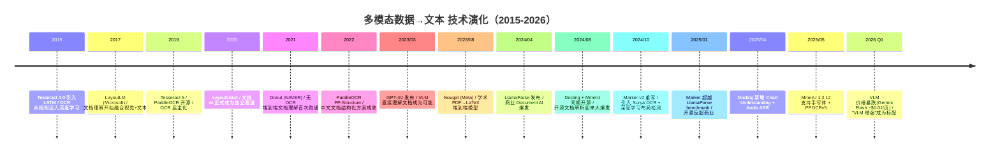
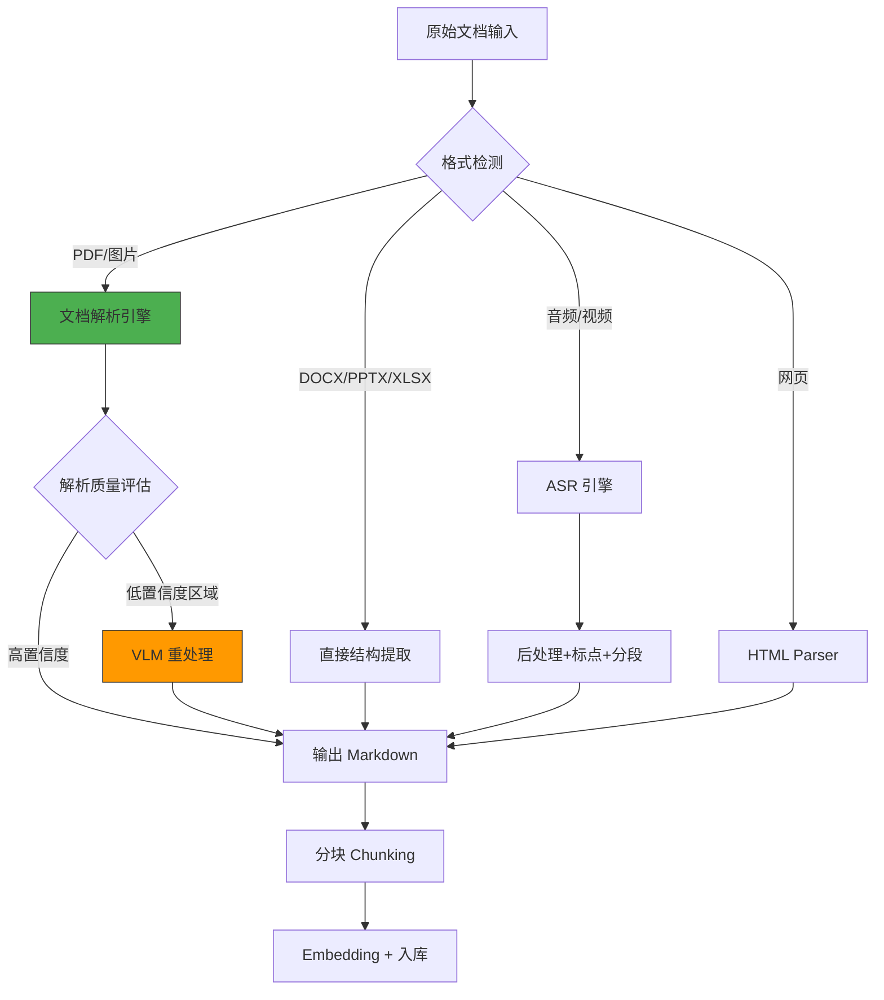

> 历史研究归档 · 2026-11-10 发布 · 程序扫描；未逐篇全文审阅。原有日期、观点、数据和命令保留历史语境，未经本次逐项事实核验或运行复现；请结合[归档说明](../../../ARCHIVE_POLICY.md)阅读。

> **一句话概括**：系统拆解"非文本数据→可检索文本"这条管线——覆盖 PDF/图片/表格/图表/公式/音频六大模态，横评 Marker / MinerU / Docling / Unstructured / LlamaParse 五大工具 + VLM 直接转写方案，给出按场景的选型决策树和生产级避坑清单。
> **研究日期**：2026-05-07
> **关联报告**：[R30](../04-%E5%B7%A5%E7%A8%8B%E5%AE%9E%E8%B7%B5/R30_RAG%E4%BB%8E%E5%85%A5%E9%97%A8%E5%88%B0%E7%94%9F%E4%BA%A7%E8%90%BD%E5%9C%B0.md)（RAG 全链路，Ch4 简要提及文档解析）· [R42](../06-%E5%B7%A5%E5%85%B7%E4%B8%8E%E7%94%9F%E6%80%81/R42_RAGFlow%E5%BC%80%E6%BA%90RAG%E5%BC%95%E6%93%8E.md)（RAGFlow 引擎，含 DeepDoc）· [R66](../06-%E5%B7%A5%E5%85%B7%E4%B8%8E%E7%94%9F%E6%80%81/R66_%E5%A4%9A%E6%A8%A1%E6%80%81Agent%E4%B8%8EComputerUse%E8%B0%83%E7%A0%94.md)（多模态 Agent，VLM 用于 GUI 操作）· R48（原稿交叉引用，本归档未解析）（Agent 知识工程）· [R65](../06-%E5%B7%A5%E5%85%B7%E4%B8%8E%E7%94%9F%E6%80%81/R65_Agent%E4%B8%BB%E6%B5%81%E6%8A%80%E6%9C%AF%E6%A0%88%E6%90%AD%E9%85%8D%E9%80%9F%E6%9F%A5%E6%89%8B%E5%86%8C.md)（技术栈搭配速查）
> **增量价值**：R30 Ch4 仅用一张表概述文档解析工具，**本报告深入到机制层**——拆解每种模态的技术路线差异、工具实现原理、生产级 benchmark 对比、成本估算，填补"多模态数据如何喂给 LLM"这个关键前置环节的研究空白。

---

## TL;DR 速查卡

| 维度 | 结论 |
|------|------|
| **核心问题** | LLM 只吃文本，但真实世界 80% 的知识藏在 PDF/图片/表格/音频里——需要一条"多模态→文本"的预处理管线 |
| **2026 年格局** | 传统 OCR 已被深度学习方案全面超越；**文档解析工具 + VLM 增强**是当前最优组合 |
| **开源首选** | **Marker**（综合准确率最高）/ **MinerU**（中文 PDF + 公式最强）/ **Docling**（多格式覆盖 + Agent 集成最广） |
| **商业首选** | **LlamaParse**（最省心）/ **Mathpix**（数学/科学文献）/ **Unstructured Platform**（企业级管线） |
| **VLM 直转** | GPT-4o / Claude Sonnet / Gemini 2.0 Flash 可直接"看图说话"，适合复杂版面/图表，但**成本是工具链的 10-50 倍** |
| **表格** | 结构化表格用工具链解析（HTML/Markdown），复杂合并单元格用 VLM 兜底 |
| **图表** | Docling 新增 Chart Understanding（饼图/柱状图→数据表）；通用场景用 VLM 描述 |
| **音频** | Whisper large-v3 是标杆；中文场景 FunASR / Paraformer 更优 |
| **关键选型因子** | ① 文档类型（扫描 vs 原生） ② 语言（中文 vs 英文） ③ 精度要求（表格还原率） ④ 成本预算 ⑤ 部署约束（私有化 vs 云） |

---

## 目录

1. [定位透镜：纵横坐标](#定位透镜)
2. [问题拆解：六大模态的技术挑战](#问题拆解)
3. [技术路线全景：三代范式演进](#技术路线)
4. [工具横评：五大开源 + 三大商业](#工具横评)
5. [VLM 直接转写方案](#vlm方案)
6. [表格处理专题](#表格专题)
7. [图表与公式专题](#图表公式)
8. [音频转文本专题](#音频专题)
9. [生产级管线设计](#生产管线)
10. [选型决策树](#选型决策树)
11. [成本速算](#成本速算)
12. [结论与最佳实践](#结论)
13. [开放问题](#开放问题)
14. [来源清单](#来源清单)

---

<a id="定位透镜"></a>
## 1. 定位透镜：纵横坐标

### 纵轴 · 演化脉络



**生命周期定位**：文档解析赛道正处于**上升期向成熟期过渡**——开源工具在 2024-2025 年经历爆发式迭代后质量逼近商业方案，VLM 降价使"混合方案"（工具链+VLM兜底）成为可能且经济可行。

**创世痛点**：RAG 系统发现"垃圾进垃圾出"——文档解析质量直接决定了检索和生成的天花板。传统 OCR（Tesseract）对复杂排版/表格/公式的效果太差，催生了这一代深度学习文档解析工具。

### 横轴 · 竞争格局

| 工具 | 背景 | 设计哲学 | 核心差异点 |
|------|------|---------|-----------|
| **Marker** | Vik Paruchuri / Datalab | 速度+精度并重，模块化管线 | 自研 Surya OCR + 深度学习全栈，可选 LLM 增强 |
| **MinerU** | 上海 AI Lab / OpenDataLab | 学术 PDF 专精，公式+表格 | 源自 InternLM 预训练数据清洗管线 |
| **Docling** | IBM Research Zurich | 多格式覆盖 + Agent 生态集成 | LF AI 基金会托管，MCP Server，VLM 原生支持 |
| **Unstructured** | 独立公司 | 企业级平台，连接器生态 | SaaS + 开源双模式，分区(partition) 抽象 |
| **LlamaParse** | LlamaIndex | 开发者最友好，一行代码搞定 | 云服务，针对 LlamaIndex RAG 管线优化 |
| **VLM 直转** | OpenAI/Anthropic/Google | 通用视觉理解 | 无需专用模型，一个 API 搞定一切 |

**设计哲学差异**：
- **工具链派**（Marker/MinerU/Docling）：用多个专用小模型串联（布局检测→OCR→表格识别→公式识别），每个环节精调，整体速度快成本低
- **VLM 派**（GPT-4o/Claude/Gemini）：用一个大模型直接"看"文档输出文本，通用性强但成本高延迟大
- **混合派**（Marker `--use_llm` / Docling VLM mode）：工具链做主力，VLM 处理边角难题——**2026 年的最优解**

### 交叉判断

纵轴告诉我们：这个领域在 2024-2025 年经历了一次质的飞跃（开源追平商业），技术成熟度已经足够生产使用。横轴告诉我们：没有银弹——不同场景（扫描件 vs 原生 PDF、中文 vs 英文、表格密集 vs 纯文本）需要不同的工具组合。**正确的选型策略不是"选最好的工具"，而是"为你的数据特征选对的管线"。**

---

<a id="问题拆解"></a>
## 2. 问题拆解：六大模态的技术挑战

"多模态数据转文本"不是一个问题，是六个子问题，每个有不同的技术难点：

| 模态 | 典型场景 | 核心挑战 | 难度 |
|------|---------|---------|------|
| **原生 PDF 文本** | 数字化文档、Word 导出的 PDF | 提取文字本身不难，难在**保持结构**（标题层级、多栏阅读顺序） | ⭐⭐ |
| **扫描件/图片中的文字** | 扫描合同、拍照笔记、截图 | OCR 精度 + 复杂排版 + 低分辨率/倾斜/模糊 | ⭐⭐⭐⭐ |
| **表格** | 财报、报表、Excel 截图 | 单元格边界识别、合并单元格、跨页表格 | ⭐⭐⭐⭐⭐ |
| **图表** | 柱状图、折线图、饼图 | 需要理解图表含义，还原为数据或自然语言描述 | ⭐⭐⭐⭐ |
| **数学公式** | 学术论文、教材 | LaTeX 还原精度、行内公式 vs 行间公式区分 | ⭐⭐⭐ |
| **音频/视频** | 会议录音、播客、教学视频 | 语音识别精度 + 说话人分离 + 时间戳对齐 | ⭐⭐⭐ |

---

<a id="技术路线"></a>
## 3. 技术路线全景：三代范式演进

### 第一代：规则 + 传统 OCR（2015 前）

```
PDF → 提取文字层（pdfminer/PyMuPDF）
图片 → Tesseract OCR → 纯文本
表格 → 规则匹配线条 → CSV
```

**缺陷**：多栏错乱、表格崩坏、公式乱码。对"长什么样"完全没有理解能力。

### 第二代：深度学习专用模型管线（2020-2024）

```
文档 → 布局检测(YOLO/LayoutLM) → 区域分类(文本/表格/图/公式)
         ↓                          ↓            ↓          ↓
    OCR(PaddleOCR/Surya)     表格模型(TSR)   VLM描述   LaTeX模型
         ↓                          ↓            ↓          ↓
    结构化文本拼接 ← ─── ─── ─── ─── ─── ─── ─── ─── ─── ─┘
         ↓
    Markdown / JSON 输出
```

**代表**：MinerU、Marker（无 LLM 模式）、Docling（传统管线模式）

**优势**：精度高、速度快、可本地部署、成本低
**局限**：每个环节需要独立模型，复杂边界情况（如表格横跨两页、图文混排）仍然处理不好

### 第三代：VLM 增强 / 端到端（2024-）

```
方案 A：工具链 + VLM 兜底（当前最优）
    文档 → 工具链解析（快速、低成本）
              ↓
    置信度低的区域 → VLM 重新处理（精准、高成本）
              ↓
    合并输出

方案 B：纯 VLM 端到端
    文档页面截图 → VLM（GPT-4o/Gemini）→ 结构化文本
    简单粗暴，但成本高（$0.01-0.05/页）
```

**代表**：Marker `--use_llm`、Docling VLM mode（GraniteDocling）、GPT-4o 直接转写

---

<a id="工具横评"></a>
## 4. 工具横评：五大开源 + 三大商业

### 4.1 核心能力对比

| 能力维度 | Marker | MinerU | Docling | Unstructured | LlamaParse |
|---------|--------|--------|---------|--------------|------------|
| **PDF 原生文本** | ⭐⭐⭐⭐⭐ | ⭐⭐⭐⭐⭐ | ⭐⭐⭐⭐ | ⭐⭐⭐⭐ | ⭐⭐⭐⭐ |
| **扫描件 OCR** | ⭐⭐⭐⭐⭐ (Surya) | ⭐⭐⭐⭐⭐ (PaddleOCR) | ⭐⭐⭐⭐ (多引擎) | ⭐⭐⭐ (Tesseract) | ⭐⭐⭐⭐ (云) |
| **表格还原** | ⭐⭐⭐⭐ (LLM模式⭐⭐⭐⭐⭐) | ⭐⭐⭐⭐ (RapidTable) | ⭐⭐⭐⭐ | ⭐⭐⭐ | ⭐⭐⭐⭐ |
| **公式(LaTeX)** | ⭐⭐⭐⭐ (Texify) | ⭐⭐⭐⭐⭐ (UniMERNet) | ⭐⭐⭐ | ⭐⭐ | ⭐⭐⭐⭐ |
| **图表理解** | ⭐⭐ | ⭐⭐ | ⭐⭐⭐⭐ (新功能) | ⭐⭐ | ⭐⭐⭐ |
| **多格式支持** | PDF/图片/PPTX/DOCX/XLSX/HTML/EPUB | PDF 为主 | PDF/DOCX/PPTX/XLSX/HTML/音频/图片/LaTeX/XBRL | PDF/DOCX/PPTX/HTML/邮件等 | PDF/DOCX/PPTX |
| **中文效果** | ⭐⭐⭐⭐ | ⭐⭐⭐⭐⭐ | ⭐⭐⭐ | ⭐⭐⭐ | ⭐⭐⭐ |
| **速度(单页)** | ~0.18s (GPU) | ~0.5s (GPU) | ~1s | ~2s | 云延迟 ~3-5s |
| **Agent 集成** | API Server | CLI + API | MCP Server + LangChain/LlamaIndex/CrewAI/Haystack | 连接器生态 | LlamaIndex 原生 |
| **可本地部署** | ✅ | ✅ | ✅ | ✅ (开源版) | ❌ (纯云) |
| **License** | GPL + 商业许可 | AGPL (PyMuPDF依赖) | MIT | Apache 2.0 | 商业 SaaS |
| **GPU 要求** | ~5GB VRAM | ~6GB VRAM | 可 CPU | 可 CPU | N/A |

### 4.2 Benchmark 对比（来自 Marker 官方测试集）

> 测试集：Common Crawl 抽取的单页 PDF，涵盖科学论文/书籍/表格/法律文档等

| 工具 | Heuristic Score | LLM Judge (1-5) | 速度 (H100) |
|------|----------------|-----------------|-------------|
| **Marker** | **95.67** | **4.24** | 122 页/秒 (批量) |
| LlamaParse | 84.24 | 3.98 | 云服务 |
| Mathpix | 86.43 | 4.16 | 云服务 |
| Docling | 86.71 | 3.70 | ~50 页/秒 |

> ⚠️ 注意：这是 Marker 团队自测的结果，可能存在 home-field advantage。但多个独立评测（社区博客、Reddit 讨论）也基本验证了 Marker 在综合场景下的领先地位。

### 4.3 各工具详评

#### Marker — 综合王者

```python
# 基础用法：PDF → Markdown
from marker.converters.pdf import PdfConverter
from marker.models import create_model_dict
from marker.output import text_from_rendered

converter = PdfConverter(artifact_dict=create_model_dict())
rendered = converter("document.pdf")
text, _, images = text_from_rendered(rendered)

# LLM 增强模式（表格/公式精度显著提升）
# marker_single document.pdf --use_llm --force_ocr
```

**核心技术栈**：
- 布局检测：Surya（自研，深度学习）
- OCR：Surya OCR（支持 90+ 语言）
- 公式：Texify（LaTeX 转换）
- 表格：专用 TableConverter + 可选 LLM 增强
- 后处理：启发式规则 + 可选 Gemini/Ollama/Claude/OpenAI 修正

**什么时候选 Marker**：追求最高综合精度、有 GPU、英文为主、需要批量处理

#### MinerU — 中文 PDF 之王

```python
# 基础用法
from magic_pdf.data.data_reader_writer import FileBasedDataWriter
from magic_pdf.pipe.UNIPipe import UNIPipe

# 或者直接命令行
# magic-pdf -p paper.pdf -o output/ -m auto
```

**核心技术栈**：
- 布局检测：DocLayout-YOLO（自研）
- OCR：PaddleOCR（PP-OCRv4/v5，中文最强）
- 表格：RapidTable + SLANet+
- 公式：UniMERNet（2503 版，多行公式支持）
- 阅读顺序：layoutreader 模型

**什么时候选 MinerU**：中文文档为主、学术论文、大量数学公式、需要高质量公式 LaTeX 还原

#### Docling — 生态集成之王

```python
# 基础用法
from docling.document_converter import DocumentConverter

converter = DocumentConverter()
result = converter.convert("document.pdf")
print(result.document.export_to_markdown())

# VLM 模式（使用 GraniteDocling 258M）
# docling --pipeline vlm --vlm-model granite_docling paper.pdf
```

**核心技术栈**：
- 布局检测：Heron（新默认模型，更快）
- OCR：多引擎支持
- 表格：TableFormer
- VLM：GraniteDocling-258M（IBM 自研小型 VLM，可离线）
- 图表理解：Bar/Pie/Line → 数据表/代码/描述
- 音频：ASR 模型支持
- 统一表示：DoclingDocument（结构化中间格式）

**什么时候选 Docling**：需要处理多种格式（不只 PDF）、要接入 Agent 生态（MCP/LangChain）、需要图表理解、企业级 MIT 许可

#### Unstructured — 企业管线之王

```python
from unstructured.partition.auto import partition

# 自动检测格式并分区
elements = partition(filename="document.pdf")

# 每个 element 有类型标注：Title, NarrativeText, Table, Image...
for el in elements:
    print(f"{el.category}: {el.text[:100]}")
```

**设计特点**：
- "分区"（Partition）抽象——把文档切成带语义标签的 Element
- 丰富的连接器（S3、GCS、MongoDB、Pinecone 等）
- 开源版能力有限，平台版加了 VLM enrichment
- 依赖系统包较多（Tesseract、Poppler、LibreOffice）

**什么时候选 Unstructured**：需要端到端数据管线（从源到向量库）、企业级 SaaS、已有 Unstructured 平台订阅

---

<a id="vlm方案"></a>
## 5. VLM 直接转写方案

当文档解析工具搞不定时（极复杂排版、手绘图表、混合媒体），VLM 是终极兜底。

### 5.1 技术原理

```
页面截图 (1-2MB JPEG) → Vision Encoder → Token 序列 → LLM Decoder → 结构化文本

关键参数：
- 1080p 图片 ≈ 1200-2000 tokens（取决于模型的 tile 策略）
- 一张 A4 页面 ≈ $0.01-0.05 的输入成本
```

### 5.2 主流 VLM 文档转写能力对比

| 模型 | 文本提取 | 表格还原 | 图表描述 | 公式 LaTeX | 中文 | 成本/页 |
|------|---------|---------|---------|-----------|------|--------|
| **GPT-4o** | ⭐⭐⭐⭐⭐ | ⭐⭐⭐⭐ | ⭐⭐⭐⭐⭐ | ⭐⭐⭐⭐ | ⭐⭐⭐⭐ | ~$0.02 |
| **Claude Sonnet 4** | ⭐⭐⭐⭐⭐ | ⭐⭐⭐⭐⭐ | ⭐⭐⭐⭐ | ⭐⭐⭐⭐ | ⭐⭐⭐⭐ | ~$0.015 |
| **Gemini 2.0 Flash** | ⭐⭐⭐⭐ | ⭐⭐⭐⭐ | ⭐⭐⭐⭐ | ⭐⭐⭐ | ⭐⭐⭐ | ~$0.003 |
| **Qwen2.5-VL-72B** | ⭐⭐⭐⭐ | ⭐⭐⭐⭐ | ⭐⭐⭐ | ⭐⭐⭐ | ⭐⭐⭐⭐⭐ | 本地部署 |
| **GraniteDocling-258M** | ⭐⭐⭐ | ⭐⭐⭐ | ⭐⭐ | ⭐⭐ | ⭐⭐ | 本地/免费 |

### 5.3 VLM 转写 Prompt 模板

```python
# 通用文档转写 Prompt
DOCUMENT_TO_TEXT_PROMPT = """
请将这张文档图片的内容完整转换为 Markdown 格式。要求：
1. 保持原文的标题层级结构（用 # ## ### 标注）
2. 表格转为 Markdown 表格格式，保持所有单元格内容
3. 数学公式转为 LaTeX 格式，行内公式用 $ 包裹，独立公式用 $$ 包裹
4. 图表用 [图表描述: xxx] 标注，并尝试描述图表传达的关键信息
5. 忽略页眉、页脚、页码
6. 保持原文语言，不要翻译
"""

# 表格专用 Prompt（精度更高）
TABLE_EXTRACTION_PROMPT = """
请将图片中的表格精确转换为 Markdown 格式。
- 保持所有行列结构完整
- 合并单元格用重复内容表示
- 数字保持原始精度
- 如果表格有标题，放在表格上方
- 只输出表格内容，不要其他解释
"""

# Python 示例：使用 OpenAI API 转写文档
import base64
from openai import OpenAI

def document_image_to_text(image_path: str) -> str:
    client = OpenAI()
    
    with open(image_path, "rb") as f:
        base64_image = base64.b64encode(f.read()).decode("utf-8")
    
    response = client.chat.completions.create(
        model="gpt-4o",
        messages=[{
            "role": "user",
            "content": [
                {"type": "text", "text": DOCUMENT_TO_TEXT_PROMPT},
                {"type": "image_url", "image_url": {
                    "url": f"data:image/jpeg;base64,{base64_image}",
                    "detail": "high"  # 高精度模式
                }}
            ]
        }],
        max_tokens=4096
    )
    return response.choices[0].message.content
```

### 5.4 VLM 方案的适用边界

| 适合 VLM | 不适合 VLM |
|----------|-----------|
| 极复杂排版（杂志、海报） | 大批量标准文档（>1000 页） |
| 手绘图表、流程图 | 纯文本 PDF（杀鸡用牛刀） |
| 多语言混排 | 对延迟敏感的实时场景 |
| 需要语义理解的图表 | 预算有限的场景 |
| 表格跨页合并 | 需要 100% 精确数字还原 |

---

<a id="表格专题"></a>
## 6. 表格处理专题

表格是多模态转文本中**最难的子问题**——因为表格的语义不只在文字里，还在**空间位置关系**里。

### 6.1 表格类型与难度分级

```
Level 1: 规则网格表格（有清晰线条）     → 工具链轻松搞定
Level 2: 无线条表格（靠对齐暗示结构）   → 需要深度学习模型
Level 3: 合并单元格（行/列跨度）         → 需要 TSR(Table Structure Recognition) 模型
Level 4: 跨页表格                        → 需要 LLM 辅助合并
Level 5: 嵌套表格 / 表格中含表格         → 目前所有工具都处理不好
```

### 6.2 表格输出格式选择

| 格式 | 优势 | 劣势 | 适用场景 |
|------|------|------|---------|
| **Markdown Table** | LLM 友好、人类可读 | 不支持合并单元格、复杂结构丢失 | 简单表格、RAG 检索 |
| **HTML `<table>`** | 完整结构保留、支持合并单元格 | Token 占用多 | 复杂表格、需要精确还原 |
| **CSV/TSV** | 程序处理方便 | 无结构信息 | 数据分析、数据库导入 |
| **JSON（行列结构）** | 强类型、可编程 | LLM 上下文友好度一般 | API 传递、后续处理 |

**实战建议**：RAG 场景用 **Markdown Table**（token 效率最高）；需要精确还原的场景（如财报）用 **HTML**；纯数据处理用 **CSV**。

### 6.3 各工具表格处理能力实测

```
# Marker 表格提取（独立 TableConverter）
from marker.converters.table import TableConverter
from marker.models import create_model_dict
from marker.output import text_from_rendered

converter = TableConverter(artifact_dict=create_model_dict())
rendered = converter("financial_report.pdf")
text, _, images = text_from_rendered(rendered)
# 输出 HTML 表格，支持 --output_format json 获取单元格坐标
```

Marker 在 FinTabNet 测试集上的 TEDS（Tree Edit Distance-based Similarity）得分：
- 标准模式：0.816
- LLM 增强模式：**0.907**
- 纯 Gemini：0.829

**结论**：工具链 + LLM 混合（Marker `--use_llm`）在表格还原上超过纯 VLM。

---

<a id="图表公式"></a>
## 7. 图表与公式专题

### 7.1 图表（Chart）→ 文本

图表转文本有三种策略：

| 策略 | 做法 | 输出 | 适用场景 |
|------|------|------|---------|
| **数据还原** | 识别图表类型 + 提取数据点 | 数据表（如 CSV） | 柱状图、折线图等结构化图表 |
| **语义描述** | VLM 描述图表含义 | 自然语言段落 | 用于 RAG 检索的语义化描述 |
| **代码还原** | 生成能重现该图表的代码 | Python/matplotlib 代码 | 需要编辑或修改图表 |

**Docling 的 Chart Understanding**（2025 新功能）：
- 支持柱状图、饼图、折线图
- 可输出为数据表、代码或详细描述
- 在 Docling 管线中自动触发，无需额外配置

**VLM 方案**（通用性最强）：
```python
CHART_PROMPT = """
分析这张图表：
1. 图表类型是什么？
2. X轴和Y轴分别代表什么？
3. 列出所有可读取的数据点
4. 图表传达的关键趋势或结论是什么？
请以结构化格式回答。
"""
```

### 7.2 数学公式 → LaTeX

| 工具 | 模型 | 行间公式 | 行内公式 | 中文混排 |
|------|------|---------|---------|---------|
| MinerU | UniMERNet (2503) | ⭐⭐⭐⭐⭐ | ⭐⭐⭐⭐ | ⭐⭐⭐⭐ |
| Marker | Texify | ⭐⭐⭐⭐ | ⭐⭐⭐ (需 `--force_ocr`) | ⭐⭐⭐ |
| Nougat | 端到端 | ⭐⭐⭐⭐⭐ | ⭐⭐⭐⭐⭐ | ⭐⭐ (仅英文训练) |
| VLM | GPT-4o/Claude | ⭐⭐⭐⭐ | ⭐⭐⭐ | ⭐⭐⭐⭐ |

**公式场景选型**：
- 英文学术论文 → Nougat（端到端最强）或 MinerU
- 中文数学教材 → MinerU（PaddleOCR + UniMERNet 组合）
- 偶尔遇到公式 → Marker `--force_ocr` 够用

---

<a id="音频专题"></a>
## 8. 音频转文本专题

### 8.1 主流方案对比

| 工具 | 类型 | 语言支持 | 中文效果 | 说话人分离 | 部署 |
|------|------|---------|---------|-----------|------|
| **Whisper large-v3** | 开源模型 | 99 语言 | ⭐⭐⭐⭐ | ❌ (需外挂) | 本地 GPU |
| **FunASR (Paraformer)** | 开源模型 | 中文为主 | ⭐⭐⭐⭐⭐ | ✅ 内置 | 本地 |
| **Docling ASR** | 开源集成 | 多语言 | ⭐⭐⭐ | 取决于后端 | 本地 |
| **Azure Speech** | 云服务 | 100+ 语言 | ⭐⭐⭐⭐⭐ | ✅ | 云 |
| **讯飞/百度 ASR** | 云服务 | 中文 | ⭐⭐⭐⭐⭐ | ✅ | 云 |

### 8.2 实战代码

```python
# Whisper 本地转写
import whisper

model = whisper.load_model("large-v3")
result = model.transcribe("meeting.mp3", language="zh")
print(result["text"])

# 带时间戳的输出（适合做字幕或检索）
for segment in result["segments"]:
    print(f"[{segment['start']:.1f}s → {segment['end']:.1f}s] {segment['text']}")
```

```python
# FunASR（中文更优）
from funasr import AutoModel

model = AutoModel(model="paraformer-zh", vad_model="fsmn-vad", punc_model="ct-punc")
result = model.generate(input="meeting.wav")
print(result[0]["text"])
```

### 8.3 音频转文本的后处理

原始转录文本往往需要后处理才能用于 RAG：

1. **标点恢复**：Whisper 自带，FunASR 用 ct-punc 模型
2. **段落分割**：按语音停顿 + 话题转换切分
3. **说话人标注**：pyannote-audio 做 Speaker Diarization
4. **口语→书面语**：用 LLM 做文风转换（去掉"嗯""那个"等填充词）

---

<a id="生产管线"></a>
## 9. 生产级管线设计

### 9.1 推荐架构



### 9.2 质量评估与回退策略

```python
# 伪代码：解析质量评估 + VLM 回退
def parse_with_fallback(file_path: str) -> str:
    # 第一轮：工具链快速解析
    result = marker_parse(file_path)
    
    # 质量信号检测
    quality_signals = assess_quality(result)
    
    # 哪些页面需要 VLM 兜底？
    low_quality_pages = [
        page for page in result.pages
        if page.ocr_confidence < 0.8          # OCR 置信度低
        or page.table_count > 0 and page.table_score < 0.7  # 表格识别不佳
        or page.has_complex_layout              # 复杂排版
    ]
    
    # 第二轮：对问题页面用 VLM 重处理
    for page in low_quality_pages:
        vlm_result = vlm_parse_page(page.image)
        result.pages[page.index] = vlm_result
    
    return result.to_markdown()
```

### 9.3 生产避坑 Top 10

| # | 坑 | 症状 | 解法 |
|---|-----|------|------|
| 1 | PDF 文字层是乱码 | 提取出来的文本全是符号映射错误 | 强制 OCR（`--force_ocr`）忽略文字层 |
| 2 | 扫描件倾斜 | OCR 精度暴跌 | 预处理做 deskew（倾斜矫正） |
| 3 | 双栏被读成交错 | "第一栏第一行，第二栏第一行，第一栏第二行..." | 用布局检测模型确定阅读顺序 |
| 4 | 表格跨页 | 表头在第一页，数据在第二页，被切成两个独立表格 | Marker `--use_llm` 自动合并跨页表格 |
| 5 | 页眉页脚混入正文 | 每 500 字冒出一次"第 X 页" | 工具一般自动处理；检查是否启用了 header/footer removal |
| 6 | 图片中的文字没被识别 | 流程图、架构图中的文字标注丢失 | 对图片区域单独做 OCR 或 VLM 描述 |
| 7 | 水印干扰 OCR | 识别出大量水印文字 | 预处理去水印，或调高 OCR 置信度阈值 |
| 8 | 加密 PDF | 解析报错 | 先解密再处理；无密码则无法处理 |
| 9 | 超大文件 OOM | 500 页 PDF 一次性加载爆内存 | 分页处理、batch 模式 |
| 10 | 输出格式不一致 | 同一批文档的表格有的是 HTML 有的是 Markdown | 统一配置输出格式，后处理做归一化 |

---

<a id="选型决策树"></a>
## 10. 选型决策树

```mermaid
graph TD
    START[你的文档是什么？] --> Q1{主要是什么格式？}
    
    Q1 -->|PDF为主| Q2{原生PDF还是扫描件？}
    Q1 -->|多种格式混合| DOCLING[推荐 Docling]
    Q1 -->|音频/视频| AUDIO[Whisper/FunASR]
    Q1 -->|网页| WEB[Jina Reader / Trafilatura]
    
    Q2 -->|原生PDF| Q3{语言？}
    Q2 -->|扫描件为主| Q4{中文还是英文？}
    
    Q3 -->|英文为主| Q5{表格/公式多吗？}
    Q3 -->|中文为主| MINERU[推荐 MinerU]
    
    Q4 -->|中文| MINERU
    Q4 -->|英文/多语言| MARKER[推荐 Marker]
    
    Q5 -->|表格密集| Q6{精度要求？}
    Q5 -->|公式密集| MINERU
    Q5 -->|纯文本为主| MARKER
    
    Q6 -->|极高(财报级)| MARKER_LLM[Marker --use_llm]
    Q6 -->|一般| MARKER
    
    style MARKER fill:#4CAF50,color:#fff
    style MINERU fill:#2196F3,color:#fff
    style DOCLING fill:#9C27B0,color:#fff
    style MARKER_LLM fill:#FF9800,color:#fff
```

### 快速选型表（按优先级排序的推荐）

| 你的场景 | 第一选择 | 备选 | 理由 |
|---------|---------|------|------|
| 英文文档、追求最高精度 | Marker `--use_llm` | LlamaParse | Benchmark 最高 |
| 中文文档、学术论文 | MinerU | Marker | PaddleOCR 中文无敌 + UniMERNet 公式强 |
| 多格式混合 + Agent 集成 | Docling | Unstructured | MCP Server + 最广格式支持 |
| 企业级管线、预算充足 | Unstructured Platform | LlamaParse | 托管服务、无需运维 |
| 极复杂版面、偶尔使用 | GPT-4o / Claude 直接转 | Gemini Flash（省钱） | 通用性最强，无需部署 |
| 私有化部署、安全要求高 | Docling / MinerU | Marker (GPL注意) | 本地运行、数据不出域 |
| 纯表格提取 | Marker TableConverter | Camelot (简单表格) | 专用转换器精度更高 |

---

<a id="成本速算"></a>
## 11. 成本速算

### 每 1000 页的处理成本估算

| 方案 | 硬件/API 成本 | 时间 | 适合规模 |
|------|-------------|------|---------|
| **Marker (本地 GPU)** | ~$0.5 (电费，A100 ~8秒处理1000页) | ~8 秒 | 大规模批量 |
| **MinerU (本地 GPU)** | ~$1 (电费) | ~30 秒 | 大规模批量 |
| **Docling (CPU)** | ~$0.2 (电费) | ~15 分钟 | 中小规模/无 GPU |
| **LlamaParse** | ~$3-10 (按页计费) | ~1 分钟 | 中等规模 |
| **Unstructured Platform** | ~$5-15 | ~2 分钟 | 企业级 |
| **GPT-4o 直转** | ~$20-50 | ~5 分钟 | 小规模/高价值文档 |
| **Gemini 2.0 Flash 直转** | ~$3-5 | ~3 分钟 | 中规模/性价比 VLM |

### 成本公式

```
月度成本 = 日均文档量 × 每文档页数 × 30 × 单页成本

示例：
- 日处理 100 份报告 × 平均 20 页 × 30 天 = 60,000 页/月
- Marker 本地: 60,000 × $0.0005 = $30/月（几乎只有电费）
- LlamaParse: 60,000 × $0.005 = $300/月
- GPT-4o: 60,000 × $0.03 = $1,800/月
```

---

<a id="结论"></a>
## 12. 结论与最佳实践

### 核心结论

1. **没有银弹**：不同数据特征需要不同工具。"帮我选一个最好的"是错误的问题，正确的问题是"我的数据长什么样？"

2. **工具链 + VLM 回退是 2026 年的最优范式**：用工具链（Marker/MinerU/Docling）处理 90% 的标准情况，用 VLM 兜底 10% 的复杂情况。成本约为纯 VLM 的 1/10，精度相当甚至更高。

3. **中文选 MinerU，英文选 Marker，杂食选 Docling**——这是一条足够粗糙但足够正确的选型直觉。

4. **表格是最难的子问题**——如果你的数据表格密集，预算允许的话直接上 `--use_llm` 模式，TEDS 从 0.816 跳到 0.907 是值得付出的 API 成本。

5. **数据质量 > 模型能力**：在文档解析环节投入 80% 的优化精力（清洗、格式规范化、质量检测），比在检索/生成环节做优化回报更高。

### 最佳实践 Checklist

```
□ 先分析你的文档类型分布（原生/扫描/混合？表格占比？语言？）
□ 用 100 份样本做 A/B 测试，而不是凭感觉选工具
□ 建立解析质量自动检测（OCR 置信度、表格还原率抽检）
□ 对低质量结果做 VLM 回退，而不是降低质量标准
□ 分块策略要感知文档结构（表格不切、标题跟内容绑定）
□ 保留原始文件引用（page_number + bbox），支持溯源
□ 监控解析失败率和成本，持续迭代管线
```

---

<a id="开放问题"></a>
## 13. 开放问题

| 问题 | 当前状态 | 预计突破时间 |
|------|---------|------------|
| 端到端多模态 RAG（跳过"转文本"步骤） | ColPali/ColQwen 开始探索直接用视觉 embedding 做检索 | 2026-2027 |
| 视频内容理解→文本 | 仅有帧抽取+逐帧 VLM 描述，无统一方案 | 2027+ |
| 手绘/白板内容结构化 | VLM 能描述但不能精确还原结构 | 2027+ |
| 跨页语义连续性 | 大部分工具逐页处理，跨页语义断裂 | 持续改进中 |
| 3D/CAD 文件转文本描述 | 几乎无现成方案 | 未知 |
| 实时流式文档解析 | 当前全部是批处理模式 | 2026 H2 |

---

<a id="来源清单"></a>
## 14. 来源清单

📌 **来源清单**
- [Marker GitHub + PyPI](https://pypi.org/project/marker-pdf/) — 2026-01-31 (v1.10.2) — 综合 benchmark 领先，GPL + 商业双许可
- [MinerU GitHub + PyPI](https://pypi.org/project/magic-pdf/) — 2025-05-24 (v1.3.12) — 中文 PDF 最强，手写体支持，PPOCRv5 集成
- [Docling PyPI](https://pypi.org/project/docling/) — 2026-04-29 (v2.92.0) — IBM Research，MIT 许可，最广格式覆盖，MCP Server
- [Unstructured PyPI](https://pypi.org/project/unstructured/) — 2026-05-06 (v0.22.27) — 企业级平台，连接器生态
- [LlamaParse Docs](https://docs.cloud.llamaindex.ai/llamaparse/) — 2026 — LlamaIndex 官方文档解析云服务
- [Docling Technical Report (arXiv:2408.09869)](https://arxiv.org/abs/2408.09869) — 2024-08 — Docling 技术细节
- [MinerU Technical Report (arXiv:2409.18839)](https://arxiv.org/abs/2409.18839) — 2024-09 — MinerU 技术细节
- 模型训练知识 — 截止日期未知 — VLM、Whisper、OCR 通用知识

⚖️ **来源一致性**：多源基本一致（Marker benchmark 由其作者提供，其他工具的数据来自各自官方）；存在 Marker 自测可能的 home-field 偏差，但社区评测大体验证了排序。
📅 **时效性声明**：以上信息获取于 2026-05-07。文档解析工具迭代极快（月级更新），具体版本功能请以最新 Release 为准。
