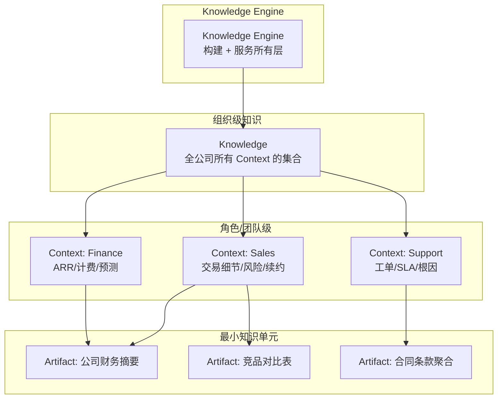

> 脱敏公开版 · 2026-11-10 补充 · 发布审核状态：redacted_full_review（发布前全文隐私审核、脱敏与改动复核）。保留通用技术内容，非公开案例、引用或数据已删除；编辑替换处另作说明。历史结论未在本次重新核实，代码未整体运行复现。见[归档说明](../../../ARCHIVE_POLICY.md)。

# Pinecone Nexus 知识引擎调研：编译期知识层与 Agent 基础设施新范式

> **一句话概括**：Pinecone 于 2026-05-04 发布 Nexus——一个"知识引擎"而非检索系统，核心创新是将推理从运行时（inference time）前移到编译时（compile time），把数据预编译为任务特化的 Artifact，Agent 直接消费结构化知识而非原始文档块。
> **研究日期**：2026-05-10
> **关联报告**：[R30](../04-%E5%B7%A5%E7%A8%8B%E5%AE%9E%E8%B7%B5/R30_RAG%E4%BB%8E%E5%85%A5%E9%97%A8%E5%88%B0%E7%94%9F%E4%BA%A7%E8%90%BD%E5%9C%B0.md) RAG 生产落地、[R48](R48_Agent%E7%9F%A5%E8%AF%86%E5%B7%A5%E7%A8%8B%E5%85%A8%E6%99%AF%E8%B0%83%E7%A0%94.md) Agent 知识工程全景、[R09](R09_%E5%A4%A7%E8%A7%84%E6%A8%A1%E7%9F%A5%E8%AF%86%E5%BA%93%E6%A3%80%E7%B4%A2%E6%96%B9%E6%A1%88.md) 大规模知识库检索方案、[R42](../06-%E5%B7%A5%E5%85%B7%E4%B8%8E%E7%94%9F%E6%80%81/R42_RAGFlow%E5%BC%80%E6%BA%90RAG%E5%BC%95%E6%93%8E.md) RAGFlow 引擎

---

## 目录

- [一、定位透镜：纵横坐标](#一定位透镜纵横坐标)
- [二、Nexus 是什么](#二nexus-是什么)
- [三、核心架构拆解](#三核心架构拆解)
- [四、KnowQL：Agent 的声明式查询语言](#四knowql-agent-的声明式查询语言)
- [五、Benchmark 实测数据](#五benchmark-实测数据)
- [六、与现有 RAG 范式的关系](#六与现有-rag-范式的关系)
- [七、通用启示与适用性判断](#七通用启示与适用性判断)
- [八、局限性与风险](#八局限性与风险)
- [九、结论](#九结论)
- [十、开放问题](#十开放问题)

---

## 一、定位透镜：纵横坐标

### 纵轴 · 演化脉络

**创世故事**：Pinecone 由 Edo Liberty（前 Amazon/Yahoo Research）于 2019 年创办，最初定位为**托管向量数据库**。2022-2023 年 RAG 爆发，Pinecone 成为 RAG 生态的事实标准组件之一（800K+ 活跃开发者，9000+ 付费客户）。

**关键转折**：2025-2026 年，随着 Agent 从"辅助工具"演进为"自主任务执行者"，Pinecone 观察到一个结构性问题——**Agent 85% 的时间花在检索和组装上下文，而非推理**。传统 RAG 返回"chunks"让模型自行拼装答案，在复杂多步任务中 completion rate 只有 50-60%。这直接催生了 Nexus 的诞生。

**生命周期定位**：**萌芽期（理念验证阶段）**。2026-05-04 发布，目前仅 Early Access（限量设计合作伙伴），无公开 SDK/API，无独立定价。产品理念很前沿，但生产验证极度有限。

### 横轴 · 竞争格局

| 方案 | 设计哲学 | 推理位置 | 输出形态 |
|------|---------|---------|---------|
| **传统 RAG**（Pinecone DB / Weaviate / Qdrant） | 找到相关块，让 LLM 拼答案 | 运行时 | ranked chunks |
| **Agentic RAG**（LangGraph RAG / CrewAI） | 循环检索-判断-再检索 | 运行时 | 多轮拼装 |
| **GraphRAG**（微软 GraphRAG / Neo4j） | 知识图谱+社区摘要 | 编译时（部分） | 图结构+摘要 |
| **Pinecone Nexus** | 预编译任务特化 Artifact | 编译时 | 结构化 typed JSON |
| **RAGFlow / Dify 等平台** | 端到端 RAG 管线封装 | 运行时 | 管线输出 |

**设计哲学差异**：
- 传统 RAG 是"搜索引擎思维"——你问什么我检索什么，推理成本在每次查询
- GraphRAG 是"半编译"——建图和社区摘要是离线的，但具体问题仍需运行时推理
- Nexus 是"全编译"——把"面对这类问题需要什么形态的答案"这件事在数据变更时一次性完成

### 交叉判断

**靠谱程度**：理念方向正确（"减少运行时推理负担"是行业共识），但产品成熟度极低。Early Access + 无公开定价 + 自家 Benchmark = **高度待验证**。

**该不该用**：当前阶段（2026-05）——**不适合直接采用，但核心理念值得借鉴**。理由：
1. 闭源 SaaS 产品，无法自建/自控
2. 仅 Early Access，无 GA 时间线
3. "编译期知识"的思想可以用开源工具自行实现（GraphRAG、预计算摘要、结构化索引）

---

## 二、Nexus 是什么

说白了：Nexus 是一个**在数据写入时就把"可能被问到的问题"提前回答好**的系统。

传统 RAG 流程：
```
用户提问 → 嵌入查询 → 找到 chunks → LLM 拼答案（每次都做）
```

Nexus 流程：
```
数据变更 → Context Compiler 编译为 Artifact → 存储
用户提问 → KnowQL 声明需要什么 → 返回预编译的结构化答案（一次调用）
```

核心价值主张：**Do the work once, not every query.**

---

## 三、核心架构拆解

Nexus 由四层原语组成，每层是下层的组合：



### 四个核心概念

| 概念 | 定义 | 类比 |
|------|------|------|
| **Artifact** | 针对特定任务/结果编译出的结构化知识片段 | 数据仓库中的物化视图（Materialized View） |
| **Context** | 为特定角色/团队/工作流策展的 Artifact 集合 | 数据仓库中的 Schema/Datamart |
| **Knowledge** | 公司所有 Context 的总体 | 整个数据仓库 |
| **Knowledge Engine** | 构建和服务上述所有的系统 | ETL + 查询引擎 |

### Context Compiler（核心创新）

这是 Nexus 的灵魂。本质上是一个**自主 Coding Agent**，做以下循环：

```
1. 接收：源数据 + 任务规格（eval set，即"代表性问题+正确答案"）
2. 探索：编写 curate() 函数（如何构建 Artifact）和 query() 函数（如何检索）
3. 评估：跑 eval set，用失败信号反馈
4. 迭代：修改代码，重跑，直到 eval 通过
5. 输出：一个可工作的、调优过的 Context
```

这个设计的巧妙之处：**领域专家只需要定义 eval set（什么问题该有什么答案），不需要懂检索架构**。编译器自动发现最优的 artifact 结构。

和我们的 PSEV 框架映射：
- P（Profile）= eval set 定义了"什么是好结果"
- S（Strategy）= 编译器自动选择 curation/retrieval 策略
- E（Execute）= 编译器执行代码、构建 artifact
- V（Verify）= 对照 eval set 打分

---

## 四、KnowQL：Agent 的声明式查询语言

KnowQL 是 Nexus 的查询界面。设计灵感直接来自 SQL——"SQL 统一了关系数据的访问方式，KnowQL 要统一 Agent 的知识访问方式"。

**六个原语**：

| 原语 | 作用 | SQL 类比 |
|------|------|---------|
| **ASK** | 目标、输出 schema、查询范围 | SELECT + FROM |
| **WHERE** | 确定性谓词 + 访问控制 | WHERE + RBAC |
| **GROUND** | 字段级引用 + 置信度分层 | 无直接类比（数据血缘） |
| **SHAPE** | 返回精确 typed 字段 | 投影（AS + CAST） |
| **CONFIDENCE** | 分离有据断言 vs 不确定推断 | 无直接类比 |
| **BUDGET** | 深度层级 + 延迟信封 + Token 预算 | LIMIT + TIMEOUT |

示例查询（简化）：
```json
{
  "ask": "Compare fiscal 2022 share repurchases for NVIDIA, Microsoft, Walmart",
  "ground": true,
  "shape": {
    "type": "object",
    "properties": {
      "companies": {
        "type": "array",
        "items": {
          "properties": {
            "company_name": { "type": "string" },
            "repurchased_usd_millions": { "type": "number" },
            "program_size_usd_millions": { "type": "number" },
            "remaining_usd_millions": { "type": "number" }
          }
        }
      }
    }
  }
}
```

返回：精确的 typed JSON，而非一堆文档块。Agent 的唯一工作是拿着结构化数据做最终推理。

---

## 五、Benchmark 实测数据

Pinecone 创建了 **KRAFTBench**（Knowledge Retrieval Assessment Framework for Text）来评估。测试条件：

- 数据集：493 份 S&P 500 公司 2022 财年 10-K 文件（总计 ~245MB）
- 问题：150 个高难度问题，跨 9 个行业、10 个主题
- 约束：每题 120s + 1M tokens 上限
- 评分模型：claude-sonnet-4-6 作为 LLM Judge

| 指标 | Pinecone Nexus | Agentic RAG | Coding Agent |
|------|:---:|:---:|:---:|
| **完成率** | 100% (150/150) | 98.7% (148/150) | 62.7% (94/150) |
| **平均延迟** | 22.7s | 37.9s | 84.1s |
| **准确度** | 0.680 | 0.413 | 0.585 |
| **Token 消耗** | 6,733 | 49,103 | 528,301 |
| **成本（$）** | 1.69 | 7.77 | 14.77 |

**数据可信度评估**：
- ⚠️ 这是**自家 Benchmark 自家评测**——没有第三方独立验证
- ⚠️ 测试场景（财务文件的事实性问答）对 Nexus 的"预编译"范式天然有利——因为答案结构可预测
- ⚠️ 22.7s 延迟**不含编译时间**——如果算上首次编译 Artifact 的成本，TCO 图景会很不同
- ✓ 但 Token 消耗 ~7x/~80x 的差异级别是合理的——预编译确实能大幅减少推理时重复劳动

---

## 六、与现有 RAG 范式的关系

Nexus 不是"RAG 的替代"——更准确地说是"RAG 的上层建筑"。Pinecone 自己的定位很清楚：

```
Foundation: Pinecone Vector Database（含新发布的 full-text search）
Knowledge Engine: Nexus + KnowQL（新层）
Access Layer: Marketplace（90+ 预制应用）
```

**视频标题"RAG 时代终结"是营销夸大**。实际情况：

1. RAG（向量检索 + 语义搜索）仍然是 Nexus 底层的核心能力
2. Nexus 在 RAG 之上增加了"编译层"——把原来 Agent 在运行时做的拼装、推理、结构化工作前移
3. 对于简单的"查找已知事实"场景，传统 RAG 完全够用
4. Nexus 的价值在**复杂多步推理、跨源聚合、结构化输出**这些场景才凸显

用一句话说：**RAG 是向量搜索，Nexus 是知识编译。前者找到相关材料，后者把材料加工成半成品答案。**

---

## 七、通用启示与适用性判断

### "编译期知识"理念的可借鉴点

即使不用 Nexus 产品，其核心思想也可用于通用知识工程：

| Nexus 概念 | 可借鉴的方法 | 已有基础 |
|-----------|--------------|---------|
| Artifact（预编译结构化摘要） | 为每个代码模块/文档生成结构化摘要，存为 JSON | R48 中的“知识工件”概念 |
| Context（角色特化视图） | 按角色组织不同的知识切片 | — |
| eval-driven compilation | 用“代表性问题”驱动知识库结构优化 | R15 评估方案 |
| typed output（结构化返回） | 用 schema 约束结构化数据 | R97 Tool 输入输出规范 |

### 适用场景判断

**适合 Nexus 范式的场景**：
- 知识相对稳定（不是每秒都在变），编译成本可分摊
- 问题类型可预测（能定义 eval set）
- 需要高准确度 + 低延迟 + 可审计
- 多 Agent 共享同一知识底座

**不适合的场景**：
- 数据实时性要求极高（秒级更新）
- 问题完全不可预测（开放式创意任务）
- 数据量极小（编译 overhead > 直接检索）
- 预算有限的探索阶段

### 借鉴理念自行实现的探索路径

1. 用 GraphRAG 或自建管线做“预编译摘要”（Artifact 层）
2. 按业务角色组织不同的 Context 切片
3. 用 structured output（JSON Schema）约束 Agent 返回格式
4. 用 eval set 驱动知识库结构的迭代优化

---

## 八、局限性与风险

### Nexus 本身的局限

1. **编译成本不透明**：官方从不提"第一次编译需要多久、多少 Token"——这个成本可能很大
2. **数据更新延迟**：如果源数据频繁变更，重编译的频率和成本是关键问题
3. **闭源锁定**：无开源替代、无自建路径、无数据导出保证
4. **Benchmark 偏置**：测试场景（SEC 10-K 结构化财务数据）天然适合预编译，对非结构化/创意性场景的表现未知
5. **LangChain 背书需谨慎**：Harrison Chase 的引言更像商业合作声明而非独立评估

### "编译期知识"理念本身的风险

1. **过度预编译陷阱**：如果预测了 100 种问题模式但实际只命中 10 种，90% 的编译成本是浪费
2. **知识鲜度 vs 编译成本**的 trade-off：编译越深，更新越贵
3. **eval set 质量决定天花板**：如果 eval 设计不好，编译器优化的方向就是错的

---

## 九、结论

**Pinecone Nexus 提出了一个方向正确但尚未被广泛验证的新范式**——"编译期知识层"。

核心洞察（这不是 Nexus 独有的，但 Nexus 是第一个产品化的）：
> Agent 系统中，85% 的 Token 消耗和延迟不是花在"推理"上，而是花在"找到和组装正确的上下文"上。把这个组装工作从每次查询时做，变成数据变更时做一次，是降低成本和提高可靠性的正路。

**选型建议**：
- 如果你在评估向量数据库 → 继续用 Pinecone DB / Weaviate / Qdrant，Nexus 还太早
- 如果你在做 Agentic RAG 且痛点是"太慢太贵不稳定" → 借鉴 Nexus 的"预编译"理念，用开源工具自建
- 如果你是企业用户且 Pinecone 的 Early Access 对你开放 → 可以试点一个小域验证效果

**生命周期判断**：萌芽期，理念验证完成，产品验证未完成。6-12 个月后看 GA + 第三方 Benchmark 再决定是否采纳。

---

## 十、开放问题

1. **编译成本量化**：一个中等规模的知识域（~1GB 文档），首次编译需要多少 Token、多长时间？
2. **增量编译**：文档更新后是全量重编译还是增量？增量编译的实现是否可靠？
3. **开源替代**：GraphRAG + 结构化摘要 + typed output 能在多大程度上复制 Nexus 的效果？
4. **KnowQL 标准化前景**：是否有可能成为行业标准？还是会像 GraphQL 一样碎片化？
5. **vs. 模型进步**：如果未来模型的 context window 到 10M+ tokens 且价格继续降，"编译期优化"的 ROI 还成立吗？

---

## 来源清单

| 来源 | URL | 日期 | 摘要 |
|------|-----|------|------|
| Pinecone 官方公告 | https://www.pinecone.io/blog/knowledge-infrastructure-for-agents/ | 2026-05-04 | CEO+CTO 联合发文，产品定位与全栈介绍 |
| Nexus 技术深潜 | https://www.pinecone.io/blog/introducing-nexus-knowledge-engine/ | 2026-05-04 | 架构细节、KRAFTBench 评测、KnowQL 设计 |
| Nexus 产品页 | https://www.pinecone.io/nexus/ | 2026-05-04 | 产品 landing page，核心指标宣称 |
| 小红书/视频 @yasinshaw | — | 2026-05-10 | "RAG 时代终结？编译期知识来了"第4集 |

⚖️ **来源一致性**：三份 Pinecone 官方源高度一致（同一发布日），缺乏第三方独立验证。
📅 **时效性声明**：以上信息获取于 2026-05-10。产品处于 Early Access，细节可能随 GA 变化。
