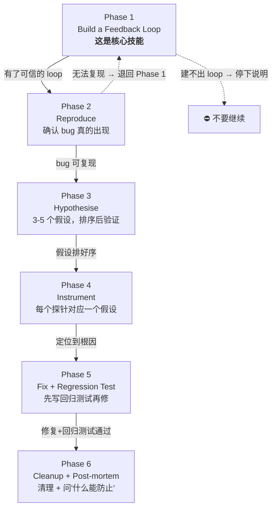

> 脱敏公开版 · 2026-11-10 补充 · 发布审核状态：redacted_full_review（发布前全文隐私审核、脱敏与改动复核）。保留通用技术内容，非公开案例、引用或数据已删除；编辑替换处另作说明。历史结论未在本次重新核实，代码未整体运行复现。见[归档说明](../../../ARCHIVE_POLICY.md)。

# mattpocock/skills 六大可借鉴设计深度拆解

> **一句话**：在 R76 全景调研基础上，对 mattpocock/skills 中 6 个最值得借鉴的设计做源码级拆解——拆到"为什么好、好在哪根骨头上、搬过来要改什么、不改会出什么问题"，并给出落地优先级排序。
> **研究日期**：2026-05-15
> **前置报告**：[R76_mattpocock_skills_RealEngineers调研](../06-%E5%B7%A5%E5%85%B7%E4%B8%8E%E7%94%9F%E6%80%81/R76_mattpocock_skills_RealEngineers%E8%B0%83%E7%A0%94.md)（2026-04-30，全景调研）
> **增量说明**：在 R76 §七"值得借鉴"清单基础上，新增源码级分析、适配方案、CONTEXT-FORMAT.md 模板规范、diagnose 六阶段完整流程、write-a-skill Review Checklist。

---

## 目录

- [零、增量定位](#零增量定位)
- [一、CONTEXT.md 术语表 + grill-with-docs 拷问机制](#一contextmd-术语表--grill-with-docs-拷问机制)
- [二、caveman 持久化 + Auto-Clarity 豁免](#二caveman-持久化--auto-clarity-豁免)
- [三、tdd 反水平切片原则](#三tdd-反水平切片原则)
- [四、diagnose 六阶段调试纪律](#四diagnose-六阶段调试纪律)
- [五、handoff 会话交接](#五handoff-会话交接)
- [六、write-a-skill 的 Skill 编写规范](#六write-a-skill-的-skill-编写规范)
- [七、综合：落地优先级排序](#七综合落地优先级排序)
- [八、来源清单](#八来源清单)
- [九、开放问题](#九开放问题)

---

## 零、增量定位

R76 于 2026-04-30 完成 mattpocock/skills 全景调研（当时 46k Stars），给出了"值得借鉴 vs 值得警惕"的清单和八条落地建议。

本报告的增量：

| 维度 | R76 覆盖 | 本报告新增 |
|------|---------|-----------|
| 仓库状态 | 46k Stars，14 个 Skill | 82.6k Stars，+2 新 Skill（handoff/prototype），+plugin.json 注册结构 |
| 借鉴清单 | 7 条"值得借鉴"标题 | 6 个设计的**源码级拆解** |
| CONTEXT.md | 提到了术语表理念 | 完整的 CONTEXT-FORMAT.md 格式规范拆解 |
| diagnose | 一句话"固定调试流程" | 六阶段完整流程 + 10 种反馈循环构建方法 |
| write-a-skill | 未覆盖 | 完整规范 + 6 项 Review Checklist |
| 适配方案 | 笼统建议 | 每个设计的**逐项适配表** |

---

## 一、CONTEXT.md 术语表 + grill-with-docs 拷问机制

### 1.1 这是什么

grill-with-docs 是一个三件套：

1. **拷问流程**——Agent 逐个追问方案的每个决策分支，一次一个问题，等用户回答后才继续
2. **CONTEXT.md**——项目术语表（DDD 的 Ubiquitous Language），格式严格规定
3. **docs/adr/**——架构决策记录，但有"三件齐备"门槛控制滥用

### 1.2 为什么值得借鉴——反直觉因果链

核心洞察不是"术语表好"（谁都知道），而是 Matt 发现了一条**反直觉因果链**：

```
Agent 输出啰嗦
  ↑ 不是因为模型话多
  ↑ 而是因为项目缺凝练词汇
  ↑ Agent 被迫用 20 个词描述本该 1 个词的概念
  ↑ 根治方法不是"让它少说话"，是"给它精确的词"
```

这解释了为什么 terse-mode（压缩输出）和 CONTEXT.md（压缩输入）是**互补关系**——前者治标（输出端砍废话），后者治本（输入端给精确词汇）。

### 1.3 CONTEXT-FORMAT.md 格式规范

Matt 对术语表有非常具体的格式要求：

```markdown
# {Context Name}
{一两句话说明这个上下文是什么、为什么存在}

## Language
**Order**: A customer's request to purchase one or more products.
_Avoid_: Purchase, transaction

**Invoice**: A request for payment sent to a customer after delivery.
_Avoid_: Bill, payment request

## Relationships
- An **Order** produces one or more **Invoices**
- An **Invoice** belongs to exactly one **Customer**

## Example dialogue
> **Dev:** "When a Customer places an Order, do we create the Invoice immediately?"
> **Domain expert:** "No — Invoice is only generated once Fulfillment is confirmed."

## Flagged ambiguities
- "account" 曾被混用为 Customer 和 User — 已解决：两个独立概念
```

关键设计决定：

| 设计点 | 作用 |
|--------|------|
| **`_Avoid_` 字段** | 不只定义正确词，还列"禁用替代词"——防 Agent 和人类用不同词指同一事物 |
| **Example dialogue** | 用对话而非定义展示概念边界——比干巴巴的定义更能帮 Agent 理解关系 |
| **Flagged ambiguities** | 主动记录曾经的歧义和解决方案，防未来重蹈 |
| **"Only project-specific terms"** | 明确排除通用编程概念（timeout、error），防术语表膨胀成百科 |
| **Lazily created** | 没有术语时不创建空文件，第一个术语确定时才建 |

### 1.4 grill 流程中的五个防护动作

| 动作 | 触发条件 | 效果 |
|------|---------|------|
| Challenge against the glossary | 用户使用与 CONTEXT.md 冲突的术语 | 当场叫停，要求明确 |
| Sharpen fuzzy language | 用户使用模糊或多义词 | 要求给出精确的规范用词 |
| Cross-reference with code | 用户说法与代码实际行为不一致 | 揪出矛盾，要求确认哪个是对的 |
| Update CONTEXT.md inline | 一个术语被确定 | 当场写入，不攒着批量改 |
| Offer ADRs sparingly | 决策满足"三件齐备" | 才创建 ADR |

### 1.5 ADR "三件齐备"原则

只有同时满足以下三个条件，才创建 ADR：

1. **Hard to reverse** — 改主意的成本很高
2. **Surprising without context** — 未来读者会问"为什么这样做？"
3. **Real trade-off** — 有真正的替代方案，选了其中一个有具体理由

三个条件**缺任一个就不创建**。这解决了 ADR 实践中最大的痛点：滥用导致 ADR 文件夹变成噪声。

### 1.6 多上下文支持

单上下文（大多数仓库）：根目录一个 `CONTEXT.md`。

多上下文：根目录 `CONTEXT-MAP.md` 列出所有上下文和它们的关系：

```markdown
# Context Map
## Contexts
- [Ordering](./src/ordering/CONTEXT.md) — 接收和跟踪客户订单
- [Billing](./src/billing/CONTEXT.md) — 生成发票和处理支付

## Relationships
- **Ordering → Fulfillment**: Ordering 发出 OrderPlaced 事件；Fulfillment 消费
- **Ordering ↔ Billing**: 共享 CustomerId 和 Money 类型
```

### 1.7 适配方案

| Matt 原设计 | 我们的适配 | 原因 |
|------------|-----------|------|
| `.claude/` 路径发现 | agent.md/instruction 中引用 | VS Code Copilot 无 `.claude/` 机制 |
| `CONTEXT.md` 放项目根目录 | 同，或放 `docs/CONTEXT.md` | 位置约定不变 |
| grill 是独立 Skill | 融入 tech-selector 第一阶段，或做独立 instruction | 我们的 Skill 偏研究型 |
| 英文模板 | 中英双语模板 | 团队实际使用中文为主 |
| 单/多上下文由 CONTEXT-MAP 决定 | monorepo 项目需要 CONTEXT-MAP | 多仓场景适用 |

---

## 二、caveman 持久化 + Auto-Clarity 豁免

### 2.1 我们的 terse-mode 已有的

三档强度（lite/full/ultra）、基本的安全阀（安全警告、多步骤指令、用户追问、报告输出）。

### 2.2 Matt 的 caveman 多出来的两个关键设计

#### 持久化声明的措辞精确度

**Matt 的写法**（对 LLM 更有效）：
> "ACTIVE EVERY RESPONSE once triggered. **No revert after many turns**. **No filler drift**. **Still active if unsure**."

**我们当前的写法**：
> "激活后每条回复都保持，不会随对话轮次衰减。不确定是否还在生效时——默认仍在生效。"

表面意思一样，但 Matt 的版本**逐条否定了模型可能发生的退化行为**：
- "No revert after many turns" → 针对长对话中忘记早期指令
- "No filler drift" → 针对逐渐恢复添加 filler 词
- "Still active if unsure" → 针对不确定时默认回退正常模式

这不是语义差异，是**指令工程的精度差异**。正面描述"应该做什么"不如逐个封堵"模型会怎么溜号"。

#### Auto-Clarity Exception 的精确判定

**Matt 的版本**：
> "Drop caveman temporarily for: security warnings, irreversible action confirmations, **multi-step sequences where fragment order risks misread**, user asks to clarify or repeats question."

**差异分析**：
- 我们有"报告/文档输出"——Matt 没有。这是我们正确的增量（caveman 不涉及长文档生成）
- Matt 有"fragment order risks misread"——比我们的"多步骤指令"更精确。关键词是：**不是所有多步骤都退出简洁模式，只有碎片句可能导致步骤顺序被误读时才退出**

### 2.3 建议的改动

1. 持久化声明改为"逐条封堵退化行为"的负面列表措辞
2. Auto-Clarity Exception 将"多步骤指令"细化为"碎片句可能导致步骤顺序被误读"
3. 三档体系和"报告/文档输出"安全阀保持不变——这是我们的正确增量

---

## 三、tdd 反水平切片原则

### 3.1 问题：大多数人"假 TDD"

默认行为：让 Agent 先写完所有测试 → 再写所有实现。

Matt 管这叫 **horizontal slicing**，并指出它产出烂测试的三个原因：

```
Tests written in bulk test imagined behavior, not actual behavior
  → 还没写实现，测试只能基于"以为"代码会怎么工作

You end up testing the shape of things rather than user-facing behavior
  → 测数据结构的形状、函数签名，而不是用户可观察的行为

Tests become insensitive to real changes
  → 测试通过时行为可能已坏，测试失败时行为可能没问题
```

### 3.2 正确做法：Vertical Slicing

```
WRONG (horizontal):
  RED:   test1, test2, test3, test4, test5
  GREEN: impl1, impl2, impl3, impl4, impl5

RIGHT (vertical):
  RED→GREEN: test1→impl1
  RED→GREEN: test2→impl2
  RED→GREEN: test3→impl3
```

核心原理：每个测试**基于你刚写的实现的真实认知**来设计，而不是基于开始前的想象。

### 3.3 tdd SKILL.md 的其他精华

**测试哲学**：
> Tests should verify behavior through public interfaces, not implementation details. Warning sign: test breaks when you refactor but behavior hasn't changed.

**Workflow 四步**：
1. **Planning**：确认接口 + 确认要测的行为 + 用户批准
2. **Tracer Bullet**：一个测试证明路径端到端能通
3. **Incremental Loop**：每次一个测试，只写够过的代码
4. **Refactor**：所有测试绿了才重构。**Never refactor while RED**

**Per-Cycle Checklist**：
```
[ ] Test describes behavior, not implementation
[ ] Test uses public interface only
[ ] Test would survive internal refactor
[ ] Code is minimal for this test
[ ] No speculative features added
```

### 3.4 适用范围（不限于写代码）

垂直切片原则对我们的**实验脚本设计**、**Skill 验证**、**原型构建**同样适用。核心抽象：

> **不要一次性设计完所有验证步骤再去执行。每做一步验证，基于真实结果调整下一步。**

具体映射：
- `experiments/`：每个实验是一个 vertical slice——先跑通最小路径再扩展
- `skill-evaluator`：评估用例逐个设计和执行，不批量预设
- `prototypes/`：先做 tracer bullet 打通端到端，不先搭完所有模块

---

## 四、diagnose 六阶段调试纪律

**整个仓库工程密度最高的一个 Skill。** 六个阶段，每个都有硬性进入/退出条件。

### 4.1 六阶段总览



### 4.2 Phase 1 — Build a Feedback Loop（核心）

Matt 用了原文一半的篇幅在讲这一步。他的原话：

> "This is the skill. Everything else is mechanical. If you have a fast, deterministic, agent-runnable pass/fail signal for the bug, you will find the cause. If you don't have one, no amount of staring at code will save you."

**10 种构建反馈循环的方法**（按优先级排序）：

| 序号 | 方法 | 适用场景 |
|:---:|------|---------|
| 1 | Failing test（单元/集成/E2E） | 能写测试的场景（最佳） |
| 2 | Curl / HTTP 脚本 | Web API bug |
| 3 | CLI + fixture + diff snapshot | 命令行工具 bug |
| 4 | Headless browser（Playwright/Puppeteer） | UI bug |
| 5 | Replay captured trace | 有请求/事件日志可回放 |
| 6 | Throwaway harness | 最小化子系统+mock 依赖 |
| 7 | Property / fuzz loop | "偶尔输出错误"类 bug |
| 8 | Bisection harness（git bisect run） | 知道"某两个版本之间出的" |
| 9 | Differential loop（新旧版本 diff 输出） | 回归类 bug |
| 10 | HITL bash script | 最后手段：必须人类点击 |

**优化反馈循环的三个维度**：
- **更快**：缓存 setup、跳过无关初始化、缩小测试范围
- **信号更清晰**：断言具体症状，不是"没崩"
- **更确定性**：固定时间、种子 RNG、隔离文件系统

**非确定性 bug**：目标不是干净复现而是**提高复现率**。循环触发 100 次、并行化、加压力、注入 sleep 缩小时间窗口。50% 复现率可调试，1% 不行——持续提高。

**硬性门控**：
> "Do not proceed to Phase 2 until you have a loop you believe in."
> "Do not proceed to hypothesise without a loop."

### 4.3 Phase 3 — Hypothesise（反锚定设计）

> "Generate 3–5 ranked hypotheses **before testing any of them**. Single-hypothesis generation anchors on the first plausible idea."

强制生成多个假设再排序，是**结构化对抗锚定效应**——防止第一个看起来合理的想法绑架整个调查方向。

每个假设必须**可证伪**：
> 格式："If [X] is the cause, then [Y] will make the bug disappear / [Z] will make it worse."

说不出预测的假设 = "a vibe" → 丢掉或重新锐化。

排好序后给用户看一眼再开始验证——"They often have domain knowledge that re-ranks instantly"。但不阻塞——用户不在就按自己的排序走。

### 4.4 Phase 4 — Instrument（标签纪律）

> "Tag every debug log with a unique prefix, e.g. `[DEBUG-a4f2]`. Cleanup at the end becomes a single grep."

每个探针必须对应 Phase 3 的一个具体假设。一次改一个变量。

工具偏好：
1. Debugger / REPL inspection（一个断点胜过十条日志）
2. 针对性日志（只在区分假设的边界处）
3. **Never "log everything and grep"**

性能回归的特殊分支：日志通常错。用 timing harness / `performance.now()` / profiler / query plan → **先测量再修**。

### 4.5 Phase 5 — Fix + Regression Test

关键设计：先写回归测试再修。但有前提——**必须有正确的测试 seam**：

> "A correct seam is one where the test exercises the real bug pattern as it occurs at the call site."

如果没有正确的 seam（太浅的测试给假信心），那**"缺乏 seam"本身就是发现**——说明代码架构阻碍了 bug 被锁定。

### 4.6 Phase 6 — Cleanup + Post-mortem

必做清单：
```
[ ] 原始复现场景不再复现（重跑 Phase 1 loop）
[ ] 回归测试通过（或已记录缺乏 seam）
[ ] 所有 [DEBUG-...] 标签清理完（grep 前缀）
[ ] 临时原型删除
[ ] 正确假设写入 commit/PR message
```

最后一步是架构反馈：
> "What would have prevented this bug? If the answer involves architectural change, hand off to `/improve-codebase-architecture`."

每次调试结束**强制做一次根因到架构层面的追问**。

### 4.7 适配方案

| Matt 原设计 | 我们的适配 |
|------------|-----------|
| 引用 `/improve-codebase-architecture` | 改为我们的对应流程或 ADR 记录 |
| 10 种反馈循环假设 Claude Code 环境 | 标注哪些在 VS Code + Copilot 中最方便 |
| Phase 6 post-mortem 只进 commit message | 可连接到 KNOWLEDGE_INDEX 知识沉淀流程 |
| 无（Matt 原版无此项） | 增加"调试会话 handoff"——中断时保存进度 |

---

## 五、handoff 会话交接

### 5.1 原文

整个 SKILL.md 极简——只有一段话：

> "Write a handoff document summarising the current conversation so a fresh agent can continue the work. Save it to a path produced by `mktemp -t handoff-XXXXXX.md`. Suggest the skills to be used, if any, by the next session. Do not duplicate content already captured in other artifacts (PRDs, plans, ADRs, issues, commits, diffs). Reference them by path or URL instead."

### 5.2 设计洞察

| 设计点 | 作用 |
|--------|------|
| **不重复已有产物** | 不把 PRD、ADR、commit 抄一遍，只引用路径——防 handoff 文档膨胀 |
| **推荐下个会话用哪些 Skill** | 交接时就给出"接手人应该用什么工具"——降低下个会话的启动摩擦 |
| **`mktemp` 生成临时文件** | 承认 handoff 是一次性消耗品，不进版本控制 |

### 5.3 与我们"分会话协议"的关系

```
分会话协议（agent.md）→ 计划层面："预判要拆 4 个会话，每个做什么"
handoff → 执行层面："这个会话做完了，具体结论和未完成项交接给下一个"
```

分会话协议在任务**开始前**使用，handoff 在任务**中间或结束时**使用。两者互补。

### 5.4 适配方案

| Matt 原设计 | 我们的适配 |
|------------|-----------|
| `mktemp` 临时路径 | 存 `sessions/YYYY-MM/handoff-{topic}.md` |
| 不记录已有产物 | 同——引用路径而非复制内容 |
| 推荐下个会话 Skill | 增加推荐"Agent 模式"（如 AI Research Expert / GuidedDev） |
| 无 | 增加"未完成的 TODO 清单"（manage_todo_list 状态快照） |
| 无 | 增加"已读文件清单"（帮下个会话避免重复读取） |

---

## 六、write-a-skill 的 Skill 编写规范

### 6.1 核心规范

| 规则 | Matt 的标准 | 我们当前状态 | 差距 |
|------|-----------|-------------|------|
| SKILL.md 篇幅 | **≤100 行**，超过拆 REFERENCE.md | 无限制，terse-mode 130 行 | 有差距 |
| description 字段 | ≤1024 chars，写清触发条件 | 有但长短不一 | 基本一致 |
| 文件结构 | SKILL.md + REFERENCE.md + EXAMPLES.md + scripts/ | SKILL.md + 散落附属文件 | 有差距 |
| Review checklist | 6 项 | 无 | 完全缺失 |

### 6.2 100 行限制的设计理由

```
SKILL.md 会被完整注入 Agent 上下文
  → 越长，占用 context window 越多
  → 同时加载多个 Skill 时，总长度挤压"实际工作内容"
  → 100 行 ≈ 3-4KB ≈ 在 200K context 中几乎无感
  → 超过 100 行的内容通过 REFERENCE.md 按需加载（read_file）
```

本质是**上下文效率**设计——SKILL.md 是"永远加载的入口"，REFERENCE.md 是"需要时才读的详情"。

### 6.3 Skill 文件结构模板

```
skill-name/
├── SKILL.md           # 主指令，≤100 行（required）
├── REFERENCE.md       # 详细文档（if needed）
├── EXAMPLES.md        # 使用示例（if needed）
└── scripts/           # 工具脚本（if needed）
    └── helper.js
```

### 6.4 SKILL.md 模板

```markdown
---
name: skill-name
description: Brief description of capability. Use when [specific triggers].
---

# Skill Name

## Quick start
[Minimal working example]

## Workflows
[Step-by-step processes with checklists]

## Advanced features
[Link to separate files: See [REFERENCE.md](REFERENCE.md)]
```

### 6.5 description 字段要求

description 是 **Agent 唯一能看到的**用来决定加载哪个 Skill 的信息。

**要求**：
- ≤1024 chars
- 第三人称
- 第一句：做什么
- 第二句：Use when [具体触发条件]

**好的例子**：
> "Extract text and tables from PDF files, fill forms, merge documents. Use when working with PDF files or when user mentions PDFs, forms, or document extraction."

**坏的例子**：
> "Helps with documents."（无法区分这个和其他文档 Skill）

### 6.6 Review Checklist（6 项）

```
[ ] Description includes triggers ("Use when...")
[ ] SKILL.md under 100 lines
[ ] No time-sensitive info
[ ] Consistent terminology
[ ] Concrete examples included
[ ] References one level deep
```

"No time-sensitive info" 值得注意——Skill 是长期资产，不应包含"截至 2026 年 X 月"这种会过期的信息。

### 6.7 建议的渐进采纳

1. **新 Skill 按 100 行标准执行**——超出部分拆 REFERENCE.md
2. **已有 Skill 不强制改**——下次修改时顺便拆分
3. **Review Checklist 纳入 Skill 创建流程**
4. `description` 字段统一要求 "Use when" 触发条件

---

## 七、综合：落地优先级排序

| 排序 | 借鉴项 | 投入 | 回报 | 依赖 |
|:---:|--------|------|------|------|
| **1** | CONTEXT.md 术语表 | 低——写模板 + 1 个项目试点 | 高——从根源降低 Agent 啰嗦和理解偏差 | 无 |
| **2** | diagnose 调试纪律 | 低——几乎原样搬 | 高——结构化调试替代"猜来猜去" | 无 |
| **3** | terse-mode 持久化措辞升级 | 极低——改几行 | 中——更好的指令漂移对抗 | 无 |
| **4** | write-a-skill 规范 | 低——写模板 + checklist | 中——新 Skill 质量标准化 | 无 |
| **5** | tdd 垂直切片原则 | 低——写 instruction | 中——适用于实验和原型 | 无 |
| **6** | handoff 会话交接 | 中——需和分会话协议整合 | 中——改善跨会话连续性 | 分会话协议 |

**推荐执行顺序**：1 → 3 → 2 → 4 → 5 → 6

理由：先做投入最低但回报最直接的（CONTEXT.md 模板 + terse-mode 措辞修正），再做需要更多设计的（diagnose Skill、write-a-skill 规范），最后做有依赖的（handoff 需要和分会话协议整合）。

---

## 八、来源清单

| 来源 | 日期 | 关键内容 |
|------|------|---------|
| [mattpocock/skills GitHub](https://github.com/mattpocock/skills) | 2026-05-15 | 82.6k Stars，17 个 Skill |
| [grill-with-docs/SKILL.md](https://github.com/mattpocock/skills/blob/main/skills/engineering/grill-with-docs/SKILL.md) | 2026-05-15 | 拷问流程 + ADR 三件齐备 |
| [grill-with-docs/CONTEXT-FORMAT.md](https://github.com/mattpocock/skills/blob/main/skills/engineering/grill-with-docs/CONTEXT-FORMAT.md) | 2026-05-15 | 术语表格式规范 |
| [caveman/SKILL.md](https://github.com/mattpocock/skills/blob/main/skills/productivity/caveman/SKILL.md) | 2026-05-15 | 持久化 + Auto-Clarity |
| [tdd/SKILL.md](https://github.com/mattpocock/skills/blob/main/skills/engineering/tdd/SKILL.md) | 2026-05-15 | 反水平切片 + vertical slicing |
| [diagnose/SKILL.md](https://github.com/mattpocock/skills/blob/main/skills/engineering/diagnose/SKILL.md) | 2026-05-15 | 六阶段调试纪律 |
| [handoff/SKILL.md](https://github.com/mattpocock/skills/blob/main/skills/productivity/handoff/SKILL.md) | 2026-05-15 | 会话交接 |
| [write-a-skill/SKILL.md](https://github.com/mattpocock/skills/blob/main/skills/productivity/write-a-skill/SKILL.md) | 2026-05-15 | Skill 编写规范 |
| [plugin.json](https://github.com/mattpocock/skills/blob/main/.claude-plugin/plugin.json) | 2026-05-15 | Skill 注册清单 |
| 本工作区 [R76_mattpocock_skills_RealEngineers调研](../06-%E5%B7%A5%E5%85%B7%E4%B8%8E%E7%94%9F%E6%80%81/R76_mattpocock_skills_RealEngineers%E8%B0%83%E7%A0%94.md) | 2026-04-30 | 全景调研基线 |

⚖️ **来源一致性**：全部一手仓库原文，单源可信。与 R76 交叉验证，核心结论一致，Stars 数据已更新。
📅 **时效性声明**：以上信息获取于 2026-05-15。

---

## 九、开放问题

1. **CONTEXT.md 试点项目选哪个？** 可选择一个活跃原型，或一个术语较复杂的项目
2. **diagnose Skill 独立新建还是融入 source-code-dissector？** 两者都涉及源码分析，但 diagnose 聚焦 bug，dissector 聚焦理解——可能应该保持独立
3. **write-a-skill 的 100 行标准是否适用于我们的研究型 Skill？** 我们的 Skill 偏分析方法论，天然比 Matt 的"日常工程操作"Skill 更长。可能需要放宽到 150 行
4. **handoff 和分会话协议的整合方案**尚未具体设计——需要在下一次实际分会话场景中试跑并迭代
