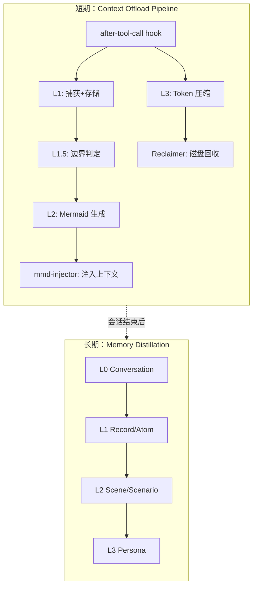
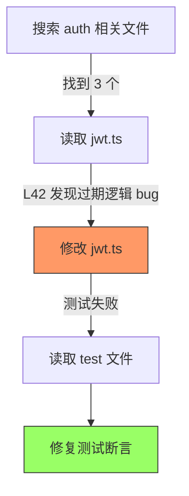
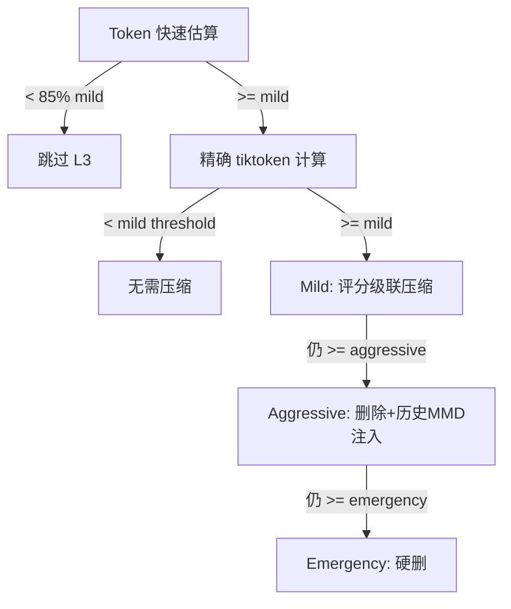
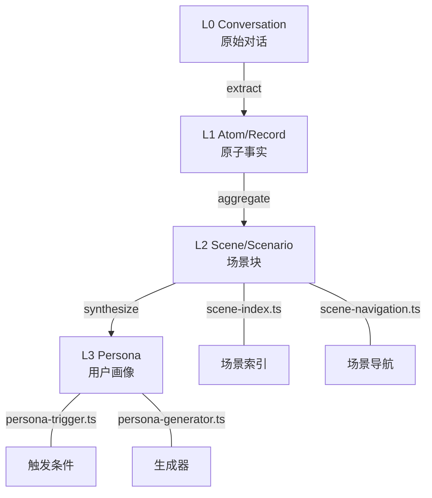

> 历史研究归档 · 2026-11-10 发布 · 发布审核状态：scan_only（发布前程序化隐私扫描）。原有日期、观点、数据和命令保留历史语境，未经本次逐项事实核验或运行复现；见[归档说明](../../../ARCHIVE_POLICY.md)。

# TencentDB Agent Memory 符号化上下文压缩机制深度拆解

> **一句话概括**：源码级拆解 TencentDB Agent Memory 的 Context Offload Pipeline——一套五层渐进压缩系统（L1 捕获→L1.5 边界判定→L2 Mermaid 生成→L3 三级压缩→Reclaim 回收），核心创新是用 Mermaid 流程图做"符号化缓存层"替代传统摘要，在 SWE-bench 连续 50 题场景下 Token 省 33%、通过率涨 10%。
>
> **研究日期**：2026-05-15
> **增量价值**：在 [R117](../02-%E7%9F%A5%E8%AF%86%E7%AE%A1%E7%90%86%E4%B8%8E%E4%B8%8A%E4%B8%8B%E6%96%87/R117_Agent%E8%AE%B0%E5%BF%86%E7%B3%BB%E7%BB%9F%E5%9B%9B%E4%B8%AA%E5%8F%AF%E5%80%9F%E9%89%B4%E8%AE%BE%E8%AE%A1%E6%A8%A1%E5%BC%8F%E6%B7%B1%E5%BA%A6%E6%8B%86%E8%A7%A3.md)（四层巩固/RRF/Ebbinghaus/Token预算）基础上，下沉到源码实现层，拆解一个真正跑通了的完整 Context Offload Pipeline 工程实现。R117 讲"应该怎么设计记忆系统"，本报告讲"一个实际跑通了的系统具体怎么写的"。
> **关联报告**：[R117](../02-%E7%9F%A5%E8%AF%86%E7%AE%A1%E7%90%86%E4%B8%8E%E4%B8%8A%E4%B8%8B%E6%96%87/R117_Agent%E8%AE%B0%E5%BF%86%E7%B3%BB%E7%BB%9F%E5%9B%9B%E4%B8%AA%E5%8F%AF%E5%80%9F%E9%89%B4%E8%AE%BE%E8%AE%A1%E6%A8%A1%E5%BC%8F%E6%B7%B1%E5%BA%A6%E6%8B%86%E8%A7%A3.md)（记忆设计模式）、[R102](../01-%E7%90%86%E8%AE%BA%E4%B8%8E%E6%9E%B6%E6%9E%84/R102_Agent_Dreaming_%E5%BD%93AI%E5%AD%A6%E4%BC%9A%E5%81%9A%E6%A2%A6.md)（Agent Dreaming 异步巩固）、R100（原稿交叉引用，本归档未解析）（Pattern Topics）、[R116](R116_OpenHuman%E5%9B%9B%E5%A4%A7%E8%AE%BE%E8%AE%A1%E6%A8%A1%E5%BC%8F%E6%B7%B1%E5%BA%A6%E6%8B%86%E8%A7%A3%E4%B8%8E%E5%80%9F%E9%89%B4%E6%96%B9%E6%A1%88.md)（OpenHuman 设计模式，含 TokenJuice）

---

## 目录

1. [定位透镜](#定位透镜)
2. [架构全景：两大子系统](#架构全景两大子系统)
3. [短期 Offload Pipeline 五层机制](#短期-offload-pipeline-五层机制)
4. [Mermaid Canvas 核心实现拆解](#mermaid-canvas-核心实现拆解)
5. [L3 三级压缩机制](#l3-三级压缩机制)
6. [长期记忆 L0→L3 蒸馏管线](#长期记忆-l0l3-蒸馏管线)
7. [工程细节亮点](#工程细节亮点)
8. [可借鉴设计清单与落地映射](#可借鉴设计清单与落地映射)
9. [局限与开放问题](#局限与开放问题)
10. [来源清单](#来源清单)

---

## 定位透镜

**纵轴 · 创世故事**：2026-05 由腾讯数据库团队开源（Tencent/TencentDB-Agent-Memory），1636 Stars，TypeScript，MIT License。诞生于一个具体的工程痛点——在 OpenClaw（编码 Agent）上跑 SWE-bench 连续 50 题时，工具日志（搜索结果、代码片段、报错堆栈）吃掉了绝大多数 Token，Agent"看到了太多细节反而看不清全局"。迭代速度极快：3 天一个版本，一个月从 v0.1 迭代到 v0.3.4。生命周期定位：**上升期早期**。

**横轴 · 设计哲学对比**：

| 方案 | 核心哲学 | 短期压缩 | 长期记忆 | 可回溯性 |
|------|---------|---------|---------|---------|
| **TencentDB** | 符号化 + 渐进披露 | Mermaid Canvas + 三级压缩 | L0→L3 语义金字塔 | **全链路白盒** |
| OpenHuman TokenJuice | 规则裁剪 | 确定性规则截断 | 无 | 中（规则可审计） |
| Mem0 | 图谱化事实 | 无专门短期管理 | 实体-关系图 | 中 |
| MemGPT/Letta | 虚拟分页 | 主动 push/pop 上下文页 | 归档检索 | 差（黑盒） |
| agentmemory | 认知四层 | Working buffer | 四层巩固 | 中 |

**交叉判断**：TencentDB 的独特价值在于**它是目前唯一一个在源码层面公开了"如何在 Agent Loop 中做实时上下文管理"的完整实现**。其他方案要么只管长期记忆（Mem0）、要么只有概念没有源码（agentmemory 的压缩层）、要么压缩策略太粗暴（Letta 的 push/pop）。它的 Mermaid Canvas 思路在"结构化信息的保留"上比任何文本摘要方案都优雅。

---

## 架构全景：两大子系统



**数据流**：每次工具调用 → `after-tool-call` hook 拦截 → 存入 JSONL + refs/*.md → L1.5 判定长/短任务 → 长任务触发 L2 Mermaid 生成 → Mermaid 注入上下文 → Token 超阈值时 L3 压缩。会话结束后，对话数据流入长期管线做 L0→L3 蒸馏。

---

## 短期 Offload Pipeline 五层机制

### L1：捕获与存储（after-tool-call.ts, 584 行）

每次工具调用结束后，hook 拦截输出：

```typescript
// 简化自 after-tool-call.ts
const pair: ToolPair = {
  toolName: event.toolName,
  toolCallId,
  params: resolvedParams,
  result: event.result,
  error: event.error,
  timestamp: nowChinaISO(),
  durationMs: event.durationMs,
};
stateManager.addToolPair(pair);
```

**存储双写**：
- `offload-{session}.jsonl`：结构化条目（tool_call_id, summary, node_id, result_ref, timestamp）
- `refs/{timestamp}.md`：原始完整输出（可达数 KB 的搜索结果、代码块等）

**跳过条件**：Heartbeat 调用（如定时写 HEARTBEAT.md）、approval-pending 状态的工具调用、已处理过的重复 ID。

### L1.5：边界判定（state-manager.ts 中的 L15Boundary）

这是一个**任务粒度分类器**——判断当前这段工具调用序列是"短任务"还是"长任务"：

```typescript
interface L15Boundary {
  startIndex: number;
  result: "short" | "long";  // 短任务不需要 MMD，长任务需要
  targetMmd: string | null;  // 长任务对应的 MMD 文件名
}
```

**设计意图**：避免对简单的单步工具调用（如读一个文件）也启动完整的 Mermaid 管线。只有被判定为"long"的段落才会产生 Mermaid 节点。

**关键状态**：`l15Settled` 标志位——在 L1.5 完成判定之前，L2 和 MMD 注入都不会启动（避免对不完整的信息做无意义的压缩）。

### L2：Mermaid 生成（l2-mermaid.ts, 286 行）

**独立触发**（不是被 L1 直接调用）：

| 触发条件 | 阈值（默认） | 含义 |
|---------|------------|------|
| Condition A | `l2NullThreshold` 个 node_id=null 的条目 | 积累了足够多未处理的工具输出 |
| Condition B | `l2TimeoutSeconds` 秒超时 | 太久没生成过 Mermaid 了 |

**执行流程**：
1. 从 JSONL 读取所有 `node_id=null` 或 `node_id="wait"` 的条目
2. 按 L1.5 boundary 分组（只处理 `result="long"` 的段落）
3. 调用后端 LLM（`backendClient.l2Generate`）生成/更新 Mermaid 图
4. LLM 返回 Mermaid 文本 + node 映射表
5. `backfillNodeIds`：将每个 offload entry 回填其对应的 Mermaid node_id

**生成的 Mermaid 文件**存于 `mmds/{mmdId}.mmd`，格式：



### Mermaid 注入：mmd-injector.ts（374 行）

注入器负责把当前活跃的 Mermaid 图塞进对话消息中：

```typescript
// 注入后的消息结构
const activeMsg = {
  role: "user",
  content: [{ type: "text", text: activeMmdText }],
  _mmdContextMessage: "active",  // 标记属性，用于后续定位替换
};
```

**注入位置策略**：插入在最新 user message 之后——让 LLM 先看到"全局地图"，再处理当前步骤。但必须避免插在 tool_use / tool_result 对之间（`adjustForToolCallPair` 函数处理这个边界）。

**注入的文本模板**（来自源码）：

```
<current_task_context>
【当前活跃任务的mermaid流程图】这是你最近正在执行的任务的阶段性记录...
**任务目标:** {taskGoal}
**任务文件:** {activeMmdFile}
```mermaid
{mmdContent}
```
标记为 "doing" 的节点是近期焦点，"done" 的已完成。
请参考此保持方向感，避免重复已完成的工作。
</current_task_context>
```

**Token 预算控制**：`mmdMaxTokenRatio`（默认占上下文窗口的 X%），超出则不注入。

**增量更新**：每次 `after-tool-call` 都检查 MMD 文件指纹是否变化（`computeFingerprint = length:first64chars`），变化才重新注入——避免无谓的重复注入。

---

## L3 三级压缩机制

当 Token 用量触达阈值时，L3 启动三级渐进压缩：



### Mild 压缩：compressByScoreCascade

对消息中的工具结果按**重要性评分**排序，低分的原地替换为摘要：

- 当前任务 node 中的结果 → 高分（受保护）
- 历史任务的结果 → 低分（优先压缩）
- 已被 offload 的结果 → 最低分（直接替换为单行引用）

### Aggressive 压缩：aggressiveCompressUntilBelowThreshold

**直接删除**旧消息，但**同时注入历史 MMD** 来弥补丢失的上下文：

```typescript
// 伪代码
const result = await aggressiveCompressUntilBelowThreshold(messages, ...);
// 删除后注入历史 MMD 补偿
const mmdInjection = await buildHistoryMmdInjection(
  result.allDeletedToolCallIds, offloadMap, offloadEntries,
  stateManager, logger, countTokens, contextWindow, pluginConfig,
);
```

**历史 MMD** 插入位置：active MMD 之前（让 LLM 按时间顺序阅读：历史 → 当前）。

### Emergency 压缩：emergencyCompress

最后防线——硬删到只保留最近 N 条消息（`EMERGENCY_MIN_MESSAGES_TO_KEEP`）。只在以下情况触发：
- Token 用量 >= 95% 上下文窗口
- 或 aggressive 因"user message 保护"而卡住时强制升级

### Quick Token Estimation（性能优化）

避免每次 after-tool-call 都跑 tiktoken（开销大）：

```typescript
// CJK-aware 快速估算
function _quickCountTokens(text: string): number {
  let cjk = 0;
  for (let i = 0; i < text.length; i++) {
    const c = text.charCodeAt(i);
    if ((c >= 0x4e00 && c <= 0x9fff) || ...) cjk++;
  }
  const rest = text.length - cjk;
  return Math.ceil(cjk * 1.5 + rest / 4);
}
```

只有当快速估算接近阈值（85% mild）或连续跳过 5 次后，才强制做精确计算。

---

## 长期记忆 L0→L3 蒸馏管线



**src/core/ 模块清单**：

| 模块 | 文件 | 职责 |
|------|------|------|
| conversation | conversation/ | L0 原始对话捕获与存储 |
| record | record/ | L1 原子事实提取（"用户偏好 dark theme"） |
| scene | scene-extractor.ts | L2 从对话中提取场景块 |
| scene | scene-format.ts | 场景 Markdown 格式化 |
| scene | scene-index.ts | 场景索引维护 |
| scene | scene-navigation.ts | 场景间关联导航 |
| persona | persona-trigger.ts | 何时触发 persona 重新生成 |
| persona | persona-generator.ts | 从场景综合用户画像 |
| profile | profile/ | 用户 profile 管理 |
| store | store/ | BM25 + vector + RRF 检索后端 |
| tools | tools/ | Agent 工具（tdai_memory_search 等） |

**Drill-Down 链路保障**：

```
L3 persona.md 
  → "来源: scene_20260515_debug_auth.md"
    → "来源: atom_xxx, atom_yyy"  
      → "来源: conversation session-42, turn 7-12"
```

每一层都在 Markdown 中显式标注其生成来源。persona 变了可以追溯到哪段对话引起的变化。

---

## 工程细节亮点

### 1. 磁盘回收：Reclaimer（487 行）

5 步清理策略，每步独立 try-catch（一步失败不影响后续）：

| 步骤 | 清理对象 | 保留策略 |
|------|---------|---------|
| Step 1 | 过期 JSONL | mtime > retentionDays |
| Step 2 | 孤儿 refs/*.md | 不被任何 JSONL 引用且过期 |
| Step 3 | 过期 MMD | mtime > cutoff，但保留 active + 最少 15 个 |
| Step 4 | 过大日志 | 总大小 > logMaxSizeMb 时截断最大文件 |
| Step 5 | 过期 registry 条目 | updatedAt > cutoff |

**原子写入**：JSON 文件用 tmp + rename 模式防止崩溃导致数据损坏。

### 2. Session Registry

每个 Agent 维护一个 `sessions-registry.json`，记录所有 session → offload 文件的映射。跨 session 查找历史记忆时，先查 registry 再读对应 JSONL。

### 3. Opik Tracer（可观测性）

每个关键决策点（L1.5 判定、L2 触发、L3 压缩、MMD 注入）都通过 `traceOffloadDecision` 发送结构化 trace，支持事后分析压缩效果。

### 4. Host Adapter 抽象

```typescript
// src/core/types.ts
interface HostAdapter {
  // 不同宿主（OpenClaw / Hermes）实现这个接口
  // TdaiCore 通过 adapter 与宿主交互
}
```

核心逻辑与宿主框架解耦。新框架只需实现 HostAdapter 即可接入。

---

## 可借鉴设计清单与落地映射

### 设计一：Mermaid Canvas 做短期状态追踪（P0，直接可用）

**原理**：把多步任务的执行轨迹编码为 Mermaid 图，注入上下文供 Agent 保持方向感。

**我们可以怎么用**：在 pattern-topics T01（Recursive Agent Loop）中，当递归深度 > 3 或工具调用 > 10 次时，生成一个 Mermaid 任务图注入 system prompt。具体做法：

```python
# 概念性示例（非 TencentDB 代码）
def build_task_canvas(steps: list[dict]) -> str:
    """将执行步骤列表编码为 Mermaid 任务图"""
    lines = ["graph TD"]
    for i, step in enumerate(steps):
        node_id = f"N{i:03d}"
        label = step["summary"][:30]
        status = step.get("status", "done")
        lines.append(f'    {node_id}["{label}"]')
        if i > 0:
            prev = f"N{i-1:03d}"
            edge_label = step.get("outcome", "")[:20]
            lines.append(f'    {prev} -->|{edge_label}| {node_id}')
        if status == "doing":
            lines.append(f'    style {node_id} fill:#ff9,stroke:#333')
        elif status == "failed":
            lines.append(f'    style {node_id} fill:#f66,stroke:#333')
    return "\n".join(lines)
```

**适用场景**：Dev Agent 做复杂多文件修改、调研 Agent 做多步信息搜集。

### 设计二：三级渐进压缩（P1，中等价值）

**原理**：不要等 Token 爆了才处理，设三条水位线分级响应。

| 水位 | 动作 | 信息损失 |
|------|------|---------|
| 60%（Mild） | 低优先级工具输出原地替换为摘要 | 最小 |
| 80%（Aggressive） | 删除旧消息 + 注入历史 MMD 补偿 | 中等 |
| 95%（Emergency） | 硬删到只剩 N 条 | 大 |

**与 R117 Token 预算控制的关系**：R117 提出了分层配额的概念，TencentDB 给出了一个可运行的实现——区别在于它加入了"补偿注入"（aggressive 删除后用历史 MMD 弥补，不是纯粹丢弃）。

### 设计三：L1.5 任务边界判定（P1，减少不必要开销）

**原理**：不是所有工具调用都需要上下文管理。读一个 10 行的配置文件不值得启动 Mermaid Pipeline。

**判定逻辑**：分析工具调用序列的复杂度（调用数、输出长度、持续时间），分为 short/long。只有 long 才进入完整的 offload 管线。

**我们可以怎么用**：在 Dev Agent 的 `after-tool-call` instruction 中加一个快速判断——"如果最近 5 次工具调用总输出 < 2000 tokens，不需要做任何压缩/追踪"。

### 设计四：node_id 回溯链（P2，调试必备）

**原理**：任何压缩/摘要都必须保留"如何找回原始数据"的确定性路径。

```
Mermaid node N003 
  → offload.jsonl 中 node_id="N003" 的条目
    → result_ref: "refs/2026-05-15T14-23-08.md"
      → 完整的原始工具输出
```

**我们已有的对应**：KNOWLEDGE_INDEX §五 依赖关系已在做类似的事（报告间关联）。可以在 sessions/ 日志中借鉴 result_ref 思路——每次重要的中间产出都存一份快照，主文档只保留引用。

### 设计五：CJK-aware 快速 Token 估算（P3，小优化）

```python
def quick_estimate_tokens(text: str) -> int:
    cjk = sum(1 for c in text if '\u4e00' <= c <= '\u9fff' 
              or '\u3400' <= c <= '\u4dbf')
    return int(cjk * 1.5 + (len(text) - cjk) / 4)
```

在需要频繁判断"是否超过阈值"但不需要精确计数的场景下很实用。

---

## 局限与开放问题

### 已确认的局限

1. **Mermaid 图膨胀**：当任务超过 ~200 步时，Mermaid 图本身也会变得很大。源码中虽有 `mmdMaxTokenRatio` 限制，但没看到"Mermaid 图本身的压缩/折叠"机制。这是一个**尚未解决的天花板**。

2. **LLM 调用开销**：L1.5 边界判定、L2 Mermaid 生成都要调 LLM。v0.3.4 新增了 `local-llm` 选项（本地小模型做 offload 摘要），说明他们也意识到了这个成本问题。

3. **强依赖 Hook 机制**：整个系统建立在"能拦截每次工具调用的输入/输出"之上。如果宿主框架不提供这样的 hook point，就无法接入。这也是为什么目前只支持 OpenClaw 和 Hermes。

4. **PersonaMem 76% 准确率**：长期记忆的用户画像生成还有 24% 的信息丢失。源码中 `persona-trigger.ts` 的触发逻辑可能还不够成熟。

5. **单人团队风险**：3 个贡献者、1 个核心提交者（Yuntong8888），bus factor = 1。

### 开放问题

- **Mermaid Canvas 与 subgraph 折叠**：超长任务是否可以用 Mermaid subgraph 做"段落折叠"？只展开当前活跃段，历史段收起为单节点？
- **多 Agent 场景**：当多个 Agent 协作时，每个 Agent 的 MMD 如何合并或交叉引用？
- **Skill 生成层**：Roadmap 提到"Automatic Skill generation"——从 Mermaid 执行轨迹中提炼可复用的 Skill，这与我们的 Forge 阶段思路一致，但尚未实现。

---

## 来源清单

| 来源 | URL | 获取日期 | 关键信息 |
|------|-----|---------|---------|
| 官方仓库 README | [Tencent/TencentDB-Agent-Memory](https://github.com/Tencent/TencentDB-Agent-Memory) | 2026-05-15 | 架构概述、benchmark 数据 |
| src/offload/mmd-injector.ts | 374 行 TypeScript | 2026-05-15 | Mermaid 注入机制完整实现 |
| src/offload/pipelines/l2-mermaid.ts | 286 行 TypeScript | 2026-05-15 | L2 触发条件与 node_id 回填 |
| src/offload/hooks/after-tool-call.ts | 584 行 TypeScript | 2026-05-15 | L1 捕获 + L3 三级压缩 |
| src/offload/state-manager.ts | 448 行 TypeScript | 2026-05-15 | 状态管理与 L1.5 边界 |
| src/offload/reclaimer.ts | 487 行 TypeScript | 2026-05-15 | 5 步磁盘回收 |
| src/core/ 目录结构 | persona/ scene/ record/ | 2026-05-15 | 长期记忆模块组织 |

⚖️ 来源一致性：单一来源（官方仓库源码），benchmark 为自测数据
📅 时效性声明：以上信息获取于 2026-05-15，仓库版本 v0.3.4
