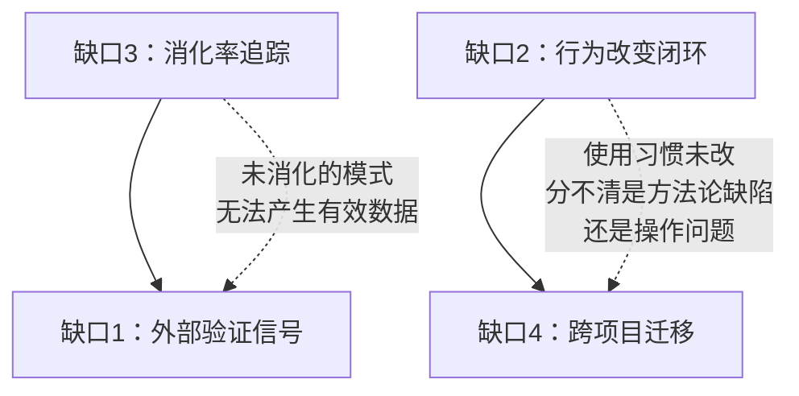

> 脱敏节选 · 2026-11-10 补充 · 发布审核状态：redacted_full_review（发布前全文隐私审核、脱敏与改动复核）。保留通用技术内容，非公开案例、引用或数据已删除；编辑替换处另作说明。历史结论未在本次重新核实，代码未整体运行复现。见[归档说明](../../../ARCHIVE_POLICY.md)。

# 人机交互迭代飞轮分析：四步循环评估与行动路径

> **研究日期**：2026-05-16

四步循环假说：**手搓 → 提炼 → AI 升级 → 人吸收 → 更好的手搓 → ...**

## 飞轮判定：齿轮组还是飞轮？

**飞轮的核心特征**：每转一圈都比上一圈更容易、更快、产出质量更高，且**动力来自系统本身而非外部推动**。

## 四个验证维度与因果排序

### 验证维度之间的因果关系

**因果排序**：先消化（缺口3）→ 再改行为（缺口2）→ 然后跨项目验证（缺口4）→ 最后建度量体系（缺口1）。

### 验证维度 1：外部验证信号

**待检查的问题**：质量信号是否仅来自 AI 自审？

**需要的信号**（至少一个不可博弈的外部指标）：
- 技术方案的 PM 评审通过率（人工评审，不是 AI 评分）
- 新项目使用 Skill 的首版合格率（不经修改就能用 vs 需要大改）
- 方法论迁移到第二个项目时的适配成本（改了多少行才能用）

### 验证维度 2：行为改变的闭环

**待检查的问题**：分析之后是否记录了行为变化及其效果，形成反馈闭环？

**建议**：每周从交互日志自动计算 3 个指标（约束覆盖率、一击即中率、澄清轮次），与上周对比。这些变化可作为行为是否改变的观察信号。

**最小实验**：发消息前加一句约束尾巴（"产出路径：{文件名}"或"约束：{一个限制}"）。3 天后数——加了几次、忘了几次。

**优先级**：中（零成本启动，但效果需要时间验证）

### 验证维度 3：消化率追踪

**建议**：
1. 对模式库做断舍离——每个候选模式判断"下个 Sprint 要用 / 有意思但没场景 / 想不出什么时候用"，分别标 🟢/🟡/⚪

2. 给产出物索引 加"消化率"指标：`已采纳 / 总注册`

### 验证维度 4：跨项目迁移实验

**建议**：用 tech-proposal-writer 在一个完全不同的项目上写一版方案，不做任何调整直接用。记录：
- 哪些章节通用、直接能用
- 哪些章节写出了"不属于这个项目"的内容（过拟合信号）
- 哪些你需要的章节 Skill 没覆盖（提炼不够信号）

原文提出的候选判据是：通用度 >70% 时继续检验迁移能力，<50% 时检查是否过拟合。这些阈值不是已验证的通用标准。

### 核心原则

**先消化再生产，先改一个习惯再改三个，先在本项目验证再迁移。**

飞轮不是一下子推起来的，它需要先在一个最小的齿上咬合住。

## 开放问题

1. **AI 自审的校准问题**：如何引入一个不可博弈的外部信号来校准 AI 自审结果？PM 评审通过率是目前最现实的候选项，但数据频率太低（每个方案才一次）。是否有更高频的校准方式？

2. **方法论的"保质期"**：tech-proposal-writer 和 dev-workflow 是基于写作时模型的能力边界设计的。当模型能力跃升（比如 output 上限从 16K 翻倍、遵循度大幅提升），这些方法论中哪些规则会过时？需要一个定期审视机制。

3. **齿轮组→飞轮的转化条件**：需要多少次成功的跨项目迁移（缺口 4 验证通过）才能判定飞轮成立？一个初步标准是：3 个不同类型的项目都能用同一套 Skill 产出合格方案，且适配成本 <20%。
