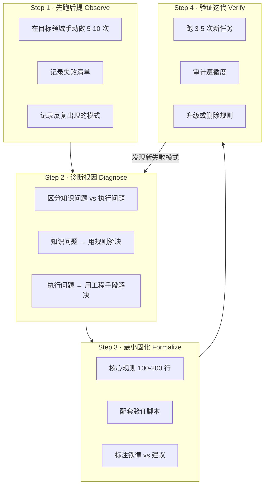

> 脱敏节选 · 2026-11-10 补充 · 发布审核状态：redacted_full_review（发布前全文隐私审核、脱敏与改动复核）。保留通用技术内容，非公开案例、引用或数据已删除；编辑替换处另作说明。历史结论未在本次重新核实，代码未整体运行复现。见[归档说明](../../../ARCHIVE_POLICY.md)。

# 知识固化演化复盘：可迁移的方法

> **研究日期**：2026-05-16
> **关联报告**：R120（Dev Agent 双层架构设计）、R119（mattpocock skills 借鉴）、R14（Anthropic Skill Creator 哲学）、R76（mattpocock skills 调研）

---

## 有效推进：值得保留和迁移的

### 1. 实践先于固化

先观察实际任务中的失败和重复模式，再决定哪些规则值得保留；具体步骤见下文四步法。

### 2. 根因分析驱动正确解法

值得检查的不只是规则数量，还包括**长上下文中执行是否遗漏**。可考虑的工程措施是：用显式状态记录和工具检查关键步骤，减少对模型记忆规则的依赖。

四种机制的设计逻辑清晰：

| 机制 | 解决什么问题 | 核心洞察 |
|------|------------|---------|
| subagent 隔离 | 审查 Checklist 太复杂，主 agent 记不全 | 新鲜 prompt 不被主对话稀释 |
| 文件锚定 | 状态需要跨轮次保持 | "读文件"比"记住第4步"可靠 |
| 触发式规则 | 中间环节容易被跳过 | 与具体动作绑定，而非与抽象阶段绑定 |
| 脚本硬门控 | 最后一步总被跳过 | 独立安全网，不依赖任何一方的记忆 |

### 3. 双层分离架构

把通用规则（质量触发器、编码原则）和项目专属数据（文件路径、技术环境）分开：

```
通用层 instructions         项目层 agent.md
  靠 description 匹配自动加载          靠工作区隔离
  跨项目复用                           项目专属数据
  改一处全项目生效                     每个项目独立维护
```

### 4. 保留版本对比基线

保留旧版本，才能核对规则的新增、删除与变化。

### 5. 设计决策文档化

记录问题、备选方案、决策理由及验证情况，让后续读者能理解设计缘由。

## 无效或可改进的推进

### 规则过细的代价

**问题不是规则不好，是粒度过细导致的三个连锁反应**：

1. **维护成本超过价值**：过长规则中改动一处可能需要排查多处引用
2. **注意力竞争**：长篇产出之后再核对大量 Checklist，可能出现遗漏，需要检验
3. **跨项目适配障碍**：表格列头固定到列名级别（"事项 | 具体内容 | 开发预估工作量/天 | 阶段"），不同项目可能需要不同的列

这暴露了一个元问题：**固化时如何避免只覆盖已知失败模式，而遗漏尚未发生的失败模式？** 答案可能是：不试图预测所有失败，而是保持"事故→补丁→验证"的快速迭代能力。

### 设计原则间的张力

SKILL.md 的第 7 条设计原则是"因地制宜"——**不要照搬模板**。但 SKILL 本身又定义了极其详细的模板格式（固定列头、固定标题层级、固定用词）。两者存在张力：

- 如果模型严格遵循全部详细规范 → 产出会高度统一，但可能不适合某些项目
- 如果模型遵循"因地制宜"原则 → 可能跳过某些规范，产出不一致

这不是不可调和的矛盾，但需要明确"哪些规则是铁律、哪些是建议"——当前 SKILL.md 没有做这个区分。

## 可迁移最佳实践：实战提纯四步法

以下是通用知识固化框架。核心假设：**固化的目的不是写规则，是保障规则被执行**。

### 框架概览



### Step 1 · 先跑后提（Observe → Extract）

**做什么**：在目标领域手动做 5-10 次完整流程。每次结束后记录三件事：
- 什么步骤被跳过了？
- 什么决策反复出现？
- 哪里出了错，错的根因是什么？

**产出**：失败清单 + 反复模式清单。

### Step 2 · 诊断根因（Diagnose）

**做什么**：对 Step 1 的失败清单做根因分析，把问题分为两类：

| 问题类型 | 定义 | 解法方向 |
|---------|------|---------|
| **知识问题** | 模型不知道该怎么做 | 用 SKILL 规则 / instructions 告诉它 |
| **执行问题** | 模型知道但在长对话中忘了 / 跳过了 | 用工程手段保障执行 |

**产出**：问题归因矩阵——什么问题用什么机制解决。

### Step 3 · 最小固化（Formalize · MVP）

**做什么**：

1. **先写 100-200 行核心规则**（不是 800 行完美规则）
2. **配套 1 个可执行验证脚本**（哪怕只检查 3 件事，能 exit 0/1 就行）
3. **明确标注**哪些是"铁律"（不可违反）、哪些是"建议"（可灵活调整）
4. **跨项目复用** → 双层架构（通用层 + 项目层）

**规模控制建议**（写作时提出的候选范围，尚需按任务和模型校准）：

| 产物类型 | 建议行数 | 理由 |
|---------|---------|------|
| 通用 instructions | 100-200 行 | 自动加载到每次对话，过长稀释其他指令 |
| 项目 agent.md | 80-150 行 | 只放数据和项目专属配置 |
| Skill SKILL.md | 150-400 行 | 超过 400 行考虑拆分为多个 Skill |
| 验证脚本 | 50-150 行 | 能 exit 0/1 的可执行检查 |

### Step 4 · 验证迭代（Verify → Iterate）

**做什么**：

1. 用 Step 3 的产出跑 3-5 次新任务
2. 每次审计遵循度：哪些规则被执行了？哪些被跳过了？
3. 被跳过的规则分两种处理：
   - (a) 确实应该执行 → 换更强的保障机制（升级为触发式 / 文件锚定 / 脚本）
   - (b) 其实没必要 → 删掉（**规则数量本身是维护成本**）

**产出**：稳态版本（经过 2+ 轮验证的产物）。

### 保障机制决策表

当 Step 2 诊断出执行问题时，按以下表选择保障机制：

| 问题性质 | 保障机制 | 实现成本 | 适用场景 | 实例 |
|---------|---------|---------|---------|------|
| "模型不知道怎么做" | SKILL 规则 / instructions | 低 | 格式规范、写法示例 | tech-proposal-writer 的章节结构 |
| "模型知道但会忘" | 触发式规则 | 低 | 与具体动作绑定的检查 | "改.py前先读_假设验证.md" |
| "规则太复杂记不全" | subagent 隔离 | 中 | 多项 Checklist 审查 | T1 设计审查 → coding-reviewer |
| "状态需要跨轮次保持" | 文件锚定 | 中 | 假设清单、环境清单 | `_假设验证.md` + T2 读取 |
| "最后一步总被跳过" | 脚本硬门控 | 中 | 会话/流程结束检查 | `_check_session.py` + T3 |
| "自检项太多，注意力不够" | 可执行脚本替代 Checklist | 中-高 | 40+ 项检查 | 建议 tech-proposal-writer 采用 |

**选型原则**：能用低成本机制解决的不要上高成本的。触发式规则（一行代码）能搞定的，不要启动 subagent（需要写完整 prompt + 等待返回）。

---

## 开放问题与后续计划

1. **实战提纯四步法的适用边界**：本框架从 "Skill 编写"和"开发流程"两个场景中提炼，是否适用于其他知识固化场景（如"代码审查规范""需求分析规范""测试策略"）？需要在更多场景中验证。

2. **实战提纯四步法是否值得固化为 Skill**：本报告已经把框架写清楚了。如果在 3+ 个新的知识固化场景中被引用和验证，再固化为 Skill。当前阶段停留在报告中即可。

---

## 来源清单

| 来源 | 日期 | 摘要 |
|------|------|------|
| R14 Anthropic Skill Creator 设计哲学 | — | Skill 写法参考 |
| R76/R119 mattpocock skills 调研 | — | 外部 Skill 设计参考 |

📅 时效性声明：以上信息分析于 2026-05-16
