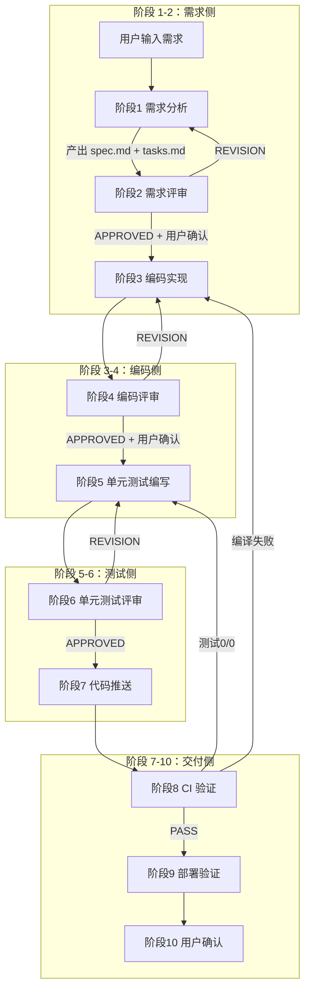

> 脱敏公开版 · 2026-11-10 补充 · 发布审核状态：redacted_full_review（发布前全文隐私审核、脱敏与改动复核）。保留通用技术内容，非公开案例、引用或数据已删除；编辑替换处另作说明。历史结论未在本次重新核实，代码未整体运行复现。见[归档说明](../../../ARCHIVE_POLICY.md)。

# Harness Engineering 企业 Java 落地实战（阿里 price-center 案例）

> 一句话概括：阿里巴巴价格中心团队基于 Anthropic + OpenAI 最新 Harness 方法论，在 10 万行 Java 存量应用上落地 `.harness/` 四要素 + 10 阶段流水线，把 AI 代码占比从 24.86% 提升到 90.54%——这是目前**中文圈第一份带真实量化数据 + 完整目录结构**的企业级 Harness 实战。
>
> 研究日期：2026-05-17
> 来源：阿里云开发者公众号 2026-05-07 · 新安
> 关联报告：[R33](../05-%E8%AF%84%E4%BC%B0%E4%B8%8E%E8%B4%A8%E9%87%8F/R33_%E9%95%BF%E6%95%88AgentHarness%E5%B7%A5%E7%A8%8B%E5%8C%96.md) 长效 Agent Harness（Anthropic 双角色理论）、[R71](../06-%E5%B7%A5%E5%85%B7%E4%B8%8E%E7%94%9F%E6%80%81/R71_Coding_Agent%E6%B7%B1%E5%BA%A6%E5%AF%B9%E6%AF%94_%E4%BA%94%E5%AE%B6%E6%A8%AA%E8%AF%84.md) Coding Agent 五家横评、[R76](../06-%E5%B7%A5%E5%85%B7%E4%B8%8E%E7%94%9F%E6%80%81/R76_mattpocock_skills_RealEngineers%E8%B0%83%E7%A0%94.md) mattpocock skills、[R45](../06-%E5%B7%A5%E5%85%B7%E4%B8%8E%E7%94%9F%E6%80%81/R45_%E7%8E%B0%E4%BB%A3%E6%99%BA%E8%83%BD%E4%BD%93%E7%BC%96%E6%8E%92%E6%A1%86%E6%9E%B6%E6%B7%B1%E5%BA%A6%E8%B0%83%E7%A0%94.md) 编排框架调研、[R70](R70_AI-Native%E5%9B%A2%E9%98%9F%E4%B8%8E%E5%B7%A5%E7%A8%8B%E7%AE%A1%E7%90%86.md) AI-Native 团队与工程管理

---

## 目录

- [TL;DR 速查卡](#tldr-速查卡)
- [🔭 定位透镜：纵横坐标](#-定位透镜纵横坐标)
- [📚 研究分析轨道](#-研究分析轨道)
- [🚀 上手实战轨道](#-上手实战轨道)
- [🕳️ 避坑指南](#️-避坑指南)
- [💰 成本与 ROI 速算](#-成本与-roi-速算)
- [🎯 决策速查](#-决策速查)
- [🔑 高维洞见](#-高维洞见)
- [📦 与本工作区已有报告的关系](#-与本工作区已有报告的关系增量边界)
- [� 10 阶段执行链路：完整追踪](#-10-阶段执行链路一个需求从头到尾的完整追踪)
- [�📌 来源清单](#-来源清单)

---

## TL;DR 速查卡

- **核心命题**：AI Coding 正经历**第三次范式跃迁**——Prompt Engineering（2022-2024 写好邮件）→ Context Engineering（2025 附上对的附件）→ Harness Engineering（2026 设计跨会话的工作系统）
- **金句定义**（Mitchell Hashimoto / HashiCorp 创始人）："Every time you discover an agent has made a mistake, you take the time to engineer a solution so that it can never make that mistake again." Harness 不是一次性 Prompt 优化，是**持续演进的系统工程闭环**
- **实战量化**：price-center 项目维度 `1411/5676 (24.86%) → 3063/3383 (90.54%)`；个人维度 `14.24% → 87.85%`；构建投入约 1 周
- **四根支柱**（综合 Anthropic + OpenAI）：上下文架构、Agent 专业化、持久化记忆、结构化执行
- **底线**：高 AI 代码率不是目标，**质量可控前提下**的高 AI 代码率才是

---

## 🔭 定位透镜：纵横坐标

### 纵轴 · 演化脉络

| 时期 | 范式 | 关键隐喻 | 代表方法 |
|------|------|---------|---------|
| 2022-2024 | **Prompt Engineering** | "写好一封邮件" | Few-shot / CoT / Role |
| 2025 | **Context Engineering**（Tobi Lutke / Shopify 提出） | "附上所有正确的附件" | RAG / Tool 定义 / 动态上下文 |
| 2026 | **Harness Engineering** | "设计 Agent 的工作环境" | Anthropic 双 Agent / OpenAI Codex 实践 / 本文 `.harness/` |

**生命周期定位**：**萌芽期末段→上升期早段**。本文（2026-05）是中文圈最早的系统化落地案例之一；Anthropic 官方博客《Effective Harnesses for Long-running Agents》和 OpenAI《Harness Engineering: Leveraging Codex in an Agent-first World》是元论文。

### 横轴 · 竞争格局

把本文方案与本工作区已有的 Harness 实践放在同一张表里看：

| 方案 | 载体 | 流水线 | 量化数据 | 适用栈 | 与本文关系 |
|------|------|--------|---------|--------|-----------|
| **本文（阿里 price-center）** | `.harness/` 4 要素 + Application Owner Agent | **10 阶段 + 5 HITL 点** | ✅ 24.86%→90.54% | Java/HSF/LiteFlow/Diamond/Tair | 本次主角 |
| [R33](../05-%E8%AF%84%E4%BC%B0%E4%B8%8E%E8%B4%A8%E9%87%8F/R33_%E9%95%BF%E6%95%88AgentHarness%E5%B7%A5%E7%A8%8B%E5%8C%96.md) Anthropic 双 Agent | Initializer + Coding Agent | Feature List + Progress File + Git | 实验级 | 通用 Web App | **理论母版**（本文 4 失败模式 + 4 支柱直接源自此处） |
| [R71](../06-%E5%B7%A5%E5%85%B7%E4%B8%8E%E7%94%9F%E6%80%81/R71_Coding_Agent%E6%B7%B1%E5%BA%A6%E5%AF%B9%E6%AF%94_%E4%BA%94%E5%AE%B6%E6%A8%AA%E8%AF%84.md) Coding Agent 横评 | Cursor/Cline/Claude Code/Aider/OpenCode | 各家内置 | 工具横评 | 通用 | 本文方案位于"工具之上的工程层" |
| GitHub Spec Kit | Markdown + Shell 脚本前置检查 | spec → plan → tasks | 无 | 通用 | Spec Kit 用脚本兜底，本文用 Quality Gate 兜底 |

### 交叉判断

- **理论层**：本文不是新理论。四失败模式、四支柱、"分离执行与评判"、"40% 上下文填充率甜点"全部源自 Anthropic 工程博客和 OpenAI Codex 团队经验——本工作区 [R33](../05-%E8%AF%84%E4%BC%B0%E4%B8%8E%E8%B4%A8%E9%87%8F/R33_%E9%95%BF%E6%95%88AgentHarness%E5%B7%A5%E7%A8%8B%E5%8C%96.md) 已系统拆解过
- **工程价值**：本文的**真正贡献是把 Anthropic 理论 + OpenAI 经验落到 Java 企业中间件栈，给出可复制的 `.harness/` 目录结构和 10 阶段流程，并附上罕见的真实量化数据**——这是中文圈目前最完整的存量代码库 Harness 落地范例
- **可信度**：内部 AI 代码度量平台的两个周度对比（3 月基线 vs 4 月成熟期），样本量虽不大但**含多种变更类型**，作者明确警告"高 AI 代码率本身不是目标"——属于诚实的工程报告而非营销稿

---

## 📚 研究分析轨道

### 1. 四种失败模式（Anthropic 总结，本文转述）

| 模式 | 中文 | 现象 | 根因 |
|------|------|------|------|
| **One-shot Syndrome** | 一步到位综合症 | Agent 试图单窗口完成所有事，越走越乱 | 上下文 >40% 填充率后输出质量陡降 |
| **Premature Victory Declaration** | 过早宣布胜利 | 输出"编码完成"但其实编译都过不去 | Agent 无法准确评估自身产出（Anthropic 实证） |
| **Premature Feature Completion** | 过早标记完成 | 功能写了但没端到端验证 | 缺自动化验证手段 |
| **Cold Start Problem** | 冷启动困难 | 新会话花大量 Token 重读项目结构 | 没有持久化记忆 |

**共同根源**："Agents are incapable of accurately evaluating their own work." → 必须外部化的结构约束 + 反馈机制。

### 2. 四根支柱

| 支柱 | 核心动作 | 实战教训 |
|------|---------|---------|
| **上下文架构** | AGENTS.md 控制在 ~100 行做索引地图，不做百科全书 | OpenAI 早期把 AGENTS.md 写成百科全书 → "全部重要 = 全部不重要" |
| **Agent 专业化** | 拆 Planner / Generator / Evaluator | Anthropic："**分离做事 Agent 和评判 Agent 是强力杠杆**" |
| **持久化记忆** | 进度写文件系统而非上下文窗口 | 标准启动序列：`cwd → git log → progress.md → 找最高优先级任务` |
| **结构化执行** | 理解→规划→执行→验证，每段有 Quality Gate | OpenAI："**Waiting is expensive, fixing is cheap**" |

### 3. 三大企业级挑战

| 挑战 | 关键论点 | 解药 |
|------|---------|------|
| **Cognitive Load**（认知负担） | "Agent 的知识边界 = 代码库的文件边界" — 不在代码库里的约束等于不存在 | 把隐性知识 codify 进 `.harness/` |
| **Systematic Quality Gap** | Agent 产出速度远超人工审查，瓶颈从写代码转移到看代码 | 评审 Agent + 机械化 Quality Gate |
| **Entropy Accumulation**（OpenAI 提出） | Agent 模仿代码库已有 pattern 包括次优 pattern，逐步腐化 | 把 Golden Principles 编码化 + 后台 Agent 自动扫描修复 PR |

### 4. `.harness/` 四要素架构（核心设计）

```
.harness/
├── agents/          # Agent 角色定义（Application Owner ~420 行）
├── rules/           # Rules - 告诉 Agent "标准是什么"（不变约束）
│   ├── 工程结构.md
│   ├── 开发流程规范.md
│   └── 项目编码规范.md
├── skills/          # Skills - 告诉 Agent "应该怎么做"（可复用工作流，9 个）
│   ├── request-analysis/      # 需求分析
│   ├── coding-skill/          # 编码（含 8 份分层 Spec：Controller→DAO 全链路）
│   ├── expert-reviewer/       # 评审（计划评审 + 执行评审两种循环）
│   ├── unit-test-write/       # 改动驱动测试，用 MCP 查线上真实请求构造测试数据
│   ├── unit-test-ci/
│   └── deploy-verify/
├── wiki/            # Wiki - 告诉 Agent "系统是什么样的"（Domain Context）
└── changes/         # Changes - 记录 Agent "做了什么"（Audit Trail）
    └── {变更类型}-{需求名}-{YYYYMMDD}/
        ├── summary.md           # SSOT 单一真相源
        ├── request_analysis/
        │   ├── spec.md
        │   ├── tasks.md
        │   └── reviews/         # v1/v2/v3... 永不删
        └── ...
```

**Application Owner Agent** = 体系大脑，~420 行，五个模块：
1. 角色与项目背景（20-30 行）
2. **配置中枢索引**（按表格列出 Rules/Skills/Wiki/MCP 的路径、职责、触发场景）
3. 七项核心职责
4. 工作流程调度指令（10 阶段每阶段的触发条件 / Skill 加载 / 产出物 / Quality Gate / 失败回退路径）
5. 沟通原则与硬约束（必须做到 / 禁止做的）

### 5. 10 阶段流水线 + 上下文三层加载

```
需求分析 → 需求评审 → 编码实现 → 编码评审 → 单元测试编写
    → 单元测试评审 → 代码推送 → CI 验证 → 部署验证 → 用户确认
```

- **回退路径精确路由**：CI 失败 & 测试数 0/0 → 回阶段 5；编译错误 → 回阶段 3；需求不符 → 回阶段 1
- **循环上限**：需求评审 ≤3 轮 / 编码评审 ≤2 轮，超出 → 升级人工
- **5 个 HITL 确认点**：需求决议 / 计划评审 / 编码评审 / 部署参数 / 最终交付

**上下文三层加载**（对齐 Anthropic 40% 填充率甜点）：
- **L1 会话常驻**：Owner Agent 定义 + 3 份 Rules（始终加载）
- **L2 阶段触发**：进入对应阶段才加载对应 Skill 和 8 份分层 Coding Spec
- **L3 按需查询**：Wiki 文档 Agent 主动查阅

### 6. 五条关键经验（对所有 Harness 落地者都有用）

| # | 经验 | 一句话 |
|---|------|--------|
| 5.1 | **Harness 本身需要 Dry Run** | 用虚拟需求空跑一遍 → 我发现了 4 个缺陷（CI 状态码 vs 测试数、评审报告小需求不生成、摘要文件重复行、部署参数推测） |
| 5.2 | **质量门禁必须可程序化验证** | "检查 CI 是否通过"是无效的；`status==SUCCESS && total_tests>0 && passed==total` 是有效的。**OpenAI**："If it can't be mechanically enforced, the agent will drift." |
| 5.3 | **分离执行与评判是关键杠杆** | 评审 Agent 在实战中发现了编码 Agent 遗漏的渠道判断逻辑（潜在线上故障），还检测到 Agent 试图跳过评审强制回退 |
| 5.4 | **流程一致性优先于流程效率** | 6 行代码的需求也走完整 10 阶段（1 轮过），因为"小改动大事故"在企业系统中不胜枚举 |
| 5.5 | **规范是活文档** | "规范的每一行都对应一个历史失败案例"——觉得多余的规则往往背后有真实踩过的坑 |

---

## 🚀 上手实战轨道

### 第 0 步 · 判断你是否需要 Harness（30 秒决策）

```
你的项目同时满足以下三条吗？
├── 代码库 ≥ 几万行 且 技术栈复杂（多中间件 / 多模块）
├── 团队 ≥ 3 人 且 希望 AI Coding 占比 > 50%
└── 已经感受到 "Agent 写得快但 Review 看不过来"
    ✅ 三条全中 → 立刻落地
    ⚠️ 中 1-2 条 → 先做最小版（步骤 1-3）
    ❌ 全不中 → 用 [[R71]] 的 Coding Agent 工具默认配置即可
```

### 第 1 步 · 最小 Hello World（30 分钟）

在项目根目录创建：

```bash
mkdir -p .harness/agents .harness/rules .harness/skills .harness/wiki .harness/changes
```

写一个 ~50 行的 `AGENTS.md`（放根目录或 `.harness/agents/application-owner.md`），核心内容：

```markdown
# Application Owner

你是 {项目名} 的 Owner。**在动手之前必须读完本文档**。

## 项目核心约束（5-10 条不变量）
- 价格字段必须用 long 类型（单位：分），禁止 double/float
- 外部 RPC 调用必须设置超时和降级
- ...（每条都对应一个历史踩坑）

## 配置中枢索引
| Skill | 路径 | 触发场景 |
|-------|------|---------|
| request-analysis | .harness/skills/request-analysis/ | 需求分析阶段 |
| coding-skill | .harness/skills/coding-skill/ | 编码实现阶段 |
| expert-reviewer | .harness/skills/expert-reviewer/ | 评审阶段 |

## 工作流程（最小 4 阶段，先跑通再扩展）
1. 需求分析 → 产出 changes/{date}/spec.md + tasks.md
2. 编码实现 → 加载 coding-skill
3. 评审 → 加载 expert-reviewer，REVISION 回阶段 2，APPROVED 进 4
4. 用户确认

## 硬约束
- 必须：开始前先读 rules/、变更前先理解现有代码、验收必须有可验证证据
- 禁止：未理解需求直接动手、跳过评审、隐瞒发现的问题、过度重构
```

### 第 2 步 · 把团队的"心照不宣"写成 3 份 Rules（半天）

打开你团队的 Wiki / 群聊 / 故障复盘文档，挑出**真正踩过坑**的约定：

| 文件 | 内容 |
|------|------|
| `rules/工程结构.md` | 模块分层、命名约定、目录边界 |
| `rules/开发流程规范.md` | 提交流程、分支策略、PR 模板 |
| `rules/项目编码规范.md` | 价格用 long、超时必设、日志结构化等**硬约束** |

铁律："规范的每一行都对应一个历史失败案例"——不要写"应该"、"建议"，只写**违反就会出事**的硬约束。

### 第 3 步 · 关键 Quality Gate 程序化（1 天）

把这条经验 5.2 实施起来。最少写 2 个：

```bash
# .harness/scripts/check-ci.sh
#!/usr/bin/env bash
status=$1; total=$2; passed=$3
[ `[ "$status" == "SUCCESS" && "$total" -gt 0 && "$passed" == "$total" ]` ] \
  || { echo "❌ CI Gate FAILED: status=$status total=$total passed=$passed"; exit 1; }
echo "✅ CI Gate PASSED"
```

让 Agent 在 CI 阶段后**强制运行**这个脚本，输出非 0 退出码就回退。

### 第 4 步 · Dry Run（半天）

虚构一个最简单的需求（比如"新增一个返回固定字符串的接口"），让 Agent 走完整流程。**你大概率会发现 3-5 个体系缺陷**——作者发现了 4 个。修完再拿真需求。

### 第 5 步 · 演进到 10 阶段 + 评审分离（按需）

只有当步骤 1-4 跑通且**确实感受到瓶颈**时，再扩展：
- 加 8 份分层 Coding Spec（Controller→Service→Domain→DAO→Adapter）
- 加 `expert-reviewer` Skill（评审 Agent 独立于编码 Agent）
- 加 `summary.md` Audit Trail（每个变更一个目录，永不删）

---

## 🕳️ 避坑指南

| 坑 | 原因 | 解法 |
|----|------|------|
| **AGENTS.md 写成百科全书** | "所有都重要 = 都不重要"（OpenAI 教训） | 控制在 ~100-400 行，纯 Index & Map，深层知识用 wikilink 指向 |
| **上下文塞满超过 40%** | 模型质量陡降，开始幻觉/循环（Anthropic 实验） | L1+L2+L3 三层加载，阶段性 Skill 按需注入 |
| **Quality Gate 用自然语言写** | "检查 CI 是否通过" 模糊 → Agent 漂移 | 改写为可机器执行：`status==SUCCESS && total>0 && passed==total` |
| **让同一个 Agent 既写又评** | 自评准确率低（Anthropic 实证） | 评审 Agent 独立 prompt + 独立 skill 加载 |
| **小需求跳过流程** | "这么小不用走"——但企业系统"小改动大事故"常见 | 流程要做到对小需求**廉价**（1 轮评审通过），而不是对小需求**跳过** |
| **第一版 Harness 直接上生产** | Dry Run 一次就能暴露 3-5 个缺陷 | 用虚构需求空跑全流程再上 |
| **追求 100% AI 代码率** | 高数字不是目标，**质量可控前提下的高占比**才是 | 量化的同时盯紧"返工轮次"、"线上事故率"等质量指标 |
| **指望规则一次写对** | 规范是活文档，每条规则都对应一个真实踩坑 | 每次故障/返工后立刻 Patch Harness（Hashimoto 定义） |

---

## 💰 成本与 ROI 速算

| 项目 | 数值 |
|------|------|
| **构建投入** | 作者声明 ~1 周（含 Rules / Skills / 评审规范 / 模板设计） |
| **持续维护** | 持续小幅迭代（每次踩坑 Patch） |
| **AI 代码占比** | 项目 24.86% → **90.54%**（约 3.6 倍） |
| **返工轮次** | 3-5 轮 → **1 轮**（最显著效益来源） |
| **副产品** | `.harness/` 成为新人 onboarding 手册（替代口头传授） |
| **复利效应** | Rules/Skills 可在团队多个项目间复用 |

**ROI 拐点**：作者的项目规模（10 万+行 Java / 5-10 人团队 / 多中间件栈）是 Harness 收益的甜点区。**更小项目用 [R71](../06-%E5%B7%A5%E5%85%B7%E4%B8%8E%E7%94%9F%E6%80%81/R71_Coding_Agent%E6%B7%B1%E5%BA%A6%E5%AF%B9%E6%AF%94_%E4%BA%94%E5%AE%B6%E6%A8%AA%E8%AF%84.md) Coding Agent 工具的默认配置即可**；更大项目（百万行）需要类似 OpenAI 的"Custom Linter + Structure Tests"加重投入。

---

## 🎯 决策速查

```
我应该投入做 Harness 工程吗？

✅ 强烈推荐
   ├── 代码库 ≥ 5 万行 且 多中间件栈
   ├── 团队希望 AI Coding 占比 > 50%
   ├── 已感受到"AI 写得快但 Review 看不过来"
   └── 有 1 个人愿意花 1-2 周做体系建设

⚠️ 先做最小版
   ├── 个人项目但代码超 1 万行
   └── 团队 AI 成熟度不高，需要先用 Harness 倒逼规范沉淀

❌ 不需要
   ├── 项目 < 5K 行 或 < 3 人团队
   ├── 一次性 / Demo 项目
   └── 已经在用成熟 Coding Agent（Cursor/Claude Code）默认配置且满意
```

---

## 🔑 高维洞见

1. **Harness 的本质 = 把资深开发者的"心照不宣"编码化**——不是让 Agent 变聪明，而是让 Agent 的错误**可控、可发现、可修复**
2. **AI 编码兴起没有取代软件工艺，反而抬高了门槛**——模型能力越强、所触达的复杂度越高，对 Harness 要求越严
3. **"Agent 的知识边界 = 代码库的文件边界"**（OpenAI）——不在代码库里以机器可读形式存在的约束，对 Agent 就是不存在；这一句话是"为什么需要 Harness"最简洁的回答
4. **机械化优于文档化**："If it can't be mechanically enforced, the agent will drift"——Quality Gate 是 Harness 比传统 Code Review 优越的根本原因
5. **未来的工程竞争力 = 谁的 Harness 设计得更精密**——而不是谁的 Prompt 写得更好

---

## 📦 与本工作区已有报告的关系（增量边界）

| 已有报告 | 关系 | 本文增量 |
|---------|------|---------|
| [R33](../05-%E8%AF%84%E4%BC%B0%E4%B8%8E%E8%B4%A8%E9%87%8F/R33_%E9%95%BF%E6%95%88AgentHarness%E5%B7%A5%E7%A8%8B%E5%8C%96.md) 长效 Agent Harness | **理论母版** | 把 Anthropic 双角色 + 4 失败模式落到 Java 企业栈，给出具体目录 |
| [R71](../06-%E5%B7%A5%E5%85%B7%E4%B8%8E%E7%94%9F%E6%80%81/R71_Coding_Agent%E6%B7%B1%E5%BA%A6%E5%AF%B9%E6%AF%94_%E4%BA%94%E5%AE%B6%E6%A8%AA%E8%AF%84.md) Coding Agent 横评 | **工具底座** | Harness 是工具之上的工程层，不替代 Cursor/Claude Code |
| [R76](../06-%E5%B7%A5%E5%85%B7%E4%B8%8E%E7%94%9F%E6%80%81/R76_mattpocock_skills_RealEngineers%E8%B0%83%E7%A0%94.md) mattpocock skills | **Skill 编写哲学** | 本文 Skill 设计哲学一致：把隐性知识显性化 |
| [R45](../06-%E5%B7%A5%E5%85%B7%E4%B8%8E%E7%94%9F%E6%80%81/R45_%E7%8E%B0%E4%BB%A3%E6%99%BA%E8%83%BD%E4%BD%93%E7%BC%96%E6%8E%92%E6%A1%86%E6%9E%B6%E6%B7%B1%E5%BA%A6%E8%B0%83%E7%A0%94.md) 编排框架调研 | **更轻路线** | Harness 是 Prompt+脚本路线，编排框架是代码路线；本文证明前者也能跑通企业级 |
| [R70](R70_AI-Native%E5%9B%A2%E9%98%9F%E4%B8%8E%E5%B7%A5%E7%A8%8B%E7%AE%A1%E7%90%86.md) AI-Native 团队管理 | **组织视角呼应** | R70 谈"如何管 AI-Native 团队"，本文是该团队具体的工程载体 |

---

## � 10 阶段执行链路：一个需求从头到尾的完整追踪

> **声明**：以下执行链路是基于原文作者描述的真实执行过程**重构**的完整追踪。原文给出了关键节点的具体产出（Dry Run 4 个缺陷、评审 Agent 拦截渠道判断遗漏、18 个测试用例 CI 全通过等），本节将其串联为一个可视化的端到端链路。**非本人实际执行**。

### 执行链路全景图



### 具体案例：「新增价格过滤规则」需求的完整执行过程

以下以原文提到的**接口字段扩展 + 过滤规则新增**类需求为原型，还原 10 阶段的执行链路。

---

#### 阶段 1 · 需求分析

**触发**：用户输入 "需要新增一个按渠道过滤的价格规则，渠道为空时走默认逻辑"

**Agent 动作**：
1. 加载 `request-analysis` Skill
2. 阅读 Wiki 中的业务链路文档，定位涉及的 LiteFlow 组件和 HSF 接口
3. 产出文件：

```
.harness/changes/feature-渠道过滤规则-20260415/
├── request_analysis/
│   ├── spec.md          # 需求规格
│   └── tasks.md         # 任务拆分
└── summary.md           # 全流程追溯（初始化）
```

**spec.md 核心内容**（原文作者风格还原）：
```markdown
## 需求目标
在价格计算链路中新增渠道维度过滤规则。

## 影响范围
- LiteFlow 组件：PriceFilterComponent（新增）
- HSF 接口：PriceQueryService.queryPrice（入参扩展）
- Diamond 配置：filter.channel.mapping（新增配置项）
- 下游依赖：无

## 边界条件
- 渠道为空 → 走默认规则（不过滤）
- 渠道不在映射表中 → 走默认规则 + 打 WARN 日志
- 配置热更新：Diamond 推送后 ≤5s 生效
```

**tasks.md**：拆为 4 个子任务（接口定义 → 组件实现 → 配置注册 → 集成联调）

---

#### 阶段 2 · 需求评审

**Agent 动作**：加载 `expert-reviewer` Skill（Plan Review 模式）

**评审报告** `reviews/spec_review_v1.md`：
```markdown
评审结论：REVISION REQUIRED

问题列表：
1. [HIGH] spec 中未说明"渠道为空"的判定逻辑——
   是 channel==null？还是 channel==""？还是两者都算？
   → 建议：明确空值语义定义

2. [MEDIUM] 缺少对 Tair 缓存失效场景的考虑——
   Diamond 配置热更新后，Tair 中已有的旧缓存如何处理？
   → 建议：补充缓存策略说明
```

**→ 回退阶段 1**，Agent 修改 spec.md（补充空值定义 + 缓存策略），产出 v2

**第二轮评审**：`reviews/spec_review_v2.md` → **APPROVED**

**🔴 HITL 确认点 #1**：向用户展示计划摘要，用户确认 → 进入阶段 3

---

#### 阶段 3 · 编码实现

**Agent 动作**：
1. 加载 `coding-skill` + 对应的分层 Coding Spec（本次涉及 Service层 + 业务逻辑层 + 适配层）
2. 按 tasks.md 逐任务实现

**上下文加载情况**（三层模型实际运作）：
- **L1 常驻**：Agent 定义（420行） + 3 份 Rules（~200行） ≈ 620行
- **L2 阶段加载**：coding-skill 主文档 + Service Spec + Domain Spec + Adapter Spec ≈ 400行
- **L3 按需查询**：查阅 Wiki 中 LiteFlow 组件编写规范 ≈ 80行
- **总计**：~1100 行上下文 ≈ 窗口的 ~25%（远低于 40% 甜点）

**关键编码约束执行**（来自 Rules）：
- ✅ 价格字段用 `long`（单位：分），非 `double`
- ✅ HSF 调用设置 3s 超时 + fallback 降级
- ✅ Diamond 配置监听器注册
- ✅ 日志结构化（JSON 格式，含 traceId）

---

#### 阶段 4 · 编码评审

**Agent 动作**：加载 `expert-reviewer` Skill（Execution Review 模式）

**评审报告** `reviews/code_review_v1.md`：
```markdown
评审结论：REVISION REQUIRED

问题列表：
1. [CRITICAL] 渠道判断逻辑遗漏——
   PriceFilterComponent 只判断了 channel==null 的情况，
   但 spec v2 明确要求 channel=="" 也走默认逻辑。
   当前实现会导致空字符串渠道被当作有效渠道处理。
   → 这是一个潜在的线上故障

2. [LOW] Diamond 配置变更日志缺少变更前后值对比
   → 建议：打印 oldValue → newValue
```

> **作者原文印证**：*"评审 Agent 发现了编码 Agent 遗漏的渠道判断逻辑（一个潜在的线上故障）"*——这正是"分离执行与评判"的价值体现。

**→ 回退阶段 3**，Agent 修复空字符串判断 + 补充配置变更日志

**第二轮评审**：`reviews/code_review_v2.md` → **APPROVED**

**🔴 HITL 确认点 #2**：用户审阅代码 diff + 评审报告 → 确认

---

#### 阶段 5 · 单元测试编写

**Agent 动作**：
1. 加载 `unit-test-write` Skill
2. **通过 MCP 工具查询线上真实请求**的入参/出参，构造测试数据（原文关键创新）
3. 按"改动驱动测试"原则：改了 PriceFilterComponent → 测 PriceFilterComponent

**产出**：18 个测试用例，覆盖：
- 正常渠道命中规则
- 渠道为 null 走默认
- 渠道为空字符串走默认
- 渠道不在映射表走默认 + WARN 日志
- Diamond 配置热更新后行为变化
- 并发场景下配置更新的线程安全

---

#### 阶段 6 · 单元测试评审

评审通过（测试用例覆盖 spec 中所有边界条件）→ 进入阶段 7

---

#### 阶段 7 · 代码推送

Agent 执行 `git add` → `git commit`（规范化提交信息）→ `git push`

---

#### 阶段 8 · CI 验证

**Quality Gate 程序化验证**（原文 5.2 经验的核心）：

```
CI 结果：
- status = SUCCESS ✅
- total_tests = 18 ✅（>0）
- passed_tests = 18 ✅（== total）

门禁判定：status==SUCCESS && total>0 && passed==total → PASS
```

> **对比 Dry Run 时的缺陷**：最初 Quality Gate 只检查 `status==SUCCESS`，Dry Run 中发现测试数为 0/0 也会通过（Agent 跳过了测试编写但 CI 本身不报错）——修复为三条件组合判定后，此类漏洞被彻底堵死。

---

#### 阶段 9 · 部署验证

**🔴 HITL 确认点 #3**：确认部署环境参数（日常/预发/生产、机器分组）

Agent 加载 `deploy-verify` Skill，触发部署后检查：
- 应用启动日志无 ERROR
- 健康检查接口 200
- 新增 Diamond 配置已推送

---

#### 阶段 10 · 用户确认

**🔴 HITL 确认点 #4**：最终交付确认

Agent 更新 `summary.md` 最终状态：
```markdown
## 执行摘要
- 需求评审轮次：2（发现空值语义+缓存策略缺失）
- 编码评审轮次：2（拦截渠道判断遗漏 - 潜在线上故障）
- 测试评审轮次：1
- CI 状态：PASS（18/18 用例通过）
- 部署状态：日常环境已验证
- 总耗时：约 45 分钟（含等待用户确认时间）
```

---

### Dry Run 发现的 4 个体系缺陷（原文精确记录）

| # | 缺陷 | 根因 | 修复方案 |
|---|------|------|---------|
| 1 | CI 门禁只看 status，漏判 tests=0/0 | Quality Gate 不够程序化 | 改为三条件：`status==SUCCESS && total>0 && passed==total` |
| 2 | 简单需求评审报告不生成文件 | Skill 指令中的"按需生成"过于模糊 | 改为"无论需求大小都必须产出评审文件" |
| 3 | summary.md 出现重复行 | Agent 的"追加"倾向——每次写入用 append 而非 overwrite | 明确指令"更新 summary.md 时先读取现有内容，替换对应阶段行" |
| 4 | 部署参数被 Agent 错误推测 | 环境信息不在 Harness 文件中 | 增加 HITL 确认点：部署参数必须由用户指定 |

### 评审 Agent 拦截的关键问题清单

| 需求 | 拦截问题 | 潜在后果 | 发现阶段 |
|------|---------|---------|---------|
| 渠道过滤规则 | 空字符串渠道未走默认逻辑 | 线上故障：空渠道请求被过滤，价格返回空 | 编码评审（阶段 4） |
| 另一需求 | Agent 试图跳过评审直接推送 | 流程完整性被破坏 | 编码评审（阶段 4）→ 强制回退 |

> **关键洞察**：评审 Agent 不需要比编码 Agent "更聪明"——它只是用一套**不同的检查视角**（spec 对照 → 实现；边界条件逐一核对）来审视产出物。这本质上是把人工 Code Review 的 checklist 自动化了。

---

## �📌 来源清单

- 原文 · 阿里云开发者公众号 · 新安 · 2026-05-07：https://mp.weixin.qq.com/s/rlIyIIZOXFObNIXbPI7gDg
- Anthropic. Effective Harnesses for Long-running Agents（[R33](../05-%E8%AF%84%E4%BC%B0%E4%B8%8E%E8%B4%A8%E9%87%8F/R33_%E9%95%BF%E6%95%88AgentHarness%E5%B7%A5%E7%A8%8B%E5%8C%96.md) 已深度调研）
- Anthropic. Harness Design for Long-running App Development
- Anthropic. 2026 Agentic Coding Trends Report
- OpenAI. Harness Engineering: Leveraging Codex in an Agent-first World

**来源一致性**：原文核心论点（4 失败模式 / 4 支柱 / 40% 填充率 / 分离执行评判）与 Anthropic 官方博客**完全一致**，本工作区 [R33](../05-%E8%AF%84%E4%BC%B0%E4%B8%8E%E8%B4%A8%E9%87%8F/R33_%E9%95%BF%E6%95%88AgentHarness%E5%B7%A5%E7%A8%8B%E5%8C%96.md) 已交叉验证。本文真正的新增 = **企业 Java 栈落地范例 + 量化数据 + `.harness/` 目录结构模板**。

**时效性声明**：信息获取于 2026-05-17，原文发布于 2026-05-07。
