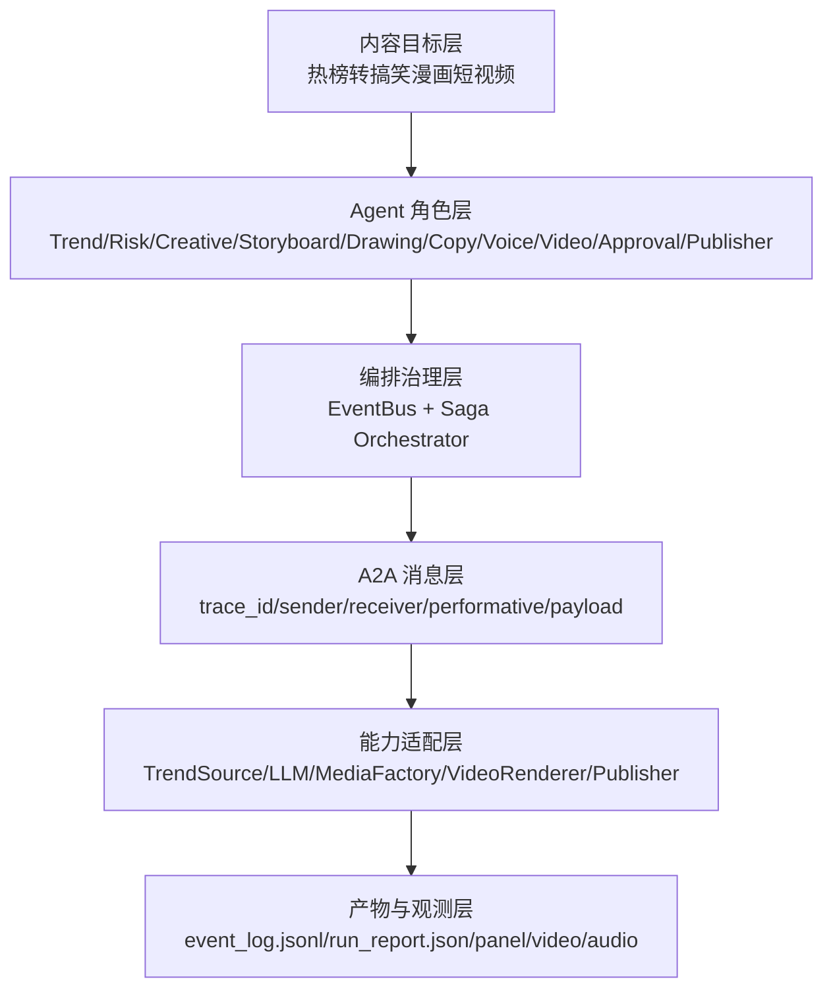

> 历史研究归档 · 2026-11-10 发布 · 程序扫描；未逐篇全文审阅。原有日期、观点、数据和命令保留历史语境，未经本次逐项事实核验或运行复现；请结合[归档说明](../../../ARCHIVE_POLICY.md)阅读。

# P08 事件驱动多 Agent 自媒体系统架构复盘

> 一句话概括：本报告复盘 `prototypes/P08_viral_video_agent_lab/` 如何从一个“究极复杂 Agent 示例”演化为真实可运行的自媒体创作 MVP，重点解释其中厉害设计的思路、取舍、解决的问题，以及关键实现如何组织。
> 研究日期：2026-05-19  
> 关联产出物：D74（原稿交叉引用，本归档未解析） `prototypes/P08_viral_video_agent_lab/`  
> 关联知识：[R50](R50_A2A%E5%8D%8F%E8%AE%AE%E5%85%A5%E9%97%A8%E5%AD%A6%E4%B9%A0%E6%8C%87%E5%8D%97.md) A2A、[R51](R51_%E5%A4%9AAgent%E7%BC%96%E6%8E%92%E4%B8%89%E7%A7%8D%E5%AE%9E%E7%8E%B0%E6%96%B9%E5%BC%8F.md) 多 Agent 编排、[R68](R68_Agent%E4%BA%A7%E5%93%81%E6%A8%A1%E5%BC%8F%E4%B8%8EHITL%E8%AE%BE%E8%AE%A1.md) HITL、[R70](R70_AI-Native%E5%9B%A2%E9%98%9F%E4%B8%8E%E5%B7%A5%E7%A8%8B%E7%AE%A1%E7%90%86.md) EDD、R133（原稿交叉引用，本归档未解析） Agentic Skills Framework

---

## TL;DR 速查卡

- **这个系统的本质**：不是“一个 Agent 自动做视频”，而是一个小型内容生产操作系统：事件总线负责调度，A2A 消息负责契约，Saga 负责状态，Agent 负责局部智能，Adapter 负责外部能力。
- **最值得学的设计**：把“模型能力层”和“系统治理层”拆开。OpenAI Agents SDK 只负责局部创意/文案，事件流、审批、安全、日志、渲染由本地系统掌控。
- **为什么不用一个大 Agent**：大 Agent 失败时看不清是哪一步坏了；P08 每一步都有事件、输入、输出、trace，可以复盘和替换。
- **为什么要 A2A envelope**：它让 Agent 之间不是“函数互调”，而是“带身份、意图、载荷、链路号的消息协作”，未来可以平滑换成远程 Agent 服务。
- **为什么先导出视频包而不是全自动发布**：自媒体生产的高风险点不是生成，而是发布；V1 应该做“生成 + 人审 + 手动发布”，而不是绕平台规则全自动。
- **当前验证状态**：mock dry-run、pytest、模板媒体 + MoviePy MP4 已验证；真实 OpenAI 图像/TTS 路径已预留，需要用户提供 `OPENAI_API_KEY` 后运行。

---

## 目录

- #🔭 定位透镜：P08 在 Agent 系统演化中的位置（原稿交叉引用，本归档未解析）
- #一、系统全景：它到底由哪些层组成（原稿交叉引用，本归档未解析）
- #二、核心设计 1：事件驱动，不是顺序脚本（原稿交叉引用，本归档未解析）
- #三、核心设计 2：A2A envelope，让 Agent 协作可审计（原稿交叉引用，本归档未解析）
- #四、核心设计 3：Saga 编排，解决多分支等待问题（原稿交叉引用，本归档未解析）
- #五、核心设计 4：小 Agent 分工，而不是超级 Agent（原稿交叉引用，本归档未解析）
- #六、核心设计 5：Adapter 隔离外部能力（原稿交叉引用，本归档未解析）
- #七、核心设计 6：HITL 发布闸门（原稿交叉引用，本归档未解析）
- #八、核心设计 7：EDD 先定义好行为，再改 Prompt/Agent（原稿交叉引用，本归档未解析）
- #九、从 dry-run 到真实 MP4：生产化升级路径（原稿交叉引用，本归档未解析）
- #十、关键代码摘录：只看最有价值的片段（原稿交叉引用，本归档未解析）
- #十一、避坑指南：这些坑比代码更重要（原稿交叉引用，本归档未解析）
- #十二、成本与 ROI：为什么建议每天 1 条先跑通（原稿交叉引用，本归档未解析）
- #十三、下一步演进路线（原稿交叉引用，本归档未解析）
- #📌 来源清单（原稿交叉引用，本归档未解析）

---

## 🔭 定位透镜：P08 在 Agent 系统演化中的位置

一句话结论：P08 不是“某个 SDK 的 demo”，而是把 Agent 系统从玩具脚本推进到可运营流水线的一次架构演示。

### 纵轴：从单 Agent 到内容生产操作系统

Agent 系统大致可以分 5 个复杂度层级：

| 层级 | 形态 | 典型能力 | 最大问题 |
|---|---|---|---|
| L1 | 单 Prompt | 一问一答 | 无状态、不可复盘 |
| L2 | 单 Agent + Tools | 会调用工具 | 工具链失败难定位 |
| L3 | Workflow | 固定步骤执行 | 分支/并发/等待变复杂 |
| L4 | Multi-Agent | 多角色协作 | 通信契约和状态治理困难 |
| L5 | Event-driven Agent System | 事件、消息、状态机、审计、HITL | 工程复杂度上升 |

P08 目标就是 L5 的学习样例：它不追求“最短代码”，而是追求把生产系统里真正麻烦的东西摊开给你看：事件、trace、状态、审批、日志、适配器、评估。

### 横轴：和 LangGraph / CrewAI / OpenAI Agents SDK 的区别

| 方案 | 强项 | 如果直接用它做 P08 的问题 | P08 的取法 |
|---|---|---|---|
| LangGraph | 显式图、状态流、条件路由 | 学习门槛高，容易先陷入框架概念 | P08 先手写轻量 Saga，让你看懂本质 |
| CrewAI | 角色协作直观 | 容易把协作变成“角色扮演 Prompt” | P08 强制所有协作用事件和 envelope 表达 |
| OpenAI Agents SDK | Agent、Runner、tools、handoff、tracing | SDK 不等于业务治理层 | P08 只把它作为局部 LLM 能力层 |
| 一个大脚本 | 快速能跑 | 不可审计、不可扩展、难接真实能力 | P08 拆为事件总线 + Agent + Adapter |

### 交叉判断

P08 的核心判断是：**复杂 Agent 系统的难点不在“会不会调用模型”，而在“模型之外的系统如何治理”。**

因此 P08 采用了一个反直觉设计：

> 模型只负责局部智能，系统负责全局秩序。

这也是后续你真正用它做自媒体时最该保留的原则。

---

## 一、系统全景：它到底由哪些层组成

一句话结论：P08 是一个 6 层结构，越往上越业务，越往下越工程。



### 每层解决的问题

| 层 | 解决什么问题 | 为什么需要这一层 |
|---|---|---|
| 内容目标层 | 明确系统最终产物 | 防止 Agent 自由发挥到不可控 |
| Agent 角色层 | 把复杂任务拆成职责清晰的小工种 | 降低单 Agent 认知负载 |
| 编排治理层 | 管事件顺序、并发等待、状态合并 | 解决“多个结果什么时候凑齐”的问题 |
| A2A 消息层 | 规定 Agent 间通信格式 | 支持审计、追踪、未来远程化 |
| 能力适配层 | 隔离 OpenAI、MoviePy、平台 API 等外部能力 | 方便替换供应商和测试 |
| 产物与观测层 | 保存每步输出和运行报告 | 方便复盘、调试、评估 |

---

## 二、核心设计 1：事件驱动，不是顺序脚本

一句话结论：事件驱动的价值在于让复杂流程“可插拔、可观察、可并行”，而不是把所有步骤硬写成一条长函数。

### 如果用顺序脚本会怎样

最直觉的实现可能是：

```text
fetch_trends()
for trend in trends:
    check_risk()
    write_plan()
    write_storyboard()
    draw_images()
    write_caption()
    synthesize_voice()
    compose_video()
    publish()
```

它看起来简单，但一旦进入真实系统，会立刻遇到 5 个问题：

1. 某一步失败后如何重试？
2. 绘画和配音能不能并行？
3. 多个热榜如何独立追踪？
4. 审批停住后如何恢复？
5. 怎么知道最终视频是哪几个中间产物合成的？

P08 用事件总线解决这些问题。

### P08 的事件模型

P08 的关键事件包括：

```text
PipelineStarted
TrendDetected
RiskChecked / RiskRejected
ContentPlanCreated
CaptionRequested
StoryboardReady
ComicRendered
VoiceoverReady
AssetBundleReady
VideoRendered
ApprovalRequested
ApprovalGranted
PublicationDryRun
```

这些事件像流水线上的“工单状态变更”。每个 Agent 只订阅自己关心的事件，处理完再发布新事件。

### 这个设计解决了什么

| 问题 | 事件驱动如何解决 |
|---|---|
| 步骤耦合 | Agent 不直接调用彼此，只通过事件连接 |
| 难调试 | 每个事件写入 `event_log.jsonl` |
| 难扩展 | 新增 Agent 只需订阅事件 |
| 难替换 | 替换绘画 Agent 不影响其他步骤 |
| 难复盘 | `trace_id` + 事件日志可以还原链路 |

---

## 三、核心设计 2：A2A envelope，让 Agent 协作可审计

一句话结论：A2A envelope 的价值不是“发消息”，而是把 Agent 协作从隐式函数调用变成显式协议。

### P08 的 A2A 消息字段

每个事件中都包了一层 `A2AMessage`：

| 字段 | 含义 | 为什么重要 |
|---|---|---|
| `message_id` | 消息唯一 ID | 去重、审计 |
| `trace_id` | 单个选题链路 ID | 同一条视频的所有事件串起来 |
| `conversation_id` | 本次 pipeline run ID | 同一次批处理串起来 |
| `sender` | 发送 Agent | 责任归属 |
| `receiver` | 接收 Agent | 路由与权限控制 |
| `performative` | 意图：inform/request/approve/reject/delegate | 不只是内容，还有动作语义 |
| `payload` | 结构化载荷 | Agent 真正处理的数据 |

### 为什么不用普通函数参数

函数参数只能表达“调用”，不能表达“协作关系”。

A2A envelope 可以表达：

- 这是一个请求还是通知？
- 是批准还是拒绝？
- 谁发起的？
- 发给谁？
- 属于哪条任务链？
- 未来能不能转成网络消息？

这正是复杂 Agent 系统从“脚本”变成“协议系统”的关键。

---

## 四、核心设计 3：Saga 编排，解决多分支等待问题

一句话结论：Saga 负责“等多个异步分支都完成后再进入下一步”，这是复杂工作流的核心难点之一。

### P08 中的并行分支

当 `StoryboardReady` 出现后，系统会同时触发：

- `DrawingAgent` → 生成漫画图
- `VoiceoverAgent` → 生成配音
- `CopywriterAgent` 已经在另一条分支生成配文

视频合成必须等待三者都完成：

```text
ComicRendered + VoiceoverReady + CaptionReady → AssetBundleReady
```

这就是 Saga 的用武之地。

### 为什么不是简单 await

如果只是单条任务，`await draw(); await voice(); await caption()` 可以。

但真实系统里有多条热榜同时跑：

```text
trend A: image done, voice pending, caption done
trend B: rejected
trend C: caption done, image pending, voice done
```

你需要按 `trend_id` 管每条任务的状态，不能串线。P08 曾经就修过一个真实问题：多条热榜共用同一个 `trace_id` 会导致 artifact 覆盖。修复方式就是每条 `TrendDetected` 都生成独立 trace。

### Saga 状态长什么样

P08 的 `TopicSaga` 只保留最必要状态：

```python
@dataclass
class TopicSaga:
    trend: dict[str, Any]
    comic_payload: dict[str, Any] | None = None
    caption_payload: dict[str, Any] | None = None
    voice_payload: dict[str, Any] | None = None
    video_requested: bool = False
    rejected: bool = False
```

这段设计的价值不在代码技巧，而在**状态最小化**：只记录推进流程所需的关键事实，不把所有中间对象都塞进全局状态。

---

## 五、核心设计 4：小 Agent 分工，而不是超级 Agent

一句话结论：P08 把“做一条短视频”拆成 10 个小 Agent，是为了降低复杂度、提升可替换性和可评估性。

### Agent 职责表

| Agent | 输入事件 | 输出事件 | 解决的问题 |
|---|---|---|---|
| `TrendScoutAgent` | `PipelineStarted` | `TrendDetected` | 获取候选选题 |
| `RiskAndRightsAgent` | `TrendDetected` | `RiskChecked` / `RiskRejected` | 安全与版权前置拦截 |
| `CreativeDirectorAgent` | `RiskChecked` | `ContentPlanCreated` / `CaptionRequested` | 生成创意方向 |
| `StoryboardAgent` | `ContentPlanCreated` | `StoryboardReady` | 把创意拆成镜头和台词 |
| `DrawingAgent` | `StoryboardReady` | `ComicRendered` | 把分镜变成图像资产 |
| `CopywriterAgent` | `CaptionRequested` | `CaptionReady` | 生成标题/文案/话题 |
| `VoiceoverAgent` | `StoryboardReady` | `VoiceoverReady` | 生成配音脚本或音频 |
| `VideoComposerAgent` | `AssetBundleReady` | `VideoRendered` | 合成视频 manifest 或 MP4 |
| `ApprovalAgent` | `VideoRendered` | `ApprovalRequested` / `ApprovalGranted` | 人审闸门 |
| `PublisherAgent` | `ApprovalGranted` | `PublicationDryRun` | 生成发布结果，默认不真实发布 |

### 为什么这样拆

拆 Agent 的原则不是“角色越多越酷”，而是满足 3 个条件才拆：

1. **输入输出不同**：绘画、文案、配音产物完全不同。
2. **失败模式不同**：文案失败、图像失败、发布失败的处理方式不同。
3. **未来替换方式不同**：绘画可能换 OpenAI / Midjourney / 本地模型，视频可能换 MoviePy / ffmpeg / 剪映 API。

### 反模式：角色扮演式多 Agent

很多多 Agent demo 只是：

```text
Researcher 说几句
Writer 说几句
Reviewer 说几句
```

它看起来像多 Agent，但没有真实产物边界。P08 的每个 Agent 都产出结构化事件或文件资产，这才是工程意义上的多 Agent。

---

## 六、核心设计 5：Adapter 隔离外部能力

一句话结论：Adapter 层把“系统流程”和“外部供应商”隔离开，避免整个系统被某个 API 绑死。

P08 的 Adapter 有 4 类：

| Adapter | 当前实现 | 未来可替换为 |
|---|---|---|
| `TrendSource` | mock / file | 抖音开放 API、飞书表格、RSS、人工选题池 |
| `LLM` | mock / OpenAI Agents SDK | Claude、Qwen、本地模型、LiteLLM Gateway |
| `MediaFactory` | dry_run / template / OpenAI | Midjourney、Stable Diffusion、ElevenLabs、Azure TTS |
| `VideoRenderer` | manifest / MoviePy | ffmpeg、Remotion、剪映模板、云渲染 |
| `Publisher` | dry-run only | 官方发布 API、半自动发布包 |

### 为什么 Adapter 重要

如果你把 OpenAI 调用直接写进 `DrawingAgent`，后面想换图像服务，就要改 Agent 逻辑。

P08 的做法是：

```text
DrawingAgent 只知道：我要 render_panel(prompt)
MediaFactory 决定：写 JSON / 画模板 PNG / 调 OpenAI 图像 API
```

这样 Agent 负责业务语义，Adapter 负责技术实现。

### 三档媒体模式

| 模式 | 用途 | 产物 |
|---|---|---|
| `dry_run` | 低成本验证流程 | prompt JSON / manifest JSON |
| `template` | 无 API Key 生成真实 MP4 | PNG + WAV + MP4 |
| `openai` | 真实内容生产 | AI 图像 + TTS + MP4 |

这个三档设计非常值得复用：先让系统“结构可跑”，再让产物“形式可跑”，最后让内容“质量可用”。

---

## 七、核心设计 6：HITL 发布闸门

一句话结论：自媒体 Agent 最大风险不是生成失败，而是发布错误内容；因此发布前必须有人审或强规则审批。

P08 的发布链路是：

```text
VideoRendered → ApprovalRequested → ApprovalGranted → PublicationDryRun
```

其中 `ApprovalRequested` 会带上检查清单：

- 是否原创而非搬运
- 是否避开真实个人隐私/诽谤
- 是否符合平台规则
- 是否允许进入 dry-run 发布

### 为什么不直接自动发布

全自动发布有 4 类风险：

| 风险 | 例子 | 后果 |
|---|---|---|
| 内容风险 | 误用隐私、肖像、争议事件 | 下架、投诉、封号 |
| 平台风险 | 自动化绕规则、异常频率 | 风控、限流 |
| 品牌风险 | 文案冒犯、低质内容 | 账号定位受损 |
| 法务风险 | 搬运、版权、诽谤 | 侵权纠纷 |

所以 P08 的正确生产路线是：

```text
V1: 生成视频 + 文案 → 人工审核 → 手动发布
V2: 发布包 + checklist → 半自动发布
V3: 官方 API + OAuth + 审计日志 → 受控自动发布
```

这不是保守，而是生产系统的基本安全边界。

---

## 八、核心设计 7：EDD 先定义好行为，再改 Prompt/Agent

一句话结论：P08 是概率性系统，不能只靠单元测试；必须用 Eval 集定义“什么叫好”。

P08 的 Eval 文件是：

`prototypes/P08_viral_video_agent_lab/evals/viral_pipeline_eval.yaml`

覆盖 5 个行为：

| Case | 验证点 |
|---|---|
| `case_001_full_pipeline_dry_run` | 全链路事件是否完整 |
| `case_002_safety_gate_rejects_sensitive_topic` | 隐私/敏感选题是否被拒绝 |
| `case_003_a2a_message_contract` | A2A 字段是否完整 |
| `case_004_human_approval_before_publish` | 发布前是否有人工审批 |
| `case_005_replayable_event_log` | 是否生成可复盘日志 |

### 为什么这比普通测试更重要

普通测试验证“代码有没有报错”。

Eval 验证“Agent 行为有没有变坏”。

例如你以后优化 Prompt，可能代码测试全过，但风险 Agent 不再拒绝隐私选题，这就是行为回归。EDD 的目的就是防这个。

---

## 九、从 dry-run 到真实 MP4：生产化升级路径

一句话结论：P08 的生产化不是一步跳到全自动，而是三层渐进：先结构真实，再媒体真实，再发布真实。

### 阶段 1：结构真实

命令：mock + dry_run + manifest。

产物：事件日志、prompt JSON、video manifest。

价值：验证事件、状态、A2A、审批是否正确。

### 阶段 2：媒体真实

命令：mock + template + MoviePy。

产物：真实 PNG、WAV、MP4。

当前已验证：

`output/run_741621a36d0f/video_trace_8cc6b0f16d34.mp4`

价值：即使没有 API Key，也能验证视频生产链。

### 阶段 3：内容真实

命令：openai + openai media + MoviePy。

产物：AI 图像、TTS 音频、MP4。

需要用户提供：`OPENAI_API_KEY`。

### 阶段 4：发布真实

不建议当前立刻做。

需要：平台官方 API、账号授权、发布审计、人审策略、失败重试、限流。

---

## 十、关键代码摘录：只看最有价值的片段

本节不逐行讲代码，只摘最能体现设计思想的片段。

### 1. Saga 的最小状态

```python
@dataclass
class TopicSaga:
    trend: dict[str, Any]
    comic_payload: dict[str, Any] | None = None
    caption_payload: dict[str, Any] | None = None
    voice_payload: dict[str, Any] | None = None
    video_requested: bool = False
    rejected: bool = False
```

**设计点**：状态只记录流程推进所需的事实，不保存无关细节。这样系统容易复盘，也不容易出现“全局状态泥球”。

### 2. 等三路资产齐全再合成视频

```python
if saga.comic_payload and saga.caption_payload and saga.voice_payload:
    saga.video_requested = True
    return [Event(type="AssetBundleReady", message=msg, data=payload)]
```

**设计点**：这是 Saga 编排的核心。绘画、配文、配音可以独立完成，但必须在编排层合流。

### 3. 每条热榜单独 trace

```python
msg = A2AMessage(
    sender=self.name,
    receiver="risk_and_rights_agent",
    performative=Performative.INFORM,
    payload=payload,
    trace_id=new_id("trace"),
    conversation_id=event.message.conversation_id,
)
```

**设计点**：多条热榜不能共用 trace，否则 artifact 会串线、覆盖或难复盘。这是实际验证中暴露并修复的问题。

### 4. Agent 不直接依赖供应商

```python
asset = await self.runtime.media.render_panel(
    prompt=panel["visual_prompt"],
    panel=panel,
    name=f"panel_{panel['panel']}_{event.message.trace_id}",
    store=self.runtime.store,
)
```

**设计点**：`DrawingAgent` 不关心是 OpenAI、模板图还是别的绘画服务。它只表达“我要渲染一个 panel”。这就是 Adapter 隔离。

### 5. 发布默认 dry-run

```python
if allow_real_publish:
    raise NotImplementedError(
        "Real publishing is intentionally not implemented..."
    )
```

**设计点**：真实发布不是简单开关，而是高风险能力。没有官方 API 和审批闭环时，宁可明确拒绝。

---

## 十一、避坑指南：这些坑比代码更重要

| 坑 | 为什么危险 | P08 的解法 |
|---|---|---|
| 一个超级 Agent 做所有事 | 失败不可定位，输出不可控 | 拆成 10 个职责单一 Agent |
| 没有事件日志 | 出错后只能猜 | 所有事件写 `event_log.jsonl` |
| Agent 间直接函数调用 | 无协议、无身份、不可远程化 | 使用 A2A envelope |
| 多任务共用 trace | artifact 串线、日志混乱 | 每条 `TrendDetected` 独立 trace |
| SDK 统治架构 | 系统被供应商调用方式绑死 | SDK 只作为 LLM 能力层 |
| 一开始真实发布 | 误发和风控风险过高 | 先导出发布包 + 人审 |
| 只做 mock | 以为能跑，实际不能产视频 | 增加 template + MoviePy 真实 MP4 路径 |
| 不做 Eval | Prompt 改坏了不知道 | `evals/viral_pipeline_eval.yaml` 定义行为底线 |

---

## 十二、成本与 ROI：为什么建议每天 1 条先跑通

一句话结论：早期自媒体 Agent 的瓶颈不是自动化程度，而是内容方向是否成立。

### 成本结构

| 成本项 | 早期占比 | 说明 |
|---|---:|---|
| LLM 文案 | 低 | 单条内容文本调用不贵 |
| 图像生成 | 中高 | 每条 3 张图，是真正 API 成本项 |
| TTS | 中低 | 通常比图像便宜 |
| 视频渲染 | 低 | 本地 MoviePy 可承担 |
| 人工审核 | 高 | 但早期不能省 |
| 选题试错 | 最高 | 内容方向不对，自动化越高亏越快 |

### 推荐节奏

前 7 天：每天 1 条。

目标不是规模化，而是验证：

- 哪类选题容易出效果？
- 漫画风格是否稳定？
- 用户是否愿意看完？
- 文案有没有账号记忆点？
- 人审规则是否足够？

等你有 7-14 条数据，再做自动选题和批量生成。

---

## 十三、下一步演进路线

一句话结论：P08 下一步不该盲目加 Agent，而应围绕“质量、效率、发布、复盘”四条线演进。

### V1.1：账号定位固化

新增：

- 固定 IP 角色
- 固定视觉风格
- 禁用词表
- 口头禅/结尾 CTA

目标：让视频有账号一致性。

### V1.2：选题评分 Agent

新增：

- 热度评分
- 风险评分
- 改编潜力评分
- 与账号定位匹配度

目标：不要什么热榜都做。

### V1.3：质量评估 Agent

新增：

- 分镜是否完整
- 笑点是否明确
- 文案是否过长
- 是否可能违规

目标：生成后先自检，再给人审。

### V1.4：发布包生成

新增：

- `caption.txt`
- `hashtags.txt`
- `cover.png`
- `publish_checklist.md`
- `metadata.json`

目标：你手动上传时不需要到处复制。

### V2：数据回流

新增：

- 播放量
- 完播率
- 点赞率
- 评论关键词
- 选题类别

目标：让系统从“生成器”变成“增长实验台”。

### V3：官方 API 发布

只在满足以下条件后做：

- 平台有官方发布 API
- 账号授权合法
- 人审策略稳定
- 有发布日志和撤回机制
- 有频率限制和失败重试

---

## 结论与最佳实践

P08 最值得学习的不是某一段代码，而是 7 个工程判断：

1. **复杂系统先拆协议，再写 Agent。** 没有事件和消息契约，多 Agent 很快变成混乱聊天群。
2. **模型只做局部智能，系统负责全局治理。** 不要把安全、审批、状态、日志都塞给 LLM。
3. **先 dry-run，再模板真实，再 API 真实。** 每一层都能单独验证，调试成本最低。
4. **HITL 是生产能力，不是低级形态。** 对高风险发布场景，人审是系统可靠性的一部分。
5. **Adapter 是长期可维护性的关键。** 外部服务一定会换，业务逻辑不要被供应商 API 污染。
6. **Eval 是 Agent 行为的需求文档。** 没有 Eval，Prompt 优化只是玄学调参。
7. **自媒体自动化的第一目标不是全自动，而是稳定地产出可审核发布包。**

如果只记一句话：

> P08 的厉害之处不是“会生成视频”，而是它把生成视频这件事拆成了可观察、可替换、可审计、可验证的 Agent 生产系统。

---

## 开放问题与后续计划

- OpenAI 图像/TTS 路径需要用户提供 `OPENAI_API_KEY` 后验证真实成本和效果。
- 平台发布 API 尚未接入，当前只建议手动发布或半自动发布包。
- 选题评分、爆款复盘、封面生成、字幕生成尚未实现。
- 当前模板视频偏工程验证，视觉质量需要进一步设计账号风格。
- 未来可对比 LangGraph 版本，看手写 Saga 与框架图编排的维护成本差异。

---

## 📌 来源清单

- `prototypes/P08_viral_video_agent_lab/README.md` — 2026-05-19 — P08 架构说明、A2A 契约、运行方式。
- `prototypes/P08_viral_video_agent_lab/PRODUCTION_GUIDE.md` — 2026-05-19 — 自媒体生产路线、运行命令、发布策略。
- `prototypes/P08_viral_video_agent_lab/src/viral_lab/orchestrator.py` — 2026-05-19 — EventBus 接线、Saga 状态、合流逻辑。
- `prototypes/P08_viral_video_agent_lab/src/viral_lab/agents.py` — 2026-05-19 — 10 个 Agent 职责、OpenAI Agents SDK 适配、HITL 发布闸门。
- `prototypes/P08_viral_video_agent_lab/src/viral_lab/adapters.py` — 2026-05-19 — TrendSource、MediaFactory、VideoRenderer、Publisher Adapter。
- `prototypes/P08_viral_video_agent_lab/evals/viral_pipeline_eval.yaml` — 2026-05-19 — EDD 行为评估集。
- `prototypes/P08_viral_video_agent_lab/VALIDATION.md` — 2026-05-19 — pytest、dry-run、模板 MP4 验证结果。
- OpenAI Agents SDK Quickstart — 2026-05-19 抓取过 — `Agent`、`Runner`、function tools、handoffs、tracing、HITL 等能力入口。

⚖️ 来源一致性：本报告主要基于本地源码与验证日志，事实高置信；OpenAI 图像/TTS 具体 API 仍需用真实 Key 再做一次端到端验证。  
📅 时效性声明：以上信息整理于 2026-05-19。

---

## 🔑 核心洞见

- 复杂 Agent 系统的核心不是让一个模型更聪明，而是把多个小 Agent 管起来。
- 事件日志是复杂 Agent 的黑匣子，没有事件日志就没有可调试性。
- A2A envelope 的价值不是通信，而是让每次协作可审计、可替换、可远程化。
- 生产级 Agent 必须把模型能力层和系统治理层分开。
- 自媒体自动化先导出发布包，比一上来全自动发布更接近生产正确解。
