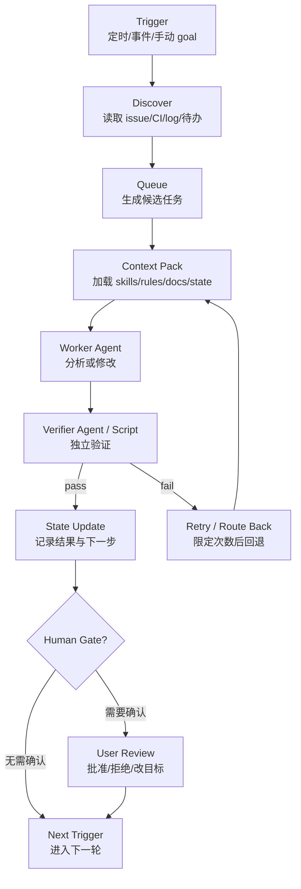

> 历史研究归档 · 2026-11-10 发布 · 程序扫描；未逐篇全文审阅。原有日期、观点、数据和命令保留历史语境，未经本次逐项事实核验或运行复现；请结合[归档说明](../../../ARCHIVE_POLICY.md)阅读。

# Loop Engineering 循环工程调研：从提示代理到设计代理自推进系统

> **一句话概括**：Loop Engineering 是 AI coding agent 进入“系统设计”阶段后的新实践：开发者不再只是一轮轮提示 Agent，而是设计一个会定期发现工作、调用 Agent、验证结果、持久化状态并决定下一步的工程循环。
>
> **研究日期**：2026-06-15  
> **范围说明**：本文讨论的是 AI coding agent 语境下的 Loop / Looping Engineering，不讨论化工领域的 chemical looping 或控制工程中的传统 loop tuning。  
> **增量边界**：在已有 R134（原稿交叉引用，本归档未解析） Harness Engineering（单次执行环境）和 R124（原稿交叉引用，本归档未解析）-R127（原稿交叉引用，本归档未解析） AI 辅助开发飞轮（人机协作元循环）基础上，本文补充“自动化多轮 Agent 工作系统”的架构、风险和落地建议。

---

## TL;DR 速查卡

**结论：Loop Engineering 是 Harness Engineering 的上层控制循环，核心价值在“可持续推进”，核心风险在“无人看管地持续犯错”。**

| 维度 | 结论 |
|------|------|
| 是什么 | 设计一个外部循环：触发器 → 任务发现 → Agent 执行 → 独立验证 → 状态更新 → 下一轮 |
| 不是什么 | 不是单条 prompt 技巧，不是单个 Agent 框架，也不是放任 Agent 自动改生产环境 |
| 和 Harness 的关系 | Harness 解决“一次执行怎么可靠”；Loop 解决“多次执行怎么自推进且不失控” |
| 关键组件 | schedule / `/goal` / `/loop`、worktree、skills、connectors/MCP、subagents、state file、human gate |
| 最小可用形态 | 每日只读 triage loop：读 issue/CI/log → 写 Markdown 报告 → 人确认是否进入修复 |
| 判断标准 | 必须有明确完成条件、可复现验证命令、状态文件、失败上限、人工升级路径 |
| 最大成本 | Token 与 Review 带宽；Agent 并行越多，人的验证压力越大 |
| 推荐 | 先做“只读报告型 loop”，观察 2 周后再加写权限；不要一开始做自动 PR / 自动部署 |

---

## 一、概念定位

**结论：Loop Engineering 的杠杆点从“怎么提示 Agent”移动到“怎么让系统替你提示、验证和续跑 Agent”。**

Addy Osmani 在 2026-06-07 的《Loop Engineering》中给出的核心定义是：你不再自己充当持续提示 Agent 的人，而是设计一个系统去做这件事。文中把 loop 描述为一种“递归目标”：定义目的后，AI 持续迭代直到完成。该文同时明确提醒这是早期实践，Token 成本和失控风险需要谨慎评估。

更工程化地说，Loop Engineering 包含 6 件事：

1. **触发器**：定时、事件、手动 goal、CI 失败、issue 更新。
2. **任务发现**：读取 issue、PR、CI、日志、知识库或待办队列。
3. **上下文装配**：通过 skills、rules、docs、state file 限定 Agent 应该知道什么。
4. **执行隔离**：用 worktree / branch / sandbox 防止多 Agent 文件冲突。
5. **独立验证**： maker 和 checker 分离，验证者不能只复述执行者的自评。
6. **状态持久化**：把“做过什么、失败在哪里、下一步是什么”写到对话外。

因此它不是一个新 SDK，而是一种 **Agent 工作系统设计方法**。

---

## 二、与已有知识库的关系

**结论：本次不是从零研究；它补的是 R134 与 R124-R127 之间缺的“自动化运行层”。**

| 已有报告 | 已有结论 | 本文增量 |
|----------|----------|----------|
| R134（原稿交叉引用，本归档未解析） Harness Engineering | `.harness/`、rules、skills、wiki、changes 让单次 Agent 执行更可靠 | Loop 把 Harness 放到定时/事件/goal 循环里反复运行 |
| R124（原稿交叉引用，本归档未解析） 人机交互迭代飞轮 | 当前更像“手摇齿轮组”，缺外部验证、行为度量、迁移证据 | Loop 是自动化候选，但必须补外部信号，否则只会把“手摇”改成“自动空转” |
| R126（原稿交叉引用，本归档未解析） AI 辅助开发飞轮改进 | 返工计数器、踩坑表、规则断舍离、反思节律 | Loop 可以把这些动作变成定时检查，但不应替代人的判断 |
| R133（原稿交叉引用，本归档未解析） Superpowers | Skill 是流程规训 + 触发测试 + Review 回路 | Loop 需要 Skill 才能避免每轮重新解释项目约束 |
| R123（原稿交叉引用，本归档未解析） Eval-Optimize 飞轮 | 持续监控 → 定期体检 → 自动优化 | Loop 是把 Eval-Optimize 推向代码与项目管理场景的执行外壳 |

一句话关系：


---

## 三、外部事实核验

**结论：概念来自社区总结，但底层能力已被 Codex 与 Claude Code 官方能力部分验证；“效果一定更快”没有被严格证明。**

| 事实点 | 来源 | 结论 | 置信度 |
|--------|------|------|--------|
| “Loop Engineering”作为 AI coding agent 热词 | Addy Osmani 2026-06-07 文章 | 社区解释性文章，定义清晰但不是标准规范 | 中 |
| Codex `/goal` 能围绕可验证停止条件持续工作 | OpenAI Codex 官方文档 | 官方能力存在，适合长任务、迁移、重构、实验 | 高 |
| Codex Skills 用 `SKILL.md` 封装可复用工作流 | OpenAI 官方文档 | Skills 是 Loop 的上下文/流程载体 | 高 |
| Codex subagents 可并行执行并汇总结果 | OpenAI 官方文档 | 适合 explorer / reviewer / worker 分工，但会增加 Token | 高 |
| Claude Code `/goal` 有独立 evaluator 判断是否完成 | Anthropic 官方文档 | maker/checker 分离已进入产品层 | 高 |
| Claude Code `/loop` 可按时间间隔重复运行 prompt | Anthropic 官方文档 | 适合轮询、PR 守护、部署检查，但有 session 约束 | 高 |
| Claude hooks 可在生命周期点运行命令/HTTP/LLM/agent 检查 | Anthropic 官方文档 | 可构造质量门禁，也带本机权限风险 | 高 |
| AI 编码一定提速 | METR 2025/2026 研究 | 早期 RCT 曾显示资深开源开发者变慢；2026 更新认为测量受选择偏差影响，真实提速仍需谨慎判断 | 中 |

来源一致性判断：

- **多源一致**：Loop 需要状态、验证、隔离、子代理、持久化上下文。
- **来源分歧**：生产率提升幅度没有稳定结论；体验报告偏乐观，RCT/研究更谨慎。
- **待验证**：对个人知识库和多项目工作流，Loop 是否真正降低返工率，需要本地实验数据。

---

## 四、Loop 的标准结构

**结论：一个可用 Loop 的骨架不是“自动运行 Agent”，而是“带闸口的状态机”。**



关键不是图，而是每个节点都要有可审计产物：

| 节点 | 产物 | 失败上限 |
|------|------|----------|
| Trigger | cron / `/loop` / `/goal` / CI event 配置 | 误触发立即停用 |
| Discover | 候选任务列表，含来源链接 | 无候选则归档，不进入执行 |
| Context Pack | 被加载的规则、Skill、状态文件清单 | 找不到上下文则 stop |
| Worker | diff、分析报告或 PR 草稿 | 不允许直接部署 |
| Verifier | 测试输出、lint、review findings、风险列表 | 连续失败 N 次转人工 |
| State Update | progress.md / Linear / issue comment | 写状态失败则不继续下一轮 |
| Human Gate | 审批记录 | 高风险动作必须人工确认 |

---

## 五、组件对照

**结论：Loop Engineering 不是单工具特性，而是把多个已有能力组合成一个可运行闭环。**

| 组件 | Codex 侧 | Claude Code 侧 | 工程含义 |
|------|----------|----------------|----------|
| 目标续跑 | `/goal`，明确可验证停止条件 | `/goal`，独立小模型评估完成条件 | 长任务不靠人每轮续 prompt |
| 定时轮询 | Automations / app workflows（官方文档入口存在） | `/loop`、scheduled tasks、routines、GitHub Actions | 让 triage / CI 守护定期发生 |
| 工作隔离 | worktrees / threads / subagent workflows | `git worktree`、`--worktree`、subagent `isolation: worktree` | 并行代理不互踩文件 |
| Skills | `SKILL.md` + scripts/references/assets | Claude Skills / plugins | 项目经验外部化，降低冷启动 |
| 子代理 | `.codex/agents/*.toml`，并行 spawn 汇总 | `.claude/agents/*.md`、agent teams | maker/checker/explorer 分工 |
| Hooks | Codex hooks/rules 生态 | lifecycle hooks：PreToolUse、PostToolUse、Stop 等 | 把安全与质量门禁机械化 |
| Connectors | MCP / plugins / GitHub / Linear 等 | MCP / plugins / channels | Loop 能触达真实工具 |
| State | Markdown / issue / Linear / repo 文件 | Markdown / issue / Linear / memory | 对话外记忆是 loop 的脊柱 |

注意：上表中“能力可用”不等于“默认安全”。尤其 hooks 和 connectors 带真实系统权限，必须按最小权限配置。

---

## 六、三种落地形态

**结论：按风险从低到高分三层，个人/小团队应从只读层开始。**

| 层级 | 形态 | 示例 | 风险 | 推荐程度 |
|------|------|------|------|----------|
| L1 只读报告型 | 定时发现问题，只写报告 | 每天读 CI/issue/log，输出 triage.md | 低：误报多但不改代码 | 最高，先做 |
| L2 半自动修复型 | 生成补丁或 PR 草稿，人工合并 | CI 失败后开 worktree 尝试修复并跑测试 | 中：可能浪费 Token 和 review 时间 | 试点后做 |
| L3 自动执行型 | 自动改代码、开 PR、处理评论、可能部署 | 夜间维护分支、自动修复 flaky test | 高：错误可持续累积 | 只适合成熟门禁后做 |

推荐最小实验：

```markdown
# loop.md / 每日 triage prompt 草案

目标：只读检查当前仓库过去 24 小时的开发风险，不修改任何文件。

步骤：
1. 读取最近 commit、失败测试、open issue、TODO 标记。
2. 输出候选任务表：问题、证据、风险、建议 owner、是否需要人工确认。
3. 不创建分支，不写代码，不删除文件。
4. 将结果写入 `reports/loop-triage/YYYY-MM-DD.md`。
5. 若没有候选任务，只写一行 “no actionable finding”。
```

这个形态的好处是成本可控、误报可被人工快速校正，而且不会污染代码库。

---

## 七、成本模型

**结论：Loop 的真实成本不是“发起一次 Agent 调用”，而是 Token、Review 带宽和错误回收三项叠加。**

以下是预估，需本地实测校准：

| 成本项 | L1 只读报告型 | L2 半自动修复型 | L3 自动执行型 |
|--------|---------------|-----------------|---------------|
| 单次 Token | 20K-80K（预估） | 100K-500K（预估） | 500K+（预估） |
| 人工时间 | 每天 5-10 分钟看报告 | 每个 PR 15-60 分钟 review | 需要持续审计与事故响应 |
| 工程投入 | 0.5-1 天 | 2-5 天 | 1-3 周以上 |
| 运维复杂度 | 低 | 中 | 高 |
| 最大失败模式 | 报告噪声 | 低质 PR 淹没 reviewer | 自动化错误持续累积 |

一个粗略 ROI 公式：

```text
净收益 = 省下的发现/修复时间
       - Token 成本
       - 人工 Review 成本
       - 误报/误修复返工成本
       - 系统维护成本
```

因此判断标准不是“Loop 是否能跑”，而是“跑 2 周后，返工率、漏检率、人工查找时间是否下降”。

---

## 八、风险与防护

**结论：Loop 会放大系统设计的好坏；越自动，越需要硬门禁。**

| 风险 | 现象 | 防护 |
|------|------|------|
| Token 失控 | 定时任务空跑、大量 subagents 并发 | 每轮预算上限、无发现即归档、限制 max threads |
| 自证完成 | 写代码的 Agent 自己说完成 | maker/checker 分离；checker 只读；验证命令必须入 transcript |
| 状态污染 | progress 文件写错，下一轮沿错方向跑 | 状态 schema、追加式日志、人工可读 diff |
| 并行冲突 | 多 Agent 改同一文件 | worktree 隔离、单 owner、合并前统一 review |
| 权限越界 | hooks/connectors 执行破坏性操作 | read-only 默认、危险命令 deny list、人工审批 |
| 理解债 | Loop 产出代码，人不再理解系统 | 每周抽样代码阅读、关键改动要求设计解释 |
| 噪声淹没 | 报告太多导致用户不看 | 严格 actionable 标准；无证据不入队 |
| 指标错位 | 追 AI 代码占比或自动 PR 数 | 追缺陷率、返工率、CI 通过率、review 接受率 |

最低护栏清单：

- 每个 loop 只能有一个明确目标和一个停止条件。
- 默认只读，写权限必须单独打开。
- 写权限 loop 必须在独立 worktree。
- 每次改动必须留下 diff、测试输出和状态记录。
- 连续失败 2-3 次必须停止并升级人工。
- 任何部署、删除、force push、数据库写操作都必须人工确认。

---

## 九、对个人知识库的建议

**结论：你当前最值得做的是“知识库维护型 Loop”，不是“自动编码型 Loop”。**

理由：

1. 你的知识库已有 100+ 报告、70+ 产出物，积累速度已经超过消化速度；R124（原稿交叉引用，本归档未解析） 已把“消化率追踪”列为关键缺口。
2. 知识库维护 Loop 主要是只读分析 + Markdown 归档，风险比自动改代码低。
3. 该 Loop 能直接服务已有 R126 建议：返工计数器、踩坑速查、规则断舍离、每日微反思。

推荐路线：

| 阶段 | 目标 | 产物 | 成功标准 |
|------|------|------|----------|
| P0：只读周报 | 每周扫描新增报告、sessions、digest | `digest/YYYY-MM-DD_loop_review.md` | 人工看 5 分钟能决定下一步 |
| P1：消化率追踪 | 给 PATTERN_LIBRARY / DELIVERABLES 加使用状态 | 消化率表 | 至少识别 3 个该删/该用/该搁置条目 |
| P2：规则健康检查 | 扫 AGENTS/skills 中长期未触发规则 | 规则断舍离候选表 | 每月删除或合并 1-3 条低价值规则 |
| P3：半自动沉淀 | 对明确高价值会话生成方法卡草稿 | methodology draft | 人工确认后再入库 |

不建议一上来做：

- 自动改项目源码并提交。
- 自动同步飞书覆盖文档。
- 自动入 Milvus / PG / MinIO。
- 自动修改全局 AGENTS 或 Skill 主规则。

这些动作都属于高影响写操作，应该等只读 Loop 连续稳定后再考虑。

---

## 十、判断一个 Loop 是否合格

**结论：能跑不是合格；能停、能查、能回滚才合格。**

| 检查项 | 合格标准 |
|--------|----------|
| 目标 | 一句话可说明，且不是开放式 backlog |
| 停止条件 | 有可测信号：测试、lint、空队列、报告生成、人工确认 |
| 上下文 | 用 Skill / docs / state file 装配，不靠长 prompt 粘贴 |
| 隔离 | 写操作在 worktree 或临时分支 |
| 验证 | 独立 verifier 或脚本，不能只信 worker 自评 |
| 状态 | 每轮记录输入、输出、失败原因、下一步 |
| 预算 | 有 token/时间/轮次上限 |
| 安全 | 高危操作 deny by default |
| 人工闸口 | 合并、发布、覆盖、删除前必须人工批准 |
| 度量 | 追踪返工率、采纳率、漏检率，而非“跑了多少轮” |

---

## 十一、开放问题

**结论：Loop Engineering 仍处于早期，真正要验证的是“长期净收益”。**

1. **生产率净收益**：在你的真实工作流中，Loop 是减少查找时间，还是增加 review 噪声？
2. **消化率**：自动报告是否真的促成规则删除、知识归档、模式采纳？
3. **Verifier 可信度**：独立 Agent 审查能否发现 worker 的真实错误，还是只制造二次幻觉？
4. **任务边界**：哪些任务适合长期 loop，哪些必须保持人工手动启动？
5. **成本上限**：每周愿意为知识维护 Loop 支付多少 Token 和人工 review 时间？

---

## 来源清单

### 外部来源

- Addy Osmani, **Loop Engineering**, 2026-06-07: https://addyosmani.com/blog/loop-engineering/
- OpenAI Developers, **Follow a goal | Codex use cases**: https://developers.openai.com/codex/use-cases/follow-goals
- OpenAI Developers, **Agent Skills | Codex**: https://developers.openai.com/codex/skills
- OpenAI Developers, **Subagents | Codex**: https://developers.openai.com/codex/subagents
- Anthropic / Claude Code Docs, **Keep Claude working toward a goal**: https://code.claude.com/docs/en/goal
- Anthropic / Claude Code Docs, **Run prompts on a schedule**: https://code.claude.com/docs/en/scheduled-tasks
- Anthropic / Claude Code Docs, **Create custom subagents**: https://code.claude.com/docs/en/sub-agents
- Anthropic / Claude Code Docs, **Hooks reference**: https://code.claude.com/docs/en/hooks
- METR, **Measuring the Impact of Early-2025 AI on Experienced Open-Source Developer Productivity**, 2025-07-10: https://metr.org/blog/2025-07-10-early-2025-ai-experienced-os-dev-study/
- METR, **We are Changing our Developer Productivity Experiment Design**, 2026-02-24: https://metr.org/blog/2026-02-24-uplift-update/

### 本地知识库来源

- R123 RAG 自动评估优化框架（原稿交叉引用，本归档未解析）
- R124 人机交互迭代飞轮分析（原稿交叉引用，本归档未解析）
- R126 AI 辅助开发飞轮改进方案（原稿交叉引用，本归档未解析）
- R127 飞轮完整复盘（原稿交叉引用，本归档未解析）
- R133 Obra Superpowers（原稿交叉引用，本归档未解析）
- R134 Harness Engineering 企业 Java 落地（原稿交叉引用，本归档未解析）

