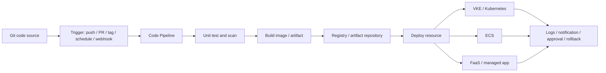

> 历史研究归档 · 2026-11-10 发布 · 程序扫描；未逐篇全文审阅。原有日期、观点、数据和命令保留历史语境，未经本次逐项事实核验或运行复现；请结合[归档说明](../../../ARCHIVE_POLICY.md)阅读。

# 火山云 CI/CD：持续交付平台调研

> **一句话**：火山云 CI/CD 这条线应重点看持续交付（Code Pipeline / CP）如何把代码变更交付到云上运行环境，并在失败时定位、分批、灰度和回滚。
> **研究日期**：2026-07-03
> **增量说明**：Vault 已有部署上线全景、Harness Engineering、Docker 踩坑与 Loop Engineering；本报告在旧三合一速查基础上，把火山云 CI/CD 独立拆开，补充产品定位、关键概念、竞品对比、实操路线、指标和风险边界。

---

## 目录

- [TL;DR 速查卡](#tldr-速查卡)
- [它是什么，不是什么](#它是什么不是什么)
- [定位透镜](#定位透镜)
- [交付链路架构](#交付链路架构)
- [关键概念地图](#关键概念地图)
- [可实操体验路径](#可实操体验路径)
- [失败演练与观测指标](#失败演练与观测指标)
- [竞品与替代方案](#竞品与替代方案)
- [企业采用检查清单](#企业采用检查清单)
- [风险边界](#风险边界)
- [来源清单](#来源清单)
- [锻造审视](#锻造审视)

---

## TL;DR 速查卡

| 维度 | 结论 |
|---|---|
| 核心对象 | 火山引擎持续交付 Code Pipeline，简称 CP |
| 解决问题 | 代码变更如何自动测试、构建、生成镜像/制品、部署到云资源，并支持失败定位和回滚 |
| 不是啥 | 不是代码托管本身；不是“大模型云能力”；不是点一下部署的小工具 |
| 主要链路 | 代码源 -> 流水线 -> 单测/扫描 -> 镜像/制品 -> 部署资源 -> 托管应用/集群 -> 通知/回滚 |
| 重点能力 | 工作区、代码源、YAML/可视化流水线、触发器、变量、缓存、并发锁、服务连接、私有资源池、资源部署、API |
| 推荐实操 | 有账号跑 CP 到 VKE/ECS/托管应用；无账号用 GitHub Actions + Docker + kind shadow 一次 |
| 评估指标 | DORA 四指标、流水线成功率、构建 p95、缓存命中率、审批等待、回滚耗时、制品追溯覆盖率 |
| 最大风险 | 权限过大、密钥泄露、镜像 tag 不可追溯、私有资源池不可用、回滚不可用、只跑通不治理 |

---

## 它是什么，不是什么

一句话结论：火山云 CI/CD 的核心是持续交付平台，而不是单点构建工具。

火山引擎持续交付（Code Pipeline / CP）是云原生应用交付平台。它用流水线把代码源、测试、构建、镜像/制品、部署、通知、审批、回滚与 API 自动化串起来，目标是让一次代码变更可以稳定、可追踪、可回收地进入云上运行环境。

| 判断 | 内容 |
|---|---|
| 是什么 | 面向云原生应用的持续交付平台，覆盖工作区、代码源、流水线、触发器、构建资源、部署资源、托管应用和 API。 |
| 是什么 | 火山云资源交付中枢之一，尤其适合把应用发布到 VKE/Kubernetes、ECS、FaaS 或托管应用。 |
| 是什么 | 企业研发治理工具：它关心权限、审批、并发、通知、日志、制品、环境和回滚。 |
| 不是什么 | 不是代码仓库或需求管理系统本身。代码托管、项目管理、测试管理可能来自外部系统。 |
| 不是什么 | 不是 AI 云能力。即使交付的是 AI 应用，CP 解决的也是软件交付和运行环境变更问题。 |
| 不是什么 | 不是“一键部署”按钮。成熟 CI/CD 的价值在长期降低变更失败率和恢复时间。 |

理解它的一个好类比：代码是原料，测试是质检，镜像/制品是半成品，VKE/ECS/FaaS 是生产线，灰度和回滚是安全阀，流水线日志和部署记录是审计台账。

---

## 定位透镜

一句话结论：火山云 CI/CD 是火山云生态承接企业应用交付的工程底座，重点看它和云资源的整合深度。

| 轴 | 判断 |
|---|---|
| 纵轴：演化脉络 | 火山引擎来自字节内部云原生基础设施外溢，持续交付承接企业应用发布需求。官方文档目录覆盖工作区、代码源、YAML 流水线、触发器、变量、缓存、通知、并发锁、服务连接、私有资源池、资源部署、托管应用、API，说明它已经超出简单 build 工具。 |
| 横轴：竞争格局 | 对标阿里云云效 Flow、腾讯 CODING、华为 CodeArts、GitHub Actions、AWS CodePipeline。火山 CP 的差异应落在与 VKE、ECS、镜像仓库、应用交付和火山云 IAM/网络/资源的整合。 |
| 交叉判断 | 如果应用主要部署在火山云，CP 是自然的交付中枢；如果诉求是全 ALM、代码托管和需求协同，云效/CODING/CodeArts 可能更完整；如果仓库在 GitHub 且面向全球/开源，GitHub Actions 更自然。 |

---

## 交付链路架构

一句话结论：CI/CD 的成熟度要沿着“从 commit 到运行时变更记录”的链路看。



| 链路节点 | 关键问题 | 需要观察的证据 |
|---|---|---|
| 代码源 | 从哪里拉代码，凭证如何管理，分支/tag 如何触发 | 代码源配置、webhook、权限范围 |
| 流水线 | 阶段、任务、步骤如何编排，是否支持 YAML/模板 | 流水线定义、模板复用、参数化 |
| 测试/扫描 | 是否在发布前强制运行单测、lint、镜像扫描、依赖扫描 | 失败阻断、报告归档 |
| 构建资源 | 谁执行构建，公共池还是私有池，网络是否能访问依赖 | 构建日志、资源池状态、缓存命中 |
| 制品 | 镜像 tag/digest 如何追溯 commit，是否禁用 `latest` | 镜像仓库记录、SBOM/签名 |
| 部署资源 | 发布到 VKE/ECS/FaaS/托管应用的方式 | 部署配置、环境变量、密钥注入 |
| 变更治理 | 是否有人工卡点、并发锁、灰度、回滚、通知 | 审批记录、部署历史、回滚演练 |
| API | 能否被内部研发平台调用 | API 权限、运行记录、自动化脚本 |

---

## 关键概念地图

一句话结论：学习火山 CP 时，要先把对象模型记住，而不是先点控制台。

| 概念 | 含义 | 实操时看什么 |
|---|---|---|
| 工作区 | 团队或项目的隔离空间 | 成员、角色、资源边界 |
| 代码源 | 连接 GitHub/GitLab/自有仓库等 | 凭证、分支、webhook、访问范围 |
| 流水线 | 串联测试、构建、部署的主对象 | 阶段、任务、步骤、变量、缓存、通知 |
| YAML 流水线 | 用代码描述流水线 | 是否可版本化、可 review、可复用 |
| 触发器 | 手动、代码源、定时、通用 Webhook、镜像源 Webhook | 触发条件是否准确，是否误发生产 |
| 构建资源池 | 执行构建任务的机器资源 | 公共池/私有池、网络、依赖、排队时间 |
| 私有资源池 | 通过 Agent 接入私有构建集群 | 不暴露集群 API Server 的情况下执行内部构建 |
| 服务连接 | 访问云资源或外部系统的凭证抽象 | 最小权限、轮转、审计 |
| 变量/密钥 | 流水线运行参数和敏感信息 | secret redaction、环境隔离 |
| 并发锁 | 控制同一资源被多个流水线同时修改 | 防止生产发布互相覆盖 |
| 部署资源 | Kubernetes、ECS、FaaS、托管应用等发布目标 | 目标环境、命名空间、权限 |
| 托管应用 | CP 管理的应用部署对象 | 版本、扩缩容、变更记录、回滚 |
| 回滚 | 失败或异常时回到成功版本 | 能否按版本/digest 回退，是否演练过 |
| API | 对流水线、运行、日志、部署资源等做自动化 | 是否能接入内部研发平台 |

---

## 可实操体验路径

一句话结论：有账号就跑真实 CP；没账号也要用 shadow pipeline 体验一次完整交付链。

### 路径 A：火山控制台真实体验

| 步骤 | 动作 | 观察点 |
|---|---|---|
| 1. 开通 CP | 完成跨服务授权，确认需要访问哪些云服务 | 授权粒度、默认权限是否过大 |
| 2. 创建工作区 | 新建项目空间，添加成员和角色 | 权限模型是否清晰 |
| 3. 创建代码源 | 接一个最小 Web 服务仓库，例如 FastAPI/Node/Vite | 凭证、webhook、分支过滤 |
| 4. 新建流水线 | 单测 -> 代码扫描 -> 镜像构建 -> 推送镜像仓库 -> 部署 | 阶段/任务/步骤抽象是否清楚 |
| 5. 配变量和缓存 | 配 image tag、环境变量、Node/Maven/Go 缓存 | 构建耗时是否下降 |
| 6. 部署到目标 | VKE/K8s YAML、ECS 或托管应用任选一种 | 服务连接、集群权限、命名空间 |
| 7. 触发发布 | push 一次小改动，观察自动运行 | 日志、制品、部署记录是否串起来 |
| 8. 故意失败 | 让测试失败、镜像 tag 错误或凭证过期 | 失败定位、通知、重跑体验 |
| 9. 回滚/分批 | 用成功版本回滚，或做一次分批发布 | 回滚粒度和耗时 |
| 10. 复盘追溯 | 记录 commit、pipeline run、image tag/digest、deploy record | 是否能从线上版本追到代码 |

推荐记录模板：

```markdown
# CP 体验记录

## 应用
## 代码源
## 触发方式
## 流水线阶段
## 制品
## 部署目标
## 失败演练
## 回滚结果
## 追溯链路
## 待验证项
```

### 路径 B：无账号 shadow pipeline

没有火山账号时，用 GitHub Actions + Docker + kind/minikube 模拟概念。

```yaml
name: shadow-cicd
on:
  push:
    branches: [main]
jobs:
  test-build-render:
    runs-on: ubuntu-latest
    steps:
      - uses: actions/checkout@v4
      - name: Test
        run: pytest -q
      - name: Build image
        run: docker build -t demo-app:${{ github.sha }} .
      - name: Render manifest
        run: sed "s/IMAGE_TAG/${{ github.sha }}/" k8s/deploy.yaml > out.yaml
      - name: Upload artifact
        uses: actions/upload-artifact@v4
        with:
          name: rendered-manifest
          path: out.yaml
```

| Shadow 对象 | 火山 CP 对应 |
|---|---|
| GitHub repo | 代码源 |
| GitHub workflow | 流水线 |
| job/step | 阶段/任务/步骤 |
| secrets/env | 变量/服务连接 |
| Docker build | 镜像构建 |
| artifact upload | 制品归档 |
| kind/minikube apply | K8s 部署资源 |
| workflow logs | 流水线运行日志 |

shadow 的重点不是 GitHub Actions 本身，而是亲手体验三件事：一次变更如何生成制品，制品如何绑定 commit，部署失败如何定位和回滚。

---

## 失败演练与观测指标

一句话结论：CI/CD 是否成熟，只有故意失败和长期指标能看出来。

### 必做失败演练

| 演练 | 注入方式 | 期待平台表现 |
|---|---|---|
| 测试失败 | 写一个 failing test | 阻断部署，日志定位到测试报告 |
| 镜像构建失败 | Dockerfile 写错依赖或路径 | 显示构建层级和错误原因 |
| 镜像拉取 401 | 使用错误 registry secret | 部署失败可定位到凭证问题 |
| K8s YAML 错误 | 写错字段或 image tag | 部署阶段失败，不污染旧版本 |
| 并发发布 | 同时触发两次生产流水线 | 并发锁或排队，避免互相覆盖 |
| 回滚演练 | 发布坏版本后回退成功版本 | 有明确版本记录和耗时 |

### 指标

| 指标 | 用法 |
|---|---|
| 部署频率 | 看交付速度，按服务/环境分开统计 |
| 变更前置时间 | 从 commit 到生产可用的时间 |
| 变更失败率 | 发布后导致回滚、热修或故障的比例 |
| 恢复时间 | 从故障发现到恢复的时间 |
| 流水线成功率 | 区分代码失败、环境失败、平台失败 |
| 排队时间 | 衡量资源池容量和并发锁影响 |
| 构建 p95 | 衡量缓存、资源池和依赖下载问题 |
| 缓存命中率 | 判断构建优化是否生效 |
| 审批等待 | 衡量流程卡点是否过重 |
| 制品追溯覆盖率 | 线上版本是否能追到 commit、镜像 digest、流水线运行 |
| 生产未审批比例 | 治理红线指标 |
| 私有资源池不可用时长 | 企业内部构建稳定性指标 |

---

## 竞品与替代方案

一句话结论：选 CI/CD 不要只看“能不能跑 pipeline”，要看它和代码平台、云资源、权限、审计、部署目标的匹配。

| 维度 | 火山 CP | 阿里云云效 Flow | 腾讯 CODING | 华为 CodeArts | GitHub Actions | AWS CodePipeline |
|---|---|---|---|---|---|---|
| 核心重心 | 火山云资源交付 | 阿里云 DevOps 协同 | 代码托管到持续部署 | 华为云软件开发生产线 | GitHub 原生 automation | AWS 原生交付 |
| 部署目标 | VKE/K8s/ECS/FaaS/托管应用 | ACK/ECS/SAE/FC 等 | CVM/TKE/SCF/K8s | CodeArts Deploy/云服务 | 任意目标，自接 runner/secrets | ECS/Lambda/EC2/CloudFormation 等 |
| 扩展性 | 自定义步骤、API、私有资源池 | 模板、插件、企业流程 | Webhook、发布单、审批 | 扩展、策略、规则 | Marketplace/custom actions | AWS service integrations |
| 治理 | 工作区、环境类别、人工卡点、并发锁、服务连接 | RAM/VPC/审计/身份源 | 权限、发布单、审批 | 权限、策略、通过条件 | environments、secrets、branch protection | IAM、approval、CloudTrail |
| 适用条件 | 应用主要落火山云 | 阿里云生态和企业协作 | 腾讯云和 CODING 体系 | 华为云工程体系 | GitHub 作为主仓库 | AWS 深绑定 |

推荐判断：如果目标应用会部署到火山云，优先理解 CP 和 VKE/ECS/镜像仓库的整合；如果只是为了学习 CI/CD 概念，GitHub Actions shadow 足够；如果要企业级全流程协作，要额外比较需求、代码、测试、制品、权限和审计全链路。

---

## 企业采用检查清单

一句话结论：企业采用 CI/CD 的关键是治理和恢复能力，不是演示时跑通一次。

| 检查项 | 合格信号 |
|---|---|
| 权限最小化 | 服务连接只给必要资源权限，生产环境单独授权 |
| 密钥治理 | secret 不进日志，支持轮转，禁止明文变量 |
| 制品追溯 | 线上版本可追到 commit、pipeline run、image digest |
| 环境隔离 | dev/staging/prod 有独立变量、权限和审批 |
| 模板复用 | 常用语言和部署目标有标准模板 |
| 失败阻断 | 单测/扫描失败不能继续生产部署 |
| 并发控制 | 同一服务同一环境不能同时发布 |
| 回滚演练 | 定期验证回滚，不只在事故时第一次用 |
| 私有资源池 | 内网依赖构建不暴露公网，Agent 稳定可观测 |
| API 自动化 | 内部研发平台可调用流水线和读取运行状态 |
| 成本观测 | 构建资源、缓存、排队和失败重试有统计 |

---

## 风险边界

一句话结论：CI/CD 的风险通常不是“没有功能”，而是权限、制品、环境和回滚没有治理。

| 风险 | 边界判断 |
|---|---|
| 权限过大 | 跨服务授权和服务连接如果默认过宽，流水线被攻破就会放大为云资源风险。 |
| 密钥泄露 | 变量、日志、脚本 echo、构建产物都可能泄露 secret，需要 redaction 和扫描。 |
| 制品不可追溯 | 只用 `latest` 或手写 tag，会导致线上版本追不到 commit。 |
| 私有资源池脆弱 | Agent 不可用、网络不通、依赖源不稳定会让交付停摆。 |
| 回滚假能力 | 控制台有回滚按钮不代表业务可回滚；数据库迁移、配置变更、消息兼容都要单独验证。 |
| 过度平台化 | 一上来做复杂模板和审批会拖慢团队；先从 1-2 条标准链路沉淀。 |
| AI 应用特殊性 | 模型版本、prompt、向量库、特征表和推理配置也应进入制品追溯，否则只追代码不够。 |

---

## 来源清单

Sources and freshness:

- [火山引擎 - 持续交付产品页](https://www.volcengine.com/product/cp) - retrieved 2026-07-03 - Code Pipeline 产品定位。
- [火山引擎文档 - 持续交付快速入门](https://www.volcengine.com/docs/6461/1248910) - retrieved 2026-07-03 - 工作区、代码源、流水线、运行、触发器、运行详情。
- [火山引擎文档 - 代码源](https://www.volcengine.com/docs/6461/79124) - retrieved 2026-07-03 - 代码源接入。
- [火山引擎文档 - YAML 流水线](https://www.volcengine.com/docs/6461/2371381) - retrieved 2026-07-03 - YAML 化流水线。
- [火山引擎文档 - 触发器](https://www.volcengine.com/docs/6461/974668) - retrieved 2026-07-03 - 手动、代码源、定时、Webhook、镜像源触发。
- [火山引擎文档 - 资源部署](https://www.volcengine.com/docs/6461/2384166) - retrieved 2026-07-03 - Kubernetes、ECS、FaaS、应用交付等部署场景。
- [火山引擎文档 - 私有资源池](https://www.volcengine.com/docs/6461/1251519) - retrieved 2026-07-03 - 私有构建资源池和 Agent 接入。
- [阿里云 - 云效 DevOps](https://www.alibabacloud.com/zh/product/devops) - retrieved 2026-07-03 - 竞品定位。
- [腾讯 CODING - 持续部署](https://coding.net/help/docs/cd/intro.html) - retrieved 2026-07-03 - 竞品定位。
- [华为云 CodeArts Pipeline 产品介绍](https://support.huaweicloud.com/intl/en-us/productdesc-pipeline/pipeline_pdtd_00001.html) - retrieved 2026-07-03 - 竞品定位。
- [GitHub Docs - Understand GitHub Actions](https://docs.github.com/en/actions/get-started/understand-github-actions) - retrieved 2026-07-03 - GitHub Actions 概念。
- [AWS Docs - CodePipeline concepts](https://docs.aws.amazon.com/codepipeline/latest/userguide/concepts.html) - retrieved 2026-07-03 - AWS CodePipeline 概念。
- [DORA - DORA metrics](https://dora.dev/guides/dora-metrics/) - retrieved 2026-07-03 - 部署频率、变更前置时间、变更失败率、恢复时间。

Consistency: 官方文档与竞品文档一致说明 CI/CD 的核心是流水线编排和部署治理；火山 CP 的差异主要来自与火山云资源的整合。待验证项主要是实际控制台体验、权限粒度和私有资源池稳定性。

---

## 锻造审视

一句话结论：本报告提炼出一套“交付链路审计表”，暂不写入 `PATTERN_LIBRARY.md`。

可复用模式：

1. 调研云厂商 CI/CD 时，不从功能清单开始，而从 commit 到 runtime 的追溯链开始。
2. 每个平台都用同一组失败演练验证：测试失败、构建失败、凭证失败、部署失败、并发发布、回滚。
3. 对 AI 应用交付，额外追踪模型版本、prompt、向量库和推理配置。

暂不入库原因：目前仅在火山云 CI/CD 案例中沉淀；等后续比较云效/CODING/CodeArts 或内部发布平台时复用，再整理成正式模式卡。

