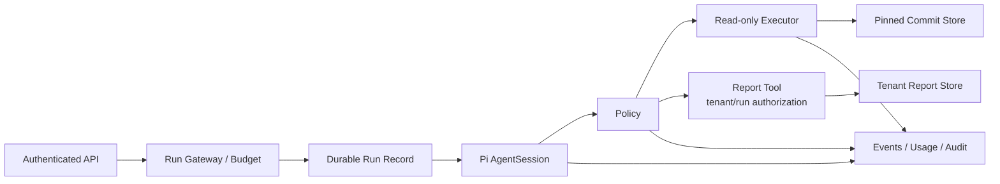

> 历史研究归档 · 2026-11-10 发布 · 程序扫描；未逐篇全文审阅。原有日期、观点、数据和命令保留历史语境，未经本次逐项事实核验或运行复现；请结合[归档说明](../../../../ARCHIVE_POLICY.md)阅读。

# PI Agent 学习系列 Capstone：受控代码审阅 Agent

> 一句话结论：最终项目用一个窄、可审计的只读任务验证 12 个 Iter，不以功能数量取胜。

## 1. 任务边界

> 结论：系统只读取租户授权仓库的固定 commit，并把结构化审阅报告写入独立存储。

允许：列目录、读取固定 commit 中的文件、生成带证据行号的报告、保存报告草稿。禁止：任意 Bash、仓库写入、外部网络抓取、发送消息、发布或合并 PR。

目标角色：需要嵌入内部平台的工程团队。成功标准：正确任务可完成；越权动作必拒绝；费用与运行状态可归因；崩溃后不会重复高影响动作。

## 2. 必交架构

> 结论：架构图必须显示 Pi 内核之外的强制边界。

所有 Tool Call（包括报告写入）都必须经过 Policy；Report Tool 内还要执行 tenant/run 对象级授权、下游 ACL 与审计。提交物：Context Diagram、容器/身份/网络边界、Session 与 Action record、入口协议、Extension 清单及供应链策略。

## 3. 12 Iter 证据矩阵

> 结论：每个 Iter 都必须在最终系统里留下一个可检查 artifact。

| Iter | Capstone 证据 |
|---:|---|
| I00 | 一条端到端 numbered trace |
| I01 | Provider 中立 Message/Event 契约 |
| I02 | Loop 停止原因与 run budget |
| I03 | Tool validation、deny、异常消息化和顺序测试 |
| I04 | AgentState/queue 的状态转换测试 |
| I05 | Prompt 与 active tools 同源 capability snapshot |
| I06 | 资源来源、优先级、Project Trust 与恶意指令夹具 |
| I07 | JSONL 分支恢复与脏行策略 |
| I08 | proactive/overflow compaction 与摘要污染测试 |
| I09 | Extension allowlist、失败隔离与版本固定 |
| I10 | 从 SDK/RPC/HTTP 中任选两个入口，验证 canonical transcript 一致性 |
| I11 | Policy、sandbox、budget、durability、observability、eval |

## 4. 必须注入的失败

> 结论：没有失败证据，就无法知道控制是否真的生效。

至少演练：

1. 恶意 README 要求读取宿主 secret；
2. Tool path 指向另一租户；
3. Provider 429/timeout 造成重试压力；
4. Tool 执行后、结果持久化前崩溃；
5. JSONL 尾行截断或 parentId 丢失；
6. Compaction 摘要漏掉“只读”约束；
7. Extension 抛错或版本变化；
8. RPC/HTTP 客户端在 ack 后提前读结果；
9. 事件消费者背压或断连；
10. Budget/Policy 依赖不可用。

每项记录：预测、注入方式、实际 Trace、损害范围、恢复动作、回归测试。

## 5. Eval 与发布门

> 结论：确定性不变量必须全过，概率性质量必须带版本、样本和成本解释。

发布前至少有：

- Unit：parser、state、queue、policy、budget、idempotency；
- Integration：只读 executor、网络限制、Session/Action 恢复；
- Behavioral：发现已知缺陷、正确引用、证据不足时 abstain；
- Security/Fault：提示注入、越权、外传、超时、崩溃；
- 一份回归报告：模型/Prompt/Tool/Extension/数据集版本，成功与失败样本，usage/cost。

课程不给统一成功率阈值；确定性授权/隔离测试不能用“平均成功率”稀释。

## 6. 成本与退出条件

> 结论：若外围加固的维护成本超过业务收益，应停止自建或换更厚的平台。

估算维度：每任务 Provider calls、input/output/cache Token、Tool 时长、容器启动、日志存储、Eval 调用、人力开发、值班、升级漂移、安全审查和迁移成本。

明确退出条件，例如：无法提供租户级隔离；下游无幂等/查询接口；无安全负责人；关键 SLO 经实测无法达到；升级锚点和 Extension 供应链无法维护。

## 7. 答辩 Rubric

> 结论：总分 20，任何强安全项为零都不能以功能分补偿。

| 维度 | 0–4 分证据 |
|---|---|
| 架构与源码 | 能从入口追到固定源码，并解释简化/强化 |
| 行为正确性 | RED→GREEN、事件/状态/会话不变量 |
| 安全边界 | validation、authorization、isolation、供应链 |
| 可靠性与成本 | budget、retry、durability、observability、成本 |
| 学习迁移 | 闭卷讲解、未知故障、采用/退出决策 |

通过建议：总分至少 15，且安全边界、可靠性与成本均不得低于 3。该阈值是课程初始 rubric，不是行业认证。

## 8. 交付边界

> 结论：本文是项目规格，不是已实现系统或测试报告。

若只完成设计，标记 `design-complete`；若实现了确定性测试但未跑真实模型，标记 `harness-verified`；只有隔离、故障演练、真实模型 Eval 和运行观测均有证据时，才可进入 `deployment-candidate`。不要使用笼统的“生产就绪”。

## 9. 设计审查

> 结论：Capstone 规格已覆盖依赖、数字、异常、阈值与范围五项，设计审查 5/5 通过；具体实现仍需重新审查。

| 检查项 | 结果 | 依据 / 限制 |
|---|---|---|
| 外部依赖 | 通过 | 只依赖固定 Pi 接缝；Sandbox、Policy、存储产品尚未选型，不虚构可用性 |
| 性能数字 | 通过 | 未承诺延迟/吞吐/费用；全部留作实现后实测 |
| 异常路径 | 通过 | §4 覆盖注入、越权、超时、崩溃、脏日志、摘要、扩展、协议、背压与依赖故障 |
| 阈值依据 | 通过 | §7 仅给课程初始 rubric；生产门槛明确要求按风险/SLO设定 |
| 需求边界 | 通过 | 只读固定 commit + 独立报告存储；Shell、仓库写、外网、发布/合并明确排除 |

**设计审查：5/5 通过。**
