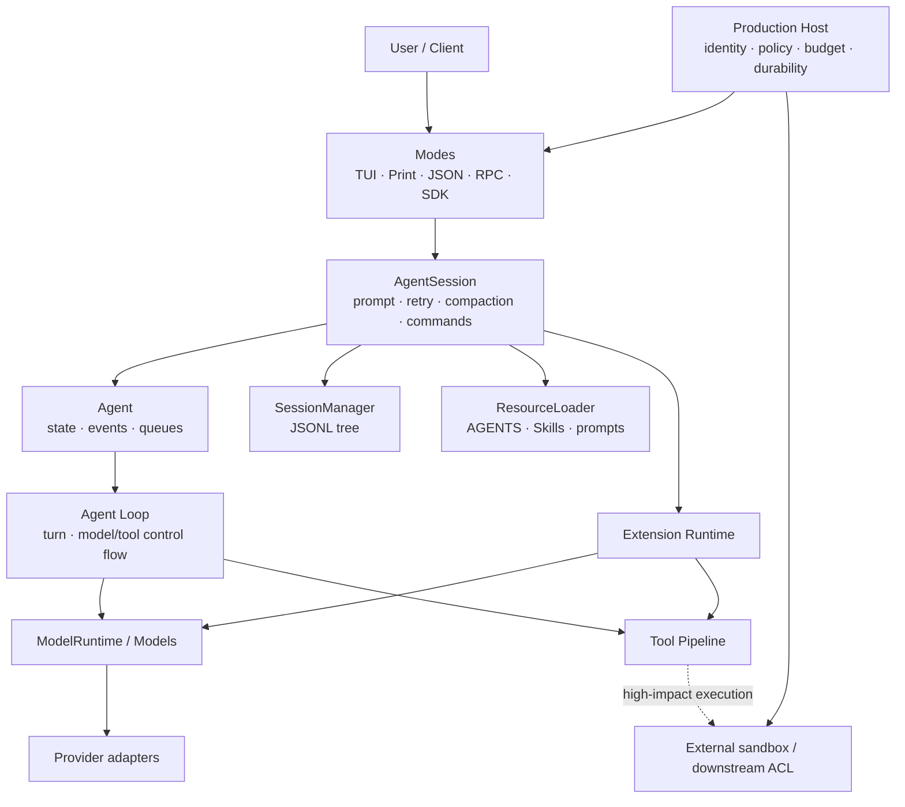

> 历史研究归档 · 2026-11-10 发布 · 发布审核状态：scan_only（发布前程序化隐私扫描）。原有日期、观点、数据和命令保留历史语境，未经本次逐项事实核验或运行复现；见[归档说明](../../../../ARCHIVE_POLICY.md)。

# PI Agent 概念地图

> 一句话结论：Pi 可理解为“入口适配、会话编排、状态化执行、无状态协议、持久化/资源/扩展、外部生产控制”六组职责，而不是一个巨型 Agent 类。

## 三条主轴

> 结论：读源码时沿“数据、控制、信任”三条轴提问，比记类名更不容易迷路。

| 轴 | 每到一层要问 |
|---|---|
| 数据 | 当前是哪种 Message？进入临时 request view 还是永久 transcript？ |
| 控制 | 谁决定继续一 Turn、结束 Run、retry 或 compact？ |
| 信任 | 参数经过什么校验？谁有权限？是否真的隔离？ |

## 七个反混淆锚点

> 结论：下面七对概念是 12 个 Iter 最常见的错误心智模型。

| 不要混为一谈 | 正确区分 |
|---|---|
| Model vs Provider | Model 是能力/元数据描述；Provider 承担鉴权与请求实现 |
| Turn vs Run | Turn 是一次 Assistant + 整批 Tool Result；Run 可含多个 Turn |
| Context view vs transcript | Provider 可只看变换后的视图；永久会话不应被请求裁剪反写 |
| validation vs sandbox | Schema 检查结构；sandbox 限制进程、文件、网络实际能力 |
| Project Trust vs sandbox | Trust 控制项目资源/Extension 装载；不限制内置 Tool 的 OS 权限 |
| Session tree vs durable action log | JSONL 保存对话因果；外部副作用仍需幂等键与 Action record |
| Adapter output vs core transcript | TUI/Text/JSON 字节可以不同；规范化 Message/Tool/stop 语义应一致 |
