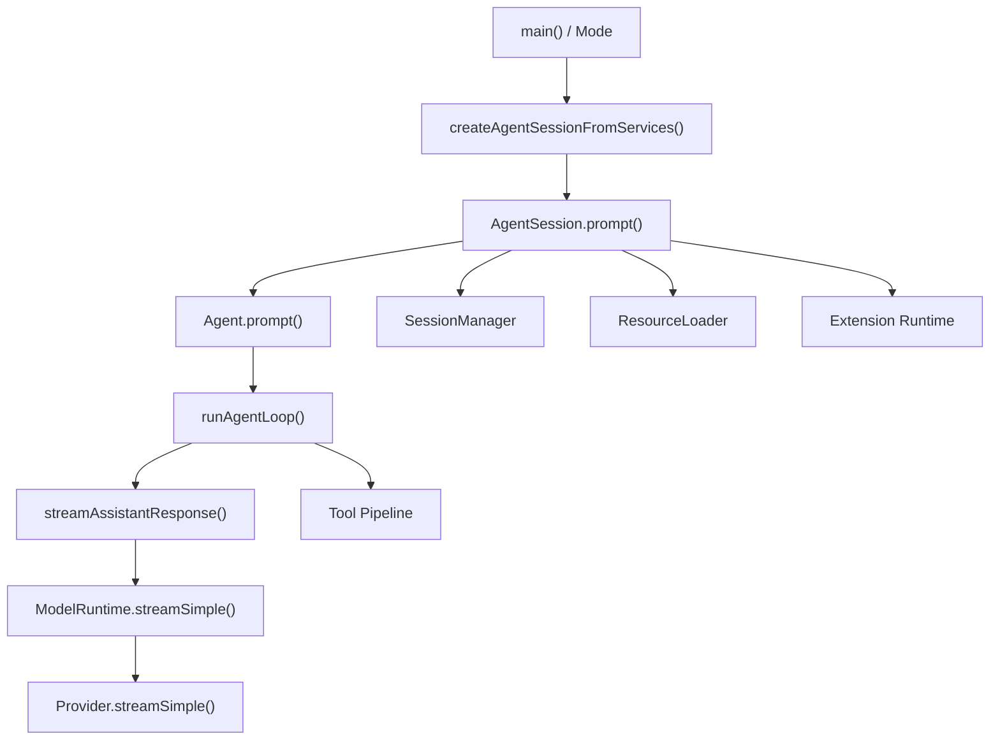
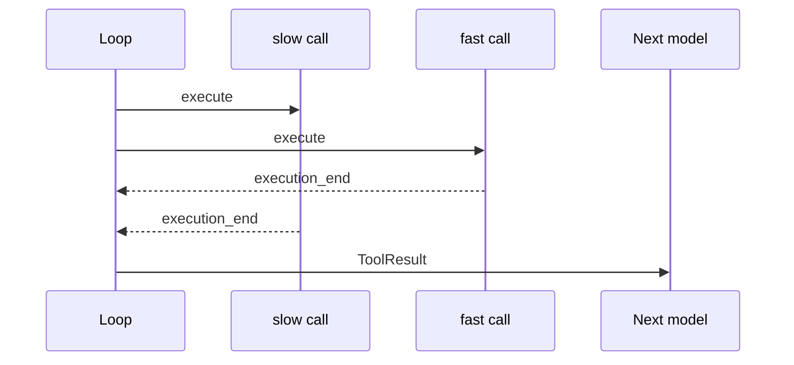

> 历史研究归档 · 2026-11-10 发布 · 程序扫描；未逐篇全文审阅。原有日期、观点、数据和命令保留历史语境，未经本次逐项事实核验或运行复现；请结合[归档说明](../../../../ARCHIVE_POLICY.md)阅读。

# PI Agent 源码地图：PI-I00–11

> 一句话结论：12 个 Iter 沿一条稳定主链展开——入口把请求交给 `AgentSession`，再由 `Agent → Agent Loop → ModelRuntime/Provider` 驱动模型与工具，同时资源、会话树、压缩与扩展从侧面参与编排。

## 0. 证据口径

> 结论：下列行号全部固定到提交 `063fb963c5c33d099faa593d17e60e0a875430cd`，源码事实与课程推断分开标注。

| 标签 | 含义 |
|---|---|
| **[源码事实]** | 可由链接中的实现或类型直接验证 |
| **[测试事实]** | 上游测试或本课程动态测试已验证 |
| **[课程简化]** | Mini Pi 为降低认知/环境成本主动省略 |
| **[课程强化]** | 本课程建议的防御性改造，不冒充上游行为 |
| **[待验证]** | 需要真实 Provider、性能或生产环境验证 |

固定链接前缀：[`earendil-works/pi@063fb963`](https://github.com/earendil-works/pi/tree/063fb963c5c33d099faa593d17e60e0a875430cd)。本地 clone 位于 `work/pi`。

## 1. 总调用链

> 结论：Mode 只适配输入输出，`AgentSession` 是会话编排中心，`Agent Loop` 才是模型—工具控制流内核。



| 层 | 只看什么 | 固定源码 |
|---|---|---|
| CLI 边界 | 文件头明确 SDK 承担核心工作 | [`main.ts` L1–6](https://github.com/earendil-works/pi/blob/063fb963c5c33d099faa593d17e60e0a875430cd/packages/coding-agent/src/main.ts#L1-L6) |
| Runtime 组装 | cwd-bound services、Session、Runtime 如何汇合 | [`main.ts` L769–800](https://github.com/earendil-works/pi/blob/063fb963c5c33d099faa593d17e60e0a875430cd/packages/coding-agent/src/main.ts#L769-L800) |
| 多入口分流 | RPC、Interactive、Print/JSON 共享 Session | [`main.ts` L868–915](https://github.com/earendil-works/pi/blob/063fb963c5c33d099faa593d17e60e0a875430cd/packages/coding-agent/src/main.ts#L868-L915) |
| SDK 装配 | 模型、配置、资源、会话恢复 | [`sdk.ts` L169–243](https://github.com/earendil-works/pi/blob/063fb963c5c33d099faa593d17e60e0a875430cd/packages/coding-agent/src/core/sdk.ts#L169-L243) |
| Agent 构造 | 默认工具、消息转换、streamFn、hooks | [`sdk.ts` L245–360](https://github.com/earendil-works/pi/blob/063fb963c5c33d099faa593d17e60e0a875430cd/packages/coding-agent/src/core/sdk.ts#L245-L360) |
| Session 构造 | Agent、SessionManager、ResourceLoader、Runtime 汇合 | [`sdk.ts` L376–390](https://github.com/earendil-works/pi/blob/063fb963c5c33d099faa593d17e60e0a875430cd/packages/coding-agent/src/core/sdk.ts#L376-L390) |
| Prompt 入口 | 命令、Skill、鉴权、预压缩、消息构造 | [`agent-session.ts` L1114–1265](https://github.com/earendil-works/pi/blob/063fb963c5c33d099faa593d17e60e0a875430cd/packages/coding-agent/src/core/agent-session.ts#L1114-L1265) |
| Agent → Loop | 状态化包装和 Loop 调用 | [`agent.ts` L337–469](https://github.com/earendil-works/pi/blob/063fb963c5c33d099faa593d17e60e0a875430cd/packages/agent/src/agent.ts#L337-L469) |
| 控制流 | 两层循环、模型、工具、队列 | [`agent-loop.ts` L155–275](https://github.com/earendil-works/pi/blob/063fb963c5c33d099faa593d17e60e0a875430cd/packages/agent/src/agent-loop.ts#L155-L275) |
| 模型边界 | AgentMessage → Message → Provider stream | [`agent-loop.ts` L281–372](https://github.com/earendil-works/pi/blob/063fb963c5c33d099faa593d17e60e0a875430cd/packages/agent/src/agent-loop.ts#L281-L372) |
| 持久化 | `message_end` 后追加 Session entry | [`agent-session.ts` L594–666](https://github.com/earendil-works/pi/blob/063fb963c5c33d099faa593d17e60e0a875430cd/packages/coding-agent/src/core/agent-session.ts#L594-L666) |

**[源码事实]** 一个 `session.prompt()` 不等于一次模型请求：Tool Call 可在一个 Agent Run 中触发多次 Provider 请求；Run 之后 Session 还可能因 retry/compaction 调用 `agent.continue()`。

## 2. PI-I00 · Whole Game 断点

> 结论：第一遍只跟踪“输入经过谁、事件由谁发、状态在哪里落地”，不要展开每个类型。

| 观察点 | 固定源码 | 进去只看什么 |
|---|---|---|
| Print 入口 | [`print-mode.ts` L103–143](https://github.com/earendil-works/pi/blob/063fb963c5c33d099faa593d17e60e0a875430cd/packages/coding-agent/src/modes/print-mode.ts#L103-L143) | 调用 `session.prompt()`，结束后从 Session state 读输出 |
| Interactive 入口 | [`interactive-mode.ts` L889–919](https://github.com/earendil-works/pi/blob/063fb963c5c33d099faa593d17e60e0a875430cd/packages/coding-agent/src/modes/interactive/interactive-mode.ts#L889-L919) | TUI 也进入同一 Session |
| RPC 入口 | [`rpc-mode.ts` L393–414](https://github.com/earendil-works/pi/blob/063fb963c5c33d099faa593d17e60e0a875430cd/packages/coding-agent/src/modes/rpc/rpc-mode.ts#L393-L414) | 协议适配，不复制 Agent 内核 |
| Session → Agent | [`agent-session.ts` L1061–1072](https://github.com/earendil-works/pi/blob/063fb963c5c33d099faa593d17e60e0a875430cd/packages/coding-agent/src/core/agent-session.ts#L1061-L1072) | 首次 prompt 后还有 retry/compaction 可能 |
| Loop 公共入口 | [`agent-loop.ts` L95–143](https://github.com/earendil-works/pi/blob/063fb963c5c33d099faa593d17e60e0a875430cd/packages/agent/src/agent-loop.ts#L95-L143) | `agent_start → turn_start → prompt events → runLoop` |
| Model Runtime | [`model-runtime.ts` L440–502](https://github.com/earendil-works/pi/blob/063fb963c5c33d099faa593d17e60e0a875430cd/packages/coding-agent/src/core/model-runtime.ts#L440-L502) | 鉴权、请求参数合并、Provider 分派 |

**[课程简化]** Mini Pi Whole Game 从 `runAgentLoop()` 开始，没有真实 CLI、Session 持久化和 ModelRuntime；它只保留模型→工具→模型的可观察 Trace。

## 3. PI-I01 · `pi-ai` 统一协议

> 结论：`pi-ai` 的关键价值是把 Provider 差异压到稳定的 Model/Context/Message/Event 契约之后。

| 概念 | 固定源码 | 进去只看什么 |
|---|---|---|
| StreamFunction | [`types.ts` L297–315](https://github.com/earendil-works/pi/blob/063fb963c5c33d099faa593d17e60e0a875430cd/packages/ai/src/types.ts#L297-L315) | 模型请求函数的稳定签名 |
| Content / ToolCall | [`types.ts` L323–357](https://github.com/earendil-works/pi/blob/063fb963c5c33d099faa593d17e60e0a875430cd/packages/ai/src/types.ts#L323-L357) | text、thinking、image、toolCall 的区分 |
| Usage / StopReason | [`types.ts` L359–403](https://github.com/earendil-works/pi/blob/063fb963c5c33d099faa593d17e60e0a875430cd/packages/ai/src/types.ts#L359-L403) | `pending/stop/length/toolUse/error/aborted` |
| 三种 Message role | [`types.ts` L384–423](https://github.com/earendil-works/pi/blob/063fb963c5c33d099faa593d17e60e0a875430cd/packages/ai/src/types.ts#L384-L423) | user、assistant、toolResult |
| Tool / Context | [`types.ts` L449–481](https://github.com/earendil-works/pi/blob/063fb963c5c33d099faa593d17e60e0a875430cd/packages/ai/src/types.ts#L449-L481) | 一次请求可见的消息和工具 |
| 流事件文法 | [`types.ts` L483–503](https://github.com/earendil-works/pi/blob/063fb963c5c33d099faa593d17e60e0a875430cd/packages/ai/src/types.ts#L483-L503) | start、各 block 增量、done/error |
| Provider 注册/分派 | [`models.ts` L66–202](https://github.com/earendil-works/pi/blob/063fb963c5c33d099faa593d17e60e0a875430cd/packages/ai/src/models.ts#L66-L202) | Provider 与 Models registry 的职责 |
| 鉴权合并 | [`models.ts` L455–525](https://github.com/earendil-works/pi/blob/063fb963c5c33d099faa593d17e60e0a875430cd/packages/ai/src/models.ts#L455-L525) | resolver 与显式参数优先级 |
| EventStream | [`event-stream.ts` L4–88](https://github.com/earendil-works/pi/blob/063fb963c5c33d099faa593d17e60e0a875430cd/packages/ai/src/utils/event-stream.ts#L4-L88) | terminal event 与 `result()` |
| 异步错误流 | [`lazy.ts` L31–61](https://github.com/earendil-works/pi/blob/063fb963c5c33d099faa593d17e60e0a875430cd/packages/ai/src/api/lazy.ts#L31-L61) | setup/auth 错误如何转 terminal error |

**[源码事实]** `Model` 是数据描述，`Provider` 才拥有鉴权与流实现；`provider`（服务归属）和 `api`（传输协议）是不同维度。ToolResult 不是旁路日志，而是正式 Message。

**[边界]** 固定提交之后的 `2c30412` 为某些没有 `finish_reason` 的 OpenAI-compatible stream 增加推断兼容字段；这不改变课程固定提交的事件断点，但升级 PI-I01 时应补一项 compatibility 练习。

## 4. PI-I02 · Agent Loop

> 结论：Core Loop 是“内层 Tool/Steering + 外层 Follow-up”，Mini Pi 先只复现 Tool 驱动的内层骨架。

| 机制 | 固定源码 | 证据 |
|---|---|---|
| 两层循环 | [`agent-loop.ts` L155–275](https://github.com/earendil-works/pi/blob/063fb963c5c33d099faa593d17e60e0a875430cd/packages/agent/src/agent-loop.ts#L155-L275) | **[源码事实]** 外层等 Agent 本来停止再拉 Follow-up；内层处理工具/Steering |
| 请求视图 | [`agent-loop.ts` L281–302](https://github.com/earendil-works/pi/blob/063fb963c5c33d099faa593d17e60e0a875430cd/packages/agent/src/agent-loop.ts#L281-L302) | transform 先于 convert，且不反写永久 transcript |
| Streaming commit | [`agent-loop.ts` L314–372](https://github.com/earendil-works/pi/blob/063fb963c5c33d099faa593d17e60e0a875430cd/packages/agent/src/agent-loop.ts#L314-L372) | partial 先占位，terminal 后替换最终消息 |
| 事件类型 | [`types.ts` L415–437](https://github.com/earendil-works/pi/blob/063fb963c5c33d099faa593d17e60e0a875430cd/packages/agent/src/types.ts#L415-L437) | Agent/Turn/Message/Tool 四组生命周期 |
| 无工具事件测试 | [`agent-loop.test.ts` L118–164](https://github.com/earendil-works/pi/blob/063fb963c5c33d099faa593d17e60e0a875430cd/packages/agent/test/agent-loop.test.ts#L118-L164) | **[测试事实]** 事件相对顺序 |
| Steering 时机 | [`agent-loop.test.ts` L681–785](https://github.com/earendil-works/pi/blob/063fb963c5c33d099faa593d17e60e0a875430cd/packages/agent/test/agent-loop.test.ts#L681-L785) | **[测试事实]** 整批工具完成后才注入 |

**[源码事实]** Core Loop 没有固定最大 Turn 数；Provider 永远返回 Tool Call 时可能持续运行。**[课程强化]** Mini Pi 默认 `maxTurns=8`，仅是离线实验护栏，阈值为初始值、待具体场景调优。

## 5. PI-I03 · Tool Pipeline

> 结论：Pi 的默认并发发生在串行预检之后，并同时维护“真实完成顺序”和“模型结果源顺序”。

| 阶段 / 不变量 | 固定源码 | 进去只看什么 |
|---|---|---|
| AgentTool contract | [`types.ts` L354–403](https://github.com/earendil-works/pi/blob/063fb963c5c33d099faa593d17e60e0a875430cd/packages/agent/src/types.ts#L354-L403) | execute、update、executionMode |
| 执行模式决策 | [`agent-loop.ts` L411–425](https://github.com/earendil-works/pi/blob/063fb963c5c33d099faa593d17e60e0a875430cd/packages/agent/src/agent-loop.ts#L411-L425) | 任一 sequential 令整批串行 |
| 串行管线 | [`agent-loop.ts` L433–487](https://github.com/earendil-works/pi/blob/063fb963c5c33d099faa593d17e60e0a875430cd/packages/agent/src/agent-loop.ts#L433-L487) | 每个 Call 预检→执行→消息化后再下一个 |
| 并行管线 | [`agent-loop.ts` L489–554](https://github.com/earendil-works/pi/blob/063fb963c5c33d099faa593d17e60e0a875430cd/packages/agent/src/agent-loop.ts#L489-L554) | 预检串行、执行并发、Promise.all 保持源顺序 |
| 参数准备/预检 | [`agent-loop.ts` L586–664](https://github.com/earendil-works/pi/blob/063fb963c5c33d099faa593d17e60e0a875430cd/packages/agent/src/agent-loop.ts#L586-L664) | lookup → prepareArguments → validate → before hook |
| execute/update | [`agent-loop.ts` L666–707](https://github.com/earendil-works/pi/blob/063fb963c5c33d099faa593d17e60e0a875430cd/packages/agent/src/agent-loop.ts#L666-L707) | 异常转结果、settle 后拒绝 late update |
| after hook | [`agent-loop.ts` L709–754](https://github.com/earendil-works/pi/blob/063fb963c5c33d099faa593d17e60e0a875430cd/packages/agent/src/agent-loop.ts#L709-L754) | 成功/失败结果都可被覆盖，hook throw 也消息化 |
| ToolResult | [`agent-loop.ts` L756–792](https://github.com/earendil-works/pi/blob/063fb963c5c33d099faa593d17e60e0a875430cd/packages/agent/src/agent-loop.ts#L756-L792) | 执行结果怎样变成正式 Message |
| length fail-closed | [`agent-loop.ts` L374–405](https://github.com/earendil-works/pi/blob/063fb963c5c33d099faa593d17e60e0a875430cd/packages/agent/src/agent-loop.ts#L374-L405) | 截断消息中的所有 Tool Call 都拒绝执行 |
| 双顺序测试 | [`agent-loop.test.ts` L586–679](https://github.com/earendil-works/pi/blob/063fb963c5c33d099faa593d17e60e0a875430cd/packages/agent/test/agent-loop.test.ts#L586-L679) | end 按完成序，ToolResult 按调用序 |
| Hook 变异测试 | [`agent-loop.test.ts` L444–504](https://github.com/earendil-works/pi/blob/063fb963c5c33d099faa593d17e60e0a875430cd/packages/agent/test/agent-loop.test.ts#L444-L504) | 校验后 Hook 改类型仍进入 execute |

### 参数的四个版本

```text
原始 arguments
→ prepareArguments 后
→ Schema coercion / validation 后
→ beforeToolCall 可能原地修改后
```

**[源码事实]** Core 不对最后一步再次校验。**[课程强化]** Mini Pi 可打开 `revalidateAfterBeforeHook`，用一项额外本地校验换更明确的 Hook 信任边界；兼容性与性能影响需在真实扩展集上验证。

### 并发的双顺序



**[测试事实]** 本课程 `iter03-tool-pipeline.test.ts` 动态验证了这两套顺序，以及任一 sequential 工具令 `maxActive=1`。

## 6. PI-I04 · Agent State 与消息队列

> 结论：`Agent` 先把事件归约为当前状态，再等待异步监听器完成；Steering 与 Follow-up 是两个消费时机不同的 FIFO 队列。

| 不变量 | 固定源码 | 进去只看什么 |
|---|---|---|
| State contract | [`types.ts` L327–351](https://github.com/earendil-works/pi/blob/063fb963c5c33d099faa593d17e60e0a875430cd/packages/agent/src/types.ts#L327-L351) | streaming、message、pendingToolCalls、error 的只读投影 |
| 初始状态 | [`agent.ts` L60–93](https://github.com/earendil-works/pi/blob/063fb963c5c33d099faa593d17e60e0a875430cd/packages/agent/src/agent.ts#L60-L93) | mutable state 怎样复制 tools/messages 并初始化运行字段 |
| 两个 FIFO 的实现 | [`agent.ts` L123–157](https://github.com/earendil-works/pi/blob/063fb963c5c33d099faa593d17e60e0a875430cd/packages/agent/src/agent.ts#L123-L157) | `all` 与 `one-at-a-time` 的 drain 语义 |
| Subscribe / 公共队列 API | [`agent.ts` L233–323](https://github.com/earendil-works/pi/blob/063fb963c5c33d099faa593d17e60e0a875430cd/packages/agent/src/agent.ts#L233-L323) | subscribe/unsubscribe、steer/followUp、clear、abort、waitForIdle |
| Prompt / Continue | [`agent.ts` L336–423](https://github.com/earendil-works/pi/blob/063fb963c5c33d099faa593d17e60e0a875430cd/packages/agent/src/agent.ts#L336-L423) | 状态化外壳怎样调用公共 Loop；assistant 末尾怎样先取队列 |
| 队列接入 Loop | [`agent.ts` L434–468](https://github.com/earendil-works/pi/blob/063fb963c5c33d099faa593d17e60e0a875430cd/packages/agent/src/agent.ts#L434-L468) | Steering/Follow-up 各自的 drain callback |
| Run lifecycle | [`agent.ts` L471–520](https://github.com/earendil-works/pi/blob/063fb963c5c33d099faa593d17e60e0a875430cd/packages/agent/src/agent.ts#L471-L520) | activeRun、失败消息、finishRun 与 idle 时机 |
| Reducer + listener barrier | [`agent.ts` L522–576](https://github.com/earendil-works/pi/blob/063fb963c5c33d099faa593d17e60e0a875430cd/packages/agent/src/agent.ts#L522-L576) | 先归约 message/tool/error，再按订阅顺序 await listener |
| 两层 Loop 消费时机 | [`agent-loop.ts` L155–275](https://github.com/earendil-works/pi/blob/063fb963c5c33d099faa593d17e60e0a875430cd/packages/agent/src/agent-loop.ts#L155-L275) | 工具批次后先 Steering，Agent 本来停止后才 Follow-up |
| 异步订阅测试 | [`agent.test.ts` L190–262](https://github.com/earendil-works/pi/blob/063fb963c5c33d099faa593d17e60e0a875430cd/packages/agent/test/agent.test.ts#L190-L262) | 监听器是事件传播屏障，不只是 fire-and-forget |

**[源码事实]** Steering 不会中断已开始的 Tool；当前工具批次先完成。**[课程待实现]** I04 Mini Pi 的 reducer、listener barrier 与 queue 测试尚未编码，课程 Trace 不能记作动态通过。

## 7. PI-I05 · AgentSession 与能力编译

> 结论：`AgentSession` 是产品控制面，一次 public prompt 可能因 retry、compaction 或队列触发多次 Core Run。

| 观察点 | 固定源码 | 进去只看什么 |
|---|---|---|
| Session 事件面 | [`agent-session.ts` L140–184](https://github.com/earendil-works/pi/blob/063fb963c5c33d099faa593d17e60e0a875430cd/packages/coding-agent/src/core/agent-session.ts#L140-L184) | Agent 基础事件与 queue、entry、session-info、compaction、retry、summarization、bash 等事件怎样统一外发 |
| 构造与依赖 | [`agent-session.ts` L303–405](https://github.com/earendil-works/pi/blob/063fb963c5c33d099faa593d17e60e0a875430cd/packages/coding-agent/src/core/agent-session.ts#L303-L405) | Agent、SessionManager、Settings、ResourceLoader、ModelRuntime 汇合 |
| Agent 事件持久化 | [`agent-session.ts` L594–666](https://github.com/earendil-works/pi/blob/063fb963c5c33d099faa593d17e60e0a875430cd/packages/coding-agent/src/core/agent-session.ts#L594-L666) | `message_end` 后怎样 append Session entry |
| Prompt / Tool 同源重建 | [`agent-session.ts` L920–1055](https://github.com/earendil-works/pi/blob/063fb963c5c33d099faa593d17e60e0a875430cd/packages/coding-agent/src/core/agent-session.ts#L920-L1055) | active tools 与 system prompt 从同一能力状态刷新 |
| 私有 Run runner | [`agent-session.ts` L1061–1103](https://github.com/earendil-works/pi/blob/063fb963c5c33d099faa593d17e60e0a875430cd/packages/coding-agent/src/core/agent-session.ts#L1061-L1103) | prompt 后 retry/compaction/queue 可 `continue()` |
| Public prompt preflight | [`agent-session.ts` L1114–1265](https://github.com/earendil-works/pi/blob/063fb963c5c33d099faa593d17e60e0a875430cd/packages/coding-agent/src/core/agent-session.ts#L1114-L1265) | command、template/skill、鉴权、预压缩、队列与消息构造 |
| SDK 装配 | [`sdk.ts` L292–397](https://github.com/earendil-works/pi/blob/063fb963c5c33d099faa593d17e60e0a875430cd/packages/coding-agent/src/core/sdk.ts#L292-L397) | ModelRuntime stream、hooks、Agent 与 Session 创建 |
| System Prompt 编译 | [`system-prompt.ts` L8–100](https://github.com/earendil-works/pi/blob/063fb963c5c33d099faa593d17e60e0a875430cd/packages/coding-agent/src/core/system-prompt.ts#L8-L100) | cwd、tools、guidelines、context 怎样进入 Prompt |
| Session 替换 | [`agent-session-runtime.ts` L67–191](https://github.com/earendil-works/pi/blob/063fb963c5c33d099faa593d17e60e0a875430cd/packages/coding-agent/src/core/agent-session-runtime.ts#L67-L191) | teardown、apply、rebind 的生命周期 |

**[架构推断]** 把 Tool registry 与 Prompt 分开手工维护会产生“提示说能用、实际没注册”的 capability drift；课程建议从同一 snapshot 编译两者。**[课程待实现]** 该 compiler 尚未进入 Mini Pi。

## 8. PI-I06 · ResourceLoader 与信任边界

> 结论：资源发现、合并、信任和注入是四个不同阶段；Project Trust 门控一部分项目本地配置、包和可执行资源，但不是执行沙箱。

| 观察点 | 固定源码 | 进去只看什么 |
|---|---|---|
| Loader 契约 / 显式选项 | [`resource-loader.ts` L28–48](https://github.com/earendil-works/pi/blob/063fb963c5c33d099faa593d17e60e0a875430cd/packages/coding-agent/src/core/resource-loader.ts#L28-L48)、[`L125–159`](https://github.com/earendil-works/pi/blob/063fb963c5c33d099faa593d17e60e0a875430cd/packages/coding-agent/src/core/resource-loader.ts#L125-L159) | 公开快照、no-discovery、additional paths 与 override |
| AGENTS / CLAUDE 层级 | [`resource-loader.ts` L67–123](https://github.com/earendil-works/pi/blob/063fb963c5c33d099faa593d17e60e0a875430cd/packages/coding-agent/src/core/resource-loader.ts#L67-L123) | 单目录候选优先级与 global + root-to-cwd 合并 |
| Trust bootstrap | [`resource-loader.ts` L333–416](https://github.com/earendil-works/pi/blob/063fb963c5c33d099faa593d17e60e0a875430cd/packages/coding-agent/src/core/resource-loader.ts#L333-L416) | 预信任 Extension、Trust 决策与最终 Extension 合并 |
| 资源最终汇合 | [`resource-loader.ts` L419–491](https://github.com/earendil-works/pi/blob/063fb963c5c33d099faa593d17e60e0a875430cd/packages/coding-agent/src/core/resource-loader.ts#L419-L491) | 显式路径、Skills/Prompts/Themes/Context 与 System Prompt 收口 |
| 项目 SYSTEM Trust gate | [`resource-loader.ts` L969–994](https://github.com/earendil-works/pi/blob/063fb963c5c33d099faa593d17e60e0a875430cd/packages/coding-agent/src/core/resource-loader.ts#L969-L994) | `.pi/SYSTEM.md`、`APPEND_SYSTEM.md` 的项目门控 |
| 约定目录与 Trust 分支 | [`package-manager.ts` L2303–2466](https://github.com/earendil-works/pi/blob/063fb963c5c33d099faa593d17e60e0a875430cd/packages/coding-agent/src/core/package-manager.ts#L2303-L2466) | 四类资源的 user/project 自动发现，不把它误叫成 npm/git 解析 |
| Trust 判定 | [`project-trust.ts` L46–95](https://github.com/earendil-works/pi/blob/063fb963c5c33d099faa593d17e60e0a875430cd/packages/coding-agent/src/core/project-trust.ts#L46-L95) | override、Extension、store、默认行为与无 UI fail-closed |
| Extension 动态追加资源 | [`agent-session.ts` L2254–2276](https://github.com/earendil-works/pi/blob/063fb963c5c33d099faa593d17e60e0a875430cd/packages/coding-agent/src/core/agent-session.ts#L2254-L2276) | discover 后加入 skill/prompt/theme 并重建 Prompt |
| Tools / Prompt 同源 | [`agent-session.ts` L2455–2545](https://github.com/earendil-works/pi/blob/063fb963c5c33d099faa593d17e60e0a875430cd/packages/coding-agent/src/core/agent-session.ts#L2455-L2545)、[`L1021–1055`](https://github.com/earendil-works/pi/blob/063fb963c5c33d099faa593d17e60e0a875430cd/packages/coding-agent/src/core/agent-session.ts#L1021-L1055) | 刷新 Tool registry，再从 active tool snapshot 重建 System Prompt |
| Prompt 消费 Context/Tools | [`system-prompt.ts` L43–159](https://github.com/earendil-works/pi/blob/063fb963c5c33d099faa593d17e60e0a875430cd/packages/coding-agent/src/core/system-prompt.ts#L43-L159) | 已加载资源最终是否真的进入模型请求 |

**[源码事实]** explicit CLI flags 与 auto-discovery 要分开推理；同目录候选文件也不是全部无条件拼接。项目 AGENTS/CLAUDE Context、全局资源和显式 CLI 资源不应被笼统描述成“未 Trust 就都不加载”。**[安全边界]** Trust 决定项目动态资源装配，不代表内置 Read/Bash 被限制在 cwd。

## 9. PI-I07 · JSONL Session Tree 与恢复

> 结论：正常 Entry API 以 append-only 树记录历史；恢复选择一条 active branch 重建上下文，不会重放已经发生的 Tool 副作用。

| 观察点 | 固定源码 | 进去只看什么 |
|---|---|---|
| Header / Entry 类型 | [`session-manager.ts` L30–156](https://github.com/earendil-works/pi/blob/063fb963c5c33d099faa593d17e60e0a875430cd/packages/coding-agent/src/core/session-manager.ts#L30-L156) | `id`、`parentId`、message/compaction/model 等 entry |
| 版本迁移 | [`session-manager.ts` L230–314](https://github.com/earendil-works/pi/blob/063fb963c5c33d099faa593d17e60e0a875430cd/packages/coding-agent/src/core/session-manager.ts#L230-L314) | v1→v2→v3 与未来版本处理；迁移可 rewrite 文件 |
| Path / Context 算法 | [`session-manager.ts` L334–470](https://github.com/earendil-works/pi/blob/063fb963c5c33d099faa593d17e60e0a875430cd/packages/coding-agent/src/core/session-manager.ts#L334-L470) | leaf-to-root、Entry→Message、latest Compaction + recent tail |
| 文件读取与 Header 校验 | [`session-manager.ts` L503–555](https://github.com/earendil-works/pi/blob/063fb963c5c33d099faa593d17e60e0a875430cd/packages/coding-agent/src/core/session-manager.ts#L503-L555) | 逐行跳过任意 malformed line 后继续；第一个成功解析的 entry 必须是合法 Header |
| Open / migration rewrite | [`session-manager.ts` L844–927](https://github.com/earendil-works/pi/blob/063fb963c5c33d099faa593d17e60e0a875430cd/packages/coding-agent/src/core/session-manager.ts#L844-L927) | 类的 append-only 正常语义，以及 open/migration 的例外 |
| Leaf 恢复与 append 落盘 | [`session-manager.ts` L930–1049](https://github.com/earendil-works/pi/blob/063fb963c5c33d099faa593d17e60e0a875430cd/packages/coding-agent/src/core/session-manager.ts#L930-L1049) | Header 创建、last-entry leaf、索引、持久化与 `_appendEntry` |
| 专用 append methods | [`session-manager.ts` L1051–1118](https://github.com/earendil-works/pi/blob/063fb963c5c33d099faa593d17e60e0a875430cd/packages/coding-agent/src/core/session-manager.ts#L1051-L1118) | 消息、模型、thinking 等事实怎样进入日志 |
| 公共 Branch / Context API | [`session-manager.ts` L1255–1348](https://github.com/earendil-works/pi/blob/063fb963c5c33d099faa593d17e60e0a875430cd/packages/coding-agent/src/core/session-manager.ts#L1255-L1348) | active branch、context、orphan tree 与 append-only API |
| Branch / 派生 Session 文件 | [`session-manager.ts` L1354–1490](https://github.com/earendil-works/pi/blob/063fb963c5c33d099faa593d17e60e0a875430cd/packages/coding-agent/src/core/session-manager.ts#L1354-L1490) | 同文件 branch summary 与活动路径复制成新文件 |
| Runtime fork | [`agent-session-runtime.ts` L259–348](https://github.com/earendil-works/pi/blob/063fb963c5c33d099faa593d17e60e0a875430cd/packages/coding-agent/src/core/agent-session-runtime.ts#L259-L348) | 选 before/at、创建目标 Session、teardown/rebind |
| `/clone` 入口 | [`interactive-mode.ts` L4614–4630](https://github.com/earendil-works/pi/blob/063fb963c5c33d099faa593d17e60e0a875430cd/packages/coding-agent/src/modes/interactive/interactive-mode.ts#L4614-L4630) | 复用 fork(position=at)，不是 SessionManager 表格范围里的隐含动作 |
| `message_end` 持久化 | [`agent-session.ts` L624–665](https://github.com/earendil-works/pi/blob/063fb963c5c33d099faa593d17e60e0a875430cd/packages/coding-agent/src/core/agent-session.ts#L624-L665) | 运行时消息与 append-only entry 的接缝 |

**[源码事实]** load/resume 是用日志重建 Agent context，不是再次执行旧工具。Append-only 是正常 Entry mutation API 的不变量；版本迁移可 `_rewriteFile()`，fork/clone 也会创建并写入派生 Session 文件。**[反混淆]** Compaction entry 是模型上下文摘要边界，也不是跨任务长期语义记忆库。

## 10. PI-I08 · Compaction、Overflow 与 Retry

> 结论：Compaction 用有损摘要换可继续上下文；proactive threshold 与 overflow recovery 的触发、重试和失败语义不能混成一条路径。

| 观察点 | 固定源码 | 进去只看什么 |
|---|---|---|
| 默认预算与触发式 | [`compaction.ts` L126–238](https://github.com/earendil-works/pi/blob/063fb963c5c33d099faa593d17e60e0a875430cd/packages/coding-agent/src/core/compaction/compaction.ts#L126-L238) | reserve、keepRecent、usage 估算与严格 `>` |
| 合法 cut point | [`compaction.ts` L308–460](https://github.com/earendil-works/pi/blob/063fb963c5c33d099faa593d17e60e0a875430cd/packages/coding-agent/src/core/compaction/compaction.ts#L308-L460) | 不从 Tool Result 开始 recent tail，怎样向后累计预算 |
| 摘要请求 | [`compaction.ts` L622–685](https://github.com/earendil-works/pi/blob/063fb963c5c33d099faa593d17e60e0a875430cd/packages/coding-agent/src/core/compaction/compaction.ts#L622-L685) | previous summary、输出预算与 summarizer error |
| 多次压缩 / split turn | [`compaction.ts` L710–918](https://github.com/earendil-works/pi/blob/063fb963c5c33d099faa593d17e60e0a875430cd/packages/coding-agent/src/core/compaction/compaction.ts#L710-L918) | 已有摘要怎样再次被纳入；切 Turn 的两段摘要 |
| Session 触发与恢复 | [`agent-session.ts` L1943–2214](https://github.com/earendil-works/pi/blob/063fb963c5c33d099faa593d17e60e0a875430cd/packages/coding-agent/src/core/agent-session.ts#L1943-L2214) | threshold 不自动重答；overflow 失败可 compact-and-retry 一次 |
| 普通 Retry 分离 | [`agent-session.ts` L2630–2725](https://github.com/earendil-works/pi/blob/063fb963c5c33d099faa593d17e60e0a875430cd/packages/coding-agent/src/core/agent-session.ts#L2630-L2725) | context overflow 为什么不走普通 transient retry |
| Context 投影 | [`session-manager.ts` L410–469](https://github.com/earendil-works/pi/blob/063fb963c5c33d099faa593d17e60e0a875430cd/packages/coding-agent/src/core/session-manager.ts#L410-L469) | 最新摘要 + recent tail 怎样成为模型输入 |
| Append-only 边界 | [`session-manager.ts` L1015–1048](https://github.com/earendil-works/pi/blob/063fb963c5c33d099faa593d17e60e0a875430cd/packages/coding-agent/src/core/session-manager.ts#L1015-L1048) | 追加 Compaction entry，不删除完整 JSONL 历史 |
| Branch Summary | [`branch-summarization.ts` L108–375](https://github.com/earendil-works/pi/blob/063fb963c5c33d099faa593d17e60e0a875430cd/packages/coding-agent/src/core/compaction/branch-summarization.ts#L108-L375) | 分支切换摘要与常规 Compaction 是相邻但不同的机制 |

**[源码事实]** 摘要是有损的，完整 JSONL 仍在磁盘；模型后续默认只看到摘要投影和 recent tail。**[课程待验证]** 摘要质量、Token 节省与阈值是否适合具体任务，必须用真实长会话 Eval。

## 11. PI-I09 · Extension Runtime

> 结论：Extension 是同进程高权限代码，通过 registry 与 ordered hook chain 改变 Tool、Provider、Prompt、UI 和 Session；可扩展不等于已隔离。

| 观察点 | 固定源码 | 进去只看什么 |
|---|---|---|
| Trust 两阶段加载 | [`resource-loader.ts` L333–417](https://github.com/earendil-works/pi/blob/063fb963c5c33d099faa593d17e60e0a875430cd/packages/coding-agent/src/core/resource-loader.ts#L333-L417) | 未信任项目前后分别允许哪些资源 |
| 发现规则 | [`loader.ts` L586–720](https://github.com/earendil-works/pi/blob/063fb963c5c33d099faa593d17e60e0a875430cd/packages/coding-agent/src/core/extensions/loader.ts#L586-L720) | `.ts/.js`、目录 index 与 package manifest |
| import / factory / load error | [`loader.ts` L398–540](https://github.com/earendil-works/pi/blob/063fb963c5c33d099faa593d17e60e0a875430cd/packages/coding-agent/src/core/extensions/loader.ts#L398-L540) | Jiti 执行模块、等待 async factory、单扩展错误收集 |
| Extension API registry | [`loader.ts` L226–390](https://github.com/earendil-works/pi/blob/063fb963c5c33d099faa593d17e60e0a875430cd/packages/coding-agent/src/core/extensions/loader.ts#L226-L390) | handlers、tools、commands、providers 如何登记 |
| Runner 绑定 | [`runner.ts` L267–410](https://github.com/earendil-works/pi/blob/063fb963c5c33d099faa593d17e60e0a875430cd/packages/coding-agent/src/core/extensions/runner.ts#L267-L410) | Core/Provider/Host 动作怎样注入 Runtime |
| Error 与变换链 | [`runner.ts` L796–1074](https://github.com/earendil-works/pi/blob/063fb963c5c33d099faa593d17e60e0a875430cd/packages/coding-agent/src/core/extensions/runner.ts#L796-L1074) | 普通 handler、tool_call、tool_result、context/provider middleware 的不同错误策略 |
| Input / before start | [`runner.ts` L1076–1225](https://github.com/earendil-works/pi/blob/063fb963c5c33d099faa593d17e60e0a875430cd/packages/coding-agent/src/core/extensions/runner.ts#L1076-L1225) | ordered chain 怎样逐步修改输入与 Prompt |
| UI / Tool / Provider 类型面 | [`types.ts` L1033–1420](https://github.com/earendil-works/pi/blob/063fb963c5c33d099faa593d17e60e0a875430cd/packages/coding-agent/src/core/extensions/types.ts#L1033-L1420) | Extension 的真实能力面远大于一个 callback |
| Session 安装 Tool hook | [`agent-session.ts` L460–517](https://github.com/earendil-works/pi/blob/063fb963c5c33d099faa593d17e60e0a875430cd/packages/coding-agent/src/core/agent-session.ts#L460-L517) | Extension tool_call 怎样进入 Core Tool pipeline |
| Reload 生命周期 | [`agent-session.ts` L2602–2625](https://github.com/earendil-works/pi/blob/063fb963c5c33d099faa593d17e60e0a875430cd/packages/coding-agent/src/core/agent-session.ts#L2602-L2625) | shutdown、reload、重建 Runner、再发 start/discover |

**[安全边界]** Project Trust 能降低项目静默加载本地动态代码的风险；已加载 Extension 仍与 Pi 共享进程、用户、文件和凭据权限。权限门可以用 Extension 实现 UX 与策略接入，但强隔离仍应在 OS/Container/下游 ACL。

## 12. PI-I10 · TUI、Print/JSON、RPC 与 SDK

> 结论：所有入口共享 `AgentSession` 行为，差异留在输入协议、事件呈现和生命周期；等价的是规范化 transcript，不是输出字节。

| 观察点 | 固定源码 | 进去只看什么 |
|---|---|---|
| 总模式分流 | [`main.ts` L868–915](https://github.com/earendil-works/pi/blob/063fb963c5c33d099faa593d17e60e0a875430cd/packages/coding-agent/src/main.ts#L868-L915) | Session 组装完成后才选择 Adapter |
| Core 首轮事件 | [`agent-loop.ts` L95–117](https://github.com/earendil-works/pi/blob/063fb963c5c33d099faa593d17e60e0a875430cd/packages/agent/src/agent-loop.ts#L95-L117) | `agent_start → turn_start → user message_start/end` |
| Print / JSON | [`print-mode.ts` L103–157](https://github.com/earendil-works/pi/blob/063fb963c5c33d099faa593d17e60e0a875430cd/packages/coding-agent/src/modes/print-mode.ts#L103-L157) | JSON 订阅全事件；Print 只投影最终文本与退出码 |
| TUI 输入 | [`interactive-mode.ts` L889–919](https://github.com/earendil-works/pi/blob/063fb963c5c33d099faa593d17e60e0a875430cd/packages/coding-agent/src/modes/interactive/interactive-mode.ts#L889-L919) | 交互循环也落到 `session.prompt()` |
| TUI 事件消费 | [`interactive-mode.ts` L2843–2885](https://github.com/earendil-works/pi/blob/063fb963c5c33d099faa593d17e60e0a875430cd/packages/coding-agent/src/modes/interactive/interactive-mode.ts#L2843-L2885) | UI 是事件 Presenter，不拥有第二套 Loop |
| RPC ack | [`rpc-mode.ts` L393–429](https://github.com/earendil-works/pi/blob/063fb963c5c33d099faa593d17e60e0a875430cd/packages/coding-agent/src/modes/rpc/rpc-mode.ts#L393-L429) | success 确认 preflight 接受；完成走异步事件 |
| 严格 JSONL | [`jsonl.ts` L4–57](https://github.com/earendil-works/pi/blob/063fb963c5c33d099faa593d17e60e0a875430cd/packages/coding-agent/src/modes/rpc/jsonl.ts#L4-L57) | 只按 LF 分帧；U+2028/U+2029 可在 JSON 字符串内 |
| SDK 入口 | [`sdk.ts` L135–184](https://github.com/earendil-works/pi/blob/063fb963c5c33d099faa593d17e60e0a875430cd/packages/coding-agent/src/core/sdk.ts#L135-L184) | 进程内宿主怎样注入 Model、Loader 与 SessionManager |
| Runtime rebind | [`agent-session-runtime.ts` L170–220](https://github.com/earendil-works/pi/blob/063fb963c5c33d099faa593d17e60e0a875430cd/packages/coding-agent/src/core/agent-session-runtime.ts#L170-L220) | Session 替换后旧对象 teardown、新对象 rebind |

**[架构不变量]** 新增 HTTP/WebSocket 入口时只能依赖 Session port 和事件流，不应导入或复制 `runAgentLoop()`。**[边界]** RPC 子进程提供故障边界，但同用户、同挂载、同网络仍不是权限沙箱。

## 13. PI-I11 · 生产加固与 Eval

> 结论：Pi 暴露了足够的加固接缝，却没有默认提供多租户 Policy、强 Sandbox、Durable Workflow 或统一 Run Budget。

| 观察点 | 固定源码 | 事实与边界 |
|---|---|---|
| Project Trust | [`project-trust.ts` L24–95](https://github.com/earendil-works/pi/blob/063fb963c5c33d099faa593d17e60e0a875430cd/packages/coding-agent/src/core/project-trust.ts#L24-L95) | 控制项目资源装载，不改变 OS 权限 |
| Path resolution | [`path-utils.ts` L40–117](https://github.com/earendil-works/pi/blob/063fb963c5c33d099faa593d17e60e0a875430cd/packages/coding-agent/src/core/tools/path-utils.ts#L40-L117) | 支持绝对路径；这里没有 cwd containment |
| Bash timeout/abort | [`bash.ts` L24–145](https://github.com/earendil-works/pi/blob/063fb963c5c33d099faa593d17e60e0a875430cd/packages/coding-agent/src/core/tools/bash.ts#L24-L145) | timeout 可选；本地 shell 继承宿主环境；Abort kill process tree |
| 可替换 Executor 接缝 | [`bash.ts` L52–82](https://github.com/earendil-works/pi/blob/063fb963c5c33d099faa593d17e60e0a875430cd/packages/coding-agent/src/core/tools/bash.ts#L52-L82) | `BashOperations` 可委托远端/隔离执行，但默认不这样做 |
| Tool 输出预算 | [`truncate.ts` L1–45](https://github.com/earendil-works/pi/blob/063fb963c5c33d099faa593d17e60e0a875430cd/packages/coding-agent/src/core/tools/truncate.ts#L1-L45) | 2000 行/50KB 是 Context 输出截断，不是进程资源配额 |
| Session 后处理 | [`agent-session.ts` L1061–1102](https://github.com/earendil-works/pi/blob/063fb963c5c33d099faa593d17e60e0a875430cd/packages/coding-agent/src/core/agent-session.ts#L1061-L1102) | retry/compaction/queue 会增加 Core Run，需要总预算 |
| Overflow 恢复护栏 | [`agent-session.ts` L1943–2011](https://github.com/earendil-works/pi/blob/063fb963c5c33d099faa593d17e60e0a875430cd/packages/coding-agent/src/core/agent-session.ts#L1943-L2011) | compact-and-retry 最多一次，不等于全 Run 已有总上限 |
| Retry 配置/语义 | [`settings-manager.ts` L813–838](https://github.com/earendil-works/pi/blob/063fb963c5c33d099faa593d17e60e0a875430cd/packages/coding-agent/src/core/settings-manager.ts#L813-L838)、[`retry.ts` L91–102](https://github.com/earendil-works/pi/blob/063fb963c5c33d099faa593d17e60e0a875430cd/packages/ai/src/utils/retry.ts#L91-L102) | `maxRetries` 不含首次 attempt，多层配置需要共享总预算 |
| Eval Harness | [`pi-harness.ts` L94–180](https://github.com/earendil-works/pi/blob/063fb963c5c33d099faa593d17e60e0a875430cd/packages/evals/src/pi-harness.ts#L94-L180) | 临时目录、Session 直接适配、transcript/usage 归一化 |
| Smoke Eval | [`smoke.eval.ts` L1–16](https://github.com/earendil-works/pi/blob/063fb963c5c33d099faa593d17e60e0a875430cd/packages/evals/src/smoke.eval.ts#L1-L16) | 一个基础 E2E 案例，不代表安全或生产覆盖 |

**[课程强化]** 生产宿主应在 Pi 外围增加 authentication、完整仲裁、最小权限 executor、共享 run budget、幂等 Action record、敏感数据策略和分层 Eval。阈值、成本、SLO 与部署拓扑均待具体环境验证。

## 14. 内置工具与安全边界

> 结论：工具参数合法不代表调用获得授权，Pi 内置工具也不自动构成沙箱。

| 事实 | 固定源码 |
|---|---|
| 工具注册能力包含 read/bash/edit/write/grep/find/ls | [`tools/index.ts` L81–196](https://github.com/earendil-works/pi/blob/063fb963c5c33d099faa593d17e60e0a875430cd/packages/coding-agent/src/core/tools/index.ts#L81-L196) |
| 默认激活 read/bash/edit/write | [`sdk.ts` L245–251](https://github.com/earendil-works/pi/blob/063fb963c5c33d099faa593d17e60e0a875430cd/packages/coding-agent/src/core/sdk.ts#L245-L251) |
| 同一 real path 的文件变更排队 | [`file-mutation-queue.ts` L16–60](https://github.com/earendil-works/pi/blob/063fb963c5c33d099faa593d17e60e0a875430cd/packages/coding-agent/src/core/tools/file-mutation-queue.ts#L16-L60) |
| Read 保留头部并提供 next offset | [`read.ts` L203–327](https://github.com/earendil-works/pi/blob/063fb963c5c33d099faa593d17e60e0a875430cd/packages/coding-agent/src/core/tools/read.ts#L203-L327) |
| Bash 保留尾部并保存完整输出路径 | [`bash.ts` L316–457](https://github.com/earendil-works/pi/blob/063fb963c5c33d099faa593d17e60e0a875430cd/packages/coding-agent/src/core/tools/bash.ts#L316-L457) |
| 公共输出阈值 | [`truncate.ts` L1–37](https://github.com/earendil-works/pi/blob/063fb963c5c33d099faa593d17e60e0a875430cd/packages/coding-agent/src/core/tools/truncate.ts#L1-L37) |
| 路径解析没有 cwd 沙箱语义 | [`path-utils.ts` L40–50](https://github.com/earendil-works/pi/blob/063fb963c5c33d099faa593d17e60e0a875430cd/packages/coding-agent/src/core/tools/path-utils.ts#L40-L50) |

因此必须区分：

| 控制 | 回答的问题 |
|---|---|
| Schema validation | 参数结构/类型是否符合契约？ |
| Authorization | 当前主体是否允许做这件事？ |
| Isolation / sandbox | 即使代码恶意，实际能触碰哪些文件、进程与网络？ |

## 15. 推荐源码阅读顺序

> 结论：按一个可观察问题来回跳 3–5 个断点，比顺序读完整文件更有效。

1. 先运行 `lab/run-demo.ps1`，写下 Trace 预测。
2. PI-I00：`print-mode → AgentSession.prompt → Agent.prompt → runAgentLoop`。
3. PI-I01：`Message/Context/Event → Provider registry → EventStream`。
4. PI-I02：`runLoop → streamAssistantResponse → AgentEvent tests`。
5. PI-I03：`executeToolCalls → prepare → execute → finalize → upstream tests`。
6. PI-I04：`Agent.processEvents → listeners → steer/followUp queues → Agent Loop drain points`。
7. PI-I05：`AgentSession.prompt → capability rebuild → _runAgentPrompt → retry/compaction`。
8. PI-I06：`ResourceLoader.reload → Project Trust → System Prompt / Tools`。
9. PI-I07：`Session Entry → parent chain → active branch → buildSessionContext`。
10. PI-I08：`shouldCompact → cut point → summary → append Compaction → context projection`。
11. PI-I09：`discover → load factory → registry → Runner chain → reload`。
12. PI-I10：`main mode dispatch → Session port → event Presenter → Runtime rebind`。
13. PI-I11：`Trust/Path/Bash facts → external Policy/Sandbox/Budget → Eval harness`。
14. 每次只回答一个问题，并把答案落到“源码事实 / 课程简化 / 强化建议 / 待验证”之一。

## 16. 漂移检查

> 结论：截至 2026-07-31，远端 HEAD 已前进到 `74caa264…`，课程仍以固定标本为准。

只读检查显示固定提交之后：

- `packages/agent/src/agent-loop.ts`、`agent/types.ts`、`agent.ts` 未被后续提交触碰；
- `packages/ai/src/types.ts`、`coding-agent/src/main.ts`、`agent-session.ts` 有变更；
- 最新事实可能继续变化，升级课程时需重新运行 `git log/diff`、重定位行号并跑所有 Lab/上游相关测试。

这是一项 2026-07-31 的时间截面，不是未来兼容性保证。
