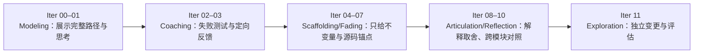

> 历史研究归档 · 2026-11-10 发布 · 程序扫描；未逐篇全文审阅。原有日期、观点、数据和命令保留历史语境，未经本次逐项事实核验或运行复现；请结合[归档说明](../../../../ARCHIVE_POLICY.md)阅读。

# PI Agent 渐进式源码学习系列：教学设计

> 一句话结论：这套课程不把“读过源码”当作学会，而是让学习者反复经历完整链路、闭卷提取、失败测试、源码对照、自我解释和迁移改造，最终做到能从记忆重建并独立修改 Agent。

## 1. 课程契约

> 一句话结论：课程以固定提交上的 PI 源码为事实基线，以可运行的 Mini Pi 为练习场，以可观察行为而不是阅读进度作为掌握证据。

- **研究对象**：`earendil-works/pi`，固定提交 `063fb963c5c33d099faa593d17e60e0a875430cd`（提交时间 2026-07-28）。
- **学习对象**：具备基础 TypeScript 阅读能力、希望理解 Agent 系统如何真正运行的成人自学者。
- **最终能力**：能从一次用户输入出发，解释并重建“消息协议 → 模型流 → Agent Loop → 工具执行 → Session → 上下文治理 → 扩展与多入口”的主路径；面对新需求时，能找到源码位置、预测影响范围、写失败测试再实现。
- **练习环境**：离线 `ScriptedModel`、Node.js 原生 TypeScript 与 `node:test`；不需要模型 API、Key 或第三方 npm 包。
- **非目标**：不教授 TypeScript 基础语法，不宣称 Mini Pi 等价于生产版 PI，不用记忆文件名替代对控制流和不变量的理解。

“学会”的最小证据是：目标测试全部通过、能闭卷重建关键关系、能用源码位置解释取舍，并完成一个未见过的变体。只看完文档、复制出通过代码或说“我大概懂了”都不算。

## 2. 证据分层与外推边界

> 一句话结论：提取练习与间隔学习的证据最强，主动学习也有大样本支持；Whole Game、ICAP 与认知学徒制更适合作为设计框架，所有结论迁移到成人 TypeScript 源码自学时都必须保留不确定性。

| 方法 | 本系列如何使用 | 证据判断 | 对本课程的外推限制 |
|---|---|---|---|
| 提取练习（Retrieval Practice） | 每 Iter 开始闭卷预测，结束闭卷画流程、回答因果题 | **较强**：Roediger 与 Karpicke 的实验显示，延迟测试中反复提取可优于反复重读；Dunlosky 等综述将练习测试评为高效策略。[原始研究](https://doi.org/10.1111/j.1467-9280.2006.01693.x)；[综述](https://www.psychologicalscience.org/publications/journals/pspi/learning-techniques.html) | 经典实验多使用文本材料与回忆测验；“记住协议”不自动等于“会修改异步控制流”，所以必须再加运行与迁移任务。复杂材料中的提取效应也可能减弱。
| 间隔学习（Spacing / Distributed Practice） | 在下一 Iter、跨两 Iter及延迟复习中重新提取旧概念 | **较强但领域偏窄**：Cepeda 等元分析纳入 184 篇文章、317 个实验，支持间隔相对集中学习的保持优势，同时指出最佳间隔取决于保持周期。[元分析](https://www.evullab.org/pdf/CepedaPashlerVulWixtedRohrer-PB-2006.pdf) | 该元分析主要限制在言语回忆任务，不能直接推出源码调试的最佳间隔；本系列的复习节奏只是初始配置，必须按遗忘与表现调整。
| 主动学习（Active Learning） | 预测输出、写 RED 测试、注入错误、改代码，不连续被动阅读 | **较强但场景不同**：Freeman 等对 225 项本科 STEM 研究的元分析报告，主动学习平均提高考试/概念测验表现 0.47 个标准差，传统讲授组失败比率更高。[PNAS/PMC 全文](https://pmc.ncbi.nlm.nih.gov/articles/PMC4060654/) | 这是教师组织的大学课堂证据，干预形式差异很大；不能把该效应量直接套到单人、异步、源码课程。
| ICAP | 把“看代码”升级为“运行/标注”，再升级为“生成解释/新测试”；有同伴或审阅者时才做互动论证 | **中等，属于理论框架及经验归纳**：ICAP 提出被动、主动、建构、互动四种可观察参与模式及预期次序。[论文](https://doi.org/10.1080/00461520.2014.965823)；[作者公开 PDF](https://education.asu.edu/sites/g/files/litvpz656/files/lcl/chiwylie2014icap_2.pdf) | ICAP 是条件性预测，不保证任何“互动”都优于高质量独立建构；单人和 AI 的问答若只是索要答案，不能冒充 Interactive。
| Worked Examples + Fading | Iter 00–01 给完整示例，Iter 02–03 留关键空白，后续逐步撤掉伪代码、行号与测试骨架 | **中等**：示例渐隐有助于从看例题过渡到解题；近迁移较稳定，远迁移结果更依赖自我解释和任务设计。[Atkinson、Renkl 与 Merrill](https://doi.org/10.1037/0022-0663.95.4.774) | 研究任务通常比真实 TypeScript Agent 更封闭；渐隐过快会造成无效搜索，渐隐过慢会形成复制依赖。
| 自我解释（Self-explanation） | 每次通过测试后回答“为什么是这个顺序”“若删掉此分支会怎样”，并与上游实现对照 | **中等**：Chi 等观察到成功学习者产生更多将步骤联系到原理的解释。[原始研究](https://doi.org/10.1207/s15516709cog1302_1) | 说得流畅不代表解释正确；必须由运行结果、反例和源码位置约束。
| 认知学徒制（Cognitive Apprenticeship） | 示范专家追踪路径，再提供 coaching/scaffolding，逐步 fading，最后让学习者独立探索 | **框架性证据**：Collins、Brown 与 Newman 系统提出 modeling、coaching、scaffolding、articulation、reflection、exploration。[原文](https://www.pdcnet.org/thinking/content/thinking_1988_0008_0001_0002_0010?file_type=pdf) | 它是教学设计框架，不是对本课程效果的直接试验；自学场景中的“教练”主要由测试、提示阶梯和源码差异承担。
| Whole Game | Iter 00 先跑一个缩小但完整的 Agent，再逐 Iter 放大其中一段 | **研究知情的设计框架**：Perkins 主张先玩可完成的“初级完整游戏”，避免只学零件。[Harvard Project Zero](https://pz.harvard.edu/resources/making-learning-whole-how-seven-principles-of-teaching-can-transform-education) | 不是 PI Agent 专门实验；完整游戏若包含过多细节也会过载，因此 Iter 00 只展示一条确定性主路径。

证据标签不是给教学法排“流行度”，而是限制我们能说多满。事实是：这些方法分别在记忆、课堂 STEM、示例学习或理论建模中得到支持；因此，本课程把它们组合为一个**待验证的教学设计**，而不是声称这个组合已经在“成人自学 TypeScript Agent 源码”上证明有效。

## 3. 固定学习循环：TRACE

> 一句话结论：每个 Iter 都运行同一个 TRACE 循环，让阅读始终落到提取、行动、解释和迁移上，但 TRACE 只是本课程的工程化组合名，不是已独立验证的新教学法。

| 阶段 | 学习动作 | 产出 | 主要依据 |
|---|---|---|---|
| **T — Trace the Whole Game** | 先运行或观看当前“缩小的完整游戏”，从输入沿事件追到输出；读代码前预测下一事件 | 一张事件链或时序草图 | Whole Game、认知学徒制的 modeling |
| **R — Retrieve** | 关掉文档和源码，写出本 Iter 的关键类型、顺序、不变量和一个失败路径 | 闭卷回答；标注“记得 / 推断 / 不知道” | Retrieval Practice、Spacing |
| **A — Attempt** | 先运行一个会失败的测试（RED），独立实现最小行为，再观察 GREEN；不直接复制答案 | 失败证据、实现、通过证据 | Active Learning、ICAP 的 Active/Constructive |
| **C — Compare & Explain** | 将 Mini Pi 与固定提交中的 PI 源码并排比较，解释“相同不变量、删掉的生产复杂度、不同取舍” | 带源码锚点的自我解释 | Self-explanation、认知学徒制的 articulation/reflection |
| **E — Extend & Space** | 注入一个未见过的边界条件，新增测试；安排下一次闭卷复习，并穿插旧 Iter | 迁移测试、复习到期项 | Fading、Spacing、Interleaving |

每次学习按以下顺序执行，不因“这章看起来简单”而跳过：

1. **零资料诊断**：先回答 2–4 个预测题；错答案用于定位，不计分。
2. **跑完整路径**：观察输入、模型事件、工具调用、工具结果、终止事件，给每一步编号。
3. **只读最小源码切片**：沿调用链读，不按目录漫游；先看类型与测试，再看实现。
4. **制造 RED**：运行课程预置失败测试或自己写一个；保留真实失败原因。
5. **最小 GREEN**：实现刚好满足行为契约的代码，然后整理命名与重复逻辑。
6. **源码对照**：至少指出一个共同不变量、一个 Mini Pi 的主动简化、一个上游为生产问题增加的分支。
7. **闭卷讲回去**：不看材料画图或口述；若需要看关键词，记录使用的提示层级。
8. **迁移与复习登记**：改变一个条件并写新测试，把本 Iter 加入后续复习队列。

单人完成第 7 步通常属于 ICAP 的 **Constructive**：学习者生成了材料中没有的解释。只有当同伴、导师或 AI 对解释提出反例，学习者据证据修正推理时，才可能接近 **Interactive**；把答案直接交给 AI 生成仍然是被动消费。

## 4. 脚手架与提示阶梯

> 一句话结论：帮助应当按最小必要信息逐层释放，并记录用到哪一层，以便把“测试通过”与“独立完成”区分开。

| 层级 | 可提供的信息 | 示例 | 使用规则 |
|---|---|---|---|
| H0 | 无提示 | 只给行为目标与失败测试 | 默认从这里开始 |
| H1 | 目标与约束 | “每个 tool call 必须恰好对应一个 tool result” | 不指出文件或算法 |
| H2 | 不变量 / 反例 | “验证失败不能调用 execute” | 仍由学习者定位实现点 |
| H3 | 源码导航 | 给包、文件、符号名，不给答案代码 | 读者必须先预测该符号的职责 |
| H4 | 算法骨架 | 伪代码或空缺流程图 | 学习者补齐分支和事件顺序 |
| H5 | 部分示例 | 填好一个正常路径，错误路径留空 | 通过后解释为什么不能照搬到所有分支 |
| H6 | 完整 worked example | 提供参考实现与测试 | 仅在多次失败后使用；随后关闭答案重写或完成等价变体 |

提示使用协议：

- 一次只上升一级；测试输出和运行 trace 本身不算“作弊”，它们是系统反馈。
- 使用 H3 以上提示后，必须补一条自我解释：“我缺少的是事实、定位方法，还是控制流模型？”
- 若连续两个 Iter 都需要 H5/H6，下一 Iter 不继续加速，先重做上一个迁移题。
- 若连续两个 Iter 在 H0/H1 完成，则下一 Iter 撤掉一项脚手架，例如不再给伪代码或目标测试名。
- 提示层级不是能力标签，只是调整下一次练习难度的数据。

## 5. 12 个 Iter 的教学法映射

> 一句话结论：12 个 Iter 从“看见全局”逐渐过渡到“独立设计与评估”，知识范围扩大时，示例和提示反而逐步减少。

| Iter | 核心对象 / 初级完整游戏 | 主要学习活动 | 默认脚手架 | 间隔与穿插 | 掌握产物 |
|---|---|---|---|---|---|
| 00 | 一次确定性的端到端 Whole Game：用户消息 → 模型 → 工具 → 模型 → 结束 | 给事件排序、跑 trace、闭卷重画；先建立全局坐标 | H5–H6：完整示例与事件表 | 建立首批复习卡，不要求记文件树 | 能解释每个事件为何出现、由谁产生 |
| 01 | `pi-ai` 的统一模型/消息/流事件协议 | 从运行输出反推类型；补全事件联合类型；比较 provider 差异被放在哪里 | H4–H5：类型骨架、完整正常例 | 提取 Iter 00 的整条链，再把每个事件映射到类型 | 能从未知事件判断其生产者、消费者与终止语义 |
| 02 | 最小 Agent Loop | 先写循环失败测试，再实现 tool-call 轮转与 stop；手绘循环不变量 | H3–H4：源码符号和伪代码，不给实现 | 混合提取 00 的全链与 01 的协议 | 能独立重建 loop，并解释为何不是一次模型调用 |
| 03 | 工具管线：验证、执行、错误、顺序 | 注入非法参数、抛错、并行/串行冲突；给失败行为分类 | H2–H4：只给不变量和部分测试 | 提取 01 的事件、02 的循环；旧题改成错误路径 | 能保证失败可见且不误执行，能解释结果顺序 |
| 04 | Agent 状态、事件、steer 与 follow-up | 在运行中插入新输入，预测状态转移；实现事件订阅者 | H2–H3 | 对比 02 的同步轮转与 04 的中途控制 | 能区分当前轮输入、steer 和 follow-up 的时机 |
| 05 | `AgentSession` 与 prompt / tool 编译 | 从一次 turn 追到 session 边界；删除一个编译步骤观察失败 | H2–H3 | 穿插 01 的协议与 04 的状态事件 | 能画出 Session 编排边界及其与核心 Loop 的职责分工 |
| 06 | resources、`AGENTS.md`、Skills 与信任边界 | 构造恶意/冲突指令；按来源和权限解释何者可执行 | H1–H3 | 重用 03 的验证思维，区分模型输出与系统授权 | 能定位资源装载点，并给出一条可测试的信任边界 |
| 07 | JSONL 会话树、分叉与恢复 | 手工重建父子关系；从中间节点 fork；破坏一行数据验证恢复策略 | H1–H2 | 对比 04 的内存状态与持久化状态 | 能从日志恢复有效上下文并解释树而非平面列表的价值 |
| 08 | compact、retry 与上下文预算 | 设定超限/限流/中断场景；设计不会悄悄丢语义的降级 | H1–H2 | 穿插 05 的 prompt 编译和 07 的会话历史 | 能指出压缩触发、保留信息与重试边界；阈值标“初始值，待验证” |
| 09 | Extension Runtime | 写最小扩展，限制其生命周期与能力；注入扩展异常 | H1：只给接口契约 | 重用 03 的工具错误隔离与 06 的信任边界 | 能新增扩展而不侵入核心 Loop，并解释隔离失败时的影响 |
| 10 | TUI、Print、JSON、RPC、SDK 多入口 | 让同一核心行为从两个入口运行；对照事件适配而非复制业务逻辑 | H0–H1 | 混合提取 01 的协议、04 的事件、05 的 Session | 能证明入口共享同一核心语义并保持稳定输出契约 |
| 11 | 生产加固与评估 | 独立完成一次变更：需求 → 风险 → RED → 实现 → 回归 → 源码说明；互审或 AI 反驳 | H0；仅保留验收清单 | 累积抽取 00–10，重点重做过去的错误和高提示项 | 一份可运行改动、回归测试、失败路径、成本/局限与源码影响图 |

这张表中的 H 级别是默认值，不是按章节自动晋级。真实行为优先：若迁移失败就增加脚手架；若无需提示且延迟复习仍正确，就提前渐隐。

## 6. 示范、教练、渐隐与探索

> 一句话结论：认知学徒制在本系列中不是“老师讲、学生抄”，而是让专家思路先变得可见，再把定位、决策和验证责任逐步交还给学习者。

- **Modeling** 展示的不只“正确代码”，还包括如何沿类型、调用点、事件和测试缩小搜索范围。
- **Coaching** 通过具体反例反馈：“哪个不变量被破坏”，而不是直接给下一行代码。
- **Scaffolding** 先提供完整 trace、源码锚点和测试骨架；**Fading** 依次撤掉答案代码、伪代码、行号、测试名，最后只留行为目标。
- **Articulation** 要求把隐性的判断写出来；**Reflection** 要求比较 Mini Pi、上游 PI 和自己的实现，而不是只比较输出相同。
- **Exploration** 要求在未提供教程步骤的新变体上工作；若只能重现课堂例子，说明迁移尚未发生。

## 7. 间隔、穿插与复习调度

> 一句话结论：复习不是重读旧章节，而是在有间隔的不同上下文里重新提取、运行和解释同一个不变量。

默认复习节奏如下，全部是**课程初始值，待按个人保持表现调优**，不是从研究直接推导出的源码学习最佳间隔：

| 复习点 | 建议触发 | 闭卷动作 | 通过后 |
|---|---|---|---|
| R1 | 下一次学习开始前（建议约 D+1） | 画事件链并回答 2 个“为什么” | 进入下一 Iter |
| R2 | 再跨两个 Iter（建议约 D+3） | 将旧不变量用于新模块的错误题 | 保持原节奏 |
| R3 | 建议约 D+7 | 不看答案重跑一个代表性测试，并口述源码入口 | 若需 H3+，缩短下一间隔 |
| R4 | 建议约 D+21 | 完成未见过的变体，比较当时与现在的解释 | 进入长期维护队列 |

穿插规则：

- 每个 Iter 至少带回前两个 Iter 的一个概念，但换一种表面形式，例如在 Iter 06 用工具验证的不变量审视指令信任边界。
- 复习优先抽取“曾答错、信心高但错误、用过 H4+”的项目，而不是平均重读。
- 逾期时先做最旧的一次闭卷诊断，不需要为了“补表”集中重读所有内容。
- 复习通过看的是独立重建和迁移，不看“读起来是否熟悉”；熟悉感是再认，不是提取。

## 8. 掌握标准

> 一句话结论：一个 Iter 只有同时通过行为、解释、源码定位和迁移四道门才算掌握，任何单一分数都不足以替代它们。

| 门 | 验收行为 | 必留证据 | 未通过时 |
|---|---|---|---|
| M1 行为 | 本 Iter 目标测试 100% 通过，且保留至少一个真实 RED 结果 | 测试命令、通过/失败数、首个失败原因 | 回到最小失败行为，不扩大实现 |
| M2 解释 | 闭卷重建主路径；关键生产者、消费者、顺序与错误路径均正确 | 手绘/文字事件链；“为什么”和“若删除会怎样” | 使用 H1/H2 后再次闭卷，不靠重读结束 |
| M3 源码 | 能给出固定提交中的入口符号和关键实现位置，并说明 Mini Pi 删掉了什么生产复杂度 | 至少一个入口锚点、一个测试锚点、一个简化声明 | 沿调用关系重新定位，不背目录树 |
| M4 迁移 | 独立加入一个未在示例中出现的边界测试或行为变体 | 新测试、预测、结果与解释 | 提升一层提示，完成等价新变体后再验收 |

“100% 目标测试通过”是工程验收线，不是心理测量常模；其意义是行为契约不能部分满足。其余标准是本课程定义的初始 rubric，实际使用后应根据延迟保持和迁移失败率调整。

每次还要记录**校准**：答题前信心（0–100）与实际结果。高信心错误比低信心错误更值得优先复习；这里不设置“合格信心值”，只观察信心与证据是否逐渐一致。

## 9. 费曼式讲解的准确定位

> 一句话结论：本系列保留“用自己的话讲给别人听”的形式，但把它视为提取练习与自我解释的实用包装，不声称“费曼学习法”本身已有同等强度的独立证据。

每个 Iter 的 teach-back 使用四问：

1. **它解决什么运行时问题？** 不允许只复述类名。
2. **输入如何变成输出？** 必须说出事件顺序和状态变化。
3. **为什么不能删掉这个分支？** 给一个可运行反例。
4. **Mini Pi 与上游 PI 哪里相同、哪里刻意不同？** 给固定提交中的源码锚点。

如果讲解出现“然后系统就处理了”“这里做一下校验”之类空洞跳步，就回到缺失节点写测试。语言简单不是目的，因果完整、可被反例检验才是目的。

## 10. 明确拒绝的学习误区

> 一句话结论：课程不按“视觉型/听觉型学习者”分流，也不把划线、重读、视频速度或代码复制量当成学习效果。

- **不做 Learning Styles 匹配**：Pashler 等综述没有找到足以支持“按学习风格匹配教学形式能提高学习”的证据。[Learning Styles 综述](https://doi.org/10.1111/j.1539-6053.2009.01038.x)。图、文字、运行 trace 和口述会同时存在，是因为任务需要多种表征与可访问性，而不是给人贴“视觉型/听觉型”标签。
- **不把重读当验收**：Dunlosky 等将重读、划线等常见策略评为低效或效果不稳定；它们可用于定位，但必须接提取或生成任务。[APS 综述](https://www.psychologicalscience.org/publications/journals/pspi/learning-techniques.html)。
- **不把“主动”误解为忙碌**：抄代码、频繁点运行仍可能没有生成新理解；有效动作必须要求预测、选择、解释或反例。
- **不把测试当排名**：测试是反馈和学习事件；失败要保留，以便区分错误心智模型、实现错误和环境错误。
- **不把 AI 当答案机**：先提交自己的预测与证据，再让 AI 充当反驳者；若 AI 给出结论，仍需用固定提交源码和运行结果验证。

## 11. 跟踪字段与反馈决策

> 一句话结论：进度只记录可用于下一步决策的数据，尤其是延迟提取、提示依赖、迁移结果和信心偏差，而不是累计阅读时长。

每个 Iter 在 `PROGRESS.md` 保留这些字段：

| 字段 | 记录内容 | 用途 |
|---|---|---|
| `status` | planned / in-progress / delivered / learning / mastered / revisit | 区分内容交付与个人掌握 |
| `content_evidence` | 文档、练习、解答、源码映射是否齐备 | 避免把课程发布状态混入学习状态 |
| `pretest_prediction` | 闭卷预测与信心 | 建立基线，观察校准 |
| `red_evidence` | 首个失败测试及原因 | 证明测试真的约束目标行为 |
| `tests` | 通过数 / 总数 | 验证行为契约 |
| `hint_level` | 最高使用 H0–H6 | 决定下一 Iter 渐隐或补脚手架 |
| `source_anchors` | 固定提交中的入口、测试及关键实现位置 | 验证源码导航能力 |
| `self_explanation` | 因果解释与一个反事实 | 暴露“会运行但不理解” |
| `transfer_case` | 未见变体、预测与结果 | 区分近似模仿与迁移 |
| `confidence_before_after` | 0–100，自评前后各一次 | 观察信心—正确性偏差 |
| `review_due` / `review_result` | R1–R4 到期与闭卷结果 | 调度间隔复习 |
| `misconception` | 一句话写错因 | 让后续复习优先命中真实薄弱点 |

反馈决策优先级：

1. 迁移失败或高信心错误：标记 `revisit`，下一次先做同不变量、不同表面的题。
2. 测试通过但解释缺节点：不升级，补反事实与源码对照。
3. 解释正确但实现失败：缩小到一个 RED，检查异步顺序、状态所有权或环境差异。
4. 延迟复习在 H0/H1 连续通过：撤掉下一 Iter 的一个脚手架。
5. 延迟复习需要 H4+：缩短下次间隔并回到 worked example，不用意志力硬扛。

## 12. 成本、局限与验证计划

> 一句话结论：这套设计用更多“费力但有证据的动作”换取更可信的掌握判断，API 成本接近零，但学习者投入、内容维护和真实迁移效果仍需实测。

### 成本

- **Token / API**：核心实验使用确定性 `ScriptedModel`，无需真实模型调用；只有选择让 AI 做互动审阅时才产生外部 Token 成本，具体量取决于使用方式，当前不估算。
- **本地计算**：10 个首批测试由 Node.js 本地执行，计算成本低；这只是课程测试，不代表 PI 全仓库测试成本。
- **学习投入**：相较纯阅读，每 Iter 至少增加一次闭卷提取、一次 RED→GREEN、一次源码对照和一次迁移测试；不虚构统一完成时长，实际耗时由 `started_at` / `completed_at` 自行记录。
- **维护投入**：课程固定在一个提交上可保证行号稳定；升级 PI 时必须重新验证源码锚点、行为差异和练习假设，不能机械替换 commit。

### 已知局限

- 当前没有该课程学习者的前测、延迟后测或对照组数据，因此“更好吸收”仍是设计目标，不是已证实结果。
- `ScriptedModel` 能隔离协议和控制流，却不能复现真实供应商流式细节、模型不确定性、网络抖动或 Token 计费。
- 单人 teach-back 可产生自我解释，但缺少真实同伴共同建构；AI 审阅的质量也受提示和模型可靠性限制。
- 12 Iter 的顺序体现源码依赖和脚手架渐隐的设计判断，不是认知科学证明的唯一最优顺序。

### 最小效果验证

后续使用时只采集能改变课程决策的指标：

1. **延迟保持**：R3 能否在不看材料时重建主路径。
2. **提示依赖**：H3+ 的使用是否随 Iter 下降，而不是只看即时通过率。
3. **迁移成功**：是否能处理未在示例出现的错误路径或入口变体。
4. **源码导航**：能否从行为追到固定提交的入口、关键实现和测试。
5. **校准改善**：高信心错误是否减少。

在出现真实学习数据前，不给“提升百分比”或“最佳学习时长”；数据不足处统一标为“待验证”。

## 13. 设计审查

> 一句话结论：本版教学设计的依赖、数字来源、异常路径、阈值性质和需求边界均已显式检查，设计审查为 5/5 通过。

| 检查项 | 结果 | 证据 / 限制 |
|---|---|---|
| 1. 外部依赖已验证可用 | 通过 | 固定 PI 提交本地可读；引用均指向论文、学术机构或权威综述；课程运行依赖见 `ENVIRONMENT.md` |
| 2. 性能数字有来源 | 通过 | 0.47 SD、225 项研究等数字只引用 PNAS 元分析；首批 10/10 为本地实测；不外推课程收益 |
| 3. 异常路径覆盖 | 通过 | 设计包含测试失败、提示依赖、复习逾期、解释错误、源码漂移、AI 审阅不可靠等处理 |
| 4. 阈值有依据 | 通过 | 测试 100% 是工程行为契约；D+1/D+3/D+7/D+21 与 rubric 均明确标为初始值，待实测调优 |
| 5. 未越出需求边界 | 通过 | 聚焦 PI Agent 架构、源码学习与知识吸收；不扩展为通用 TypeScript 课或未经验证的个性化学习系统 |

**设计审查：5/5 通过。**
