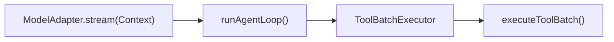

> 历史研究归档 · 2026-11-10 发布 · 程序扫描；未逐篇全文审阅。原有日期、观点、数据和命令保留历史语境，未经本次逐项事实核验或运行复现；请结合[归档说明](../../../../../ARCHIVE_POLICY.md)阅读。

# Mini Pi：离线、累计式 TypeScript 学习实验

> 一句话结论：这里不是重写生产级 Pi，而是用约 300 行依赖为零的代码保留最值得亲手验证的协议与控制流。

## 先跑完整游戏

```powershell
cd "C:/Users/USER\Documents\Codex\2026-07-28\new-chat-2\outputs\PI-Agent-Learning-Series\lab"
.\run-demo.ps1
.\run-tests.ps1
```

实测环境为 Node.js v24.14.0；脚本显式使用 Codex bundled Node，避免误用系统中的 v22.14.0。无需 `npm install`、API Key 或网络。

## 累计结构

| Iter | 只读 / 修改范围 | 关键行为测试 |
|---|---|---|
| PI-I00 | `src/whole-game.ts`、`examples/whole-game.ts` | 一个任务穿过模型→工具→模型 |
| PI-I01 | `src/types.ts`、`src/scripted-model.ts` | 统一 text/tool-call 事件文法 |
| PI-I02 | `src/agent-loop.ts` | ToolResult 回灌、length fail-closed |
| PI-I03 | `src/tool-pipeline.ts` | 校验、错误消息化、并发双顺序、整批串行、Hook 二次校验 |

单独运行一课：

```powershell
.\run-tests.ps1 -Iter iter03
```

## 三条接口边界



- `ModelAdapter` 隔离供应商差异，只暴露统一事件。
- `runAgentLoop()` 只决定何时继续请求模型、何时回灌工具结果、何时停止。
- `executeToolBatch()` 负责工具查找、参数校验、Hook、执行模式和错误消息化。

这让每个 Iter 能单独制造失败：换 Provider 不改 Loop；换工具调度不改模型协议。

## 与真 Pi 的关系

| 保留的语义 | 主动省略 |
|---|---|
| 三种消息 role；terminal `done/error`；ToolResult 进入下一轮上下文 | Usage、thinking/image、真实鉴权和多 Provider Registry |
| Assistant 产生 Tool Call 后继续模型循环 | Steering、Follow-up、Context transform（后续 Iter） |
| `length` 时工具 fail-closed | AbortSignal、partial tool update、terminate（后续 Iter） |
| 默认并发、结果保持源顺序；任一 sequential 令整批串行 | 文件 mutation queue、真实 Bash/Edit/Write 实现 |
| 默认忠实展示 Hook 后不重校验，并提供课程强化开关 | Extension runtime 与跨信任域隔离（后续 Iter） |

因此，Lab 测试通过只证明这些选定行为，不证明它具备 Pi 的完整能力或生产安全性。尤其是参数校验不等于文件系统/进程沙箱。

作者最终 QA 还使用 TypeScript 5.9.3 的 `--strict --noEmit` 运行过一次完整静态检查并通过；它是可选验证，不是运行 Lab 的前置安装。

## 学习方式

先读对应 `exercises/PI-Ixx.md` 并写下预测，再运行测试。失败时按以下顺序求助：测试名 → 源码断点 → 不变量提示 → 伪代码 → 最后才看 `solutions/`。TDD 的失败记录见 [TDD_LOG.md](TDD_LOG.md)。
