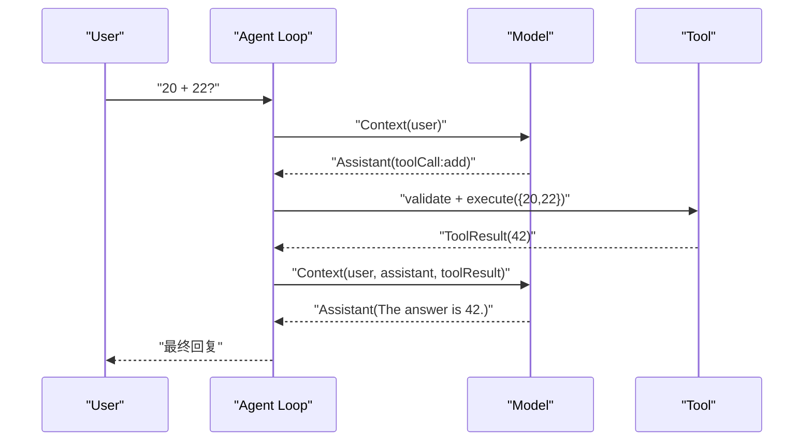
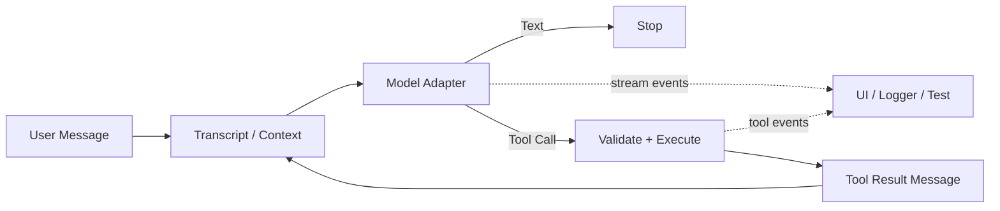

> 历史研究归档 · 2026-11-10 发布 · 发布审核状态：scan_only（发布前程序化隐私扫描）。原有日期、观点、数据和命令保留历史语境，未经本次逐项事实核验或运行复现；见[归档说明](../../../../../ARCHIVE_POLICY.md)。

# PI-I00：先跑完整游戏——一次 Agent 任务到底发生了什么

> 一句话结论：Agent 不是“更聪明的一次模型调用”，而是一个反复执行“模型产生命令 → 程序执行工具 → 结果回灌模型”的控制循环。

## 先修与本课定位

- 先修：能读懂 TypeScript 的对象、数组与 `async/await`；不要求了解 Agent 框架。
- 本课位置：先观察完整系统（Whole Game），暂时把模型协议与工具管线当黑盒；PI-I01～I03 再逐层拆开。
- 学完标准：不看文档，能画出一次“模型 → 工具 → 模型”的消息序列，并能在真 Pi 源码中指出循环发生的位置。
- 成本：Lab 不调用外部模型、无需 API Key，Token/API 费用为 0；建议用时 60～90 分钟，这是教学估算，需按个人情况校准。

这不是重复已有的 R156 架构总览：总览回答“Pi 有哪些层”，本系列要求你先预测、再运行、再制造失败，最终能凭行为反推源码。

## 闭卷唤醒

先合上源码，用自己的话写下答案；不确定也要写。

1. 模型返回一个 `toolCall` 后，谁真正执行工具：模型、Provider，还是 Agent 运行时？
2. 工具算出 `42` 后，为什么不能直接把 `42` 当作最终 Assistant 回复？
3. 一次用户请求只会产生一次模型调用吗？写出你的判断条件。

把答案保留到学完后再修订。第一次答案的错误位置，正是本课最有价值的学习证据。

## 运行前预测

不要先看下一节的实测 Trace。根据任务“计算 20 + 22”，先填表：

| 预测项 | 你的预测 |
|---|---|
| 模型调用次数 |  |
| 工具执行次数 |  |
| Transcript 中的 role 顺序 |  |
| 最后一个事件 |  |
| 若模型第一次就返回普通文本，哪些阶段会消失 |  |

## Whole Game：单次调用为什么不够

最容易写出的“上一版”只有一次模型调用：

```text
user → model → assistant
```

它在模型请求调用工具时会卡住。`toolCall` 是结构化的“行动意图”，不是行动本身；如果宿主程序不执行并把 `toolResult` 放回上下文，模型既看不到真实结果，也无法基于结果形成最终回复。

完整游戏至少要走过：



核心不变量只有两个：

1. 工具结果必须以消息形式进入下一次模型上下文，而不是只打印到终端。
2. 没有待处理的 Tool Call 时，Loop 才能正常停止；错误、截断与轮数上限是另外的停止路径。

## 心智模型

把 Pi 想成“解释器”，而不是“聊天接口”：模型输出类似指令，工具层执行指令，Transcript 是解释器的可回放内存，事件流则是旁观者看到的运行日志。



注意两条通道：Transcript 是下一轮模型会读到的持久语义；Event Trace 是 UI、日志和测试消费的观察信号。两者不能混为一谈。

## 固定提交的源码断点

本系列统一锁定提交 `063fb963c5c33d099faa593d17e60e0a875430cd`。先只看下面三个断点，避免一开始淹没在实现细节里。

1. [`runAgentLoop()` 初始化上下文并发出生命周期事件：agent-loop.ts L95–117](https://github.com/earendil-works/pi/blob/063fb963c5c33d099faa593d17e60e0a875430cd/packages/agent/src/agent-loop.ts#L95-L117)
2. [内层循环：取 Assistant、识别 Tool Call、执行并回灌 Tool Result：agent-loop.ts L169–224](https://github.com/earendil-works/pi/blob/063fb963c5c33d099faa593d17e60e0a875430cd/packages/agent/src/agent-loop.ts#L169-L224)
3. [Provider 流事件如何变成可持久的 Assistant Message：agent-loop.ts L314–371](https://github.com/earendil-works/pi/blob/063fb963c5c33d099faa593d17e60e0a875430cd/packages/agent/src/agent-loop.ts#L314-L371)

阅读时只追踪四个变量：`currentContext`、`message`、`toolCalls`、`toolResults`。其余配置先忽略。

## Lab 命令与 Build Delta

先保留预测，再在系列目录执行：

```powershell
cd "C:/Users/USER\Documents\Codex\2026-07-28\new-chat-2\outputs\PI-Agent-Learning-Series"
.\lab\run-demo.ps1
.\lab\run-tests.ps1 -Iter iter00
```

脚本固定使用 bundled Node：`C:/Users/USER\.cache\codex-runtimes\codex-primary-runtime\dependencies\node\bin\node.exe`。无需 `npm install`。

| 本 Iter 新增观察面 | 作用 | 本课先当黑盒的依赖 |
|---|---|---|
| `lab/src/whole-game.ts` | 装配两个脚本化模型响应和 `add` 工具 | `agent-loop.ts`、`tool-pipeline.ts` |
| `lab/examples/whole-game.ts` | 输出可读 Trace | 统一模型事件 |
| `lab/tests/iter00-whole-game.test.ts` | 锁定调用次数、消息顺序、事件顺序 | 后续 Iter 的具体实现 |

这是一条“垂直切片”：先证明一条端到端路径成立，再逐课替换黑盒认知。它不是生产级 Pi 的缩写版。

## 实测事件 Trace

在 bundled Node v24.14.0 上，确定性 Demo 与测试已通过。一次运行得到 2 次模型调用、1 次工具执行、4 条 Transcript 消息和下列 20 个观察标签：

```text
01  agent_start
02  turn_start
03  model:start
04  model:toolcall_start
05  model:toolcall_delta
06  model:toolcall_end
07  model:done
08  message_end:assistant
09  tool_execution_start:add
10  tool_execution_end:add
11  tool_batch_end
12  message_end:toolResult
13  turn_start
14  model:start
15  model:text_start
16  model:text_delta
17  model:text_end
18  model:done
19  message_end:assistant
20  agent_end
```

把它压缩成两条线更容易记忆：

```text
Transcript: user → assistant(toolCall) → toolResult(42) → assistant(text)
Control:    model #1 → tool batch → model #2 → stop
```

事件多于消息，因为一个 Assistant Message 会经历 `start → delta → end → done`；流事件是消息“形成的过程”，不是四条额外 Transcript。

## Mini Pi 与真 Pi

| 维度 | Mini Pi 本课 | 真 Pi 固定提交 |
|---|---|---|
| 模型 | `ScriptedModel` 预置两个答案，完全确定 | Provider 通过网络流式生成，含鉴权、取消和错误路径 |
| 工具 | 仅 `add`，进程内执行 | 通用 `AgentTool`，有参数 Schema、Hook、更新事件与执行模式 |
| 循环 | 展示模型→工具→模型主干，并有 `maxTurns` | 还有 Steering、Follow-up、上下文转换和每轮运行态更新 |
| 消息 | 只保留本批课程需要的字段 | 含 thinking/image、usage、provider/model、timestamp 等元数据 |
| 事件 | 为教学压缩，未实现真 Pi 的 `turn_end` 等全部事件 | 完整 `AgentEvent` 联合类型见 [`types.ts` L422–437](https://github.com/earendil-works/pi/blob/063fb963c5c33d099faa593d17e60e0a875430cd/packages/agent/src/types.ts#L422-L437) |

所以，Lab 通过只证明所选控制流不变量；它不证明真实 Provider 可达，也不证明具备生产安全性。

## 故障注入

在临时副本中把 `lab/src/whole-game.ts` 的响应顺序从 `[request, answer]` 改成 `[answer, request]`，先预测再运行：

```powershell
.\lab\run-tests.ps1 -Iter iter00
```

观察第一条失败断言，而不是一次看完所有红字。你要解释的不是“expected/actual 不同”，而是：为什么第一条普通文本让 Loop 提前满足停止条件，导致第二个脚本响应永远没有被消费。

恢复文件后再做正式练习：[PI-I00 练习](../exercises/PI-I00.md)。完成前不要打开答案；卡住时按“测试名 → 源码断点 → 不变量 → 伪代码”的顺序降级提示。

## Teach-back Rubric

用 90 秒向一个没读过 Pi 的同事解释“为什么一次 Tool Call 通常需要两次模型调用”。录音或写 150 字均可，按下表自评：

| 等级 | 可观察证据 |
|---|---|
| 0：复述术语 | 只说“Agent 会调用工具”，没有消息顺序 |
| 1：说清顺序 | 能说出 `user → assistant(toolCall) → toolResult → assistant` |
| 2：说清不变量 | 能解释 Tool Result 必须回灌 Context，且事件不等于消息 |
| 3：可迁移 | 能预测“首轮直接文本”“工具报错”“无终止事件”分别会影响哪里，并指出对应源码断点 |

达到 2 再进入下一课；未达到时，闭卷重画 Mermaid，不要重读整章。

## 24 小时与 7 天复习

### 24 小时后（闭卷 8 分钟）

1. 从空白画出四条 Transcript role。
2. 写出两个循环不变量。
3. 再运行 Demo，只核对错误处；不要全文重读。

### 7 天后（交错练习 15 分钟）

1. 不看代码，解释 Event Trace 与 Transcript 的区别。
2. 预测“模型首轮返回 Tool Call，但没有 Tool Executor”时系统应把什么反馈给下一轮。
3. 完成练习文件中的 7d 卡片，并把 I01 的统一事件协议混入回答。

## 下一课为什么必然出现

本课能观察 `model:toolcall_delta`，却还解释不了：Anthropic、OpenAI、Google 的原始流格式不同，为什么 Agent Loop 可以只认同一套事件名？如果 Loop 直接依赖供应商事件，每增加一个 Provider 都要重写控制流。因此下一课必须抽出统一模型与消息协议。

