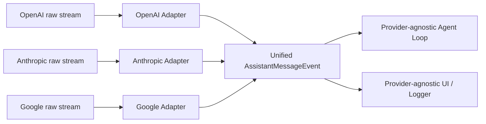
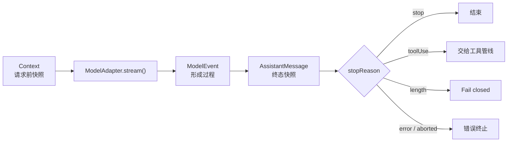

> 历史研究归档 · 2026-11-10 发布 · 发布审核状态：scan_only（发布前程序化隐私扫描）。原有日期、观点、数据和命令保留历史语境，未经本次逐项事实核验或运行复现；见[归档说明](../../../../../ARCHIVE_POLICY.md)。

# PI-I01：统一模型协议——让 Agent Loop 忘掉供应商

> 一句话结论：Pi 用统一的 `Context → AssistantMessageEventStream → AssistantMessage` 契约吸收 Provider 差异，使 Agent Loop 只处理语义事件，不处理厂商数据包。

## 先修与本课定位

- 先修：完成 PI-I00，能闭卷写出 `user → assistant(toolCall) → toolResult → assistant`。
- 本课位置：打开 Whole Game 的第一个黑盒——`ModelAdapter`；工具执行仍留到 PI-I03。
- 学完标准：能区分 Context、流事件与最终消息，能预测 text/tool-call/error 三种事件序列，并能说明新增 Provider 时哪层应该改变。
- 成本：使用确定性 `ScriptedModel`，不联网、无 API Token 费用；建议用时 75～105 分钟，为教学估算。

## 闭卷唤醒

先写后读：

1. PI-I00 的 20 个观察标签里，哪些属于“模型协议”，哪些属于“Agent 生命周期”？
2. `toolUse` 是错误、普通停止，还是一种成功终止但要求宿主继续行动的状态？
3. 如果一次流永远不发 `done` 或 `error`，消费方如何知道 Assistant Message 已完成？
4. 新接一个 Provider 时，你预计会修改 Provider Adapter、Agent Loop，还是两者都改？为什么？

## 运行前预测

先补全问号，不要执行测试：

```text
文本响应: start → ? → ? → ? → done
工具响应: start → ? → ? → ? → done
错误响应: start → ... → ?
```

再预测以下断言是否成立：

| 断言 | 你的预测与理由 |
|---|---|
| `text_delta` 自己就是最终 Assistant Message |  |
| `done(reason=toolUse)` 仍是成功终止事件 |  |
| Provider 可以把请求失败直接 `throw` 给 Loop |  |
| 同一套 Loop 能消费文本和 Tool Call |  |

## Whole Game / 上一版为什么失败

PI-I00 已能跑通，但模型层仍是黑盒。最直接的上一版会在 Loop 里分支：

```text
if OpenAI chunk ...
else if Anthropic event ...
else if Google candidate ...
```

这会把三个本应独立变化的东西粘在一起：供应商传输格式、统一消息语义、Agent 控制策略。Provider 一升级，Loop 也可能被迫修改；测试还必须联网复现每种原始流。

Pi 的做法是把变化隔离在 Adapter 内：



“统一”不等于抹平所有能力。Pi 的统一类型仍保留 `thinking`、图片、Tool Call、Usage、停止原因和 Provider 元数据；统一的是宿主可依赖的语义边界。

## 心智模型

一次模型交互有三个不同层次：



- `Context`：系统提示、历史消息、可用工具；它是输入。
- `ModelEvent`：`start/delta/end/done/error`；它是时间线。
- `AssistantMessage`：完整内容与 `stopReason`；它是可写入 Transcript 的结果。

关键协议不变量：每条流先 `start`，最终必须以 `done` 或 `error` 之一终止。`done` 不只意味着“最终文本”；`reason=toolUse` 表示本次模型生成成功结束，但 Agent 还有工具工作要做。

## 固定提交的源码断点

固定提交仍为 `063fb963c5c33d099faa593d17e60e0a875430cd`。本课只需四个断点：

1. [三种消息 role 与停止原因：types.ts L382–423](https://github.com/earendil-works/pi/blob/063fb963c5c33d099faa593d17e60e0a875430cd/packages/ai/src/types.ts#L382-L423)
2. [Context 与统一 Assistant 事件联合类型：types.ts L477–503](https://github.com/earendil-works/pi/blob/063fb963c5c33d099faa593d17e60e0a875430cd/packages/ai/src/types.ts#L477-L503)
3. [统一 StreamFunction 的错误协议：types.ts L296–315](https://github.com/earendil-works/pi/blob/063fb963c5c33d099faa593d17e60e0a875430cd/packages/ai/src/types.ts#L296-L315)
4. [`streamSimple()` 选择内建或扩展 Provider，而调用方契约不变：compat.ts L275–288](https://github.com/earendil-works/pi/blob/063fb963c5c33d099faa593d17e60e0a875430cd/packages/ai/src/compat.ts#L275-L288)

补充断点（理解终态时再看）：[`AssistantMessageEventStream.result()` 如何从 `done/error` 提取最终消息：event-stream.ts L64–87](https://github.com/earendil-works/pi/blob/063fb963c5c33d099faa593d17e60e0a875430cd/packages/ai/src/utils/event-stream.ts#L64-L87)。

## Lab 命令与 Build Delta

在系列根目录执行：

```powershell
cd "C:/Users/USER\Documents\Codex\2026-07-28\new-chat-2\outputs\PI-Agent-Learning-Series"
.\lab\run-tests.ps1 -Iter iter01
```

| Build Delta | 本课承担的责任 | 明确不承担 |
|---|---|---|
| `lab/src/types.ts` | 定义三类 Message、Context、ModelEvent、ModelAdapter | Provider 鉴权、成本、真实网络格式 |
| `lab/src/scripted-model.ts` | 把预置 Assistant Message 展开为统一事件 | 模型推理质量、网络分片时机 |
| `lab/tests/iter01-protocol.test.ts` | 锁定文本与 Tool Call 的事件边界 | Agent 是否继续循环、工具是否安全执行 |

这是一个测试替身（test double），不是 Provider 模拟器。它的价值是让协议测试确定、快速、无需 Key；代价是不能证明真实 SDK 的兼容性或流量行为。

## 实测事件 Trace

bundled Node v24.14.0 上，两条确定性协议测试均通过。

```text
Text:
start → text_start → text_delta("42") → text_end("42") → done(reason=stop)

Tool Call:
start → toolcall_start → toolcall_delta('{"a":20,"b":22}')
      → toolcall_end(add) → done(reason=toolUse)
```

事件里的 `contentIndex` 把增量绑定到 Assistant Message 的某个内容块；终态 `done.message` 才是完整消息。真 Pi 还允许文本、思考与 Tool Call 多块混排，Mini Pi 测试只覆盖单块文本和单个 Tool Call。

把它接回 PI-I00：

```text
统一模型事件 → 组装 Assistant(toolCall) → Agent 执行工具
统一模型事件 → 组装 Assistant(text)     → Agent 正常停止
```

## Mini Pi 与真 Pi

| 维度 | Mini Pi | 真 Pi 固定提交 |
|---|---|---|
| 输入 Context | 文本用户消息、简化工具描述 | 文本/图片、完整 Tool Schema、timestamp 等 |
| Assistant 内容 | `text | toolCall` | `text | thinking | toolCall`，另有签名等 Provider 元数据 |
| Usage/成本 | 省略 | 统一记录 input/output/cache/reasoning 与费用字段 |
| 流载体 | 普通 `AsyncIterable<ModelEvent>` | `AssistantMessageEventStream`，既可迭代又可 `result()` |
| 错误 | 脚本耗尽或非法 `pending` 会抛出，便于暴露课程夹具错误 | 请求/模型/运行时失败按契约编码为 `error` 事件和错误 Assistant Message |
| 分片真实性 | 一个文本块只发一个 delta；Tool Call 参数一次性 JSON 化 | delta 数量与边界由真实 Provider 数据流决定 |
| Provider 路由 | 无 Registry | `streamSimple()` 按模型选择 Provider 实现 |

因此，不要从 Mini Pi 推断“一条文本只会有一个 delta”，也不要把它的夹具异常行为当成真 Pi 的错误契约。

## 故障注入

在临时测试中，把脚本响应的 `stopReason` 改成 `pending`：

```typescript
const response = {
  role: "assistant" as const,
  content: [{ type: "text" as const, text: "42" }],
  stopReason: "pending" as const,
};
```

运行：

```powershell
.\lab\run-tests.ps1 -Iter iter01
```

预测会先看到哪些内容事件、缺少哪个终止事件、最终是断言失败还是异常。这个故障揭示：`pending` 只适用于构造中的 partial message，不能作为最终响应；否则消费者无法获得正常终态。

正式任务见 [PI-I01 练习](../exercises/PI-I01.md)。先提交预测，再打开答案。

## Teach-back Rubric

用 90 秒解释“为什么 Provider 统一层不是一个多余包装”：

| 等级 | 可观察证据 |
|---|---|
| 0：背名称 | 只列出 Context、Event、Message |
| 1：分清形态 | 能说清输入快照、过程事件、终态消息 |
| 2：说清契约 | 能说明 `start → done/error`、`toolUse` 的含义及 Loop 无需知道 Provider |
| 3：可迁移 | 能设计一个新 Provider Adapter 的边界，并指出哪些差异保留、哪些差异归一化 |

达到 2 后，闭卷写出两条事件序列；写错哪一段，只回看对应源码断点。

## 24 小时与 7 天复习

### 24 小时后（闭卷 10 分钟）

1. 写出 `Message` 的三个分支和 `AssistantMessage.content` 的三个真 Pi 分支。
2. 写出 text 与 Tool Call 两条事件文法。
3. 用一句话区分 `done(reason=toolUse)` 与 `error`。

### 7 天后（交错练习 20 分钟）

1. 从 PI-I00 的完整 Trace 中圈出本课协议事件，剩余视为 Agent/Tool 事件。
2. 设计一个“Provider 原始流突然断开”的 Adapter 行为：最终统一事件是什么，终态消息至少带什么？
3. 不看源码，说明新增 Provider 为什么不应修改 Agent Loop；再用固定提交断点核对。

## 下一课为什么必然出现

统一协议只回答“模型说了什么”，没有回答“收到 `toolUse` 后何时执行、结果如何回灌、何时再次请求、如何避免无限循环”。这些都是控制策略，不属于 Provider Adapter。所以下一课必须把 Agent Loop 作为独立状态机实现并测试。

