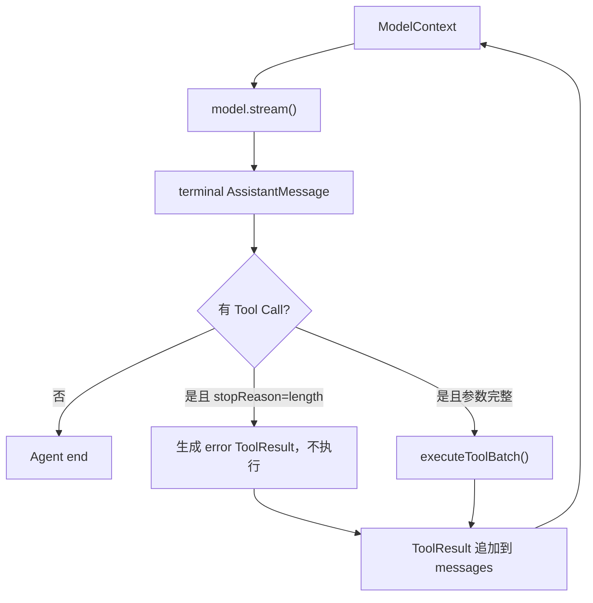

> 历史研究归档 · 2026-11-10 发布 · 发布审核状态：scan_only（发布前程序化隐私扫描）。原有日期、观点、数据和命令保留历史语境，未经本次逐项事实核验或运行复现；见[归档说明](../../../../../ARCHIVE_POLICY.md)。

# PI-I02 · 最小 Agent Loop：一次回答为什么会调用模型两次

> 一句话结论：Agent Loop 的核心不在 `while`，而在“Assistant 的 Tool Call 必须变成正式 ToolResult 消息，再进入下一次模型请求”这一状态不变量。

## 1. 定位与先修

这一课把 [PI-I01](PI-I01-%E7%BB%9F%E4%B8%80%E6%A8%A1%E5%9E%8B%E5%8D%8F%E8%AE%AE.md) 的稳定模型协议变成可持续运行的控制流；不重新讲 ReAct，若对“思考—行动—观察”陌生，再按需回看知识库 R24/R44 的 Agent Loop 入门部分。

完成后，你需要拿出三类证据：

| 层级 | 不是“看懂了”，而是能…… |
|---|---|
| 识别 | 从事件 Trace 判断当前处于哪一次模型请求 |
| 实现 | 修好 ToolResult 未回灌、截断 Tool Call 被误执行的问题 |
| 迁移 | 为永远调用工具的模型增加预算护栏，并说清与 Pi 原实现的差异 |

## 2. 闭卷唤醒：先写，后看

请暂时合上 PI-I01，用 5 分钟回答：

1. `ToolResult` 是日志，还是下一轮模型上下文中的正式消息？
2. `done` 与 `error` 为什么都必须携带最终 AssistantMessage？
3. 如果 Provider 换成另一家，Loop 应该修改吗？为什么？

不要追求一次答对。这个动作是检索练习（Retrieval Practice），目的在暴露记忆缺口，而不是评分。

## 3. 运行前预测

先预测下面任务的角色序列，再运行 Lab：

```text
User: What is 20 + 22?
Assistant: call add(a=20,b=22)
Tool: 42
Assistant: The answer is 42.
```

把以下卡片排序：

```text
第二次 model.stream
assistant(toolCall) 进入 transcript
toolResult 进入 transcript
第一次 model.stream
add.execute
assistant(final) 进入 transcript
```

再预测：若 Tool Call 的 AssistantMessage 是 `stopReason: "length"`，`add.execute` 应不应该运行？

## 4. Whole Game：只观察，不急着解释

```powershell
cd "C:/Users/USER\Documents\Codex\2026-07-28\new-chat-2\outputs\PI-Agent-Learning-Series\lab"
.\run-tests.ps1 -Iter iter02
```

实测基线：3 个测试覆盖“无工具即停止”“工具结果回灌”“length fail-closed”。测试文件是 [iter02-agent-loop.test.ts](../lab/tests/iter02-agent-loop.test.ts)，实现是 [agent-loop.ts](../lab/src/agent-loop.ts)。

## 5. 上一版为什么不够

PI-I01 的 `ScriptedModel` 已能产生统一的 text/tool-call 事件，但调用方仍不知道：

- 什么时候把最终 AssistantMessage 追加到 transcript；
- 什么时候执行工具；
- ToolResult 放在哪里；
- 何时再次请求模型；
- Provider 错误或无限 Tool Call 时怎样退出。

因此，协议只是“共同语言”，Loop 才是“对话的语法”。

## 6. 心智模型：消息驱动，而不是函数递归



四个不变量：

| 不变量 | 违反后果 |
|---|---|
| 每条模型流必须有 terminal message | Loop 不知道该提交什么，甚至永久等待 |
| Assistant Tool Call 先入 transcript | ToolResult 失去因果前项 |
| ToolResult 是下一次请求的输入 | 模型看不到环境反馈，只会猜测结果 |
| length 截断的 Tool Call 不执行 | JSON 即使可解析，也可能语义不完整，造成危险副作用 |

## 7. Pi 源码断点

以下链接固定到提交 `063fb963c5c33d099faa593d17e60e0a875430cd`，行号不会随主分支漂移。

| 进去只看什么 | 固定源码 |
|---|---|
| 公共入口如何构造本次新增消息与 Context | [`runAgentLoop()` L95–143](https://github.com/earendil-works/pi/blob/063fb963c5c33d099faa593d17e60e0a875430cd/packages/agent/src/agent-loop.ts#L95-L143) |
| 内层 Tool/Steering 与外层 Follow-up 两层循环 | [`runLoop()` L155–275](https://github.com/earendil-works/pi/blob/063fb963c5c33d099faa593d17e60e0a875430cd/packages/agent/src/agent-loop.ts#L155-L275) |
| `transformContext → convertToLlm → streamFn` 的模型边界 | [`streamAssistantResponse()` L281–372](https://github.com/earendil-works/pi/blob/063fb963c5c33d099faa593d17e60e0a875430cd/packages/agent/src/agent-loop.ts#L281-L372) |
| Agent/Turn/Message/Tool 四组事件 | [`AgentEvent` L415–437](https://github.com/earendil-works/pi/blob/063fb963c5c33d099faa593d17e60e0a875430cd/packages/agent/src/types.ts#L415-L437) |
| Stateful Agent 怎样包装 Loop | [`Agent.prompt()` L337–469](https://github.com/earendil-works/pi/blob/063fb963c5c33d099faa593d17e60e0a875430cd/packages/agent/src/agent.ts#L337-L469) |
| 官方最小 Fake Stream 测试夹具 | [`agent-loop.test.ts` L15–82](https://github.com/earendil-works/pi/blob/063fb963c5c33d099faa593d17e60e0a875430cd/packages/agent/test/agent-loop.test.ts#L15-L82) |

源码事实：Pi 一个 Turn 是“一次 Assistant 响应加该响应的整批工具结果”；一次 Agent Run 可以包含多个 Turn。Steering 不会中断正在执行的工具批次，Follow-up 只在 Agent 本来要结束时检查。

## 8. Build Delta：只读新增部分

PI-I02 相对 PI-I01 只增加 [agent-loop.ts](../lab/src/agent-loop.ts)：

1. 消费 Provider-neutral `ModelEvent`；
2. 提交 terminal AssistantMessage；
3. 找出 Tool Call 并调用注入的 `ToolBatchExecutor`；
4. 追加 ToolResult 后继续下一 Turn；
5. 把 Provider error 作为 AssistantMessage 收束；
6. 对 length 截断执行 fail-closed。

Lab 默认 `maxTurns=8` 是**课程强化**，不是当前 Pi Core 的默认行为。真实 Pi Core 没有固定最大 Turn 数，需要 `shouldStopAfterTurn` 或外部 Abort；此处的 8 是便于实验的初始值，不是性能结论，也不是推荐生产阈值。

## 9. 逐帧 Trace

```text
messages = [user]
  model call #1 sees: [user]
  append assistant(toolCall)
  execute add
  append toolResult("42")
messages = [user, assistant(toolCall), toolResult]
  model call #2 sees all three
  append assistant("The answer is 42.")
  no tool call → stop
```

关键自我解释题：为什么不能只把 `42` 放进本地变量，然后直接请求第二次模型？请回答“协议兼容、可重放、因果对应”三个维度，而不是只说“模型需要知道结果”。

## 10. Mini Pi 与真 Pi

| 维度 | Mini Pi | 真 Pi |
|---|---|---|
| 循环 | 单层模型—工具续轮 | 内层 Tool/Steering + 外层 Follow-up |
| Context | 直接复制 transcript | 可先 `transformContext`，再 `convertToLlm` |
| 事件 | 保留学习所需边界 | 更完整的 Agent/Turn/Message/Tool 生命周期，listener 被 await |
| 预算 | 课程版 `maxTurns` | Core 无固定最大 Turn；由 hook/Abort/上层策略控制 |
| 错误 | Provider error 与工具错误消息化 | 还覆盖 Abort、partial update、动态 next-turn snapshot |

Mini Pi 的测试通过不证明它能替代真 Pi，只证明选定的不变量被复现。

## 11. 故障注入

练习在 [exercises/PI-I02.md](../exercises/PI-I02.md)，答案不要提前打开。至少亲手制造一次：

- 删除 ToolResult 回灌，观察第二次 `model.calls[1]`；
- 让 `stopReason=length` 仍执行工具，先看到测试失败；
- 让模型永远返回 Tool Call，观察预算护栏；
- 让 stream 没有 `done/error`，确认 Loop 报出协议错误。

## 12. Teach-back 验收

合上文档，用 3–5 分钟讲给一个“只知道普通聊天 API”的同事：

| 分数 | 证据 |
|---:|---|
| 0 | 只能说“Loop 会重复调用模型” |
| 1 | 能说出 Assistant → Tool → Assistant |
| 2 | 能说明 ToolResult 是消息且进入下一次 Context |
| 3 | 能解释 length fail-closed、Turn 与 Run 的区别 |
| 4 | 能指出 Mini Pi 的 maxTurns 是课程强化，并提出另一种终止策略 |

达到 3 才算本课完成；测试绿但无法解释边界，仍是“会照着做”。

## 13. 延迟复习

- 24 小时后：闭卷画出一次 Tool Call 的消息序列，并标出两次模型请求各自看到什么。
- 7 天后：把 `add` 换成可能有副作用的 `write`，列出截断、重试和幂等性风险。

## 14. 下一 Iter 的必然性

目前 Loop 把 Tool Call 交给一个黑箱函数；它还回答不了“非法参数是否执行、两工具能否并发、完成乱序怎样回填、一个工具要求串行怎么办”。这正是 PI-I03 的工具执行管线。

