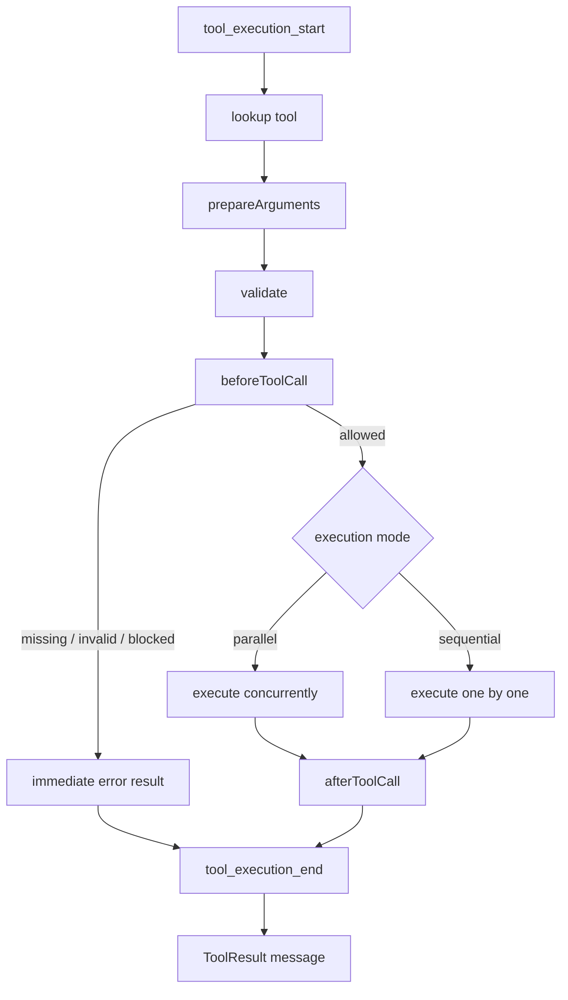
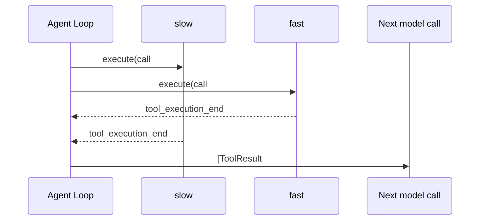

> 历史研究归档 · 2026-11-10 发布 · 发布审核状态：scan_only（发布前程序化隐私扫描）。原有日期、观点、数据和命令保留历史语境，未经本次逐项事实核验或运行复现；见[归档说明](../../../../../ARCHIVE_POLICY.md)。

# PI-I03 · 工具执行管线：并发有两种顺序

> 一句话结论：Pi 的工具并发不是“一股脑 Promise.all”，而是串行预检、受控执行、完成事件按时间发生、ToolResult 按原调用顺序回灌。

## 1. 定位与掌握证据

PI-I02 已决定“何时调用工具”；PI-I03 只回答“这批工具怎样安全、可观察、顺序稳定地执行”。

| 层级 | 完成证据 |
|---|---|
| 识别 | 能区分 `tool_execution_start` 与工具函数真正开始执行 |
| 实现 | 非法参数零执行；异常转 ToolResult；并发结果顺序稳定 |
| 迁移/批判 | 能解释 Hook 后不重校验的信任边界，并选择是否开启课程强化 |

## 2. 闭卷唤醒与预测

不看 PI-I02，先回答：

1. ToolResult 为什么必须保留 `toolCallId`？
2. `stopReason=length` 时，参数若恰好能通过 Schema，是否可执行？
3. 一次 Turn 在工具批次完成前结束了吗？

然后预测：Assistant 依次请求 `slow(30ms)`、`fast(1ms)`，两者允许并发。下面两个序列分别是什么？

```text
tool_execution_end 的顺序 = ?
下一次模型看到的 ToolResult 顺序 = ?
```

## 3. Whole Game

```powershell
cd "C:/Users/USER\Documents\Codex\2026-07-28\new-chat-2\outputs\PI-Agent-Learning-Series\lab"
.\run-tests.ps1 -Iter iter03
```

当前 4 个测试覆盖：参数/异常、并发双顺序、sequential override、Hook 二次校验。先只看测试名和失败信息，卡住后才打开 [tool-pipeline.ts](../lab/src/tool-pipeline.ts)。

## 4. 状态机



注意：Pi 在 lookup、Schema validation、`beforeToolCall` 之前就发 `tool_execution_start`。所以这个事件表示“进入管线”，不是“工具代码已经获得 CPU”。

## 5. Pi 源码断点

固定提交：`063fb963c5c33d099faa593d17e60e0a875430cd`。

| 进去只看什么 | 固定源码 |
|---|---|
| AgentTool 契约、update、executionMode | [`types.ts` L354–403](https://github.com/earendil-works/pi/blob/063fb963c5c33d099faa593d17e60e0a875430cd/packages/agent/src/types.ts#L354-L403) |
| 任一 sequential 工具如何令整批串行 | [`agent-loop.ts` L411–425](https://github.com/earendil-works/pi/blob/063fb963c5c33d099faa593d17e60e0a875430cd/packages/agent/src/agent-loop.ts#L411-L425) |
| 串行管线 | [`agent-loop.ts` L433–487](https://github.com/earendil-works/pi/blob/063fb963c5c33d099faa593d17e60e0a875430cd/packages/agent/src/agent-loop.ts#L433-L487) |
| 并行管线与双顺序 | [`agent-loop.ts` L489–554](https://github.com/earendil-works/pi/blob/063fb963c5c33d099faa593d17e60e0a875430cd/packages/agent/src/agent-loop.ts#L489-L554) |
| lookup、prepare、validate、before hook | [`agent-loop.ts` L586–664](https://github.com/earendil-works/pi/blob/063fb963c5c33d099faa593d17e60e0a875430cd/packages/agent/src/agent-loop.ts#L586-L664) |
| execute 异常怎样消息化 | [`agent-loop.ts` L666–707](https://github.com/earendil-works/pi/blob/063fb963c5c33d099faa593d17e60e0a875430cd/packages/agent/src/agent-loop.ts#L666-L707) |
| after hook 与结果覆盖 | [`agent-loop.ts` L709–754](https://github.com/earendil-works/pi/blob/063fb963c5c33d099faa593d17e60e0a875430cd/packages/agent/src/agent-loop.ts#L709-L754) |
| ToolResult 消息化 | [`agent-loop.ts` L756–792](https://github.com/earendil-works/pi/blob/063fb963c5c33d099faa593d17e60e0a875430cd/packages/agent/src/agent-loop.ts#L756-L792) |
| length 截断整批拒绝 | [`agent-loop.ts` L374–405](https://github.com/earendil-works/pi/blob/063fb963c5c33d099faa593d17e60e0a875430cd/packages/agent/src/agent-loop.ts#L374-L405) |
| 官方并发顺序测试 | [`agent-loop.test.ts` L586–679](https://github.com/earendil-works/pi/blob/063fb963c5c33d099faa593d17e60e0a875430cd/packages/agent/test/agent-loop.test.ts#L586-L679) |

## 6. Build Delta

[tool-pipeline.ts](../lab/src/tool-pipeline.ts) 新增三段职责：

1. `prepare()`：查找、兼容转换、校验、before hook；失败立即变成结构化结果。
2. `execute()`：运行工具并捕获异常，再执行 after hook。
3. `finalize()`：发结束事件、记录真实完成顺序、创建 ToolResult。

默认并发分支先逐个 `await prepare()`，再同时启动合法工具。这忠实保留了 Pi 的一个成本边界：慢 `beforeToolCall` 会延迟整批启动；“默认并发”不等于整个 Pipeline 的每一步都并发。

## 7. 双顺序为什么都正确



- UI/观测需要真实时间顺序，否则用户会误以为慢工具先结束。
- 模型上下文需要原 Tool Call 顺序，否则位置和因果关系会随网络时延漂移。
- `Promise.all` 恰好同时满足：Promise 的完成事件可乱序，返回数组仍按输入 Promise 顺序。

自我解释题：如果直接在每个 Promise 完成时 `messages.push(result)`，同一个输入为什么可能得到不同 transcript？这会怎样伤害重放和测试？

## 8. 忠实复刻与课程强化

Pi 当前顺序是：Schema 校验后调用 `beforeToolCall`。Hook 得到已验证对象并可以原地修改；修改后 Core 不再次校验。官方测试甚至覆盖了 Hook 把 String 改成 Number 后仍执行的行为。

Lab 提供两种显式模式：

| 模式 | 配置 | 含义 |
|---|---|---|
| Pi-faithful | 默认 | Hook 后不重校验，便于观察当前上游事实 |
| 教学强化 | `revalidateAfterBeforeHook: true` | 把跨信任域 Hook 的输出再次放回 Schema 边界 |

二次校验不是“Pi 已经这样做”的事实，而是本课程的改造建议。代价是一次本地校验和潜在兼容性变化；若 Hook 被视为同一可信进程内的内部代码，是否启用应由威胁模型决定。

## 9. 参数校验不是权限控制

Schema 只能回答“参数长得对不对”，不能回答：

- 这个用户能否读取该文件；
- 路径是否应被限制在工作区；
- Bash 是否运行在容器或沙箱；
- 这个 Hook 是否可信。

Pi 的 `read/edit/write` 可处理绝对路径，Bash 继承当前用户的系统权限；安全隔离要靠容器、外部 sandbox 或可信 Extension 策略。把 validation 叫作 sandbox 是错误心智模型。

## 10. Mini Pi 与真 Pi

| 保留 | 省略 / 后续再学 |
|---|---|
| `prepareArguments → validate → before → execute → after` | TypeBox coercion 的完整细节 |
| 缺工具、校验错、execute/after 抛错均消息化 | AbortSignal、partial updates、usage/details |
| 并发双顺序与整批 sequential override | `terminate` 的整批 `every()` 语义 |
| Hook 后默认不重校验 + 可选 hardening | Extension Runtime 的完整 Hook 汇聚 |
| ToolResult 正式回灌模型 | Edit/Write 同文件 mutation queue |

真实 Pi 的同文件写入还有专门队列：同一 real path 串行、不同文件仍并行。当前 Lab 没有实现它，因此不要用本实验推断文件写入无竞态。

## 11. 成本与天花板

- 并发通常降低 I/O 工具批次的墙钟时间，但这里没有做性能基准，收益大小待具体工具实测。
- 串行预检使 Hook 行为确定、事件易解释，却让慢 Hook 成为批次启动瓶颈。
- 任一 sequential 工具令整批串行，策略简单保守；复杂调度器可做依赖图分组，但实现、观测和死锁风险都会上升。
- 错误消息化让模型有机会恢复，也可能造成无止境重试；需要 PI-I02 的预算/停止策略共同约束。

## 12. 故障注入与验收

练习见 [exercises/PI-I03.md](../exercises/PI-I03.md)。完成标准：

- 非法参数的 execute 计数严格为 0；
- execute throw 只产生 `isError=true` ToolResult，Agent 不崩；
- fast 的结束事件先出现，但结果数组仍是 slow、fast；
- 任一 sequential 工具使 `maxActive=1`；
- 能用测试证明默认 Hook 边界，并清楚标注 hardening 是课程建议。

## 13. Teach-back Rubric

| 分数 | 证据 |
|---:|---|
| 0 | 只会说“工具可以并发” |
| 1 | 能说出先校验再执行 |
| 2 | 能解释异常为什么转 ToolResult |
| 3 | 能画出双顺序，解释整批 sequential override |
| 4 | 能区分 validation/authorization/sandbox，并批判 Hook 重校验取舍 |

达到 3 后再进入后续 Iter。

## 14. 延迟复习与下一步

- 24 小时后：闭卷写出从 `tool_execution_start` 到 ToolResult 的 7 个阶段。
- 7 天后：设计两个会修改同一文件的工具，说明只靠 `executionMode=parallel` 为什么会丢更新，并提出路径级队列。

当前系统仍缺“运行中的状态、事件归约、Steering 与 Follow-up 队列”。PI-I04 将从事件日志反推 Agent 状态机。

