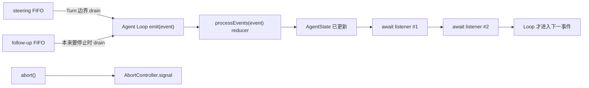

> 历史研究归档 · 2026-11-10 发布 · 发布审核状态：scan_only（发布前程序化隐私扫描）。原有日期、观点、数据和命令保留历史语境，未经本次逐项事实核验或运行复现；见[归档说明](../../../../../ARCHIVE_POLICY.md)。

# PI-I04 · Agent 状态与消息队列：事件先归约，监听器再放行

> 一句话结论：Pi 的 `Agent` 是“事件流 → 状态投影 → 等待监听器”的有状态外壳；`steer` 与 `followUp` 只是把消息放入不同消费时机的 FIFO 队列，`steer` 不是硬中断。

## 1. 定位、先修与掌握证据

**结论：I04 从“Loop 能跑”推进到“运行中发生了什么、外部何时可以相信状态”。**

先修 [PI-I02](PI-I02-%E6%9C%80%E5%B0%8FAgentLoop.md) 的两层循环与 [PI-I03](PI-I03-%E5%B7%A5%E5%85%B7%E6%89%A7%E8%A1%8C%E7%AE%A1%E7%BA%BF.md) 的 Tool Event。R156 已给出全景地图；本课新增逐事件状态表、监听器屏障和两类消息队列的精确消费点。

纵向看，I01–03 依次解决协议、控制流和工具执行，I04 才给这些瞬时事件一个可查询的运行时状态。横向看，三种“改变正在运行任务”的方式并不等价：

| API | 实际动作 | 何时生效 | 是否硬中断 |
|---|---|---|---|
| `steer(message)` | 入 steering 队列 | 正常路径在当前 Assistant Turn（含整批工具）结束后的 drain point | 否 |
| `followUp(message)` | 入 follow-up 队列 | Agent 本来要停止时 | 否 |
| `abort()` | 触发当前 `AbortController` | 由当前流/工具对 AbortSignal 的响应速度决定 | 是“请求取消”，但不保证同步瞬停 |

完成本课要拿出三类证据：

| 层级 | 掌握证据 |
|---|---|
| 识别 | 给出事件 Trace，能写出每一步的 `streamingMessage`、`messages`、`pendingToolCalls` |
| 实现 | 能设计一个“先归约、后 await 监听器”的 reducer，并证明 `waitForIdle()` 不会提前完成 |
| 迁移 | 能解释为什么 UI 完成顺序、模型上下文顺序和队列消费顺序不能混为一谈 |

## 2. 闭卷唤醒：先写再看

**结论：闭卷问题不是考试，而是定位尚未形成稳定心智模型的缺口。**

合上 I02/I03，用 5 分钟回答：

1. `message_update` 应不应该追加进 transcript？为什么？
2. `tool_execution_start` 出现时，工具函数一定已经开始执行了吗？
3. `agent_end` 监听器正在做异步持久化时，`isStreaming` 应该是什么？
4. 两条 steering 消息在 `one-at-a-time` 模式下会在哪些 Turn 被注入？
5. 如果想立即取消模型流，应该调用 `steer` 还是 `abort`？

把不确定项画圈。本课结束后只重答画圈项，避免无差别重读。

## 3. 运行前预测：慢监听器、慢工具与一条 steer

**结论：先预测时间线，才能发现自己是否把“事件已发出”误当成“运行已结算”。**

设定：

- Assistant 发出 `read` Tool Call；
- `tool_execution_start` 后工具需要 30 ms；
- 第一个订阅者在 `agent_end` 上额外等待 50 ms；
- 工具执行中用户调用 `steer(S1)`；
- steering 模式是 `one-at-a-time`。

先预测四件事：

1. `S1` 会不会让当前 `read` 立刻停止？
2. `pendingToolCalls` 在哪两个事件之间包含该 call id？
3. `S1` 是在工具前、工具中还是当前 Turn 完成后进入 transcript？
4. `agent_end` 已发出但慢监听器未结束时，`waitForIdle()` 会不会完成？

答案必须包含事件名，而不是只写“之前/之后”。

## 4. Whole Game：沿源码追一遍完整状态变化

**结论：本 Iter 的 Whole Game 是固定提交源码追踪；当前 Mini Pi 尚未实现 I04，不能运行一个不存在的 `iter04` 测试。**

按以下顺序只读指定范围：

1. 在 `Agent.prompt()` 创建 active run；
2. Loop 发出 `message_*` 与 `tool_execution_*`；
3. `processEvents()` 先修改状态；
4. 同一个 `processEvents()` 再按订阅顺序 `await` 监听器；
5. Turn 结束后才轮询 steering；
6. 本来要停止时才轮询 follow-up；
7. `agent_end` 的监听器全部完成后，`finishRun()` 才清运行态并放行 `waitForIdle()`。

观察时给每个事件写两列：`state after reducer` 与 `listener can observe`。两列应该相同，因为监听器在归约之后运行。

## 5. 上一版为什么不够

**结论：I03 的 Loop 与工具管线能产生事件，但没有有状态外壳就无法可靠驱动 UI、持久化和交互中追加消息。**

只保留 I03 会缺少：

- 流式 Assistant Message 的当前快照；
- 已完成 transcript 与流式草稿的区分；
- 正在工具管线中的 call id 集合；
- Agent 是否仍在结算的可靠信号；
- 异步监听器完成前的背压（backpressure）；
- 运行中输入的 steering/follow-up 队列；
- 明确的 abort 与排队语义。

说白了，Loop 回答“下一步执行什么”，Agent State 回答“外部现在能相信什么”。

## 6. 心智模型：Reducer 在前，Listener Barrier 在后

**结论：一次事件的原子观察边界是“先归约状态，再依次等待所有 Agent 监听器”。**



状态不是独立真相源，而是事件前缀的投影：

| 事件 | 状态归约 |
|---|---|
| `message_start` | `streamingMessage = event.message` |
| `message_update` | 更新 `streamingMessage`，不追加 transcript |
| `message_end` | 清空 `streamingMessage`，把最终消息追加到 `messages` |
| `tool_execution_start` | 复制 Set 后加入 `toolCallId` |
| `tool_execution_end` | 复制 Set 后删除 `toolCallId` |
| `turn_end` 且 Assistant 有错误 | 更新 `errorMessage` |
| `agent_end` | 清 `streamingMessage`；尚未立刻变 idle |
| `finishRun` | `isStreaming=false`、清运行态、resolve idle promise |

复制 `Set` 的意义是给观察者新的顶层引用；它没有把整个 `AgentState` 变成不可变对象。

## 7. 固定源码断点

**结论：下面的链接全部固定到提交 `063fb963c5c33d099faa593d17e60e0a875430cd`，用于把每个结论落到代码。**

| 进去只看什么 | 固定源码 |
|---|---|
| `AgentState` 的公共字段与只读运行态 | [`types.ts` L327–351](https://github.com/earendil-works/pi/blob/063fb963c5c33d099faa593d17e60e0a875430cd/packages/agent/src/types.ts#L327-L351) |
| 初始状态、数组赋值复制与空 pending Set | [`agent.ts` L60–93](https://github.com/earendil-works/pi/blob/063fb963c5c33d099faa593d17e60e0a875430cd/packages/agent/src/agent.ts#L60-L93) |
| `all` / `one-at-a-time` 的 FIFO drain | [`agent.ts` L123–157](https://github.com/earendil-works/pi/blob/063fb963c5c33d099faa593d17e60e0a875430cd/packages/agent/src/agent.ts#L123-L157) |
| 监听器等待契约、steer/follow-up 与 abort 的分界 | [`agent.ts` L233–323](https://github.com/earendil-works/pi/blob/063fb963c5c33d099faa593d17e60e0a875430cd/packages/agent/src/agent.ts#L233-L323) |
| `continue()` 在 Assistant 尾部优先消费 steering，再消费 follow-up | [`agent.ts` L336–376](https://github.com/earendil-works/pi/blob/063fb963c5c33d099faa593d17e60e0a875430cd/packages/agent/src/agent.ts#L336-L376) |
| Context 快照与队列回调如何交给 Loop | [`agent.ts` L398–469](https://github.com/earendil-works/pi/blob/063fb963c5c33d099faa593d17e60e0a875430cd/packages/agent/src/agent.ts#L398-L469) |
| active run 创建、失败消息化与最终清理 | [`agent.ts` L471–520](https://github.com/earendil-works/pi/blob/063fb963c5c33d099faa593d17e60e0a875430cd/packages/agent/src/agent.ts#L471-L520) |
| 状态 reducer 与按序 await listener | [`agent.ts` L522–576](https://github.com/earendil-works/pi/blob/063fb963c5c33d099faa593d17e60e0a875430cd/packages/agent/src/agent.ts#L522-L576) |
| steering 的 Turn 边界与 follow-up 的停止边界 | [`agent-loop.ts` L155–275](https://github.com/earendil-works/pi/blob/063fb963c5c33d099faa593d17e60e0a875430cd/packages/agent/src/agent-loop.ts#L155-L275) |
| 官方测试如何证明异步订阅者被等待 | [`agent.test.ts` L190–262](https://github.com/earendil-works/pi/blob/063fb963c5c33d099faa593d17e60e0a875430cd/packages/agent/test/agent.test.ts#L190-L262) |
| E2E 如何观察 `pendingToolCalls` | [`e2e.test.ts` L55–107](https://github.com/earendil-works/pi/blob/063fb963c5c33d099faa593d17e60e0a875430cd/packages/agent/test/e2e.test.ts#L55-L107) |

## 8. Build Delta / 学习实验

**结论：I04 的代码增量目前是待实现的课程设计，不是已经进入 Mini Pi 的事实。**

### 8.1 源码事实与课程待实现必须分开

| 项目 | 真 Pi 固定源码事实 | 当前 Mini Pi |
|---|---|---|
| State reducer | `processEvents()` 先归约后通知 | 未实现 |
| Listener barrier | Agent 监听器逐个 await | 未实现 |
| pending Tool Calls | start 加入、end 删除 | 未实现 |
| 两类队列 | 独立 FIFO、独立 drain point | 未实现 |
| Queue mode | `all` / `one-at-a-time` | 未实现 |
| Abort | 独立 AbortController | I04 未扩展 |

以下仅是**伪代码/待实现**，没有运行、没有测试通过记录：

```ts
// 伪代码/待实现
async function reduceThenNotify(event: AgentEvent) {
  state = reduce(state, event);
  for (const listener of listeners) {
    await listener(event, signal);
  }
}

// 伪代码/待实现
function drain(queue, mode) {
  return mode === "all" ? queue.takeAll() : queue.takeOldest(1);
}
```

建议未来用四个 RED 测试驱动实现：

1. `message_update` 不进入 transcript；
2. 慢 `agent_end` listener 完成前 `waitForIdle` 不 resolve；
3. Tool start/end 精确维护 pending Set；
4. 两条 steering 在两种 queue mode 下得到不同注入批次。

这些测试尚未创建或运行，不能写成“已验证”。

## 9. 事件 / 状态 Trace

**结论：steering 只改变后续输入，不回滚当前 Turn，也不跳过当前工具批次。**

假设 `S1` 在工具执行期间入队：

| 时刻 | 事件/动作 | 关键状态 | 队列 |
|---:|---|---|---|
| 1 | run 创建 | `isStreaming=true` | 空 |
| 2 | `message_start(assistant)` | 有 `streamingMessage` | 空 |
| 3 | 多次 `message_update` | 草稿变化；`messages` 未追加 | 空 |
| 4 | `message_end(assistant toolCall)` | 草稿清空；Assistant 入 transcript | 空 |
| 5 | `tool_execution_start(id=R)` | `pendingToolCalls={R}` | 空 |
| 6 | 用户调用 `steer(S1)` | 工具状态不变 | steering=[S1] |
| 7 | `tool_execution_end(id=R)` | `pendingToolCalls={}` | steering=[S1] |
| 8 | ToolResult `message_end`、`turn_end` | ToolResult 已入 transcript | steering=[S1] |
| 9 | Loop drain steering | 状态未被强制取消 | steering=[] |
| 10 | `message_start/end(S1)` | S1 入 transcript，随后请求下一 Assistant | 空 |
| 11 | 最终 `agent_end` | 最后事件已发出，listener 仍可能运行 | 空 |
| 12 | 所有 listener settle，`finishRun` | `isStreaming=false`，idle promise resolve | 空 |

两个易错点：

- `pendingToolCalls` 表示“call id 已进入工具执行管线且尚未收到 end”，不是“工具业务函数一定正在占用 CPU”；I03 已看到 start 在 lookup/validation 之前发出。
- `agent_end` 是“不会再有 Loop 事件”，不是“所有订阅者副作用均已完成”。

## 10. one-at-a-time 与 all：改变批次，不改变优先级

**结论：Queue mode 只决定一次 drain 取几条；FIFO、steering/follow-up 的消费位置都不变。**

队列中已有 `S1,S2`：

| 模式 | 第一次 steering drain | 之后 |
|---|---|---|
| `all` | 同时注入 `[S1,S2]` | 队列为空 |
| `one-at-a-time` | 只注入 `[S1]` | `S2` 留到下一 drain point |

队列中已有 `F1,F2` 也遵循相同批次规则，但只有 Agent 本来要停止时才 drain。它不是“比 steering 更晚到达”，而是**语义上更晚消费**。

## 11. Mini Pi 与真 Pi

**结论：本课可以先用伪状态机理解，但不能把未实现的 Mini Pi 当成源码复刻。**

| 维度 | I04 课程目标 | 真 Pi |
|---|---|---|
| 状态 | 最小 `messages/streaming/pending/error` | 完整 `AgentState` 与复制语义 |
| 监听 | 演示 async barrier | 订阅顺序逐个 await，并接入 run settlement |
| 队列 | 两个 FIFO + 两种 drain mode | 还覆盖 `continue()`、清队列与初始 steering poll |
| 取消 | 区分 queue 与 abort | AbortSignal 贯穿模型流和工具 |
| 事件消费者 | 一个教学 listener | AgentSession 的扩展、持久化、UI 等内部消费者 |

Mini Pi 尚无 I04 实现；任何性能、竞态或取消延迟结论都待实验。

## 12. 故障注入

**结论：最有价值的故障不是随机 throw，而是故意破坏一个时间不变量。**

练习见 [PI-I04 练习](../exercises/PI-I04.md)。至少完成两项：

- 把 listener 改成 fire-and-forget，观察“prompt 已完成但持久化未完成”的风险；
- 在 `message_update` 时追加 transcript，观察同一 Assistant 被重复存储；
- 在工具结束前 drain steering，观察 steering 被误解成抢占；
- 把 follow-up 与 steering 合并成一个队列，解释产品语义如何丢失；
- `tool_execution_end` 忘记删除 id，观察 UI 永久显示“工具运行中”。

这里要求写预测 Trace；当前没有 I04 可运行 Lab，禁止标注“测试通过”。

## 13. Teach-back Rubric

**结论：能画时序并指出边界，才算超过“知道有两个队列”。**

合上文档，向只熟悉聊天 API 的同事讲 4 分钟：

| 分数 | 证据 |
|---:|---|
| 0 | 只会说 Pi 有状态、有队列 |
| 1 | 能说出 streaming 草稿与最终 transcript 不同 |
| 2 | 能用 start/end 解释 `pendingToolCalls` |
| 3 | 能解释 reducer-before-listener、`agent_end ≠ idle`、steer 不是硬中断 |
| 4 | 能画出 steering/follow-up 两个 drain point，并分析 listener 背压的成本 |

达到 3 再进入 I05；达到 4 说明已能评审类似事件驱动 Harness。

## 14. 24 小时 / 7 天复习

**结论：延迟回忆要复现因果链，不要只背字段名。**

- 24 小时后：闭卷画 `message_start → update → end → tool start → tool end → agent_end → idle`，在每个节点写状态差量。
- 7 天后：设计三条并发输入 `S1,S2,F1`，分别推演两种 queue mode；再解释为什么 `abort` 不能由 `steer` 替代。

## 15. 下一 Iter：为什么必须引入 AgentSession

**结论：Agent 已能执行和暴露状态，但还不知道产品输入如何预处理、能力如何编译、消息如何持久化、错误如何重试或压缩。**

I05 将把 `AgentSession.prompt()` 与 `_runAgentPrompt()` 分开：前者做输入、扩展、模型与能力预检，后者把一次产品请求包装成可能包含 retry/compaction/continue 的多次 Core Run。

## Sources and freshness

- [Pi `agent.ts`（固定提交）](https://github.com/earendil-works/pi/blob/063fb963c5c33d099faa593d17e60e0a875430cd/packages/agent/src/agent.ts) - retrieved 2026-07-31 - 状态归约、订阅屏障、队列与 active run
- [Pi `agent-loop.ts`（固定提交）](https://github.com/earendil-works/pi/blob/063fb963c5c33d099faa593d17e60e0a875430cd/packages/agent/src/agent-loop.ts) - retrieved 2026-07-31 - steering/follow-up 消费时机
- [Pi `agent.test.ts`（固定提交）](https://github.com/earendil-works/pi/blob/063fb963c5c33d099faa593d17e60e0a875430cd/packages/agent/test/agent.test.ts) - retrieved 2026-07-31 - async listener、队列与 continue 行为验证
- 内部基础：Obsidian Vault `R156_PI_Agent核心架构源码导读.md` - checked 2026-07-31 - 本课在其全景地图上新增逐事件教学 Trace

Consistency: 本地 clone HEAD 与固定提交 `063fb963c5c33d099faa593d17e60e0a875430cd` 一致；源码与官方测试对监听器等待和队列时机一致。

Unverified: I04 Mini Pi 尚未实现，本文伪代码、故障注入和建议测试均未运行；不同 Provider/工具对 AbortSignal 的实际取消延迟待实测。
