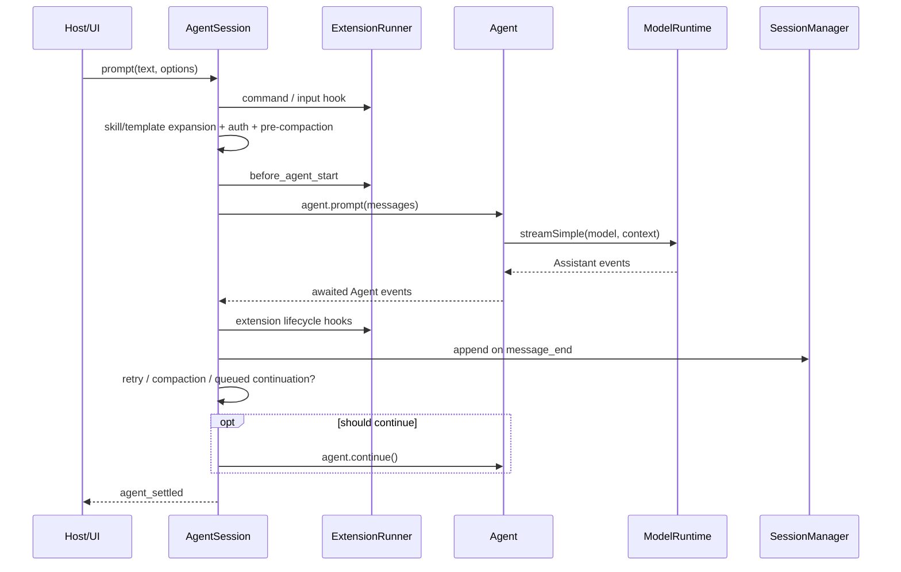
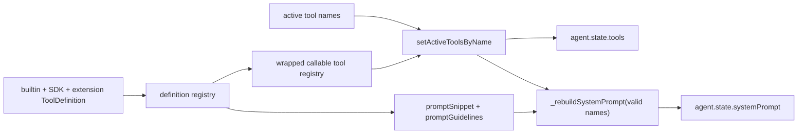

> 历史研究归档 · 2026-11-10 发布 · 程序扫描；未逐篇全文审阅。原有日期、观点、数据和命令保留历史语境，未经本次逐项事实核验或运行复现；请结合[归档说明](../../../../../ARCHIVE_POLICY.md)阅读。

# PI-I05 · AgentSession 与能力编译：一次 Prompt 可能包含多次 Core Run

> 一句话结论：`AgentSession` 是 Pi 的产品控制面——它把输入预处理、Extension Hooks、模型运行时、能力一致的 System Prompt/Tools、事件持久化以及 retry/compaction 包在 `Agent` 外；`AgentSessionRuntime` 则负责替换整套 cwd-bound 会话运行环境，两者不能混用。

## 1. 定位、先修与四个对象

**结论：I05 不再扩写 Agent Loop，而是解释产品语义如何包住执行内核。**

先修 [PI-I04](PI-I04-Agent%E7%8A%B6%E6%80%81%E4%B8%8E%E6%B6%88%E6%81%AF%E9%98%9F%E5%88%97.md) 的 reducer、listener barrier 和消息队列。R156 已判断 `AgentSession` 是架构中心；本课新增一条可复述的 Prompt 主链、能力编译不变量和四个同名近邻的边界。

| 对象 | 拥有什么 | 不负责什么 |
|---|---|---|
| `Agent` | transcript、流式状态、工具执行、steer/follow-up、事件 | Skill/模板展开、会话文件、产品级 retry/compaction |
| `AgentSession` | 单个会话的产品语义：输入、扩展、能力、持久化、重试、压缩 | 替换整个 cwd 服务图 |
| `AgentSessionRuntime` | 当前 Session + cwd-bound services + diagnostics；负责 new/resume/import/fork 时 teardown/recreate/rebind | 单个 Prompt 内的 Agent Loop |
| `ModelRuntime` | Provider/模型注册、认证、headers/env、兼容配置与 stream 路由 | 会话树、消息队列、Prompt 模板 |

纵向看，`AgentSession.prompt → Agent.prompt → runLoop → ModelRuntime → Provider` 是调用链；横向看，`AgentSessionRuntime` 站在调用链外侧，管理“当前整套会话对象是否要被替换”。

完成本课要拿出：

| 层级 | 掌握证据 |
|---|---|
| 识别 | 能把 `prompt()` 的预处理和 `_runAgentPrompt()` 的运行包装分开 |
| 实现 | 能设计 Prompt/Tool Coherence Test：关闭工具后，schema 与提示词同时消失 |
| 迁移 | 能解释错误消息为何保留在 Session 历史、却从下一次 Agent Context 删除 |

## 2. 闭卷唤醒

**结论：先暴露“Session 只是 Agent 的别名”这一常见误解。**

不看 I04/R156，回答：

1. 正在 streaming 时再次调用 `AgentSession.prompt()`，为什么必须显式选择 `steer` 或 `followUp`？
2. 用户消息是在 public `prompt()` 开始时持久化，还是在 Agent 发出某个事件后持久化？
3. 关闭 `bash` 时，只删 Tools API 中的 schema 是否足够？
4. transient error 已写入 JSONL 后，自动重试为何还要从 `agent.state.messages` 删除它？
5. `AgentSessionRuntime.switchSession()` 与 `AgentSession.prompt()` 的生命周期范围有什么不同？

圈出靠猜的答案，课后只重做这些项。

## 3. 运行前预测：能力切换与一次 transient error

**结论：先预测“一个用户 Prompt 究竟会触发几次 Core Run 和几次模型调用”。**

场景：

1. Active tools 从 `[read,bash,edit,write]` 改成 `[read,edit]`；
2. 用户输入经过 `input` Hook 转换；
3. `before_agent_start` 追加一条 custom message 并临时修改 system prompt；
4. 第一次模型响应为可重试的 529；
5. 退避后第二次成功；
6. 所有消息都由 SessionManager 持久化。

预测：

- 模型看到的 tools 中有没有 `bash`？
- base system prompt 是否还应该宣称 `bash` 可用？
- 临时 system prompt override 会不会污染下一次用户 Prompt？
- JSONL 是否保留第一次 529 对应的 Assistant 错误？
- 第二次请求的 Agent Context 是否仍包含该错误？
- `agent_end` 会出现几次，`agent_settled` 出现几次？

提示：一次产品级 Prompt 可以包含多次 `agent.continue()`；`agent_settled` 属于外层包装。

## 4. Whole Game：从 public prompt 追到 settled

**结论：读 `AgentSession` 时按一条真实 Prompt 纵切，不要从 3,000 多行文件首行线性阅读。**

按这条链追踪：



Whole Game 的九个检查点：

1. Extension command 可在 streaming 时立即处理；
2. `input` Hook 发生在 Skill/模板展开之前；
3. streaming 输入必须选择 steering/follow-up；
4. 非 streaming 输入先做模型与认证检查；
5. 新 Prompt 前可先检查 compaction；
6. `before_agent_start` 可加 custom message 或临时替换 system prompt；
7. `_runAgentPrompt()` 执行 Core Run，再处理 retry/compaction/队列；
8. `message_end` 经过 Extension 后落 SessionManager；
9. 所有 continuation 完成后才发 `agent_settled`。

当前 Mini Pi 没有 I05 Session 层；这一节是固定源码 Whole Game，不是本地运行结果。

## 5. 上一版为什么不够

**结论：I04 的 Agent 能正确执行，但仍不具备 Coding Agent 的产品上下文。**

裸 `Agent` 不知道：

- `/skill:name` 与 Prompt Template 如何展开；
- Extension command/input/before_agent_start 如何拦截输入；
- Provider 是否已配置认证；
- Active tools 变化后提示词如何同步；
- 消息何时写入会话树；
- transient error 如何退避重试；
- overflow 何时压缩并只恢复一次；
- cwd、资源加载器、诊断与 Session 替换如何重建。

因此“Agent 能跑”不等于“产品会话可恢复、可扩展、可运营”。

## 6. 心智模型：产品控制面包住执行内核

**结论：`AgentSession` 通过三个回路同时工作——输入编译、事件落盘、运行后恢复。**

```mermaid
flowchart TD
  H["Host / TUI / RPC / SDK"] --> R["AgentSessionRuntime\n替换 session + cwd services"]
  R --> S["AgentSession\n单会话产品控制面"]
  S --> I["Input compiler\ncommand → input hook → skill/template"]
  S --> C["Capability compiler\nTool Registry → tools + system prompt"]
  S --> A["Agent\nstate + loop + queues"]
  A --> M["ModelRuntime\nauth + provider + stream"]
  A --> E["Agent events"]
  E --> X["Extension hooks"]
  E --> P["SessionManager persistence"]
  E --> O["Host listeners"]
  S --> W["Post-run wrapper\nretry / compaction / continuation"]
  W --> A
```



三个回路的边界：

- 输入编译发生在 Core Run 前；
- 事件落盘由 Agent 的 awaited subscriber 驱动；
- retry/compaction 在一次 Core Run 的 `agent_end` 后决定是否 `continue()`。

## 7. public prompt 与 private runner

**结论：`prompt()` 做 preflight；`_runAgentPrompt()` 把一个产品请求扩展成一个或多个 Agent Run。**

### 7.1 `AgentSession.prompt()`

顺序是：

1. 尝试 Extension command；
2. 发 `input` Hook，可 handled/transform；
3. 展开 Skill 命令和 Prompt Template；
4. 若正在 streaming，明确入 steering 或 follow-up 队列并返回；
5. flush pending Bash messages；
6. 校验 model 与 auth；
7. 新输入前检查上次 Assistant 是否需要 compaction；
8. 组装 User + pending next-turn custom messages；
9. 发 `before_agent_start`，接纳扩展消息与临时 system prompt；
10. 交给 `_runAgentPrompt(messages)`。

### 7.2 `_runAgentPrompt()`

它先 `agent.prompt`，随后循环：

```text
Core Run 结束
  ├─ retryable error? → backoff → agent.continue()
  ├─ overflow/threshold? → compaction；需要恢复时 continue()
  ├─ agent_end hook 又排了消息? → continue()
  └─ 都没有 → 清本 Turn 的 prompt override → agent_settled
```

因此计数时必须分开：

- User Prompt：产品级意图；
- Agent Run：一次 `prompt/continue` 的核心运行；
- Model Call：Run 内还可能因工具调用产生多次；
- Compaction/Summary Call：额外模型调用，不属于主回答本身。

## 8. 能力一致的提示词编译

**结论：同一个 Active Tool Registry 同时决定“模型可调用什么”和“System Prompt 宣称什么”。**

这不是简单拼字符串，而是能力编译（capability compilation）：



关键不变量：

```text
AdvertisedCapabilities(systemPrompt)
  ⊆ CallableCapabilities(agent.state.tools)
```

Pi 用 active names 同时更新两侧，大幅降低“提示词让模型调用一个实际上不存在的工具”这种漂移。它仍不是权限系统：Extension Hook、工具实现和宿主 OS 权限是另一层信任边界。

## 9. 固定源码断点

**结论：下面每个断点回答一个架构问题，全部固定到提交 `063fb963c5c33d099faa593d17e60e0a875430cd`。**

| 架构问题 | 固定源码 |
|---|---|
| `AgentSessionEvent` 与同步 listener 类型契约 | [`agent-session.ts` L140–184](https://github.com/earendil-works/pi/blob/063fb963c5c33d099faa593d17e60e0a875430cd/packages/coding-agent/src/core/agent-session.ts#L140-L184) |
| `AgentSession` 持有哪些状态，构造时如何订阅 Agent 并建 runtime | [`agent-session.ts` L303–405](https://github.com/earendil-works/pi/blob/063fb963c5c33d099faa593d17e60e0a875430cd/packages/coding-agent/src/core/agent-session.ts#L303-L405) |
| Model auth 为什么属于 ModelRuntime 边界 | [`agent-session.ts` L407–438](https://github.com/earendil-works/pi/blob/063fb963c5c33d099faa593d17e60e0a875430cd/packages/coding-agent/src/core/agent-session.ts#L407-L438) |
| Tool call/result Extension Hooks 如何装到 Agent 接缝 | [`agent-session.ts` L460–518](https://github.com/earendil-works/pi/blob/063fb963c5c33d099faa593d17e60e0a875430cd/packages/coding-agent/src/core/agent-session.ts#L460-L518) |
| 每个 Turn 后怎样刷新 system prompt/tools/model/thinking | [`agent-session.ts` L520–540](https://github.com/earendil-works/pi/blob/063fb963c5c33d099faa593d17e60e0a875430cd/packages/coding-agent/src/core/agent-session.ts#L520-L540) |
| Agent 事件如何先给扩展/监听者，再在 `message_end` 持久化 | [`agent-session.ts` L594–666](https://github.com/earendil-works/pi/blob/063fb963c5c33d099faa593d17e60e0a875430cd/packages/coding-agent/src/core/agent-session.ts#L594-L666) |
| Extension 如何替换最终 message 且保持 state/event/store 同步 | [`agent-session.ts` L695–765](https://github.com/earendil-works/pi/blob/063fb963c5c33d099faa593d17e60e0a875430cd/packages/coding-agent/src/core/agent-session.ts#L695-L765) |
| `AgentSession.subscribe` 为什么不等待 async Promise | [`agent-session.ts` L795–809](https://github.com/earendil-works/pi/blob/063fb963c5c33d099faa593d17e60e0a875430cd/packages/coding-agent/src/core/agent-session.ts#L795-L809) |
| Active tools 如何同时更新 Tool API 与 base prompt | [`agent-session.ts` L920–1055](https://github.com/earendil-works/pi/blob/063fb963c5c33d099faa593d17e60e0a875430cd/packages/coding-agent/src/core/agent-session.ts#L920-L1055) |
| product run 如何包住 retry/compaction/queued continuation | [`agent-session.ts` L1061–1103](https://github.com/earendil-works/pi/blob/063fb963c5c33d099faa593d17e60e0a875430cd/packages/coding-agent/src/core/agent-session.ts#L1061-L1103) |
| 一条用户输入的完整 preflight 与 Hook 顺序 | [`agent-session.ts` L1114–1265](https://github.com/earendil-works/pi/blob/063fb963c5c33d099faa593d17e60e0a875430cd/packages/coding-agent/src/core/agent-session.ts#L1114-L1265) |
| overflow 与 threshold compaction 为何语义不同 | [`agent-session.ts` L1942–2011](https://github.com/earendil-works/pi/blob/063fb963c5c33d099faa593d17e60e0a875430cd/packages/coding-agent/src/core/agent-session.ts#L1942-L2011) |
| Registry 如何汇总 builtin/SDK/extension 并编译 active tools | [`agent-session.ts` L2455–2600](https://github.com/earendil-works/pi/blob/063fb963c5c33d099faa593d17e60e0a875430cd/packages/coding-agent/src/core/agent-session.ts#L2455-L2600) |
| transient error 的指数退避与 Context 删除 | [`agent-session.ts` L2631–2725](https://github.com/earendil-works/pi/blob/063fb963c5c33d099faa593d17e60e0a875430cd/packages/coding-agent/src/core/agent-session.ts#L2631-L2725) |
| SDK 怎样把 Agent stream 接到 ModelRuntime，再构造 Session | [`sdk.ts` L292–397](https://github.com/earendil-works/pi/blob/063fb963c5c33d099faa593d17e60e0a875430cd/packages/coding-agent/src/core/sdk.ts#L292-L397) |
| System Prompt 怎样根据 selected tools 生成工具与规则 | [`system-prompt.ts` L8–100](https://github.com/earendil-works/pi/blob/063fb963c5c33d099faa593d17e60e0a875430cd/packages/coding-agent/src/core/system-prompt.ts#L8-L100) |
| `AgentSessionRuntime` 的职责为何是 teardown/recreate/rebind | [`agent-session-runtime.ts` L67–191](https://github.com/earendil-works/pi/blob/063fb963c5c33d099faa593d17e60e0a875430cd/packages/coding-agent/src/core/agent-session-runtime.ts#L67-L191) |
| `ModelRuntime` 如何组合认证、Provider 与 stream | [`model-runtime.ts` L368–502](https://github.com/earendil-works/pi/blob/063fb963c5c33d099faa593d17e60e0a875430cd/packages/coding-agent/src/core/model-runtime.ts#L368-L502) |

## 10. Extension Hooks、Model Runtime 与持久化边界

**结论：三者都在 Session 周围，但分别改变策略、连接模型和记录事实。**

### Extension Hooks

- `input`：Skill/模板展开前 handled/transform；
- `before_agent_start`：加入 custom messages 或替换本次 system prompt；
- `tool_call/tool_result`：阻止、修改或覆盖工具结果；
- Agent/Turn/Message/Tool 生命周期：用于 UI、策略、记录；
- `agent_settled`：外层 product run 全部恢复动作完成。

Hook 在主路径会增加延迟；可信 Extension 还拥有很大策略权，不应把“可扩展”误写成“自动安全”。

### ModelRuntime

它统一检查认证、合并 Provider 配置/headers/env，并把请求路由到对应 Provider 的 `stream/streamSimple`。`AgentSession` 调它做 preflight，SDK 注入的 `Agent.streamFn` 也调它发真实流。

### Session Event Persistence

`AgentSession` 把异步 `_handleAgentEvent` 注册为 `Agent.subscribe` listener，所以 Extension 生命周期和 `message_end` 落盘处于 Agent 的 awaited barrier 内。普通 user/assistant/toolResult 在 `message_end` 追加到 SessionManager；compaction、branch summary 等由各自路径持久化。

一个细节：`AgentSession.subscribe` 的 listener 类型是同步 `(event) => void`，外部异步 Promise 不会被它等待；真正保证内部持久化结算的是下层 `Agent.subscribe` 屏障。不要混淆两种订阅契约。

## 11. Retry 与 Compaction：两个恢复器，两个预算

**结论：普通瞬态错误走 retry；context overflow 走 compaction，Pi 明确避免把两者混成无限重试。**

| 分支 | 触发 | 状态处理 | 是否自动 continue | 主要成本/风险 |
|---|---|---|---|---|
| transient retry | overloaded/rate-limit/server 类错误 | 错误已留 Session 历史，从 Agent Context 移除 | 退避成功后是 | 额外延迟与模型调用 |
| overflow compaction | 同模型 overflow 或 usage 超窗 | 删除 Context 尾部错误，生成摘要；最多一次恢复尝试 | 失败响应可恢复 | 摘要额外调用与失真 |
| threshold compaction | 接近窗口阈值 | 压缩历史 | 通常不自动继续已完成回答 | 摘要成本；关键约束可能丢失 |

源码默认参数与具体预算留到后续 Compaction Iter；本课只掌握“谁在 Core Run 后决定继续”。

## 12. Build Delta / 学习实验

**结论：I05 的 Session Orchestrator 目前尚未加入 Mini Pi，下面只定义待实现契约与实验。**

| 能力 | 真 Pi 固定源码事实 | 当前 Mini Pi |
|---|---|---|
| Prompt preflight | commands/hooks/templates/auth/compaction | 未实现 |
| Capability compiler | 同一 registry 生成 tools + prompt | 未实现 |
| Session persistence | `message_end` 落 SessionManager | 未实现 |
| Post-run recovery | retry/compaction/queued continuation | 未实现 |
| ModelRuntime | auth/provider/stream composition | 未实现 |
| Runtime replacement | teardown/recreate/rebind cwd services | 未实现 |

以下均为**伪代码/待实现**，没有运行：

```ts
// 伪代码/待实现
async function runSessionPrompt(text: string) {
  const compiled = await preflight(text);
  await agent.prompt(compiled.messages);
  while (await postRunNeedsContinuation()) {
    await agent.continue();
  }
  emit({ type: "agent_settled" });
}

// 伪代码/待实现
function activate(names: string[]) {
  agent.tools = registry.callables(names);
  agent.systemPrompt = compilePrompt(registry.definitions(names));
}
```

建议未来先写四个 RED 行为测试：

1. 关闭 `bash` 后，Tool API 和 Prompt 中都无 `bash`；
2. `message_end` 后 prompt resolve 前消息已持久化；
3. retry 错误保留在 session history、从下一模型 Context 删除；
4. `AgentSessionRuntime` 替换 Session 时先 shutdown/dispose 旧实例，再 rebind 新实例。

这些测试尚未创建和运行。

## 13. Prompt / Event / Persistence Trace

**结论：同一错误可以“历史上存在、下一次 Context 不存在”，这不是矛盾，而是审计与恢复的双视图。**

以 transient 529 为例：

| 时刻 | Session 动作 | Agent Context | Session 历史 |
|---:|---|---|---|
| 1 | input/before_agent_start 完成 | User + custom | 尚未落新消息 |
| 2 | `agent.prompt`，User `message_end` | 已含 User | append User |
| 3 | Assistant 529 `message_end` | 尾部含 error Assistant | append error Assistant |
| 4 | `agent_end`，post-run 判定 retryable | 仍含 error | error 保留 |
| 5 | `_prepareRetry` | 删除尾部 error | 不删除 |
| 6 | backoff 后 `agent.continue` | 从 User/custom 继续 | 历史仍可审计第一次失败 |
| 7 | 成功 Assistant `message_end` | 追加成功回复 | append 成功回复 |
| 8 | post-run 无更多恢复 | 稳定 | 稳定 |
| 9 | 清本 Turn 的 override 标记，`agent_settled` | 当前 `agent.state.systemPrompt` 可能仍显示 P1；下一独立 Prompt 若无新 override，会在 preflight 重置为 base | Session 完成 |

若是 context overflow，则第 5–6 步换成 compaction 与最多一次 compact-and-retry；不要把普通 retry 预算与 overflow 恢复次数相加成无限循环。

## 14. Mini Pi 与真 Pi

**结论：I05 的价值在架构接缝，不在伪造一个功能不全却叫“Session”的类。**

| 维度 | 教学最小实现目标 | 真 Pi |
|---|---|---|
| 输入 | 文本 + 一个 input hook | command、Skill、模板、images、nextTurn messages |
| 能力 | active names 同步 tools/prompt | builtin/SDK/extension registry + snippets/guidelines |
| 模型 | Fake ModelRuntime | Provider composition、auth、headers/env、stream |
| 持久化 | 内存 append log | JSONL 会话树与多种 entry |
| 恢复 | 一次 fake retry | retry、overflow/threshold compaction、abort |
| Runtime | 演示替换接口 | cwd-bound services、diagnostics、trust、rebind |

当前没有 I05 Mini Pi 代码或测试；实现完成前只能验证源码理解，不能验证复刻行为。

## 15. 故障注入与成本边界

**结论：优先破坏“两个视图一致”与“一个 Prompt 的结算边界”。**

练习见 [PI-I05 练习](../exercises/PI-I05.md)。推荐：

- 只更新 `agent.state.tools`，不重建 prompt；
- 在 `message_start` 而非 `message_end` 落盘；
- retry 时从 Session 历史也删错误，观察审计丢失；
- 不清 `_systemPromptOverride`，观察一次 Hook 污染后续 Turn；
- 把 `AgentSessionRuntime` 当成 Session 直接调用 prompt；
- 让 async `AgentSession.subscribe` listener 承担关键落盘，观察 Promise 不被等待。

成本维度：

- 每次 retry 都增加调用、Token 与尾延迟；
- compaction 本身也是模型调用，且摘要可能成为错误事实源；
- 每 Turn 重建/刷新能力会增加本地开销，但通常远小于网络模型调用；这里未做基准，不能给性能数字；
- 同步/awaited Hook 让一致性更强，也会把慢扩展变成主路径瓶颈。

## 16. Teach-back Rubric

**结论：最高分不是背出类名，而是能解释每个类的所有权和一次失败的双视图。**

| 分数 | 证据 |
|---:|---|
| 0 | 只会说 AgentSession 管 Session |
| 1 | 能区分 `prompt` preflight 与 Agent Loop |
| 2 | 能解释 active tools 与 system prompt 同源编译 |
| 3 | 能画出 event → extension → persistence → post-run recovery |
| 4 | 能区分 AgentSession/AgentSessionRuntime/ModelRuntime，并解释 retry 历史视图与 Context 视图为何不同 |

达到 3 才算完成；达到 4 才适合开始改 Session 层。

## 17. 24 小时 / 7 天复习

**结论：复习目标是重建控制面，而不是重新浏览 3,000 行源码。**

- 24 小时后：闭卷写出 `AgentSession.prompt()` 十步 preflight，再标出 `_runAgentPrompt()` 从哪里开始。
- 7 天后：画四对象所有权图，并设计 Prompt/Tool Coherence Test；再推演一次 transient retry 和一次 overflow recovery 的差异。

## 18. 下一 Iter：为什么持久化必须是一棵树

**结论：I05 只说明消息何时被 SessionManager 接住；下一 Iter 要回答这些 Entry 如何形成 JSONL 父子树、如何 resume/fork，以及 compaction 后怎样重建当前 Context。**

进入下一课前，确保你能用一句话说清：`AgentState.messages` 是当前模型视图，SessionManager 是可审计历史，两者相关但不保证永远包含同一条目集合。

## Sources and freshness

- [Pi `agent-session.ts`（固定提交）](https://github.com/earendil-works/pi/blob/063fb963c5c33d099faa593d17e60e0a875430cd/packages/coding-agent/src/core/agent-session.ts) - retrieved 2026-07-31 - Prompt、能力编译、Extension、持久化、retry/compaction
- [Pi `agent-session-runtime.ts`（固定提交）](https://github.com/earendil-works/pi/blob/063fb963c5c33d099faa593d17e60e0a875430cd/packages/coding-agent/src/core/agent-session-runtime.ts) - retrieved 2026-07-31 - Session 与 cwd-bound services 的替换生命周期
- [Pi `model-runtime.ts`（固定提交）](https://github.com/earendil-works/pi/blob/063fb963c5c33d099faa593d17e60e0a875430cd/packages/coding-agent/src/core/model-runtime.ts) - retrieved 2026-07-31 - Provider、认证、请求准备与流路由
- [Pi `sdk.ts`（固定提交）](https://github.com/earendil-works/pi/blob/063fb963c5c33d099faa593d17e60e0a875430cd/packages/coding-agent/src/core/sdk.ts) - retrieved 2026-07-31 - Agent/ModelRuntime/AgentSession 的装配
- 内部基础：Obsidian Vault `R156_PI_Agent核心架构源码导读.md` 与 Pattern P-032 - checked 2026-07-31 - 本课把全景结论展开成可检索练习

Consistency: 本地 clone HEAD 与固定提交 `063fb963c5c33d099faa593d17e60e0a875430cd` 一致；R156 与本次逐行核对在控制面、能力一致性和恢复边界上无冲突。

Unverified: I05 Mini Pi 尚未实现；能力重建耗时、Hook 延迟、真实 retry/compaction Token 成本均未做本课程基准。
