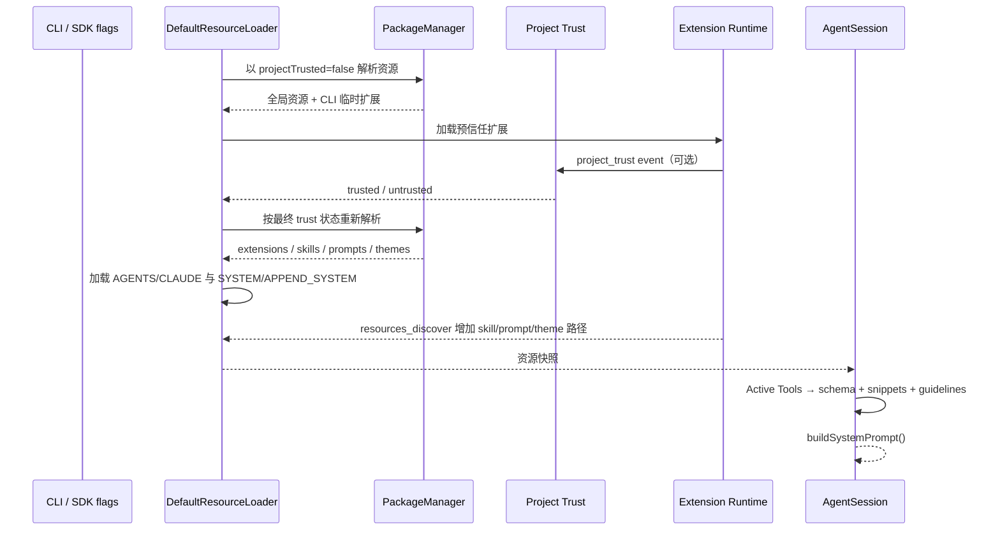
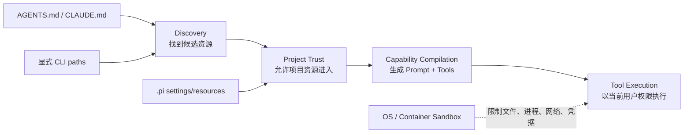

> 历史研究归档 · 2026-11-10 发布 · 程序扫描；未逐篇全文审阅。原有日期、观点、数据和命令保留历史语境，未经本次逐项事实核验或运行复现；请结合[归档说明](../../../../../ARCHIVE_POLICY.md)阅读。

# PI-I06 · 资源加载与信任边界：先决定加载什么，再决定告诉模型什么

> 一句话结论：`ResourceLoader` 是 Pi 的“能力装配台”，Project Trust 只决定项目本地资源能否进入装配台；它既不是工具授权，也不是 sandbox，而 Prompt 与 Tool 必须从同一份 Active Tool Registry 编译才能避免能力漂移。

## 1. 定位、先修与掌握证据

**结论：这一 Iter 从“会话怎样运行”上移到“会话启动时拿到了哪些能力”。**

先修：PI-I03 的 Tool Definition/Tool Registry、PI-I05 的 AgentSession 组装边界。知识库 R156 已给出全景和 P-032，本课新增的是逐项资源发现、层级顺序、显式参数优先级、Trust 负面边界以及可操作的故障实验。

| 轴 | 本课位置 |
|---|---|
| 纵向 | 静态内置工具 → 全局资源 → 项目资源 → CLI 临时资源 → Extension 动态资源 |
| 横向 | 配置发现（discovery）/ 输入批准（trust）/ 工具授权（authorization）/ 进程隔离（isolation）是四件不同的事 |

完成后，你要拿出以下证据：

| 层级 | 不是“读过”，而是能…… |
|---|---|
| 识别 | 给定目录树与 flags，写出最终加载的 AGENTS、Skill、Prompt、Theme、Extension 集合 |
| 解释 | 说明未信任项目仍会加载什么，以及 Project Trust 为什么不限制 Bash/文件/网络权限 |
| 设计 | 从同一 Tool Definition 生成 API schema 与 Prompt snippet，并测试动态禁用时二者一起消失 |
| 批判 | 区分上游事实、课程强化和仍需外部 sandbox 解决的风险 |

## 2. 闭卷唤醒

**结论：先暴露错误心智模型，再阅读答案，比顺着代码点头更有效。**

合上前一课，用 5 分钟回答：

1. `AGENTS.md` 属于 System Prompt、普通 User Message，还是 Tool Result？
2. 同一目录同时有 `AGENTS.md` 和 `CLAUDE.md`，Pi 会把两份都拼进去吗？
3. `--no-extensions -e ./audit.ts` 的显式扩展应不应该加载？
4. 拒绝 Project Trust 后，模型还能否通过已启用的 `bash` 读取 cwd 中的普通文件？
5. Prompt 宣称“可用 bash”但请求中的 tools 没有 bash，会造成什么失败？

写下置信度。置信度高但答错，正是本课最值得修正的知识缺口。

## 3. 运行前预测

**结论：资源系统最容易错在优先级，而不是单个 loader 的实现。**

预测下列启动条件的结果，不要先看源码：

```text
全局：~/.pi/agent/AGENTS.md、extensions/global.ts、skills/global/SKILL.md
项目：/repo/CLAUDE.md、/repo/app/AGENTS.md、/repo/app/CLAUDE.md
      /repo/app/.pi/extensions/project.ts、skills/project/SKILL.md、SYSTEM.md
cwd： /repo/app
状态：项目未信任
flags：--no-extensions -e ./audit.ts --skill ./lesson/SKILL.md
```

请分别写出：

- Context Files 的顺序；
- Extensions；
- Skills；
- `.pi/SYSTEM.md` 是否替换默认 Prompt；
- 已存在的 `read/bash/edit/write` 是否被 Project Trust 收回。

## 4. Whole Game：跟踪一次两阶段装配

**结论：完整路径是“预信任扩展 → Trust 决策 → 最终资源解析 → Prompt/Tool 同源编译”。**



本批没有为 PI-I06 新增可执行 Mini Pi 模块。Whole Game 的操作是源码 Trace 与练习设计，不得写成“测试已通过”。要获得实现证据，需要完成 [PI-I06 练习](../exercises/PI-I06.md) 中的最小 loader/coherence tests。

## 5. 失败驱动：五种“能启动但不一致”

**结论：资源加载失败通常不会表现为一个漂亮的启动崩溃，而会变成能力缺失、错误能力或隐蔽的信任扩大。**

| 失败 | 表面现象 | 真正破坏的不变量 |
|---|---|---|
| Prompt 仍写 bash，tools 已禁用 | 模型反复尝试不存在的工具 | Prompt/Runtime 能力不一致 |
| 项目未信任却执行项目 Extension | 一启动就运行仓库代码 | Trust gate 被绕过 |
| 把 AGENTS 当成受 Trust 保护 | 拒绝信任后仍看到项目指令，误判为漏洞 | 混淆 Context Files 与 `.pi` 可执行资源 |
| `--no-*` 连显式路径也吞掉 | 临时调试资源无故消失 | 混淆“关闭发现”与“拒绝显式输入” |
| 把 Trust 当 sandbox | 合法工具仍能访问宿主资源 | 混淆加载批准与操作系统隔离 |

故障优先阅读顺序：先看 `PathMetadata/source/scope`，再看 Trust 状态，最后看 Active Tool 名单与最终 System Prompt；不要从 UI 缺少一个名字直接猜 loader 坏了。

## 6. 心智模型：四个平面不能合并

**结论：同一启动过程包含“发现、批准、编译、隔离”四道边界，只有最后一道能限制宿主权限。**



记住四句话：

1. Discovery 说“我找到了什么”。
2. Trust 说“项目能否影响 Pi 的配置和可执行扩展”。
3. Capability Compilation 说“模型被告知并能调用什么”。
4. Sandbox 说“即使调用了，进程实际上能触碰什么”。

## 7. ResourceLoader 的职责边界

**结论：ResourceLoader 返回资源快照和诊断，不直接决定模型请求，也不执行工具。**

接口暴露五组结果：Extensions、Skills、Prompts、Themes、Context Files，外加 replace/append System Prompt。`DefaultResourceLoader.reload()` 负责重新装配；AgentSession 再消费这些结果。

资源来源可按三类理解：

| 来源 | 例子 | 关键语义 |
|---|---|---|
| 自动发现 | `~/.pi/agent/skills`、`.pi/prompts` | 约定目录；受 `--no-*` 与项目 Trust 影响 |
| 显式输入 | `-e x.ts`、`--skill path`、SDK additional paths | 用户本次明确指定；关闭 auto-discovery 后仍可保留 |
| 扩展贡献 | `resources_discover` 返回 skill/prompt/theme paths | 先加载 Extension，后追加资源；不能用它再发现新 Extension |

PackageManager 还给资源附 `source/scope/origin/baseDir`，并定义冲突优先级：项目 settings > 项目 auto > 用户 settings > 用户 auto > package。它是名称冲突的输入顺序，不是安全级别。

## 8. AGENTS.md / CLAUDE.md：层级发现与合并

**结论：Pi 按“全局先、祖先从根到 cwd 后”的顺序收集；每个目录只取候选列表中的第一份文件。**

当前固定提交的算法：

1. 先在 `agentDir` 找 `AGENTS.md`；
2. 从 cwd 向文件系统根逐级扫描，再用 `unshift` 排成根 → cwd；
3. 同一路径去重；
4. 单目录候选顺序为 `AGENTS.md`、`AGENTS.MD`、`CLAUDE.md`、`CLAUDE.MD`，命中即返回；
5. 最终 `buildSystemPrompt()` 按该顺序把每份内容包进带 path 的 `<project_instructions>`。

因此：同目录同时有 `AGENTS.md` 和 `CLAUDE.md` 时不是两份都拼接，`AGENTS.md` 胜出。官方 README 的“All matching files are concatenated”应结合源码理解为“跨层命中的文件都拼接”，而不是“一层内所有候选都拼接”。

更重要的信任边界：Project Trust 不保护这些 Context Files。拒绝 Trust 后，项目 `AGENTS.md/CLAUDE.md` 仍会进入 Prompt，除非显式 `--no-context-files`。它们不能直接作为进程代码执行，却能 Prompt Inject 模型，因此处理不可信仓库时仍需人工审阅和外部隔离。

## 9. Skills、Prompt Templates、Extensions、Themes 的发现

**结论：四类资源共享 scope/metadata 管线，但格式、显式 flag 与动态扩展能力并不完全相同。**

| 资源 | 自动目录 | 显式入口 | `--no-*` 后显式入口 | 项目未信任 |
|---|---|---|---|---|
| Extension | `~/.pi/agent/extensions`、`.pi/extensions`、package | `-e/--extension` | 仍加载 CLI Extension | 项目 Extension 不加载；全局/CLI 仍加载 |
| Skill | `~/.pi/agent/skills`、`~/.agents/skills`、`.pi/skills`、祖先 `.agents/skills` | `--skill` | 显式路径仍加载 | 项目 auto Skill 不加载；显式/全局可加载 |
| Prompt Template | `~/.pi/agent/prompts`、`.pi/prompts` | `--prompt-template` | 显式路径仍加载 | 项目 auto Prompt 不加载 |
| Theme | `~/.pi/agent/themes`、`.pi/themes` | `--theme` | 显式路径仍加载 | 项目 auto Theme 不加载 |

边界补充：

- Extension 的约定目录支持直接 `.ts/.js`，子目录则优先 manifest 或 `index.ts/index.js`。
- Skill 的 Pi 目录可发现顶层 `.md` 与递归 `SKILL.md`；`.agents/skills` 的根 `.md` 不算 Skill。
- Prompt 是 Markdown；Theme 是 JSON。
- `resources_discover` 只追加 Skills/Prompts/Themes。Extension 必须先被已有路径装载，避免递归自举。
- `--no-context-files` 只关闭 AGENTS/CLAUDE 发现，不等于关闭 `.pi/SYSTEM.md`；System Prompt 的项目版本由 Trust 控制。

## 10. Project Trust 能保证什么，不能保证什么

**结论：Project Trust 是 project-local input-loading guard，不是模型行为或工具副作用的安全证明。**

它能保证的范围：

- 未批准前不加载 `.pi/settings.json`；
- 不自动加载项目 `.pi/extensions/skills/prompts/themes`、项目 package 资源与 `.pi/SYSTEM.md/APPEND_SYSTEM.md`；
- 先只加载全局/CLI Extension，让它们可参与 `project_trust` 决策；
- 非交互模式没有弹窗，按 saved decision / `defaultProjectTrust` / `--approve|--no-approve` 决定。

它不能保证：

- `read/bash/edit/write` 被限制在 cwd；
- Bash 无网络、无凭据或无子进程；
- AGENTS/CLAUDE、源码注释、构建输出不会 Prompt Inject；
- 用户已安装的全局 Extension/Skill 是安全的；
- Tool Call 得到逐次授权；
- 文件写入可回滚或外部副作用幂等。

说白了，Trust 防的是“仓库在你批准前偷偷改 Pi 的配置/扩展”，Sandbox 防的是“即便 Agent 做了危险决定，也碰不到不该碰的宿主资源”。不可信、无人值守或带真实凭据的任务，应把 Pi/工具放入容器、VM、micro-VM 或策略沙箱，并最小化挂载、网络和凭据。

## 11. Prompt 与 Tool 同源一致性（P-032）

**结论：Active Tool Registry 必须同时驱动模型 `tools` 与 System Prompt 中的工具说明。**

Pi 的 Tool Definition 可携带 `promptSnippet` 与 `promptGuidelines`。`_refreshToolRegistry()` 从同一组 definition 建立：

- 可执行 Tool Registry；
- 每个工具的一行 Prompt snippet；
- 每个工具的行为 guideline。

随后 `_rebuildSystemPrompt()` 只对当前 Registry 中的有效工具收集 snippets/guidelines，并把同一 `validToolNames` 交给 `buildSystemPrompt()`。动态关闭 bash 后，理想不变量是：

```text
request.tools 中没有 bash
AND
systemPrompt 的 Available tools / bash guideline 中没有 bash
```

这不是“Prompt 写得漂亮”的问题，而是 Runtime Contract。若 Prompt、Tool Schema、运行时开关由三份配置维护，长期运行、Extension override 和 replay 时几乎必然漂移。

课程建议增加 `capabilityManifestHash = hash(tool names + schemas + prompt fragments)`，把 hash 写进事件以便审计。注意：这是课程强化，固定提交的 Pi 没有这一字段。

## 12. Pi 源码断点

**结论：先按装配顺序读 1–8，再用 9–13 校准安全与一致性。**

固定提交：`063fb963c5c33d099faa593d17e60e0a875430cd`。

| # | 进去只看什么 | 固定源码 |
|---:|---|---|
| 1 | ResourceLoader 的公开快照边界 | [`resource-loader.ts` L28–48](https://github.com/earendil-works/pi/blob/063fb963c5c33d099faa593d17e60e0a875430cd/packages/coding-agent/src/core/resource-loader.ts#L28-L48) |
| 2 | 单目录候选优先级、全局 + 根到 cwd 的合并顺序 | [`resource-loader.ts` L67–123](https://github.com/earendil-works/pi/blob/063fb963c5c33d099faa593d17e60e0a875430cd/packages/coding-agent/src/core/resource-loader.ts#L67-L123) |
| 3 | no-discovery、additional paths 与 override 配置面 | [`resource-loader.ts` L125–159](https://github.com/earendil-works/pi/blob/063fb963c5c33d099faa593d17e60e0a875430cd/packages/coding-agent/src/core/resource-loader.ts#L125-L159) |
| 4 | 预信任 Extension 与最终 Trust 重载 | [`resource-loader.ts` L333–416](https://github.com/earendil-works/pi/blob/063fb963c5c33d099faa593d17e60e0a875430cd/packages/coding-agent/src/core/resource-loader.ts#L333-L416) |
| 5 | 显式路径如何与发现结果合并，AGENTS/SYSTEM 在何处收口 | [`resource-loader.ts` L419–491](https://github.com/earendil-works/pi/blob/063fb963c5c33d099faa593d17e60e0a875430cd/packages/coding-agent/src/core/resource-loader.ts#L419-L491) |
| 6 | 项目 SYSTEM/APPEND_SYSTEM 的 Trust gate | [`resource-loader.ts` L969–994](https://github.com/earendil-works/pi/blob/063fb963c5c33d099faa593d17e60e0a875430cd/packages/coding-agent/src/core/resource-loader.ts#L969-L994) |
| 7 | settings 与自动发现汇合点 | [`package-manager.ts` L901–953](https://github.com/earendil-works/pi/blob/063fb963c5c33d099faa593d17e60e0a875430cd/packages/coding-agent/src/core/package-manager.ts#L901-L953) |
| 8 | 四类资源的 user/project 约定目录与 Trust 分支 | [`package-manager.ts` L2303–2466](https://github.com/earendil-works/pi/blob/063fb963c5c33d099faa593d17e60e0a875430cd/packages/coding-agent/src/core/package-manager.ts#L2303-L2466) |
| 9 | 什么项目资源会触发 Trust | [`trust-manager.ts` L29–37](https://github.com/earendil-works/pi/blob/063fb963c5c33d099faa593d17e60e0a875430cd/packages/coding-agent/src/core/trust-manager.ts#L29-L37)、[`L177–205`](https://github.com/earendil-works/pi/blob/063fb963c5c33d099faa593d17e60e0a875430cd/packages/coding-agent/src/core/trust-manager.ts#L177-L205) |
| 10 | override → Extension → saved decision → default → UI 的决策序 | [`project-trust.ts` L46–95](https://github.com/earendil-works/pi/blob/063fb963c5c33d099faa593d17e60e0a875430cd/packages/coding-agent/src/core/project-trust.ts#L46-L95) |
| 11 | Extension 动态增加 skill/prompt/theme 后重建 Prompt | [`agent-session.ts` L2254–2276](https://github.com/earendil-works/pi/blob/063fb963c5c33d099faa593d17e60e0a875430cd/packages/coding-agent/src/core/agent-session.ts#L2254-L2276) |
| 12 | Active Tools 怎样生成 Prompt snippets/guidelines | [`agent-session.ts` L2455–2545](https://github.com/earendil-works/pi/blob/063fb963c5c33d099faa593d17e60e0a875430cd/packages/coding-agent/src/core/agent-session.ts#L2455-L2545) |
| 13 | 同一有效 Tool 名单怎样进入最终 System Prompt | [`agent-session.ts` L1021–1055](https://github.com/earendil-works/pi/blob/063fb963c5c33d099faa593d17e60e0a875430cd/packages/coding-agent/src/core/agent-session.ts#L1021-L1055) |
| 14 | Context Files、Skills、Tool snippets 的最终编译 | [`system-prompt.ts` L43–69](https://github.com/earendil-works/pi/blob/063fb963c5c33d099faa593d17e60e0a875430cd/packages/coding-agent/src/core/system-prompt.ts#L43-L69)、[`L79–159`](https://github.com/earendil-works/pi/blob/063fb963c5c33d099faa593d17e60e0a875430cd/packages/coding-agent/src/core/system-prompt.ts#L79-L159) |
| 15 | 显式 flags 与 `--no-*` 的公开契约 | [`args.ts` L256–276](https://github.com/earendil-works/pi/blob/063fb963c5c33d099faa593d17e60e0a875430cd/packages/coding-agent/src/cli/args.ts#L256-L276) |

## 13. Build Delta / 学习实验

**结论：本 Iter 的可执行 Delta 尚未落入 Mini Pi，当前交付的是接口设计与验收规范。**

状态：**待实现、未实测**。建议下一次代码批次新增：

```text
lab/src/resource-loader.ts
lab/src/capability-compiler.ts
lab/tests/iter06-resource-loader.test.ts
lab/tests/iter06-capability-coherence.test.ts
```

最小实验应先 RED 后 GREEN：

1. 同目录 AGENTS 胜过 CLAUDE；跨目录顺序为 global → root → cwd；
2. untrusted 时排除 project `.pi` 资源但保留 Context Files；
3. `noDiscovery + explicitPath` 仍加载显式资源；
4. 动态禁用工具后，schema 与 Prompt fragment 同时消失；
5. Trust 决策不得被断言为 filesystem/network sandbox。

不得把“文档已写”“源码已阅读”写成“实验通过”。

## 14. Trace：从目录到一次模型请求

**结论：Trace 的终点不是“找到文件”，而是“请求中的能力与 Prompt 完全对应”。**

```text
[discover] global extensions/global.ts
[discover] CLI audit.ts
[trust bootstrap] projectTrusted=false
[trust decision] untrusted
[resolve] reject .pi/extensions/project.ts and .pi/SYSTEM.md
[context] accept /repo/CLAUDE.md, /repo/app/AGENTS.md
[explicit] accept lesson/SKILL.md
[registry] active = read,bash,edit,write,audit_tool
[prompt] context files + skill catalog + snippets(active)
[model request] tools(active) + systemPrompt(active)
```

检查点：`[registry]` 和 `[prompt]` 必须能追溯到同一 active set；`[trust]` 只能解释资源是否进入，不能解释 Bash 后续能访问哪些路径。

## 15. Mini Pi 与真 Pi

**结论：Mini Pi 尚未实现资源层，因此只能承接接口练习，不能模拟真实的 package/trust/extension 装配成本。**

| 维度 | Mini Pi 当前 | 真 Pi 固定提交 |
|---|---|---|
| Context files | 待实现 | global + ancestor hierarchy，单目录候选优先级 |
| Resource discovery | 待实现 | settings、约定目录、packages、CLI、Extension contributions |
| Trust | 待实现 | 两阶段 Extension bootstrap + saved/default/override 决策 |
| Capability coherence | I03 有 Tool Registry 雏形，未编译 Prompt | Active Definition 同时生成 Tool 与 Prompt fragments |
| Isolation | 无 | Pi 也无内建 sandbox；依赖外部边界 |

真 Pi 的 PackageManager 还处理安装、过滤、冲突、metadata 与来源追踪；本课不把这些工程细节伪装成几十行练习就能完整复刻。

## 16. 故障注入与验收

**结论：故障注入要证明“失败发生在哪一层”，而不只是检查某个资源数量。**

练习见 [exercises/PI-I06.md](../exercises/PI-I06.md)。至少完成：

- 同目录放 AGENTS + CLAUDE，验证只选第一候选；
- 未信任项目中放恶意 `.pi/extensions/x.ts` 与恶意 `AGENTS.md`，解释两者不同结果；
- `--no-extensions -e` 与 `--no-skills --skill` 的显式路径案例；
- 动态关闭 bash，检查 Prompt 和 tools 双边；
- 在答案中明确写出 Trust、Authorization、Sandbox 的责任边界。

## 17. Teach-back Rubric

**结论：能画加载图不够，必须能解释负面保证与同源一致性。**

| 分数 | 掌握证据 |
|---:|---|
| 0 | 只会说“ResourceLoader 会加载配置” |
| 1 | 能列出五类资源与 AGENTS 层级 |
| 2 | 能区分 auto-discovery 与显式 flags |
| 3 | 能准确说明 untrusted 时保留/排除什么，并指出 Trust 不是 sandbox |
| 4 | 能设计 Prompt/Tool Coherence Test，解释 Extension 动态资源与 source metadata |

达到 3 再进入会话持久化；否则 JSONL 中“恢复了什么能力”也会讲错。

## 18. 24 小时 / 7 天复习

**结论：延迟复习重点是重建优先级，而不是背路径清单。**

- 24 小时后：闭卷画出两阶段 Trust 加载时序，并写出同目录 AGENTS/CLAUDE 的选择规则。
- 7 天后：给一个“无人值守处理外部 PR”的场景，分别提出 Discovery、Trust、Authorization、Sandbox 控制，并说明成本：额外容器运维、最小凭据配置、资源审计和 Prompt token。

## 19. 下一 Iter 的必然性

**结论：能力装配完成后，下一问是这些回合怎样在进程退出后仍保留分支与上下文。**

ResourceLoader 决定一次 Session 启动时拿到什么；它不回答消息、模型切换、分支与压缩如何持久化。PI-I07 将把线性聊天数组替换为 append-only JSONL 会话树，并严格区分 load/context replay 与外部副作用恢复。

## 20. Sources and freshness

**结论：固定源码与 2026-07-31 的官方文档在 Trust/sandbox 主结论上一致。**

Sources and freshness:
- [固定提交 ResourceLoader](https://github.com/earendil-works/pi/blob/063fb963c5c33d099faa593d17e60e0a875430cd/packages/coding-agent/src/core/resource-loader.ts#L28-L48) - retrieved 2026-07-31 - 资源接口、层级发现、两阶段 Trust 与最终合并
- [固定提交 PackageManager 自动发现](https://github.com/earendil-works/pi/blob/063fb963c5c33d099faa593d17e60e0a875430cd/packages/coding-agent/src/core/package-manager.ts#L2303-L2466) - retrieved 2026-07-31 - user/project scopes 与四类约定目录
- [Pi Security](https://pi.dev/docs/latest/security) - retrieved 2026-07-31 - Project Trust 是 input-loading guard，Pi 无内建 sandbox
- [Pi Skills](https://pi.dev/docs/latest/skills) - retrieved 2026-07-31 - Skill locations、显式路径和 progressive disclosure
- [Pi Prompt Templates](https://pi.dev/docs/latest/prompt-templates) - retrieved 2026-07-31 - Prompt discovery locations 与 CLI contract
- [Pi Extensions](https://pi.dev/docs/latest/extensions) - retrieved 2026-07-31 - `resources_discover` 与结构化 `systemPromptOptions`
- R156 PI Agent 核心架构源码导读（原稿引用文件未随本次归档发布） - retrieved 2026-07-31 - P-032 与 Project Trust 边界的已有结论

Consistency: consistent。官方最新文档与固定提交对 Trust 不是 sandbox、项目资源受 Trust、Context Files 例外、显式路径和能力同源编译的主结论一致。

Unverified: 未对本 Iter 新增 Mini Pi 自动化测试；课程建议的 `capabilityManifestHash` 是设计建议，不是上游实现。项目资源的实际 Prompt token 成本依文件大小而变，未在本课实测。
