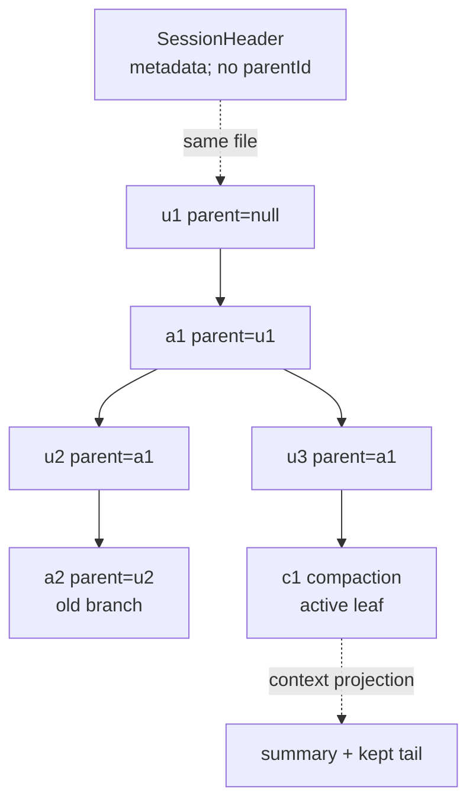

> 历史研究归档 · 2026-11-10 发布 · 发布审核状态：scan_only（发布前程序化隐私扫描）。原有日期、观点、数据和命令保留历史语境，未经本次逐项事实核验或运行复现；见[归档说明](../../../../../ARCHIVE_POLICY.md)。

# PI-I07 · JSONL 会话树与恢复：日志保留历史，叶子决定现在

> 一句话结论：Pi 的 Session 不是可修改聊天数组，而是“Header + append-only Entry 树”；`id/parentId` 保存历史分叉，文件末尾恢复 active leaf，加载只投影当前路径为模型上下文，并不重放工具副作用，也不把 Compaction 变成长期语义记忆。

## 1. 定位、先修与掌握证据

**结论：本 Iter 把 PI-I06 的运行时能力快照放进一个可退出、可恢复、可分支的会话容器。**

先修：PI-I02 的 transcript/ToolResult 因果、PI-I05 的 AgentSession、PI-I06 的资源与 Trust。知识库 R156 已给出 JSONL 树全景；本课新增精确文件格式、active leaf 推导、tree/fork/clone 操作差异、容错边界与“恢复不等于副作用重放”的故障实验。

| 轴 | 本课位置 |
|---|---|
| 纵向 | 线性 transcript → append-only tree → active-path projection → compaction checkpoint |
| 横向 | 对话日志（Pi Session）与 Durable Workflow Log 不等价；后者还需操作状态、幂等键和副作用恢复协议 |

完成后，你要拿出四类证据：

| 层级 | 能力证据 |
|---|---|
| 识别 | 看一段 JSONL 画出树、Header、active leaf 和当前模型上下文 |
| 操作 | 准确区分 `/tree`、branch、`/fork`、`/clone`、CLI `--fork` |
| 恢复 | 说明 load/migrate/index/context projection 的顺序与损坏边界 |
| 批判 | 解释 Compaction 为什么不是长期记忆，Session 为什么不是 exactly-once 工作流日志 |

## 2. 闭卷唤醒

**结论：先把“文件顺序”和“对话父子关系”分开，才不会把树读成数组。**

合上前课，闭卷回答：

1. JSONL 里最后一行的 `parentId` 可以指向中间旧节点吗？
2. Header 有 `id`，为什么它不属于 Entry 树？
3. 加载 Session 时会不会重新运行历史 Tool Call？
4. `/tree`、`/fork`、`/clone` 哪些会创建新文件？
5. Compaction 前的完整历史仍在磁盘，为什么模型却可能“忘了”？

## 3. 运行前预测

**结论：active leaf 是投影起点，不是“时间上最新回答”的同义词。**

预测以下逻辑日志。为易读省略 timestamp/message 细节：

```jsonl
{"type":"session","version":3,"id":"S","cwd":"/repo"}
{"type":"message","id":"u1","parentId":null,"message":{"role":"user","content":"A"}}
{"type":"message","id":"a1","parentId":"u1","message":{"role":"assistant","content":[{"type":"text","text":"A1"}]}}
{"type":"message","id":"u2","parentId":"a1","message":{"role":"user","content":"B"}}
{"type":"message","id":"a2","parentId":"u2","message":{"role":"assistant","content":[{"type":"text","text":"B1"}]}}
{"type":"message","id":"u3","parentId":"a1","message":{"role":"user","content":"C"}}
```

回答：

- 文件末尾恢复出的 leaf 是谁？
- 当前路径包含哪些 Entry？
- `u2/a2` 是否被删除？
- 下一条 Assistant 若接在 `u3` 后，树是什么形状？

## 4. Whole Game：从落盘到恢复

**结论：完整路径由写侧 `message_end → append` 和读侧 `parse → migrate → index → project` 组成。**

```mermaid
sequenceDiagram
  participant A as AgentSession
  participant M as SessionManager
  participant F as JSONL File
  participant L as Later Process
  A->>M: message_end(user/assistant/toolResult)
  M->>M: entry.id + parentId=current leaf
  M->>F: append JSON line
  M->>M: leaf=entry.id
  Note over F: process exits
  L->>F: loadEntriesFromFile()
  F-->>L: Header + valid parsed lines
  L->>L: migrate v1→v2→v3（如需）
  L->>L: build id index; last entry becomes leaf
  L->>L: walk parentId leaf→root
  L->>L: apply latest compaction projection
  L-->>A: messages + model + thinkingLevel
```

本批没有新增 PI-I07 Mini Pi 持久化代码；因此上图是固定源码 Trace，不是本地自动化实验结果。实现验收需完成 [PI-I07 练习](../exercises/PI-I07.md) 后再报告。

## 5. 失败驱动：聊天数组在分支与崩溃下失效

**结论：如果只保存“当前 messages 数组”，回到旧节点继续会迫使你覆盖、复制或丢弃历史。**

| 失败 | 线性数组的困难 | JSONL 树的处理 |
|---|---|---|
| 从旧回答改问题 | 截断后旧路径消失，或复制整份数组 | leaf 移到旧节点，下一 append 成为新子节点 |
| 多分支切换 | 需要多个文件/数组同步 | 同文件保留所有 Entry，以 parentId 选路径 |
| 进程在写尾部时崩溃 | 整个 JSON 可能无法解析 | JSONL 可跳过坏行并保留此前有效前缀 |
| 历史超窗口 | 删除旧消息导致不可审计 | Compaction Entry 改变模型投影，原 Entry 仍在树中 |
| 工具已执行、结果未落盘 | transcript 无法判断副作用状态 | Pi Session 仍无法解决；需外部幂等/ledger |

最后一行尤其重要：append-only 对话日志提高可审计性，不自动提供 exactly-once。

## 6. 心智模型：文件序、树序、上下文序

**结论：同一 JSONL 同时存在三种顺序，混为一谈就会错误恢复。**



| 顺序 | 定义 | 用途 |
|---|---|---|
| 文件序 | JSONL 物理行的追加次序 | 恢复最后活动点、审计操作发生顺序 |
| 树序 | `parentId` 形成的祖先/子节点关系 | 分支、导航、路径选择 |
| 上下文序 | active leaf 到根反向遍历后再 reverse，应用 compaction | 交给模型的消息顺序 |

## 7. Header 与 Entry：两个命名空间

**结论：Header 描述“这份会话文件是谁”，Entry 描述“会话树里发生了什么”。**

`SessionHeader` 是首个有效对象，包含：

```text
type=session, version, session id, timestamp, cwd, parentSession?
```

它没有 `parentId`，不参与模型上下文，也不应被当成树根。`parentSession` 表示新文件来自哪个 Session 文件，是文件级谱系；它不同于 Entry 的 `parentId`。

每个 `SessionEntryBase` 则有 `type/id/parentId/timestamp`。固定提交中的主要 Entry：

- `message`：User/Assistant/ToolResult 等正式消息；
- `thinking_level_change`、`model_change`：恢复当前设置；
- `compaction`、`branch_summary`：上下文投影检查点；
- `custom`：Extension 状态，不进 LLM context；
- `custom_message`：Extension 消息，会进 context；
- `label`、`session_info`：导航与显示元数据。

`id` 是 Entry 级短 ID，Header `id` 是 Session ID；同名字段的作用域不同。

## 8. Active leaf：文件末尾如何恢复“现在”

**结论：固定提交没有单独持久化 leaf 指针；加载时最后一个非 Header Entry 被当作 active leaf。**

写入时 `_appendEntry()` 做三件事：追加 `fileEntries`、更新 `byId`、把 `leafId` 设为新 Entry id。加载时 `_buildIndex()` 按文件序遍历所有非 Header Entry，每次覆盖 `leafId`，所以最后一条有效 Entry 成为 leaf。

Branch 的持久化技巧不是修改旧行，而是：

1. 在内存把 leaf 移到旧 Entry；
2. 下一次 append 的 `parentId` 指向这个旧 Entry；
3. 这条新行位于文件末尾，因此下次加载自然恢复到新分支。

推论：只调用 `branch(oldId)` 后立刻退出、没有追加任何 Entry，这次纯内存 leaf 移动没有持久化；下次打开仍以物理末行恢复。这个结论来自当前实现，不要泛化到未来可能增加显式 leaf record 的版本。

## 9. `/tree`、branch、`/fork`、`/clone` 与 `--fork`

**结论：tree/branch 改同一文件的活动路径，fork/clone 创建新 Session 文件，但选点和复制范围不同。**

| 操作 | 文件 | 起点 | 后续输入 | 典型用途 |
|---|---|---|---|---|
| `SessionManager.branch(id)` | 同一文件 | 指定 Entry | 下一 append 接在该节点 | 底层移动 leaf |
| `/tree` | 同一文件 | 任意可见节点 | User 节点通常退到其 parent 并把原文本放编辑器；其他节点从该点续写 | 同文件保留替代路线，可选 branch summary |
| `/fork` | 新文件 | 选择一个旧 User Message，默认取其 parent | 原 User 文本放编辑器供修改 | 从旧问题派生独立会话 |
| `/clone` | 新文件 | 当前 active leaf（`position: at`） | 空编辑器 | 复制当前活动路径后继续 |
| CLI `--fork <path\|id>` | 新文件 | 整个来源 Session 文件 | 新 cwd 下继续 | 跨项目或命令行复制来源文件 |

`/fork` 与 `/clone` 在当前 runtime 复用同一个 `fork()` 原语：前者默认 `position=before`，后者把当前 leaf 传入并指定 `position=at`。`createBranchedSession()` 只复制 root→目标 leaf 的路径到新文件，并在 Header 写 `parentSession`。CLI `--fork` 的 `forkFrom()` 则复制来源文件所有非 Header Entry，语义比交互式“抽取活动路径”更宽。

## 10. Normal append-only 与少数 rewrite

**结论：正常对话新增是 append-only，但迁移和创建派生文件会重写目标文件，不能把实现口号绝对化。**

正常路径：`message_end` 把 User/Assistant/ToolResult 变成 Entry，`_persist()` 在文件存在后用 `appendFileSync` 增加一行；旧 Entry 不修改、不删除。创建会话时为避免只有用户消息的空壳文件，固定提交会延迟到首个 Assistant 后一次性 flush Header + 当前 Entry，此后再 append。

例外：

- v1/v2 加载迁移到当前 v3 时 `_rewriteFile()`；
- `createBranchedSession()` 构造的是一个新文件，并重串保留路径中的 label parent；
- 显式新空文件初始化会写 Header。

因此，更准确的表述是：“单个已建立 Session 的正常事件历史追加不改旧 Entry；迁移和派生文件创建有受控 rewrite。”

## 11. Load 与 Context Replay：恢复消息，不恢复副作用

**结论：Pi 的 replay 是确定性上下文投影，不是重新执行历史工具。**

加载流程：

1. 逐行 JSON parse，跳过空行和 malformed line；
2. 第一个有效 Entry 必须是带字符串 id 的 `type=session` Header，否则返回空；
3. 按版本迁移 v1→v2→v3；
4. 建 `id → entry` 索引与 leaf；
5. 从 leaf 沿 parentId 回根；
6. 从整条路径恢复最近 model/thinking；
7. 把 `message/custom_message/branch_summary/compaction` 投影为 AgentMessage；普通 `custom` 等不进入 Context。

这里没有任何一步调用 `tool.execute()`。历史 ToolResult 只是消息。若崩溃发生在“外部 API 已扣款”与“ToolResult 已 append”之间，JSONL 无法判断是否应重试；生产级恢复需要工具幂等键、请求 ledger、outbox/inbox 或人工确认。

## 12. Compaction Entry 不是长期语义记忆

**结论：Compaction 是模型上下文的有损检查点，不是可检索、可更新、跨会话演化的语义记忆库。**

固定 `SessionManager` 的 `CompactionEntry` 保存 `summary/firstKeptEntryId/tokensBefore`。`buildContextEntries()` 找到 active path 上最新 Compaction 后，让模型看到：

```text
Compaction summary
+ firstKeptEntryId 开始的 recent tail
+ Compaction 之后的新 Entry
```

旧 Entry 仍在 JSONL/tree，可供人工 `/tree` 回看；但默认模型请求不再收到它们。它不具备：

- embedding/semantic search；
- 跨 Session 自动召回；
- 事实级 provenance 与冲突合并；
- 重要性、衰减、更新或删除策略；
- 摘要正确性验证。

所以“磁盘历史还在”不等于“模型仍记得”。错误摘要会进入后续上下文并可能在重复压缩中传播。关键约束、未完成事项和真实项目状态应外部化到确定性文件/数据库，不只依赖 Compaction。

源码/文档差异提醒：固定提交的 `SessionManager.CompactionEntry` 使用 `firstKeptEntryId`；同提交的官方 `session-format.md` 还描述了更新的 harness-generated `retainedTail` 自包含格式。本文以 `packages/coding-agent/src/core/session-manager.ts` 的实际类型和行为为标本，不把两条实现路径静默合并。

## 13. 损坏与未知 Entry 的恢复边界

**结论：当前 loader 对坏行宽容、对坏 Header 拒绝、对树结构只做弱防御；这不是完整的损坏修复器。**

| 输入问题 | 当前行为 | 风险/边界 |
|---|---|---|
| 空行或 malformed JSON 行 | 跳过 | 尾部半写可保留有效前缀；中间坏行会让后代变 orphan |
| 首个有效对象不是合法 Header | `loadEntriesFromFile()` 返回空；打开非空文件时报 invalid session | 不自动猜测/补 Header |
| 未知 `type` 但仍有 `id/parentId` | 运行时可能被索引并成为 leaf；默认 context projection 返回空消息 | 是当前宽容副作用，不是前向兼容承诺 |
| parentId 指向不存在节点 | `getTree()` 把 orphan 当 root；path walk 在缺失 parent 处停止 | 丢失此前祖先，不自动修链 |
| future `version >= current` | migration 不执行 | 未知语义不会被严格拒绝，需调用方/备份策略保护 |
| 重复 id、非法 parent cycle | 当前索引/遍历没有完整 schema 与 cycle repair | 可能覆盖索引或卡住遍历；这是源码审查推断，未做破坏性实测 |

恢复原则：先复制原 JSONL，绝不直接在唯一副本上修；逐行验证 JSON、Header、id 唯一性、parent 存在性与无环；将修复产物写成新文件，再用只读 parser 检查。Pi 当前 loader 的“跳过坏行”适合崩溃尾部容忍，不等于数据完整性证明。

## 14. Pi 源码断点

**结论：按“格式 → 写入 → 分支 → 读取 → 容错”顺序读，避免在 1600 行文件里迷路。**

固定提交：`063fb963c5c33d099faa593d17e60e0a875430cd`。

| # | 进去只看什么 | 固定源码 |
|---:|---|---|
| 1 | Header、Entry base、Compaction/Branch/Custom 类型 | [`session-manager.ts` L30–156](https://github.com/earendil-works/pi/blob/063fb963c5c33d099faa593d17e60e0a875430cd/packages/coding-agent/src/core/session-manager.ts#L30-L156) |
| 2 | v1→v2→v3 迁移与未来版本处理 | [`session-manager.ts` L230–314](https://github.com/earendil-works/pi/blob/063fb963c5c33d099faa593d17e60e0a875430cd/packages/coding-agent/src/core/session-manager.ts#L230-L314) |
| 3 | leaf→root 路径、Entry→Message 与 Compaction-aware Context | [`session-manager.ts` L334–470](https://github.com/earendil-works/pi/blob/063fb963c5c33d099faa593d17e60e0a875430cd/packages/coding-agent/src/core/session-manager.ts#L334-L470) |
| 4 | malformed line 跳过、Header 校验与有效前缀 | [`session-manager.ts` L503–555](https://github.com/earendil-works/pi/blob/063fb963c5c33d099faa593d17e60e0a875430cd/packages/coding-agent/src/core/session-manager.ts#L503-L555) |
| 5 | append-only tree 定义、open 非法文件与迁移 rewrite | [`session-manager.ts` L844–927](https://github.com/earendil-works/pi/blob/063fb963c5c33d099faa593d17e60e0a875430cd/packages/coding-agent/src/core/session-manager.ts#L844-L927) |
| 6 | Header 创建、last-entry leaf 恢复与 append 落盘 | [`session-manager.ts` L930–1049](https://github.com/earendil-works/pi/blob/063fb963c5c33d099faa593d17e60e0a875430cd/packages/coding-agent/src/core/session-manager.ts#L930-L1049) |
| 7 | Message/Model/Thinking/Compaction 怎样接到当前 leaf | [`session-manager.ts` L1051–1118](https://github.com/earendil-works/pi/blob/063fb963c5c33d099faa593d17e60e0a875430cd/packages/coding-agent/src/core/session-manager.ts#L1051-L1118) |
| 8 | active branch、Context、append-only API 与 orphan 树 | [`session-manager.ts` L1255–1348](https://github.com/earendil-works/pi/blob/063fb963c5c33d099faa593d17e60e0a875430cd/packages/coding-agent/src/core/session-manager.ts#L1255-L1348) |
| 9 | 同文件 branch/branch summary | [`session-manager.ts` L1354–1405](https://github.com/earendil-works/pi/blob/063fb963c5c33d099faa593d17e60e0a875430cd/packages/coding-agent/src/core/session-manager.ts#L1354-L1405) |
| 10 | 活动路径怎样变成新 Session 文件 | [`session-manager.ts` L1407–1490](https://github.com/earendil-works/pi/blob/063fb963c5c33d099faa593d17e60e0a875430cd/packages/coding-agent/src/core/session-manager.ts#L1407-L1490) |
| 11 | CLI 跨项目 fork 怎样复制全部非 Header Entry | [`session-manager.ts` L1572–1629](https://github.com/earendil-works/pi/blob/063fb963c5c33d099faa593d17e60e0a875430cd/packages/coding-agent/src/core/session-manager.ts#L1572-L1629) |
| 12 | Runtime `/fork` 的 before/at 选点和新文件切换 | [`agent-session-runtime.ts` L259–348](https://github.com/earendil-works/pi/blob/063fb963c5c33d099faa593d17e60e0a875430cd/packages/coding-agent/src/core/agent-session-runtime.ts#L259-L348) |
| 13 | `/clone` 如何复用 fork(position=at) | [`interactive-mode.ts` L4614–4630](https://github.com/earendil-works/pi/blob/063fb963c5c33d099faa593d17e60e0a875430cd/packages/coding-agent/src/modes/interactive/interactive-mode.ts#L4614-L4630) |
| 14 | `message_end` 是 User/Assistant/ToolResult 的持久化边界 | [`agent-session.ts` L624–665](https://github.com/earendil-works/pi/blob/063fb963c5c33d099faa593d17e60e0a875430cd/packages/coding-agent/src/core/agent-session.ts#L624-L665) |
| 15 | 官方 `/tree`、`/fork`、`/clone` 操作契约 | [`sessions.md` L69–127](https://github.com/earendil-works/pi/blob/063fb963c5c33d099faa593d17e60e0a875430cd/packages/coding-agent/docs/sessions.md#L69-L127) |

## 15. Build Delta / 学习实验

**结论：本 Iter 的 Mini Pi SessionStore 仍待实现；当前只有可测试接口与失败规范。**

状态：**待实现、未实测**。建议后续 TDD Delta：

```text
lab/src/session-store.ts
lab/src/session-projection.ts
lab/tests/iter07-session-tree.test.ts
lab/tests/iter07-session-recovery.test.ts
```

冻结的最小行为：

1. append 生成稳定 id，parentId 指向当前 leaf；
2. branch 不改旧 Entry，下一 append 形成新 child；
3. reload 以最后有效 Entry 为 leaf；
4. buildContext 只取 active path，应用 latest compaction；
5. malformed trailing line 保留有效前缀，非法 Header 拒绝；
6. load 从不调用 Tool executor；
7. unknown/orphan 明确返回 diagnostics，不照搬上游的静默宽容。

第 7 项是课程 hardening，不是固定提交事实。

## 16. Trace：一次分支、压缩与恢复

**结论：Trace 必须同时标注物理 append 与逻辑 parent，否则无法解释恢复结果。**

```text
append u1(parent=null)          file#1 leaf=u1
append a1(parent=u1)            file#2 leaf=a1
append u2(parent=a1)            file#3 leaf=u2
append a2(parent=u2)            file#4 leaf=a2
branch(a1)                      no file write; leaf=a1 (memory only)
append u3(parent=a1)            file#5 leaf=u3
append c1(parent=u3, compaction summary, firstKept=u3)
process exits
reload: last valid entry=c1 → leaf=c1
tree: u1-a1 has children u2 and u3; old a2 remains
context: compaction summary + kept u3/tail + entries after c1
tool replay: none
```

## 17. Mini Pi 与真 Pi

**结论：Mini Pi 尚无持久化；真 Pi 的成熟点在树、迁移和产品操作，天花板在副作用恢复与弱结构校验。**

| 维度 | Mini Pi 当前 | 真 Pi 固定提交 |
|---|---|---|
| Transcript | 进程内数组 | JSONL Header + Entry tree |
| Branch | 无 | leaf pointer + parentId，多分支同文件 |
| Fork/Clone | 无 | 活动路径提取/整文件复制 + parentSession |
| Reload | 无 | parse、migrate、index、context projection |
| Compaction | 无 | Summary Entry 改变模型投影，完整历史仍在树 |
| Corruption | 无 | 坏行跳过、Header 拒绝、orphan 弱容忍 |
| Durable side effects | 无 | 也无 exactly-once；需上层协议 |

## 18. 故障注入与验收

**结论：恢复实验必须同时检查“能打开”“树完整”“Context 正确”“没有重做副作用”。**

练习见 [exercises/PI-I07.md](../exercises/PI-I07.md)。至少完成：

- 手工构造两分支 JSONL，画出 file/tree/context 三种顺序；
- 分别解释 `/tree`、`/fork`、`/clone` 和 CLI `--fork`；
- 注入坏尾行、坏 Header、unknown type、orphan parent；
- 构造 Compaction 并列出模型实际看见的消息；
- 写出“支付已发生、ToolResult 未落盘”的恢复策略，不能回答“重放 Session 即可”。

## 19. Teach-back Rubric

**结论：真正掌握的标志是能解释恢复边界，而不是会打开 JSONL。**

| 分数 | 掌握证据 |
|---:|---|
| 0 | 只会说“Session 是 JSONL” |
| 1 | 能指出 Header 与 Entry、id 与 parentId |
| 2 | 能从 leaf 画 active path，并区分 tree/fork/clone |
| 3 | 能解释 append-only 例外、load/context replay 与 compaction 投影 |
| 4 | 能设计损坏 diagnostics、幂等副作用恢复与长期记忆的外部化方案 |

达到 3 才进入 PI-I08；否则 Compaction/Retry 会被误学成“自动记忆/自动恢复”。

## 20. 24 小时 / 7 天复习

**结论：延迟复习要重建树与故障窗口，而不是背 Entry 类型。**

- 24 小时后：闭卷写 6 行 JSONL，形成两个分支；标出物理末行、active leaf、模型 Context。
- 7 天后：设计一个“外部支付工具”恢复协议，包含 idempotency key、started/completed ledger、人工确认状态，并说明 Pi Session 只承担哪部分。

## 21. 下一 Iter 的必然性

**结论：会话树解决“历史怎样保留”，没有解决“窗口溢出、摘要失败、请求瞬断怎样继续”。**

PI-I08 将深入 Compaction、Retry 与 Context Budget：触发阈值、切点、摘要调用成本、overflow recovery、重复压缩的语义损耗，以及 retry 与副作用幂等之间的冲突。

## 22. Sources and freshness

**结论：固定源码与官方最新文档对 JSONL/tree/fork 主路径一致，但 Compaction Entry 存在新旧实现描述差异，已显式隔离。**

Sources and freshness:
- [固定提交 SessionManager](https://github.com/earendil-works/pi/blob/063fb963c5c33d099faa593d17e60e0a875430cd/packages/coding-agent/src/core/session-manager.ts#L30-L156) - retrieved 2026-07-31 - Header/Entry 类型、树、加载、分支和派生文件
- [固定提交 Sessions 官方文档](https://github.com/earendil-works/pi/blob/063fb963c5c33d099faa593d17e60e0a875430cd/packages/coding-agent/docs/sessions.md#L69-L127) - retrieved 2026-07-31 - `/tree`、`/fork`、`/clone` 用户语义
- [Pi Session File Format](https://pi.dev/docs/latest/session-format) - retrieved 2026-07-31 - JSONL Entry tree、Context building 与公开 SessionManager API
- [Pi Sessions](https://pi.dev/docs/latest/sessions) - retrieved 2026-07-31 - 会话选择、分支、fork/clone 最新操作契约
- [Pi Compaction](https://pi.dev/docs/latest/compaction) - retrieved 2026-07-31 - Compaction 是 summary + recent context 的窗口管理机制
- R156 PI Agent 核心架构源码导读（原稿引用文件未随本次归档发布） - retrieved 2026-07-31 - JSONL 树、Compaction 局限与 Durable Harness 边界

Consistency: partly consistent。JSONL 树、id/parentId、tree/fork/clone 与 Compaction 的有损上下文目的多源一致；官方最新/同提交 `session-format.md` 描述 `retainedTail` 的更新 harness 格式，而固定 `coding-agent SessionManager` 类型仍是 `firstKeptEntryId`，本文未混用。

Unverified: 未对损坏 cycle/duplicate id 做破坏性实测；相关风险是对无 visited/schema guard 源码的推断。未新增 PI-I07 Mini Pi 测试。Session 文件规模、加载延迟和 Compaction 保真率依真实任务而变，待 PI-I08 实测。
