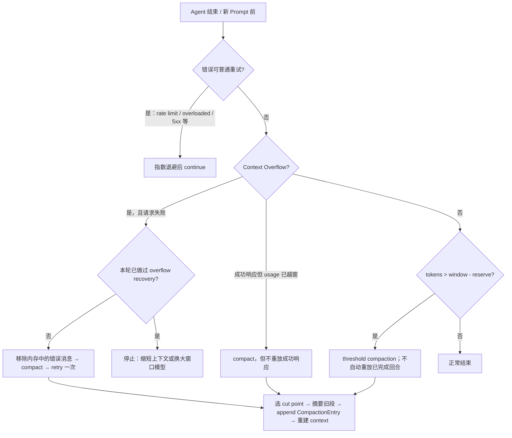
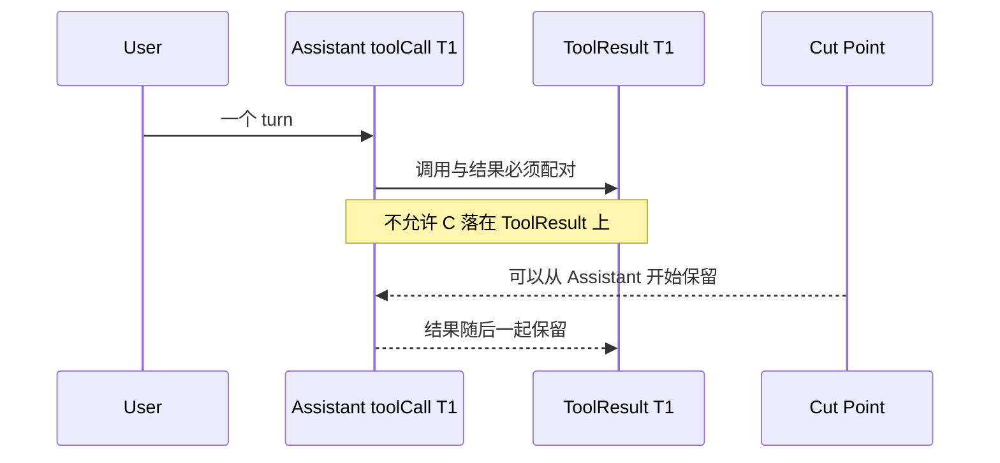

> 历史研究归档 · 2026-11-10 发布 · 发布审核状态：scan_only（发布前程序化隐私扫描）。原有日期、观点、数据和命令保留历史语境，未经本次逐项事实核验或运行复现；见[归档说明](../../../../../ARCHIVE_POLICY.md)。

# PI-I08 · Compaction 与恢复：摘要不是历史，重试也不是恢复

> 一句话结论：Pi 用阈值压缩主动腾出窗口、用至多一次 compact-and-retry 恢复 Context Overflow、用指数退避处理瞬态服务错误；三条路径共享部分机制，但触发条件、是否重放请求和失败上限完全不同。

## 1. 定位、先修与掌握证据

PI-I07 已把 Session 理解为 append-only JSONL 树。本 Iter 只解决一个新问题：磁盘历史可以一直增长，模型上下文却有硬上限，怎样在不破坏会话树的前提下继续运行？

| 层级 | 完成证据 |
|---|---|
| 识别 | 能闭卷区分 `threshold`、`overflow`、普通 retry、branch summary 四条路径 |
| 推演 | 给出 `contextWindow/reserveTokens/keepRecentTokens` 后，能算触发线、判断 cut point，并保持 Tool Call/Tool Result 配对 |
| 故障分析 | 能解释脏摘要、连续压缩、摘要模型失败和第二次 overflow 后，JSONL 与模型可见上下文分别是什么 |
| 迁移/批判 | 能设计“LLM 摘要 + 确定性项目 Artifact”的双层恢复，而不把摘要当作无损 Checkpoint |

进入前应能解释：`parentId` 如何形成分支、`buildSessionContext()` 为什么不等于 `getEntries()`、append-only 为什么仍不等于外部副作用账本。

## 2. 闭卷唤醒与预测

先不要看源码，写下答案：

1. 128,000 token 窗口、`reserveTokens=16,384` 时，自动压缩在哪条不等式成立后触发？
2. 如果 Provider 返回 529，应该先压缩还是重试？如果返回 Context Overflow 呢？
3. 一次 Tool Call 后有三个 Tool Result，cut point 能否放在第二个 Tool Result 前？
4. 压缩后旧消息是否从 `.jsonl` 删除？下一次模型是否仍能自动看到它们？
5. 同一请求在 compact-and-retry 后再次 overflow，应该继续压缩还是停止？

预测下面四种输入的动作序列：

```text
A. usage = 112,000 / 128,000，stopReason=stop
B. error = context_length_exceeded
C. error = HTTP 529
D. 摘要模型发生一次 transient stream drop
```

## 3. Whole Game：先看完整恢复决策树

本 Iter 的 Mini Pi 实验尚未实现、尚未实测。先用纸面 Trace 建立完整心智模型，不要把下面的验收矩阵称为“已通过”。



阅读时始终维护两个视图：

```text
Session truth  = JSONL 中仍存在的树形条目
Model context  = 最新 summary + firstKeptEntryId 起的 recent tail + 后续条目
```

## 4. 上一版为什么会失败

只有 PI-I07 的会话树，还会遇到三种失败：

1. **把全部 JSONL 回放给模型**：历史最终超过 Context Window；树能存不代表模型能吃下。
2. **把 overflow 当普通 retry**：输入没有变短，指数退避只会重复同一个确定性失败并继续花费调用。
3. **直接删除旧消息**：窗口暂时变小，但目标、决策、文件状态和未完成事项一起消失；Tool Call 与 Tool Result 还可能被切断。

Pi 的答案是“完整轨迹留盘、模型上下文用有损检查点替代旧段”。它比盲删可恢复，比全量回放可持续，但仍不是语义无损。

## 5. 纵向与横向定位

> 一句话结论：Compaction 是会话内的 Context Checkpoint，不是长期记忆、数据库快照或 Durable Workflow 恢复点。

纵向看，I08 位于 `Message → JSONL Entry → Branch → Compaction Context` 之后；它改变模型看到的投影，不改写已经落盘的旧条目。横向看：

| 方案 | 保真度 | Token 成本 | 可继续性 | 主要边界 |
|---|---:|---:|---:|---|
| 只保留最近 N 条 | 低且不可解释 | 低 | 高 | 会静默丢目标和因果 |
| Pi 式 LLM summary + recent tail | 中，依赖摘要质量 | 每次压缩新增 1–2 次模型调用 | 高 | 摘要会失真并级联 |
| 检索式长期记忆 | 取决于召回 | 查询时支付 | 高 | 召回遗漏、时序和冲突处理更复杂 |
| 确定性项目 Artifact + 摘要 | 关键事实高，叙事中 | 写 Artifact 有工程成本 | 高 | 需要 Schema、更新纪律和一致性检查 |

**推荐**：把 Pi summary 用作“继续对话的导航”，把需求、验收、文件状态、迁移步骤和未完成事项写入版本化 Artifact。不要要求一个生成式摘要同时承担全部任务状态。

## 6. 固定源码断点

固定提交：`063fb963c5c33d099faa593d17e60e0a875430cd`。先按表中问题阅读，不要从文件第一行顺读。

| 进去只看什么 | 固定源码 |
|---|---|
| 默认 reserve/keepRecent 与严格 `>` 触发式 | [`compaction.ts` L126–136, L232–238](https://github.com/earendil-works/pi/blob/063fb963c5c33d099faa593d17e60e0a875430cd/packages/coding-agent/src/core/compaction/compaction.ts#L126-L238) |
| Provider usage 与 trailing messages 怎样合并估算 | [`compaction.ts` L142–230](https://github.com/earendil-works/pi/blob/063fb963c5c33d099faa593d17e60e0a875430cd/packages/coding-agent/src/core/compaction/compaction.ts#L142-L230) |
| 合法 cut point 与“绝不切在 Tool Result” | [`compaction.ts` L308–363](https://github.com/earendil-works/pi/blob/063fb963c5c33d099faa593d17e60e0a875430cd/packages/coding-agent/src/core/compaction/compaction.ts#L308-L363) |
| 从后向前累计 keepRecent 的算法 | [`compaction.ts` L388–460](https://github.com/earendil-works/pi/blob/063fb963c5c33d099faa593d17e60e0a875430cd/packages/coding-agent/src/core/compaction/compaction.ts#L388-L460) |
| 摘要最大输出、previous summary 与错误语义 | [`compaction.ts` L622–685](https://github.com/earendil-works/pi/blob/063fb963c5c33d099faa593d17e60e0a875430cd/packages/coding-agent/src/core/compaction/compaction.ts#L622-L685) |
| 多次压缩边界、消息分段和 file ops | [`compaction.ts` L710–788](https://github.com/earendil-works/pi/blob/063fb963c5c33d099faa593d17e60e0a875430cd/packages/coding-agent/src/core/compaction/compaction.ts#L710-L788) |
| split turn 为什么最多生成两段摘要 | [`compaction.ts` L817–918](https://github.com/earendil-works/pi/blob/063fb963c5c33d099faa593d17e60e0a875430cd/packages/coding-agent/src/core/compaction/compaction.ts#L817-L918) |
| 摘要请求中 Tool Result 只序列化前 2,000 字符 | [`utils.ts` L84–149](https://github.com/earendil-works/pi/blob/063fb963c5c33d099faa593d17e60e0a875430cd/packages/coding-agent/src/core/compaction/utils.ts#L84-L149) |
| 普通 retry、compaction 与 queued message 的先后顺序 | [`agent-session.ts` L1061–1102](https://github.com/earendil-works/pi/blob/063fb963c5c33d099faa593d17e60e0a875430cd/packages/coding-agent/src/core/agent-session.ts#L1061-L1102) |
| 新 Prompt 加入前的预压缩检查 | [`agent-session.ts` L1174–1208](https://github.com/earendil-works/pi/blob/063fb963c5c33d099faa593d17e60e0a875430cd/packages/coding-agent/src/core/agent-session.ts#L1174-L1208) |
| threshold、overflow、成功但越窗、第二次 overflow | [`agent-session.ts` L1943–2041](https://github.com/earendil-works/pi/blob/063fb963c5c33d099faa593d17e60e0a875430cd/packages/coding-agent/src/core/agent-session.ts#L1943-L2041) |
| 扩展拦截、append entry、重建上下文和失败回退 | [`agent-session.ts` L2045–2214](https://github.com/earendil-works/pi/blob/063fb963c5c33d099faa593d17e60e0a875430cd/packages/coding-agent/src/core/agent-session.ts#L2045-L2214) |
| Context Overflow 为什么不走普通 retry | [`agent-session.ts` L2630–2725](https://github.com/earendil-works/pi/blob/063fb963c5c33d099faa593d17e60e0a875430cd/packages/coding-agent/src/core/agent-session.ts#L2630-L2725) |
| JSONL append 没有删除旧条目 | [`session-manager.ts` L1015–1048](https://github.com/earendil-works/pi/blob/063fb963c5c33d099faa593d17e60e0a875430cd/packages/coding-agent/src/core/session-manager.ts#L1015-L1048) |
| 最新 Compaction 怎样投影为 summary + recent tail | [`session-manager.ts` L410–469](https://github.com/earendil-works/pi/blob/063fb963c5c33d099faa593d17e60e0a875430cd/packages/coding-agent/src/core/session-manager.ts#L410-L469) |
| Branch Summary：共同祖先、预算与生成 | [`branch-summarization.ts` L108–145, L195–246, L293–375](https://github.com/earendil-works/pi/blob/063fb963c5c33d099faa593d17e60e0a875430cd/packages/coding-agent/src/core/compaction/branch-summarization.ts#L108-L375) |

## 7. 三条恢复路径必须分开

> 一句话结论：是否改变上下文、是否重放上一请求、允许重复几次，是识别三条路径的最小判据。

| 路径 | 典型触发 | 改变 Context | 自动继续 | 上限/停止条件 |
|---|---|---:|---:|---|
| Proactive threshold compaction | `tokens > window - reserve` | 是 | 已完成回合不重放；新 Prompt 前仍会继续提交新 Prompt | 每次检查按阈值；旧 usage 有防重复边界 |
| Overflow recovery | Provider overflow error | 是 | compact 后重试原逻辑一次 | 同一恢复链最多一次 compact-and-retry |
| Successful-over-window cleanup | `stopReason=stop` 但报告 usage 越窗 | 是 | 不重放成功响应 | 只为后续回合腾空间 |
| Ordinary retry | rate limit、overloaded、可重试 5xx 等 | 否 | 指数退避后继续 | `maxRetries` 配置 |
| Summarization retry | 摘要流瞬态中断 | 摘要尚未落盘 | 重试摘要调用 | 与 `settings.retry` 共用预算/退避 |

关键顺序在 `_handlePostAgentRun()`：普通 retry 先判定，Context Overflow 被 `_isRetryableError()` 明确排除，再进入 `_checkCompaction()`。这避免同一错误既退避重试又压缩重试。

Overflow 恢复还有两个防循环细节：

- 失败的 Assistant error 会保留在 JSONL 历史，但在 retry 的内存上下文中移除；
- `_overflowRecoveryAttempted` 令第二次 overflow 直接停止，并提示缩短上下文或换大窗口模型。

## 8. Token Budget：默认值是上游初始策略，不是性能真理

> 一句话结论：`reserveTokens` 决定何时开始腾空间，`keepRecentTokens` 决定保留多长尾部；两者用途不同，不能相互替代。

固定提交的上游默认值：

| 参数 | 值 | 作用 | 证据口径 |
|---|---:|---|---|
| `enabled` | `true` | 启用自动压缩 | 上游默认 |
| `reserveTokens` | `16,384` | 给下一次模型输出预留窗口，并形成触发线 | 上游默认，非课程实测最优值 |
| `keepRecentTokens` | `20,000` | 从最新消息向前估算，决定 recent tail | 上游默认，约值；cut point 会使实际保留量偏移 |
| 摘要 `maxTokens` | `floor(0.8 × reserveTokens)`，且不超过模型上限 | 限制摘要输出 | 源码规则；默认约 `13,107` |
| Tool Result 摘要输入 | 每条最多 2,000 字符 | 避免大输出吞掉摘要请求 | 源码常量，不等于原 JSONL 被截断 |

示例：128,000 窗口的 threshold 是严格 `contextTokens > 111,616`。正好等于 111,616 不触发；111,617 才触发。

这里没有“16,384/20,000 在所有模型、语言和仓库上最优”的性能数据。`chars/4` 只用于 trailing message/cut point 的启发式估算；中文、代码、图片和 Provider tokenizer 的偏差要在真实工作负载中测。建议把默认值当初始值，用以下指标调优：

- 每百回合压缩次数；
- 压缩新增调用、Token 和墙钟时间；
- 压缩后首轮任务恢复成功率；
- 关键约束、未完成项、文件路径的召回率；
- 连续 1/2/3 次压缩后的事实漂移率。

## 9. Cut Point：保护 Tool Pair，而不是追求精确 token 数



合法起点包括 User、Assistant、BashExecution、Custom、Branch/Compaction Summary；Tool Result 不是 cut point。原因不是“Tool Result 不重要”，而是它必须跟随产生它的 Assistant Tool Call。

当单个 turn 自身超过 `keepRecentTokens` 时，Pi 会 split turn：

1. 保留 suffix；
2. 对更早完整历史生成 history summary（若存在）；
3. 对该 turn 的 prefix 生成 turn-prefix summary；
4. 合并成一个 CompactionEntry。

因此普通压缩通常增加一次模型调用，split turn 最多两次；瞬态失败重试会继续增加调用。这是 API 成本和延迟的真实来源。

## 10. 多次压缩与脏摘要

> 一句话结论：连续压缩不会删除原始 JSONL，却会让后续模型越来越依赖“摘要的摘要”，所以磁盘可审计不等于模型自动可恢复。

第二次压缩时：

- `previousSummary` 作为迭代上下文传给摘要模型；
- 新的总结区间从上次 `firstKeptEntryId` 开始，而不是从 CompactionEntry 自身开始；
- 如果旧 kept entry 在当前路径找不到，退回到上次 CompactionEntry 后一个条目；
- `tokensBefore` 从当前重建的模型上下文重新计算。

如果摘要把 `src/auth.ts` 错写成 `src/auth.js`：

- 旧 JSONL 条目仍在磁盘树中；
- `buildSessionContext()` 只把最新摘要和 recent tail 给模型；
- 模型不会自动回读旧条目纠错；
- 再压缩时，错误可能通过 `previousSummary` 继续传播。

所以关键约束应外部化，例如：

```text
PROJECT_STATE.md / task.json / migration-plan.yaml
  ├─ 当前目标与验收
  ├─ 已确认决策与理由
  ├─ 文件/符号的确定性引用
  ├─ 未完成工作
  └─ 外部副作用与幂等键
```

摘要里引用这些 Artifact，优于反复用自然语言重述它们。

## 11. Branch Summary 不是自动压缩

| 维度 | Compaction | Branch Summary |
|---|---|---|
| 触发 | threshold、overflow、`/compact` | `/tree` 导航离开旧分支时 |
| 目标 | 缩小当前模型上下文 | 把被离开分支的工作带到新位置 |
| 范围 | 旧历史 + recent tail 边界 | old leaf 到共同祖先之间的条目 |
| 写入 | `CompactionEntry` + `firstKeptEntryId` | `BranchSummaryEntry` + `fromId` |
| 预算 | reserve/keepRecent，摘要输出最多 `0.8 × reserve` | 输入 `contextWindow - reserve`，固定提交默认摘要输出 `2,048` |
| 共同风险 | 生成式摘要有损；文件列表只能辅助，不能证明事实正确 |

两者都会累计 read/modified file 信息，但 extension 生成的自定义 details 可以有不同 Schema，消费方不能盲目强转。

## 12. Build Delta / 学习实验（尚未实现、尚未实测）

建议在 Mini Pi 增加一个完全离线的策略模拟器；目标不是调用真实 LLM，而是证明控制流不变量：

```text
lab/src/context-policy.ts
  decideRecovery(message, usage, settings, recoveryState)

lab/src/compaction-simulator.ts
  findCutPoint(entries, keepRecentTokens)
  compact(entries, fakeSummarizer)
  buildVisibleContext(entries)

lab/tests/iter08-compaction.test.ts
```

Fake Summarizer 应支持脚本化结果：正常摘要、脏摘要、一次 transient error、永久错误。待实现验收：

1. threshold 只压缩、不重放已成功 Assistant；
2. overflow error 压缩后只重试一次；
3. 529 只退避重试，不生成 CompactionEntry；
4. cut point 永不指向 Tool Result；
5. 多次压缩使用上一 `firstKeptEntryId` 与 previous summary；
6. 脏摘要改变 visible context，但原 entries 不变；
7. 摘要永久失败时不 append 半成品 CompactionEntry；
8. branch summary 只收集离开分支到共同祖先的区间。

在测试真正 RED→GREEN 前，以上都只是课程规格，不是 Lab 已通过能力。

## 13. 逐事件 Trace

以一次 overflow error 为例：

| 步骤 | 内存 Agent Context | JSONL | 事件/动作 |
|---:|---|---|---|
| 1 | 含 overflow Assistant error | error 已由 `message_end` 留存 | `agent_end` |
| 2 | 移除最后一条 error | 不删除 | `_overflowRecoveryAttempted=true` |
| 3 | 原历史仍在 | 原树仍在 | `compaction_start(reason=overflow)` |
| 4 | 未切换 | 未新增 | `prepareCompaction` + 摘要调用/可能重试 |
| 5 | 重建为 summary + tail | append CompactionEntry | `session_compact`、`compaction_end(willRetry=true)` |
| 6 | 压缩后 context | error 历史与 compaction 都保留 | `agent.continue()` 重试 |
| 7a | 成功结果加入 | append 新 Assistant | 恢复完成 |
| 7b | 第二次 overflow | append 第二个 error | 停止，不再 compact-and-retry |

## 14. Mini Pi 与真 Pi

| 课程模拟器应保留 | 真 Pi 额外机制 / 当前课程省略 |
|---|---|
| 三条恢复路径与一次 overflow 上限 | Provider-specific `isContextOverflow` 判定 |
| threshold 公式、cut point、Tool Pair | Provider usage/cache 字段与图片估算 |
| latest summary + recent tail 投影 | Extension `session_before_compact/session_compact` 覆盖 |
| previous summary 与多次压缩 | fresh routing session id、Prompt Cache 写入策略 |
| 摘要失败不 append 半成品 | AbortSignal、TUI 重试指示、认证解析 |
| Branch Summary 共同祖先 | 导航交互、label 与 extension custom details |

不要用离线 Fake Summarizer 推断真实摘要质量、模型成本或长任务成功率；这些必须单独实测。

## 15. 故障注入与验收

练习见 [exercises/PI-I08.md](../exercises/PI-I08.md)。至少注入：

- 触发线前、等于触发线、越过触发线三个边界；
- Tool Result 附近 cut point；
- 一个 turn 大于 `keepRecentTokens`；
- 两次连续 Context Overflow；
- 摘要第一次 transient、随后成功；
- 摘要永久失败；
- 摘要伪造路径或漏掉不可变约束；
- 连续三次压缩后的约束保真检查；
- branch tree 有共同祖先与无共同祖先两种情况。

验收必须同时看 `visibleContext`、完整 entries、摘要调用数、普通 retry 次数和原请求重放次数。只看最终字符串会漏掉恢复循环和成本错误。

## 16. Teach-back Rubric

| 分数 | 可观察证据 |
|---:|---|
| 0 | 只会说“上下文长了就摘要” |
| 1 | 能说出 reserve 与 keepRecent 的作用 |
| 2 | 能保证 cut point 不切断 Tool Pair，并解释 JSONL 与 visible context 不同 |
| 3 | 能闭卷画出 threshold / overflow / retry 三路决策与一次恢复上限 |
| 4 | 能设计脏摘要、连续压缩和摘要失败实验，并提出确定性 Artifact 补强 |

达到 3 才进入 PI-I09；达到 4 才适合改生产恢复策略。

## 17. 24 小时 / 7 天检索复习

- **24 小时后**：闭卷写出四行伪代码，区分 `isRetryableError`、`isContextOverflow`、`shouldCompact` 与第二次 overflow；再算一次 200K 窗口的默认触发线。
- **7 天后**：构造“连续三次压缩后把数据库迁移顺序写反”的案例，说明 JSONL、summary、project artifact 和外部数据库各自能恢复什么、不能恢复什么。

## 18. 下一 Iter

PI-I08 仍把策略写在 Core/Session 中。PI-I09 将研究 Pi 如何把 Prompt、Context、Tool、Provider、Session 和 UI 接缝交给 Extension；重点不是“能扩展多少”，而是同进程高权限代码怎样加载、隔离故障、热重载和审计供应链。

## Sources and freshness

- [Pi 官方 Compaction 文档](https://pi.dev/docs/latest/compaction) — retrieved 2026-07-31 — 当前使用语义、默认值、split turn、branch summary 与 Extension hook。
- [固定提交 compaction.ts](https://github.com/earendil-works/pi/blob/063fb963c5c33d099faa593d17e60e0a875430cd/packages/coding-agent/src/core/compaction/compaction.ts) — retrieved 2026-07-31 — 本课机制事实的主证据。
- [固定提交 AgentSession](https://github.com/earendil-works/pi/blob/063fb963c5c33d099faa593d17e60e0a875430cd/packages/coding-agent/src/core/agent-session.ts) — retrieved 2026-07-31 — threshold、overflow、retry 与失败语义。
- [固定提交 SessionManager](https://github.com/earendil-works/pi/blob/063fb963c5c33d099faa593d17e60e0a875430cd/packages/coding-agent/src/core/session-manager.ts) — retrieved 2026-07-31 — append-only 存储和模型上下文投影。
- R156 PI Agent 核心架构源码导读（原稿引用文件未随本次归档发布） — 2026-07-28 — 作为全景地图，不替代本课逐分支核对。

Consistency: 固定源码与 2026-07-31 官方文档对触发式、默认值、cut point、多次压缩和 branch summary 一致。

Unverified: 默认阈值在具体模型/中文代码仓库上的最优性、连续多次压缩的事实保真率、Pi 与其他 Agent 的长任务成本/成功率均未实测。
