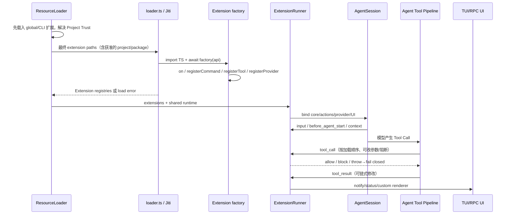

> 历史研究归档 · 2026-11-10 发布 · 发布审核状态：scan_only（发布前程序化隐私扫描）。原有日期、观点、数据和命令保留历史语境，未经本次逐项事实核验或运行复现；见[归档说明](../../../../../ARCHIVE_POLICY.md)。

# PI-I09 · Extension Runtime：策略平面，也是同进程信任边界

> 一句话结论：Pi Extension 是经 ResourceLoader 发现、由 Jiti 直接执行、再由 ExtensionRunner 绑定到 Session 的同进程 TypeScript 代码；它能改 Hook、Command、Tool、Provider 和 UI，因此高可塑，也因此绝不是 sandbox。

## 1. 定位、先修与掌握证据

PI-I08 解释了 Core 怎样压缩与恢复；I09 追问：如果你想替换摘要、增加权限门、注册新工具、改 Provider 请求或重画 UI，策略代码怎样进入运行时？

| 层级 | 完成证据 |
|---|---|
| 识别 | 能画出 `discover → load factory → registry → bind → dispatch` 五段链路 |
| 推演 | 能判断 Hook/Command/Tool/Provider/UI 在何时注册、由谁调用、异常如何传播 |
| 安全 | 能解释 Project Trust、Extension failure isolation、OS sandbox 三者各自保护什么 |
| 运维 | 能说明 `/reload` 为什么不是 JS 模块的可逆卸载，并为 timer/socket/subprocess 设计幂等 cleanup |
| 供应链 | 能为 npm/git/local package 给出固定版本、审计、最小凭据与隔离策略 |

先修：PI-I03 的 Tool Hook 管线、PI-I05 的 AgentSession 组合根、PI-I06 的资源/Project Trust、PI-I08 的 `session_before_compact` 接缝。

## 2. 闭卷唤醒与预测

不看源码，先写下预测：

1. `.pi/extensions/guard.ts` 在未信任项目中会不会执行？`~/.pi/agent/extensions/guard.ts` 呢？
2. 两个普通 `context` handler 中第一个抛错，第二个还会不会运行？
3. `tool_call` handler 抛错时，工具应该继续执行还是 fail closed？
4. Extension 能否读取 Session、注册 Provider、执行本地命令并弹 UI？如果能，它还能被称为 sandbox 吗？
5. `/reload` 之后，旧 handler 已启动的 `setInterval()` 会自动消失吗？
6. `pi -e npm:pkg` 只是临时安装，是否意味着包内代码被隔离？

把答案写成“事实 / 推断 / 建议”三栏。安全课最容易犯的错，是把推荐做法误写成上游已经保证的事实。

## 3. Whole Game：一条 Extension 从磁盘到 Tool Call

本 Iter 的 Mini Pi Extension Host 尚未实现、尚未实测。先跟踪一条完整路径：项目扩展注册 `tool_call` 权限门、`audit` Command、`safe_read` Tool、一个 Provider 和状态栏 UI。



观察重点不是 API 数量，而是三种权力：

- **改数据**：Prompt、Context、Provider payload、Tool args/result；
- **改能力**：Tool、Command、Provider、active tools；
- **做副作用**：本地 `exec`、文件/网络依赖、进程、UI、Session 写入。

## 4. 上一版为什么会失败

只靠固定 Core 会遇到两个极端：

- 每加权限门、Git checkpoint、MCP/Sub-agent 或定制 Provider 都改核心，升级冲突和测试面迅速扩大；
- 把所有能力放进一个“万能工具”，Hook、UI、状态和生命周期没有清晰接缝，调试只能看最终结果。

Extension Runtime 把策略移出 Core，但不会免费消除复杂度。它把成本转成加载顺序、兼容性、资源清理、供应链和安全隔离。

## 5. 纵向与横向定位

> 一句话结论：Pi 选择的是“高带宽、低隔离”的 in-process plugin；真正的安全边界必须放到进程之外。

纵向看：`Resource → Extension Factory → Runner Registry → Session Hook → Agent/Provider/UI`。横向看：

| 扩展方式 | API/状态访问 | 调用开销 | 崩溃/权限隔离 | 适用 |
|---|---:|---:|---:|---|
| Pi in-process Extension | 最高，可直接访问 Session/Provider/UI | 低 | 低；与 Pi 同用户权限 | 可信的 UI、Prompt、Tool 编排和本地策略 |
| 子进程 / RPC 插件 | 受协议限制 | 中 | 可做进程级资源限制 | 不稳定解析器、语言服务、独立生命周期组件 |
| MCP/远端服务 | 工具协议级 | 网络开销 | 服务端可独立鉴权/隔离 | 团队共享服务、跨语言能力 |
| OS/container/micro-VM | 可按挂载/网络/凭据限制 | 最高 | 强，前提是边界配置正确 | 不可信仓库、无人值守、高副作用任务 |

**推荐**：可信、轻量、需要深度 UI/Session 接缝的代码放 Extension；不可信依赖和高副作用执行放子进程或沙箱；处理不可信项目时，优先隔离整个 Pi 进程或把工具操作路由到隔离环境。

## 6. 固定源码断点

固定提交：`063fb963c5c33d099faa593d17e60e0a875430cd`。

| 进去只看什么 | 固定源码 |
|---|---|
| Project Trust 的两阶段资源加载 | [`resource-loader.ts` L333–417](https://github.com/earendil-works/pi/blob/063fb963c5c33d099faa593d17e60e0a875430cd/packages/coding-agent/src/core/resource-loader.ts#L333-L417) |
| `.ts/.js`、子目录 index、package manifest 的发现规则 | [`loader.ts` L586–720](https://github.com/earendil-works/pi/blob/063fb963c5c33d099faa593d17e60e0a875430cd/packages/coding-agent/src/core/extensions/loader.ts#L586-L720) |
| Jiti import、await factory、单扩展加载失败如何收集 | [`loader.ts` L398–540](https://github.com/earendil-works/pi/blob/063fb963c5c33d099faa593d17e60e0a875430cd/packages/coding-agent/src/core/extensions/loader.ts#L398-L540) |
| Extension API 怎样写入 handler/tool/command/provider registry | [`loader.ts` L226–390](https://github.com/earendil-works/pi/blob/063fb963c5c33d099faa593d17e60e0a875430cd/packages/coding-agent/src/core/extensions/loader.ts#L226-L390) |
| Runtime 初始 action stub、Provider 延迟注册和 stale guard | [`loader.ts` L140–223](https://github.com/earendil-works/pi/blob/063fb963c5c33d099faa593d17e60e0a875430cd/packages/coding-agent/src/core/extensions/loader.ts#L140-L223) |
| ExtensionRunner 怎样绑定 Core/Provider 动作 | [`runner.ts` L267–410](https://github.com/earendil-works/pi/blob/063fb963c5c33d099faa593d17e60e0a875430cd/packages/coding-agent/src/core/extensions/runner.ts#L267-L410) |
| 工具 first-registration 与重复 Command invocation 名 | [`runner.ts` L449–470, L598–648](https://github.com/earendil-works/pi/blob/063fb963c5c33d099faa593d17e60e0a875430cd/packages/coding-agent/src/core/extensions/runner.ts#L449-L648) |
| Runner Context、reload 入口和 stale 检查 | [`runner.ts` L542–555, L655–784](https://github.com/earendil-works/pi/blob/063fb963c5c33d099faa593d17e60e0a875430cd/packages/coding-agent/src/core/extensions/runner.ts#L542-L784) |
| 普通事件 handler 错误怎样隔离后继续 | [`runner.ts` L796–827](https://github.com/earendil-works/pi/blob/063fb963c5c33d099faa593d17e60e0a875430cd/packages/coding-agent/src/core/extensions/runner.ts#L796-L827) |
| `tool_result` 链式修改与 `tool_call` fail-safe 差异 | [`runner.ts` L830–948](https://github.com/earendil-works/pi/blob/063fb963c5c33d099faa593d17e60e0a875430cd/packages/coding-agent/src/core/extensions/runner.ts#L830-L948) |
| Context、Provider payload/header 的按加载顺序 middleware | [`runner.ts` L979–1074](https://github.com/earendil-works/pi/blob/063fb963c5c33d099faa593d17e60e0a875430cd/packages/coding-agent/src/core/extensions/runner.ts#L979-L1074) |
| `before_agent_start` 与 `input` 的链式语义 | [`runner.ts` L1076–1225](https://github.com/earendil-works/pi/blob/063fb963c5c33d099faa593d17e60e0a875430cd/packages/coding-agent/src/core/extensions/runner.ts#L1076-L1225) |
| UI 的完整能力面 | [`types.ts` L127–270](https://github.com/earendil-works/pi/blob/063fb963c5c33d099faa593d17e60e0a875430cd/packages/coding-agent/src/core/extensions/types.ts#L127-L270) |
| `tool_call` 参数可变且修改后不重校验 | [`types.ts` L898–912](https://github.com/earendil-works/pi/blob/063fb963c5c33d099faa593d17e60e0a875430cd/packages/coding-agent/src/core/extensions/types.ts#L898-L912) |
| Event、Tool、Command、Provider API 全景 | [`types.ts` L1033–1059, L1185–1420](https://github.com/earendil-works/pi/blob/063fb963c5c33d099faa593d17e60e0a875430cd/packages/coding-agent/src/core/extensions/types.ts#L1033-L1420) |
| AgentSession 安装 Tool Hook 并处理 `tool_call` 抛错 | [`agent-session.ts` L460–517](https://github.com/earendil-works/pi/blob/063fb963c5c33d099faa593d17e60e0a875430cd/packages/coding-agent/src/core/agent-session.ts#L460-L517) |
| Command 抛错如何记录并短路普通 Prompt | [`agent-session.ts` L1267–1293](https://github.com/earendil-works/pi/blob/063fb963c5c33d099faa593d17e60e0a875430cd/packages/coding-agent/src/core/agent-session.ts#L1267-L1293) |
| Reload：shutdown、重载资源、重建 Runner、再发 start/discover | [`agent-session.ts` L2602–2625](https://github.com/earendil-works/pi/blob/063fb963c5c33d099faa593d17e60e0a875430cd/packages/coding-agent/src/core/agent-session.ts#L2602-L2625) |

## 7. 发现与加载：Project Trust 只是一道加载门

> 一句话结论：项目扩展要先过 Trust Gate；全局和 CLI 扩展在 Trust 决策前已经被视为用户主动信任的代码。

启动大致分两遍：

1. 强制项目未信任，只加载 user/global、CLI/temporary 与 inline 扩展；
2. 这些预加载扩展可参与 `project_trust`；
3. 得到 trust 决策后，解析 packages 和最终 enabled paths；
4. 信任时才加入项目 `.pi/extensions` 与项目包资源；
5. 加载最终集合，记录冲突诊断，再组装 Runner。

发现规则本身很薄：直接 `.ts/.js`、一级子目录的 `index.ts/index.js`、或 `package.json` 的 `pi.extensions`；不会无限递归。每个模块由 Jiti import，default export 必须是 factory，异步 factory 会被 `await`。

这意味着：

- Project Trust 防止仓库在你同意前静默加载本地动态代码；
- 它不审计全局扩展、CLI `-e` 或你同意后的包；
- 它不限制扩展随后读文件、开网络、访问凭据或启动命令；
- `pi -e` 的“temporary”描述生命周期，不描述权限隔离。

## 8. ExtensionRunner：注册表加中间件，而不是独立容器

Factory 执行期间，`pi.on/registerTool/registerCommand/registerProvider` 把定义写入该 Extension 的 Map；需要 Session 动作的方法在 Runtime 尚未 bind 时会抛错，Provider 注册则先入 pending queue。Runner bind 后把共享 Runtime 指向真实 AgentSession 动作，并 flush Provider。

| 面 | 注册/接缝 | 运行时能力 | 顺序语义 |
|---|---|---|---|
| Hooks | `pi.on(event)` | 改 Input/Prompt/Context/Provider/Tool/Session | Extension load order；部分结果链式传递 |
| Commands | `registerCommand` | Session 切换、reload、交互工作流 | 在普通 Prompt 前短路；重名获得可调用后缀 |
| Tools | `registerTool` | 暴露 LLM 可调用能力、可覆盖 built-in | 同名工具 first registration wins；冲突有诊断 |
| Provider | `registerProvider/unregisterProvider` | 模型目录、URL、OAuth、stream handler | load 时排队，bind 后立即生效 |
| UI | `ctx.ui` + renderer/shortcut/widget | 对话框、状态栏、组件、编辑器、渲染 | 能力依 mode 而异；必须看 `ctx.hasUI/mode` |

同进程的直接收益是上下文丰富和延迟低；直接代价是没有序列化边界、没有最小权限对象、没有进程级崩溃隔离。

## 9. Hook 链与故障语义

> 一句话结论：Pi 对普通观测/变换 Hook 采用“记录错误、保留上一有效值、继续后续 handler”，对 `tool_call` 采用 fail-safe 阻断。

| 故障位置 | 固定提交行为 | 为什么 |
|---|---|---|
| Extension import/factory throw | 记录该 path 的 load error，继续加载后续扩展 | 单包坏掉不应阻塞全部启动 |
| 普通 lifecycle event throw | `emitError`，继续后续 handler | 观测 Hook 故障隔离 |
| `context` / Provider transform throw | 保留当前值，继续链 | 避免丢掉前面已成功变换 |
| `tool_result` throw | 保留当前 Tool Result，继续链 | Agent 仍可收到原结果 |
| `tool_call` throw | 异常向 beforeToolCall 传播；工具管线把它变成 error ToolResult，工具不执行 | 权限/前置检查应 fail closed |
| Command handler throw | 记录 `command` error，该输入仍视为已处理 | 不把失败的 `/command` 再发给模型 |
| Tool `execute` throw | Core 捕获为 `isError=true` Tool Result | 让模型看到可恢复失败 |

`tool_call` 还有一个危险事实：`event.input` 是同一个可变对象，后加载 handler 看得到前面修改，而且修改后 Core 不再 Schema validate。这是高信任进程内优化，不是跨信任域安全接口。需要接第三方策略模块时，建议在执行前对最终参数做二次校验；这是课程 hardening，不是上游现状。

## 10. Command、Tool、Provider、UI 的边界

### 10.1 Command

Command 适合需要 UI、等待 idle、切换 Session 或 reload 的操作。Session 替换类方法不放在普通 event context，是为了避免事件处理中的重入/死锁。重名 Command 不会静默覆盖，而会形成带序号的 invocation name；仍应避免依赖加载顺序给用户制造歧义。

### 10.2 Tool

Tool 是模型能力面。注册不等于激活：`getAllTools()` 与 active tool list 是两层；动态激活还会影响 System Prompt/Provider tool schema 和 Prompt Cache。覆盖 built-in Tool 时必须保持结果 details 形状与 Prompt metadata 一致，否则 UI/Session/模型能力描述会漂移。

### 10.3 Provider

Provider 注册可以替换 URL、模型集合、OAuth 或 stream handler。Extension 因而可能接触 API key、Header、Provider payload 和响应元数据。把 Provider Extension 当普通主题插件审计，是严重低估权限。

### 10.4 UI

TUI 可使用完整组件和终端输入；RPC 有协议化 UI；JSON 与 Print 没有交互 UI，相关方法为 no-op 或返回默认值。Extension 必须用 `ctx.mode`/`ctx.hasUI` 分支，而不是假设 `confirm()` 一定会弹窗。权限门在无 UI 模式下还必须定义明确的 deny/default policy。

## 11. Reload 与 Unload 的真实边界

> 一句话结论：`/reload` 替换“未来事件由哪个 Runner 处理”，但无法逆转任意 JavaScript 副作用。

固定提交的 reload 顺序：

1. 向当前 Extension Runtime 发 `session_shutdown(reason=reload)`；
2. 重载 Settings、重置 API Provider、ResourceLoader 清 factory cache；
3. 重新解析资源和执行 Extension factories；
4. 新建 ExtensionRunner、重绑 Tool/Command/Provider/UI；
5. 发 `session_start(reason=reload)` 与 `resources_discover(reason=reload)`。

必须知道的局限：

- 当前 Command 的旧调用栈会在 `await ctx.reload()` 后继续；官方建议立即 `return`；
- Tool Context 没有直接 `reload()`，要通过 Command/follow-up 触发；
- 固定 API 有 `unregisterProvider`，但没有对称的 `unloadExtension`、`unregisterTool` 或 `unregisterCommand`；移除/禁用扩展要改资源配置并 reload；
- Runner 替换不会自动清除旧 factory 启动的 timer、watcher、socket、child process、全局 monkey patch 或第三方模块单例；
- `session_shutdown` 只是通知，不是强制回收。handler 必须幂等，失败后仍可能留下资源；
- 抽出的原始对象（例如旧 `SessionManager` 引用）无法被 stale getter 自动追回。

一个可重载扩展至少要满足：

```text
factory: 不启动长生命周期资源
session_start: 创建资源，记录 handle
session_shutdown: 幂等 abort/close/clear，允许重复调用
reload command: await ctx.reload(); return
state: 需要跨 reload 的内容写 JSONL custom entry 或外部确定性存储
```

## 12. Package Trust 与供应链

> 一句话结论：安装 Pi package 等价于把第三方代码和依赖带进本机开发者权限域，版本固定只能提高可复现性，不能证明代码安全。

官方 Package 文档明确：npm/git/local package 可包含 Extensions、Skills、Prompt、Themes；项目被信任后还可自动安装缺失包，安装依赖会运行 npm。安全检查应至少包含：

| 检查 | 推荐做法 | 仍然挡不住什么 |
|---|---|---|
| 来源 | 只用明确所有者/仓库，审查 entry 与 `pi` manifest | 可信账号被接管 |
| 固定 | npm 用精确版本；git 优先固定 commit hash，不只浮动 branch/tag | 已发布制品/依赖本身恶意 |
| 依赖 | 审核 lockfile、transitive dependencies、install scripts | 首次未审计的动态下载 |
| 权限 | 不暴露无关 API key、SSH agent、home、Docker socket | 同一进程可访问已暴露资源 |
| 网络 | 不需要时禁网；需要时做 allowlist | 允许域被滥用/供应商失陷 |
| 隔离 | 不可信扩展在容器/VM 中运行整个 Pi，或把副作用路由到沙箱 | 错误挂载和过宽凭据 |
| 更新 | 更新前看 diff/changelog，重新跑故障与安全测试 | 运行时远程配置漂移 |

Project Trust 只回答“是否加载项目资源”，不是“这个包经过签名验证、能力受限或无恶意”。截至固定提交和 2026-07-31 官方文档，本课没有发现逐 Extension capability manifest 或进程内权限沙箱；若组织需要强治理，应在分发、签名/制品库、容器策略和凭据系统补齐。

## 13. Build Delta / 学习实验（尚未实现、尚未实测）

建议为 Mini Pi 增加一个无 Jiti、无真实系统权限的确定性 Host，先学习链式与失败语义：

```text
lab/src/extension-host.ts
  register(extension)
  bind(coreActions)
  emit(event)
  reload(factories)

lab/tests/iter09-extension-runtime.test.ts
```

待实现验收：

1. 一个 factory throw 不阻断下一 factory；
2. `context` handler A 变换、B throw、C 仍收到 A 的结果；
3. `tool_call` handler throw 导致 execute 计数为 0；
4. `tool_result` handler throw 时保留原结果；
5. 同名 Tool 使用首个注册并产生 conflict diagnostic；
6. Provider load-time 注册在 bind 后 flush，bind 后注册立即生效；
7. reload 先 shutdown 再 start，未 cleanup timer 的坏扩展能被检测为泄漏；
8. Print/JSON 模式下 UI 权限门采取明示 deny，而非假装弹窗成功。

这套 Host 只能验证控制流，不能证明 Jiti、npm install、真实 TUI、Provider 凭据或 OS 权限安全。

## 14. 逐事件 Trace

| 时刻 | Registry / Runner | 失败策略 | 可观察证据 |
|---:|---|---|---|
| 1 | pre-trust global/CLI factories | 单个 load error 收集 | extension diagnostics |
| 2 | trust 后最终 extension set | 冲突保留并诊断 | tool/command/flag source info |
| 3 | bind Core/Provider/UI | Provider flush 单项捕获 | register_provider error |
| 4 | `before_agent_start/context` | 抛错记录，链继续 | 后续 handler 的输入 |
| 5 | `tool_call` | 抛错/返回 block 均 fail closed | execute count = 0 |
| 6 | Tool execute + `tool_result` | execute error 消息化；result hook error 保留当前值 | ToolResult `isError` |
| 7 | `/reload` | shutdown → 资源重载 → 新 Runner → start | generation、handler version、resource handle count |

## 15. Mini Pi 与真 Pi

| 课程 Host 应保留 | 真 Pi 额外机制 / 当前课程省略 |
|---|---|
| 工厂注册、按加载顺序 handler chain | Jiti、Bun virtual modules、alias resolution |
| 普通 Hook 隔离与 `tool_call` fail-safe | 全事件 TypeScript overload 与内置工具特化类型 |
| Tool/Command/Provider registry | 动态 Tools、Prompt metadata、Model Registry/OAuth |
| reload lifecycle 与泄漏检测 | TUI/RPC UI、主题、renderer、shortcut/flag |
| trust 状态输入 | PackageManager 的 npm/git 下载、过滤和 dedupe |
| 明确“非 sandbox” | 容器、Gondolin/SSH operations 等外部隔离方案 |

## 16. 故障注入与验收

练习见 [exercises/PI-I09.md](../exercises/PI-I09.md)。至少覆盖：

- project trust 拒绝、global/CLI 仍加载；
- factory throw；
- 普通 Hook 与 `tool_call` 分别 throw；
- 两个 Hook 顺序互换造成不同结果；
- 两个扩展注册同名 Tool/Command；
- Provider 注册冲突；
- JSON/Print 模式请求 confirm；
- reload 后重复 watcher/timer；
- npm package 依赖含 install script；
- Extension 参数 mutation 绕过原 Schema。

验收输出必须包含 Extension path、event type、加载顺序、错误策略和最终生效值。只写“Agent 没崩”不足以证明 fail-safe 或无泄漏。

## 17. Teach-back Rubric

| 分数 | 可观察证据 |
|---:|---|
| 0 | 只会说“Extension 能加插件” |
| 1 | 能列举 Hook/Command/Tool/Provider/UI |
| 2 | 能画发现—加载—绑定—分派链，并解释普通 Hook 与 `tool_call` 错误差异 |
| 3 | 能说明 Project Trust 不是 sandbox、reload 不是 unload，并写出幂等 cleanup |
| 4 | 能给第三方包制定版本、依赖、凭据、网络、隔离和回滚策略，并用故障测试证明 |

达到 3 才能安全编写个人 Extension；团队分发或无人值守场景应达到 4。

## 18. 24 小时 / 7 天检索复习

- **24 小时后**：闭卷画 `ResourceLoader → Jiti factory → ExtensionRunner → AgentSession`，再写出 factory throw、context throw、tool_call throw 三种结果。
- **7 天后**：审计一个假想 npm Extension：它读取环境变量、开 WebSocket、注册 Tool、修改 Provider Header。写出哪些风险能由 Project Trust、reload cleanup、容器、短期凭据分别降低。

## 19. 下一 Iter

PI-I10 将把同一 AgentSession 暴露为 TUI、Print、JSON、RPC 与 SDK。重点是入口不同但事件/状态语义应一致，以及哪些 Extension UI 能力会随 mode 降级。

## Sources and freshness

- [Pi 官方 Extensions 文档](https://pi.dev/docs/latest/extensions) — retrieved 2026-07-31 — 位置、API、生命周期、reload、错误和 mode 语义。
- [Pi 官方 Security 文档](https://pi.dev/docs/latest/security) — retrieved 2026-07-31 — Project Trust、同用户权限与无内置 sandbox。
- [Pi 官方 Packages 文档](https://pi.dev/docs/latest/packages) — retrieved 2026-07-31 — npm/git/local 安装、固定版本和 full-system-access 警告。
- [固定提交 Extension loader](https://github.com/earendil-works/pi/blob/063fb963c5c33d099faa593d17e60e0a875430cd/packages/coding-agent/src/core/extensions/loader.ts) — retrieved 2026-07-31 — 发现、Jiti factory、registry 与 load error。
- [固定提交 ExtensionRunner](https://github.com/earendil-works/pi/blob/063fb963c5c33d099faa593d17e60e0a875430cd/packages/coding-agent/src/core/extensions/runner.ts) — retrieved 2026-07-31 — bind、handler chain、故障隔离和 stale context。
- R156 PI Agent 核心架构源码导读（原稿引用文件未随本次归档发布） — 2026-07-28 — 提供策略平面全景，本课新增生命周期与供应链练习。

Consistency: 固定源码与 2026-07-31 官方文档对同进程权限、Project Trust、Hook 顺序、reload 生命周期和错误语义整体一致。

Unverified: 第三方 Extension 生态的事故率、热重载资源泄漏率、冲突发生率和容器化开销暂无公开同口径数据；课程 Host 也尚未实现。
