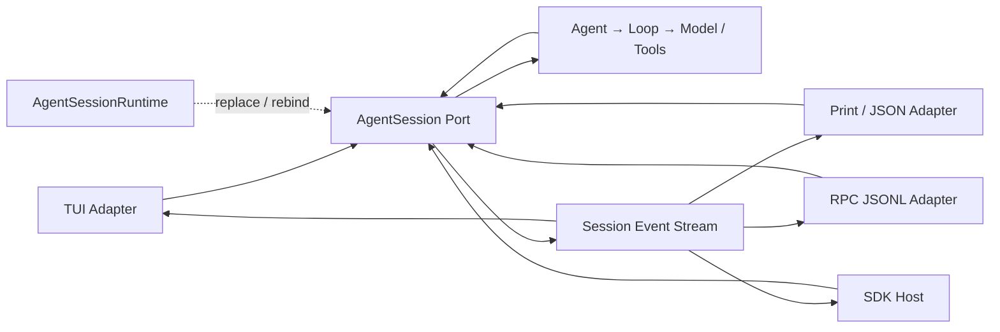
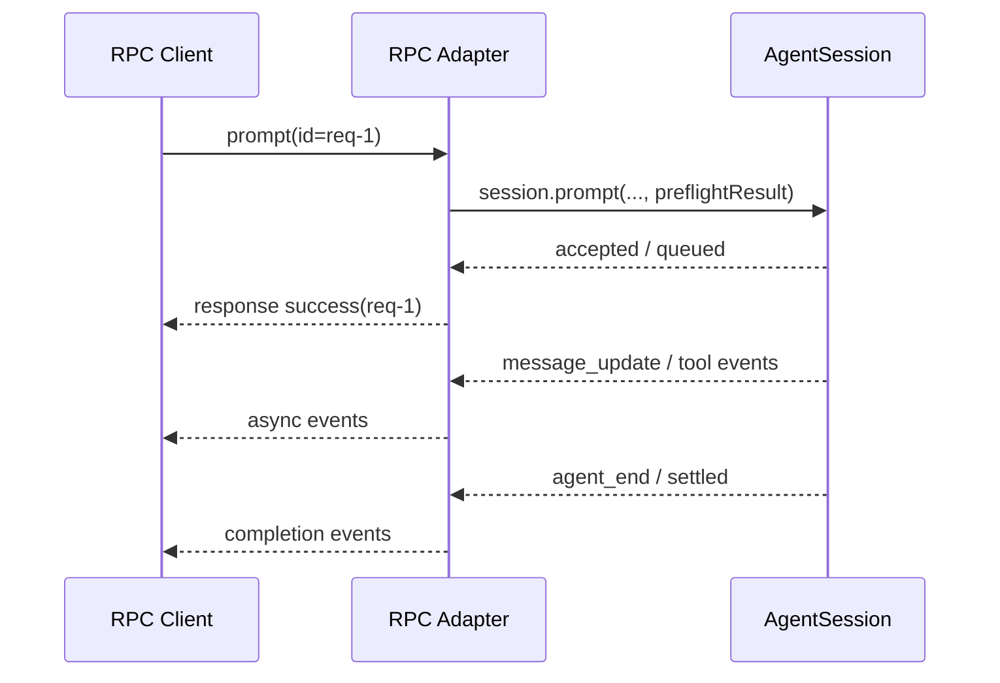

> 历史研究归档 · 2026-11-10 发布 · 程序扫描；未逐篇全文审阅。原有日期、观点、数据和命令保留历史语境，未经本次逐项事实核验或运行复现；请结合[归档说明](../../../../../ARCHIVE_POLICY.md)阅读。

# PI-I10 · 多入口同一内核：适配协议，不复制 Agent

> 一句话结论：Pi 的 TUI、Print/JSON、RPC 与 SDK 不是四套 Agent，而是围绕同一个 `AgentSession` 做输入适配、事件呈现和生命周期管理。

## 1. 定位与掌握证据

> 结论：本 Iter 把前九章的内核当作稳定“端口”，只研究不同宿主怎样接入它。

PI-I00 已经看过主链；PI-I04–09 又补齐状态、会话、持久化、压缩与扩展。现在要回答一个产品架构问题：终端用户、脚本、外部进程和 Node.js 应用的交互方式完全不同，为什么仍能共享一套行为？

| 层级 | 完成证据 |
|---|---|
| 识别 | 能指出 TUI、Print/JSON、RPC、SDK 分别适配什么 |
| 解释 | 能区分“语义一致”与“输出字节一致” |
| 诊断 | 能定位重复 Loop、协议 framing、异步确认、Session rebind 四类故障 |
| 迁移 | 能设计一个 WebSocket/HTTP 入口而不复制 Agent Loop |

本章是**架构与源码练习**。当前课程 Lab 只实现到 PI-I03；下面的 Adapter 与契约测试是待完成设计，不声称已经存在或通过。

## 2. 闭卷唤醒与预测

> 结论：先预测“哪些应相同、哪些可以不同”，再读模式实现。

关掉源码，写下答案：

1. 同一个确定性模型从 Print 与 RPC 接到同一 Prompt，最终 transcript 是否应相同？
2. Print 只输出最终文字、JSON 输出全部事件，这算行为不一致吗？
3. RPC 的 `prompt success` 表示任务完成，还是请求已被接受？
4. `/new` 替换 Session 后，旧订阅者若未解绑，会发生什么？
5. SDK 与 RPC 哪个天然拥有进程隔离？“进程隔离”是否等于安全沙箱？

把答案标为“源码事实 / 推断 / 不知道”；读完后只修改有证据推翻的部分。

## 3. Whole Game：一次任务，四种外壳

> 结论：完整游戏不是比较屏幕文字，而是把每个入口归一化为同一会话轨迹。

假设使用同一个确定性 Model、同一初始 Session、相同工具快照，输入“读取 `a.txt` 并回答首行”。规范化后的核心轨迹应是：

```text
agent_start
→ turn_start
→ user message_start / message_end
→ assistant message_start / toolCall(read) / message_end
→ tool_execution_start/end
→ toolResult message_start / message_end
→ turn_end
→ turn_start
→ assistant message_start / text / message_end
→ turn_end
→ agent_end
→ Session settled
```

四个外壳可以这样呈现：

| 入口 | 输入 | 输出 | 生命周期 |
|---|---|---|---|
| TUI / Interactive | 编辑器、快捷键、队列消息 | 逐事件渲染、状态栏、对话组件 | 长驻、可切 Session |
| Print | 参数/管道输入 | 最后一条 Assistant 文本；错误用退出码 | 单次运行后释放 |
| JSON | 参数/管道输入 | Session header + 全事件 JSONL | 单次运行后释放 |
| RPC | stdin JSONL 命令 | response 与异步 event 交错 | 长驻、可多命令/切 Session |
| SDK | 函数调用 | Promise、状态访问、事件订阅 | 由宿主负责 |

“共享内核”的可检验定义是：在归一化掉时间戳、渲染事件、协议确认和入口元数据后，核心 Message、Tool Call、Tool Result、停止原因及持久化分支一致。它不要求 ANSI 文本、JSON 字段序列或进程退出行为相同。

## 4. 上一版为什么会失败

> 结论：若每个入口各写一份 Loop，最先漂移的通常不是 happy path，而是队列、重试、压缩与错误语义。

一个常见的 v0 会这样长出来：

```text
TUI.runLoop()   Print.runLoop()   Rpc.runLoop()   Web.runLoop()
```

它短期看起来直接，随后出现四类裂缝：

1. TUI 支持 Steering，Print 忘记 Follow-up；
2. RPC 把“已接受”误报成“已完成”，客户端提前开始下一步；
3. JSON 入口没有走 Session compaction，长会话行为不同；
4. `/resume` 后 UI 还监听旧 Session，重复渲染或泄漏资源。

Pi 的选择是把行为沉入 `AgentSession` / `AgentSessionRuntime`，Mode 只翻译输入输出。说白了，入口可以拥有 UX，但不能拥有第二套 Agent 真相。

## 5. 心智模型：Ports & Adapters

> 结论：把 `AgentSession` 看作应用端口，Mode 是 Adapter，事件流是反向输出端口。



边界可以用三句话记：

- **输入适配**：把键盘、CLI 参数、JSON command 或函数参数变成 `session.prompt/steer/followUp/abort`。
- **核心行为**：Session 处理资源、队列、重试、compaction、持久化并调用 Agent。
- **输出适配**：把 Session 事件转换为 TUI 组件、文本、JSONL 或宿主回调。

## 6. Pi 源码断点

> 结论：先看总分流，再分别看输入、事件与 Session 替换，不要从 TUI 六千行文件顺序读。

固定提交：`063fb963c5c33d099faa593d17e60e0a875430cd`。

| 观察点 | 固定源码 | 只看什么 |
|---|---|---|
| CLI 模式总分流 | [`main.ts` L868–915](https://github.com/earendil-works/pi/blob/063fb963c5c33d099faa593d17e60e0a875430cd/packages/coding-agent/src/main.ts#L868-L915) | RPC、Interactive、Print/JSON 在 Session 建好后分流 |
| Core 首轮事件顺序 | [`agent-loop.ts` L95–117](https://github.com/earendil-works/pi/blob/063fb963c5c33d099faa593d17e60e0a875430cd/packages/agent/src/agent-loop.ts#L95-L117) | `agent_start → turn_start → user message events` |
| Print/JSON 共用函数 | [`print-mode.ts` L32–45](https://github.com/earendil-works/pi/blob/063fb963c5c33d099faa593d17e60e0a875430cd/packages/coding-agent/src/modes/print-mode.ts#L32-L45) | 同一 adapter 的资源释放边界 |
| JSON 订阅与 header | [`print-mode.ts` L103–127](https://github.com/earendil-works/pi/blob/063fb963c5c33d099faa593d17e60e0a875430cd/packages/coding-agent/src/modes/print-mode.ts#L103-L127) | JSON 输出事件，二者都调用 `session.prompt()` |
| Print 最终文本与退出码 | [`print-mode.ts` L129–157](https://github.com/earendil-works/pi/blob/063fb963c5c33d099faa593d17e60e0a875430cd/packages/coding-agent/src/modes/print-mode.ts#L129-L157) | 展示契约不同，不改 transcript |
| TUI 输入循环 | [`interactive-mode.ts` L889–919](https://github.com/earendil-works/pi/blob/063fb963c5c33d099faa593d17e60e0a875430cd/packages/coding-agent/src/modes/interactive/interactive-mode.ts#L889-L919) | 键盘输入最终仍到 `session.prompt()` |
| TUI 事件订阅 | [`interactive-mode.ts` L2843–2885](https://github.com/earendil-works/pi/blob/063fb963c5c33d099faa593d17e60e0a875430cd/packages/coding-agent/src/modes/interactive/interactive-mode.ts#L2843-L2885) | UI 是事件消费者 |
| RPC Prompt 确认 | [`rpc-mode.ts` L393–429](https://github.com/earendil-works/pi/blob/063fb963c5c33d099faa593d17e60e0a875430cd/packages/coding-agent/src/modes/rpc/rpc-mode.ts#L393-L429) | response 确认 preflight，完成由事件报告 |
| 严格 JSONL framing | [`jsonl.ts` L4–57](https://github.com/earendil-works/pi/blob/063fb963c5c33d099faa593d17e60e0a875430cd/packages/coding-agent/src/modes/rpc/jsonl.ts#L4-L57) | 只用 LF 分帧，不能误切 U+2028/U+2029 |
| SDK 装配入口 | [`sdk.ts` L135–184](https://github.com/earendil-works/pi/blob/063fb963c5c33d099faa593d17e60e0a875430cd/packages/coding-agent/src/core/sdk.ts#L135-L184) | 宿主可注入 Model、ResourceLoader、SessionManager |
| 公共 Session/SDK 导出面 | [`index.ts` L13–22](https://github.com/earendil-works/pi/blob/063fb963c5c33d099faa593d17e60e0a875430cd/packages/coding-agent/src/index.ts#L13-L22)、[`L191–221`](https://github.com/earendil-works/pi/blob/063fb963c5c33d099faa593d17e60e0a875430cd/packages/coding-agent/src/index.ts#L191-L221) | `AgentSession`、Runtime、服务与 Tool factory 都是正式边界 |
| Runtime 持有当前 Session | [`agent-session-runtime.ts` L74–130](https://github.com/earendil-works/pi/blob/063fb963c5c33d099faa593d17e60e0a875430cd/packages/coding-agent/src/core/agent-session-runtime.ts#L74-L130) | UI 绑定需要随 Session 替换更新 |
| Session 替换与 rebind | [`agent-session-runtime.ts` L170–220](https://github.com/earendil-works/pi/blob/063fb963c5c33d099faa593d17e60e0a875430cd/packages/coding-agent/src/core/agent-session-runtime.ts#L170-L220) | 先释放旧 Session，再 apply/rebind 新 Session |
| Runtime 最终释放 | [`agent-session-runtime.ts` L395–420](https://github.com/earendil-works/pi/blob/063fb963c5c33d099faa593d17e60e0a875430cd/packages/coding-agent/src/core/agent-session-runtime.ts#L395-L420) | shutdown event 与 dispose 所有权 |

## 7. 四个入口的真正差异

> 结论：选择入口的依据是宿主边界与交互协议，不是“哪个 Agent 更强”。

| 维度 | TUI | Print / JSON | RPC | SDK |
|---|---|---|---|---|
| 目标用户 | 人 | Shell/CI | 任意语言进程 | Node/TS 应用 |
| 耦合 | UI 与事件结构 | CLI/进程 | JSONL 协议 | TypeScript API |
| 流式输出 | 组件化 | JSON 模式支持 | 支持 | subscribe |
| 多命令 | 是 | 否 | 是 | 是 |
| Session 替换 | Runtime 管理 | 通常一次性 | Runtime 管理 | 宿主选择 |
| 进程故障隔离 | 无 | 子进程边界 | 子进程边界 | 无 |
| 序列化成本 | 无协议序列化 | 文本/JSONL | 双向 JSONL | 无协议序列化 |
| 适合 | 个人交互 | 一次性任务、事件管道 | IDE、非 Node 宿主 | 深度嵌入、测试 |

我的推荐很明确：Node/TypeScript 同进程集成优先 SDK；跨语言或希望把 Pi 生命周期关进子进程时用 RPC；CI 中只要最终答案用 Print，需要完整可机读事件用 JSON。不要为了“解耦”给同进程 Node 应用强行套 RPC，也不要为了省一个子进程让不可信多租户代码直接共享 SDK 进程。

## 8. RPC 的两个容易混淆的时钟

> 结论：Command response 属于协议接收时钟，Agent event 属于任务执行时钟。



如果客户端把第一条 `success` 当作任务完成，就会产生竞态：它可能在 Tool 仍执行时读取文件、关闭进程或发送依赖前序结果的命令。正确客户端要用 correlation id 确认“命令被接受”，再用 Session/Agent 事件判断业务完成；两者不可合并成一个布尔值。

## 9. JSONL framing 也是架构契约

> 结论：一条消息一行不等于可以使用任何“按行读取器”。

Pi 的 RPC 只把字节 `0x0A`（LF）视为记录分隔符；JSON 字符串中的 U+2028/U+2029 是合法内容，不应切帧。用代码点构造真实字符，而不是把六个 ASCII 字符 `\u2028` 当作测试：

```ts
const separator = String.fromCodePoint(0x2028);
const record = JSON.stringify({ type: "prompt", message: `a${separator}b` }) + "\n";
// 再把 record 的 UTF-8 bytes 任意拆成多个 chunk；reader 仍只能产出一条 record。
```

测试要覆盖 UTF-8 多字节跨 chunk、CRLF 输入、末尾无 LF、空行与非法 JSON。Framing 只负责切记录；解析失败、未知 command 和 request correlation 属于更上一层协议错误。

## 10. Session 替换不是改一个指针

> 结论：`/new`、`/resume`、`/fork` 后，所有宿主绑定都必须完整地转向新 Session；固定实现是 teardown-then-create，并不提供失败时原子回滚。

`AgentSessionRuntime` 的价值不仅是保存 `session` getter，而是协调：

1. 发出切换前 Extension 事件并允许取消；
2. 结束旧 Session 生命周期并 `dispose()`；
3. 用同一 factory 组装目标 Session；
4. 更新 Runtime 内部引用；
5. 触发宿主 `rebindSession`，重新绑定事件、Extensions、UI 状态。

最典型的泄漏测试：订阅旧 Session → switch → 让新旧 Session 各发一个事件。验收应是 UI 只收到新 Session 一次，旧 Session 监听器为零。只断言 `runtime.session !== oldSession` 不足以证明生命周期正确。

还要覆盖 factory 创建新 Session 失败：由于固定实现先 teardown 旧对象，宿主不能假设失败后旧 Session 仍可继续使用；产品层若需要事务式切换，必须另做预创建/回滚设计。

## 11. Build Delta：设计一个第五入口

> 结论：本 Iter 的增量是 Adapter 契约与一致性测试设计，不是已交付的 Lab 实现。

为 Mini Pi 设计 `WebSocketAdapter`，限制它只拥有：

```ts
interface SessionPort {
  prompt(text: string, options?: { streamingBehavior?: "steer" | "followUp" }): Promise<void>;
  abort(): Promise<void>;
  subscribe(listener: (event: SessionEvent) => void): () => void;
}
```

这是课程自定义 Port，不是逐字复制 Pi 类型。`AgentSession` 的 Session-event 分发不会替 Adapter await 异步 listener；网络写入的串行化、缓冲和背压应由 Adapter 自己的输出队列负责。

要求：

- Adapter 不导入 `runAgentLoop`；
- command ack 与 completion event 分离；
- 每条连接显式绑定一个 Session/租户主体；
- 断连时取消订阅；是否 abort 任务由产品策略决定，不能偷偷假设；
- 输出事件带协议版本，未知事件允许向前兼容；
- 规范化 transcript 与 SDK 直接调用一致。

这只是接口草案；`SessionEvent`、鉴权、背压、断线重连与幂等 request id 仍需在实现前设计和测试。

## 12. 故障、成本与边界

> 结论：共享内核减少语义漂移，却不会自动解决协议兼容、背压、租户隔离或宿主资源泄漏。

- **背压**：慢 RPC 客户端若消费事件不及时，会积压内存或阻塞 Agent；固定提交的 RPC 对 stdout 有背压处理，但自建网络入口仍需实测。
- **版本漂移**：SDK 直接依赖 TypeScript API，升级耦合更强；RPC 可版本化，但要维护序列化和兼容层。
- **资源所有权**：Print 在 `finally` 释放 Runtime；SDK 宿主若忘记 dispose，会留下监听器或子进程。
- **取消语义**：客户端断连、用户 abort、Session switch、工具超时是四种不同事件，不能全部映射成“连接关闭”。
- **一致性范围**：Provider 随机性、时间、文件系统变化会让真实输出不同；跨入口比较应使用确定性 Fake 或比较不变量，而不是逐字 golden answer。
- **安全边界**：RPC 子进程提供故障隔离，但如果仍以同一 OS 用户运行并共享凭据/目录，它不是权限沙箱。

## 13. 练习与验收

> 结论：练习重点是证明“薄 Adapter”，而不是再写一套聊天机器人。

完成 [exercises/PI-I10.md](../exercises/PI-I10.md)，至少留下这些证据：

- 一张入口—Session—事件图；
- 一份规范化规则和两入口等价性断言；
- 一个 ack/completion 竞态解释；
- 一个严格 JSONL 分帧反例；
- 一个 Session rebind 泄漏测试设计；
- 一个新入口的端口接口，且没有 Loop 依赖。

参考答案见 [solutions/PI-I10.md](../solutions/PI-I10.md)，应在独立作答后再打开。

## 14. Teach-back Rubric

> 结论：能说出“都调用 Session”只到 1 分，能界定契约、生命周期和故障才算掌握。

| 分数 | 证据 |
|---:|---|
| 0 | 把四入口理解成四个 Agent |
| 1 | 知道它们都调用 `session.prompt()` |
| 2 | 能区分输入 Adapter、核心行为、事件 Presenter |
| 3 | 能解释 RPC 两个时钟、严格 JSONL 和语义等价 |
| 4 | 能独立设计新入口、处理 rebind/背压/取消，并给出契约测试 |

达到 3 后进入 PI-I11；4 分需要真实实现或严谨测试设计，不靠口头宣称。

## 15. 延迟复习

> 结论：复习要换入口，不要重读相同表格。

- D+1：闭卷画 TUI、Print、RPC、SDK 到 `AgentSession` 的箭头，并说出每个输出契约。
- D+3：把 RPC 换成 HTTP `POST /runs` + SSE，标出 ack、event、completion。
- D+7：设计“切 Session 时恰有事件到达”的竞态测试。
- D+21：从未知入口需求中判断用 SDK、RPC 还是自写 Adapter，并给出成本理由。

## 16. 来源与时效

> 结论：源码事实固定在课程提交，产品入口说明已在 2026-07-31 对照官方现行文档。

- 固定源码：[`earendil-works/pi@063fb963`](https://github.com/earendil-works/pi/tree/063fb963c5c33d099faa593d17e60e0a875430cd)，行号均指向该标本。
- 官方 README：[`coding-agent/README.md`](https://github.com/earendil-works/pi/blob/main/packages/coding-agent/README.md)，用于核对四种入口、SDK/RPC 定位；访问于 2026-07-31。
- 官方 RPC 文档：[`docs/rpc.md`](https://github.com/earendil-works/pi/blob/main/packages/coding-agent/docs/rpc.md)，用于核对 ack、事件与 LF-only framing；访问于 2026-07-31。
- 官方 SDK 文档：[`docs/sdk.md`](https://github.com/earendil-works/pi/blob/main/packages/coding-agent/docs/sdk.md)，用于核对嵌入用例与 Session API；访问于 2026-07-31。
- 知识库交叉引用：R156 §2.3、§8；其中架构判断仍以本章固定源码为最终证据。

上游 main 已晚于课程标本；未来若重定位行号，必须重新验证 `main.ts`、Mode 与 `AgentSessionRuntime` 的行为，不能只批量替换 commit 字符串。
