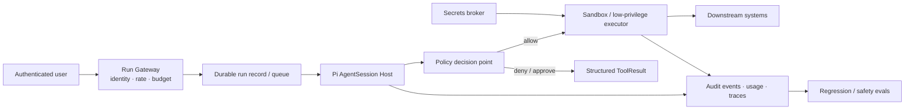
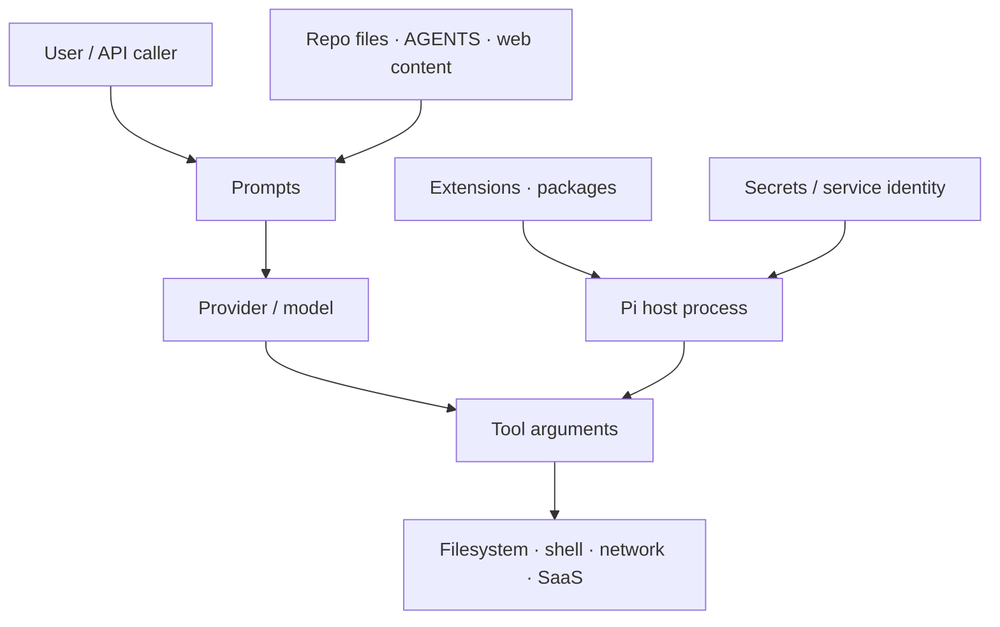
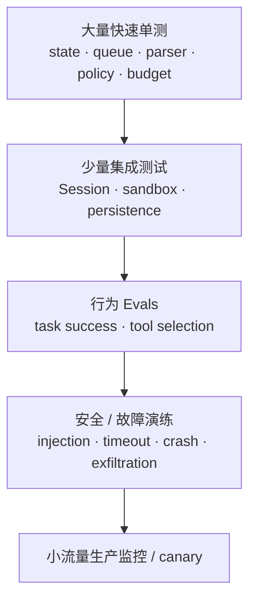

> 历史研究归档 · 2026-11-10 发布 · 发布审核状态：risk_context_review（发布前程序扫描并重点审核风险上下文）。原有日期、观点、数据和命令保留历史语境，未经本次逐项事实核验或运行复现；见[归档说明](../../../../../ARCHIVE_POLICY.md)。

# PI-I11 · 生产加固与评估：把 Thin Harness 放进厚边界

> 一句话结论：Pi 很适合作为可读、可嵌入、可改造的 Agent Harness，但原样 CLI 不是多租户生产执行平台；上线要在它外面补授权、隔离、预算、耐久语义、观测与评估。

## 1. 定位与最终能力

> 结论：本章不再添加“更聪明”的 Agent 行为，而是判断系统在失败、攻击和成本压力下是否仍可接受。

PI-I00–10 已回答“它怎样工作”。最终 Iter 回答：

- 谁能让 Agent 做什么？
- 即使模型或 Extension 被操纵，损害范围在哪里结束？
- 重试、工具和 Token 怎样有硬上限？
- 进程崩溃后，哪些事实可恢复，哪些外部副作用无法推断？
- 怎样用事件、测试和 Eval 证明一次变更没有破坏关键不变量？

掌握证据不是一份泛泛 Checklist，而是一张具体威胁图、一份策略矩阵、一次故障演练设计、一套 Eval 分层，以及“采用 Pi / 加固 Pi / 不选 Pi”的明确决策。

本章交付的是完整教学、练习、答案与 Capstone 规格；生产加固与真实 Capstone **尚未实现、未运行**，课程没有替你实现生产 Sandbox，也没有运行真实模型 Eval，任何性能、通过率和费用数字均为待实测。

## 2. 闭卷唤醒与风险预测

> 结论：先列出资产和副作用，再看安全控件；从功能清单出发容易漏掉信任边界。

不看资料，回答：

1. Project Trust 拒绝项目后，内置 Bash 是否因此被 OS 沙箱隔离？
2. Tool Schema 通过，能否证明当前用户被授权读取目标路径？
3. Permission Extension 与容器，哪个能阻止同进程恶意 Extension 直接读凭据？
4. JSONL transcript 显示“开始发送邮件”但没有结果，能否安全重试？
5. Gateway、Session、Provider 三层的 `maxRetries` 都是 3（每层另有首次 attempt），保守乘法上界是多少？
6. 一次 Agent answer 正确，能否说明它对提示注入、超时和工具异常都可靠？

每题写下最坏后果；如果答案只写“加日志”“人工确认”，继续追问控件在哪里强制执行、攻击者能否绕过。

## 3. Whole Game：从 Prompt 到受控副作用

> 结论：生产完整路径要在 Agent 前后增加独立控制面，而不是只在 System Prompt 里写“请安全”。



推荐的责任分配：

| 层 | 必须回答 | 不应依赖 |
|---|---|---|
| Gateway | 用户、租户、run id、总预算 | 模型自报身份 |
| Policy | 此主体此刻能否执行此动作 | Tool Schema 或 Prompt |
| Sandbox/Executor | 即使策略/模型失误，系统权限上限是什么 | 同进程 Extension 的善意 |
| Durable record | 意图、状态、幂等键、结果能否恢复 | 仅凭聊天 transcript 猜测 |
| Observability | 谁在何时调用什么、花费多少、结果怎样 | 只保存最终答案 |
| Eval | 行为、可靠性、安全、成本是否回归 | 单一 happy-path Demo |

## 4. 上一版为什么会失败

> 结论：把个人本地 Harness 直接暴露为服务，会同时放大权限、成本和恢复语义缺口。

典型 v0：HTTP 收到 Prompt → SDK 建 Session → 开启默认 `read/bash/edit/write` → 返回最终文本。它至少有六个结构性问题：

1. 所有请求继承服务进程的文件、网络与凭据权限；
2. 模型可用开放式 Bash 表达远超业务需要的动作；
3. Agent Loop 没有统一的 run/turn/tool/cost 硬预算；
4. Provider retry、Session retry、队列重放可能叠乘；
5. JSONL 记录模型轨迹，却不能证明外部副作用是否恰好一次；
6. 只有答案日志，无法重建策略决策、Tool 参数、拒绝原因和成本。

它可能“经常能跑”，但还不能称为可上线。生产加固的目标不是保证模型永不出错，而是让错误可拒绝、可限制、可归因、可恢复、可评估。

## 5. 先分清三种控制

> 结论：Validation、Authorization、Isolation 回答不同问题，任一项不能替代另外两项。

| 控制 | 问题 | Pi 可用接缝 | 强制边界 |
|---|---|---|---|
| Validation | 参数结构完整、类型正确吗？ | Tool Schema、参数预检 | 进程内代码 |
| Authorization | 此主体可执行此动作吗？ | `beforeToolCall`、专用 Tool、外部 Policy service | 下游系统/Policy gateway |
| Isolation | 即使授权或代码出错，能影响到哪里？ | 可替换 Bash operations、Extension | 容器/VM/OS 身份/网络策略 |

Project Trust 是第四种概念：它决定是否装载项目本地设置、Package 与 Extension。固定源码的提示文字明确说“允许装载和执行项目扩展”；它没有把 `resolveToCwd()` 变成工作区围栏，也没有改变 Bash 继承的 OS 权限。

一个安全的拒绝链应该是：参数非法 → validation error；参数合法但主体无权 → policy deny；策略误放行或工具有漏洞 → sandbox/下游 ACL 仍限制损害。只在 System Prompt 写“不要访问 secrets”三层都没实现。

## 6. 威胁模型：五个信任域

> 结论：Agent 风险不是只来自恶意用户，也来自项目内容、模型输出、供应链与高权限宿主。



至少登记这些资产与滥用：

| 资产/动作 | 威胁 | 最小控制 |
|---|---|---|
| 源码、凭据 | 间接 Prompt Injection 诱导外传 | 网络出口限制、凭据隔离、最小文件挂载 |
| Bash | 任意命令、持久化、横向移动 | 容器/VM、只读根、无特权用户、超时 |
| Write/Edit | 越界修改、供应链植入 | 工作区 allowlist、diff 审批、Git checkpoint |
| Extension | 同进程任意代码、包更新投毒 | 固定版本/哈希、来源审批、隔离宿主 |
| Provider 请求 | 敏感上下文出域、费用爆炸 | 数据分级、模型路由、Token/调用预算 |
| 外部 SaaS | 重复发送、删除或付款 | 最小 OAuth scope、幂等键、下游强授权、关键动作审批 |
| Session JSONL | 敏感日志、篡改/脏数据 | 权限、加密/保留期、完整性校验、解析上限 |

OWASP 把 excessive functionality、permissions、autonomy 视为 Excessive Agency 的根因，并推荐最小工具面、最小权限、下游完整仲裁。这个框架与 Pi 的默认开放 Bash 形成清晰张力：个人可信环境可以接受，面向不可信输入的服务不能默认接受。

## 7. Pi 源码断点与事实边界

> 结论：源码能证明现有接缝和默认行为；生产策略是本课程建议，不能倒写成 Pi 内建保证。

固定提交：`063fb963c5c33d099faa593d17e60e0a875430cd`。

| 观察点 | 固定源码 | 事实 |
|---|---|---|
| Project Trust 决策 | [`project-trust.ts` L24–95](https://github.com/earendil-works/pi/blob/063fb963c5c33d099faa593d17e60e0a875430cd/packages/coding-agent/src/core/project-trust.ts#L24-L95) | 控制项目资源装载；无 UI 且无适用决策时拒绝 |
| 路径解析 | [`path-utils.ts` L40–117](https://github.com/earendil-works/pi/blob/063fb963c5c33d099faa593d17e60e0a875430cd/packages/coding-agent/src/core/tools/path-utils.ts#L40-L117) | 支持相对 cwd、`~` 与绝对路径；这里没有 cwd containment |
| Bash 参数与 timeout | [`bash.ts` L24–43](https://github.com/earendil-works/pi/blob/063fb963c5c33d099faa593d17e60e0a875430cd/packages/coding-agent/src/core/tools/bash.ts#L24-L43) | timeout 可选，默认没有工具级 timeout |
| 本地进程与 Abort | [`bash.ts` L82–145](https://github.com/earendil-works/pi/blob/063fb963c5c33d099faa593d17e60e0a875430cd/packages/coding-agent/src/core/tools/bash.ts#L82-L145) | 以宿主环境启动 shell，支持 kill process tree |
| 可替换 Bash operations | [`bash.ts` L52–82](https://github.com/earendil-works/pi/blob/063fb963c5c33d099faa593d17e60e0a875430cd/packages/coding-agent/src/core/tools/bash.ts#L52-L82) | 可委托 SSH/远端 executor，是加固接缝，不是默认隔离 |
| Tool 输出上限 | [`truncate.ts` L1–45](https://github.com/earendil-works/pi/blob/063fb963c5c33d099faa593d17e60e0a875430cd/packages/coding-agent/src/core/tools/truncate.ts#L1-L45) | 默认 2000 行或 50KB；控制 Context，不等于进程输出硬配额 |
| before/after Hook | [`types.ts` L263–286](https://github.com/earendil-works/pi/blob/063fb963c5c33d099faa593d17e60e0a875430cd/packages/agent/src/types.ts#L263-L286) | 可阻断/改写 Tool；Hook 自己负责响应 Abort |
| 截断 Tool Call fail-closed | [`agent-loop.ts` L374–405](https://github.com/earendil-works/pi/blob/063fb963c5c33d099faa593d17e60e0a875430cd/packages/agent/src/agent-loop.ts#L374-L405) | output-token 截断时不执行可能残缺的参数 |
| Session 后处理循环 | [`agent-session.ts` L1061–1102](https://github.com/earendil-works/pi/blob/063fb963c5c33d099faa593d17e60e0a875430cd/packages/coding-agent/src/core/agent-session.ts#L1061-L1102) | retry、compaction、queued continuation 可再次 `agent.continue()` |
| Abort 与 idle | [`agent-session.ts` L1538–1553](https://github.com/earendil-works/pi/blob/063fb963c5c33d099faa593d17e60e0a875430cd/packages/coding-agent/src/core/agent-session.ts#L1538-L1553) | Abort 后等待 Session idle |
| Overflow 恢复上限 | [`agent-session.ts` L1943–2011](https://github.com/earendil-works/pi/blob/063fb963c5c33d099faa593d17e60e0a875430cd/packages/coding-agent/src/core/agent-session.ts#L1943-L2011) | overflow compact-and-retry 限一次，成功超窗不重复 answer |
| Retry 配置 | [`settings-manager.ts` L813–838](https://github.com/earendil-works/pi/blob/063fb963c5c33d099faa593d17e60e0a875430cd/packages/coding-agent/src/core/settings-manager.ts#L813-L838) | Session `maxRetries` 与 Provider retry 配置是不同层 |
| Retry / attempt 定义 | [`retry.ts` L91–102](https://github.com/earendil-works/pi/blob/063fb963c5c33d099faa593d17e60e0a875430cd/packages/ai/src/utils/retry.ts#L91-L102)、[`provider-retry.ts` L97–124](https://github.com/earendil-works/pi/blob/063fb963c5c33d099faa593d17e60e0a875430cd/packages/ai/src/utils/provider-retry.ts#L97-L124) | 初次调用不计入 retry；`maxRetries=3` 最多产生 4 attempts |
| Eval Harness 隔离夹具 | [`pi-harness.ts` L94–180](https://github.com/earendil-works/pi/blob/063fb963c5c33d099faa593d17e60e0a875430cd/packages/evals/src/pi-harness.ts#L94-L180) | 临时 cwd/agentDir、内存设置/Session、事件和 usage 归一化 |
| Smoke Eval | [`smoke.eval.ts` L1–16](https://github.com/earendil-works/pi/blob/063fb963c5c33d099faa593d17e60e0a875430cd/packages/evals/src/smoke.eval.ts#L1-L16) | 有端到端行为评估示例；不等于安全/生产全覆盖 |

官方 README 还明确采用“No permission popups”，建议自行用容器或 Extension 构建确认流。这是设计取舍，不是漏洞声明；是否合适取决于宿主威胁模型。

## 8. 最小权限：先缩工具，再缩身份

> 结论：比起给开放 Bash 写复杂黑名单，更可靠的起点是专用 Tool + 最小下游权限。

推荐顺序：

1. 只注册任务必需工具；读任务不要给 Bash/Write；
2. 把“发布版本”拆成 `build_release_notes`、`create_draft_release` 等窄 Tool；
3. Tool 用当前用户/租户身份访问下游，不共用高权限服务账号；
4. 在下游系统再次鉴权，不能只信 Agent Host；
5. 高影响动作先产出 dry-run/diff，再由独立 UI 审批；
6. Approval 文案由可信代码从结构化参数生成，不允许模型自由伪造按钮或摘要；
7. 开放 Bash 仅放到一次性低权限 Sandbox，默认无敏感挂载和网络。

Extension 的 `beforeToolCall` 很适合做 UX 级确认、策略查询和审计，但它与 Pi 同进程。如果同一进程内另一个 Extension 已恶意或宿主被利用，Hook 不是强制安全边界；关键授权仍应由 Executor 或下游服务完成。

## 9. 预算：把“没有 max steps”变成可计算上限

> 结论：预算要覆盖嵌套重试与副作用，不只设置一个 Token 数。

建议的 Run Envelope：

```text
deadline
max_provider_requests
max_input_tokens / max_output_tokens
max_tool_calls
max_tool_wall_time
max_cost
max_consecutive_errors
max_side_effect_actions
```

所有数字都应标为“业务策略 / 初始值，待压测与风险评审”，而不是伪装成 Pi 官方最佳值。预算检查放在每次 Provider 调用和每次 Tool 执行之前，耗尽时返回明确 stop reason 并持久化原因。

嵌套重试的最坏上界可先用保守乘法审计：

```text
max network attempts
≤ (1 + outer maxRetries) × (1 + session maxRetries) × (1 + provider maxRetries)
```

`maxRetries=3` 通常表示首次请求之外还能重试 3 次，即该层最多 4 attempts；三层都这样配置时，保守上界是 `4³ = 64`，不是 27。不同实现可能不会完整重放内层，实际值可更低，必须用配置定义和 Trace 验证。我的推荐是**只让一层拥有同一种失败的重试权**，其余层上报结构化错误；所有层共享一个总 Provider Request budget，避免策略叠乘。

对有副作用 Tool，重试前还要判断幂等性。网络超时只说明“没收到结果”，不说明“动作没发生”。

## 10. Durable Execution：Transcript 不是事务日志

> 结论：JSONL 能恢复对话分支，却不能独自证明外部动作的提交状态。

假设 Tool 做：

```text
append intent(send email, id=k1)
→ downstream accepts email
→ process crashes before ToolResult append
```

恢复后 transcript 只有 intent，没有 result。盲目重试可能重复发送；盲目跳过又可能漏发。生产动作需要：

- 业务幂等键 `k1`，由宿主生成而非模型自由生成；
- 下游 API 支持幂等或可查询操作状态；
- `intent → executing → committed/failed/unknown` 独立 Run/Action record；
- 对 `unknown` 先 reconcile，再决定 retry；
- Session entry 引用 action id，而不是把自然语言当状态机；
- 崩溃恢复时重新验证租户、策略和凭据，不沿用过期授权结论。

Pi 的 JSONL 树仍然很有价值：它提供可审计上下文和分支历史。但它不是 Durable Queue、Lease、事务 Outbox 或 exactly-once 执行引擎。

## 11. Observability：记录能改变决策的证据

> 结论：生产 Trace 至少要串起一次 Run、每次模型调用、每个 Tool 动作和最终停止原因。

最小字段：

| 层 | 字段 |
|---|---|
| Run | tenant/user、runId、sessionId、入口、版本、开始/结束、stopReason |
| Model call | provider/model、attempt、latency、input/output/cache tokens、error class |
| Tool | toolCallId、tool、参数摘要/策略标签、allow/deny、executor、duration、result class |
| Budget | 当前/上限、触发哪条限制 |
| Persistence | Session file/entry id、action id、branch/compaction boundary |
| Security | policy version、approval actor、sandbox identity、network profile |

不要默认记录完整 Prompt、Tool 输出、凭据或个人数据。先做数据分类与字段级删减/哈希；为调试临时放宽时设置访问控制和保留期。日志既是诊断资产，也是敏感数据与成本来源。

可观察性验收不是“有日志”：给定一个重复付款、越权拒绝或重试风暴，审计者应能在有限查询中确定主体、决策、动作、次数、费用和最终状态。查询时间阈值需要团队实测，不在课程里虚构。

## 12. 评估金字塔

> 结论：确定性单测守不变量，行为 Eval 测概率性能力，故障与安全演练验证边界；三者互补。



| 层 | 应固定 | 可统计 | 不应声称 |
|---|---|---|---|
| Unit | 事件顺序、预算拒绝、Policy、JSONL 解析 | 无需模型 | “模型质量已验证” |
| Integration | 容器权限、网络、Action record、恢复 | 延迟/资源 | “所有环境都相同” |
| Behavioral Eval | 数据集、模型版本、judge、seed/重复次数 | 成功率、成本、方差 | 单次成功代表稳定 |
| Security | 攻击夹具、资产、预期 deny/contain | escape/deny/exfil 指标 | 没发现即安全 |
| Production | release/version、真实告警 | SLO、成本、人工接管 | 线上流量替代预发布测试 |

Pi 的 `packages/evals` 已把 `AgentSession` 直接适配到 `vitest-evals`，并为每次运行创建临时项目与 agent 目录、归一化 transcript 和 usage。这是很好的起点，但官方 smoke case 只证明一个基础问答路径；你的业务仍需建立任务集、安全集和回归阈值。

## 13. 生产选择：什么时候选 Pi

> 结论：Pi 的代码可读性与接缝是优势；当你无力承担外围控制面时，这个优势会变成总成本。

| 场景 | 推荐 | 理由 |
|---|---|---|
| 个人、可信仓库、终端可观察 | 直接 Pi + 容器可选 | 默认简单，人工可监督 |
| 内部单租户、受控任务 | Pi SDK/RPC + 窄 Tool + 低权限 executor | 接缝清楚，加固范围可控 |
| 多租户、不可信输入、高副作用 | 仅把 Pi 当 Harness 内核，外围必须有强控制面 | 原样 CLI/SDK 权限和耐久语义不足 |
| 团队没有安全/平台维护能力 | 优先选择治理更完整的平台 | 自建 sandbox、policy、durability、eval 的人力可能高于许可成本 |
| 强 durable workflow / exactly-once | Pi + 专用工作流引擎，或不用 Pi 做编排器 | JSONL Session 不是工作流状态机 |

我的结论：学习 Agent Harness、打造高度个性化个人 Agent，Pi 是优先标本；把它裸露给不可信租户，不推荐。能否生产采用取决于你是否愿意把外围“厚边界”当作正式产品，而不是几条 Extension 脚本。

## 14. Capstone：架构答辩而非堆功能

> 结论：最终项目要证明边界和不变量，不要求一次写完完整平台。

完成 [CAPSTONE.md](../CAPSTONE.md) 中的“受控代码审阅 Agent”：只读仓库、生成审阅报告，不允许任意 Bash/Write。交付至少包含：

- Context Diagram 与信任域；
- 工具 allowlist / policy 矩阵；
- Run/Tool/Token/时间预算；
- 隔离与凭据方案；
- Session 与 Action record 的恢复语义；
- 事件与敏感数据策略；
- 单测、集成、行为、安全四层 Eval；
- 成本估算维度与“不采用 Pi”的退出条件；
- 一次超时、一次越权、一次崩溃歧义演练。

练习见 [exercises/PI-I11.md](../exercises/PI-I11.md)，参考答案见 [solutions/PI-I11.md](../solutions/PI-I11.md)。

## 15. Teach-back Rubric

> 结论：最高分不是背出更多风险，而是把每个风险映射到可强制、可测试、有所有者的控制。

| 分数 | 证据 |
|---:|---|
| 0 | “加权限、加日志、加沙箱”但说不出边界 |
| 1 | 能区分 validation / authorization / isolation |
| 2 | 能解释 Project Trust、Extension、JSONL 各自不保证什么 |
| 3 | 能给出预算、幂等、观测和 Eval 的具体设计 |
| 4 | 能在故障注入中证明控制有效，估算成本并作出采用/退出决策 |

4 分需要可重复证据；架构图漂亮但没有失败路径，只能到 2 分。

## 16. 延迟复习与长期维护

> 结论：生产知识会随威胁、Provider 与上游源码变化，复习必须包含漂移审计。

- D+1：闭卷画五个信任域，给每个域一个强制控件。
- D+3：计算一个三层重试场景的最坏调用数，并改成共享预算。
- D+7：演练 Tool 下游已提交但 Agent 未记录结果，写 reconcile 流程。
- D+21：用新业务场景重新做“选择 Pi / 加固 Pi / 不选 Pi”决策。
- 每次升级：重跑 Source Map 锚点、协议契约、Policy 与安全夹具；模型/Extension/Package 版本进入 SBOM 或等价清单。

## 17. 来源、时效与局限

> 结论：Pi 行为来自固定源码与官方文档，安全加固参考当前权威框架；具体阈值仍需业务实测。

- 固定源码：[`earendil-works/pi@063fb963`](https://github.com/earendil-works/pi/tree/063fb963c5c33d099faa593d17e60e0a875430cd)。
- 官方 README：[`coding-agent/README.md`](https://github.com/earendil-works/pi/blob/main/packages/coding-agent/README.md)，尤其 Project Trust、Extensions 与 Philosophy；访问于 2026-07-31。
- 作者设计复盘：[What I learned building a minimal coding agent](https://mariozechner.at/posts/2025-11-30-pi-coding-agent/)，用于核对极简 Loop 与控制权取舍；访问于 2026-07-31。
- OWASP：[LLM06:2025 Excessive Agency](https://genai.owasp.org/llmrisk/llm062025-excessive-agency/)，用于最小功能、权限、自治与下游完整仲裁；访问于 2026-07-31。
- OWASP：[Top 10 for Agentic Applications 2026](https://genai.owasp.org/resource/owasp-top-10-for-agentic-applications-for-2026/)，用于补充 agent goal hijacking、tool misuse、identity/privilege 与 supply-chain 风险；访问于 2026-07-31。
- NIST：[AI RMF Generative AI Profile, NIST AI 600-1](https://www.nist.gov/publications/artificial-intelligence-risk-management-framework-generative-artificial-intelligence)，用于跨生命周期风险识别、测量与治理；页面更新于 2026-04-08，访问于 2026-07-31。
- 知识库交叉引用：R156 §3–8；其中“生产建议”是课程架构判断，不是 Pi 官方保证。

已知局限：本课程没有对某个真实企业环境做威胁建模、渗透测试、性能压测或成本采样；容器/VM 配置、日志保留期、预算阈值、Eval 样本量和发布门槛全部必须按资产价值、法规和 SLO 决定。

## 18. 设计审查

> 结论：本章作为生产架构设计文档完成了 5 项前置自审，设计审查 5/5 通过。

| 检查项 | 结果 | 证据 / 限制 |
|---|---|---|
| 外部依赖已验证 | 通过 | 固定源码本地可读；Pi、OWASP、NIST 官方页面已于 2026-07-31 核对 |
| 性能数字有来源 | 通过 | 只引用源码常量 2000 行/50KB；所有业务预算、SLO、成本均标待实测 |
| 异常路径覆盖 | 通过 | 超时、断连、越权、提示注入、重试叠乘、崩溃歧义、脏 Session、扩展供应链均纳入 |
| 阈值有依据 | 通过 | 不提供伪最佳阈值；要求作为业务初始值并经风险评审/压测调优 |
| 未越出需求边界 | 通过 | 聚焦 Pi 生产化学习；未把课程伪装成已部署平台或合规认证 |

**设计审查：5/5 通过。**
