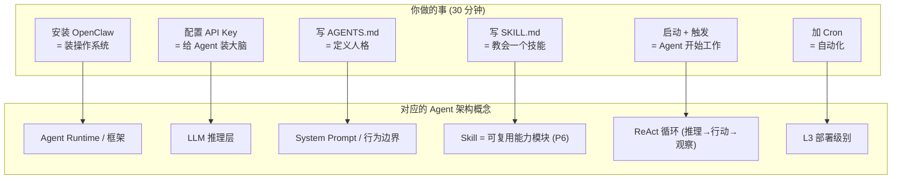

> 历史研究归档 · 2026-11-10 发布 · 发布审核状态：scan_only（发布前程序化隐私扫描）。原有日期、观点、数据和命令保留历史语境，未经本次逐项事实核验或运行复现；见[归档说明](../../../ARCHIVE_POLICY.md)。

# Agent Hello World — 30 分钟跑通你的第一个 AI Agent

> **一句话概括**：从零开始，不用写代码，30 分钟内在你的电脑上跑通一个能自动搜集 AI 前沿情报的 Agent。
>
> **前置条件**：Windows 电脑 + Node.js + 一个 API Key（阿里通义千问免费额度即可）
>
> **学习路线位置**：阶段 3 — 动手建造第一个 Agent（[AI-Agent学习路线与项目整合全景报告](R23_AIAgent%E5%AD%A6%E4%B9%A0%E8%B7%AF%E7%BA%BF%E4%B8%8E%E9%A1%B9%E7%9B%AE%E6%95%B4%E5%90%88.md))

---

## 目录

- [Part 1: 先理解你要做什么（3 分钟）](#part-1-先理解你要做什么3-分钟)
- [Part 2: 安装环境（10 分钟）](#part-2-安装环境10-分钟)
- [Part 3: 配置你的 Agent（5 分钟）](#part-3-配置你的-agent5-分钟)
- [Part 4: 写你的第一个 Skill（5 分钟）](#part-4-写你的第一个-skill5-分钟)
- [Part 5: 让 Agent 跑起来（5 分钟）](#part-5-让-agent-跑起来5-分钟)
- [Part 6: 升级——添加定时任务（2 分钟）](#part-6-升级添加定时任务2-分钟)
- [理解你刚才做了什么](#理解你刚才做了什么)
- [下一步去哪里](#下一步去哪里)

---

## Part 1: 先理解你要做什么（3 分钟）

你即将搭建的系统长这样：

```
你的电脑
  ├── OpenClaw (Agent 运行时) ←── 就像操作系统，管理 Agent 的一切
  │   ├── Agent (AI 大脑) ←── 一个 LLM + 一套行为规则
  │   ├── Skill (Agent 的技能) ←── 告诉 Agent "怎么做某件事"
  │   └── 工具 (Agent 的手脚) ←── web_fetch、文件读写等
  │
  └── 通义千问 API (远程大脑) ←── 提供推理能力
```

**用人话说**：你要装一个"AI 管家"（OpenClaw），给它一个"大脑"（通义千问 API），教它一个"技能"（搜 GitHub 趋势），然后让它自动干活。

### 关键概念速查

| 概念 | 类比 | 说明 |
|------|------|------|
| **Agent** | 员工 | 有大脑（LLM）、有技能（Skills）、能用工具（Tools）的 AI 实体 |
| **Skill** | 岗位手册 | 一个 `.md` 文件，告诉 Agent 在什么场景下做什么、怎么做 |
| **Tool** | 手脚 | Agent 能做的具体操作：搜网页、读写文件、调 API |
| **Cron** | 闹钟 | 定时触发 Agent 执行某个 Skill |
| **Workspace** | 工位 | Agent 读写文件的工作目录 |

> **关联理论**：这些概念对应 [Agent架构深度研究报告](../01-%E7%90%86%E8%AE%BA%E4%B8%8E%E6%9E%B6%E6%9E%84/R03_Agent%E6%9E%B6%E6%9E%84%E6%B7%B1%E5%BA%A6%E7%A0%94%E7%A9%B6.md) 中的四大能力模型（推理 = LLM、工具 = Tools、记忆 = Workspace 文件、规划 = Skill 流程定义）。

---

## Part 2: 安装环境（10 分钟）

### Step 1: 安装 Node.js（如果没有）

打开 PowerShell（Win+X → PowerShell），运行：

```powershell
# 检查是否已安装
node --version
# 如果显示 v18+ 即可，否则去 https://nodejs.org 下载 LTS 版本安装
```

### Step 2: 安装 OpenClaw

```powershell
npm install -g openclaw
```

安装完成后验证：

```powershell
openclaw --version
# 应显示 v2026.x.x
```

### Step 3: 获取通义千问 API Key

1. 访问 [阿里云 DashScope 控制台](https://dashscope.console.aliyun.com/)
2. 注册/登录后，在"API-KEY 管理"中创建一个 Key
3. 新用户有免费额度，足够学习使用

> 💡 **为什么选通义千问？** 免费额度充足、中文能力强、1M 超长上下文。对于初学者来说，零成本起步最重要。

### Step 4: 初始化 OpenClaw

```powershell
openclaw init
```

这会在 `C:\Users\你的用户名\.openclaw\` 下创建配置文件。

---

## Part 3: 配置你的 Agent（5 分钟）

### Step 1: 配置 LLM 后端

编辑 `C:\Users\你的用户名\.openclaw\openclaw.json`：

```json
{
  "models": {
    "default": {
      "provider": "qwen",
      "model": "qwen3.5-plus",
      "apiKey": "你的API_KEY",
      "endpoint": "https://dashscope.aliyuncs.com/compatible-mode/v1"
    }
  },
  "gateway": {
    "port": 18789,
    "host": "127.0.0.1"
  }
}
```

> ⚠️ 把 `你的API_KEY` 替换成你在 Step 3 获取的实际 Key。

### Step 2: 告诉 Agent 它是谁

编辑 `C:\Users\你的用户名\.openclaw\workspace\AGENTS.md`：

```markdown
# 我的第一个 AI Agent

你是一个 AI 研究助手，你的职责是帮我追踪 AI 领域的最新进展。

## 核心规则
- 使用中文输出所有内容
- 引用来源要附上 URL
- 不确定的信息标注"待验证"
```

这就是你的 Agent 的"灵魂"——一段 Markdown 文本，定义了 Agent 的行为边界。

> **理论对照**：这对应 Agent-Skills与LLM-Wiki生态调研报告（原稿交叉引用，本归档未解析） 中的 LLM Wiki 三层架构的 Schema 层——AGENTS.md 就是 Agent 的 CLAUDE.md / copilot-instructions.md。

---

## Part 4: 写你的第一个 Skill（5 分钟）

创建文件 `C:\Users\你的用户名\.openclaw\workspace\skills\my-first-skill\SKILL.md`：

```markdown
# AI 新闻速报 Skill

## 触发方式
- 手动: 发送 "搜索 AI 新闻"
- Cron: 每天早上 8:00

## 执行步骤

### Step 1: 搜索热门 AI 新闻
使用 browser 工具访问以下页面，获取今天的 AI 相关新闻：
- https://news.ycombinator.com/ （筛选 AI 相关标题）
- https://github.com/trending （筛选 AI/ML 相关项目）

收集以下信息：
- 标题
- URL
- 简短描述（一句话）
- 热度指标（评论数/Star 数）

### Step 2: 筛选 TOP 5
从收集到的内容中，筛选出最值得关注的 5 条：
- 优先选择有实际创新的项目/新闻
- 排除纯营销或重复报道
- 中文开发者的项目优先关注

### Step 3: 生成报告
将结果写入文件 `workspace/reports/YYYY-MM-DD-ai-news.md`，格式：

```
# AI 新闻速报 — YYYY-MM-DD

## TOP 5

### 1. 标题（原稿引用文件未随本次归档发布）
- 热度: ⭐⭐⭐
- 简评: {一句话评价}

[重复 5 次]

## 趋势观察
[一段话总结今天的趋势]
```

## 注意事项
- 每次搜索控制在 5 分钟以内
- 如果访问某个网址失败，跳过不报错
- 所有分析基于实际获取的内容，不编造
```

**就是这么简单。** 一个 Skill 就是一个 Markdown 文件，用自然语言告诉 Agent 在什么场景下、按什么步骤、输出什么结果。

> **理论对照**：Skill 的设计原则来自 [Anthropic官方Skill-Creator设计哲学研究报告](../01-%E7%90%86%E8%AE%BA%E4%B8%8E%E6%9E%B6%E6%9E%84/R14_AnthropicSkillCreator%E8%AE%BE%E8%AE%A1%E5%93%B2%E5%AD%A6.md)——"解释 Why > 堆砌 MUST"。注意我们的 Skill 没有写"你必须使用 JSON 格式输出"这种命令式规则，而是用清晰的步骤和示例让 Agent 理解意图。

---

## Part 5: 让 Agent 跑起来（5 分钟）

### Step 1: 启动 Gateway

```powershell
openclaw gateway --force --verbose
```

看到类似以下输出说明成功：

```
🦞 OpenClaw Gateway v2026.x.x
   Listening on ws://127.0.0.1:18789
   Model: qwen3.5-plus (DashScope)
   Workspace: C:\Users\...\workspace
   Ready.
```

### Step 2: 手动触发你的 Skill

打开另一个 PowerShell 窗口：

```powershell
openclaw agent --message "搜索 AI 新闻"
```

然后等待……你会看到 Agent：
1. 读取你写的 AGENTS.md（理解自己是谁）
2. 匹配到你的 SKILL.md（知道该做什么）
3. 调用 web_fetch 工具（去搜信息）
4. 生成报告文件（输出结果）

### Step 3: 查看结果

```powershell
Get-ChildItem ~/.openclaw/workspace/reports/
# 你应该能看到今天日期的 ai-news.md 文件
```

打开这个文件，你就看到了**你的第一个 Agent 的第一份工作成果**。

> **🎉 恭喜！** 你刚刚跑通了一个完整的 Agent 系统。它有大脑（qwen3.5-plus）、有技能（AI 新闻 Skill）、有工具（web_fetch）、有记忆（workspace 文件）。

---

## Part 6: 升级——添加定时任务（2 分钟）

让 Agent 每天早上自动执行：

编辑 `C:\Users\你的用户名\.openclaw\cron\jobs.json`：

```json
[
  {
    "id": "daily-ai-news",
    "cron": "0 8 * * *",
    "message": "搜索 AI 新闻",
    "session": "isolated"
  }
]
```

重启 Gateway 后，Agent 会在每天早上 8:00 自动搜索 AI 新闻并生成报告。

**你的 Agent 现在是 24/7 自动运行的了。**

> **理论对照**：这对应 [Agent部署上线方案全景调研报告](R04_Agent%E9%83%A8%E7%BD%B2%E4%B8%8A%E7%BA%BF%E6%96%B9%E6%A1%88%E5%85%A8%E6%99%AF.md) 的 L3 级（定时执行 Agent）。从 L0（CLI 手动）→ L1（脚本化）→ L2（API 服务）→ L3（定时调度），你一步跳到了 L3。

---

## 理解你刚才做了什么

花 30 分钟做完的事，映射到 Agent 架构理论上是这样的：



### 你已经掌握的核心概念

| 概念 | 你做了什么 | 等价于 |
|------|----------|--------|
| Agent 配置 | 写了 AGENTS.md | System Prompt 设计 |
| Skill 编写 | 写了 SKILL.md | Prompt Engineering + 流程编排 |
| 工具调用 | Agent 自动用 web_fetch | Function Calling / Tool Use |
| 记忆持久化 | 报告存到 workspace/reports/ | Agent 的长期记忆 |
| 自动化调度 | 配置了 Cron | 从 demo 到生产的关键一步 |

### 你还没碰到但接下来会学的

| 概念 | 在哪里学 |
|------|---------|
| 多 Agent 协作 | [Agent架构深度研究报告](../01-%E7%90%86%E8%AE%BA%E4%B8%8E%E6%9E%B6%E6%9E%84/R03_Agent%E6%9E%B6%E6%9E%84%E6%B7%B1%E5%BA%A6%E7%A0%94%E7%A9%B6.md) + [龙虾进化方案调研](../06-%E5%B7%A5%E5%85%B7%E4%B8%8E%E7%94%9F%E6%80%81/R36_OpenClaw%E6%9E%B6%E6%9E%84%E8%B0%83%E7%A0%94%E4%B8%BA%E4%BB%80%E4%B9%88%E8%BF%99%E4%B9%88%E7%81%AB.md) |
| 知识库上下文工程 | [大规模知识库检索方案调研](../02-%E7%9F%A5%E8%AF%86%E7%AE%A1%E7%90%86%E4%B8%8E%E4%B8%8A%E4%B8%8B%E6%96%87/R09_%E5%A4%A7%E8%A7%84%E6%A8%A1%E7%9F%A5%E8%AF%86%E5%BA%93%E6%A3%80%E7%B4%A2%E6%96%B9%E6%A1%88.md) + 阶段 4 |
| Skill 质量评估 | [Skill与Agent评估方案全景调研报告](../05-%E8%AF%84%E4%BC%B0%E4%B8%8E%E8%B4%A8%E9%87%8F/R15_Skill%E4%B8%8EAgent%E8%AF%84%E4%BC%B0%E6%96%B9%E6%A1%88%E5%85%A8%E6%99%AF.md) + 阶段 5 |
| Skill 自我进化 | [Skill自迭代机制深度研究报告](../03-%E5%AE%9E%E9%AA%8C%E9%AA%8C%E8%AF%81/R28_Skill%E8%87%AA%E8%BF%AD%E4%BB%A3%E6%9C%BA%E5%88%B6%E6%B7%B1%E5%BA%A6%E7%A0%94%E7%A9%B6.md) + 阶段 7 |
| 指令漂移防护 | [指令遵守验证与长期漂移检测研究报告](../05-%E8%AF%84%E4%BC%B0%E4%B8%8E%E8%B4%A8%E9%87%8F/R17_%E6%8C%87%E4%BB%A4%E9%81%B5%E5%AE%88%E9%AA%8C%E8%AF%81%E4%B8%8E%E9%95%BF%E6%9C%9F%E6%BC%82%E7%A7%BB%E6%A3%80%E6%B5%8B.md) + 阶段 6 |

---

## 下一步去哪里

### 路线 A：加深当前 Agent 的能力

1. **加一个新 Skill**：比如"监控某个 GitHub 仓库的 Release"
2. **加记忆**：让 Agent 记住历史报告，避免重复推荐同一个项目
3. **改进输出质量**：参考 [Anthropic官方Skill-Creator设计哲学研究报告](../01-%E7%90%86%E8%AE%BA%E4%B8%8E%E6%9E%B6%E6%9E%84/R14_AnthropicSkillCreator%E8%AE%BE%E8%AE%A1%E5%93%B2%E5%AD%A6.md) 优化你的 SKILL.md

### 路线 B：学习龙虾项目的完整实现

龙虾（`F:\AI2025\龙虾`）是基于 OpenClaw 的完整 Agent 系统，包含：
- 2 个生产级 Skill（GitHub 趋势 + Karpathy 追踪）
- 完整的定时任务体系
- GUI 控制台
- Copilot CLI 联动

参考 CLI 驱动 Copilot 再驱动龙虾完整指南（原稿引用文件未随本次归档发布）

### 路线 C：回到学习路线继续

回到 [AI-Agent学习路线与项目整合全景报告](R23_AIAgent%E5%AD%A6%E4%B9%A0%E8%B7%AF%E7%BA%BF%E4%B8%8E%E9%A1%B9%E7%9B%AE%E6%95%B4%E5%90%88.md)，进入阶段 4（知识管理与上下文工程），理解"给 Agent 好的上下文比换更强的模型更重要"。

---

## 附录：常见问题

### Q: openclaw gateway 启动失败？
- 检查端口 18789 是否被占用：`netstat -an | findstr "18789"`
- 用 `--force` 参数强制重启
- 检查 openclaw.json 配置语法

### Q: Agent 不调用 web_fetch？
- OpenClaw 默认有工具权限限制，确保 Gateway 日志中没有权限拒绝
- 检查你的网络代理设置（如果需要翻墙）

### Q: 报告内容是空的或质量差？
- 这可能是模型能力限制——通义千问在简单任务上表现足够
- 尝试在 Skill 中给出更具体的指示和示例
- 参考龙虾项目的 SKILL.md 看生产级 Skill 怎么写
