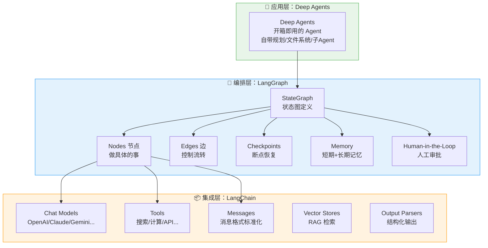
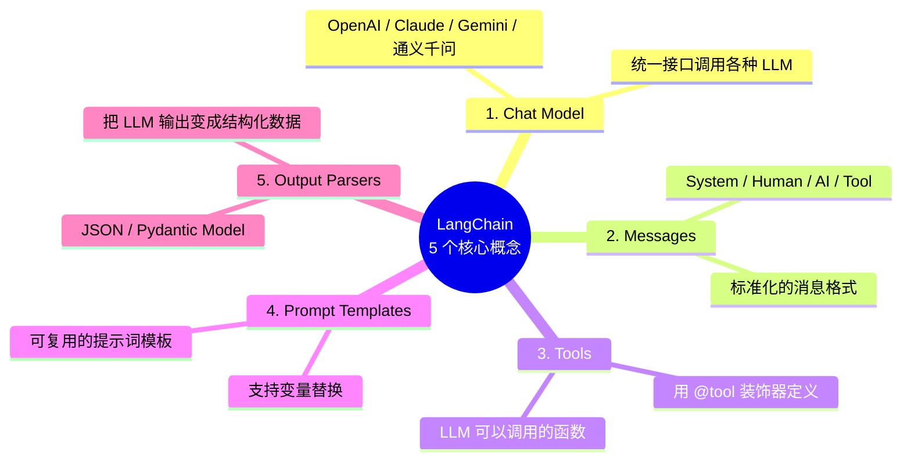
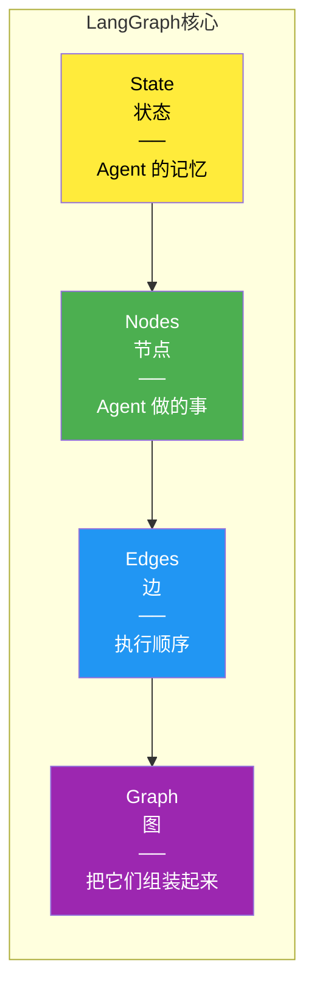
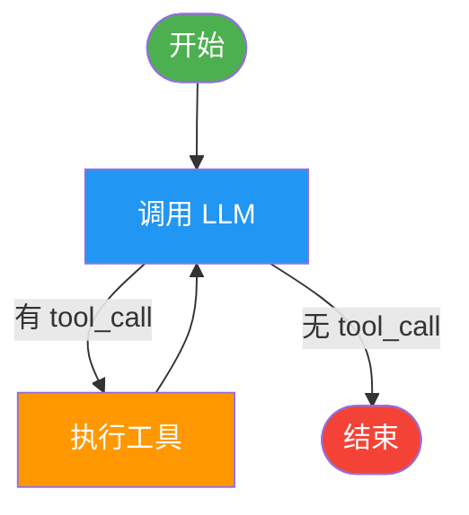
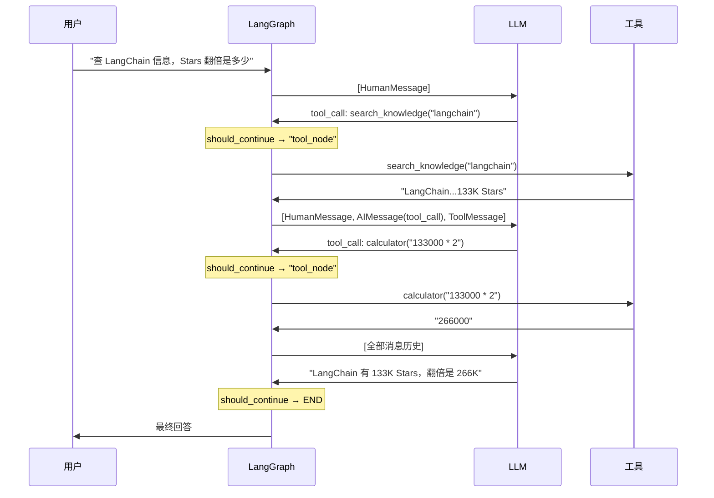
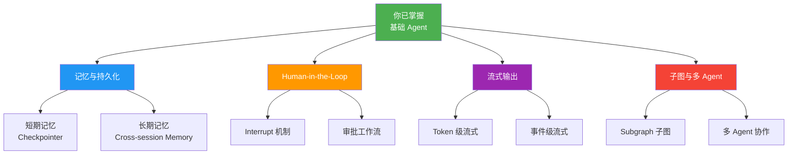
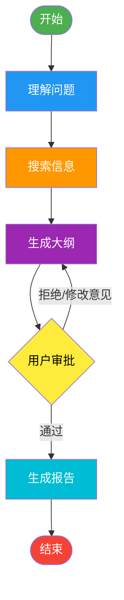
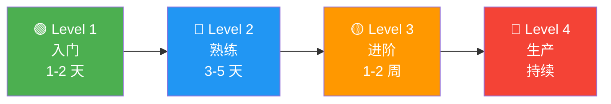

> 历史研究归档 · 2026-11-10 发布 · 程序扫描并审阅风险命中上下文；未逐篇全文审阅。原有日期、观点、数据和命令保留历史语境，未经本次逐项事实核验或运行复现；请结合[归档说明](../../../ARCHIVE_POLICY.md)阅读。

# LangChain 与 LangGraph：从入门到实战完全指南

> **一句话概括**：这不是一篇研究报告——这是一份面向 Agent 初学者的**渐进式学习文档**，从"LangChain 到底是什么"讲到"你能用 LangGraph 构建生产级 Agent"，每一步都有可运行的代码、直觉类比和灵魂追问。
>
> **研究日期**：2026-04-14
>
> **增量价值**：在 [现代智能体编排框架深度调研报告](../06-%E5%B7%A5%E5%85%B7%E4%B8%8E%E7%94%9F%E6%80%81/R45_%E7%8E%B0%E4%BB%A3%E6%99%BA%E8%83%BD%E4%BD%93%E7%BC%96%E6%8E%92%E6%A1%86%E6%9E%B6%E6%B7%B1%E5%BA%A6%E8%B0%83%E7%A0%94.md) 的"9 框架横向对比"基础上，对 LangChain+LangGraph 生态做**纵向深挖**——从概念心智模型、核心 API 逐步拆解到企业级模式，附完整可运行示例。不是"又一篇对比报告"，而是"让你真正学会"的教学文档。
>
> **适合谁读**：了解 Agent 基本概念（知道 Agent = 推理+工具+记忆+规划），但还没用过编排框架的学习者。Python 基础即可。

---

## 目录

- [第一章：为什么学 LangChain 和 LangGraph？](#第一章为什么学-langchain-和-langgraph)
- [第二章：全景鸟瞰——三层架构一张图](#第二章全景鸟瞰三层架构一张图)
- [第三章：LangChain 核心概念速通](#第三章langchain-核心概念速通)
- [第四章：你的第一个 Agent——10 分钟跑通](#第四章你的第一个-agent10-分钟跑通)
- [第五章：LangGraph 核心心智模型](#第五章langgraph-核心心智模型)
- [第六章：手搓一个 LangGraph Agent——逐步拆解](#第六章手搓一个-langgraph-agent逐步拆解)
- [第七章：进阶技能树——记忆、中断、流式](#第七章进阶技能树记忆中断流式)
- [第八章：实战项目——构建一个研究助手](#第八章实战项目构建一个研究助手)
- [第九章：从入门到生产的路线图](#第九章从入门到生产的路线图)
- [第十章：常见误区与避坑指南](#第十章常见误区与避坑指南)
- [附录：学习资源精选](#附录学习资源精选)

---

## 第一章：为什么学 LangChain 和 LangGraph？

### 💭 灵魂三问（苏格拉底式）

在动手之前，先问自己三个问题：

**Q1：我直接调 LLM API 就能做 Agent，为什么还需要框架？**

试想你在盖房子。你当然可以一砖一瓦自己砌——但如果你每次盖房都要自己造砖窑、自己炼钢筋、自己做水泥，那你盖一栋小别墅可能花三年。

LangChain/LangGraph 就是"预制建材"+"施工规范"：
- **LangChain** = 建材市场（帮你连接各种 LLM、向量库、工具，不用自己写胶水代码）
- **LangGraph** = 施工蓝图（让你画出 Agent 的执行流程图，精确控制每一步该干什么）

如果你的 Agent 只是一个简单的"接收问题→调 LLM→返回结果"，确实不需要框架。但现实中的 Agent 通常需要：
- 调用多个工具（搜索、计算、数据库查询）
- 记住之前的对话
- 在关键决策前让人类审批
- 出错后能恢复而不是从头开始

这些"看起来简单但做起来烦"的事情，就是框架存在的价值。

**Q2：市面上这么多框架（CrewAI、OpenAI SDK、Google ADK...），为什么选 LangChain/LangGraph？**

三个理由：

| 理由 | 数据支撑 |
|------|---------|
| **生态最大** | LangChain 133K⭐、LangGraph 29.2K⭐、37.9K 下游依赖——意味着遇到问题最容易找到答案 |
| **行业标准** | Klarna、Replit、Elastic 等公司在生产中使用——不是玩具项目 |
| **学了能迁移** | LangGraph 的"图编排"思想是通用范式——学一次，换到任何框架都用得上 |

> **费曼提示**：如果你只能学一个框架，学 LangGraph。因为它教会你的不只是一个工具的用法，而是**如何用图的思维来编排 Agent**——这个思维模型在 Microsoft Agent Framework、Google ADK 等框架中都适用。

**Q3：LangChain 和 LangGraph 到底是什么关系？我经常搞混。**

这是初学者最大的困惑点。一句话说清楚：

> **LangChain 是零件库，LangGraph 是装配车间。**

- **LangChain**：提供标准化的"积木块"——统一的模型调用接口（Model）、工具定义（Tool）、文档加载器（Loader）、向量存储（VectorStore）、消息格式（Message）等
- **LangGraph**：把这些积木块按照你画的"流程图"组装起来——定义节点（干什么）、边（按什么顺序干）、状态（过程中记住什么）

你可以单独用 LangChain（直接调模型、调工具），也可以单独用 LangGraph（不用 LangChain 的组件）。但组合起来威力最大——LangChain 提供零件，LangGraph 提供蓝图。

---

## 第二章：全景鸟瞰——三层架构一张图

### 在你脑中建立一张地图

学新东西最怕的不是细节太多，而是**没有地图**——不知道自己在哪、要去哪、各个概念之间是什么关系。先建立全局画面，再填充细节。



### 三层的费曼解释

想象你在经营一家餐厅：

| 层次 | 餐厅类比 | LangChain 生态 |
|------|---------|---------------|
| **集成层**（LangChain） | 食材供应商——提供各种标准化食材（牛肉、蔬菜、调料） | 提供标准化的 LLM 接口、工具、消息格式 |
| **编排层**（LangGraph） | 厨房工作流——从备菜→炒菜→装盘的流程控制 | 定义 Agent 的执行图——谁先干、谁后干、出问题怎么办 |
| **应用层**（Deep Agents） | 预制套餐——开箱即用的完整菜品 | 开箱即用的 Agent，自带规划和工具 |

**你作为初学者的学习路径**：先学食材（LangChain 核心概念）→ 再学做菜（LangGraph 图编排）→ 最后理解预制套餐怎么做的（Deep Agents）。

---

## 第三章：LangChain 核心概念速通

### 3.1 只需掌握 5 个概念

LangChain 的概念很多，但作为初学者，你只需要**先掌握 5 个**，其他的用到再学：



### 3.2 概念一：Chat Model——统一的 LLM 遥控器

**问题**：OpenAI 的 API 是 `openai.chat.completions.create()`，Anthropic 的是 `anthropic.messages.create()`，每换一个模型就要改代码？

**LangChain 的解法**：一个 `init_chat_model()` 搞定所有模型。

```python
from langchain.chat_models import init_chat_model

# 换模型只需要改这一行
model = init_chat_model("anthropic:claude-sonnet-4-6")  # Anthropic Claude
# model = init_chat_model("openai:gpt-4o")                # OpenAI GPT-4o  
# model = init_chat_model("google_genai:gemini-2.5-pro")   # Google Gemini

# 调用方式完全一样
response = model.invoke("什么是 Agent？用一句话解释。")
print(response.content)
```

> **费曼时刻**：`init_chat_model` 就像万能遥控器——不管你家电视是索尼、三星还是LG，同一个遥控器都能控制。背后的复杂性（不同品牌的红外协议）被封装了。

### 3.3 概念二：Messages——标准化的对话格式

LLM 的对话本质上是一串**消息列表**。LangChain 统一了消息格式：

```python
from langchain.messages import SystemMessage, HumanMessage, AIMessage

messages = [
    SystemMessage(content="你是一个 AI Agent 领域的专家。"),  # 系统指令
    HumanMessage(content="什么是 LangGraph？"),              # 用户输入
    AIMessage(content="LangGraph 是一个图编排框架..."),        # AI 回复
    HumanMessage(content="能举个例子吗？"),                    # 用户追问
]

response = model.invoke(messages)
print(response.content)  # AI 会基于完整对话历史回答
```

四种消息类型——记住这个表就够了：

| 类型 | 用途 | 类比 |
|------|------|------|
| `SystemMessage` | 给 AI 设定角色和规则 | 你给新员工的入职手册 |
| `HumanMessage` | 用户的输入 | 客户提的需求 |
| `AIMessage` | AI 的回复 | 员工的回答 |
| `ToolMessage` | 工具执行的结果 | 员工查完资料后带回的信息 |

### 3.4 概念三：Tools——让 LLM 拥有"手脚"

LLM 本身只能"思考"（生成文本），不能"行动"（查数据库、调 API、发邮件）。**Tool 就是 LLM 的手和脚。**

```python
from langchain.tools import tool

@tool
def search_weather(city: str) -> str:
    """查询指定城市的天气。
    
    Args:
        city: 城市名称，如"北京"、"上海"
    """
    # 实际应用中会调用天气 API，这里用模拟数据
    weather_data = {
        "北京": "晴，25°C，湿度 40%",
        "上海": "多云，22°C，湿度 65%",
        "深圳": "阵雨，28°C，湿度 80%",
    }
    return weather_data.get(city, f"未找到 {city} 的天气数据")

@tool
def calculate(expression: str) -> str:
    """计算数学表达式。
    
    Args:
        expression: 数学表达式，如 "2 + 3 * 4"
    """
    try:
        # 注意：生产环境中应使用安全的表达式求值器
        result = eval(expression)  # 仅作演示
        return str(result)
    except Exception as e:
        return f"计算错误: {e}"
```

> **灵魂追问**：LLM 怎么知道该调用哪个 Tool？
>
> 答案：**靠 Tool 的名字和描述**。上面 `"""查询指定城市的天气"""` 这个 docstring 就是告诉 LLM"遇到天气查询就用我"。所以 Tool 的描述要写得精准——这是一种 Prompt Engineering。

### 3.5 概念四：让 LLM 调用 Tool——bind_tools

有了 Tool，还需要告诉 LLM "你可以使用这些工具"：

```python
# 把工具"绑定"到模型上
model_with_tools = model.bind_tools([search_weather, calculate])

# 现在模型会自动判断是否需要调用工具
response = model_with_tools.invoke("北京今天天气怎么样？")
print(response)

# response.tool_calls 会包含：
# [{'name': 'search_weather', 'args': {'city': '北京'}, 'id': '...'}]
```

**关键理解**：`bind_tools` 后，LLM 收到问题时会做一个**决策**：
- "这个问题我直接就能答" → 直接返回文本
- "这个问题需要查数据" → 返回一个 `tool_call`（"我需要调用 search_weather，参数是 '北京'"）

**但注意**：LLM 只是**决定**要调用工具，它不会**真正执行**工具——执行是你的代码负责的。这个"决策→执行→反馈"的循环，就是 Agent 的核心。

### 3.6 概念五：用 10 行代码创建一个 Agent

LangChain 提供了一个高级 API `create_agent`，把上面的概念全部封装了：

```python
from langchain.agents import create_agent

# 定义工具（复用前面的 search_weather 和 calculate）

# 一行代码创建 Agent
agent = create_agent(
    model="anthropic:claude-sonnet-4-6",
    tools=[search_weather, calculate],
    prompt="你是一个全能助手，可以查天气和做计算。回答要简洁。",
)

# 运行 Agent
result = agent.invoke({
    "messages": [{"role": "user", "content": "北京天气怎么样？另外帮我算 15 * 37"}]
})

# Agent 会自动：
# 1. 判断需要调用两个工具
# 2. 调用 search_weather("北京")
# 3. 调用 calculate("15 * 37")
# 4. 综合工具结果给出回答
```

> **停下来想一想**（苏格拉底式）：上面这个 Agent 在背后做了什么？它经历了几次 LLM 调用？
>
> 答案：至少 2 次。第一次 LLM 看到问题，决定调用两个工具；工具执行完毕后，第二次 LLM 看到工具结果，综合生成最终回答。这就是 **ReAct 循环**（Reasoning + Acting）：思考→行动→观察→再思考。

---

## 第四章：你的第一个 Agent——10 分钟跑通

### 4.1 环境准备

```bash
# 创建虚拟环境（推荐）
python -m venv langchain-learn
# Windows
langchain-learn\Scripts\activate
# Linux/Mac
# source langchain-learn/bin/activate

# 安装核心包
pip install langchain "langchain[anthropic]" langgraph

# 设置 API Key（选其一）
# 方式 A：Anthropic Claude
set ANTHROPIC_API_KEY=your-key-here

# 方式 B：OpenAI
# set OPENAI_API_KEY=your-key-here

# 方式 C：使用免费/本地模型（Ollama）
# pip install langchain[ollama]
# 需要先安装 Ollama 并拉取模型
```

> **成本提示**：学习阶段推荐用 Claude Haiku 或 GPT-4o-mini，便宜且够用。一天的学习大约消耗 $0.5-2。如果想完全免费，用 Ollama 跑本地模型（如 Llama 3）。

### 4.2 Hello World：最简单的 Agent

创建 `01_hello_agent.py`：

```python
"""
你的第一个 LangChain Agent
目标：能回答问题 + 能调用工具
"""
from langchain.chat_models import init_chat_model
from langchain.tools import tool
from langchain.agents import create_agent

# ========== Step 1: 定义工具 ==========
@tool
def get_current_time() -> str:
    """获取当前时间。当用户问"现在几点"或"当前时间"时使用。"""
    from datetime import datetime
    return datetime.now().strftime("%Y-%m-%d %H:%M:%S")

@tool
def reverse_string(text: str) -> str:
    """反转一个字符串。当用户要求反转文字时使用。
    
    Args:
        text: 要反转的字符串
    """
    return text[::-1]

# ========== Step 2: 创建 Agent ==========
agent = create_agent(
    model="anthropic:claude-sonnet-4-6",  # 换成你的模型
    tools=[get_current_time, reverse_string],
    prompt="你是一个乐于助人的 AI 助手。可以查时间和反转字符串。用中文回答。",
)

# ========== Step 3: 运行！==========
result = agent.invoke({
    "messages": [{"role": "user", "content": "现在几点了？"}]
})

# 打印对话过程
for msg in result["messages"]:
    if hasattr(msg, 'pretty_print'):
        msg.pretty_print()
```

运行：
```bash
python 01_hello_agent.py
```

你应该看到类似输出：
```
================================ Human Message =================================
现在几点了？
================================== Ai Message ==================================
Tool Calls:
  get_current_time()
================================= Tool Message =================================
2026-04-14 15:30:42
================================== Ai Message ==================================
现在是 2026 年 4 月 14 日下午 3 点 30 分 42 秒。
```

### 4.3 试着"玩坏"它

学东西最好的方式之一是**边界测试**——故意给它出难题：

```python
# 实验 1：问一个不需要工具的问题
result = agent.invoke({
    "messages": [{"role": "user", "content": "解释一下什么是递归"}]
})
# 观察：Agent 应该直接回答，不调用任何工具

# 实验 2：问一个两个工具都用不上的问题
result = agent.invoke({
    "messages": [{"role": "user", "content": "帮我查一下明天北京的天气"}]
})
# 观察：Agent 应该说"我没有天气查询工具"

# 实验 3：需要链式推理的问题
result = agent.invoke({
    "messages": [{"role": "user", "content": "先告诉我现在几点，然后把时间字符串反转"}]
})
# 观察：Agent 应该先调 get_current_time，拿到结果后调 reverse_string
```

> **苏格拉底追问**：在实验 3 中，Agent 是怎么知道要先调一个工具再调另一个的？它有"记忆"吗？
>
> 关键洞察：`create_agent` 内部其实就是一个 LangGraph 构建的**循环图**——LLM 调用→检查是否有 tool_call→有就执行工具→把结果塞回消息列表→再次调用 LLM→循环直到 LLM 不再调用工具。这就是 ReAct 循环在代码层面的实现。

### 4.4 多轮对话——Agent 的记忆

```python
# 多轮对话示例
messages = []

# 第一轮
messages.append({"role": "user", "content": "我叫小明"})
result = agent.invoke({"messages": messages})
messages = result["messages"]

# 第二轮——Agent 应该记得你叫小明
messages.append({"role": "user", "content": "我叫什么名字？"})
result = agent.invoke({"messages": messages})

for msg in result["messages"]:
    if hasattr(msg, 'pretty_print'):
        msg.pretty_print()
```

> **注意**：这里的"记忆"是**短期记忆**——把所有历史消息都塞进上下文窗口。当对话很长时，消息列表会超过模型的上下文限制。后面在 LangGraph 中，我们会学到如何用 Checkpoint 和 Memory 来解决这个问题。

---

## 第五章：LangGraph 核心心智模型

### 5.1 为什么需要 LangGraph？

上一章的 `create_agent` 很方便——但它是一个**黑盒**。如果你想：

- 在 Agent 调用工具前，**让人类审批**？
- Agent 执行中途**保存状态**，明天继续？
- 两个 Agent **协作**，一个做研究一个写摘要？
- 对执行流程做**精确控制**（先做 A，如果结果好做 B，不好做 C）？

`create_agent` 做不到——你需要打开黑盒，自己**画流程图**。这就是 LangGraph。

### 5.2 LangGraph 的核心比喻：地铁线路图

**LangGraph 就是让你画"Agent 的地铁线路图"。**

```
你的 Agent 就像一个在地铁系统里移动的乘客：

🚉 站点（Node）     = Agent 要做的每一件具体的事（调 LLM、执行工具、处理数据）
🚇 线路（Edge）     = 从一个站到下一个站的路径
🔀 换乘站（条件边） = 根据条件决定往哪条线走
📋 地铁卡（State）   = 乘客随身携带的信息，每到一站可以读取/更新
💾 存档点（Checkpoint）= 乘客可以"存档"，下次从这里继续
🙋 人工闸门（Interrupt）= 在某些站必须刷卡（人工审批）才能继续
```

### 5.3 四个核心概念——只要这四个



#### 概念 1：State（状态）——Agent 的随身背包

State 是一个**数据结构**，在图的所有节点之间共享。每个节点可以读取 State、修改 State。

```python
from typing_extensions import TypedDict, Annotated
import operator
from langchain.messages import AnyMessage

class AgentState(TypedDict):
    messages: Annotated[list[AnyMessage], operator.add]  # 对话消息列表
    # Annotated[..., operator.add] 的意思是：
    # 每次更新 messages 时，新消息"追加"到列表末尾，而不是"替换"整个列表
```

> **费曼时刻**：`Annotated[list, operator.add]` 是 LangGraph 的一个巧妙设计。想象 messages 是一个公告栏——每个节点走过去贴一张新便签（追加），而不是撕掉所有旧便签重新贴（替换）。这叫做 **Reducer**，灵感来自 React/Redux。

#### 概念 2：Node（节点）——一个 Python 函数

节点就是一个**普通的 Python 函数**，接收 State，返回要更新的部分 State：

```python
def call_llm(state: AgentState):
    """节点 1：调用 LLM"""
    response = model.invoke(state["messages"])
    return {"messages": [response]}  # 返回新消息，会被追加到 messages 列表

def call_tool(state: AgentState):
    """节点 2：执行工具"""
    last_msg = state["messages"][-1]
    results = []
    for tool_call in last_msg.tool_calls:
        tool = tools_by_name[tool_call["name"]]
        result = tool.invoke(tool_call["args"])
        results.append(ToolMessage(content=result, tool_call_id=tool_call["id"]))
    return {"messages": results}
```

#### 概念 3：Edge（边）——连接节点的线

边决定了**执行顺序**。有两种边：

```python
# 普通边：A 做完一定做 B
graph.add_edge("call_tool", "call_llm")  # 工具执行完后，一定回到 LLM

# 条件边：根据条件走不同的路
def should_continue(state: AgentState):
    last_msg = state["messages"][-1]
    if last_msg.tool_calls:
        return "call_tool"    # LLM 要调工具 → 去工具节点
    return END                # LLM 不调工具 → 结束

graph.add_conditional_edges("call_llm", should_continue)
```

#### 概念 4：Graph（图）——组装一切

```python
from langgraph.graph import StateGraph, START, END

# 1. 创建图，指定 State 类型
graph = StateGraph(AgentState)

# 2. 添加节点
graph.add_node("call_llm", call_llm)
graph.add_node("call_tool", call_tool)

# 3. 添加边
graph.add_edge(START, "call_llm")           # 起点 → LLM
graph.add_conditional_edges("call_llm", should_continue)  # LLM → 工具或结束
graph.add_edge("call_tool", "call_llm")     # 工具 → 回到 LLM

# 4. 编译
agent = graph.compile()
```

### 5.4 可视化——看见你的 Agent

LangGraph 的杀手级功能之一是**图的可视化**：

```python
# 在 Jupyter Notebook 中
from IPython.display import Image, display
display(Image(agent.get_graph(xray=True).draw_mermaid_png()))

# 或者生成 Mermaid 文本
print(agent.get_graph().draw_mermaid())
```

你会看到类似这样的图：



> **这就是 ReAct 循环**——思考（LLM）→ 行动（Tool）→ 观察（Tool 结果回到 LLM）→ 再思考... 直到 LLM 认为可以直接回答。

---

## 第六章：手搓一个 LangGraph Agent——逐步拆解

### 6.1 完整代码，逐行注释

创建 `02_langgraph_agent.py`：

```python
"""
手动用 LangGraph 构建一个完整的 ReAct Agent
这和 create_agent 内部做的事情本质上是一样的——
但你能看到每一个齿轮是怎么转的
"""
from langchain.chat_models import init_chat_model
from langchain.tools import tool
from langchain.messages import (
    AnyMessage, SystemMessage, HumanMessage, ToolMessage
)
from typing_extensions import TypedDict, Annotated
from typing import Literal
import operator
from langgraph.graph import StateGraph, START, END

# ========== 第一步：准备零件 ==========

# 模型
model = init_chat_model("anthropic:claude-sonnet-4-6", temperature=0)

# 工具
@tool
def search_knowledge(query: str) -> str:
    """搜索知识库获取信息。当需要查找事实性信息时使用。
    
    Args:
        query: 搜索关键词
    """
    # 模拟知识库
    kb = {
        "langchain": "LangChain 是一个 LLM 应用开发框架，133K GitHub Stars。",
        "langgraph": "LangGraph 是一个图编排框架，29K Stars，基于 Pregel 模型。",
        "agent": "Agent 是具有推理、工具使用、记忆和规划能力的 AI 系统。",
    }
    for key, value in kb.items():
        if key in query.lower():
            return value
    return f"未找到关于 '{query}' 的信息。"

@tool  
def calculator(expression: str) -> str:
    """执行数学计算。
    
    Args:
        expression: 数学表达式，如 '2 + 3 * 4'
    """
    try:
        return str(eval(expression))
    except Exception as e:
        return f"计算错误: {e}"

tools = [search_knowledge, calculator]
tools_by_name = {t.name: t for t in tools}

# 把工具绑定到模型
model_with_tools = model.bind_tools(tools)

# ========== 第二步：定义 State ==========

class AgentState(TypedDict):
    """Agent 的状态——在所有节点之间共享"""
    messages: Annotated[list[AnyMessage], operator.add]
    # 你可以在这里加更多字段，比如：
    # tool_call_count: int  # 追踪调用了几次工具
    # user_name: str        # 用户信息

# ========== 第三步：定义节点 ==========

def llm_node(state: AgentState) -> dict:
    """
    节点 1: 调用 LLM
    
    LLM 看到当前所有消息，决定：
    - 直接回答（不调工具）
    - 调用一个或多个工具
    """
    # 加一个系统消息
    system = SystemMessage(content="你是一个有用的 AI 助手。可以搜索知识库和做计算。用中文回答。")
    messages = [system] + state["messages"]
    
    response = model_with_tools.invoke(messages)
    return {"messages": [response]}

def tool_node(state: AgentState) -> dict:
    """
    节点 2: 执行工具
    
    取出 LLM 最后一条消息中的 tool_calls，
    逐个执行，把结果作为 ToolMessage 返回
    """
    last_message = state["messages"][-1]
    results = []
    
    for tool_call in last_message.tool_calls:
        tool_name = tool_call["name"]
        tool_args = tool_call["args"]
        
        # 执行工具
        tool_fn = tools_by_name[tool_name]
        result = tool_fn.invoke(tool_args)
        
        # 把结果包装成 ToolMessage
        results.append(
            ToolMessage(
                content=str(result),
                tool_call_id=tool_call["id"]
            )
        )
        print(f"  🔧 调用工具 {tool_name}({tool_args}) → {result}")
    
    return {"messages": results}

# ========== 第四步：定义路由逻辑 ==========

def should_continue(state: AgentState) -> Literal["tool_node", "__end__"]:
    """
    条件边：决定下一步去哪
    
    如果 LLM 的回复包含 tool_calls → 去 tool_node
    如果 LLM 直接回答了 → 结束
    """
    last_message = state["messages"][-1]
    
    if hasattr(last_message, "tool_calls") and last_message.tool_calls:
        return "tool_node"
    return END

# ========== 第五步：组装图 ==========

# 创建图
graph_builder = StateGraph(AgentState)

# 添加节点
graph_builder.add_node("llm_node", llm_node)
graph_builder.add_node("tool_node", tool_node)

# 添加边
graph_builder.add_edge(START, "llm_node")                         # 开始 → LLM
graph_builder.add_conditional_edges("llm_node", should_continue)   # LLM → 工具或结束
graph_builder.add_edge("tool_node", "llm_node")                   # 工具 → 回到 LLM

# 编译图
agent = graph_builder.compile()

# ========== 第六步：运行！==========

if __name__ == "__main__":
    print("=" * 60)
    print("🤖 LangGraph Agent（手动版）")
    print("=" * 60)
    
    # 测试 1：需要工具的问题
    print("\n--- 测试 1：查询知识 ---")
    result = agent.invoke({
        "messages": [HumanMessage(content="LangGraph 是什么？")]
    })
    print(f"回答: {result['messages'][-1].content}")
    
    # 测试 2：需要计算的问题
    print("\n--- 测试 2：数学计算 ---")
    result = agent.invoke({
        "messages": [HumanMessage(content="计算 (15 + 27) * 3")]
    })
    print(f"回答: {result['messages'][-1].content}")
    
    # 测试 3：不需要工具的问题
    print("\n--- 测试 3：直接回答 ---")
    result = agent.invoke({
        "messages": [HumanMessage(content="你好，介绍一下你自己")]
    })
    print(f"回答: {result['messages'][-1].content}")
    
    # 测试 4：链式推理
    print("\n--- 测试 4：链式推理 ---")
    result = agent.invoke({
        "messages": [HumanMessage(content="帮我查一下 LangChain 的信息，然后告诉我如果它的 Stars 数翻倍会是多少")]
    })
    print(f"回答: {result['messages'][-1].content}")
```

### 6.2 执行流可视化

测试 4 的执行流程：



> **苏格拉底式总结**：你看到了吗？LangGraph 做的事情其实很简单——运行节点、检查条件、运行下一个节点。核心循环就是 `LLM → 检查 → 工具 → LLM → 检查 → 结束`。所有的"智能"其实来自 LLM 的决策，LangGraph 只是负责**编排**这个决策循环。

---

## 第七章：进阶技能树——记忆、中断、流式

### 7.1 技能树全景



### 7.2 持久化记忆——Checkpoint（检查点）

**问题**：前面的 Agent 每次调用都是从零开始——它不记得上一次对话。

**解决方案**：给图加一个 `checkpointer`。

```python
"""
03_memory_agent.py - 有记忆的 Agent
"""
from langgraph.checkpoint.memory import MemorySaver

# 前面的图定义代码不变...

# 编译时加上 checkpointer
memory = MemorySaver()  # 内存存储（开发用）
agent = graph_builder.compile(checkpointer=memory)

# 使用 thread_id 来标识一个对话线程
config = {"configurable": {"thread_id": "user-123"}}

# 第一轮对话
result = agent.invoke(
    {"messages": [HumanMessage(content="我叫小明，我在学 LangGraph")]},
    config=config
)
print(result["messages"][-1].content)

# 第二轮对话——Agent 记得你是谁！
result = agent.invoke(
    {"messages": [HumanMessage(content="我叫什么名字？我在学什么？")]},
    config=config
)
print(result["messages"][-1].content)
# 输出："你叫小明，你在学 LangGraph。"
```

> **费曼时刻**：`MemorySaver` 就像游戏的存档系统。每次对话结束，Agent 的完整状态（包括所有消息）都被"存档"了。下次用同一个 `thread_id` 来对话时，从最新的存档继续。
>
> 生产环境用什么？用数据库：`SqliteSaver`（轻量）或 `PostgresSaver`（生产级）。

**更酷的功能——Time Travel（时间旅行）**：

```python
# 查看所有检查点（存档记录）
for state in agent.get_state_history(config):
    print(f"检查点: {state.config['configurable']['checkpoint_id']}")
    print(f"消息数: {len(state.values['messages'])}")
    print("---")

# "时间旅行"——回到任何一个过去的状态
old_config = {"configurable": {
    "thread_id": "user-123",
    "checkpoint_id": "某个历史检查点ID"
}}
result = agent.invoke(
    {"messages": [HumanMessage(content="从这个历史点重新开始")]},
    config=old_config
)
```

### 7.3 Human-in-the-Loop——让人类审批

这是企业级 Agent 的**刚需**——关键操作前必须让人类确认。

```python
"""
04_hitl_agent.py - 有人工审批的 Agent

场景：Agent 可以删除文件，但删除前必须让用户确认
"""
from langgraph.graph import StateGraph, START, END
from langgraph.types import interrupt

@tool
def delete_file(filename: str) -> str:
    """删除指定文件。这是一个危险操作。
    
    Args:
        filename: 要删除的文件名
    """
    # 实际的删除逻辑
    return f"已删除文件: {filename}"

def tool_node_with_approval(state: AgentState) -> dict:
    """带人工审批的工具节点"""
    last_message = state["messages"][-1]
    results = []
    
    for tool_call in last_message.tool_calls:
        tool_name = tool_call["name"]
        tool_args = tool_call["args"]
        
        # 危险操作需要人工审批
        if tool_name == "delete_file":
            # interrupt() 会暂停图的执行，等待人工输入
            human_response = interrupt(
                f"⚠️ Agent 要删除文件 '{tool_args['filename']}'，是否允许？(yes/no)"
            )
            
            if human_response != "yes":
                results.append(ToolMessage(
                    content=f"用户拒绝了删除 {tool_args['filename']} 的请求。",
                    tool_call_id=tool_call["id"]
                ))
                continue
        
        # 执行工具
        tool_fn = tools_by_name[tool_name]
        result = tool_fn.invoke(tool_args)
        results.append(ToolMessage(content=str(result), tool_call_id=tool_call["id"]))
    
    return {"messages": results}

# 编译（必须有 checkpointer 才能用 interrupt）
agent = graph_builder.compile(checkpointer=MemorySaver())

# 运行——执行到 interrupt 时会暂停
config = {"configurable": {"thread_id": "session-456"}}
result = agent.invoke(
    {"messages": [HumanMessage(content="帮我删除 temp.txt")]},
    config=config
)

# 这时候 Agent 暂停了，等待人工输入
# 人工审批通过：
from langgraph.types import Command
agent.invoke(Command(resume="yes"), config=config)

# 或者拒绝：
# agent.invoke(Command(resume="no"), config=config)
```

> **苏格拉底追问**：为什么 HITL 需要 Checkpointer？
>
> 因为"暂停"意味着整个程序要停下来——你不能让它 `while True` 循环等着用户输入（那服务器不就卡死了？）。所以流程是：执行到 `interrupt` → 把当前状态保存到检查点 → 程序退出。用户审批后 → 加载检查点 → 从暂停的地方继续执行。Checkpointer 就是实现"暂停/恢复"的基石。

### 7.4 流式输出——Token by Token

用户不喜欢等 3 秒后一下子看到一大段回答。流式输出让回答**像打字一样逐字出现**：

```python
"""
05_streaming_agent.py - 流式输出
"""

# 方式 1：事件级流式（每一步都报告）
config = {"configurable": {"thread_id": "stream-1"}}

for event in agent.stream(
    {"messages": [HumanMessage(content="LangGraph 是什么？")]},
    config=config,
    stream_mode="updates"  # 每个节点更新一次
):
    for node_name, node_output in event.items():
        print(f"\n--- 节点 [{node_name}] ---")
        if "messages" in node_output:
            for msg in node_output["messages"]:
                if hasattr(msg, 'content'):
                    print(msg.content[:100])  # 截取前100字

# 方式 2：Token 级流式（逐字输出）
for msg, metadata in agent.stream(
    {"messages": [HumanMessage(content="写一首关于编程的短诗")]},
    config=config,
    stream_mode="messages"  # 消息级流式
):
    if msg.content:
        print(msg.content, end="", flush=True)
print()  # 换行
```

### 7.5 子图（Subgraph）——图中有图

当 Agent 变复杂时，你可以把一个大图拆成多个子图——像函数拆分一样：

```python
"""
06_subgraph_agent.py - 子图示例

场景：一个"研究→写作"的两步 Agent
"""
# 子图 1：研究者
research_graph = StateGraph(AgentState)
research_graph.add_node("search", search_node)
research_graph.add_node("analyze", analyze_node)
research_graph.add_edge(START, "search")
research_graph.add_edge("search", "analyze")
research_graph.add_edge("analyze", END)
research_agent = research_graph.compile()

# 子图 2：写作者
writing_graph = StateGraph(AgentState)
writing_graph.add_node("draft", draft_node)
writing_graph.add_node("polish", polish_node)
writing_graph.add_edge(START, "draft")
writing_graph.add_edge("draft", "polish")
writing_graph.add_edge("polish", END)
writing_agent = writing_graph.compile()

# 主图：编排研究者和写作者
main_graph = StateGraph(AgentState)
main_graph.add_node("researcher", research_agent)  # 子图作为节点！
main_graph.add_node("writer", writing_agent)        # 子图作为节点！
main_graph.add_edge(START, "researcher")
main_graph.add_edge("researcher", "writer")
main_graph.add_edge("writer", END)
main_agent = main_graph.compile()
```

> **类比**：这就像公司组织架构——CEO（主图）下面有研发部（研究子图）和市场部（写作子图），每个部门内部有自己的流程，CEO 只关心部门间的协作顺序。

---

## 第八章：实战项目——构建一个研究助手

### 8.1 项目需求

构建一个能帮你**做技术调研**的 Agent：

1. 接收用户的研究问题
2. 搜索相关信息（模拟联网搜索）
3. 整理信息并生成大纲
4. 让用户审批大纲（HITL）
5. 如果用户通过，生成完整报告
6. 如果用户拒绝，根据反馈修改大纲

### 8.2 设计图



### 8.3 完整实现

```python
"""
07_research_assistant.py - 技术调研助手

一个完整的 LangGraph 实战项目，综合运用：
- 多节点图编排
- 状态管理
- Human-in-the-Loop
- 条件路由
- 检查点持久化
"""
from langchain.chat_models import init_chat_model
from langchain.tools import tool
from langchain.messages import (
    AnyMessage, SystemMessage, HumanMessage, AIMessage
)
from typing_extensions import TypedDict, Annotated
from typing import Literal
import operator
from langgraph.graph import StateGraph, START, END
from langgraph.checkpoint.memory import MemorySaver
from langgraph.types import interrupt

# ========== 模型 ==========
model = init_chat_model("anthropic:claude-sonnet-4-6", temperature=0)

# ========== 工具 ==========
@tool
def web_search(query: str) -> str:
    """搜索互联网获取信息。
    
    Args:
        query: 搜索关键词
    """
    # 模拟搜索结果（实际项目中接入 Tavily / SerpAPI / Bing 等）
    results = {
        "langgraph": """
        LangGraph（29.2K⭐）是 LangChain 推出的图编排框架。
        核心特性：基于 Pregel 图计算模型、持久化检查点、HITL。
        使用者：Klarna、Replit、Elastic。
        最新版本 1.1.7（2026-04-10）。
        竞品：CrewAI（48.8K⭐）、OpenAI Agents SDK（20.8K⭐）。
        """,
        "agent framework": """
        2026 年 Agent 框架三大派系：
        图编排派：LangGraph / Microsoft Agent Framework
        角色编排派：CrewAI
        轻量 SDK 派：OpenAI Agents SDK / Pydantic AI
        """,
    }
    for key, value in results.items():
        if key in query.lower():
            return value.strip()
    return f"搜索 '{query}' 暂无结果。"

# ========== State ==========
class ResearchState(TypedDict):
    messages: Annotated[list[AnyMessage], operator.add]
    topic: str              # 研究主题
    search_results: str     # 搜索结果
    outline: str            # 生成的大纲
    report: str             # 最终报告
    revision_count: int     # 修改次数

# ========== 节点定义 ==========

def understand_topic(state: ResearchState) -> dict:
    """节点 1：理解用户的研究问题"""
    messages = state["messages"]
    user_question = messages[-1].content
    
    response = model.invoke([
        SystemMessage(content="你是一个研究助手。从用户的问题中提取核心研究主题，用一个短语概括。只输出主题，不要其他内容。"),
        HumanMessage(content=user_question)
    ])
    
    topic = response.content.strip()
    print(f"📌 识别研究主题: {topic}")
    
    return {
        "topic": topic,
        "messages": [AIMessage(content=f"好的，我将为你研究：{topic}")]
    }

def search_info(state: ResearchState) -> dict:
    """节点 2：搜索相关信息"""
    topic = state["topic"]
    print(f"🔍 搜索中: {topic}")
    
    result = web_search.invoke({"query": topic})
    print(f"📄 搜索完成，获取到 {len(result)} 字符的信息")
    
    return {
        "search_results": result,
        "messages": [AIMessage(content=f"已搜索到关于 {topic} 的信息。")]
    }

def generate_outline(state: ResearchState) -> dict:
    """节点 3：基于搜索结果生成大纲"""
    topic = state["topic"]
    search_results = state.get("search_results", "暂无搜索结果")
    revision_count = state.get("revision_count", 0)
    
    # 如果有之前的修改反馈，加入 prompt
    feedback_context = ""
    if revision_count > 0:
        # 从消息中找到用户的修改意见
        for msg in reversed(state["messages"]):
            if isinstance(msg, HumanMessage) and "修改" in msg.content:
                feedback_context = f"\n用户的修改意见：{msg.content}"
                break
    
    response = model.invoke([
        SystemMessage(content=f"""你是一个研究报告大纲生成器。
基于以下信息，为 "{topic}" 生成一个结构化的研究大纲。

搜索结果：
{search_results}
{feedback_context}

要求：
- 3-5 个主要章节
- 每个章节 2-3 个要点
- 格式清晰，用 Markdown
- 如果这是修改版（修改次数>0），说明你做了什么改动
"""),
        HumanMessage(content=f"请为 {topic} 生成研究大纲。")
    ])
    
    outline = response.content
    print(f"📋 大纲生成完成（第 {revision_count + 1} 版）")
    
    return {
        "outline": outline,
        "messages": [AIMessage(content=f"大纲已生成（第 {revision_count + 1} 版）：\n\n{outline}")]
    }

def human_review(state: ResearchState) -> dict:
    """节点 4：人工审批大纲"""
    outline = state["outline"]
    
    # 在这里暂停，等待人工输入
    response = interrupt(
        f"请审核以下大纲，输入 'yes' 通过，或输入修改意见：\n\n{outline}"
    )
    
    return {
        "messages": [HumanMessage(content=response)]
    }

def write_report(state: ResearchState) -> dict:
    """节点 5：生成最终报告"""
    topic = state["topic"]
    outline = state["outline"]
    search_results = state.get("search_results", "")
    
    response = model.invoke([
        SystemMessage(content=f"""你是一个研究报告写作专家。
基于以下大纲和参考资料，写一篇完整的研究报告。

大纲：
{outline}

参考资料：
{search_results}

要求：
- 专业但易懂
- 每个章节有具体信息，不要空洞
- 结论部分给出明确建议
- 使用 Markdown 格式
"""),
        HumanMessage(content=f"请撰写 {topic} 的完整研究报告。")
    ])
    
    report = response.content
    print(f"📝 报告生成完成，{len(report)} 字符")
    
    return {
        "report": report,
        "messages": [AIMessage(content=f"报告已完成！\n\n{report}")]
    }

# ========== 路由逻辑 ==========

def review_decision(state: ResearchState) -> Literal["generate_outline", "write_report"]:
    """审批后的路由：通过→写报告，不通过→修改大纲"""
    last_message = state["messages"][-1]
    
    if isinstance(last_message, HumanMessage):
        if last_message.content.strip().lower() in ["yes", "y", "通过", "可以"]:
            print("✅ 大纲通过审批")
            return "write_report"
        else:
            print(f"🔄 需要修改大纲")
            return "generate_outline"
    
    return "write_report"

# ========== 组装图 ==========

graph = StateGraph(ResearchState)

# 添加节点
graph.add_node("understand", understand_topic)
graph.add_node("search", search_info)
graph.add_node("outline", generate_outline)
graph.add_node("review", human_review)
graph.add_node("write", write_report)

# 添加边
graph.add_edge(START, "understand")
graph.add_edge("understand", "search")
graph.add_edge("search", "outline")
graph.add_edge("outline", "review")
graph.add_conditional_edges("review", review_decision)
graph.add_edge("write", END)

# 编译（带 checkpointer 以支持 interrupt）
research_agent = graph.compile(checkpointer=MemorySaver())

# ========== 运行示例 ==========

if __name__ == "__main__":
    config = {"configurable": {"thread_id": "research-001"}}
    
    print("🎯 启动研究助手")
    print("=" * 60)
    
    # 第一步：提交研究问题（会执行到 review 节点的 interrupt 处暂停）
    result = research_agent.invoke(
        {"messages": [HumanMessage(content="帮我调研一下 LangGraph 框架，包括它的核心特性、竞争对手和适用场景")]},
        config=config
    )
    
    # 此时 Agent 暂停在审批环节
    # 查看当前状态
    state = research_agent.get_state(config)
    print(f"\n⏸️  Agent 已暂停，等待审批")
    print(f"当前大纲:\n{state.values.get('outline', '未生成')[:200]}...")
    
    # 模拟用户审批
    print("\n--- 用户审批: 通过 ---")
    from langgraph.types import Command
    result = research_agent.invoke(
        Command(resume="yes"),
        config=config
    )
    
    # 输出最终报告
    print("\n" + "=" * 60)
    print("📝 最终报告:")
    print("=" * 60)
    print(result["values"].get("report", result["messages"][-1].content)[:500])
```

### 8.4 这个项目教会了你什么？

通过这个项目，你实际练习了 LangGraph 的**全部核心技能**：

| 技能 | 在项目中的体现 |
|------|-------------|
| **State 设计** | `ResearchState` 包含了 topic/outline/report 等结构化字段 |
| **多节点图** | 5 个节点，各司其职 |
| **条件路由** | `review_decision` 根据审批结果走不同分支 |
| **Human-in-the-Loop** | `interrupt()` 在大纲审批处暂停 |
| **Checkpoint** | `MemorySaver` 支持暂停/恢复 |
| **循环图** | 审批不通过 → 修改大纲 → 再审批（循环） |

---

## 第九章：从入门到生产的路线图

### 9.1 四阶段学习路线



#### Level 1：入门（1-2 天）

| 做什么 | 怎么做 | 验收标准 |
|--------|--------|---------|
| 安装环境 | `pip install langchain langgraph` | 能 import 不报错 |
| 理解 5 个核心概念 | 读本文第三章 | 能向朋友解释每个概念 |
| 跑通 Hello World | 复制第四章代码运行 | Agent 能正确调用工具 |
| 手搓一个图 | 复制第六章代码运行 | 理解每行代码的作用 |

#### Level 2：熟练（3-5 天）

| 做什么 | 怎么做 | 验收标准 |
|--------|--------|---------|
| 加记忆 | 用 `MemorySaver` | Agent 能记住上轮对话 |
| 加 HITL | 用 `interrupt()` | 关键操作前能暂停审批 |
| 试流式输出 | 用 `stream()` 方法 | 回答能逐字出现 |
| 完成研究助手项目 | 第八章完整项目 | 跑通全流程 |

#### Level 3：进阶（1-2 周）

| 做什么 | 怎么做 | 验收标准 |
|--------|--------|---------|
| 子图和多 Agent | 用 Subgraph 拆分复杂图 | 能编排 2+ Agent 协作 |
| 自定义 State | 设计复杂的 TypedDict | State 包含 3+ 自定义字段 |
| 错误处理 | 添加 retry、fallback 逻辑 | Agent 遇到工具错误能优雅恢复 |
| 真实工具集成 | 接入 Tavily/SerpAPI 搜索 | 能真正联网搜索 |
| 学 LangChain Academy 课程 | [免费课程](https://academy.langchain.com/courses/intro-to-langgraph)（6 小时视频、55 节课） | 完成全部 5 个 Module |

#### Level 4：生产级（持续）

| 做什么 | 怎么做 | 验收标准 |
|--------|--------|---------|
| 数据库持久化 | 用 `PostgresSaver` | 重启服务后对话能恢复 |
| LangSmith 可观测性 | 接入 LangSmith 追踪 | 能看到每一步的延迟和 Token |
| 长期记忆 | 用 LangGraph 的 Memory Store | Agent 能跨会话记住用户偏好 |
| Durable Execution | 配置断点恢复 | 服务器崩溃后 Agent 能继续 |
| 部署 | Docker + LangSmith Deployment | Agent 能被 API 调用 |

### 9.2 学什么、不学什么——功利性建议

作为初学者，你的时间有限。以下是**投入产出比**最高的学习策略：

**优先学（ROI 高）**：
- ✅ State + Node + Edge + 条件路由 —— 这四个就能解决 80% 的需求
- ✅ `create_agent` 高级 API —— 简单场景不必手写图
- ✅ Checkpoint + Memory —— 没有记忆的 Agent 在生产中没用

**暂时跳过（等需要时再学）**：
- ⏱️ Functional API —— Graph API 足够了，Functional API 是备选
- ⏱️ LangSmith 付费功能 —— 学习阶段 print 就够了
- ⏱️ Deployment Platform —— 先跑通本地

**不要学（已过时或不推荐）**：
- ❌ LangChain 旧版的 `AgentExecutor` —— 已被 LangGraph 替代
- ❌ LangChain 早期的 `Chain` 概念 —— 已重构，现在用 LCEL 或直接用 LangGraph
- ❌ AutoGen —— 已进入维护模式

---

## 第十章：常见误区与避坑指南

### 误区 1："LangChain 太复杂了"

这是 2023-2024 年的刻板印象。LangChain 经历了**大规模重构**（v0.3+），现在的 API 已经简洁很多：

```python
# 旧版（2023，确实复杂）
from langchain.agents import initialize_agent, AgentType
from langchain.agents import load_tools
tools = load_tools(["llm-math"], llm=llm)
agent = initialize_agent(tools, llm, agent=AgentType.ZERO_SHOT_REACT_DESCRIPTION)

# 新版（2026，简洁得多）
from langchain.agents import create_agent
agent = create_agent(model="anthropic:claude-sonnet-4-6", tools=[my_tool])
```

如果你看到的教程还在用 `AgentExecutor`、`AgentType`、`Chain` 这些概念——换一个新教程。

### 误区 2："一开始就要用 LangGraph"

不，对于简单场景，`create_agent` 就够了：

```python
# ✅ 简单场景：直接用 create_agent
agent = create_agent(model="...", tools=[...], prompt="...")

# ❌ 过度工程：简单 QA Agent 也手写 StateGraph
graph = StateGraph(...)  # 20 行代码做一个 create_agent 一行能搞定的事
```

**判断标准**：需要自定义执行流（条件分支/并行/HITL/子图）→ 用 LangGraph。否则 → 用 `create_agent`。

### 误区 3："LangGraph 和 LangChain 必须一起用"

不，它们可以独立使用：

```python
# LangGraph 不用 LangChain——直接用 OpenAI SDK
import openai
from langgraph.graph import StateGraph

def my_llm_node(state):
    client = openai.OpenAI()
    response = client.chat.completions.create(
        model="gpt-4o",
        messages=state["messages"]
    )
    return {"messages": [response.choices[0].message]}
```

但组合使用体验最好——LangChain 提供了标准化的 Tool/Message/Model 接口。

### 误区 4：忽略成本

Agent 的一次"思考"可能触发多次 LLM 调用。一次复杂任务（如研究助手）可能消耗 5-10 次 LLM 请求：

| 操作 | Token 量 | 成本（Claude Sonnet） |
|------|---------|---------------------|
| 理解问题 | ~500 | ~$0.003 |
| 搜索决策 | ~1,000 | ~$0.006 |
| 生成大纲 | ~2,000 | ~$0.012 |
| 写报告 | ~5,000 | ~$0.030 |
| **单次完整流程** | **~10,000** | **~$0.05** |

**省钱技巧**：
- 学习阶段用 Haiku/mini 模型（比 Sonnet 便宜 10 倍+）
- 用 `temperature=0` 让结果确定性更高（减少重试）
- 不需要工具的简单问答，不要过 Agent 循环

### 误区 5：Tool 的描述写得太随意

Tool 的 docstring 是 Prompt 的一部分——写不好，LLM 就不知道什么时候调用它：

```python
# ❌ 差的 Tool 描述
@tool
def search(q: str) -> str:
    """搜索"""  # 太笼统了，LLM 不知道搜什么、什么时候用
    pass

# ✅ 好的 Tool 描述
@tool
def search_tech_news(query: str) -> str:
    """搜索最新的技术新闻。当用户询问技术趋势、框架更新、行业动态时使用。
    不适合搜索：天气、股票、商品价格等非技术信息。
    
    Args:
        query: 技术相关的搜索关键词，如"LangGraph 最新版本"
    """
    pass
```

---

## 附录：学习资源精选

### 官方资源（最优先）

| 资源 | 说明 | 链接 |
|------|------|------|
| **LangChain 官方文档** | 概念清晰、示例完整（2026 新版） | [docs.langchain.com](https://docs.langchain.com/oss/python/langchain/overview) |
| **LangGraph 快速入门** | 15 分钟跑通完整 Agent | [LangGraph Quickstart](https://docs.langchain.com/oss/python/langgraph/quickstart) |
| **LangChain Academy** | 免费结构化课程（6h 视频 + 55 节） | [academy.langchain.com](https://academy.langchain.com/courses/intro-to-langgraph) |
| **LangChain Docs MCP** | 让你的 IDE Agent 直接查文档 | [LangChain MCP](https://docs.langchain.com/use-these-docs) |
| **LangGraph GitHub** | 源码和 examples | [github.com/langchain-ai/langgraph](https://github.com/langchain-ai/langgraph)（29.2K⭐） |

### 社区资源

| 资源 | 说明 |
|------|------|
| **LangChain Forum** | 官方论坛，活跃度高 |
| **Chat LangChain** | 在线 AI，能回答 LangChain 文档问题 |
| **Deep Learning AI 短课** | Andrew Ng 出品，质量保证 |
| **LangGraph LangChain Skills** | 给 AI 编程助手的 LangChain 知识包 |

### 与本工作区的关联

| 本工作区资源 | 关联知识 |
|-------------|---------|
| [Agent架构深度研究报告](../01-%E7%90%86%E8%AE%BA%E4%B8%8E%E6%9E%B6%E6%9E%84/R03_Agent%E6%9E%B6%E6%9E%84%E6%B7%B1%E5%BA%A6%E7%A0%94%E7%A9%B6.md) | Agent 四大能力 + Anthropic 五模式——LangGraph 就是实现这些模式的工具 |
| [现代智能体编排框架深度调研报告](../06-%E5%B7%A5%E5%85%B7%E4%B8%8E%E7%94%9F%E6%80%81/R45_%E7%8E%B0%E4%BB%A3%E6%99%BA%E8%83%BD%E4%BD%93%E7%BC%96%E6%8E%92%E6%A1%86%E6%9E%B6%E6%B7%B1%E5%BA%A6%E8%B0%83%E7%A0%94.md) | 9 框架横向对比——理解 LangGraph 在生态中的位置 |
| [从零构建Agent-基于Claude-Code源码的渐进式学习路线](../01-%E7%90%86%E8%AE%BA%E4%B8%8E%E6%9E%B6%E6%9E%84/R24_%E4%BB%8E%E9%9B%B6%E6%9E%84%E5%BB%BAAgent%E6%B8%90%E8%BF%9B%E5%BC%8F%E5%AD%A6%E4%B9%A0%E8%B7%AF%E7%BA%BF.md) | 不用框架手搓 Agent 的完整路线——理解框架帮你做了什么 |
| [Google ADK五大Agent技能设计模式研究报告](../01-%E7%90%86%E8%AE%BA%E4%B8%8E%E6%9E%B6%E6%9E%84/R06_GoogleADK%E4%BA%94%E5%A4%A7Agent%E6%8A%80%E8%83%BD%E8%AE%BE%E8%AE%A1%E6%A8%A1%E5%BC%8F.md) | 五大模式 → 用 LangGraph 都能实现 |
| tutorial/ 12 章教程 | 从概念到实操的完整学习体系 |

---

## 📌 来源清单

- [LangChain 官方文档](https://docs.langchain.com/oss/python/langchain/overview) — 2026-04-14 — 最新版重构后文档
- [LangGraph GitHub README](https://github.com/langchain-ai/langgraph) — 2026-04-14 — 29.2K⭐, MIT, v1.1.7
- [LangGraph Quickstart](https://docs.langchain.com/oss/python/langgraph/quickstart) — 2026-04-14 — 官方快速入门示例
- [LangChain Academy: Introduction to LangGraph](https://academy.langchain.com/courses/intro-to-langgraph) — 2026-04-14 — 免费课程，55 节 6h
- [现代智能体编排框架深度调研报告](../06-%E5%B7%A5%E5%85%B7%E4%B8%8E%E7%94%9F%E6%80%81/R45_%E7%8E%B0%E4%BB%A3%E6%99%BA%E8%83%BD%E4%BD%93%E7%BC%96%E6%8E%92%E6%A1%86%E6%9E%B6%E6%B7%B1%E5%BA%A6%E8%B0%83%E7%A0%94.md) — 本工作区 #26 — 9 框架深度对比
- 模型训练知识 — 截止日期未知 — 部分 API 用法和概念解释基于训练数据

⚖️ 来源一致性：官方文档与 GitHub 数据一致
📅 时效性声明：以上信息获取于 2026-04-14。LangChain 生态迭代极快，API 细节可能过时，概念和架构相对稳定。
