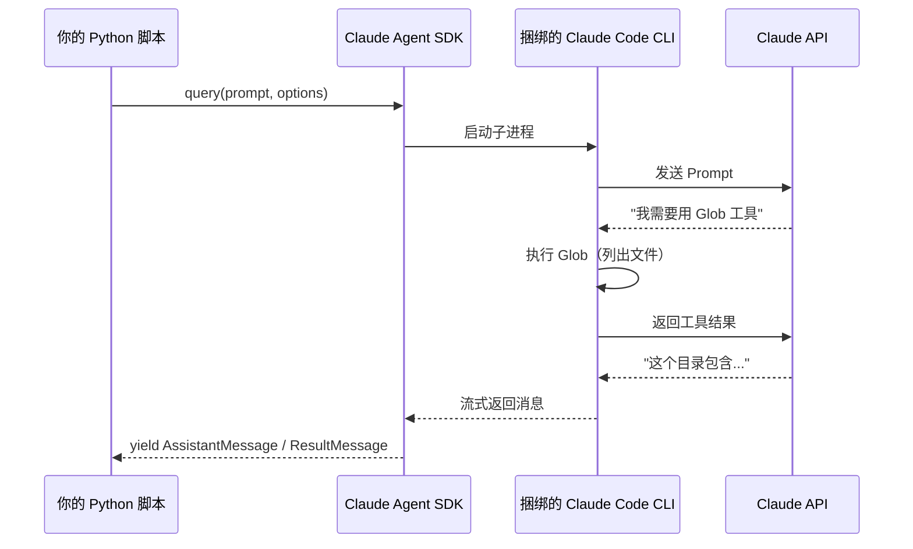
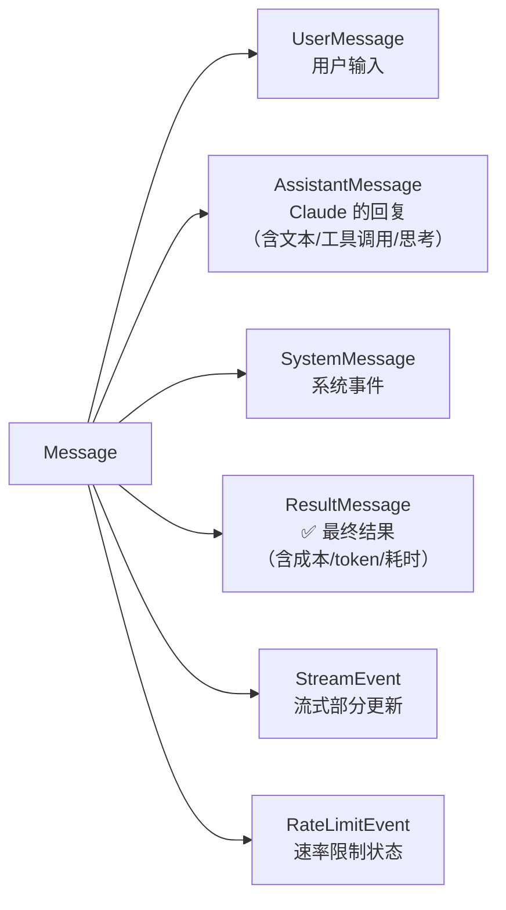
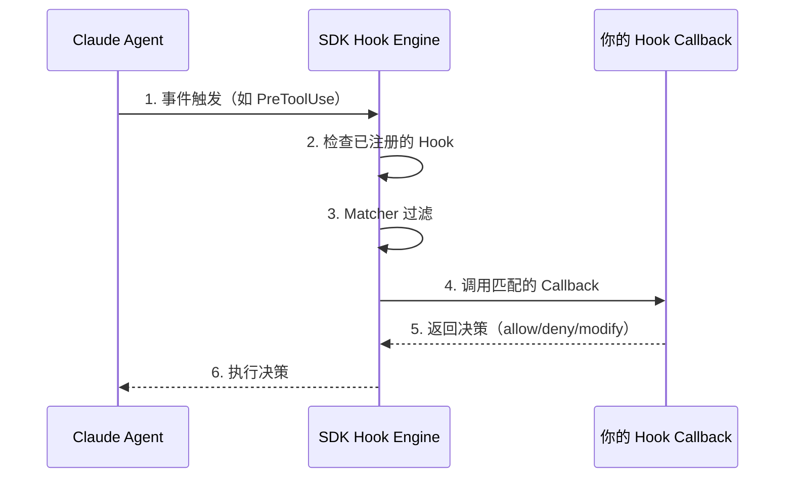
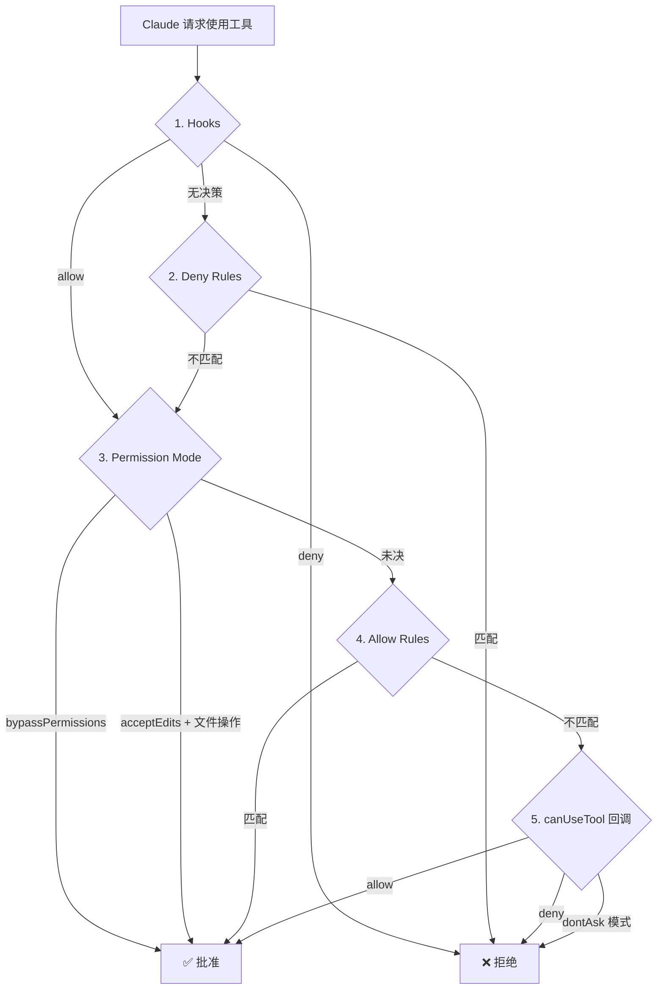

> 历史研究归档 · 2026-11-10 发布 · 程序扫描并审阅风险命中上下文；未逐篇全文审阅。原有日期、观点、数据和命令保留历史语境，未经本次逐项事实核验或运行复现；请结合[归档说明](../../../ARCHIVE_POLICY.md)阅读。

# Claude Agent SDK：从入门到实战完全指南

> **一句话概括**：Claude Agent SDK 让你把 Claude Code 的全部能力——文件读写、命令执行、Web 搜索、子 Agent 等——作为 Python/TypeScript 库嵌入自己的应用，本指南从 Hello World 到生产级 Agent 全程带走。
> 研究日期：2026-04-16
> 增量说明：[SDK-vs-IDE-vs-CLI三种Agent开发模式对比研究](R29_SDKvsIDEvsCLI%E4%B8%89%E7%A7%8DAgent%E5%BC%80%E5%8F%91%E6%A8%A1%E5%BC%8F.md) 已做过 SDK vs CLI vs IDE 的宏观对比（#25），本报告**专注 Claude Agent SDK 的实操学习路径**，是其深度延伸。

---

## 目录

- [一、它是什么、不是什么](#一它是什么不是什么)
- [二、5 分钟跑通 Hello World](#二5-分钟跑通-hello-world)
- [三、核心概念速通](#三核心概念速通)
- [四、两种 API 风格：query() vs ClaudeSDKClient](#四两种-api-风格query-vs-claudesdkclient)
- [五、自定义工具：In-Process MCP](#五自定义工具in-process-mcp)
- [六、Hooks：拦截与控制 Agent 行为](#六hooks拦截与控制-agent-行为)
- [七、权限系统：让 Agent 安全可控](#七权限系统让-agent-安全可控)
- [八、子 Agent（Subagents）](#八子-agentsubagents)
- [九、实战项目：构建一个代码审查 Agent](#九实战项目构建一个代码审查-agent)
- [十、生产化清单](#十生产化清单)
- [十一、学习路线图与 ROI 建议](#十一学习路线图与-roi-建议)
- [十二、结论与开放问题](#十二结论与开放问题)

---

## 一、它是什么、不是什么

### 一句话定义

Claude Agent SDK = **Claude Code 作为库**。你在 Claude Code 终端里使用的每一个能力（读文件、跑命令、搜代码、编辑代码、子 Agent），SDK 都暴露为 Python/TypeScript API，让你的程序自主调用。

### 与 Anthropic Client SDK 的本质区别

> 💡 **停下来想一想**：你可能会问——"我用 `anthropic` 库也能调 Claude API，为啥还需要 Agent SDK？"

关键区别在于**谁来管理工具循环**：

```python
# ❌ Client SDK：你自己实现工具循环
response = client.messages.create(...)
while response.stop_reason == "tool_use":
    result = your_tool_executor(response.tool_use)  # 你写的！
    response = client.messages.create(tool_result=result, **params)

# ✅ Agent SDK：Claude 自主管理工具循环
async for message in query(prompt="Fix the bug in auth.py"):
    print(message)  # Claude 自己读文件、定位 bug、编辑代码
```

说白了：

| 维度 | Client SDK (`anthropic`) | Agent SDK (`claude-agent-sdk`) |
|------|--------------------------|-------------------------------|
| 你写什么 | Prompt + 工具执行逻辑 + 循环控制 | Prompt + 配置 |
| Agent 循环 | 你管 | SDK 管 |
| 内置工具 | 无 | Read/Write/Edit/Bash/Grep/Glob/WebSearch 等 |
| 适用场景 | 简单的问答、分类、生成 | 自主编码、文件操作、系统管理 |

### 定位透镜

**纵轴（演化脉络）**：
- 2024 年 Claude Code CLI 发布 → 2025 年 Claude Code SDK 发布 → **2026 年 4 月更名为 Claude Agent SDK**（v0.1.0），标志着从"IDE 工具"到"可编程 Agent 引擎"的定位转变
- 当前版本：v0.1.59（2026-04-14 发布），Python GA + TypeScript GA
- CLI 自动捆绑在包里，无需单独安装

**横轴（竞争格局）**：
- 与 OpenAI Agents SDK 竞争同一个位置（"把 Agent 能力装进你的程序"），但设计哲学不同
- Claude Agent SDK 的差异化：**内置完整工具集** + **In-Process MCP** + **Hooks 拦截系统** + **Session Fork**
- 详细对比见 [SDK-vs-IDE-vs-CLI三种Agent开发模式对比研究](R29_SDKvsIDEvsCLI%E4%B8%89%E7%A7%8DAgent%E5%BC%80%E5%8F%91%E6%A8%A1%E5%BC%8F.md)

---

## 二、5 分钟跑通 Hello World

### 前置条件

- Python 3.10+
- Anthropic API Key（从 [Console](https://platform.claude.com/) 获取）
- 也支持 Amazon Bedrock / Google Vertex AI / Azure AI Foundry 作为后端

### Step 1：安装

```bash
pip install claude-agent-sdk
```

> 📌 CLI 自动捆绑，无需 `curl -fsSL https://claude.ai/install.sh | bash`（但你也可以用系统级安装）。

### Step 2：设置 API Key

```bash
export ANTHROPIC_API_KEY=your-api-key
```

### Step 3：第一个 Agent

```python
import asyncio
from claude_agent_sdk import query, ClaudeAgentOptions


async def main():
    async for message in query(
        prompt="What files are in this directory?",
        options=ClaudeAgentOptions(allowed_tools=["Bash", "Glob"]),
    ):
        if hasattr(message, "result"):
            print(message.result)


asyncio.run(main())
```

**运行它**：
```bash
python hello_agent.py
```

> 🎯 **阶段性验收**：如果你看到了当前目录的文件列表，恭喜——你已经成功让 Claude 自主执行了一个 Bash 命令。这不是 Claude "编造"的文件列表，而是**真正在你的系统上执行了 `ls` 或 `glob`**。

### 发生了什么？



**关键理解**：SDK 在底层启动了一个 Claude Code CLI 子进程。你的 Python 代码和 Claude Code CLI 之间通过 JSON 通信。这意味着 Claude Code 的所有能力——包括文件系统沙箱、权限控制、工具执行——都是现成的。

---

## 三、核心概念速通

### 3.1 消息类型

SDK 返回的消息（`Message`）是一个联合类型，你需要按类型分发处理：



**最常用的处理模式**：

```python
from claude_agent_sdk import (
    AssistantMessage, ResultMessage, TextBlock, ToolUseBlock
)

async for message in query(prompt="...", options=options):
    if isinstance(message, AssistantMessage):
        for block in message.content:
            if isinstance(block, TextBlock):
                print(f"Claude 说: {block.text}")
            elif isinstance(block, ToolUseBlock):
                print(f"Claude 调用工具: {block.name}({block.input})")
    elif isinstance(message, ResultMessage):
        print(f"完成! 耗时={message.duration_ms}ms, "
              f"成本=${message.total_cost_usd:.4f}, "
              f"轮次={message.num_turns}")
```

### 3.2 内置工具

Claude Agent SDK 内置了以下工具，**开箱即用**：

| 工具名 | 做什么 | 典型场景 |
|--------|--------|---------|
| `Read` | 读取文件内容 | 代码审查、文档分析 |
| `Write` | 创建新文件 | 代码生成、报告生成 |
| `Edit` | 精确编辑已有文件 | Bug 修复、重构 |
| `Bash` | 执行终端命令 | 安装依赖、运行测试、git 操作 |
| `Glob` | 按模式查找文件 | 发现 `**/*.py`、`src/**/*.ts` |
| `Grep` | 正则搜索文件内容 | 查找 TODO、定位函数定义 |
| `WebSearch` | 搜索互联网 | 查找最新文档、API 变更 |
| `WebFetch` | 抓取网页内容 | 获取官方文档、读 GitHub README |
| `Agent` | 启动子 Agent | 并行任务、分工协作 |
| `Monitor` | 监听后台进程输出 | 观察日志、反应式处理 |
| `AskUserQuestion` | 向用户提问 | 交互式确认、澄清需求 |

> 📌 你**不需要**实现这些工具——这就是 Agent SDK 和 Client SDK 的核心差异。

### 3.3 ClaudeAgentOptions：一站式配置

`ClaudeAgentOptions` 是 SDK 配置的中心，覆盖了你能想到的几乎所有维度：

```python
from claude_agent_sdk import ClaudeAgentOptions

options = ClaudeAgentOptions(
    # === 基础配置 ===
    system_prompt="You are an expert Python developer",  # 自定义系统提示
    cwd="/path/to/project",              # 工作目录
    model="claude-sonnet-4-20250514",    # 指定模型
    max_turns=10,                        # 最大工具轮次
    max_budget_usd=1.0,                  # 预算上限（美元）

    # === 权限 ===
    allowed_tools=["Read", "Grep", "Glob"],  # 自动批准的工具
    disallowed_tools=["Bash"],               # 禁止的工具
    permission_mode="acceptEdits",           # 权限模式

    # === 高级 ===
    mcp_servers={...},                   # MCP 服务器（自定义工具）
    hooks={...},                         # 拦截钩子
    agents={...},                        # 子 Agent 定义
    thinking={"type": "enabled", "budget_tokens": 20000},  # 扩展思考
    fork_session=True,                   # 分叉会话
    enable_file_checkpointing=True,      # 文件变更回滚
)
```

---

## 四、两种 API 风格：query() vs ClaudeSDKClient

> 💡 **停下来想一想**：如果你只需要问一个问题然后拿结果，和你需要进行多轮对话，对 API 设计有什么不同要求？

### 4.1 `query()`：一次性任务

每次调用创建一个**新会话**，无状态，适合独立任务：

```python
from claude_agent_sdk import query, ClaudeAgentOptions

async def analyze_file(file_path: str) -> str:
    """分析一个文件并返回结果"""
    result = None
    async for message in query(
        prompt=f"Analyze {file_path} for potential bugs",
        options=ClaudeAgentOptions(
            allowed_tools=["Read", "Grep"],
            max_turns=5,
        ),
    ):
        if hasattr(message, "result"):
            result = message.result
    return result
```

**适用场景**：
- 一次性代码分析/生成
- 批量文件处理
- CI/CD 管线中的自动化步骤
- 不需要上下文延续的独立任务

### 4.2 `ClaudeSDKClient`：多轮对话

维持一个**持久会话**，Claude 记住之前的对话：

```python
from claude_agent_sdk import ClaudeSDKClient, ClaudeAgentOptions, AssistantMessage, TextBlock

async def interactive_session():
    options = ClaudeAgentOptions(
        allowed_tools=["Read", "Write", "Edit"],
        permission_mode="acceptEdits",
    )

    async with ClaudeSDKClient(options=options) as client:
        # 第一轮：Claude 记住了这个上下文
        await client.query("Read the file auth.py and tell me what it does")
        async for msg in client.receive_response():
            if isinstance(msg, AssistantMessage):
                for block in msg.content:
                    if isinstance(block, TextBlock):
                        print(block.text)

        # 第二轮：Claude 知道"this file"指的是 auth.py
        await client.query("Add input validation to this file")
        async for msg in client.receive_response():
            if isinstance(msg, AssistantMessage):
                for block in msg.content:
                    if isinstance(block, TextBlock):
                        print(block.text)

        # 第三轮：还可以打断
        await client.query("Now run the tests")
        await asyncio.sleep(3)
        await client.interrupt()  # 如果跑太久就打断
        async for msg in client.receive_response():
            pass  # 必须 drain 被打断的消息
```

**核心差异速查表**：

| 维度 | `query()` | `ClaudeSDKClient` |
|------|----------|-------------------|
| 会话 | 每次新建 | 复用同一个 |
| 上下文记忆 | ❌ | ✅ |
| 多轮对话 | ❌ | ✅ |
| 中断（interrupt）| ❌ | ✅ |
| Hooks | ✅ | ✅ |
| 自定义工具 | ✅ | ✅ |
| 使用场景 | 一次性自动化 | 交互式应用/对话 |

**选择依据**：如果你的场景像"批处理"就用 `query()`，像"聊天"就用 `ClaudeSDKClient`。

---

## 五、自定义工具：In-Process MCP

> 这是 Claude Agent SDK 最强大的特性之一——你可以用 Python 函数直接扩展 Claude 的能力，无需启动额外进程。

### 5.1 核心概念

自定义工具通过 **In-Process MCP Server** 实现。说白了：
1. 你用 `@tool` 装饰器定义一个 Python 函数
2. 你用 `create_sdk_mcp_server()` 把它包装成 MCP 服务器
3. 你把这个服务器通过 `mcp_servers` 传给 Claude

Claude 在推理过程中会**自主决定何时调用**你的工具。

### 5.2 实操：构建一个数据库查询工具

```python
import asyncio
from typing import Any
from claude_agent_sdk import (
    tool, create_sdk_mcp_server, query,
    ClaudeAgentOptions, ResultMessage
)


# Step 1: 定义工具
@tool(
    "query_database",
    "Query the application database. Returns results as JSON.",
    {"sql": str, "limit": int},  # 简单类型映射
)
async def query_database(args: dict[str, Any]) -> dict[str, Any]:
    # 你的真实数据库逻辑
    # ⚠️ 生产环境务必做 SQL 注入防护！这里仅为演示
    sql = args["sql"]
    limit = args.get("limit", 10)

    # 模拟查询结果
    results = [{"id": 1, "name": "Alice"}, {"id": 2, "name": "Bob"}]

    return {
        "content": [
            {"type": "text", "text": f"Query returned {len(results)} rows:\n{results}"}
        ]
    }


# Step 2: 创建 MCP 服务器
db_server = create_sdk_mcp_server(
    name="database",
    version="1.0.0",
    tools=[query_database],
)


# Step 3: 使用
async def main():
    options = ClaudeAgentOptions(
        mcp_servers={"db": db_server},
        # 工具命名格式: mcp__{server_key}__{tool_name}
        allowed_tools=["mcp__db__query_database"],
    )

    async for message in query(
        prompt="How many users are in the database?",
        options=options,
    ):
        if isinstance(message, ResultMessage) and message.subtype == "success":
            print(message.result)


asyncio.run(main())
```

### 5.3 工具命名规则

```
mcp__{你在 mcp_servers 字典中的 key}__{工具的 name 参数}
```

例如：
- `mcp_servers={"db": server}` + `@tool("query_database", ...)` → `mcp__db__query_database`
- `mcp_servers={"weather": server}` + `@tool("get_temp", ...)` → `mcp__weather__get_temp`

### 5.4 错误处理最佳实践

```python
@tool("fetch_data", "Fetch data from API", {"url": str})
async def fetch_data(args: dict[str, Any]) -> dict[str, Any]:
    try:
        # ... 你的逻辑 ...
        return {"content": [{"type": "text", "text": "Success!"}]}
    except Exception as e:
        # ✅ 返回 is_error=True → Agent 循环继续，Claude 看到错误并决定下一步
        return {
            "content": [{"type": "text", "text": f"Error: {str(e)}"}],
            "is_error": True,
        }
        # ❌ 如果直接 raise → Agent 循环中断，整个 query() 调用失败
```

**铁律**：在工具 handler 里**永远捕获异常**，返回 `is_error: True` 而不是让异常冒泡。

### 5.5 Tool Annotations

给工具加上行为注解，帮助 Claude 做更好的调度决策：

```python
from claude_agent_sdk import tool, ToolAnnotations

@tool(
    "search_logs",
    "Search application logs",
    {"query": str, "hours": int},
    annotations=ToolAnnotations(
        readOnlyHint=True,    # 不修改环境 → Claude 可以并行调用多个只读工具
        openWorldHint=True,   # 访问外部系统
    ),
)
async def search_logs(args):
    ...
```

### 5.6 与外部 MCP 服务器混用

你可以同时使用 In-Process 和外部 MCP 服务器：

```python
options = ClaudeAgentOptions(
    mcp_servers={
        "internal": sdk_server,        # In-Process（你的 Python 函数）
        "github": {                    # 外部 stdio 服务器
            "type": "stdio",
            "command": "npx",
            "args": ["-y", "@modelcontextprotocol/server-github"],
            "env": {"GITHUB_TOKEN": "..."},
        },
        "remote_api": {                # 外部 HTTP 服务器
            "type": "http",
            "url": "https://my-mcp-server.com/mcp",
        },
    }
)
```

---

## 六、Hooks：拦截与控制 Agent 行为

> Hooks 是 Claude Agent SDK 的**安全护栏和可观测性核心**。它让你在 Agent 的关键执行点插入自定义逻辑——拦截危险操作、记录审计日志、注入上下文、追踪子 Agent。

### 6.1 Hook 工作流



### 6.2 可用事件

| 事件 | Python | TypeScript | 触发时机 | 典型用途 |
|------|--------|------------|---------|---------|
| `PreToolUse` | ✅ | ✅ | 工具调用前 | 拦截危险命令 |
| `PostToolUse` | ✅ | ✅ | 工具执行后 | 审计日志 |
| `PostToolUseFailure` | ✅ | ✅ | 工具执行失败 | 错误处理 |
| `UserPromptSubmit` | ✅ | ✅ | 用户提交 Prompt | 注入上下文 |
| `Stop` | ✅ | ✅ | Agent 停止 | 保存状态 |
| `SubagentStart/Stop` | ✅ | ✅ | 子 Agent 生命周期 | 追踪并行任务 |
| `PreCompact` | ✅ | ✅ | 对话压缩前 | 归档完整记录 |
| `Notification` | ✅ | ✅ | Agent 状态通知 | 发送到 Slack/PagerDuty |
| `PermissionRequest` | ✅ | ✅ | 权限决策点 | 自定义权限逻辑 |
| `SessionStart/End` | ❌ | ✅ | 会话生命周期 | 初始化/清理（Python 不可用） |

### 6.3 实操：安全护栏

```python
from claude_agent_sdk import ClaudeAgentOptions, ClaudeSDKClient, HookMatcher


# Hook 1: 阻止危险的 bash 命令
async def block_dangerous_commands(input_data, tool_use_id, context):
    if input_data["tool_name"] != "Bash":
        return {}

    command = input_data["tool_input"].get("command", "")
    dangerous_patterns = ["rm -rf", "DROP TABLE", "mkfs", "> /dev/sda"]

    for pattern in dangerous_patterns:
        if pattern in command:
            return {
                "systemMessage": f"Blocked: command contains '{pattern}'",
                "hookSpecificOutput": {
                    "hookEventName": "PreToolUse",
                    "permissionDecision": "deny",
                    "permissionDecisionReason": f"Dangerous pattern: {pattern}",
                },
            }
    return {}


# Hook 2: 保护 .env 文件
async def protect_env_files(input_data, tool_use_id, context):
    file_path = input_data["tool_input"].get("file_path", "")
    if file_path.endswith(".env") or "/.env" in file_path:
        return {
            "hookSpecificOutput": {
                "hookEventName": "PreToolUse",
                "permissionDecision": "deny",
                "permissionDecisionReason": "Cannot modify .env files",
            }
        }
    return {}


# Hook 3: 审计日志
async def audit_logger(input_data, tool_use_id, context):
    print(f"[AUDIT] Tool={input_data.get('tool_name')} "
          f"Session={input_data.get('session_id')}")
    return {}


# 组装
options = ClaudeAgentOptions(
    hooks={
        "PreToolUse": [
            HookMatcher(matcher="Bash", hooks=[block_dangerous_commands]),
            HookMatcher(matcher="Write|Edit", hooks=[protect_env_files]),
            HookMatcher(hooks=[audit_logger]),  # 无 matcher = 匹配所有工具
        ],
    },
    allowed_tools=["Read", "Write", "Edit", "Bash", "Grep"],
)
```

### 6.4 修改工具输入（沙箱重定向）

```python
async def redirect_to_sandbox(input_data, tool_use_id, context):
    """把所有文件写入重定向到 /sandbox 目录"""
    if input_data["tool_name"] == "Write":
        original_path = input_data["tool_input"].get("file_path", "")
        return {
            "hookSpecificOutput": {
                "hookEventName": "PreToolUse",
                "permissionDecision": "allow",
                "updatedInput": {
                    **input_data["tool_input"],
                    "file_path": f"/sandbox{original_path}",
                },
            }
        }
    return {}
```

> ⚠️ 使用 `updatedInput` 时**必须**同时返回 `permissionDecision: "allow"`，否则修改不生效。

### 6.5 Hook 链与优先级

多个 Hook 按数组顺序执行。如果任一 Hook 返回 `deny`，操作被拦截——**deny 优先于 ask，ask 优先于 allow**。

```python
options = ClaudeAgentOptions(
    hooks={
        "PreToolUse": [
            HookMatcher(hooks=[rate_limiter]),        # 第一：检查速率
            HookMatcher(hooks=[authorization]),       # 第二：验证权限
            HookMatcher(hooks=[input_sanitizer]),     # 第三：净化输入
            HookMatcher(hooks=[audit_logger]),        # 最后：记录日志
        ]
    }
)
```

---

## 七、权限系统：让 Agent 安全可控

### 7.1 权限评估流程

当 Claude 请求使用一个工具时，SDK 按以下顺序检查：



### 7.2 五种权限模式

| 模式 | 行为 | 适用场景 |
|------|------|---------|
| `default` | 标准流程，未匹配的触发 canUseTool | 交互式应用 |
| `acceptEdits` | 自动批准文件编辑 | 快速原型、信任 Claude 的编辑 |
| `dontAsk` | 未预批准的直接拒绝 | 无人值守的自动化 |
| `bypassPermissions` | 全部批准（⚠️ 慎用） | 隔离环境/沙箱中 |
| `plan` | 规划模式，不执行工具 | 代码审查、方案设计 |

### 7.3 最安全的生产配置模式

```python
# 「白名单 + dontAsk」模式：只允许明确列出的工具，其余全拒绝
options = ClaudeAgentOptions(
    allowed_tools=["Read", "Glob", "Grep"],  # 只批准只读工具
    permission_mode="dontAsk",                # 未列出的直接拒绝
)
```

### 7.4 自定义权限回调

```python
from claude_agent_sdk.types import (
    PermissionResultAllow, PermissionResultDeny, ToolPermissionContext
)

async def custom_permission(
    tool_name: str,
    input_data: dict,
    context: ToolPermissionContext,
) -> PermissionResultAllow | PermissionResultDeny:
    """自定义权限逻辑"""
    # 系统目录写入 → 拒绝并中断
    if tool_name == "Write" and input_data.get("file_path", "").startswith("/system/"):
        return PermissionResultDeny(
            message="System directory write not allowed",
            interrupt=True,  # 中断整个执行
        )

    # 配置文件 → 重定向到沙箱
    if tool_name in ["Write", "Edit"] and "config" in input_data.get("file_path", ""):
        safe_path = f"./sandbox/{input_data['file_path']}"
        return PermissionResultAllow(
            updated_input={**input_data, "file_path": safe_path}
        )

    return PermissionResultAllow(updated_input=input_data)


options = ClaudeAgentOptions(can_use_tool=custom_permission)
```

---

## 八、子 Agent（Subagents）

### 8.1 编程式定义子 Agent

```python
from claude_agent_sdk import ClaudeAgentOptions, AgentDefinition

options = ClaudeAgentOptions(
    agents={
        "code_reviewer": AgentDefinition(
            description="Reviews code for bugs and best practices",
            prompt="You are a senior code reviewer. Focus on: security vulnerabilities, "
                   "performance issues, and code style. Be specific and actionable.",
            tools=["Read", "Grep", "Glob"],            # 限定工具
            model="sonnet",                             # 可以用更便宜的模型
        ),
        "test_writer": AgentDefinition(
            description="Writes unit tests for Python code",
            prompt="You are a test engineer. Write comprehensive pytest tests with "
                   "edge cases. Use mocking when appropriate.",
            tools=["Read", "Write", "Bash"],
            model="inherit",                            # 继承主 Agent 模型
        ),
    },
    allowed_tools=["Read", "Write", "Edit", "Bash", "Agent"],
)
```

**Claude 会自主决定何时派遣子 Agent**——你在 Prompt 中提到"review the code and write tests"，Claude 会根据 `description` 选择合适的子 Agent。

### 8.2 用 Hook 追踪子 Agent

```python
async def subagent_tracker(input_data, tool_use_id, context):
    print(f"[SUBAGENT] Completed: {input_data['agent_id']}")
    print(f"  Transcript: {input_data['agent_transcript_path']}")
    return {}

options = ClaudeAgentOptions(
    hooks={
        "SubagentStop": [HookMatcher(hooks=[subagent_tracker])],
    },
)
```

---

## 九、实战项目：构建一个代码审查 Agent

> 把前面学到的所有概念组合起来，构建一个**真正有用**的 Agent。

```python
"""
code_review_agent.py — 自动代码审查 Agent
功能：
1. 扫描 PR 中变更的文件
2. 分析代码质量和潜在问题
3. 生成结构化的审查报告
"""
import asyncio
from typing import Any
from claude_agent_sdk import (
    query, ClaudeAgentOptions, ResultMessage,
    tool, create_sdk_mcp_server, HookMatcher
)


# === 自定义工具 ===

@tool(
    "get_pr_diff",
    "Get the diff of changed files in the current branch compared to main",
    {},
)
async def get_pr_diff(args: dict[str, Any]) -> dict[str, Any]:
    """获取当前分支相对于 main 的变更"""
    import subprocess
    try:
        result = subprocess.run(
            ["git", "diff", "main", "--name-only"],
            capture_output=True, text=True, timeout=30
        )
        files = result.stdout.strip().split("\n") if result.stdout.strip() else []
        return {
            "content": [{"type": "text", "text": f"Changed files:\n" + "\n".join(files)}]
        }
    except Exception as e:
        return {
            "content": [{"type": "text", "text": f"Error getting diff: {e}"}],
            "is_error": True,
        }


# === 安全 Hook ===

async def block_writes(input_data, tool_use_id, context):
    """代码审查 Agent 不允许修改任何文件"""
    if input_data["tool_name"] in ["Write", "Edit"]:
        return {
            "hookSpecificOutput": {
                "hookEventName": "PreToolUse",
                "permissionDecision": "deny",
                "permissionDecisionReason": "Review agent is read-only",
            }
        }
    return {}


async def cost_tracker(input_data, tool_use_id, context):
    """追踪工具使用，用于成本估算"""
    print(f"  [tool] {input_data.get('tool_name', 'unknown')}")
    return {}


# === 组装 ===

review_server = create_sdk_mcp_server(
    name="review", version="1.0.0", tools=[get_pr_diff]
)

REVIEW_PROMPT = """Review the code changes in this repository.

For each changed file:
1. Read the file
2. Identify potential issues: bugs, security vulnerabilities, performance problems
3. Check code style and best practices
4. Note any missing tests or documentation

Output a structured review report in Markdown format with:
- Summary (1-2 sentences)
- Issues found (categorized by severity: Critical/Warning/Info)
- Suggestions for improvement
- Overall assessment (Approve/Request Changes/Needs Discussion)
"""


async def run_review():
    options = ClaudeAgentOptions(
        system_prompt="You are a senior code reviewer. Be thorough but constructive.",
        mcp_servers={"review": review_server},
        allowed_tools=[
            "Read", "Grep", "Glob",
            "mcp__review__get_pr_diff",
        ],
        permission_mode="dontAsk",  # 只读，不需要人工确认
        max_turns=20,
        max_budget_usd=0.50,  # 每次审查预算 $0.50
        hooks={
            "PreToolUse": [
                HookMatcher(matcher="Write|Edit", hooks=[block_writes]),
                HookMatcher(hooks=[cost_tracker]),
            ],
        },
    )

    print("🔍 Starting code review...")
    async for message in query(prompt=REVIEW_PROMPT, options=options):
        if isinstance(message, ResultMessage):
            if message.subtype == "success":
                print("\n📋 Review Report:")
                print(message.result)
                print(f"\n💰 Cost: ${message.total_cost_usd:.4f}")
                print(f"⏱️ Duration: {message.duration_ms}ms")
                print(f"🔄 Turns: {message.num_turns}")
            else:
                print(f"❌ Review failed: {message.result}")


if __name__ == "__main__":
    asyncio.run(run_review())
```

**这个例子综合运用了**：
- `query()` 一次性任务
- 自定义工具（`get_pr_diff`）
- In-Process MCP Server
- Hooks（安全护栏 + 成本追踪）
- 权限控制（`dontAsk` + 只读工具白名单）
- 预算上限（`max_budget_usd`）

---

## 十、生产化清单

从"能跑"到"能上生产"，你还需要关注这些：

### 10.1 成本控制

```python
options = ClaudeAgentOptions(
    max_turns=15,          # 防止无限循环
    max_budget_usd=2.0,    # 硬预算上限
    model="claude-sonnet-4-20250514",  # Sonnet 性价比高于 Opus
)
```

使用 `ResultMessage` 追踪实际消耗：
```python
if isinstance(message, ResultMessage):
    print(f"Input tokens: {message.usage.get('input_tokens')}")
    print(f"Output tokens: {message.usage.get('output_tokens')}")
    print(f"Cache read: {message.usage.get('cache_read_input_tokens')}")
    print(f"Total cost: ${message.total_cost_usd:.4f}")
```

### 10.2 错误处理

```python
from claude_agent_sdk import (
    ClaudeSDKError,
    CLINotFoundError,
    CLIConnectionError,
    ProcessError,
    CLIJSONDecodeError,
)

try:
    async for message in query(prompt="...", options=options):
        pass
except CLINotFoundError:
    # SDK 找不到捆绑的 Claude Code CLI
    print("重新安装: pip install --force-reinstall claude-agent-sdk")
except ProcessError as e:
    # CLI 进程失败
    print(f"Exit code: {e.exit_code}, stderr: {e.stderr}")
except CLIJSONDecodeError as e:
    # CLI 返回的 JSON 解析失败
    print(f"Bad line: {e.line}")
```

### 10.3 会话管理

```python
from claude_agent_sdk import list_sessions, get_session_messages, rename_session

# 列出最近的会话
for session in list_sessions(directory="/path/to/project", limit=5):
    print(f"{session.summary} ({session.session_id})")

# 读取历史消息
messages = get_session_messages(session_id="...", limit=20)

# 给会话打标签方便后续检索
rename_session(session_id="...", title="PR #42 Code Review")
```

### 10.4 结构化输出

```python
options = ClaudeAgentOptions(
    output_format={
        "type": "json_schema",
        "schema": {
            "type": "object",
            "properties": {
                "summary": {"type": "string"},
                "issues": {
                    "type": "array",
                    "items": {
                        "type": "object",
                        "properties": {
                            "file": {"type": "string"},
                            "severity": {"type": "string", "enum": ["critical", "warning", "info"]},
                            "description": {"type": "string"},
                        },
                    },
                },
                "verdict": {"type": "string", "enum": ["approve", "request_changes"]},
            },
        },
    }
)
```

### 10.5 文件变更回滚

```python
options = ClaudeAgentOptions(enable_file_checkpointing=True)

async with ClaudeSDKClient(options=options) as client:
    await client.query("Refactor the auth module")
    last_msg_id = None
    async for msg in client.receive_response():
        if hasattr(msg, "uuid"):
            last_msg_id = msg.uuid

    # 如果不满意，回滚！
    if last_msg_id:
        await client.rewind_files(last_msg_id)
```

### 10.6 沙箱模式

```python
from claude_agent_sdk import SandboxSettings

options = ClaudeAgentOptions(
    sandbox={
        "enabled": True,
        "autoAllowBashIfSandboxed": True,
        "network": {"allowLocalBinding": True},
    },
)
```

---

## 十一、学习路线图与 ROI 建议

### 四阶段路线


| 阶段 | 学什么 | ROI | 验收标准 |
|------|--------|-----|---------|
| 🟢 入门 | `query()` + 内置工具 + 消息处理 | ⭐⭐⭐⭐⭐ | 能用 `query()` 让 Claude 分析代码/生成文件 |
| 🟡 熟练 | `ClaudeSDKClient` + 自定义工具 + 权限 | ⭐⭐⭐⭐ | 能构建多轮对话 + 自定义 MCP 工具 |
| 🟠 进阶 | Hooks + 子 Agent + 会话管理 | ⭐⭐⭐ | 能构建安全的生产级 Agent |
| 🔴 生产 | 沙箱 + 成本优化 + 结构化输出 + 可观测性 | ⭐⭐ | 能支撑日均千次调用的生产系统 |

### 暂缓学习的内容

- TypeScript SDK（除非你的项目是 TypeScript 技术栈）
- 自定义 Transport（极低频需求，内部 API）
- `SdkBeta` 特性（当前唯一的 `context-1m` beta 已在 2026-04-30 退役）

### 与本工作区知识体系的关联

| 如果你想… | 先读这个 |
|-----------|---------|
| 理解 Agent 架构原理 | [Agent架构深度研究报告](../01-%E7%90%86%E8%AE%BA%E4%B8%8E%E6%9E%B6%E6%9E%84/R03_Agent%E6%9E%B6%E6%9E%84%E6%B7%B1%E5%BA%A6%E7%A0%94%E7%A9%B6.md) |
| 对比 SDK vs CLI vs IDE 三种开发模式 | [SDK-vs-IDE-vs-CLI三种Agent开发模式对比研究](R29_SDKvsIDEvsCLI%E4%B8%89%E7%A7%8DAgent%E5%BC%80%E5%8F%91%E6%A8%A1%E5%BC%8F.md) |
| 从源码理解 Claude Code 内部机制 | [从零构建Agent-基于Claude-Code源码的渐进式学习路线](../01-%E7%90%86%E8%AE%BA%E4%B8%8E%E6%9E%B6%E6%9E%84/R24_%E4%BB%8E%E9%9B%B6%E6%9E%84%E5%BB%BAAgent%E6%B8%90%E8%BF%9B%E5%BC%8F%E5%AD%A6%E4%B9%A0%E8%B7%AF%E7%BA%BF.md) |
| 构建长效自主 Agent | [长效Agent-Harness工程化研究报告](../05-%E8%AF%84%E4%BC%B0%E4%B8%8E%E8%B4%A8%E9%87%8F/R33_%E9%95%BF%E6%95%88AgentHarness%E5%B7%A5%E7%A8%8B%E5%8C%96.md) |
| 多 Agent 框架选型 | [现代智能体编排框架深度调研报告](../06-%E5%B7%A5%E5%85%B7%E4%B8%8E%E7%94%9F%E6%80%81/R45_%E7%8E%B0%E4%BB%A3%E6%99%BA%E8%83%BD%E4%BD%93%E7%BC%96%E6%8E%92%E6%A1%86%E6%9E%B6%E6%B7%B1%E5%BA%A6%E8%B0%83%E7%A0%94.md) |

---

## 十二、结论与开放问题

### 核心要点

1. **Claude Agent SDK = Claude Code 作为库**：内置 10+ 工具，你只需关注 Prompt 和配置
2. **两种 API 选对场景**：一次性任务用 `query()`，交互式对话用 `ClaudeSDKClient`
3. **In-Process MCP 是最大杀手锏**：用 Python 函数直接扩展 Claude 能力，无需管理外部进程
4. **Hooks + 权限 = 安全护栏**：生产环境务必配置，deny 优先级最高
5. **成本意识**：`max_turns` + `max_budget_usd` + `ResultMessage.total_cost_usd` 三件套

### 与已有范式的关联

- **P5（简单可组合 > 复杂框架）**：Claude Agent SDK 正是这一范式的产品化体现——不给你复杂的编排框架，给你直接可用的原子能力
- **P6（SKILL.md = 通用能力注入格式）**：SDK 通过 `setting_sources=["project"]` 加载项目的 SKILL.md，与我们的 Skill 体系天然兼容
- **P17（双角色分工）**：子 Agent 机制 (`AgentDefinition`) 可以直接实现 Initializer + Worker 模式

### 开放问题

| # | 问题 | 状态 |
|---|------|------|
| O1 | 实际 Token 消耗的项目级基准测试（不同任务类型的单次调用成本中位数） | ⬜ 待实验 |
| O2 | 与 LangGraph 的混合架构（LangGraph 做编排 + Claude Agent SDK 做执行） | ⬜ 待探索 |
| O3 | 多 Agent（子 Agent）并行的实际性能瓶颈和成本放大效应 | ⬜ 待实验 |
| O4 | SDK 在 Windows 环境的兼容性（当前捆绑的 CLI 是否完整支持） | ⬜ 待验证 |

---

📌 **来源清单**
- [PyPI: claude-agent-sdk 0.1.59](https://pypi.org/project/claude-agent-sdk/) — 2026-04-14
- [Agent SDK Overview](https://code.claude.com/docs/en/agent-sdk/overview) — 2026-04-16 获取
- [Python SDK Reference](https://code.claude.com/docs/en/agent-sdk/python) — 2026-04-16 获取
- [Hooks Guide](https://code.claude.com/docs/en/agent-sdk/hooks) — 2026-04-16 获取
- [Permissions Guide](https://code.claude.com/docs/en/agent-sdk/permissions) — 2026-04-16 获取
- [Custom Tools Guide](https://code.claude.com/docs/en/agent-sdk/custom-tools) — 2026-04-16 获取
- [GitHub: anthropics/claude-agent-sdk-python](https://github.com/anthropics/agent-sdk) — 6.3K⭐

⚖️ 来源一致性：多源一致（官方文档 + PyPI + GitHub）
📅 时效性声明：以上信息获取于 2026-04-16
