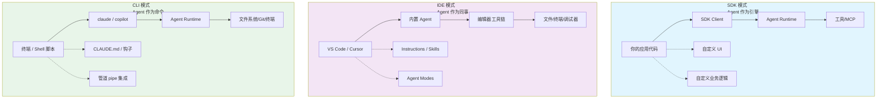
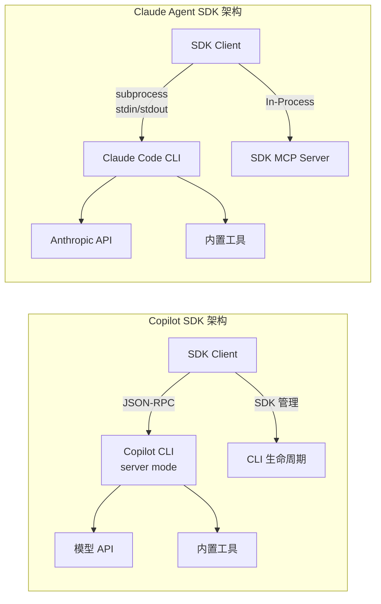
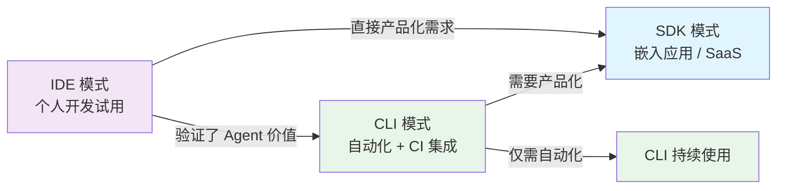
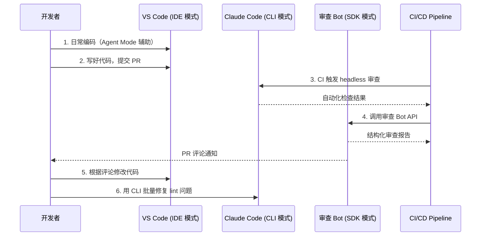
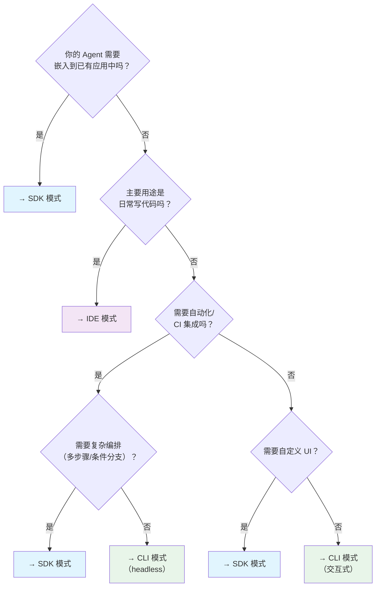

> 历史研究归档 · 2026-11-10 发布 · 程序扫描；未逐篇全文审阅。原有日期、观点、数据和命令保留历史语境，未经本次逐项事实核验或运行复现；请结合[归档说明](../../../ARCHIVE_POLICY.md)阅读。

# SDK vs IDE vs CLI：三种 Agent 开发模式对比研究

> **一句话概括**：SDK 是"把 Agent 当引擎嵌入你的应用"，IDE 是"在编辑器里和 Agent 协作开发"，CLI 是"在终端里让 Agent 替你干活"——三者的本质区别不在技术实现，而在**谁是主体、谁是工具**。
> 研究日期：2026-04-14
> 增量说明：本工作区首次系统对比三种模式。已有 [Agent部署上线方案全景调研报告](R04_Agent%E9%83%A8%E7%BD%B2%E4%B8%8A%E7%BA%BF%E6%96%B9%E6%A1%88%E5%85%A8%E6%99%AF.md) 覆盖了部署层级（L0-L8），[Copilot全局自定义跨工作区复用方案研究](R32_Copilot%E5%85%A8%E5%B1%80%E8%87%AA%E5%AE%9A%E4%B9%89%E8%B7%A8%E5%B7%A5%E4%BD%9C%E5%8C%BA%E5%A4%8D%E7%94%A8.md) 覆盖了 IDE 定制，本报告聚焦**开发模式选型**这一新维度。

---

## 目录

- [一、三种模式的本质定位](#一三种模式的本质定位)
- [二、两大 SDK 深度对比：Copilot SDK vs Claude Agent SDK](#二两大-sdk-深度对比copilot-sdk-vs-claude-agent-sdk)
- [三、三种模式的全维度对比](#三三种模式的全维度对比)
- [四、落地实例](#四落地实例)
- [五、选型决策树](#五选型决策树)
- [六、结论与最佳实践](#六结论与最佳实践)
- [七、开放问题](#七开放问题)

---

## 一、三种模式的本质定位

**核心区别在于控制权和集成深度的不同**。用一个类比：

| 类比 | SDK 模式 | IDE 模式 | CLI 模式 |
|------|---------|---------|---------|
| 汽车 | 买发动机，装到自己设计的车里 | 开别人造好的车，调座椅和导航 | 叫出租车，告诉司机目的地 |
| 编程 | 调 API，写逻辑 | 用 GUI 交互 | 写命令行脚本 |
| 主体 | **你的应用**是主体，Agent 是组件 | **IDE**是主体，Agent 是助手 | **终端**是主体，Agent 是执行者 |



### 1.1 SDK 模式

**把 Coding Agent 的能力以编程接口暴露出来**，让开发者在自己的应用中调用。

说白了：你的程序是老板，Agent 是干活的员工。你决定什么时候让 Agent 思考、用什么工具、拿到结果后怎么处理。

**代表产品**：
- **GitHub Copilot SDK**（`github/copilot-sdk`，8.4K⭐，v0.2.2，Public Preview，2026-04-14 获取）
- **Claude Agent SDK**（`anthropic/claude-agent-sdk-python`，6.3K⭐，v0.1.59，2026-04-14 获取）

### 1.2 IDE 模式

**在编辑器中内嵌 Agent 功能**，开发者通过对话框、Agent 面板、内联补全等 UI 交互来驱动 Agent。

说白了：你和 Agent 坐在同一张桌子前，你说想法，它帮你写代码、搜文件、跑命令。你有最终决定权，但 UI 是别人设计的。

**代表产品**：
- **VS Code + GitHub Copilot**（Chat、Agent Mode、Edits）
- **Cursor**（Composer、Agent Mode）
- **Windsurf**
- **Claude Code in VS Code**（作为 VS Code 扩展运行）

### 1.3 CLI 模式

**通过命令行调用 Agent** ，支持交互式对话、非交互式单次执行（headless）、以及管道（pipe）集成。

说白了：你在终端里给 Agent 下命令，他自己去读代码、改文件、跑测试。你可以看着它干（交互模式），也可以下完命令就走（headless 模式）。

**代表产品**：
- **Claude Code CLI**（`claude` 命令，113K⭐）
- **GitHub Copilot CLI**（`copilot` 命令）
- **Aider**（开源 CLI Agent）
- **OpenHands CLI**

---

## 二、两大 SDK 深度对比：Copilot SDK vs Claude Agent SDK

这两个是当前最有影响力的 Agent SDK，但设计哲学和定位有明显差异。

### 2.1 基本信息

| 维度 | GitHub Copilot SDK | Claude Agent SDK |
|------|-------------------|-----------------|
| 仓库 | [github/copilot-sdk](https://github.com/github/copilot-sdk) 8.4K⭐ | [anthropic/claude-agent-sdk-python](https://github.com/anthropics/claude-agent-sdk-python) 6.3K⭐ |
| 版本 | v0.2.2（Public Preview） | v0.1.59 |
| 语言支持 | TypeScript、Python、Go、.NET、Java（5 种） | Python（官方），TypeScript（社区） |
| 底层模型 | GPT-4.1 等 GitHub 模型目录中的所有模型 + BYOK | Claude（Anthropic 模型） |
| 架构 | SDK → JSON-RPC → Copilot CLI（server mode） | SDK → subprocess → Claude Code CLI |
| 认证 | GitHub OAuth / Token / BYOK | Anthropic API Key |
| 计费 | Copilot 订阅（含 Premium Request 配额）/ BYOK 自计费 | Anthropic API 用量计费 |
| 状态 | Public Preview | GA（生产就绪） |
| 许可证 | MIT | MIT |

### 2.2 核心能力对比

| 能力 | Copilot SDK | Claude Agent SDK |
|------|------------|-----------------|
| **基础查询** | `session.sendAndWait()` | `query(prompt=...)` |
| **流式响应** | ✅ 40+ 事件类型 | ✅ AsyncIterator |
| **多轮对话** | ✅ Session 原生支持 | ✅ `ClaudeSDKClient` 双向交互 |
| **自定义工具** | `defineTool()` 声明式定义 | `@tool` 装饰器 + In-Process MCP Server |
| **MCP 集成** | ✅ 外部 HTTP/stdio MCP | ✅ 内外部 MCP 混合 |
| **Hooks** | ✅ 拦截器模式 | ✅ `HookMatcher` + PreToolUse/PostToolUse |
| **自定义 Agent** | ✅ `customAgents` 定义子角色 | ✅ 支持 subagent / session fork |
| **System Prompt** | ✅ 分段覆写（replace/append/prepend/remove） | ✅ `system_prompt` + `SystemPromptPreset` |
| **权限控制** | `allowed_tools` 白名单 + `onPermissionRequest` | `allowed_tools` + `permission_mode` + `can_use_tool` |
| **Session 持久化** | ✅ 跨重启恢复 | ✅ `session_id` 恢复 |
| **可观测性** | ✅ OpenTelemetry 原生 + W3C Trace Context 传播 | ⚠️ 基础日志 |
| **BYOK 多模型** | ✅ 支持 OpenAI/Azure/Anthropic 等 | ❌ 仅 Anthropic 模型 |
| **Image 输入** | ✅ 支持 | ⚠️ 通过 MCP 间接 |

### 2.3 架构差异

两者都采用"SDK 包装 CLI"的架构，但实现方式不同：



**关键差异**：
- **Copilot SDK** 的 CLI 运行在 server mode（长驻进程），SDK 通过 JSON-RPC 通信。多个 SDK 客户端可以连接同一个 CLI server，有利于多租户场景。
- **Claude Agent SDK** 的 CLI 作为 subprocess 启动，自定义工具通过 In-Process MCP Server 实现（无需外部进程），更简单但不支持共享 CLI 进程。

### 2.4 代码风格对比

**Copilot SDK（TypeScript）**：
```typescript
import { CopilotClient, defineTool } from "@github/copilot-sdk";

const getWeather = defineTool("get_weather", {
    description: "Get the current weather for a city",
    parameters: { type: "object", properties: { city: { type: "string" } }, required: ["city"] },
    handler: async ({ city }) => ({ city, temp: "72°F", condition: "sunny" }),
});

const client = new CopilotClient();
const session = await client.createSession({
    model: "gpt-4.1",
    streaming: true,
    tools: [getWeather],
    customAgents: [{
        name: "weather-bot",
        description: "Weather assistant",
        prompt: "You are a weather expert.",
    }],
});

session.on("assistant.message_delta", (e) => process.stdout.write(e.data.deltaContent));
await session.sendAndWait({ prompt: "What's the weather in Tokyo?" });
await client.stop();
```

**Claude Agent SDK（Python）**：
```python
from claude_agent_sdk import tool, create_sdk_mcp_server, ClaudeAgentOptions, ClaudeSDKClient, HookMatcher

@tool("get_weather", "Get the current weather for a city", {"city": str})
async def get_weather(args):
    return {"content": [{"type": "text", "text": f"Tokyo: 72°F, sunny"}]}

server = create_sdk_mcp_server(name="tools", version="1.0.0", tools=[get_weather])

options = ClaudeAgentOptions(
    mcp_servers={"tools": server},
    allowed_tools=["mcp__tools__get_weather"],
    system_prompt="You are a weather expert.",
)

async with ClaudeSDKClient(options=options) as client:
    await client.query("What's the weather in Tokyo?")
    async for msg in client.receive_response():
        print(msg)
```

**差异总结**：Copilot SDK 更像传统 Web 框架的声明式风格；Claude Agent SDK 更 Pythonic，工具通过 MCP Server 抽象而非直接定义。

---

## 三、三种模式的全维度对比

### 3.1 核心维度对比表

| 维度 | SDK 模式 | IDE 模式 | CLI 模式 |
|------|---------|---------|---------|
| **控制粒度** | 🟢 最细 — 每个工具调用、每条消息都可编程拦截 | 🟡 中等 — 通过 Instructions/Skills/Agents 定制 | 🟡 中等 — 通过 CLAUDE.md/钩子/参数定制 |
| **集成灵活度** | 🟢 最高 — 嵌入任何应用（Web/API/Bot/桌面） | 🔴 最低 — 限定在编辑器内 | 🟡 中等 — 终端 + 管道 + CI/CD |
| **上手成本** | 🔴 最高 — 需要写代码、理解架构 | 🟢 最低 — 装插件开箱即用 | 🟡 中等 — 基础使用简单，高级定制需学习 |
| **UI 定制** | 🟢 完全自定义 | 🔴 受限于编辑器 UI | 🔴 无 GUI（纯文本） |
| **多用户支持** | 🟢 原生支持 — 多租户、Session 隔离 | 🔴 单用户 | 🔴 单用户（CI 场景例外） |
| **自动化/CI** | 🟢 原生编程接口 | 🔴 不适合 | 🟢 天然适配 — headless + pipe |
| **上下文质量** | 🟡 需要自己管理 | 🟢 最高 — 编辑器提供完整文件树/LSP/调试器 | 🟡 中等 — 有文件系统但无 LSP 深度集成 |
| **交互体验** | 🟡 取决于你的 UI 实现 | 🟢 最好 — 所见即所得，内联 diff | 🟡 文本流式输出，无 rich UI |
| **调试便利** | 🟡 需要自建可观测性 | 🟢 编辑器内直接看 | 🟡 日志 + verbose 输出 |
| **生产部署** | 🟢 为此而生 | 🔴 不适用 | 🟡 headless 可以，但不是主要设计目标 |
| **成本模型** | API 调用 / 订阅配额 | IDE 订阅 | API 调用 / 订阅配额 |

### 3.2 适用场景矩阵

| 场景 | 推荐模式 | 原因 |
|------|---------|------|
| **构建 SaaS 产品中的 AI 功能** | SDK | 需要嵌入已有应用、自定义 UI、多用户 |
| **内部工具/企业 Bot** | SDK | 需要认证集成、多租户、API 化 |
| **日常编码（写功能/修 bug）** | IDE | 上下文最完整、交互最自然、所见即所得 |
| **代码审查** | IDE / CLI | IDE 有 diff 视图；CLI 可批量自动化 |
| **CI/CD 自动化** | CLI → SDK | 简单用 CLI headless；复杂用 SDK 编排 |
| **批量代码迁移/重构** | CLI | headless 批量执行，pipe 串联 |
| **原型验证/快速实验** | IDE / CLI | 上手快、反馈快 |
| **研究/数据分析** | SDK / CLI | 可编程控制实验参数、采集数据 |
| **自定义 Agent 平台** | SDK | 唯一支持完全自主编排的模式 |
| **教学/演示** | IDE | 视觉直观、易理解 |

### 3.3 演进路径

三种模式不是互斥的，很多团队会沿着这条路径演进：



---

## 四、落地实例

### 4.1 SDK 模式实例：构建企业级代码审查 Bot

**场景**：团队需要一个自动审查 PR 的 Bot，集成到 GitHub Webhook → 审查代码 → 在 PR 中留评论。

**Copilot SDK 实现（TypeScript）**：

```typescript
import { CopilotClient, defineTool } from "@github/copilot-sdk";

// 自定义工具：获取 PR diff
const getPRDiff = defineTool("get_pr_diff", {
    description: "Get the diff of a pull request",
    parameters: {
        type: "object",
        properties: {
            repo: { type: "string" },
            pr_number: { type: "number" },
        },
        required: ["repo", "pr_number"],
    },
    handler: async ({ repo, pr_number }) => {
        // 调用 GitHub API 获取 diff
        const res = await fetch(`https://api.github.com/repos/${repo}/pulls/${pr_number}`, {
            headers: { Accept: "application/vnd.github.diff" },
        });
        return { diff: await res.text() };
    },
});

// 创建审查 Agent
async function reviewPR(repo: string, prNumber: number) {
    const client = new CopilotClient();
    const session = await client.createSession({
        model: "gpt-4.1",
        tools: [getPRDiff],
        customAgents: [{
            name: "reviewer",
            description: "Expert code reviewer",
            prompt: `Review the PR for: security issues, performance problems,
                     code style violations. Output structured JSON.`,
        }],
    });
    
    const response = await session.sendAndWait({
        prompt: `Review PR #${prNumber} in ${repo}`,
    });
    
    await client.stop();
    return response; // → 解析后写入 PR Comment
}
```

**Claude Agent SDK 实现（Python）**：

```python
from claude_agent_sdk import query, ClaudeAgentOptions

async def review_pr(repo: str, pr_number: int):
    options = ClaudeAgentOptions(
        system_prompt="""You are an expert code reviewer. Review for:
        - Security vulnerabilities
        - Performance issues  
        - Code style violations
        Output structured JSON with findings.""",
        allowed_tools=["Read", "Bash"],
        max_turns=5,
    )
    
    results = []
    async for msg in query(
        prompt=f"Review the latest changes in this PR: git diff main...HEAD",
        options=options,
    ):
        results.append(msg)
    
    return results
```

### 4.2 IDE 模式实例：用 VS Code Agent Mode 开发新功能

**场景**：为一个 Express 应用添加用户认证模块。

**操作流程**：

1. 在 VS Code 中打开项目
2. 打开 Copilot Chat，切换到 Agent Mode
3. 输入：`"为这个 Express 应用添加 JWT 认证，包括注册、登录、中间件三部分"`
4. Agent 自动：
   - 扫描项目结构，理解现有路由和中间件
   - 安装依赖（`jsonwebtoken`, `bcryptjs`）
   - 创建 `src/auth/` 目录
   - 编写 `auth.controller.ts`、`auth.middleware.ts`、`auth.routes.ts`
   - 修改 `app.ts` 注册新路由
   - 运行测试确认无破坏性变更
5. 开发者在编辑器中审查每个文件的 diff，逐个接受/拒绝

**关键优势**：编辑器拥有完整的 LSP 上下文（类型信息、import 关系、编译错误），Agent 生成的代码质量比 CLI/SDK 模式通常更高。

### 4.3 CLI 模式实例：批量迁移 Python 2 → Python 3

**场景**：200 个 Python 文件需要从 Python 2 迁移到 Python 3。

**Claude Code CLI 实现**：

```bash
# 单文件交互式迁移（调试/验证）
claude "Migrate src/legacy/parser.py from Python 2 to Python 3. 
       Fix print statements, unicode handling, and dict.keys() usage."

# headless 批量执行（CI 集成）
find src/legacy -name "*.py" | while read f; do
    claude -p "Migrate $f from Python 2 to Python 3. \
              Fix: print(), unicode, dict methods, exceptions syntax." \
           --allowedTools Read,Write \
           --output-format json
done

# 管道模式：pipe 文件内容进 Agent
cat src/legacy/parser.py | claude -p "Convert this Python 2 code to Python 3" --pipe
```

**Copilot CLI 实现**：

```bash
# headless 单次执行
copilot --prompt "Migrate src/legacy/parser.py from Python 2 to Python 3" \
        --allow-all

# 非交互批量（与 SDK 的 headless server 配合）
copilot --headless --port 4321 &
# 然后用 SDK 连接进行编程控制
```

### 4.4 混合模式实例：端到端 Agent 开发工作流

最成熟的团队通常混合使用三种模式：



---

## 五、选型决策树



**Copilot SDK vs Claude Agent SDK 子选型**：

| 条件 | 推荐 |
|------|------|
| 需要多语言 SDK（Go/.NET/Java） | Copilot SDK（5 种语言） |
| 需要 BYOK 多模型切换 | Copilot SDK |
| 需要 OpenTelemetry 原生可观测 | Copilot SDK |
| 需要最强推理能力（代码/复杂任务） | Claude Agent SDK（Claude 模型） |
| 生产就绪、API 稳定 | Claude Agent SDK（GA > Preview） |
| Python 生态优先 | Claude Agent SDK（Pythonic 设计） |
| 已有 GitHub 生态（Actions/OAuth） | Copilot SDK |
| 需要 In-Process 工具（无 IPC 开销） | Claude Agent SDK |

---

## 六、结论与最佳实践

### 核心结论

1. **三种模式解决不同问题**：SDK 解决"产品化"，IDE 解决"日常协作"，CLI 解决"自动化执行"。选择取决于你在 Agent 交互中的角色——是构建者、使用者、还是调度者。

2. **SDK 是 Agent 产品化的必经之路**：如果你的目标是把 Agent 能力集成到面向用户的产品中（Web 应用、Bot、API 服务），SDK 是唯一选择。IDE 和 CLI 都是"开发者工具"，不是"产品组件"。

3. **IDE 模式的上下文优势不可忽视**：编辑器拥有 LSP、类型系统、调试器、文件树、Git 状态等丰富的上下文信号，这使得 IDE 模式下 Agent 生成代码的质量通常最高。这是 SDK 和 CLI 难以复制的优势。

4. **CLI 是自动化的最优起点**：在 CI/CD 场景中，CLI 的 headless 模式提供了最小摩擦的集成路径，比 SDK 简单得多，适合"先跑通再优雅"的策略。

5. **两大 SDK 形成差异化竞争**：
   - **Copilot SDK** 胜在生态广度（5 语言 + BYOK + OpenTelemetry + GitHub 生态），适合企业级多语言团队
   - **Claude Agent SDK** 胜在模型深度（Claude 推理能力）和 API 成熟度（GA 状态），适合 Python 优先 + 高质量推理场景

### 最佳实践

| # | 实践 | 说明 |
|---|------|------|
| 1 | **从 IDE 开始，验证 Agent 价值** | 零投入验证 Agent 能不能解决你的问题 |
| 2 | **用 CLI headless 做第一个自动化** | 比 SDK 简单 10 倍，适合验证自动化可行性 |
| 3 | **产品化时再上 SDK** | SDK 有工程复杂度成本，别过早引入 |
| 4 | **保持 MCP 工具层统一** | 无论 SDK/IDE/CLI，工具通过 MCP 协议定义，确保跨模式可复用 |
| 5 | **IDE 定制和 CLI 定制可并行维护** | VS Code 的 instructions/skills 和 CLI 的 CLAUDE.md/hooks 可以共存 |

---

## 七、开放问题

| # | 问题 | 优先级 |
|---|------|--------|
| Q1 | Copilot SDK 从 Preview 到 GA 的时间线和 Breaking Changes? | 🔴 选型关键 |
| Q2 | 两大 SDK 在长效任务（>1h）场景下的稳定性对比 | 🟡 待实验 |
| Q3 | BYOK 模式下 Copilot SDK 的实际性能（因为多了一层 CLI 代理） | 🟡 待验证 |
| Q4 | Claude Agent SDK 的 TypeScript 版何时官方支持？ | 🟡 关注中 |
| Q5 | MCP 工具在三种模式间的可移植性实测 | 🟢 值得验证 |

---

📌 **来源清单**
- [github/copilot-sdk](https://github.com/github/copilot-sdk) — 2026-04-14 — 8.4K⭐，v0.2.2，Public Preview
- [github/copilot-sdk/docs/getting-started.md](https://github.com/github/copilot-sdk/blob/main/docs/getting-started.md) — 2026-04-14 — 完整教程和 API 示例
- [github/copilot-sdk/docs/features/index.md](https://github.com/github/copilot-sdk/blob/main/docs/features/index.md) — 2026-04-14 — 功能清单
- [github/copilot-sdk/docs/setup/index.md](https://github.com/github/copilot-sdk/blob/main/docs/setup/index.md) — 2026-04-14 — 多场景部署方案
- [anthropic/claude-agent-sdk-python](https://github.com/anthropics/claude-agent-sdk-python) — 2026-04-14 — 6.3K⭐，v0.1.59，README 全文
- 模型训练知识 — 截止日期未知 — IDE 模式对比、CLI 使用经验

⚖️ 来源一致性：多源一致
📅 时效性声明：以上信息获取于 2026-04-14
