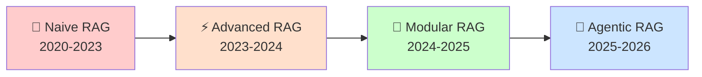
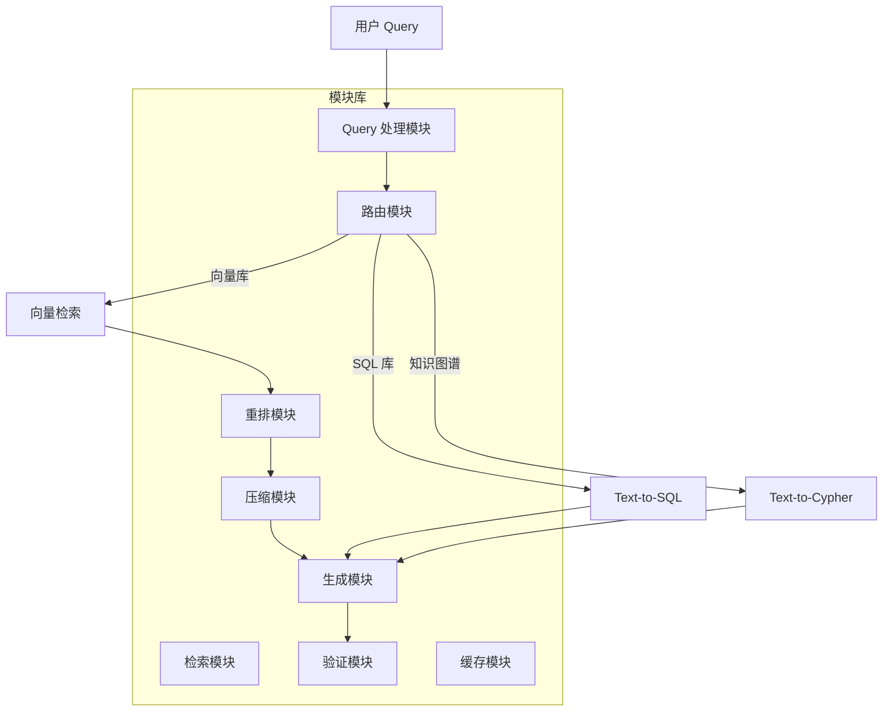
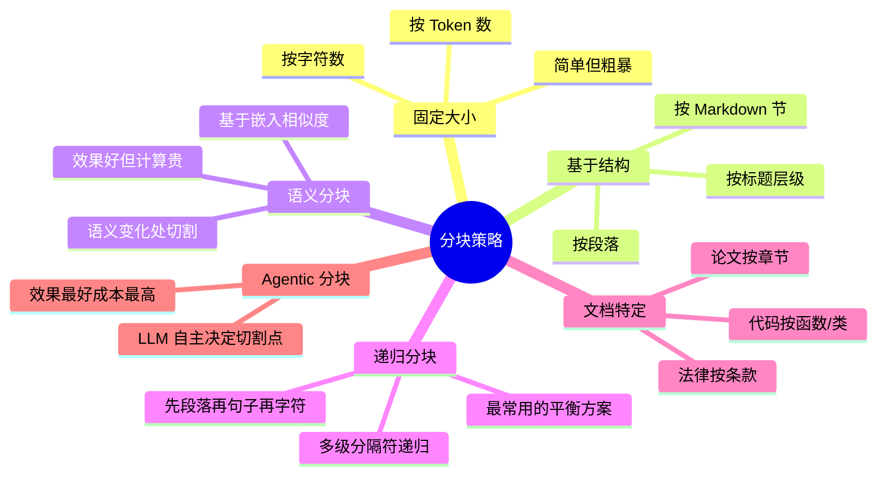
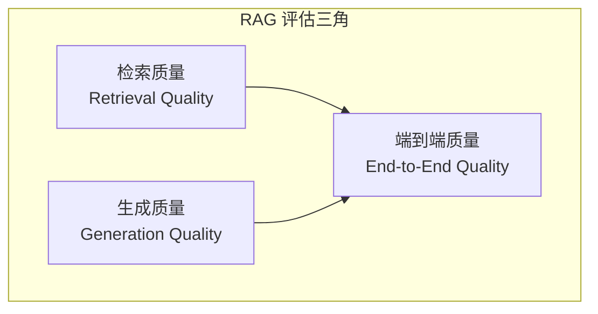
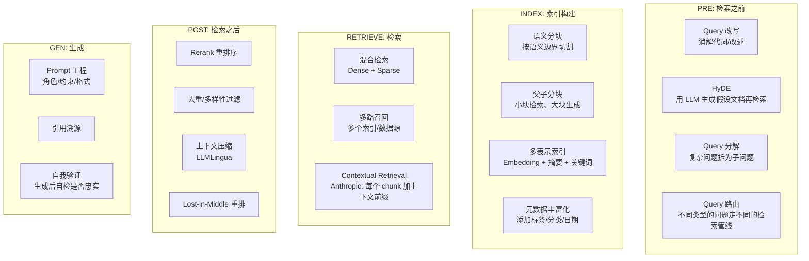

> 历史研究归档 · 2026-11-10 发布 · 全文已读；公开副本处理了内部引用。原有日期、观点、数据和命令保留历史语境，未经本次逐项事实核验或运行复现；请结合[归档说明](../../../ARCHIVE_POLICY.md)阅读。

# RAG 从入门到生产落地完全指南

> **一句话概括**：从"RAG 是什么"起步，沿 Naive→Advanced→Modular→Agentic 四代演进路线，深入工业级 RAG 的每一个环节（文档解析、分块、Embedding、检索、重排、生成），重点揭示理论到生产的"最后一公里"——那些只有踩过坑的人才知道的事。
> **目标读者**：了解 LLM 基础概念，想系统掌握 RAG 并在生产环境落地的开发者。
> **研究日期**：2026-04-17

---

## 目录

- [第一章：RAG 是什么——30 秒建立心智模型](#第一章rag-是什么30-秒建立心智模型)
- [第二章：为什么需要 RAG——LLM 的三个致命缺陷](#第二章为什么需要-ragllm-的三个致命缺陷)
- [第三章：RAG 的四代演进](#第三章rag-的四代演进)
- [第四章：数据预处理——一切的起点](#第四章数据预处理一切的起点)
- [第五章：分块策略——RAG 的第一个生死关](#第五章分块策略rag-的第一个生死关)
- [第六章：Embedding——把文字变成向量](#第六章embedding把文字变成向量)
- [第七章：检索——找到最相关的内容](#第七章检索找到最相关的内容)
- [第八章：重排与后处理——精中选精](#第八章重排与后处理精中选精)
- [第九章：生成——最后一步也是最容易翻车的一步](#第九章生成最后一步也是最容易翻车的一步)
- [第十章：评估——你怎么知道你的 RAG 好不好](#第十章评估你怎么知道你的-rag-好不好)
- [第十一章：生产级十大暗坑](#第十一章生产级十大暗坑)
- [第十二章：优化策略全景图](#第十二章优化策略全景图)
- [第十三章：前沿——Agentic RAG 与 RAG 的未来](#第十三章前沿agentic-rag-与-rag-的未来)
- [第十四章：学习路线图](#第十四章学习路线图)
- [结论与最佳实践](#结论与最佳实践)
- [开放问题](#开放问题)

---

## 第一章：RAG 是什么——30 秒建立心智模型

**RAG = 开卷考试**。

传统 LLM 是闭卷考试：模型只能用训练时记住的知识回答问题。RAG（Retrieval-Augmented Generation，检索增强生成）让 LLM 变成了开卷考试——先去书架上找到相关的参考资料，再基于这些资料作答。

```
┌─────────────────────────────────────────────────────────────┐
│                    RAG = 检索 + 生成                         │
│                                                              │
│   用户提问 ──→ 检索知识库 ──→ 将结果作为上下文 ──→ LLM 生成回答  │
│       │            │                │                  │      │
│    "什么是       搜索向量库        把检索到的          基于参考    │
│     X 协议？"    找相关文档        文档塞进 Prompt     资料作答    │
└─────────────────────────────────────────────────────────────┘
```

**类比锚定**：
- 如果 LLM 是一个博学但记忆模糊的教授，RAG 就是给他配了一个图书管理员——教授说"我需要关于 X 的资料"，图书管理员从海量文档中找出最相关的几篇递过去，教授再基于这些资料回答你的问题。
- 如果 LLM 是搜索引擎，RAG 就是搜索引擎 + 一个会读搜索结果并综合回答的人。

### 最小可运行示例

```python
# 最简 RAG：5 行代码理解本质
from openai import OpenAI

client = OpenAI()

# 1. 你的"知识库"（生产中这是向量数据库）
knowledge = """
公司年假规定：入职满1年享受5天年假，满5年享受10天，满10年享受15天。
年假可以拆分使用，最小单位半天。未休年假可折算工资，按日工资300%计算。
"""

# 2. 用户提问
question = "我工作3年了，有几天年假？没休完怎么办？"

# 3. RAG = 把知识塞进 Prompt + 让 LLM 回答
response = client.chat.completions.create(
    model="gpt-4o-mini",
    messages=[{
        "role": "user",
        "content": f"根据以下资料回答问题。\n\n资料：{knowledge}\n\n问题：{question}"
    }]
)
print(response.choices[0].message.content)
# → "根据公司规定，入职满1年享受5天年假。您工作3年，享有5天年假。
#    未休完的年假可折算工资，按日工资的300%计算。"
```

> **🛑 停下来想一想**：这5行代码就是 RAG 的全部本质。后面所有的 Embedding、向量库、分块、重排……都是在优化"怎么从海量文档中找到这段 `knowledge`"这一步。记住这个心智模型，后面不会迷路。

---

## 第二章：为什么需要 RAG——LLM 的三个致命缺陷

### 缺陷一：知识截止（Knowledge Cutoff）

LLM 的训练数据有截止日期。GPT-4o 的训练数据截至 2024 年 10 月，Claude 3.5 截至 2025 年初。问它"昨天发布的新政策是什么"，它只能编造。

**RAG 怎么解决**：把最新文档喂进去，LLM 就有了"最新知识"。

### 缺陷二：幻觉（Hallucination）

LLM 不知道就编。问它"贵公司的退款政策是什么"，它会编一个看起来合理但完全虚假的退款政策。

**RAG 怎么解决**：给它真正的退款政策文档作为参考，幻觉大幅减少。研究表明，RAG 可将幻觉率降低 40-70%（Shuster et al., 2021; Lewis et al., 2020）。

### 缺陷三：缺乏私有知识

LLM 不知道你公司的内部文档、技术规范、历史决策。

**RAG 怎么解决**：把私有知识库作为检索源，LLM 获得了企业特定知识。

### RAG vs 其他方案

| 方案 | 核心思路 | 优势 | 劣势 | 适用场景 |
|------|---------|------|------|---------|
| **RAG** | 检索 + 注入上下文 | 知识可实时更新、不改模型、可审计 | 检索质量是瓶颈、有延迟 | 知识频繁更新的场景 |
| **Fine-tuning** | 将知识烧入模型权重 | 推理时无额外延迟 | 昂贵、难以更新、事实召回差 | 风格/格式/行为调整 |
| **Long Context** | 把所有东西塞进上下文窗口 | 简单粗暴、无信息丢失 | 成本高、有上限、"Lost in the Middle" | 小型知识库（<200K tokens） |
| **Wiki 法** | 预编译为 LLM 友好格式 | 质量最高、零检索延迟 | 需要人工维护 | 中小型结构化知识 |

> **关键洞察**（来自 [大规模知识库检索方案调研](../02-%E7%9F%A5%E8%AF%86%E7%AE%A1%E7%90%86%E4%B8%8E%E4%B8%8A%E4%B8%8B%E6%96%87/R09_%E5%A4%A7%E8%A7%84%E6%A8%A1%E7%9F%A5%E8%AF%86%E5%BA%93%E6%A3%80%E7%B4%A2%E6%96%B9%E6%A1%88.md)）：**RAG 不是唯一的路**，但它是最通用的路。对于超过 200K tokens 的知识库，RAG 几乎是唯一可行的方案。对于小型知识库，直接用 Prompt Caching + 全文注入（Wiki 法）可能性价比更高。

---

## 第三章：RAG 的四代演进

RAG 不是一成不变的。从 2020 年 Meta 提出 RAG 概念至今，已经历了四代演进（Gao et al., 2024 arXiv:2312.10997）：



### 第一代：Naive RAG（2020-2023）

经典三步流水线：**索引（Index）→ 检索（Retrieve）→ 生成（Generate）**。

```
文档 → 分块 → Embedding → 存入向量库
                                    ↓
用户 Query → Embedding → 向量相似度搜索 → Top-K 结果 → 拼入 Prompt → LLM 生成
```

**特点**：简单直接，但问题一大堆：
- 分块粗暴（固定 512 token 切一刀），语义被切断
- 单一向量检索，精确匹配差（搜"利率3.5%"可能搜不到"年化收益率百分之三点五"）
- 检索到的文档直接拼接，无质量筛选
- 用户问题写得差就检索不到

### 第二代：Advanced RAG（2023-2024）

在 Naive RAG 基础上，对检索的**前、中、后**三个阶段分别优化：

| 阶段 | 优化手段 | 解决什么问题 |
|------|---------|-------------|
| **检索前（Pre-Retrieval）** | Query 改写、HyDE、Query 分解、Query 路由 | 用户问题模糊/复杂 |
| **检索中（Retrieval）** | 混合检索（向量+BM25）、多路召回、细粒度索引 | 单一检索信号不够 |
| **检索后（Post-Retrieval）** | Rerank 重排序、压缩、去重、Lost-in-the-Middle 对策 | 检索结果噪声多 |

### 第三代：Modular RAG（2024-2025）

**核心理念**：RAG 不是一条固定管线，而是一组**可插拔模块**。根据任务需求，自由组合不同的模块。



代表项目：
- **LlamaIndex**（29.2K⭐，模块化 RAG 框架）
- **RAGFlow**（78.3K⭐，开源 RAG 引擎，Apache 2.0）
- **Haystack**（17K⭐，Deepset 开源管线框架）

### 第四代：Agentic RAG（2025-2026）

**核心理念**：RAG 不再是被动的管线，而是由 Agent 主动驱动的智能检索。Agent 决定"要不要检索""检索什么""检索结果够不够""需不需要追加检索"。

```
用户 Query → Agent 思考 → "我需要关于X的信息" 
                                   ↓
                           调用检索工具 → 评估结果
                                   ↓
                           "不够，还需要Y" → 再次检索
                                   ↓
                           "够了" → 综合生成回答
```

说白了：**前三代 RAG 是一条流水线，Agentic RAG 是一个会思考的工人在操作流水线**。

> **与已有知识的交叉引用**：这正好对应了本工作区范式 P4"不是塞更多，而是选更准"。Agent 的判断力让"选更准"成为可能。

---

## 第四章：数据预处理——一切的起点

> **生产级洞察**：90% 的 RAG 问题不在模型，在数据。数据质量决定了 RAG 的上限，模型和算法只决定你能多接近这个上限。

### 4.1 文档解析（Document Parsing）

这是生产 RAG 最容易被低估的一步。Demo 里大家都用干净的 Markdown，但真实世界的数据长这样：

| 文档类型 | 挑战 | 解决方案 |
|---------|------|---------|
| **PDF** | 表格错位、图文混排、扫描件 OCR | Unstructured.io / LlamaParse / MinerU / Docling / DeepDoc |
| **Word/PPT** | 嵌套表格、母版文字、批注 | python-docx + 后处理 |
| **网页** | 导航菜单/广告/侧边栏噪声 | Jina Reader / Trafilatura / BeautifulSoup |
| **代码仓库** | 多语言混编、引用关系 | Tree-sitter AST 解析 |
| **图片/OCR** | 手写、低分辨率、复杂排版 | 多模态模型（GPT-4V/Claude Vision）|

**生产坑 #1：PDF 解析的地狱**

PDF 不是一种结构化格式——它本质上是"在坐标 (x, y) 画出字符 c"的绘图指令集合。这意味着：
- 两列排版可能被解析成交错的文字
- 表格变成一堆散落的文字
- 页眉页脚混入正文
- 数学公式变成乱码

**实战建议**：
1. 先用规则引擎处理已知格式（公司内部 80% 的文档格式是固定的）
2. 对复杂 PDF 使用 LlamaParse（目前最强 PDF 解析，收费）或 MinerU/Docling（开源）
3. 对扫描件，多模态模型 > 传统 OCR
4. **验收标准**：人工抽查 100 个文档的解析质量，表格还原率 >90% 才能过

### 4.2 数据清洗

```python
# 生产级数据清洗示例
def clean_document(text: str) -> str:
    """清洗文档文本，准备进入 RAG 管线"""
    import re
    
    # 1. 去除页眉页脚（通常是重复的）
    text = remove_headers_footers(text)
    
    # 2. 合并被换行符打断的段落
    text = re.sub(r'(?<!\n)\n(?!\n)', ' ', text)
    
    # 3. 去除多余空白
    text = re.sub(r'\s+', ' ', text)
    
    # 4. 保留有意义的结构标记（标题、列表）
    # 注意：不要过度清洗——表格分隔符、编号列表是重要的结构信息
    
    # 5. 标准化格式（全角→半角、繁→简等，视场景而定）
    text = normalize_unicode(text)
    
    return text.strip()
```

> **🛑 停下来想一想**：为什么数据清洗很重要？因为 `"利率\n3.5%"` 被切块后可能变成两个 chunk，导致检索时答案被拆散了。

---

## 第五章：分块策略——RAG 的第一个生死关

分块（Chunking）是 RAG 的第一个关键决策。块太大，噪声多、浪费 token；块太小，上下文碎片化、语义不完整。

### 5.1 分块策略对比



| 策略 | 原理 | 优势 | 劣势 | 适用场景 |
|------|------|------|------|---------|
| **固定大小** | 每 N 个 token 切一刀 | 简单、可预测 | 语义被打断 | 快速原型 |
| **递归分块** | 优先按段落→句子→字符递归切割 | 平衡性好 | 对非结构化文档效果有限 | **通用首选** |
| **语义分块** | 检测语义转折点切割 | 语义完整性最好 | 需要额外 Embedding 计算 | 高质量要求场景 |
| **文档结构** | 按 Markdown 标题/代码函数切割 | 保留原始结构 | 依赖文档有清晰结构 | 技术文档、论文 |
| **父子分块** | 小块用于检索，大块用于生成 | 检索精准 + 上下文完整 | 实现复杂 | **生产级推荐** |

### 5.2 生产级最佳实践：父子分块（Parent-Child Chunking）

这是 Advanced RAG 中最重要的优化之一：**检索用小块，生成用大块**。

```
  ┌───────────── Parent Chunk (2000 tokens) ──────────────┐
  │                                                        │
  │  ┌─── Child 1 ───┐  ┌─── Child 2 ───┐  ┌─ Child 3 ─┐ │
  │  │  (400 tokens)  │  │  (400 tokens)  │  │ (400 tk)  │ │
  │  └────────────────┘  └────────────────┘  └───────────┘ │
  │                                                        │
  └────────────────────────────────────────────────────────┘
  
  检索时：用 Child 匹配（精准度高）
  生成时：返回整个 Parent（上下文完整）
```

```python
from langchain_text_splitters import RecursiveCharacterTextSplitter

# 父块：用于生成（保留完整上下文）
parent_splitter = RecursiveCharacterTextSplitter(
    chunk_size=2000,
    chunk_overlap=200,
)

# 子块：用于检索（更精准的匹配）
child_splitter = RecursiveCharacterTextSplitter(
    chunk_size=400,
    chunk_overlap=50,
)

# 建立索引时，存储 child → parent 的映射关系
parent_chunks = parent_splitter.split_documents(documents)
for parent in parent_chunks:
    children = child_splitter.split_documents([parent])
    for child in children:
        child.metadata["parent_id"] = parent.metadata["id"]
        # 将 child embedding 存入向量库
        # 检索到 child 后，返回对应的 parent
```

### 5.3 块大小怎么选？

**没有银弹**。但有经验法则：

| 场景 | 推荐 Chunk Size | 推荐 Overlap | 理由 |
|------|----------------|-------------|------|
| 精确问答（FAQ） | 200-400 tokens | 20-50 | 答案通常在一段内 |
| 文档摘要 | 1000-2000 tokens | 100-200 | 需要更多上下文 |
| 技术文档 | 500-1000 tokens | 50-100 | 平衡精度和上下文 |
| 法律/合同 | 按条款自然分割 | 条款间不重叠 | 条款是天然单位 |
| 代码 | 按函数/类分割 | 包含 import 头 | 代码有天然边界 |

**实战建议**：用你的真实数据 + 真实问题做 A/B 测试。改一个 chunk_size 参数跑一轮评估，看指标变化。这不是玄学，是实验科学。

> **生产坑 #2：chunk overlap 设太大导致重复内容**。overlap=200 意味着每个 chunk 的前后各有 200 tokens 和相邻 chunk 重复。检索 Top-5 时可能实际上只有 3 个不同的文档片段，其余是重叠内容。

---

## 第六章：Embedding——把文字变成向量

### 6.1 Embedding 是什么

Embedding 是把文字映射到高维空间中的向量。语义相近的文字，向量也相近。

```
"如何重置密码？" → [0.12, -0.34, 0.56, ..., 0.78]  (1536维)
"忘记密码怎么办？" → [0.11, -0.33, 0.55, ..., 0.77]  ← 很接近！
"今天天气怎么样？" → [-0.45, 0.21, -0.12, ..., 0.03] ← 很远！
```

### 6.2 Embedding 模型选型

2026 年主流 Embedding 模型对比：

| 模型 | 维度 | 上下文长度 | MTEB 排名 | 中文 | 部署方式 | 成本 |
|------|------|----------|----------|------|---------|------|
| **OpenAI text-embedding-3-large** | 3072 | 8191 | 前10 | 好 | API | $0.13/1M tokens |
| **OpenAI text-embedding-3-small** | 1536 | 8191 | 前20 | 好 | API | $0.02/1M tokens |
| **Cohere embed-v3** | 1024 | 512 | 前10 | 好 | API | $0.10/1M tokens |
| **BGE-M3**（BAAI） | 1024 | 8192 | 前5 | **极好** | 本地/API | 免费 |
| **GTE-Qwen2**（阿里） | 1536 | 128K | 前5 | **极好** | 本地/API | 免费 |
| **Jina-embeddings-v3** | 1024 | 8192 | 前10 | 好 | API/本地 | 免费/付费 |
| **Voyage-3** | 1024 | 32K | 前5 | 好 | API | $0.06/1M tokens |
| **nomic-embed-text** | 768 | 8192 | 前20 | 一般 | 本地 | 免费 |

**选型决策树**：

```
你的场景是...
├── 中文为主？
│   ├── 预算充裕 → GTE-Qwen2 / BGE-M3（MTEB中文榜首批）
│   └── 预算紧张 → BGE-M3 本地部署（免费）
├── 英文为主？
│   ├── 不想部署 → OpenAI text-embedding-3-small/large
│   └── 可以部署 → BGE-M3 / nomic-embed-text
├── 中英混合？
│   └── BGE-M3（专门设计为多语言+多粒度）
└── 超长文档（>8K tokens）？
    └── GTE-Qwen2（支持 128K）/ Voyage-3（支持 32K）
```

### 6.3 Embedding 的三个关键陷阱

**陷阱一：Query 和 Document 的 Embedding 不对称**

许多人用同一个模型、同一种方式 embed query 和 document。但用户 query 通常很短（"退款政策是什么"），document chunk 很长（一整段政策描述）。好的 Embedding 模型（如 BGE-M3、Instructor）支持 query/document 不同的 prompt prefix，利用这个特性能显著提升召回率。

```python
# BGE-M3 的正确用法
query_embedding = model.encode(
    "Represent this sentence for searching relevant passages: 退款政策是什么",
    # 注意 query 需要加 prefix
)
doc_embedding = model.encode(
    "本公司退款政策如下：购买后7天内可无条件退款..."
    # document 不加 prefix
)
```

**陷阱二：维度越高不一定越好**

OpenAI 的 text-embedding-3-large 是 3072 维，但你可以用 `dimensions` 参数截断到 256/512/1024 维，召回率下降很小但存储和检索速度大幅提升。

**陷阱三：Embedding 模型一旦换了，整个向量库要重建**

这是生产环境的大坑。你不能把 text-embedding-ada-002 生成的向量和 text-embedding-3-small 的向量混在一起——它们的向量空间不同，相似度计算没有意义。**换模型 = 全量重建索引**。

> **实战建议**：第一次选模型就选好。用 MTEB Leaderboard（https://huggingface.co/spaces/mteb/leaderboard）做参考，在自己的数据上跑 Benchmark，然后定了就别轻易换。

---

## 第七章：检索——找到最相关的内容

### 7.1 检索策略全景

| 策略 | 原理 | 优势 | 劣势 |
|------|------|------|------|
| **向量检索（Dense）** | 语义相似度匹配 | 理解同义词 | 精确匹配差 |
| **关键词检索（Sparse/BM25）** | TF-IDF 词频匹配 | 精确匹配强 | 不理解同义词 |
| **混合检索（Hybrid）** | Dense + Sparse 融合 | 兼顾语义+精确 | 需要调权重 |
| **多路召回** | 多个检索器结果合并 | 召回率高 | 去重复杂 |
| **知识图谱检索** | 图结构关系检索 | 关系推理强 | 构建成本高 |

### 7.2 为什么一定要混合检索

**这是从 Naive RAG 到 Advanced RAG 的最关键一步**。

纯向量检索的致命弱点：
```
Query: "FDA 21 CFR Part 11 合规要求"
→ 向量检索可能返回"GMP 质量管理标准"（语义相近但不是你要的）
→ BM25 会精确匹配 "21 CFR Part 11" 这个关键词

Query: "如何处理客户投诉？"
→ BM25 只搜到包含"客户投诉"四个字的文档
→ 向量检索还能找到"用户反馈处理流程"、"售后纠纷解决方案"
```

**混合检索 = 两个互补的信号源**：

> 公开版说明：此处原有来自内部项目的代码示例，未纳入公开归档。

> **来自本工作区的实证**（[代码检索能力实验报告](../03-%E5%AE%9E%E9%AA%8C%E9%AA%8C%E8%AF%81/R07_%E4%BB%A3%E7%A0%81%E6%A3%80%E7%B4%A2%E8%83%BD%E5%8A%9B%E5%AE%9E%E9%AA%8C.md)）：Multi-Signal 融合达到 MRR=0.68、Hit@3=80%，显著优于任何单一信号。路径匹配是最可靠的信号，语义检索提供互补。

### 7.3 向量数据库选型

| 向量库 | 类型 | 混合检索 | 过滤 | 集群 | Stars | 适合场景 |
|--------|------|---------|------|------|-------|---------|
| **Milvus** | 专用 | ✅ 内置 BM25 | ✅ | ✅ | 33K | 生产级首选 |
| **Qdrant** | 专用 | ✅ | ✅ Payload Filter | ✅ | 23K | 高性能场景 |
| **Weaviate** | 专用 | ✅ | ✅ GraphQL | ✅ | 14K | GraphQL 生态 |
| **Chroma** | 专用（轻量） | ❌ | ✅ | ❌ | 18K | 原型/小规模 |
| **pgvector** | PostgreSQL 扩展 | ✅（配合 pg_trgm） | ✅ SQL | ✅ | 14K | 已有 PG 的团队 |
| **Elasticsearch** | 搜索引擎 | ✅ | ✅ DSL | ✅ | 72K | 已有 ES 的团队 |

**选型经验法则**：
- 原型阶段 → Chroma（内存数据库，pip install 即用）
- 生产且 <100 万文档 → Qdrant 或 pgvector
- 生产且 >100 万文档 → Milvus（专为大规模设计）
- 已有 Elasticsearch → 直接用 ES 的向量搜索能力

---

## 第八章：重排与后处理——精中选精

### 8.1 为什么需要 Rerank

向量检索是**大网捞鱼**（从百万文档中找 Top-100），Rerank 是**精挑细选**（从 Top-100 中选 Top-5）。

向量检索是通过高效的近似最近邻（ANN）算法快速从海量数据中召回候选，精度有限。Rerank 用更复杂的模型（通常是交叉编码器 Cross-Encoder）逐一评估 query-document 对的相关性，精度更高但速度慢（所以只对 Top-K 做）。

```
向量检索（毫秒级，百万→100）→ Rerank（百毫秒级，100→5）→ 传给 LLM

     速度快、精度低                   速度慢、精度高
     (Bi-Encoder)                   (Cross-Encoder)
```

### 8.2 Rerank 模型选型

| 模型 | 提供方 | 精度 | 延迟 | 成本 |
|------|-------|------|------|------|
| **Cohere Rerank v3** | Cohere API | 极高 | ~100ms/20 docs | $2/1K 搜索 |
| **BGE-Reranker-v2-m3** | BAAI | 高 | 本地 GPU | 免费 |
| **Jina Reranker v2** | Jina | 高 | API/本地 | 免费/付费 |
| **Cross-Encoder 自训** | Hugging Face | 可调 | 取决于模型 | 训练成本 |
| **LLM-as-Reranker** | 用 LLM 打分 | 最高 | 秒级 | Token 成本 |

**生产坑 #3：Rerank 延迟加倍**

Rerank 对 Top-100 重排，每个 doc 需要过一遍 Cross-Encoder。如果模型在 CPU 上跑，100 个文档可能需要 2-3 秒。在实时对话场景中这是不可接受的。

**优化方案**：
1. 减少 Rerank 输入：向量检索只返回 Top-20 而非 Top-100
2. GPU 部署 Rerank 模型
3. 二阶段 Rerank：先用轻量模型把 100→20，再用重模型 20→5

### 8.3 其他后处理技巧

**去重**：混合检索可能返回重复文档，需要基于文档 ID 或内容 hash 去重。

**多样性过滤**：Top-5 全来自同一个文档的不同小块？这不好。使用 MMR（Maximal Marginal Relevance）在相关性和多样性之间平衡。

**Lost in the Middle 对策**：研究表明 LLM 对上下文中间位置的信息关注度最低（Liu et al., 2023）。把最相关的结果放在上下文的**开头和结尾**，不太相关的放中间。

```python
def reorder_for_lost_in_middle(docs: list) -> list:
    """重排文档顺序，缓解 Lost in the Middle 效应"""
    # 按相关性排序后，交替放到开头和结尾
    reordered = []
    for i, doc in enumerate(docs):
        if i % 2 == 0:
            reordered.append(doc)  # 偶数位放前面
        else:
            reordered.insert(len(reordered) // 2, doc)  # 奇数位塞中间
    return reordered
```

---

## 第九章：生成——最后一步也是最容易翻车的一步

### 9.1 Prompt 工程

RAG 的生成 Prompt 需要清晰地告诉 LLM 三件事：
1. **你的角色和行为约束**
2. **参考资料**
3. **要回答的问题**

```python
RAG_PROMPT = """你是一个专业的客服助手。基于以下参考资料回答用户的问题。

规则：
1. 只基于参考资料回答，不要编造信息
2. 如果参考资料中没有相关信息，明确告知"根据现有资料无法回答此问题"
3. 引用具体来源，使用 [1] [2] 格式标注
4. 回答要简洁、准确

参考资料：
{context}

用户问题：{question}

回答："""
```

**关键细节**：
- 明确说"只基于参考资料"——否则 LLM 会混入训练知识
- 允许说"不知道"——否则 LLM 宁可编也不说不知道
- 要求引用来源——方便用户验证，也约束 LLM 不编造

### 9.2 上下文截断策略

LLM 有上下文窗口限制。当检索结果太多时，需要截断。

```python
def build_context(results: list, max_tokens: int = 4000) -> str:
    """构建上下文，确保不超过 token 限制"""
    context_parts = []
    current_tokens = 0
    
    for i, doc in enumerate(results):
        doc_tokens = count_tokens(doc.content)
        if current_tokens + doc_tokens > max_tokens:
            break  # 超过限制就停止
        context_parts.append(f"[{i+1}] {doc.content}\n来源: {doc.metadata['source']}")
        current_tokens += doc_tokens
    
    return "\n\n".join(context_parts)
```

### 9.3 流式输出

生产环境必须有流式输出（Streaming）。RAG 的延迟 = 检索延迟 + LLM 生成延迟。如果用户等 5 秒才看到第一个字，体验极差。流式输出让用户在检索完成后立即看到 LLM 逐字生成。

```python
async def stream_rag_response(query: str):
    # 1. 检索（不可流式，必须等）
    results = await retrieve(query)
    context = build_context(results)
    
    # 2. 生成（流式输出）
    async for chunk in client.chat.completions.create(
        model="gpt-4o-mini",
        messages=[{"role": "user", "content": RAG_PROMPT.format(
            context=context, question=query
        )}],
        stream=True
    ):
        if chunk.choices[0].delta.content:
            yield chunk.choices[0].delta.content
```

### 9.4 引用溯源

用户需要知道"这个答案来自哪"。这不仅是体验问题，在合规场景（医疗、法律、金融）是硬性要求。

```python
def extract_citations(answer: str, sources: list) -> dict:
    """从回答中提取引用标记，关联到原始来源"""
    import re
    citations = {}
    for match in re.finditer(r'\[(\d+)\]', answer):
        idx = int(match.group(1)) - 1
        if 0 <= idx < len(sources):
            citations[match.group(0)] = {
                "source": sources[idx].metadata["source"],
                "page": sources[idx].metadata.get("page"),
                "content_preview": sources[idx].content[:200]
            }
    return citations
```

---

## 第十章：评估——你怎么知道你的 RAG 好不好

> **核心原则**：不能评估的东西就不能改进。很多团队上线了 RAG，但完全不知道它的准确率是 60% 还是 90%。

### 10.1 RAG 评估的三个维度



| 维度 | 指标 | 含义 | 工具 |
|------|------|------|------|
| **检索** | Context Precision | 检索到的文档中有多少是相关的 | Ragas |
| **检索** | Context Recall | 回答所需的信息有多少被检索到了 | Ragas |
| **检索** | MRR@K | 第一个正确结果在第几位 | 自定义 |
| **检索** | Hit@K | Top-K 中是否包含正确答案 | 自定义 |
| **生成** | Faithfulness（忠实度） | 回答是否忠于参考资料（不编造） | Ragas / DeepEval |
| **生成** | Answer Relevance | 回答是否切题 | Ragas / DeepEval |
| **端到端** | Correctness | 回答是否正确 | 人工 + LLM Judge |
| **端到端** | Latency | 端到端延迟 | 自定义 |
| **端到端** | 用户满意度 | 用户是否觉得有用 | 点赞/踩 |

### 10.2 评估工具链

| 工具 | Stars | 核心能力 | 适合阶段 |
|------|-------|---------|---------|
| **Ragas** | 13.3K | RAG 专业评估（8+ 指标）、自动测试集生成 | 开发/CI |
| **DeepEval** | 14.7K | 通用 LLM 评估（50+ 指标）、RAG 支持 | 开发/CI |
| **Promptfoo** | 19.9K | Eval + 红队安全测试 | CI/CD |
| **Phoenix/Arize** | 9.2K | 可观测性 + Eval，生产监控 | 生产 |
| **LangSmith** | LangChain | Trace + Eval + Dataset 管理 | 全流程 |

### 10.3 最小可行评估：从 50 条开始

不要等到"完美的评估体系"搭好才评估。**从 50 条测试样本开始**：

```python
# 最小评估脚本
import json

# 1. 构建测试集（50条就够起步）
test_cases = [
    {
        "question": "公司的年假政策是什么？",
        "expected_answer": "入职满1年享受5天年假，满5年10天，满10年15天",
        "expected_source": "HR手册第3章"
    },
    # ... 49 more
]

# 2. 跑 RAG 管线
results = []
for case in test_cases:
    rag_answer = rag_pipeline(case["question"])
    results.append({
        "question": case["question"],
        "expected": case["expected_answer"],
        "actual": rag_answer.text,
        "sources": rag_answer.sources,
    })

# 3. 简单评估（LLM-as-Judge）
correct = 0
for r in results:
    judgment = llm_judge(
        f"参考答案：{r['expected']}\n实际回答：{r['actual']}\n"
        f"实际回答是否正确传达了参考答案的核心信息？回答 YES 或 NO"
    )
    if "YES" in judgment:
        correct += 1

accuracy = correct / len(results)
print(f"准确率: {accuracy:.1%}")  # 目标: >85%
```

> **来自 [Skill与Agent评估方案全景调研报告](../05-%E8%AF%84%E4%BC%B0%E4%B8%8E%E8%B4%A8%E9%87%8F/R15_Skill%E4%B8%8EAgent%E8%AF%84%E4%BC%B0%E6%96%B9%E6%A1%88%E5%85%A8%E6%99%AF.md) 的交叉引用**：Eval-Driven Development（P11 范式）同样适用于 RAG——先有评估，再改管线。每次修改 chunk size、换 embedding 模型、调 rerank，都跑一遍评估看指标变化。

---

## 第十一章：生产级十大暗坑

这些是只有在生产环境踩过后才知道的坑：

### 暗坑 #1：数据质量 >> 模型质量

**现象**：花了大量精力调 embedding 模型、chunk size、rerank，准确率从 70% 到 72%。然后回头清理了一下数据源，准确率直接到 85%。

**教训**：80% 的错误来自 20% 的脏数据。**先修数据，后调模型。**

### 暗坑 #2：Embedding 更新导致全量重建

**现象**：上线 3 个月后，更好的 embedding 模型发布了。想换？整个向量库要重建。100 万文档 × 每条 0.5 秒 = 5.7 天不间断运行。

**教训**：选型时就要考虑到这一点。设计系统时预留"双索引热切换"能力：新索引在后台构建，完成后一键切换。

### 暗坑 #3：多轮对话中的代词消解

**现象**：
```
用户：什么是 FDA 21 CFR Part 11？
RAG：（正确回答）
用户：它和 GMP 有什么关系？    ← "它"指什么？
RAG：（检索了完全不相关的内容）
```

**教训**：多轮对话需要 Query 改写——把代词替换为实际指代对象。参见 [代码检索能力实验报告](../03-%E5%AE%9E%E9%AA%8C%E9%AA%8C%E8%AF%81/R07_%E4%BB%A3%E7%A0%81%E6%A3%80%E7%B4%A2%E8%83%BD%E5%8A%9B%E5%AE%9E%E9%AA%8C.md) 中 P8 范式"语义鸿沟→LLM Rewrite 解决"。

```python
async def rewrite_query(query: str, chat_history: list) -> str:
    """消解代词，将 query 改写为独立问题"""
    if not chat_history:
        return query
    
    prompt = f"""根据对话历史，将用户最新的问题改写为一个独立的、完整的问题。
不要回答问题，只改写。

对话历史：
{format_history(chat_history)}

用户最新问题：{query}

改写后的独立问题："""
    
    return await llm_call(prompt)
```

### 暗坑 #4：Token 成本失控

**现象**：开发时测试了 100 个问题，成本 $2。上线后每天 10,000 个问题，月成本 $6,000。

**成本构成**：
```
每次查询成本 = Embedding 成本 + Rerank 成本 + LLM 生成成本
            ≈ $0.00002    + $0.001     + $0.02
            ≈ $0.021/次

日均 10,000 次 × 30 天 = $6,300/月
```

**优化策略**：
1. 缓存热门问题的回答（Redis）
2. 使用更小的 LLM（gpt-4o-mini 比 gpt-4o 便宜 30 倍）
3. 对简单问题跳过 rerank
4. Prompt Caching（Claude 的 Prompt Caching 可省 90% 缓存命中时的成本）

### 暗坑 #5：检索到了但 LLM 忽略

**现象**：检索结果包含正确答案，但 LLM 的回答没有用到它。

**原因**：
- 检索结果太多，答案淹没在噪声中（→ 减少 Top-K，加 rerank）
- Lost in the Middle 效应（→ 重排文档顺序）
- Prompt 没有强调"只基于参考资料"（→ 强化 Prompt 约束）

### 暗坑 #6：表格和结构化数据检索失败

**现象**：知识库中一个漂亮的表格，Embedding 后变成了一堆散落的文字，检索时完全匹配不上。

**教训**：表格需要特殊处理：
1. 提取表格 → 转为逐行描述性文字
2. 或者每行作为独立 chunk，附带表头作为上下文
3. 或者对表格生成摘要，用摘要检索，返回原始表格

### 暗坑 #7：知识库更新导致"幽灵文档"

**现象**：文档 v1 说"利率 3.5%"，更新为 v2 说"利率 4.0%"。但向量库中两个版本的 chunk 都在，检索可能返回过时信息。

**教训**：
- 文档更新时，**必须删除旧版本的所有 chunk 再插入新版本**
- 使用文档版本号 + 时间戳做元数据过滤
- 重要文档变更后触发一轮回归测试

### 暗坑 #8：并发下的性能瓶颈

**现象**：单用户延迟 2 秒，50 个用户并发时延迟飙到 15 秒。

**原因清单**：
- Embedding 推理没有 batch（每个请求都单独调一次）
- Rerank 模型部署在 CPU 上
- 向量数据库连接数不够
- LLM API 并发限制

**优化**：batch embedding、GPU rerank、连接池、LLM 限流+队列。

### 暗坑 #9：多语言场景的语义鸿沟

**现象**：用户用中文提问，知识库是英文文档。向量相似度分数很低。

**教训**：
- 使用多语言 Embedding 模型（BGE-M3 专为此设计）
- 或者 Query 翻译为知识库语言后再检索
- 或者知识库翻译为用户语言（一次性成本）

> **来自本工作区的实证**（[代码检索能力实验报告](../03-%E5%AE%9E%E9%AA%8C%E9%AA%8C%E8%AF%81/R07_%E4%BB%A3%E7%A0%81%E6%A3%80%E7%B4%A2%E8%83%BD%E5%8A%9B%E5%AE%9E%E9%AA%8C.md)）：语义鸿沟（中→英）是代码检索中最大的瓶颈（P8 范式），LLM Rewrite 是最有效的解决方案。

### 暗坑 #10：RAG 系统无法自我诊断

**现象**：用户反馈"回答不准"，但你不知道是检索的问题还是生成的问题。

**教训**：必须有可观测性：
1. **记录每次查询的完整 trace**：原始 query → 改写后 query → 检索结果 → rerank 结果 → 最终回答
2. **分阶段打分**：检索 recall、rerank 精度、生成忠实度
3. 使用 Phoenix/LangSmith 等工具做生产监控

---

## 第十二章：优化策略全景图

### 12.1 按阶段的优化菜单



### 12.2 按投入产出比排序

| 优先级 | 优化项 | 预期提升 | 实施成本 | 建议 |
|--------|-------|---------|---------|------|
| 🔴 P0 | 数据清洗 | +10-20% | 低 | **首先做** |
| 🔴 P0 | 混合检索 | +5-15% | 低 | **必做** |
| 🔴 P0 | Chunk size 调优 | +5-10% | 低 | **必做** |
| 🟡 P1 | Rerank | +3-8% | 中 | 强烈建议 |
| 🟡 P1 | Query 改写 | +5-10%（多轮场景） | 低 | 多轮必做 |
| 🟡 P1 | 父子分块 | +3-7% | 中 | 推荐 |
| 🟢 P2 | Contextual Retrieval | +3-5% | 中 | 知识库大时有效 |
| 🟢 P2 | HyDE | +2-5% | 低 | 简单场景有效 |
| 🟢 P2 | GraphRAG | 视场景而定 | 高 | 关系推理场景才值得 |
| 🟢 P2 | Fine-tune Embedding | +2-5% | 高 | 有标注数据才值得 |

### 12.3 Contextual Retrieval（Anthropic 方案）

这是 Anthropic 在 2024 年提出的优化策略，核心思想很简单：**给每个 chunk 加上它在原文中的上下文描述**。

```
❌ 普通 chunk:
"第三季度收入增长 15%，主要受新产品线驱动。"
→ 缺少上下文：哪个公司？哪年？什么产品线？

✅ Contextual chunk:
"[上下文: 本段来自 2024 年 Acme Corp 年度财报第 6 页，讨论的是 Q3 财务表现]
第三季度收入增长 15%，主要受新产品线驱动。"
→ 检索时锚点更丰富，命中率更高
```

实现方式：用 LLM 为每个 chunk 生成一段上下文描述，拼在 chunk 前面再做 Embedding。

**效果**：Anthropic 报告 Contextual Retrieval + BM25 + Rerank 组合将检索失败率降低了 67%。

**成本**：需要对每个 chunk 额外调用一次 LLM。10 万 chunk ≈ $10-50（用 Claude Haiku/GPT-4o-mini）。

---

## 第十三章：前沿——Agentic RAG 与 RAG 的未来

### 13.1 Agentic RAG

Agentic RAG 是 RAG 的最新演进方向：**把 Agent 的推理能力引入 RAG 管线**。

传统 RAG 是"一查一答"的单次流水线。Agentic RAG 则让 Agent 自主决定：
- **要不要检索**：简单问题直接答，复杂问题才检索
- **检索什么**：Agent 分析问题后生成精准的检索策略
- **够不够**：评估检索结果质量，不够就追加检索
- **从哪检索**：不同类型的问题路由到不同的数据源

```python
# Agentic RAG 概念示例（伪代码）
class AgenticRAG:
    def answer(self, question: str):
        # Agent 分析问题
        plan = self.agent.analyze(question)
        
        if plan.needs_retrieval:
            # 可能多轮检索
            context = []
            for sub_query in plan.search_queries:
                source = plan.route(sub_query)  # 路由到合适的数据源
                results = source.search(sub_query)
                context.extend(results)
                
                # 评估是否还需要更多信息
                if self.agent.is_sufficient(question, context):
                    break
            
            return self.generate(question, context)
        else:
            return self.agent.direct_answer(question)
```

### 13.2 长上下文窗口会杀死 RAG 吗？

Google Gemini 提供 2M token 上下文窗口，Claude 提供 200K。有人说"直接把所有文档塞进去，不需要 RAG 了"。

**答案：不会，但 RAG 的定位会变。**

| 知识库规模 | 长上下文方案 | RAG 方案 | 推荐 |
|-----------|------------|---------|------|
| <50K tokens | ✅ 全量塞入 | ❌ 杀鸡用牛刀 | **长上下文** |
| 50K-500K tokens | ✅ 可行但贵 | ✅ 更经济 | **Prompt Caching + 全文注入** 或 **RAG** |
| 500K-2M tokens | ⚠️ 可行但 Lost in the Middle 严重 | ✅ 推荐 | **RAG** |
| >2M tokens | ❌ 超出窗口 | ✅ 唯一方案 | **RAG** |

> **来自本工作区的交叉引用**（[大规模知识库检索方案调研](../02-%E7%9F%A5%E8%AF%86%E7%AE%A1%E7%90%86%E4%B8%8E%E4%B8%8A%E4%B8%8B%E6%96%87/R09_%E5%A4%A7%E8%A7%84%E6%A8%A1%E7%9F%A5%E8%AF%86%E5%BA%93%E6%A3%80%E7%B4%A2%E6%96%B9%E6%A1%88.md)）：EMNLP 2024 研究表明，长上下文 LLM 在**一致性**上优于 RAG（因为 LLM 看到了所有信息），但 RAG 在**成本**和**超大规模知识库**上有不可替代的优势。Prompt Caching 是中间地带的性价比杀手锏。

### 13.3 GraphRAG

微软在 2024 年提出的 GraphRAG 将知识图谱引入 RAG：

```
传统 RAG:  文档 → 分块 → 向量 → 检索
GraphRAG: 文档 → 实体抽取 → 构建知识图谱 → 社区检测 → 社区摘要 → 检索
```

**优势**：对"全局性问题"效果显著（"整个数据集的主要主题是什么？"）。
**劣势**：构建成本极高，10 万 token 文档可能需要 $50+ 的 LLM 调用来构建图谱。

**适用场景**：复杂的关联推理（"A 公司的子公司 B 和 C 公司有什么业务交集？"）。简单问答场景不需要 GraphRAG。

> **工作区状态**：GraphRAG 在本知识库中标记为 G2（已识别但未深入），[AI-Agent学习路线与项目整合全景报告](R23_AIAgent%E5%AD%A6%E4%B9%A0%E8%B7%AF%E7%BA%BF%E4%B8%8E%E9%A1%B9%E7%9B%AE%E6%95%B4%E5%90%88.md) 中 G-H 进行了初步实验，但因 nano-graphrag 依赖冲突而阻塞。

### 13.4 RAG 的未来方向

| 方向 | 当前状态 | 前景 |
|------|---------|------|
| **Agentic RAG** | 主流框架已支持 | ⭐⭐⭐⭐⭐ 确定性趋势 |
| **多模态 RAG** | 图片/视频/音频检索 | ⭐⭐⭐⭐ 快速发展 |
| **RAG + Fine-tuning** | 组合使用（RAG 提供事实，FT 提供风格）| ⭐⭐⭐ 边界在探索 |
| **端到端学习的 RAG** | 检索器和生成器联合训练 | ⭐⭐ 学术阶段 |
| **RAG 被 Wiki 法替代** | 小型知识库场景下已论证可行 | ⭐⭐⭐ 场景化替代 |

---

## 第十四章：学习路线图

### 阶段一：概念速通（1 天）

**目标**：理解 RAG 是什么、为什么需要它、基本流程。

| 任务 | 资源 | 预期产出 |
|------|------|---------|
| 看 LangChain RAG from Scratch 前 4 集 | [YouTube Playlist](https://youtube.com/playlist?list=PLfaIDFEXuae2LXbO1_PKyVJiQ23ZztA0x) (8K⭐) | 理解 Index/Retrieve/Generate |
| 跑通 5 行代码 RAG | 本文第一章示例 | 第一个可运行的 RAG |
| 读本工作区已有报告 | [大规模知识库检索方案调研](../02-%E7%9F%A5%E8%AF%86%E7%AE%A1%E7%90%86%E4%B8%8E%E4%B8%8A%E4%B8%8B%E6%96%87/R09_%E5%A4%A7%E8%A7%84%E6%A8%A1%E7%9F%A5%E8%AF%86%E5%BA%93%E6%A3%80%E7%B4%A2%E6%96%B9%E6%A1%88.md) | 十大方案全景视野 |

**验收标准**：能向别人解释"RAG 解决什么问题""RAG 管线有几步"。

### 阶段二：动手搭建（2-3 天）

**目标**：用框架搭建一个有向量库的 RAG 系统。

| 任务 | 资源 | 预期产出 |
|------|------|---------|
| 安装 LangChain + Chroma | LangChain 文档 | 本地开发环境 |
| 用 RecursiveCharacterTextSplitter 分块 | 本文第五章 | 理解 chunk size 对效果的影响 |
| 实现向量检索 + 问答 | LangChain RAG Tutorial | 第一个框架化的 RAG |
| 切换到混合检索 | 本文第七章 | Dense + BM25 混合检索 |

**验收标准**：用你自己的文档（比如一份技术规范），RAG 能正确回答 10 个手写问题中的 7 个以上。

### 阶段三：生产化改造（1-2 周）

**目标**：把 Demo 变成可上线的系统。

| 任务 | 资源 | 预期产出 |
|------|------|---------|
| 换用生产级向量库（Milvus/Qdrant） | 官方文档 | 支持持久化和大规模 |
| 添加 Rerank | 本文第八章 | 检索精度提升 |
| 添加 Query 改写 | 本文第十一章暗坑 #3 | 多轮对话支持 |
| 实现流式输出 | 本文第九章 | 用户体验优化 |
| 搭建评估体系 | 本文第十章 + Ragas | 50 条测试集 + 自动评估 |
| 引用溯源 | 本文第九章 | 回答可追溯 |
| 成本估算 | 本文暗坑 #4 | 月成本预算 |

**验收标准**：50 条测试集准确率 > 85%，P95 延迟 < 3 秒，有可观测性 Dashboard。

### 阶段四：深度优化（持续）

**目标**：从 85% 到 95%。

| 任务 | 资源 | 预期产出 |
|------|------|---------|
| A/B 测试 chunk size | 不同参数跑评估 | 找到最优 chunk size |
| 尝试 Contextual Retrieval | Anthropic 文档 | 检索失败率进一步降低 |
| 实现父子分块 | 本文第五章 | 精准检索 + 完整上下文 |
| 错误分析 | 分析 Bad Case | 定向优化 |
| 探索 Agentic RAG | 本文第十三章 | 复杂问题智能路由 |

**验收标准**：Bad Case 分析形成闭环——每周分析 10 个 bad case，分类原因，定向修复。

### 学习资源全表

| 资源 | 类型 | 难度 | 说明 |
|------|------|------|------|
| [RAG from Scratch](https://youtube.com/playlist?list=PLfaIDFEXuae2LXbO1_PKyVJiQ23ZztA0x) | 视频 | 入门 | LangChain 官方 18 集，从零讲起 |
| [RAG Survey](https://arxiv.org/abs/2312.10997) (Gao et al. 2024) | 论文 | 进阶 | RAG 最全面的综述论文 |
| [RAGFlow](https://github.com/infiniflow/ragflow) (78.3K⭐) | 开源项目 | 进阶 | 生产级 RAG 引擎，学习工程实践 |
| [LlamaIndex](https://docs.llamaindex.ai/) | 框架文档 | 进阶 | 模块化 RAG 框架 |
| [Ragas](https://docs.ragas.io/) (13.3K⭐) | 工具 | 中等 | RAG 专用评估框架 |
| [大规模知识库检索方案调研](../02-%E7%9F%A5%E8%AF%86%E7%AE%A1%E7%90%86%E4%B8%8E%E4%B8%8A%E4%B8%8B%E6%96%87/R09_%E5%A4%A7%E8%A7%84%E6%A8%A1%E7%9F%A5%E8%AF%86%E5%BA%93%E6%A3%80%E7%B4%A2%E6%96%B9%E6%A1%88.md) | 本工作区 | 中等 | 十大方案横向对比 |
| [MTEB Leaderboard](https://huggingface.co/spaces/mteb/leaderboard) | 榜单 | 参考 | Embedding 模型选型参考 |

---

## 结论与最佳实践

### 核心认知

1. **RAG 不是一个算法，是一个系统工程问题**。每一步（解析、分块、Embedding、检索、重排、生成）都有自己的最佳实践和陷阱。
2. **数据质量 >> 模型质量**。在优化任何检索算法之前，先确保你的数据是干净的。
3. **混合检索是必选项**，不是可选项。纯向量检索在生产中远远不够。
4. **评估驱动开发（P11 范式）**。没有评估体系的 RAG 就是在黑暗中摸索。
5. **不是所有场景都需要 RAG**。小型知识库直接用 Prompt Caching 全文注入可能更好（[大规模知识库检索方案调研](../02-%E7%9F%A5%E8%AF%86%E7%AE%A1%E7%90%86%E4%B8%8E%E4%B8%8A%E4%B8%8B%E6%96%87/R09_%E5%A4%A7%E8%A7%84%E6%A8%A1%E7%9F%A5%E8%AF%86%E5%BA%93%E6%A3%80%E7%B4%A2%E6%96%B9%E6%A1%88.md) P1 范式）。

### 速查决策树

```
你的知识库规模是...
├── <50K tokens → 不用 RAG，直接全文注入
├── 50K-200K tokens → Prompt Caching + 全文注入（性价比最高）
├── 200K-5M tokens → 标准 RAG（本文的主要场景）
│   ├── 第一步：数据清洗 + 递归分块 + 混合检索
│   ├── 第二步：加 Rerank + 评估体系
│   └── 第三步：按 Bad Case 定向优化
└── >5M tokens → RAG + 分层路由（不同主题不同索引）
    └── 复杂关联推理 → 考虑 GraphRAG
```

### 最小可行 RAG 到生产 RAG 的升级路径

```
V0 (1 天)：全文注入 / 5行代码 RAG
    ↓
V1 (3 天)：LangChain + Chroma + 固定分块 + 单路检索
    ↓
V2 (1 周)：生产向量库 + 混合检索 + Rerank + 流式输出
    ↓
V3 (2 周)：Query 改写 + 父子分块 + 评估体系 + 可观测性
    ↓
V4 (持续)：Contextual Retrieval + Agentic RAG + Bad Case 驱动优化
```

---

## 开放问题

| # | 问题 | 当前状态 | 优先级 |
|---|------|---------|--------|
| 1 | GraphRAG 本地实操验证 | G2/G-H 已识别，实验被依赖阻塞 | ⬜ 中 |
| 2 | 多模态 RAG（图片/图表检索） | 仅理论了解 | ⬜ 中 |
| 3 | RAG + Fine-tuning 组合最佳实践 | 仅理论了解 | ⬜ 低 |
| 4 | Rerank 模型 Fine-tune on 领域数据 | 未尝试 | ⬜ 中 |
| 5 | RAG 系统的自动化回归测试 CI/CD 集成 | 已有 Ragas/Promptfoo 调研 | ⬜ 高 |

---

## 📌 来源清单

- [RAG Survey (Gao et al., 2024)](https://arxiv.org/abs/2312.10997) — 2024-03 — RAG 最全面的综述，定义 Naive/Advanced/Modular 三代
- [RAGFlow GitHub](https://github.com/infiniflow/ragflow) — 78.3K⭐ — 开源生产级 RAG 引擎
- [RAG from Scratch (LangChain)](https://github.com/langchain-ai/rag-from-scratch) — 8K⭐ — 18 集教学系列
- [LlamaIndex Advanced RAG Cheat Sheet](https://www.llamaindex.ai/blog/a-cheat-sheet-and-some-recipes-for-building-advanced-rag-803a9d94c41b) — 2024-01 — Advanced RAG 技巧速查
- [Deconstructing RAG (LangChain)](https://www.langchain.com/blog/deconstructing-rag) — 2023-11 — RAG 解构分析
- [Contextual Retrieval (Anthropic)](https://www.anthropic.com/news/contextual-retrieval) — 2024-09 — 检索失败率降低 67%
- [MTEB Leaderboard](https://huggingface.co/spaces/mteb/leaderboard) — Embedding 模型排名
- Shuster et al., 2021 — "Retrieval Augmentation Reduces Hallucination in Conversation"
- Liu et al., 2023 — "Lost in the Middle: How Language Models Use Long Contexts"

⚖️ 来源一致性：多源一致（RAG 四代演进分类、混合检索优于单一检索、数据质量优先等结论跨多源一致）
📅 时效性声明：以上信息获取于 2026-04-17。Embedding 模型排名和向量库版本可能快速变化，建议查阅最新 MTEB。


> 本次归档补注：文中的效果数字、排名和生产经验属于原稿陈述；本次未重跑 RAG 实验，未将预期指标确认为实际测量结果。
