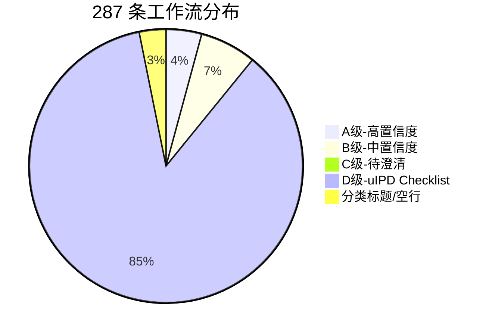
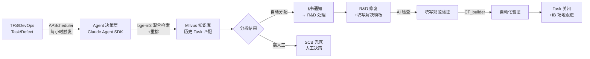
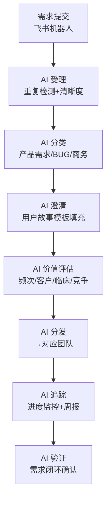
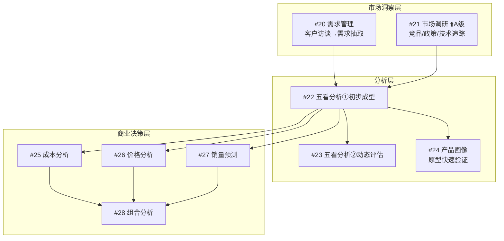
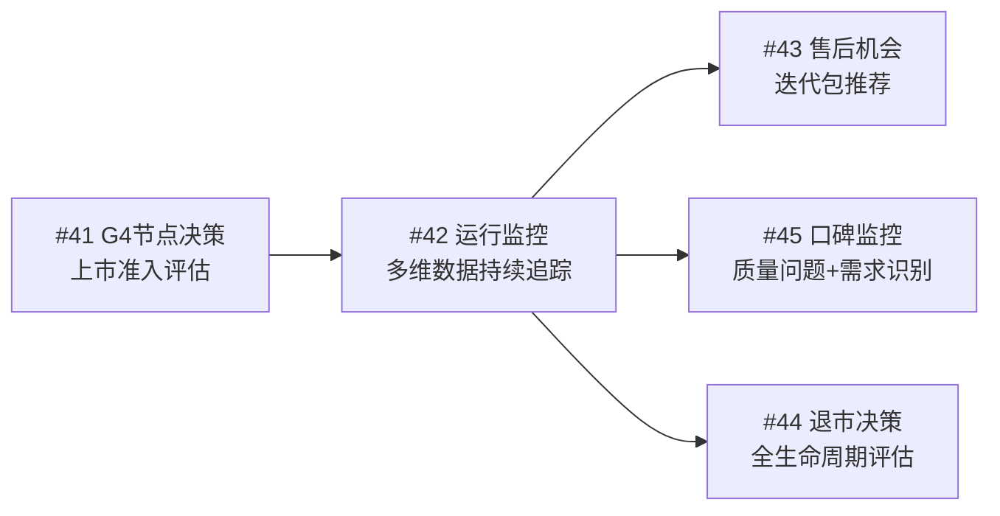
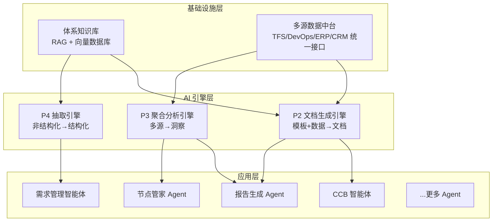
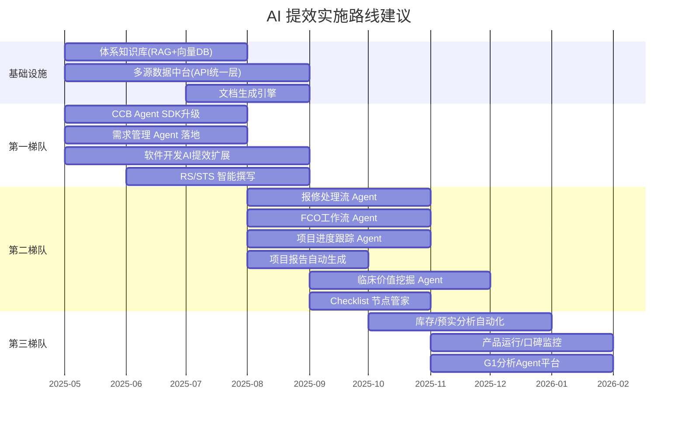

> 历史研究归档 · 2026-11-10 发布 · 发布审核状态：scan_only（发布前程序化隐私扫描）。原有日期、观点、数据和命令保留历史语境，未经本次逐项事实核验或运行复现；见[归档说明](../../../ARCHIVE_POLICY.md)。

# 研发工作流 AI 提效机会全量分析报告

> **一句话概括**：对 287 条研发工作流进行全量分析，识别出 **12 个 A 级（高置信度）**、**19 个 B 级（中置信度）**、**2 个 C 级（待澄清）** AI 提效机会，以及 **245 条 uIPD Checklist** 聚合出的 **5 个跨域平台级 AI 机会**；另有 9 条分类标题行不纳入分析。
>
> **分析日期**：2025-04-23（更新：2026-04-23 补充 #9 软件功能开发流、#13 FCO、#14 项目进度、#21 市场调研文档后升级为 A 级）
> **数据来源**：飞书多维表格「研发工作流清单-价值流」（287 条全量），外加 16 篇链接文档（成功读取 14 篇，2 篇权限不足）
> **分析方法**：主 Agent 数据采集 + 3 个 SubAgent 并行分析（文档读取 / 核心工作流分析 / Checklist 聚合分析）

---

## 目录

- [一、数据全景与分析方法论](#一数据全景与分析方法论)
- [二、A 级 — 高置信度 AI 提效机会（12 条）](#二a-级--高置信度-ai-提效机会12-条)
- [三、B 级 — 中置信度 AI 提效机会（19 条）](#三b-级--中置信度-ai-提效机会19-条)
- [四、C 级 — 待澄清项（2 条）](#四c-级--待澄清项2-条)
- [五、uIPD Checklist 聚合分析（245 条 → 14 个流程域）](#五uipd-checklist-聚合分析245-条--14-个流程域)
- [六、跨工作流共性 AI 能力矩阵](#六跨工作流共性-ai-能力矩阵)
- [七、整体优先级与实施路线图](#七整体优先级与实施路线图)
- [八、下一步行动项](#八下一步行动项)

---

## 一、数据全景与分析方法论

### 1.1 数据全景

| 类别 | 数量 | 特征 |
|------|------|------|
| A 级 | 12 | 有文档已读取 + 有用户故事或详细流程描述 + 可推断完整数据流 |
| B 级 | 19 | 有用户故事但较笼统，或文档未能读取 |
| C 级 | 2 | 仅有名称或模板占位符，信息不足以判断 |
| D 级 | 245 | uIPD Checklist 活动，按流程域聚合分析 |
| 标题行 | 9 | #7/#8/#17 无用户故事空行 + #47-#52 分类标题，不含业务内容 |

### 1.2 文档读取情况

| 状态 | 数量 | 涉及工作流 |
|------|------|-----------|
| ✅ 成功读取 | 14 篇 | #1(×2), #6(×2), #9, #11, #13, #14b, #16, #18, #19, #21, #31, #37 |
| ❌ forbidden | 2 篇 | #12 ECCB, #14a PDSG |
| ❌ not found | 0 篇 | — |

### 1.3 分级标准

| 级别 | 信息完整度 | AI 提效判断 | 行动 |
|------|-----------|------------|------|
| **A** | 有文档已读取 + 有用户故事或详细流程描述 + 输入/输出/系统明确 | 输出完整数据流分析 | 可直接进入技术方案阶段 |
| **B** | 有用户故事但缺细节，或有链接但未读到 | 有方向，需验证 | 标注需补充的信息 |
| **C** | 仅有名称/链接，无故事 | 无法判断 | 列出需求澄清清单 |
| **D** | uIPD Checklist 条目 | 单条太细，需聚合 | 按流程域整合后评估 |

### 1.4 AI 提效模式定义

| 代号 | 名称 | 说明 |
|------|------|------|
| **P1** | 智能分类与路由 | 根据内容自动分类、分发、流转 |
| **P2** | 文档智能生成 | 基于模板和数据源自动生成结构化文档 |
| **P3** | 多源数据聚合分析 | 从多个系统提取数据并生成洞察 |
| **P4** | 信息抽取与结构化 | 从非结构化文本中提取关键信息 |
| **P5** | 智能检索与知识问答 | 基于知识库的问答和检索增强 |
| **P6** | 持续监控与预警 | 周期性数据采集、分析、异常检测 |

---

## 二、A 级 — 高置信度 AI 提效机会（12 条）

### A1. #1 CCB 处理流 ⭐首批试点 — 已上线，正在升级

**信息完整度** ★★★★★ | **AI 提效置信度** ★★★★★

**痛点**：R2 节点后 task 数量庞大（CT 年处理 11,530 条，库存 14,846 条），CCB 会议每天 1 小时×6 角色，流转和分析耗费巨大人力。

| 维度 | 内容 |
|------|------|
| **输入** | TFS/DevOps 中的 task 和 defect 工单（描述/附件/日志）；历史 CCB 决策记录 |
| **涉及系统** | TFS（CT/CO/MI/MR 等）、Azure DevOps（超声/HSI）、飞书、Milvus 向量数据库 |
| **AI 处理** | ①APScheduler 每小时拉取新工单 ②bge-m3 混合检索+重排匹配历史案例 ③LLM 分析根因+推荐解决方案 ④自动流转至对应负责人 ⑤填写规范检查 ⑥验证结果校验 |
| **输出** | 自动分类分发结果、问题分析报告、推荐解决方案、状态更新、飞书通知（11 个节点） |
| **提效预估** | CCB 会议 1h/天×6 角色→0；自动化团队 8h/天→0。短期 2026 部分接管，长期 2027 年 95% 接管 |
| **当前状态** | CT 已上线 Dify 方案，正在升级为 Claude Agent SDK 多 BU 统一框架 |

---

### A2. #6 需求管理流 ⭐首批试点 — 技术方案已完成

**信息完整度** ★★★★★ | **AI 提效置信度** ★★★★★

**痛点**：需求受理、澄清、价值评估环节人力密集，MR BU 仅受理+澄清+评估就年耗约 2,450 人时。

| 维度 | 内容 |
|------|------|
| **输入** | 需求描述（自然语言）、历史需求池、IB Task 记录、产品线知识图谱 |
| **涉及系统** | 飞书 Project、IB Task 多维表格、Milvus+PostgreSQL+Neo4j+Redis+Kafka |
| **AI 处理** | 8 个子流程全覆盖：创建→受理→分类→澄清→评估→分发→追踪→验证 |
| **输出** | 结构化需求卡片、价值评估报告、分发决策、追踪看板、周报 |
| **提效预估** | 受理 350h→<50h、澄清 1,400h→<200h、评估 700h→<100h（仅 MR BU） |
| **技术方案** | Claude Agent SDK + 飞书机器人 + Skill Hub(GitLab) + 三层记忆架构 |

---

### A3. #11 报修处理流 — 全流程 Agent 节点已标注

**信息完整度** ★★★★☆ | **AI 提效置信度** ★★★★★

**痛点**：从服务请求到问题归档全链条流程，涉及多系统多角色（纷享销客/飞书/TFS/DevOps），手工流转效率低、日志分析耗时。

| 维度 | 内容 |
|------|------|
| **输入** | 客户电话/工单描述、设备运行日志、CRM 工单数据、历史维修案例 |
| **涉及系统** | 纷享销客 CRM、飞书多维表格、TFS/DevOps、不良事件监测系统 |
| **AI 节点**（文档中红标 🔴） | ①工单自动分配 ②时效监控预警 ③日志智能分析 ④知识库语义检索 ⑤IB 群自动创建 ⑥自动分发研发 ⑦工单自动归档 ⑧评审数据汇总 ⑨PC 单信息维护 |
| **输出** | 自动分配工单、日志分析报告、推荐解决方案、预警通知、归档记录 |
| **提效预估** | 工单流转时间减少 50%+、日志分析时间减少 80%+ |

---

### A4. #16 研发库存分析和处理流 — 数据中台+智能预警

**信息完整度** ★★★★☆ | **AI 提效置信度** ★★★★☆

**痛点**：财务需手工从 MES/SAP 导出 1 万+条 Excel 数据，逐条补全归属信息，数据孤岛严重、分析滞后。

| 维度 | 内容 |
|------|------|
| **输入** | MES 库存数据、SAP/ERP 物料数据、项目归属信息、历史库存变动记录 |
| **涉及系统** | SAP/ERP、MES、飞书表格、采购系统 |
| **AI 处理** | ①MES/SAP 自动拉取清洗 ②智能匹配归属（项目/部门/人） ③库龄+闲置+尾料分析 ④预警（超期/异常波动） ⑤自动生成 ST 报告 |
| **输出** | 实时库存看板、预警推送、分析报告、处置建议（报废/调拨/消耗） |
| **提效预估** | 手工 1 万+条 Excel→自动化；分析周期从月度→实时 |

---

### A5. #18 预实分析和管理流 — 预算全生命周期 AI 赋能

**信息完整度** ★★★☆☆ | **AI 提效置信度** ★★★★☆

**痛点**：预算编制→执行→差异分析全链条手工操作，多系统数据割裂，预实比对周期长。

| 维度 | 内容 |
|------|------|
| **输入** | 立项预算、年度预算、ERP 实际支出、OA 审批流水、SAP 成本中心 |
| **涉及系统** | 财务系统、ERP、OA 审批、SAP |
| **AI 处理** | ①自动汇总多源预算 ②实时监控月度执行 ③自动比对预实差异+标注异常 ④生成优化建议 ⑤审批自动校验 |
| **输出** | 预算汇总报表、预实差异分析报告、超支预警、优化建议 |
| **提效预估** | 月度预实分析从数天→自动生成；超支审批校验从人工→自动 |

---

### A6. #19 项目报告生成工作流 — ST 报告/周月报自动生成

**信息完整度** ★★★★☆ | **AI 提效置信度** ★★★★☆

**痛点**：ST 报告和周/月报需从多系统手动拉取数据，人工汇总排版，周期长且易出错。

| 维度 | 内容 |
|------|------|
| **输入** | ST 多维表格、BP、IB 库、TFS/DevOps Task 执行情况 |
| **涉及系统** | ST 多维表格、BP（业务规划）、IB 库、TFS/Azure DevOps |
| **AI 处理** | ①多源数据自动拉取 ②甘特图自动生成 ③HOT Issue 自动识别 ④偏差趋势分析 ⑤报告模板自动填充 |
| **输出** | ST 报告（PPT/文档）、周报/月报、HOT Issue 列表、偏差分析图表 |
| **提效预估** | 报告生成从 1-2 天/次→<1 小时；消除人工搬运错误 |

---

### A7. #31 RS/STS 撰写+Feature 规划 — 提效 75%

**信息完整度** ★★★★★ | **AI 提效置信度** ★★★★★

**痛点**：RS/STS/Feature 文档涉及多角色(PRODM/CAE/PMK/SCM/CS/SSE/系统工程师/PM)多轮评审，单流程总耗时 8-11 天。

| 维度 | 内容 |
|------|------|
| **输入** | 立项材料（市场/竞品/需求/供应链/服务策略）、历史 RS/STS 文档、模板 |
| **涉及系统** | TFS/DevOps、文档管理系统 |
| **AI 处理** | ①从立项材料抽取需求要点 ②按模板自动生成 RS 各章节初稿（8 角色分工） ③Feature 自动拆分+优先级 ④STS 测试规格生成 ⑤评审意见整合 |
| **输出** | RS 文档初稿、Feature 清单及版本分配、STS 文档初稿、PDS 原型图 |
| **提效预估** | RS 3-5 天→1 天、Feature 2-3 天→0.5 天、STS 2-3 天→0.5 天，**总计提效约 75%** |

---

### A8. #37 临床价值挖掘 — 一般产品+创新产品双路径

**信息完整度** ★★★★☆ | **AI 提效置信度** ★★★★☆

**痛点**：临床价值挖掘依赖大量人工调研（竞品对比、文献检索、专家访谈），周期长、覆盖面有限。

| 维度 | 内容 |
|------|------|
| **输入** | 竞品参数库、前代产品参数、学术文献、临床指南、专家意见 |
| **涉及系统** | 竞品数据库、文献库（PubMed 等）、Research API |
| **AI 处理** | ①竞品参数自动填写+对比 ②新旧产品差异自动提取 ③文献语义检索+关键发现 ④科研合作方向推荐 ⑤发散联想（跨领域场景） |
| **输出** | 竞品对比矩阵、临床亮点报告、科研合作建议、验证方案草案、创新应用场景 |
| **提效预估** | 竞品调研从 2-3 周→2-3 天；文献调研覆盖面提升 10 倍+ |

---

### A9. #13 FCO 工作流 — 全流程提效场景已量化 🆕

**信息完整度** ★★★★★ | **AI 提效置信度** ★★★★★

**痛点**：FCO（现场升级）涉及年度规划→策划→准备→发布→监控→变更→关闭全链条，手动跟踪进度（每周 12-16h）、成本估算误差 8-12%、方案撰写 8-12h/次、物料跟踪 22-33h/月。

| 维度 | 内容 |
|------|------|
| **输入** | SCR/DCN/ECO/CC/CAPA/NCP 触发源、纷享销客工单、装机设备列表、物料 BOM、历史 FCO 数据 |
| **涉及系统** | PLM（Windchill）、ERP（SAP）、纷享销客 CRM、Solar 平台、飞书多维表格 |
| **AI 处理** | ①执行状态实时跟踪+异常预警（提效 80-85%）②范围与成本自动预估（误差≤2%）③多方案自动生成+对比推荐（4-6h→≤1.5h）④物料状态自动跟踪+缺货预警（提效 90%+）⑤FCO 文件自动准备+上传校验（提效 75-80%）⑥变更影响自动评估 |
| **输出** | 每日进度报告、成本明细表、多套可行方案对比、物料状态看板、FCO 文件包、周度总结报告 |
| **提效预估**（文档已量化） | 进度跟踪 12-16h/月→≤2h；成本估算误差 8-12%→≤2%；方案生成 8-12h→≤1.5h；物料跟踪 22-33h/月→≤2.2h；文件准备返工率 15%→≤2% |

---

### A10. #14 项目进度跟踪流(软件) — 痛点极详细，6 大提效场景 🆕

**信息完整度** ★★★★★ | **AI 提效置信度** ★★★★★

**痛点**：项目计划散落在飞书/Project/TFS/DevOps/Windchill 多处，无法体现依赖关系；PDSG 会议材料需从 6+ 系统手动汇总；进度偏差和风险只能每周人工核对。

| 维度 | 内容 |
|------|------|
| **输入** | 项目计划（飞书/MS Project）、TFS Task、DevOps PBI、Windchill 文档状态、IB 问题、测试报告、CodeBeamer 数据 |
| **涉及系统** | 飞书（任务/云文档）、TFS、Azure DevOps、Windchill PLM、CodeBeamer、MS Project |
| **AI 处理** | ①多源任务数据自动聚合看板 ②关键路径识别+完工时间预测 ③PDSG 会前材料自动汇总（从 6 个系统拉取）④计划变更影响自动推演 ⑤项目信用积分自动计算 ⑥跨 BU 依赖变更自动通知 |
| **输出** | 项目健康度看板（多色风险标识）、PDSG 汇报 PPT、偏差应对措施表、关键路径图、绩效度量报告、自动提醒通知 |
| **提效预估** | PDSG 会前准备从数小时→自动生成；进度跟踪从每周人工核对→实时看板；风险识别从滞后发现→实时预警 |
| **文档中明确的需求** | ①统一项目管理工具 ②标准模板自动检查 ③团队信用积分 ④进度可视化看板 ⑤跨 BU 变更通知 ⑥版本健康度视图 |

---

### A11. #21 市场调研（看竞争/对手） — 五阶段全链路智能化 🆕

**信息完整度** ★★★★★ | **AI 提效置信度** ★★★★★

**痛点**：竞争情报采集依赖产品经理个人经验，检索机制主观偏差大、覆盖不全；多源数据（FDA/NMPA/专利/临床等）跨语言跨格式处理困难；数据筛选、归一化、验证全靠人工；分析以描述性统计为主缺乏预测能力；报告形式单一、监测滞后、知识难沉淀。

| 维度 | 内容 |
|------|------|
| **输入** | FDA/NMPA 注册数据、专利文献、ClinicalTrials.gov 临床试验、竞品官网、行业报告、招投标数据、社交媒体、招聘信息、合作公告 |
| **涉及系统** | FDA/NMPA 数据库、专利局、PubMed、ClinicalTrials.gov、竞品知识图谱、智能爬虫集群 |
| **AI 处理**（5 阶段 15 个子活动） | ①范围确定：NLP 语义扩展检索+市场聚类识别竞品+关联图谱挖掘友商 ②数据收集：全网数据源自动发现+Deep Research 自适应检索+智能爬虫集群 ③信息提取：语义相关性评分筛选+归一化维度映射+多源交叉验证 ④建模分析：竞品技术画像+全局态势预测+多智能体竞争仿真 ⑤结果输出：可视化叙事报告+实时监测分级预警+知识库迭代优化 |
| **输出** | 竞品对比矩阵、竞争格局可视化图谱、技术路线预测报告、竞品变化警报、影响评估简报、交互式仪表盘 |
| **提效预估** | 情报响应速度天级→分钟级；分析覆盖广度点状→全网；数据源从 20 个→200+；检索策略从季度级更新→周级自动优化；报告生成时间大幅缩短 |
| **文档中明确的技术方案** | NLP 语义扩展(BioBERT/PubMedBERT)、协同过滤+BERTopic 关键词推荐、强化学习(PPO/DQN)检索策略优化、GNN 图神经网络竞争关系图谱、多智能体竞争仿真 |

---

### A12. #9 软件功能开发流 ⭐首批试点 — 26 个活动×8 个 BU 全量工时分析 🆕

**信息完整度** ★★★★★ | **AI 提效置信度** ★★★★★

**痛点**：软件功能开发全流程涵盖需求定义→方案设计→编码→测试→缺陷修复→发布 26 个活动，跨 8 个 BU（HSI/CT/MI/MR/RT/XR/US/CO）。编码占均 28.8%、手动测试执行 22.4%、需求验证 15.8%、方案设计 15.5%、修复 13.3%——前 5 项合计占工时 95.8%。

| 维度 | 内容 |
|------|------|
| **输入** | 产品经理需求、架构设计文档、代码仓库、测试用例集、缺陷库、自动化脚本框架、历史 Task 库 |
| **涉及系统** | TFS/Azure DevOps、IDE(VS/VS Code)、Git、CI/CD 流水线、测试框架、飞书 |
| **AI 处理**（26 个活动已按优先级排序） | ①编码：Copilot/Claude Code 辅助开发（**各 BU 已在用**）28.8%）②手动测试执行：多模态 UI 自动化测试/AITscene（开发中）22.4%）③需求验证：AI 智能回归（15.8%）④方案设计：Copilot+MCP 辅助架构（15.5%）⑤缺陷修复：Bug 诊断助手/SonarCube 修复助手（**已在用**）13.3%）⑥自动化脚本编写：AI 脚本生成（已开发）12%）⑦自测联调：智能环境部署+日志分析（11%）⑧用例设计：AI 生成测试用例（8.8%）|
| **输出** | 代码、测试用例、自动化脚本、缺陷分析报告、测试总结报告、接口文档、发布包 |
| **提效预估** | 编码效率提升 30-50%（Copilot 已验证）；手动测试→多模态自动化（目标减少 60%+）；缺陷分析时间减少 50%+；自动化脚本编写效率提升 3-5倍 |
| **当前状态**（跨 BU 汇总） | Copilot/Claude Code：**8 个 BU 均已使用**；Bug 诊断助手：HSI 已使用；多模态 UI 测试(AITscene)：开发中；AI 脚本生成：HSI/XR 已开发 |

---

## 三、B 级 — 中置信度 AI 提效机会（19 条）

### B 级一览表

| 编号 | 工作流名称 | 提效模式 | 缺失信息 | 补充后预期 |
|------|-----------|---------|---------|-----------|
| #20 | 需求管理（市场侧） | P4+P5 | 访谈频次/工作量、与#6关系 | "访谈→需求卡片"自动化 |

| #22 | G1-市场分析①初步成型 | P3+P2+P5 | "五看"模板结构、数据源库 | "五看自动填充 Agent" |
| #23 | G1-市场分析②动态评估 | P6+P3 | 更新周期、预警规则 | 与#22合并为"五看持续运营 Agent" |
| #24 | G1-产品画像 | P2 | 原型精度要求、产品类型 | AI 辅助原型生成方案 |
| #25 | G1-成本分析 | P3+P2+P6 | API 可用性、分析维度定义 | "成本分析 Agent" |
| #26 | G1-价格分析 | P3+P6 | 公开数据源、历史交易数据 | 竞品价格监控+弹性模拟 |
| #27 | G1-销量预测 | P3+P6+P2 | 历史销量数据规模、区域定义 | ML 预测+LLM 报告生成 |
| #28 | G1-组合分析 | P3+P4 | Roadmap 格式、冲突定义 | "组合分析推演 Agent" |
| #32 | Feature 具体开发 | P6+P5+P1 | 注册法规知识库、Feature 管理系统 | "Feature 合规分析 Agent" |
| #33 | 注册材料提交 | P2+P5 | 注册模板结构、体系文档格式 | "注册材料生成 Agent"⚠️需严格人工审核 |
| #34 | 产品材料制作 | P2+P4 | 语种列表、Datasheet 模板 | 翻译+参数表生成（翻译可快速落地） |
| #35 | 市场宣传材料 | P2+P4 | 一致性规则、品牌规范 | 合规检查优先落地 |
| #36 | 转产打通 | P2+P4 | G1-G3 材料格式、转产 checklist | "转产合规 Agent" |
| #39 | 小批量 IB 管理 | P1+P4+P5 | IB 管理流程、反馈 SOP | 与#11 互补的"小批量 IB Agent" |
| #41 | G4 节点决策 | P3+P2 | G4 checklist、数据源映射 | "G4 决策准备 Agent" |
| #42 | 产品运行监控 | P6+P3+P2 | 数据源系统、监控频率 | "产品运营监控 Agent" |
| #43 | 售后机会判断 | P3+P1 | 装机数据库、迭代包目录 | "售后商机推荐 Agent" |
| #44 | 产品退市决策 | P3+P2+P6 | 退市触发规则、数据源映射 | 退市分析报告自动生成 |
| #45 | 口碑监控 | P6+P1+P3+P4 | 数据源、分层规则、与#11 关系 | "口碑监控 Agent" |

### B 级详细分析（按主题分组）

#### 主题一：G1 阶段市场与商业分析群（#20, #22-#28，共 8 条）

这 8 条工作流覆盖了 G1 阶段的市场分析、产品规划和商业决策全流程（#21 市场调研已升级为 A 级）：

**建议**：这 8 条存在强关联性，与已升级为 A 级的 #21 市场调研共同构成完整的 G1 分析链路，建议设计为统一的 **「G1 分析 Agent 平台」**，共享数据源和分析引擎。

#### 主题二：文档生成群（#31-#36，共 6 条）

| 工作流 | 文档类型 | AI 能力需求 | 共享能力 |
|--------|---------|-----------|---------|
| #31 RS/STS | 需求/测试规范 | 从立项材料→结构化文档 | 模板引擎 |
| #33 注册材料 | 法规注册文件 | 体系框架→注册文档 | 体系知识库 |
| #34 产品材料 | Datasheet/配置单 | 体系文件→参数表 | 体系知识库 |
| #35 宣传材料 | PPT/白皮书 | 体系→市场材料+合规检查 | 体系知识库+合规引擎 |
| #36 转产材料 | 培训/转移文档 | G1-G3→转产材料 | 跨阶段文档转换 |
| #32 Feature 开发 | 合规判定 | 法规库→注册路径 | 法规知识库 |

**建议**：统一建设 **「体系知识库」+ 「文档生成引擎」**，作为这 6 条工作流的共享基础设施。

#### 主题三：产品全生命周期监控群（#41-#45，共 5 条）

**建议**：共享 **产品全生命周期数据中台**（订单/毛利/MTBF/客户反馈/装机量），上层按场景差异化。

---

## 四、C 级 — 待澄清项（2 条）

| 编号 | 名称 | 已有信息 | 需要补充 |
|------|------|---------|--------|
| **#12** | ECCB 处理流 | 用户故事为模板占位符；文档 forbidden | ①与 #1 CCB 的区别 ②真实用户故事 ③处理频次和工作量 |
| **#38** | 客户早期反馈(客户 AI 助手) | story 为提问式（未明确需求） | ①“早期”指哪个阶段 ②AI 助手的目标用户 ③与 #39/#45 的边界 |

> **特别提醒**：#12 被标为首批试点或有技术方案，说明业务方认可其价值。建议优先补充该项信息，可能直接升级为 A 级。
> 
> **本次更新说明**：#9 软件功能开发流、#13 FCO、#14 项目进度跟踪、#21 市场调研已获得文档权限，内容极为详尽，已升级为 A 级。

---

## 五、uIPD Checklist 聚合分析（245 条 → 14 个流程域）

### 5.1 流程域聚合概览

| 域 | 名称 | 条目数 | G1前 | G1-G2 | G2-G3 | AI可能性 |
|----|------|--------|------|-------|-------|---------|
| D1 | 市场洞察与产品策略 | 26 | ✅ | ✅ | ✅ | **高** |
| D2 | 需求与功能规划 | 14 | ✅ | ✅ | | 中 |
| D3 | 项目管理与组织 | 28 | ✅ | ✅ | ✅ | 中 |
| D4 | 风险管理 | 28 | ✅ | ✅ | ✅ | **高** |
| D5 | 系统设计与技术开发 | 27 | ✅ | ✅ | ✅ | 中 |
| D6 | 质量管理 | 14 | ✅ | ✅ | ✅ | **高** |
| D7 | 测试与验证 | 16 | | ✅ | ✅ | **高** |
| D8 | 注册与法规合规 | 16 | ✅ | ✅ | ✅ | 中 |
| D9 | 知识产权管理 | 15 | ✅ | ✅ | ✅ | 中 |
| D10 | 供应链与制造 | 15 | ✅ | ✅ | ✅ | **高** |
| D11 | 服务与售后 | 9 | ✅ | ✅ | ✅ | 中 |
| D12 | 财务与商业分析 | 12 | ✅ | ✅ | ✅ | **高** |
| D13 | 文档与配置管理 | 11 | | ✅ | ✅ | 中 |
| D14 | 跨域协同与节点评审 | 14 | ✅ | ✅ | ✅ | **高** |

### 5.2 各流程域 AI 提效评估

| 域 | 流程域 | AI模式 | AI能做什么 | 前置条件 |
|----|--------|--------|-----------|---------|
| D1 | 市场洞察与产品策略 | P3,P5,P6,P2 | 自动抓取并分析市场/竞品/招标数据，生成"五看"分析报告初稿 | 市场数据源接口、竞品数据库 |
| D2 | 需求与功能规划 | P4,P3,P5 | 从客户访谈中自动抽取需求，多来源需求去重排优先级 | 需求管理系统、历史需求文档 |
| D3 | 项目管理与组织 | P3,P6,P2 | 聚合多维进度数据，识别关键路径偏差并预警 | 项目管理工具、资源管理系统 |
| D4 | 风险管理 | P3,P6,P1,P2 | 自动识别分级各类风险，基于历史数据预测趋势 | 历史风险数据库、外部数据源 |
| D5 | 系统设计与技术开发 | P2,P5,P4 | 辅助生成架构/接口规范初稿，检索复用历史方案 | 历史设计文档库、PLM/CAD系统 |
| D6 | 质量管理 | P3,P6,P4 | 汇总质量数据和现场问题，识别重复问题模式 | 质量系统、现场问题数据库 |
| D7 | 测试与验证 | P3,P1,P2,P6 | 汇总测试结果，智能分析 Defect，生成测试总结报告 | 测试管理工具、缺陷跟踪系统 |
| D8 | 注册与法规合规 | P5,P6,P4,P2 | 追踪各国法规变更，辅助生成注册材料初稿 | 法规数据库（FDA/NMPA/CE） |
| D9 | 知识产权管理 | P5,P6,P2 | 自动专利检索和 FTO 分析，监控竞品专利动态 | 专利数据库接口 |
| D10 | 供应链与制造 | P3,P6,P1 | 监控供应链状态，预警卡脖子风险，分析国产替代可行性 | ERP/MES系统、BOM数据 |
| D11 | 服务与售后 | P3,P5,P6 | 汇总服务网络覆盖差距，评估可服务性指标达成 | 服务工单系统、备件管理 |
| D12 | 财务与商业分析 | P3,P2,P6 | 整合多源成本/财务数据，生成商业可行性分析报告 | 财务系统（SAP等） |
| D13 | 文档与配置管理 | P2,P4,P1 | 检查 DHF/DMR 完整性，生成基线文档状态报告 | PLM/文档管理系统 |
| D14 | 跨域协同与节点评审 | P3,P1,P6 | 检查协同矩阵 checklist 完成状态，汇总各域准备度 | 各域系统数据接口 |

### 5.3 五大跨域平台级 AI 机会

#### 🏗️ 机会一：节点准入自动检查（Gate Readiness Auto-Check）

**覆盖范围**：245 条全覆盖 | **实施难度**：高 | **价值**：⭐⭐⭐⭐⭐

每次节点评审前，项目经理需逐条确认 245 条中对应阶段的完成状态（G1前 42 条、G1-G2 80 条、G2-G3 123 条），耗时巨大。

**AI 实现**：自动从各业务系统拉取每条 checklist 的完成状态 → 自动评估达标度（🟢已完成/🟡进行中/🔴未开始）→ 生成节点评审就绪度报告 → 预测节点通过概率 → 识别 TOP 阻塞项。

**预估价值**：将节点评审准备从**数周**压缩到**数小时**。

#### 📝 机会二：节点评审材料自动生成

**覆盖范围**：约 100 条文档产出项 | **实施难度**：中 | **价值**：⭐⭐⭐⭐⭐

**AI 实现**：基于各系统实时数据自动填充节点评审 PPT 模板 → 自动生成风险/质量/财务等章节 → 自动对比上一节点数据、高亮变化和偏差。

#### 🧠 机会三：智能节点管家（Gate Co-Pilot）

**覆盖范围**：245 条全覆盖 | **实施难度**：中低（可渐进） | **价值**：⭐⭐⭐⭐

**AI 实现**：项目经理的 AI 助手，随时查询任意 checklist 项状态 → 主动提醒即将到期交付物 → 自动调整优先级建议 → 回答"距 G2 还需完成哪些工作？"等自然语言问题。

#### 🔄 机会四：跨阶段一致性追踪

**覆盖范围**：约 80 条跨阶段重复项 | **实施难度**：中 | **价值**：⭐⭐⭐⭐

大量活动在三阶段重复出现（IP 三件套、风险管理、供应链策略等）。AI 自动追踪每个主题在不同阶段的演变一致性，偏离时预警。

#### 📊 机会五：项目健康度看板

**覆盖范围**：14 个域全覆盖 | **实施难度**：中 | **价值**：⭐⭐⭐⭐

14 域健康度实时看板，每域一个聚合评分。基于历史项目数据预测风险，自动识别"被忽视的域"。

---

## 六、跨工作流共性 AI 能力矩阵

### 6.1 能力需求热力图

| AI 模式 | 出现次数 | 核心工作流 |
|---------|---------|-----------|
| **P3 多源数据聚合分析** | 18 | #13,#14,#16,#18,#19,#21-#23,#25-#28,#37,#41-#45 |
| **P2 文档智能生成** | 19 | #9,#13,#14,#16,#18,#19,#21,#22,#24,#25,#27,#31,#33-#36,#41,#42,#44 |
| **P4 信息抽取与结构化** | 15 | #1,#6,#9,#11,#19-#21,#28,#31,#34-#37,#39,#45 |
| **P6 持续监控与预警** | 15 | #9,#11,#13,#14,#16,#18,#21,#23,#25-#27,#32,#42,#44,#45 |
| **P5 智能检索与知识问答** | 12 | #1,#6,#9,#11,#20-#22,#31-#33,#37,#39 |
| **P1 智能分类与路由** | 7 | #1,#6,#11,#32,#39,#43,#45 |

### 6.2 建议优先建设的平台级能力

**关键洞察**：建设 **「体系知识库」+「多源数据中台」** 两个基础设施，可以支撑上层 80% 的 Agent 应用。

---

## 七、整体优先级与实施路线图

### 7.1 三梯队实施优先级

| 梯队 | 工作流 | 理由 | 状态 |
|------|--------|------|------|
| 🥇 **第一梯队** | #1 CCB 处理流 | 已上线 Dify，正升级 Agent SDK，标杆案例 | 实施中 |
| 🥇 **第一梯队** | #6 需求管理流 | 技术方案完成，提效 2450 人时可量化 | 实施中 |
| 🥇 **第一梯队** | #9 软件功能开发流 | 8 个 BU 已用 Copilot，多项 AI 工具开发中 | 部分实施中 |
| 🥇 **第一梯队** | #31 RS/STS 撰写 | 提效 75%，模板化程度高，落地清晰 | 可立即启动 |
| 🥈 **第二梯队** | #11 报修处理流 | Agent 节点已标注，架构清晰 | 需技术方案 |
| 🥈 **第二梯队** | #13 FCO 工作流 | 全流程提效已量化，独立性强 | 需技术方案 |
| 🥈 **第二梯队** | #14 项目进度跟踪 | 痛点极详细，与 #19 互补 | 需技术方案 |
| 🥈 **第二梯队** | #19 项目报告生成 | 重复性高、快速见效 | 需技术方案 |
| 🥈 **第二梯队** | #21 市场调研 | 文档极详尽，5阶段15子活动全覆盖 | 需技术方案 |
| 🥈 **第二梯队** | #37 临床价值挖掘 | 知识密集型，AI 检索+分析优势大 | 需技术方案 |
| 🥈 **第二梯队** | #39 小批量 IB 管理 | 与 #11 互补，共享报修基础设施 | 需技术方案 |
| 🥈 **第二梯队** | Checklist 节点管家 | 投入小、见效快、可渐进 | 需设计 |
| 🥉 **第三梯队** | #16,#18 库存/预实 | 明确场景，需先打通数据源 | 需数据中台 |
| 🥉 **第三梯队** | #41-#45 全生命周期监控群 | 价值高但涉及系统多 | 需数据中台 |
| 🥉 **第三梯队** | #20,#22-#28 G1 分析群 | 信息需补充，建议统一设计 | 需需求澄清 |
| 📋 **储备** | #32-#36 文档生成群 | 需建设体系知识库后启动 | 需基础设施 |
| ❓ **待澄清** | #12,#38 | 信息不足 | 需需求补充 |

### 7.2 实施路线建议

---

## 八、下一步行动项

### 立即（本周）

| # | 行动 | 负责人建议 | 目的 |
|---|------|-----------|------|
| 1 | 开放 2 篇 forbidden 文档权限 | 文档所有者 | 解锁 #12/#14a 的分析 |
| 2 | 填写 #12 ECCB 真实用户故事 | 对应产品经理 | 当前为模板占位符 |
| 3 | 确认 #6 与 #20 的关系 | 需求管理负责人 | 两者URL重叠 |

### 短期（两周内）

| # | 行动 | 目的 |
|---|------|------|
| 4 | 12 个 A 级工作流输出详细技术可行性报告 | 进入方案设计阶段 |
| 6 | 19 个 B 级工作流按“缺失信息”列表向业务方发问卷 | 信息补充→升级为 A 级 |
| 7 | 启动「体系知识库」和「多源数据中台」的架构设计 | 基础设施先行 |

### 中期（一个月内）

| # | 行动 | 目的 |
|---|------|------|
| 8 | 收集 #1 CCB 试点运行数据作为 ROI 基线 | 为后续工作流提供投资参考 |
| 9 | 评估 TFS/DevOps/纷享销客/SAP 等系统的 API 可用性 | 数据中台可行性评估 |
| 10 | 组织 uIPD 流程专家 + AI 团队联合评审 Checklist 5 大机会 | 验证机会四/五的实际价值 |

---

## 附录：287 条工作流完整分级清单

点击展开完整清单

| 编号 | 名称 | 级别 | 有故事 | 有链接 | 有文档 |
|------|------|------|:------:|:------:|:------:|
| 1 | CCB处理流(首批试点) | A | ✅ | ✅ | ✅ |
| 6 | 需求管理流(首批试点) | A | | ✅ | ✅ |
| 7 | 注册文档流(首批试点) | — | | | |
| 8 | 体系文档流 | — | | | |
| 9 | 软件功能开发流(首批试点) | A | | ✅ | ✅ |
| 11 | 报修处理流 | A | | ✅ | ✅ |
| 12 | ECCB处理流 | C | ⚠️占位 | ✅ | ❌ |
| 13 | FCO工作流 | A | | ✅ | ✅ |
| 14 | 项目进度跟踪流(软件) | A | | ✅ | ✅ |
| 16 | 研发库存分析和处理流 | A | | ✅ | ✅ |
| 17 | 物料管理流 | — | | | |
| 18 | 预实分析和管理流 | A | | ✅ | ✅ |
| 19 | 项目报告生成工作流 | A | | ✅ | ✅ |
| 20 | 需求管理 | B | ✅ | ✅ | |
| 21 | 市场调研 | A | ✅ | ✅ | ✅ |
| 22 | G1-市场分析①初步成型 | B | ✅ | | |
| 23 | G1-市场分析②动态评估 | B | ✅ | | |
| 24 | G1-产品画像 | B | ✅ | | |
| 25 | G1-成本分析 | B | ✅ | | |
| 26 | G1-价格分析 | B | ✅ | | |
| 27 | G1-销量预测 | B | ✅ | | |
| 28 | G1-组合分析 | B | ✅ | | |
| 31 | RS/STS撰写+Feature规划 | A | ✅ | ✅ | ✅ |
| 32 | Feature具体开发 | B | ✅ | | |
| 33 | 注册材料提交 | B | ✅ | | |
| 34 | 产品材料制作 | B | ✅ | | |
| 35 | 市场宣传材料制作 | B | ✅ | | |
| 36 | 转产打通 | B | ✅ | | |
| 37 | 临床价值挖掘 | A | ✅ | ✅ | ✅ |
| 38 | 客户早期反馈 | C | ⚠️提问 | | |
| 39 | 小批量IB管理 | B | ✅ | | |
| 41 | G4节点决策 | B | ✅ | | |
| 42 | 产品运行监控 | B | ✅ | | |
| 43 | 售后机会判断 | B | ✅ | | |
| 44 | 产品退市决策 | B | ✅ | | |
| 45 | 口碑监控 | B | ✅ | | |
| 47-52 | 分类标题/空行 (6条) | 标题 | | | |
| 53-94 | G1及G1前 Checklist (42条) | D | | | |
| 95-174 | G1-G2 Checklist (80条) | D | | | |
| 175-297 | G2-G3 Checklist (123条) | D | | | |

---

> **报告生成信息**
> - 数据采集：lark-cli 从飞书多维表格读取 287 条全量数据（3 页分页）
> - 文档读取：14 篇成功 / 2 篇 forbidden
> - 分析架构：主 Agent 数据采集+协调 → SubAgent-B 读取 16 篇文档 → SubAgent-A 分析 33 条核心工作流 → SubAgent-C 聚合 245 条 Checklist
> - 分析局限：2 篇链接文档权限不足、uIPD Checklist 无用户故事、各系统 API 可用性未评估
