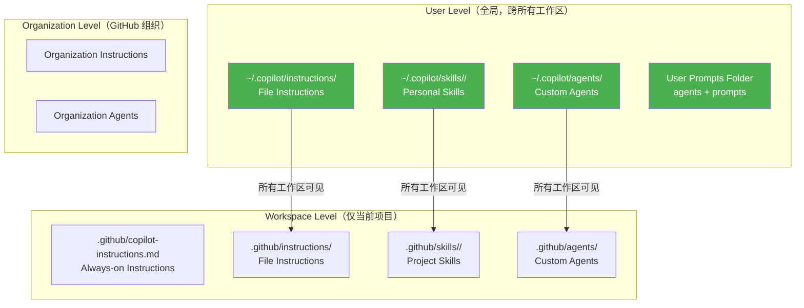

> 历史研究归档 · 2026-11-10 发布 · 程序扫描；未逐篇全文审阅。原有日期、观点、数据和命令保留历史语境，未经本次逐项事实核验或运行复现；请结合[归档说明](../../../ARCHIVE_POLICY.md)阅读。

# Copilot 全局自定义跨工作区复用方案研究

> 一句话概括：VS Code Copilot 提供了完整的三层作用域体系（User / Workspace / Organization），通过将通用质量规则提升到 User 级别的 `~/.copilot/` 目录，可以让所有新项目自动继承高质量产出规则。
> 研究日期：2026-04-12
> 关联报告：[Anthropic官方Skill-Creator设计哲学研究报告](../01-%E7%90%86%E8%AE%BA%E4%B8%8E%E6%9E%B6%E6%9E%84/R14_AnthropicSkillCreator%E8%AE%BE%E8%AE%A1%E5%93%B2%E5%AD%A6.md)、Agent-Skills与LLM-Wiki生态调研报告（原稿交叉引用，本归档未解析）

---

## 目录

- [§1 核心发现](#1-核心发现)
- [§2 VS Code Copilot 三层自定义体系](#2-vs-code-copilot-三层自定义体系)
- [§3 各原语的全局化路径](#3-各原语的全局化路径)
- [§4 当前工作区资产盘点与分类](#4-当前工作区资产盘点与分类)
- [§5 实施方案：全局化路线图](#5-实施方案全局化路线图)
- [§6 信息搜集方法论固化方案](#6-信息搜集方法论固化方案)
- [§7 实施清单与验证](#7-实施清单与验证)

---

## §1 核心发现

**VS Code Copilot（截至 2026-04）已提供完整的用户级全局自定义支持。** 核心机制是：将自定义文件放到用户主目录下的 `~/.copilot/` 路径，即可在所有工作区生效。

✅ **关键结论**：

1. **Custom Agents**（`.agent.md`）：已原生支持用户级。你的 `ai-research-expert.agent.md` 等已在 User Prompts 目录，所有工作区可用
2. **Instructions**（`.instructions.md`）：支持用户级路径 `~/.copilot/instructions/`，可通过 `applyTo` 控制适用范围
3. **Skills**（`SKILL.md`）：支持个人级路径 `~/.copilot/skills/<name>/`，`~/.agents/skills/<name>/`
4. **Always-on Instructions**（`copilot-instructions.md`）：**只有工作区级别**，不能全局化。替代方案是用 `.instructions.md` + `applyTo: "**"` 实现同等效果
5. **优先级**：User 级 > Workspace 级 > Organization 级
6. **Settings Sync**：用户级指令和 Agent 可通过 VS Code Settings Sync 在多设备间同步

---

## §2 VS Code Copilot 三层自定义体系



### 各路径一览

| 类型 | 用户级路径（全局） | 工作区级路径 | 说明 |
|------|-------------------|-------------|------|
| Custom Agents | `~/.copilot/agents/` 或 User Prompts | `.github/agents/` | `.agent.md` 文件 |
| Instructions | `~/.copilot/instructions/` | `.github/instructions/` | `.instructions.md` 文件 |
| Skills | `~/.copilot/skills/<name>/` | `.github/skills/<name>/` | 文件夹 + `SKILL.md` |
| Always-on | ❌ 不支持用户级 | `.github/copilot-instructions.md` | 用 `applyTo: "**"` 替代 |
| Prompts | User Prompts Folder | `.github/prompts/` | `.prompt.md` 文件 |
| Hooks | `~/.agents/hooks/` | `.github/hooks/` | 已配置 |

> **User Prompts Folder 路径**：`%APPDATA%\Code\User\prompts\`（你的实际路径：`C:/Users/USER\AppData\Roaming\Code\User\prompts\`）

---

## §3 各原语的全局化路径

### 3.1 Instructions（推荐：全局化的主力）

这是最灵活的全局化手段。`.instructions.md` 文件放到 `~/.copilot/instructions/`，可以：

- `applyTo: "**"` — 对所有文件生效（≈ 全局 always-on）
- `applyTo: "**/*.py"` — 仅对 Python 文件生效
- 无 `applyTo` — 按 `description` 语义匹配，按需加载

**关键设置**：`chat.instructionsFilesLocations`（确保 `~/.copilot/instructions` 为 `true`，默认已开启）

**优先级**：User Instructions > Workspace Instructions > Organization Instructions

**实用模式**：

```markdown
---
description: "通用代码质量规则，适用于所有文件和任务"
applyTo: "**"
---
# 通用质量规则
- 所有结论需标注数据来源或置信度
- 不重复已知信息，标注增量
...
```

### 3.2 Skills（全局化可复用能力）

放到 `~/.copilot/skills/<skill-name>/SKILL.md` 即可全局可用。

**注意点**：
- 文件夹名必须与 `SKILL.md` 中 `name` 字段一致
- Skills 是按需加载的，不会浪费任何 context window
- 可引用同目录下的脚本和资源

### 3.3 Custom Agents（已经全局化）

你的三个 Agent 已经在 User Prompts 目录，所有工作区可用：
- `ai-research-expert.agent.md` ✅
- `think-and-act.agent.md` ✅
- `dev-pipeline.agent.md` ✅

### 3.4 Settings Sync

VS Code Settings Sync 可以同步用户级指令文件到多设备。启用路径：

> Command Palette → `Settings Sync: Configure` → 勾选 `Prompts and Instructions`

---

## §4 当前工作区资产盘点与分类

### 从 copilot-instructions.md 提取的规则分类

| 规则 | 通用性 | 建议 |
|------|--------|------|
| 工作流 1-5（研究/产出/日志/汇总/行为分析） | ❌ 仅此工作区 | 保留在 workspace |
| 知识索引更新规范 | ❌ 仅此工作区 | 保留在 workspace |
| Obsidian 格式约定 | ❌ 仅此工作区 | 保留在 workspace |
| 质量约定（不重复/标注增量/交叉引用/数据优先） | ✅ 通用 | **提升到 User 级** |
| 自省机制（C1-C8） | ⚠️ 概念通用，细节需适配 | 提炼通用版 |
| 命名约定 | ❌ 仅此工作区 | 保留在 workspace |

### 从 AI Research Expert 提取的可全局化能力

| 能力 | 通用性 | 建议 |
|------|--------|------|
| 五阶段研究方法论 | ⚠️ 研究场景通用 | 保留在 Agent 中 |
| 方案探索五阶段 | ✅ 通用 | 保留在 Agent 中 |
| **信息搜集方法论**（调研 ≠ 只用模型语料） | ✅ 极其通用 | **固化到 Agent + 全局指令** |
| 行文风格 | ⚠️ 个人偏好 | 可提升到 User 级 |
| 质量直觉（实事求是/有骨气/知不知道） | ✅ 通用 | **提升到 User 级** |

### 工作区 Skills

| Skill | 通用性 | 建议 |
|-------|--------|------|
| `knowledge-base-organizer` | ❌ 仅此工作区 | 保留 |
| `skill-evaluator` | ⚠️ 有复用潜力 | 考虑全局化 |

---

## §5 实施方案：全局化路线图

### Step 1：创建 `~/.copilot/instructions/` 全局指令

**文件 1**：`quality-standards.instructions.md` — 通用质量标准

```markdown
---
description: "通用产出质量规则。提升 AI 输出的准确性、可追溯性和增量价值。"
applyTo: "**"
---
# 通用质量标准

## 实事求是
- 所有结论标注依据来源（数据、源码、文档链接）
- 有数据用数据说话，无数据标注"待验证"
- 局限性与优势同等重要——主动指出方案的天花板

## 增量优先
- 开始任务前，先检查已有成果，不做重复劳动
- 新产出明确标注"在已有 X 基础上，新增了 Y"
- 交叉引用已有知识，形成知识网络而非信息孤岛

## 诚实的不确定性
- 事实说"是"，推断说"因此"，观点说"我认为"，猜测说"这是猜测"
- 对比分析中给出明确推荐和理由，不甩一堆选项让用户自己挑
- 被质疑时重新审视推理链——逻辑漏洞就改，逻辑完整就坚持

## 成本意识
- 方案讨论时主动估算成本维度（Token、API 调用量、运维复杂度、人力投入）
- 技术可行但经济不可行的方案 = 不可行
```

**文件 2**：`research-protocol.instructions.md` — 调研行为规范

```markdown
---
description: "Use when: 调研, 研究, research, 调查, investigate, 分析市面方案, 技术选型, 方案对比, survey, 了解一下, 帮我看看"
---
# 调研行为规范

当用户要求"调研""研究""了解一下"时，必须综合多种信息来源，不能仅依赖模型训练语料。

## 信息来源优先级
1. **工作区已有知识**：先查已有报告和索引，避免重复劳动
2. **官方文档与源码**：使用 web fetch 获取官方文档、GitHub README、源码
3. **社区与专家洞察**：搜索技术博客、GitHub Issues/Discussions、Twitter/X 大V观点
4. **对比与验证**：找到多个独立来源交叉验证，标注信息来源和时效性

## 执行协议
- 不接受"据我所知"作为唯一来源——必须至少有一个外部信息源
- 对时效性敏感的信息（版本号、Stars 数、API 变更），必须实时获取
- 搜索无果时坦诚说明，而不是编造看似合理的信息
- 综合多来源时标注一致性：多源一致 = 高置信，来源矛盾 = 标注分歧
```

**文件 3**：`output-style.instructions.md` — 输出风格偏好

```markdown
---
description: "输出风格偏好，适用于较长的分析和报告类产出"
---
# 输出风格偏好

## 结构
- 每个章节以一句话结论开头（快速通道），正文展开推理链（深度通道）
- 复杂关系用 Mermaid 图（架构用 graph，流程用 sequenceDiagram）
- 对比分析用表格，不用散文

## 语言
- 中文为主，专业术语首次出现标注英文原文
- 精准但不学究，可以"说白了"但不油腻
- 善用类比把新概念锚到已知概念上
```

### Step 2：更新 AI Research Expert Agent

在 Agent 的"阶段一：信息追踪 · Radar"中增加**信息搜集执行协议**，明确要求使用 web 工具进行真实搜索。

### Step 3：可选 — 全局化 Skill

如果后续发现 `skill-evaluator` 等 Skill 在多个项目中用到，可以将其复制到 `~/.copilot/skills/skill-evaluator/`。

---

## §6 信息搜集方法论固化方案

### 问题定义

用户观察到一个行为模式：当说"调研一下"时，AI 往往**仅凭模型训练语料**给出"看起来像调研"的回答，而不是**真正去搜索市面上的信息**。这是 LLM 的一个已知局限——它倾向于用已有知识"模拟"搜索行为，而不是真正执行搜索。

### 解决方案：在 Agent 中硬编码搜索行为

在 AI Research Expert 的指令中，增加一个**信息搜集执行协议**（Information Gathering Protocol），明确规定：

1. **触发条件**：用户使用"调研""研究""了解一下""看看市面上""帮我查查"等触发词
2. **强制行为**：
   - 必须使用 `#tool:web/fetch` 或浏览器工具获取至少 2 个外部信息源
   - 必须搜索 GitHub（Stars、Issues、最近提交活跃度）
   - 必须搜索官方文档（而非凭记忆复述）
   - 时效性信息必须标注获取日期
3. **输出格式**：
   - 信息来源清单（URL + 获取日期 + 关键摘要）
   - 来源一致性分析（多源一致/矛盾）
   - 模型知识 vs 实时信息的标注

### 双层固化策略

| 层级 | 路径 | 作用 |
|------|------|------|
| **全局指令** | `~/.copilot/instructions/research-protocol.instructions.md` | 所有 Agent 都遵守的调研规范 |
| **Agent 增强** | `ai-research-expert.agent.md` 新增"信息搜集执行协议" | AI Research Expert 的强化版搜索行为 |

全局指令覆盖"基本调研意识"，Agent 增强覆盖"深入研究的具体方法论"。

---

## §7 实施清单与验证

### 需要创建的文件

| # | 文件路径 | 类型 | 状态 |
|---|---------|------|------|
| 1 | `~/.copilot/instructions/quality-standards.instructions.md` | 全局指令 | 待创建 |
| 2 | `~/.copilot/instructions/research-protocol.instructions.md` | 全局指令 | 待创建 |
| 3 | `~/.copilot/instructions/output-style.instructions.md` | 全局指令 | 待创建 |
| 4 | `User Prompts/ai-research-expert.agent.md` | Agent 更新 | 待更新 |

### 验证方法

1. 创建文件后，在 VS Code 中运行 `Chat: Open Chat Customizations`
2. 切换到 Instructions 标签，确认全局指令出现且标记为 "User"
3. 在**任意新工作区**中打开 Chat，输入 "/instructions" 或右键 → Diagnostics，确认全局指令已加载
4. 测试：在新工作区中对 AI Research Expert 说"研究一下 XX"，观察是否主动使用 web 搜索

### 注意事项

- `applyTo: "**"` 的全局指令会消耗 context window，保持精炼（建议每个文件 < 500 tokens）
- 全局指令是**最高优先级**，会覆盖工作区级同类规则
- Settings Sync 启用后，这些文件会自动同步到你的其他设备
