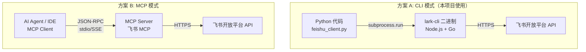
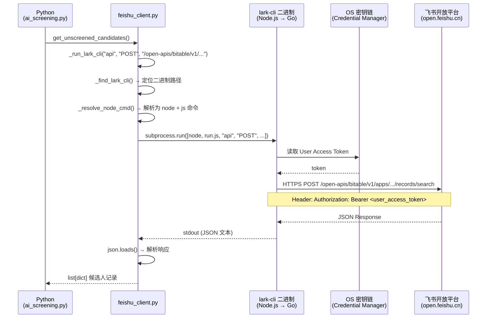
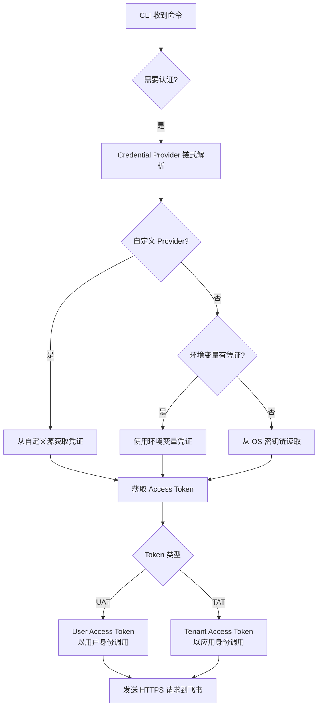
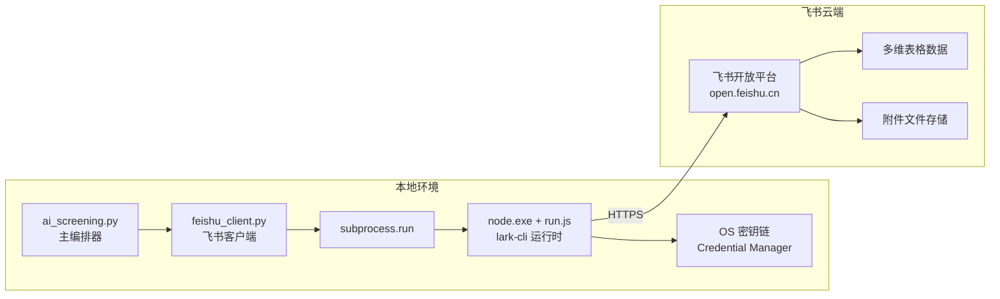

> 历史研究归档 · 2026-11-10 发布 · 发布审核状态：scan_only（发布前程序化隐私扫描）。原有日期、观点、数据和命令保留历史语境，未经本次逐项事实核验或运行复现；见[归档说明](../../../ARCHIVE_POLICY.md)。

# 飞书 CLI 与 MCP 通信机制调研报告

> 一句话概括：本文从架构原理、调用链路、使用方式三个维度，拆解飞书 CLI（lark-cli）和 MCP Server 两种 AI Agent 与飞书通信方案的本质区别，并结合本项目（简历筛选系统）的实际使用给出选型建议。
> 研究日期：2026-04-23
> 关联项目：AI 简历筛选系统（`feishu_client.py`）

---

## 目录

- [一、背景与问题](#一背景与问题)
- [二、飞书 CLI（lark-cli）是什么](#二飞书-clilark-cli是什么)
- [三、MCP Server 是什么](#三mcp-server-是什么)
- [四、CLI vs MCP 核心对比](#四cli-vs-mcp-核心对比)
- [五、飞书 CLI 调用原理深度拆解](#五飞书-cli-调用原理深度拆解)
- [六、本项目的实际使用方式](#六本项目的实际使用方式)
- [七、飞书 CLI 使用指南](#七飞书-cli-使用指南)
- [八、结论与最佳实践](#八结论与最佳实践)

---

## 一、背景与问题

本项目（AI 简历筛选系统）通过 `lark-cli` 与飞书多维表格交互，完成简历的拉取、附件下载、AI 评估结果回写等操作。用户提出三个问题：

1. 飞书 CLI 和 MCP 有什么区别？
2. CLI 怎么使用？
3. 整套调用原理是什么？

---

## 二、飞书 CLI（lark-cli）是什么

### 2.1 基本信息

| 属性 | 值 |
|------|-----|
| 全名 | `@larksuite/cli` |
| 维护者 | 飞书官方 larksuite 团队 |
| 开源协议 | MIT |
| GitHub | https://github.com/larksuite/cli |
| 当前版本 | v1.0.17（本机安装版本） |
| 安装方式 | `npm install -g @larksuite/cli` |
| 核心语言 | Go（编译为二进制）+ Node.js wrapper |
| 定位 | **Agent-Native 的飞书操作工具**——专为人类和 AI Agent 设计 |

### 2.2 设计哲学

飞书 CLI 的官方定位是"**给 Agent 一双操作飞书的手**"。它不是一个传统的 REST SDK，而是一个面向 AI Agent 优化的命令行工具，核心理念：

- **Agent-Native Design**：22 个 AI Agent Skills，可被 Claude Code、Cursor、TRAE 等 AI 工具直接使用
- **三层命令架构**：Shortcuts → API Commands → Raw API，覆盖从便捷操作到完整 API 调用的全谱段
- **AI-Friendly 输出**：结构化 JSON 输出、智能默认值、简洁参数设计，最大化 Agent 调用成功率
- **安全防护**：输入注入保护、终端输出清理、OS 原生密钥链存储凭证

### 2.3 三层命令体系

```
┌─────────────────────────────────────────────────┐
│  Layer 1: Shortcuts（快捷命令）                    │
│  前缀 "+"，人和 AI 都友好                          │
│  示例: lark-cli calendar +agenda                  │
│        lark-cli docs +fetch --doc <url>           │
│        lark-cli base +record-list --base-token XX │
├─────────────────────────────────────────────────┤
│  Layer 2: API Commands（精选 API 命令）            │
│  从飞书 OAPI 元数据自动生成，100+ 命令              │
│  示例: lark-cli calendar events instance_view     │
│        --params '{"calendar_id":"primary"}'       │
├─────────────────────────────────────────────────┤
│  Layer 3: Raw API（原始 API 调用）                 │
│  可调用飞书开放平台 2500+ 个 API                    │
│  示例: lark-cli api GET /open-apis/bitable/v1/... │
│        --params '{"page_size":"100"}'             │
└─────────────────────────────────────────────────┘
```

**说白了**：Layer 1 是"说人话"，`+agenda` 就是看日程；Layer 2 是"标准接口"，和飞书文档一一对应；Layer 3 是"万能后门"，飞书有的 API 它都能调。

### 2.4 覆盖的业务域

14 个业务域，200+ 命令：

| 域 | 能力 |
|----|------|
| 📅 日历 | 查日程、约会议、查忙闲、推荐时间 |
| 💬 消息 | 发消息、回复、群管理、搜索消息 |
| 📄 云文档 | 创建/读取/更新/搜索文档 |
| 📁 云空间 | 上传/下载文件、权限管理 |
| 📊 多维表格 | 表/字段/记录/视图/仪表盘/自动化 |
| 📈 电子表格 | 创建/读写/追加/查找/导出 |
| 🖼️ 幻灯片 | 创建/管理演示文稿 |
| ✅ 任务 | 创建/查询/更新/完成任务 |
| 📚 知识库 | 空间/节点/文档管理 |
| 👤 通讯录 | 搜索用户、查看部门 |
| 📧 邮箱 | 搜索/读取/发送/回复/归档 |
| 🎥 视频会议 | 会议记录、妙记 |
| 🕐 考勤 | 打卡记录查询 |
| ✍️ 审批 | 审批任务、审批/拒绝/转交 |

---

## 三、MCP Server 是什么

### 3.1 MCP 协议概述

MCP（Model Context Protocol）是 Anthropic 于 2024 年底提出的开放协议，旨在标准化 AI 模型与外部工具/数据源之间的通信。可以理解为"AI Agent 的 USB 接口"。

```
┌──────────────┐     MCP 协议      ┌──────────────┐
│              │  ←─ JSON-RPC ──→  │              │
│  AI Agent    │                   │  MCP Server  │
│  (Client)    │  Tools/Resources  │  (飞书/DevOps │
│              │  ←─ 标准接口 ──→   │   /GitHub...) │
└──────────────┘                   └──────────────┘
```

### 3.2 MCP 的核心概念

| 概念 | 说明 |
|------|------|
| **Server** | 暴露 Tools 和 Resources 的服务端，每个外部系统一个 Server |
| **Client** | AI Agent 端的 MCP 客户端（通常内嵌在 IDE/Agent 框架中） |
| **Tool** | Server 提供的可调用函数（如 `get_work_item`、`create_document`） |
| **Resource** | Server 提供的可读取数据源 |
| **Transport** | 通信层，支持 stdio / SSE / StreamableHTTP |

### 3.3 飞书 MCP 生态现状

飞书官方目前的策略是**以 CLI 为核心，MCP 为辅**：

- 飞书官方的 OpenClaw 插件底层就是基于 CLI 构建的
- 飞书 CLI 本身可以被任何 MCP Client 通过 subprocess 方式调用
- 社区有第三方的飞书 MCP Server 实现（如 `nicepkg/lark-cli`），但非官方维护

---

## 四、CLI vs MCP 核心对比

### 4.1 架构层面



### 4.2 多维对比表

| 维度 | 飞书 CLI | MCP Server |
|------|---------|------------|
| **通信协议** | subprocess 调用，返回 JSON | JSON-RPC 2.0（stdio/SSE） |
| **调用方** | 任何能执行 shell 命令的程序 | 实现了 MCP Client 的 AI Agent/IDE |
| **认证方式** | OAuth Device Flow（用户登录）或 App 凭证 | 取决于 Server 实现（PAT/OAuth/App 凭证） |
| **API 覆盖度** | 飞书全平台 2500+ API | 取决于 Server 封装了多少 Tool |
| **Agent 优化** | ✅ 专为 Agent 设计，22 个 Skills | ⚠️ 取决于 Server 实现质量 |
| **官方维护** | ✅ 飞书官方（larksuite 团队） | ❌ 多为社区实现 |
| **安装部署** | `npm install -g @larksuite/cli` | 配置 MCP Server（JSON 配置文件） |
| **适用场景** | 自动化脚本、Agent 工具调用、人工操作 | IDE 集成、Agent 框架原生集成 |
| **灵活性** | ⭐⭐⭐⭐⭐ 任何语言/环境都能用 | ⭐⭐⭐ 需要 MCP 兼容环境 |
| **实时性** | 一次调用一次返回 | 支持流式响应和事件订阅 |
| **凭证存储** | OS 密钥链（Keychain/Credential Manager） | 配置文件或环境变量 |

### 4.3 本质区别

**CLI 是工具，MCP 是协议。** 两者不在同一个抽象层：

- **CLI** 是一个**具体的可执行程序**，封装了飞书 API 的调用逻辑。你可以在终端里直接敲命令，也可以被 Python/Node 等语言通过 subprocess 调用。
- **MCP** 是一个**通信标准**，定义了 AI Agent 和外部工具之间的"握手语言"。任何系统都可以实现 MCP Server 来暴露自己的能力。

**类比**：
- CLI ≈ 一把万能螺丝刀（你拿起来就能拧螺丝）
- MCP ≈ 螺丝刀接口标准（定义了刀头的尺寸和形状，让不同品牌的刀头都能互换）

**二者可以共存**：飞书 CLI 可以被包装成 MCP Server（事实上社区已有这样的实现），MCP Client 也可以直接调用 CLI 命令。

---

## 五、飞书 CLI 调用原理深度拆解

### 5.1 整体调用链路

以本项目从飞书多维表格读取候选人记录为例，完整的调用链路如下：



### 5.2 各环节详解

#### 环节 1：Python → CLI 的桥接

本项目的 `feishu_client.py` 封装了所有与飞书的交互，核心函数是 `_run_lark_cli()`：

```python
def _run_lark_cli(*args, timeout=60, json_format=True):
    """执行 lark-cli 命令并返回解析后的 JSON"""
    lark_bin = _find_lark_cli()           # 1. 找到 lark-cli 可执行文件
    cmd = _resolve_node_cmd(lark_bin)     # 2. 解析为可执行命令
    cmd += list(args)                      # 3. 拼接参数
    if json_format:
        cmd += ["--format", "json"]        # 4. 强制 JSON 输出

    result = subprocess.run(cmd, capture_output=True, timeout=timeout)
    # 5. 解码输出（处理 GBK/UTF-8）
    # 6. 提取 JSON 部分
    # 7. 解析并返回
```

**为什么要 `_resolve_node_cmd()`？** 因为 Windows 上 npm 全局安装的 `lark-cli.cmd` 是一个批处理文件，通过 `cmd.exe` 执行时会把 JSON 中的 `|`、`&`、`<`、`>` 等字符误解为 shell 操作符。解决方案是直接调用 `node.exe` + JS 入口脚本，绕过 cmd.exe。

#### 环节 2：CLI 内部的认证体系



**OAuth Device Flow 登录流程**：

```
1. 用户运行: lark-cli auth login --scope "base:table:read ..."
2. CLI 向飞书申请 device_code，生成授权 URL
3. 用户在浏览器中打开 URL → 飞书登录 → 确认授权
4. CLI 轮询获取 user_access_token
5. Token 存入 OS 密钥链（Windows: Credential Manager）
6. 后续调用自动从密钥链读取，无需重复登录
```

#### 环节 3：CLI → 飞书 API 的 HTTP 请求

CLI 内部有一套完整的 HTTP 请求链：

```
CLI 构建请求
    │
    ├── Security Header 注入（X-Cli-*, User-Agent）
    ├── Authorization Header 注入（Bearer token）
    ├── Transport 中间件（可扩展：日志、监控、改写）
    ├── 重试逻辑（网络错误、频率限制自动重试）
    │
    ▼
飞书 Open API
    │
    ▼
CLI 处理响应
    ├── 自动分页（--page-all 自动翻页合并）
    ├── JSON 格式化输出
    └── 错误处理和提示
```

### 5.3 本项目中的具体调用路径

以 `get_unscreened_candidates()` 为例：

```
Python 调用层:
  feishu_client.search_records(app_token, table_id, filter_expr, field_names)

  ↓ 转化为

CLI 命令层:
  lark-cli api POST /open-apis/bitable/v1/apps/{app_token}/tables/{table_id}/records/search
    --data '{"filter":{"conjunction":"and","conditions":[{"field_name":"AI初筛","operator":"isEmpty","value":[]}]}}'
    --format json

  ↓ 转化为

HTTP 请求层:
  POST https://open.feishu.cn/open-apis/bitable/v1/apps/{app_token}/tables/{table_id}/records/search
  Authorization: Bearer u-xxxxxxxx
  Content-Type: application/json
  Body: {"filter": {...}}
```

### 5.4 完整的数据流图



---

## 六、本项目的实际使用方式

### 6.1 项目调用飞书的四大场景

| 场景 | feishu_client.py 函数 | CLI 层命令 |
|------|----------------------|-----------|
| 拉取未筛选候选人 | `get_unscreened_candidates()` | `api POST .../records/search` |
| 下载简历附件 | `download_attachment()` | `api GET .../medias/batch_get_tmp_download_url` |
| 回写 AI 评估结果 | `write_screening_result()` | `api PUT .../records/{id}` |
| 批量更新记录 | `batch_update_records()` | `api POST .../records/batch_update` |

### 6.2 认证配置

本项目使用 **OAuth 用户登录** 模式：

```bash
# 登录时申请所需权限
lark-cli auth login --scope "docx:document:readonly drive:drive:readonly wiki:wiki:readonly base:app:read base:record:read"

# 检查当前状态
lark-cli auth status
```

登录后 Token 存入 Windows Credential Manager，`feishu_client.py` 每次调用 `lark-cli` 时会自动使用。

### 6.3 为什么选 CLI 而非直接调飞书 SDK？

| 考量 | 直接用 SDK（HTTP 请求） | 用 CLI |
|------|----------------------|--------|
| Token 管理 | 需要自己实现刷新逻辑 | CLI 自动管理，密钥链存储 |
| API 变更适配 | 需要跟踪飞书 API 变更 | `lark-cli update` 一键升级 |
| 分页处理 | 需要自己写分页循环 | `--page-all` 自动处理 |
| 错误处理 | 需要自己解析错误码 | CLI 统一错误提示 |
| 开发效率 | 每个 API 都要查文档 | 命令行即文档 |
| Agent 协同 | 仅限代码调用 | 人和 AI 都能直接用 |

---

## 七、飞书 CLI 使用指南

### 7.1 安装

```bash
# 安装 CLI
npm install -g @larksuite/cli

# （可选）安装 AI Agent Skills
npx skills add larksuite/cli -y -g

# 初始化应用配置（首次使用）
lark-cli config init
```

### 7.2 认证

```bash
# 方式 1：推荐权限一键登录
lark-cli auth login --recommend

# 方式 2：按域登录
lark-cli auth login --domain calendar,base

# 方式 3：精确 scope 登录
lark-cli auth login --scope "base:app:read base:record:read drive:drive:readonly"

# 查看状态
lark-cli auth status

# 检查特定权限
lark-cli auth check --scope "base:record:read"
```

### 7.3 常用命令速查

**多维表格操作**（本项目核心）：
```bash
# 查看表列表
lark-cli base +table-list --base-token <token>

# 查看字段
lark-cli base +field-list --base-token <token> --table-id <id>

# 读取记录
lark-cli base +record-list --base-token <token> --table-id <id>

# 搜索记录
lark-cli base +record-search --base-token <token> --table-id <id>
```

**文档操作**：
```bash
# 读取文档
lark-cli docs +fetch --doc <url>

# 搜索文档
lark-cli docs +search --query "关键词"
```

**原始 API 调用**（万能方式）：
```bash
# GET 请求
lark-cli api GET /open-apis/bitable/v1/apps/<token>/tables/<id>/records --page-all

# POST 请求
lark-cli api POST /open-apis/bitable/v1/apps/<token>/tables/<id>/records/search \
  --data '{"filter":{"conjunction":"and","conditions":[...]}}'
```

### 7.4 输出控制

```bash
--format json       # 完整 JSON（默认，适合程序解析）
--format pretty     # 人类友好格式
--format table      # 表格格式
--format csv        # CSV 格式
--format ndjson     # 换行分隔 JSON（适合管道处理）
```

### 7.5 API 内省

```bash
# 查看 API 方法的参数、类型、所需权限
lark-cli schema calendar.events.instance_view
lark-cli schema im.messages.delete
```

---

## 八、结论与最佳实践

### 8.1 核心结论

1. **飞书 CLI 和 MCP 不是竞争关系，而是不同层次的东西**。CLI 是一个具体的工具，MCP 是一个通信协议标准。CLI 可以被包装成 MCP Server。

2. **对于本项目，CLI 方案是正确的选择**。原因：
   - 飞书官方维护，API 覆盖完整（2500+）
   - Token 管理自动化，不需要手动刷新
   - Python 通过 subprocess 调用简单可靠
   - 飞书 MCP Server 目前多为社区实现，稳定性和覆盖度不如官方 CLI

3. **调用链路清晰**：`Python → subprocess → node + lark-cli → HTTPS → 飞书 API`。每一层都有明确的职责边界。

### 8.2 适用场景建议

| 场景 | 推荐方案 | 原因 |
|------|---------|------|
| Python/Node 自动化脚本 | **飞书 CLI** | subprocess 调用最简单，覆盖完整 |
| VS Code/Cursor 中的 AI Agent | **飞书 CLI** | Agent Skills 原生支持 |
| IDE 内嵌 MCP 集成 | **CLI 包装为 MCP Server** | 兼得 MCP 标准和 CLI 覆盖度 |
| 企业级自定义 Agent 平台 | **CLI 扩展（Go 编译）** | Credential/Transport 扩展点灵活 |
| 多平台 Agent（飞书+企微+钉钉） | **各平台 MCP Server** | MCP 标准接口统一调用 |

### 8.3 本项目可改进方向

1. **错误处理增强**：当前 `feishu_client.py` 对 CLI 调用失败的重试策略可以更精细（区分网络错误、权限错误、频率限制）
2. **Token 过期检测**：可在调用前先 `lark-cli auth status` 检查 Token 有效性
3. **考虑 MCP 包装**：如果未来需要在其他 Agent 框架中复用飞书交互能力，可考虑将 `feishu_client.py` 包装为 MCP Server

---

📌 **来源清单**
- [飞书 CLI GitHub 仓库](https://github.com/larksuite/cli) — 官方源码和文档
- [飞书 CLI 官方介绍](https://open.feishu.cn/document/mcp_open_tools/feishu-cli-let-ai-actually-do-your-work-in-feishu) — 2026-04-17 更新
- [自研 Agent 接入飞书 CLI](https://open.feishu.cn/document/mcp_open_tools/feishu-cli/embed-feishu-cli-in-agent) — 2026-04-21 更新
- 本项目 `feishu_client.py` 源码分析 — 实际调用链路验证
- `lark-cli --help` / `lark-cli --version` — 本机 v1.0.17 实际输出

⚖️ 来源一致性：多源一致，高置信
📅 时效性声明：以上信息获取于 2026-04-23
